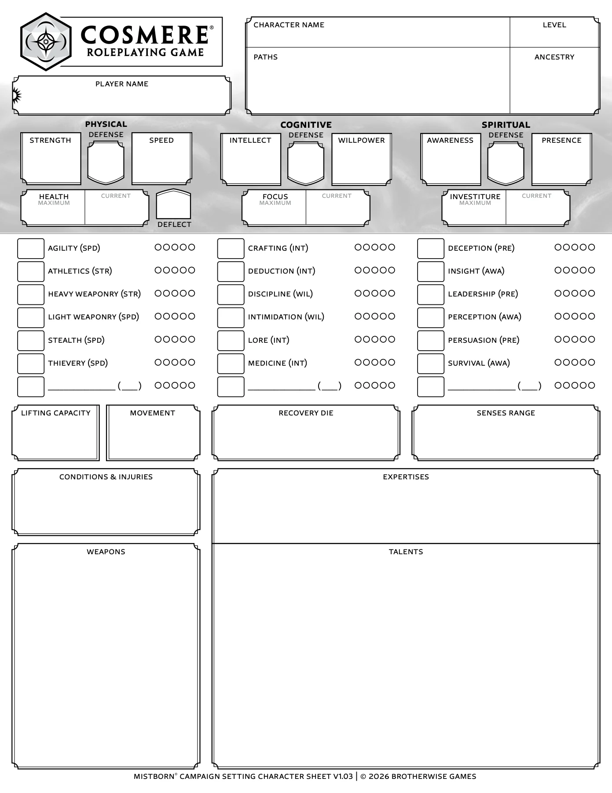
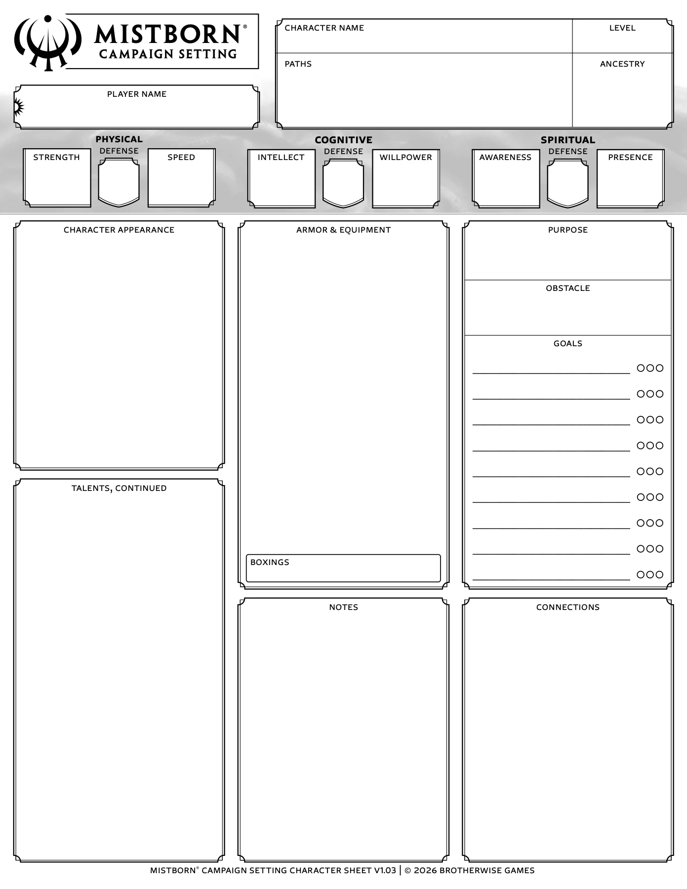

[下載迷霧之子繁中角色紙（可填寫 PDF）](../downloads/mistborn-character-sheet-zh-tw.pdf)

## 角色紙正面

| 玩家姓名 | 角色姓名 | 等級 | 路徑 | 血統 |
| --- | --- | --- | --- | --- |
|  |  |  |  |  |

| 力量 | 速度 | 智力 | 意志 | 察覺 | 風采 |
| --- | --- | --- | --- | --- | --- |
|  |  |  |  |  |  |

| 實體防禦 | 意識防禦 | 靈魂防禦 |
| --- | --- | --- |
|  |  |  |

## 資源

| 資源 | 上限 | 目前 |
| --- | --- | --- |
| 生命值 |  |  |
| 專注點 |  |  |
| 授予 |  |  |

偏轉值：______

## 技能

| 技能 | 屬性 | 數值 | 技能等級 |
| --- | --- | --- | --- |
| 敏捷 | SPD |  | ○ ○ ○ ○ ○ |
| 運動 | STR |  | ○ ○ ○ ○ ○ |
| 重型武器 | STR |  | ○ ○ ○ ○ ○ |
| 輕型武器 | SPD |  | ○ ○ ○ ○ ○ |
| 隱匿 | SPD |  | ○ ○ ○ ○ ○ |
| 竊術 | SPD |  | ○ ○ ○ ○ ○ |
| _____________ | ___ |  | ○ ○ ○ ○ ○ |
| 工藝 | INT |  | ○ ○ ○ ○ ○ |
| 推理 | INT |  | ○ ○ ○ ○ ○ |
| 紀律 | WIL |  | ○ ○ ○ ○ ○ |
| 威嚇 | WIL |  | ○ ○ ○ ○ ○ |
| 學識 | INT |  | ○ ○ ○ ○ ○ |
| 醫學 | INT |  | ○ ○ ○ ○ ○ |
| _____________ | ___ |  | ○ ○ ○ ○ ○ |
| 欺騙 | PRE |  | ○ ○ ○ ○ ○ |
| 洞察 | AWA |  | ○ ○ ○ ○ ○ |
| 領導 | PRE |  | ○ ○ ○ ○ ○ |
| 感知 | AWA |  | ○ ○ ○ ○ ○ |
| 說服 | PRE |  | ○ ○ ○ ○ ○ |
| 求生 | AWA |  | ○ ○ ○ ○ ○ |
| _____________ | ___ |  | ○ ○ ○ ○ ○ |

## 其他數值

| 恢復骰 | 舉重能力 | 移動速率 | 感知範圍 |
| --- | --- | --- | --- |
|  |  |  |  |

## 狀態與傷勢

___________________________

## 武器

___________________________

## 專長

___________________________

## 天賦

___________________________

迷霧之子® 戰役設定角色紙 v1.03 | © 2026 Brotherwise Games

## 角色紙背面

| 玩家姓名 | 角色姓名 | 等級 | 路徑 | 血統 |
| --- | --- | --- | --- | --- |
|  |  |  |  |  |

| 力量 | 速度 | 智力 | 意志 | 察覺 | 風采 |
| --- | --- | --- | --- | --- | --- |
|  |  |  |  |  |  |

| 實體防禦 | 意識防禦 | 靈魂防禦 |
| --- | --- | --- |
|  |  |  |

## 角色外貌

___________________________

## 護甲與裝備

___________________________

盒金：______

## 核心目的

___________________________

## 內在障礙

___________________________

## 短期目標

| 短期目標 | 進度 |
| --- | --- |
| ___________________________ | ○ ○ ○ |
| ___________________________ | ○ ○ ○ |
| ___________________________ | ○ ○ ○ |
| ___________________________ | ○ ○ ○ |
| ___________________________ | ○ ○ ○ |
| ___________________________ | ○ ○ ○ |
| ___________________________ | ○ ○ ○ |
| ___________________________ | ○ ○ ○ |
| ___________________________ | ○ ○ ○ |

## 天賦（續）

___________________________

## 備註

___________________________

## 人脈

___________________________

迷霧之子® 戰役設定角色紙 v1.03 | © 2026 Brotherwise Games

