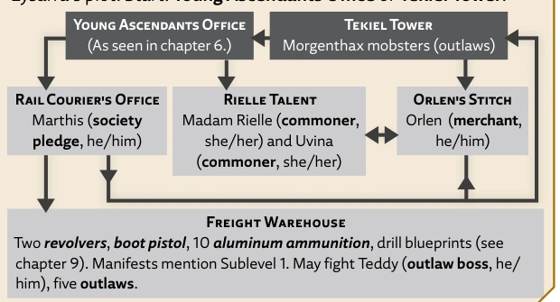

《迷霧之子傳承》GM 工具 v1.02

**準備。** 複習「NPC 檔案」中的 Lysarra Tekiel。PC 升至 6 級。

### 盯上太齊爾

PC 遭到負面報導。**企業家傳承。** 春季沙龍將於 10 天後舉行。這是取得下一塊鍍金地圖碎片，也就是午夜迷霧披風的機會。**時代跳躍。** NeBaal 擔心 Wilko。

#### 試煉：調查太齊爾（—／—）

找出進入沙龍的方法。PC 沒找到任何新線索時，記下一次失敗。為 Lysarra 的陰謀埋下伏筆。起點是 Young Ascendants 辦公室或太齊爾塔。

| 地點 | 線索與人物 | 線索去向 |
| --- | --- | --- |
| Young Ascendants 辦公室（見第 6 章） | 調查起點之一。 | 鐵路信使辦公室、Rielle 模特兒經紀公司。 |
| 太齊爾塔 | 調查起點之一；Morgenthax 歹徒（法外之徒）。 | Young Ascendants 辦公室、Orlen 的裁縫店。 |
| 鐵路信使辦公室 | Marthis（候補成員，他）。 | 貨運倉庫、Orlen 的裁縫店、太齊爾塔。 |
| Rielle 模特兒經紀公司 | Rielle 女士（平民，她）與 Uvina（平民，她）。 | Orlen 的裁縫店；兩地可互相追查。 |
| Orlen 的裁縫店 | Orlen（商人，他）。 | Rielle 模特兒經紀公司；兩地可互相追查。 |
| 貨運倉庫 | 兩把左輪手槍、一把靴筒手槍、10 發鋁彈藥和鑽機藍圖（見第 9 章）。貨運清單提到地下 1 層。可能與 Teddy（法外之徒首領，他）和五名法外之徒交戰。 | 貨運清單提供地下 1 層的線索。 |

**試煉進度，失敗**　＿＿＿＿＿＿

### 盛裝赴殺局

PC 最多有 10 天為沙龍做準備。

- **在 Orlen 店裡試衣。** 成功通過 DC 14 學識或工藝檢定，可備妥 Fellise Masque 風格的時裝，在伸展台上獲得一項優勢。**時代跳躍。**
- **沙龍前的休整。** 原有 10 天，調查中每次失敗扣 1 天。提醒玩家這是第二時代最後一次休整。
- **與死亡擦肩而過。** 鐵眼現身，為尾聲埋下伏筆。
- **角色升級。** PC 升至 7 級。
- **沙龍準備。** 說明沙龍時程。Wilko 擔心 NeBaal。

#### 戰鬥：Morgenthax 的威脅

若尚未在「調查太齊爾」中交戰，Teddy（法外之徒首領）與五名法外之徒會發動攻擊。進行團體 DC 17 感知檢定，否則歹徒會架防。

- **戰場效果。** 穿針引線。
- **結束。** Teddy 被擊敗。若時裝受損，需以 DC 18 工藝檢定修補。

### 時尚潛入（地圖 8.1）

Morgenthax 打手巡邏，Conrad 工程師架設纜線，Young Ascendants（平民）招待賓客並擔任司儀。

#### 對話：實習生 Marthis（意識防禦 13／靈魂防禦 14／專注點 4）

讓 Marthis 開口。若已完成相關目標，自動成功。**時代跳躍。** 若 PC 在第 6 章待他刻薄，一次失敗就會結束對話。

- **抵抗。** 背叛 Lysarra。
- **成功。** Marthis 說出自己的擔憂。

**專注點追蹤**　＿＿＿＿＿＿

#### 試煉：伸展台上的行動（—／—）

Fellise Masque 時裝秀。**時代跳躍。** 每名 PC 進行三次檢定，結果取決於成功次數。

**試煉進度，成功**　＿＿＿＿＿＿

### 拍賣行動

- **Merid 到場。** Merid 來確認 PC 的情況。
- **活板門與送餐升降機。** Conrad 特工藏在舞台下方，房間內有一座送餐升降機。
- **鍍金閒談。** Gilded Few 閒聊。Percival Haught 爵爺（平民，他）在場。
- **熱情招呼。** Lysarra 過來聊天，找安靜的 PC 或說書人。**說書人傳承。**
- **拍賣槌下。** 拍賣品是繁花扇、Robe of Silenced Steel與午夜迷霧披風。

#### [機遇] 事件：主宰拍賣

告訴玩家這個事件關乎拍賣，其實它是關於陷阱。

- **推進條件。** PC 花費 [機遇] 或成功搜索周圍。
- **觸發效果。** PC 找到陷阱，見「發現陷阱」。

**事件進度**　○ ○ ○ ○

PC 可以出價。長袍拍賣完後，拍賣提早結束。

### 翠綠結局

#### 試煉：屏住呼吸（6／—）

逃出充滿毒氣的房間。若已觸發事件，PC 起始時已有 2 次成功。

- **特殊規則：翠綠迷霧。** 每輪，角色受到 1d4 命力傷害。任何檢定失敗的 PC 也會受到 1d8 命力傷害。傷害時機及無須呼吸者的例外見[冒險正文的翠綠迷霧規則](/mistborn-zh-tw/legacy/fatal-fashion/an-emerald-ending/#特殊規則翠綠迷霧)。
- **特殊規則：中斷的拍賣。** PC 可以拿走午夜迷霧披風。
- **特殊規則：其他賓客。** PC 可以救 Merid 和 Marthis。

| 試煉進度 | 追蹤 |
| --- | --- |
| 成功 | □ □ □ □ □ □ |

**繼承人傳承。探索者傳承。**

#### 戰鬥：趕上列車（地圖 8.1）

Lysarra Tekiel 和 Eliane Vorn 隊長（或殺霧者精銳）在 T2 發動攻擊。**新手傳承。** 敵人在每輪開始時行動。

- **第一輪。** T1 有五名戴防毒面具的 Conrad 特工現身，取出尖刺並保護午夜迷霧披風。
- **第二輪。** 兩名法外之徒經走廊到 T2 參戰。
- **第三輪。** 兩名法外之徒搭電梯到 T2 參戰。
- **第四輪。** 發報機傳來消息，Lysarra 搭電梯逃離。本輪的 NPC 慢速輪次中，T1 的五名 Conrad 特工前往 T2 加入戰鬥。

- **戰場效果。** 玻璃帷幕、翠綠迷霧、自由落體、壁掛式發報機、電梯。
- **結束。** 若 PC 在 Lysarra 逃走前殺了她，可取得一枚血金尖刺（黃銅鎔金術）。否則 Vorn 會戰到死為止。無論哪種情況，都可取得 1,000 盒金、五具防毒面具和電梯密碼 1024。

**執法者傳承。**

**地下 1 層列車月台。** 密碼可通往地下 1 層。列車已經開走，留下鋅與紅銅血金尖刺。

**Wilko 遭綁架。** NeBaal 焦急不安。Wilko 遭綁架，日誌被偷走。三人組搶先趕往永恆寶庫。

《迷霧之子傳承》GM 工具 v1.02｜第 8 章：致命時尚

#### 第 8 章次要角色

| 姓名 | 讀音 | 代名詞 | 描述 |

| --- | --- | --- | --- |

| 鐵眼 | EYE-ern-eyes | 他 | 和諧的使者、鋼鐵審判者與死亡的化身，有些人稱他為沼澤。 |

| Ismara Buvidas | iss-MAR-uh BOO-vee-dass | 她 | Gilded Few 成員，出席埃拉瑞爾春季沙龍的貴女，熱愛時尚。 |

| Rielle 女士 | ree-ELL | 她 | Rielle 模特兒經紀公司的時髦老闆。 |

| Orlen | OR-len | 他 | 精明的克羅司混血，Orlen 裁縫店的老闆兼首席裁縫。 |

| Percival Haught | PER-sih-vul HOTT | 他 | Gilded Few 爵爺，出席埃拉瑞爾春季沙龍。 |

| Teddy | TED-ee | 他 | 替 Lysarra 效力、令人畏懼的 Morgenthax 小頭目。 |

| Uvina | oo-VEE-nuh | 她 | Young Ascendants 成員，Rielle 女士的助理。 |

### 敵手

| 場景 | 敵手 |

| --- | --- |

| 調查太齊爾 | 多名 Morgenthax 歹徒（法外之徒）、Rielle 女士與 Uvina（平民）、Marthis（候補成員）、Orlen（商人） |

| 貨運倉庫（第八區）或盛裝赴殺局 | 五名 Morgenthax 歹徒（法外之徒）、Teddy（法外之徒首領） |

| 時尚潛入 | 多名 Morgenthax 打手、多名 Conrad 工程師、Marthis（候補成員）、Merid（執法者）、Ismara Buvidas 貴女與 Percival Haught 爵爺（平民）、五名 Conrad 特工、Lysarra Tekiel、Eliane Vorn 隊長或殺霧者精銳 |

| 翠綠結局 | Merid（執法者）、Marthis（候補成員） |

| 趕上列車 | Lysarra Tekiel、Eliane Vorn 隊長或殺霧者精銳、多名 Morgenthax 歹徒（法外之徒）、五名 Conrad 特工 |

《迷霧之子傳承》GM 工具 v1.02｜第 8 章：致命時尚
### NPC 檔案

#### 扮演 Lysarra Tekiel

**性格** 沉著、工於心計、敏銳。**目標** 恢復太齊爾家族地位。**外貌** Lysarra Tekiel（讀作「lye-SAR-uh TEE-kee-ehl」，她）二十五歲上下，輪廓分明，目光銳利，深色頭髮優雅地側梳成捲，五官白皙銳利。她穿著低調，剪裁精緻。

Lysarra 通常是房裡最聰明的人，靠說服別人把她的想法當成自己的主意，成就許多事。她表面慷慨迷人又有耐心，心裡卻厭倦安撫有錢沒腦的男人。她雖喜愛伴侶 Eliane Vorn 隊長，最終仍只忠於自己，為成功不惜一切。

#### 扮演 Eliane Vorn 隊長

**性格** 強悍、威嚴、不可動搖。**目標** 保護 Lysarra 與國家檔案館。**外貌** Eliane Vorn（讀作「eh-lee-AH-nah VOHRN」，她）是雙生師人類，皮膚深棕，提早斑白的頭髮緊束腦後，神態傲慢自信。

Vorn 出生於 Morgenthax 犯罪家族，後來成為依藍戴警員，失去警徽後才接任國家檔案館警備隊長。Lysarra 說服 Kwylliam 雇用她，她從此與鍍金三人組合作。Vorn 是 Lysarra 的情人，也是她與依藍戴犯罪勢力的聯絡人。

#### 扮演 Azmine Wilko 教授

- **性格** 尊重他人、凡事以歷史為鑑、勤勉。
- **目標** 運用過往的知識改善未來。
- **外貌** Azmine Wilko（讀作「AZ-meen WILL-koh」，她）是一名克羅司混血女性，皮膚藍灰，下巴線條柔和，波浪髮用髮夾別起。她穿著符合教授身分的粗呢套裝，提著改裝過的皮革公事包。

Wilko 教授相信「人必須從歷史中學習」。她照字面實踐這項信念，用歷史事例建立自己的看法，並經常引用歷史名人的話。Wilko 想記錄 PC 的經歷，便在她戲稱「紅銅意識」的巨大日誌裡，以不同顏色分類記錄，留給後世的歷史學家。身為校園中唯一有克羅司血統的教授，她早就習慣被別人當成異類。她把教授的穿著與頭銜當作護甲，盡量避免衝突。Wilko 即使是祕密結社守護者組織的一員，也很不擅長說謊。

#### 扮演第二時代的 NeBaal

- **性格** 多疑、好奇、喜愛陰森的事物。
- **目標** 阻止 Gilded Few，重新學會信任。
- **外貌** 第二時代的 NeBaal 偏好男性外形，經常更換形體，但也常換回 PC 在第 6 章第一次帶來的骨骸。

第二時代的 NeBaal 希望有人能處理 Gilded Few，但這名坎得拉早已為此承受太多痛苦和損失。NeBaal 需要第二時代 PC 找到鍍金地圖，卻不願一直回想被囚禁的日子，也盡可能不與 Gilded Few 接觸，希望能好好療傷，繼續向前。錯過三個世紀的種種經歷後，NeBaal 迫不及待地探索依藍戴。NeBaal 對承諾保持戒心，怕每個承諾到頭來都會成為另一座牢籠，但也非常渴望找到值得信任的人。

#### 扮演 Merid

- **性格** 誠懇、理想主義、意志堅定。
- **目標** 避免永恆尖刺落入心術不正的人手裡。
- **外貌** Merid（讀作「MARE-id」，他）是一名高個子的泰瑞司執法者，赤陶色的皮膚襯著銀耳環和銀手鐲。他在橄欖色防塵長外套下穿著扣領襯衫，配著槍套。

Merid 在蠻橫區出生長大，始終保有雙親教給他的樂觀。他愛說笑，總想讓大家打起精神。他為了保護手無寸鐵的人當上執法者，與 Elanda Wilko 一起實現這個夢想。兩人查緝一處非法的 Gilded Few 據點時，無意中幫了守護者組織。守護者組織留下深刻印象，邀兩人加入。Elanda 婉拒，Merid 則接受了。

#### 扮演 Marthis Elariel／Tekiel

- **性格** 輕信、笨拙、愛裝男子漢。
- **目標** 通過午夜試煉，讓父母為自己驕傲。
- **外貌** Marthis（讀作「MAR-this」，他）是一名身材健壯的年輕男子，皮膚古銅，有一個鷹鉤鼻，黑髮修剪整齊。

Marthis 從小養尊處優，鮮少因自己的平庸吃苦。他的雙親都曾是千眼會的「眼」，他害怕讓他們失望。這種恐懼使他容易受人利用。Marthis 說話時虛張聲勢，把 Kwylliam 當成偶像。緊張時，他會來回踱步，用拳頭捶自己的手掌。

#### 商人

商人希望每次談話都能談成一筆有利的交易。他們用商業頭腦在壓力下保持上風，再用反駁行動逐步消耗角色的專注點。不過，商人並不想樹敵。談得不順利時，他們寧願妥協，也不願失去一條人脈。

商人很少備有適合作戰的裝備。一旦打起來，他們會立刻試著逃走，並用攻擊掩護撤退。

有的商人看重利潤，有的出於熱情，也有的是因為貪婪。無論動機為何，他們都透過買賣供應平常不容易取得的貨物。不誠實的商人只想中飽私囊，有時甚至會刻意讓貨物短缺，好哄抬價格，或明知對方心術不正，仍把貨物與金錢送到他們手中。不過，對一群英雄來說，買賣往往是必要的。找到一位可靠的商人合作，往往能改變局勢。

*階層（Tier）1 勁敵（Rival）— 中型類人生物*

力量 1、實體防禦 12、速度 1、智力 1、意識防禦 13、意志 2、察覺 2、靈魂防禦 14、風采 2。

生命值（Health）：18（15–21）

專注點（Focus）：4

授予（Investiture）：0

移動：25 呎

感知（Senses）：10 呎（視覺）

實體技能：輕型武器（Light Weaponry）+2

意識技能：工藝 +3、推理（Deduction）+2

靈魂技能：洞察（Insight）+4、感知（Perception）+3、說服（Persuasion）+4

特徵

商業頭腦（Business Acumen）。商人在一場對話（Conversation）中第一次抵抗影響（Influence）時，無須花費專注點。

營業存貨（Stock-in-Trade）。商人進行與自己專營貨品相關的檢定時，獲得一個優勢（Advantage）。這些貨品可以是火器、金屬或珠寶等。

意外到貨（Unexpected Acquisition）。每個場景一次，若一名 PC 在與商人對話時擲出[機遇]，商人的存貨中就有一件稀有或 PC 正需要的東西。

行動

[1行動] **打擊：臨時武器（Strike: Improvised Weapon）。** 攻擊 +2，觸及範圍 5 呎，造成 1d4 + 2 衝擊傷害（impact damage）。

[1行動] **打擊：短管手槍（Strike: Snub Nose Pistol）。** [第二時代] 攻擊 +2，距離 20/60 呎，造成 1d4 + 2 銳利傷害（keen damage）。穿刺（Pierce）：這次傷害無法以目標的偏轉值（Deflect）減少。裝填（Loaded）[6]：花費[1行動]將這把武器的彈藥補滿。

[2行動] **反駁（Counterargument）。** 商人進行說服檢定，對抗一名角色的靈魂防禦（Spiritual Defense）。成功時，目標失去 2 專注點。

《迷霧之子傳承》GM 工具 v1.02｜第 8 章：致命時尚

#### 法外之徒

*階層 1 嘍囉 — 中型類人生物*

力量 0、實體防禦 12、速度 2、智力 0、意識防禦 11、意志 1、察覺 2、靈魂防禦 13、風采 1。

生命值：11（9–13）

專注點：3

授予：0

移動：25 呎

感知：10 呎（視覺）

實體技能：敏捷 +4、輕型武器 +3、隱匿（Stealth）+3、竊術 +4

意識技能：紀律 +2、威嚇 +2

靈魂技能：感知 +3、求生（Survival）+3

特徵

伏擊者（Ambusher）。每個場景開始時，若法外之徒未措手不及（Surprised），便對自己能感知且靈魂防禦（Spiritual defense）最高的敵人進行隱匿檢定，對抗該敵人的靈魂防禦。成功時，法外之徒可以在第一個回合前使用[1行動]。失敗時，或無法感知任何敵人時，法外之徒可以在自己的第一個輪次將獲取優勢（Gain Advantage）作為[自由行動]使用。

嘍囉。法外之徒的攻擊無法造成致命一擊，且一旦受到傷勢就立即遭到擊敗。

行動

[1行動] **打擊：小刀。** 攻擊 +3，觸及範圍 5 呎或距離 20/60 呎，造成 1d4 + 3 銳利傷害。

[1行動] **打擊：短弓（Strike: Shortbow）。** 第一時代。攻擊 +3，距離 80/320 呎，造成 1d6 + 3 銳利傷害。

[1行動] **打擊：短管手槍（Strike: Snub Nose Pistol）。** 第二時代。攻擊 +3，距離 20/60 呎，造成 1d4 + 3 銳利傷害。穿刺：目標的偏轉值無法減少這次傷害。裝填[6]：花費[1行動]將這把武器的彈藥補滿。

[1行動] **粗暴滋事（Roughhousing，花費 2 專注點）。** 法外之徒進行威嚇檢定，對抗距自己 5 呎內一名目標的實體防禦。成功時，目標失去 1 專注點，並陷入迷惑（Disoriented），直到法外之徒的下一個輪次結束。

法外之徒戰術

法外之徒很少堂堂正正地打鬥，偏好設伏、以多欺少。伏擊者特徵讓他們立刻占得上風，能在敵人反應過來前先行射擊。若打成近戰，他們會用粗暴滋事讓目標陷入迷惑。主動開打的法外之徒往往會死戰到底。若是自己猝不及防，他們可能會試著逃走，等到有利時再度出擊。

#### 平民

**階層 1 嘍囉｜中型類人生物**

| 力量 | 實體防禦 | 速度 | 智力 | 意識防禦 | 意志 | 察覺 | 靈魂防禦 | 風采 |
| --- | --- | --- | --- | --- | --- | --- | --- | --- |
| 0 | 11 | 1 | 1 | 12 | 0 | 1 | 11 | 0 |

- **生命值** 10（8–12）　**專注點** 2　**授予** 0
- **移動** 25 呎　**感知** 10 呎（視覺）
- **實體技能** 運動 +1
- **意識技能** 工藝 +2
- **靈魂技能** 洞察 +2、感知 +2

**嘍囉。** 平民的攻擊無法造成致命一擊，且受到傷勢時會立刻被擊敗。

**能幹。** 平民具備一項職業的實用專長，在與該職業相關的檢定中獲得一項優勢。

[1行動] **打擊：臨時武器。** 攻擊 +1，觸及 5 呎，造成 1d4 + 1 衝擊傷害。

[反應] **分散注意（消耗 1 專注點）。** 盟友對位於平民觸及範圍內的敵人進行檢定時，平民使該盟友在檢定上獲得一項優勢。

**平民戰術。** 除非親近的人正面臨迫在眉睫的危險，平民在戰鬥中通常會逃跑並尋找安全處。被迫戰鬥時，通常用臨時武器打擊，或用「分散注意」幫助更有能力的盟友。對話中，平民通常會聽從自己認為比較有能力的人。

《迷霧之子傳承》GM 工具 v1.02｜第 8 章：致命時尚

#### 法外之徒首領

階層 1 首領，中型類人生物

| 力量 | 實體防禦 | 速度 | 智力 | 意識防禦 | 意志 | 察覺 | 靈魂防禦 | 風采 |
| --- | --- | --- | --- | --- | --- | --- | --- | --- |
| 3 | 15 | 2 | 2 | 16 | 4 | 4 | 17 | 3 |

**生命值** 55（44–66）　**專注點** 6　**授予** 0  
**偏轉值** 1（皮甲）　**移動** 25 呎　**感知** 20 呎（視覺）  
**實體技能** 運動 +5、重型武器 +5、輕型武器 +4  
**意識技能** 紀律 +6、威嚇 +6  
**靈魂技能** 領導 +5、求生 +6

##### 特徵

**伏擊者。** 每個場景開始時，若法外之徒首領未處於措手不及狀態，便進行一次隱匿檢定，對抗其能感知到的敵人中最高的靈魂防禦。成功時，首領可在第一回合開始前使用 [1行動]。如果失敗或感知不到任何敵人，首領可在自己的第一個輪次用 [自由行動] 執行「獲取優勢」。

**首領。** 法外之徒首領每回合可以各進行一個快速輪次和一個慢速輪次。敵人結束輪次後，首領可以花費 1 專注點，立即額外使用 [1行動] 或 [自由行動]。此外，首領可在自己的輪次花費 1 專注點，移除自身的一個狀態。

##### 行動

**[1行動] 打擊：小刀。** 攻擊 +4，觸及 5 呎或射程 20/60 呎，造成 1d4 + 4 銳利傷害。命中時，法外之徒首領還可花費 1 專注點，使目標陷入折磨［1d8］，直到目標恢復至少 1 生命值。

**[1行動] 打擊：長弓（第一時代）。** 攻擊 +5，射程 150/600 呎，造成 1d6 + 5 銳利傷害。命中時，法外之徒首領可花費 1 專注點，使目標陷入減速，直到目標的下一個輪次結束。

**[1行動] 打擊：卡賓槍（第二時代）。** 攻擊 +5，射程 80/320 呎，造成 1d8 + 5 銳利傷害。命中時，若法外之徒首領在這次攻擊中有至少一次優勢，還可使目標倒地。**穿刺。** 目標的偏轉值無法減免此傷害。**裝填 [4]。** 可用 [1行動] 將這把武器裝填至滿彈。

**[1行動] 不顧後果的攻擊。** 法外之徒首領執行一次承受劣勢的「打擊」行動。若使用具有裝填特性的武器，則額外消耗 1 發彈藥。若命中或擦傷，這次攻擊也會傷害目標 5 呎內除首領以外的所有角色，視同這次攻擊擦傷了那些角色。

**[2行動] 鼓動大夥。** 法外之徒首領對一個能影響的目標進行威嚇檢定，對抗其意識防禦。成功時，首領 60 呎內的所有盟友恢復 1d4 專注點。

**[2行動] 弟兄們，上！（消耗 2 專注點）。** 法外之徒首領命令 30 呎內每名能影響的盟友，只要辦得到，就用 [反應] 對一名敵人進行近戰攻擊。

**[反應] 別讓我失望（消耗 1 專注點）。** 法外之徒首領能影響的一名盟友攻擊未命中時，首領可讓該盟友重擲該次攻擊擲骰的 d20，有可能將未命中改為命中。盟友必須使用新的結果，並可在看見結果後選擇是否擦傷。

##### 機遇與變故

**機遇。** 敵人可以消耗 [機遇]，使法外之徒首領直到其下一個輪次結束前，無法使用「鼓動大夥」行動或「別讓我失望」反應。

**變故。** GM 可以消耗敵人檢定中的 [變故]，讓法外之徒首領以 [反應] 使用「弟兄們，上！」行動。

有些法外之徒首領行事殘暴，有些有著危險的魅力。他們召集志同道合的罪犯，控制地盤並擴張勢力。依藍戴的犯罪組織階層分明，指揮鏈也很長。法外之徒首領往往掌管一個分區，或領導一批手下，經驗老到。除了處理動武的差事，這些首領有時也負責行政工作，例如管理家族的合法生意。

#### 法外之徒首領戰術

法外之徒首領使用「弟兄們，上！」協調手下的行動。不把嘍囉死活放在心上的首領，會毫不猶豫地使用「不顧後果的攻擊」，朝混戰中的人群開火。戰鬥進行到後段，首領會用「鼓動大夥」幫法外之徒盟友恢復足夠的專注點，讓他們能造成擦傷或使用「粗暴滋事」行動。

《迷霧之子傳承》GM 工具 v1.02｜第 8 章：致命時尚
#### Conrad 工程師

**階層 1 勁敵｜中型類人生物**

| 力量 | 實體防禦 | 速度 | 智力 | 意識防禦 | 意志 | 察覺 | 靈魂防禦 | 風采 |
| --- | --- | --- | --- | --- | --- | --- | --- | --- |
| 1 | 14 | 2 | 3 | 15 | 2 | 3 | 14 | 1 |

- **生命值** 30（24–36）　**專注點** 4　**授予** 0
- **移動** 25 呎　**感知** 20 呎（視覺）
- **實體技能** 敏捷 +4、輕型武器 +4
- **意識技能** 工藝 +5、推理 +5、紀律 +4
- **靈魂技能** 感知 +5

##### 特徵

**能幹的工程師。** 工程師在與機械相關的檢定中獲得一項優勢。

##### 行動

**[1行動] 打擊：警棍。** 攻擊 +4，觸及 5 呎，造成 1d6 + 4 衝擊傷害。

**[1行動] 打擊：實驗型手槍。** 攻擊 +4，射程 20/80 呎，造成 1d6 + 4 銳利傷害。命中時，工程師可花費 1 專注點，將目標向遠離自己的方向推開 15 呎。穿刺：目標的偏轉值無法減免此傷害。裝填［8］：花費 [1行動] 將彈藥補滿。

**[2行動] 部署原型裝置（消耗 1 專注點）。** 工程師選擇自己能感知且在 15 呎內的一名角色，進行對抗其意識防禦的工藝攻擊檢定，擲 1d6 + 4 能量傷害。命中時，裝置困住目標，使其陷入定身和折磨［2d6 能量］，直到獲救。被困的目標或能觸及目標的角色可以使用技能，進行 DC 14 的敏捷或運動檢定。成功時，目標獲救。

**[2行動] 警鳴手榴彈（限用 1 次）。** 工程師把一個會發出刺耳警報聲、令人分心的裝置擲向 30 呎內能感知的一點。角色每次在裝置周圍 10 呎內花費專注點時，必須額外花費 1 專注點。能觸及裝置的角色可以使用技能，進行 DC 14 的運動或竊術檢定，成功便結束警報效果。

**Conrad 工程師戰術。** 工程師與敵人保持距離，用實驗型手槍維持間距，避開近戰後對最大威脅部署原型裝置，或向敵群投擲警鳴手榴彈。

#### 打手

打手行動迅速、莽撞而有效，從不臨陣退縮。他們會保護團隊中較弱的成員，用「猛衝」快速穿越戰場。第二時代的打手若無法靠近，可以用霰彈槍，但仍以進入近戰並用徒手打擊束縛敵人為首要目標。束縛敵人後，打手會用「折斷骨頭」重創單一目標，或用「臨場發揮」同時打倒多個敵人。若難以束縛目標，可以先用「擊倒」為下一次徒手打擊創造機會。

**階層 2 勁敵｜中型類人生物**

| 力量 | 實體防禦 | 速度 | 智力 | 意識防禦 | 意志 | 察覺 | 靈魂防禦 | 風采 |
| --- | --- | --- | --- | --- | --- | --- | --- | --- |
| 5 | 18 | 3 | 1 | 14 | 3 | 3 | 16 | 3 |

- **生命值** 45（36–54）　**專注點** 5　**授予** 0
- **移動** 30 呎　**感知** 20 呎（視覺）
- **實體技能** 運動 +7、重型武器 +6
- **意識技能** 威嚇 +6
- **靈魂技能** 感知 +6、求生 +5

##### 特徵

**猛衝。** 打手可以穿越敵人占據的區域，且不會因中型或更小的物體造成的困難地形而陷入減速。

##### 行動

**[1行動] 打擊：徒手。** 攻擊 +7，觸及 5 呎，造成 1d8 + 7 衝擊傷害。命中中型或更小的目標時，打手可使其陷入束縛，但解除此狀態前，打手無法攻擊其他目標。受束縛的目標可以花費 [2行動] 進行 DC 15 的敏捷或運動檢定，成功則解除束縛。

**[1行動] 打擊：霰彈槍（第二時代）。** 攻擊 +6，射程 20/60 呎，造成 1d10 + 6 銳利傷害。命中時也擦傷目標周圍 5 呎內每名角色。穿刺：目標的偏轉值無法減免此傷害。裝填［2］：花費 [1行動] 將彈藥補滿。

**[2行動] 折斷骨頭。** 打手對自己束縛的目標進行運動檢定，對抗其實體防禦。成功時，目標陷入以下其中一種狀態，直到打手下個輪次結束：迷惑、精疲力竭［−1］或減速。打手可花費 3 專注點，改為造成一處傷勢。

**[2行動] 臨場發揮。** 打手把自己束縛的敵人擲向距離自己 20 呎內的另一名敵人。打手進行運動攻擊，對抗兩個目標的實體防禦，擲 3d8 + 7 衝擊傷害。不論命中與否，被擲出的敵人都會倒地，落在另一名目標旁最近的未占據空間。

**[反應] 擊倒（消耗 1 專注點）。** 距離打手 5 呎內的大型或更小敵人以近戰攻擊命中打手後，打手使該攻擊者倒地。

《迷霧之子傳承》GM 工具 v1.02｜第 8 章：致命時尚

#### 候補成員

**階層 1 嘍囉｜中型類人生物**

| 力量 | 實體防禦 | 速度 | 智力 | 意識防禦 | 意志 | 察覺 | 靈魂防禦 | 風采 |
| --- | --- | --- | --- | --- | --- | --- | --- | --- |
| 2 | 14 | 2 | 2 | 14 | 2 | 1 | 13 | 2 |

- **生命值** 11（8–14）　**專注點** 4　**授予** 4
- **移動** 25 呎　**感知** 10 呎（視覺）
- **實體技能** 運動 +4、輕型武器 +3、隱匿 +4
- **意識技能** 威嚇 +6、學識 +4
- **靈魂技能** 欺瞞 +4

##### 特徵

**嘍囉。** 候補成員的攻擊無法造成致命一擊，且受到傷勢時會立刻被擊敗。

**特權人生。** 每次檢定限一次，候補成員可以重擲該次擲骰中所有骰面為 1 的骰子。

**顯赫家名。** 候補成員亮出家族姓氏時，在威嚇和說服檢定中獲得一項優勢。

##### 行動

[1行動] **打擊：鍍金手杖。** 攻擊 +3，觸及 5 呎，造成 1d8 + 3 衝擊傷害。命中時，若目標沒有專注點，額外受到 2d4 傷害。

[2行動] **倚仗身分（消耗 2 專注點）。** 候補成員對距離自己 10 呎內且能感知到自己的一名敵人進行威嚇檢定，對抗其靈魂防禦。成功時，目標若有能力，就必須花費 2 專注點，或以 [反應] 在安全的前提下盡可能遠離候補成員，最多移動自身移動速度的一半。

**候補成員戰術。** 候補成員會在攻擊前用「倚仗身分」迫使敵人移動或消耗專注點。射幣或扯手則改用鋼推或鐵拉。敵人的專注點降至 0 後，候補成員就以鍍金手杖打擊。

#### 執法者

*階層 1 勁敵（Rival）— 中型類人生物*

力量 3、實體防禦 15、速度 2、智力 2、意識防禦 14、意志 2、察覺 3、靈魂防禦 14、風采 1。

生命值：22（18–26）

專注點：4

授予：0

移動：25 呎

感知：20 呎（視覺）

實體技能：運動 +4、重型武器（Heavy Weaponry）+5、輕型武器 +4

意識技能：推理（Deduction）+3、紀律 +3、威嚇 +3

靈魂技能：洞察 +4、感知 +4、說服（Persuasion）+3

特徵

執法目光（Eye of the Law）。如果一名角色對執法者進行欺騙（Deception）檢定且失敗，該角色失去 1 專注點。

行動

[1行動] **打擊：小刀（Strike: Knife）。** 攻擊 +4，觸及範圍 5 呎，造成 1d4 + 4 銳利傷害。

[1行動] **打擊：卡賓槍（Strike: Carbine）。** 攻擊 +5，距離 80/320 呎，造成 1d8 + 5 銳利傷害。命中時，執法者也可以花費 1 專注點，使目標倒地（Prone）。穿刺：目標的偏轉值無法減少這次傷害。裝填[8]：花費[1行動]將這把武器的彈藥補滿。

[2行動] **逮捕（Arrest）。** 執法者進行運動檢定，對抗一名倒地目標的實體防禦（Physical defense）。成功時，用一副手銬（handcuffs）銬住對方。成功通過 DC 30 的運動檢定，或直接對手銬造成 15 傷害，都能破壞手銬。成功通過 DC 18 的竊術（Thievery）檢定則能解開手銬。執法者隨身攜帶兩副手銬。

[反應] **緊追不放（In Pursuit，花費 1 專注點）。** 距執法者 30 呎內的一名敵人倒地後，執法者移動最多等同於自己移動速率的距離。

執法者戰術

執法者聯手時，往往令人難以招架。他們可以用卡賓槍攻擊讓敵人倒地，其他執法者便能趁機以緊追不放反應靠近並包圍目標。執法者會在自己的下一個輪次使用逮捕行動拘留目標。

盤問嫌犯或遭拘留的人時，執法者的執法目光特徵會對任何試圖說謊的人施加壓力。

《迷霧之子傳承》GM 工具 v1.02｜第 8 章：致命時尚

#### Conrad 特工

**階層 1 勁敵｜中型類人生物**

| 力量 | 實體防禦 | 速度 | 智力 | 意識防禦 | 意志 | 察覺 | 靈魂防禦 | 風采 |
| --- | --- | --- | --- | --- | --- | --- | --- | --- |
| 2 | 15 | 3 | 2 | 14 | 2 | 3 | 14 | 1 |

- **生命值** 30（24–36）　**專注點** 4　**授予** 0
- **偏轉值** 1（皮革）　**移動** 30 呎　**感知** 20 呎（視覺）
- **實體技能** 敏捷 +4、輕型武器 +5、隱匿 +5
- **意識技能** 工藝 +4、紀律 +4
- **靈魂技能** 感知 +5

##### 行動

**[1行動] 打擊：警棍。** 攻擊 +5，觸及 5 呎，造成 1d6 + 5 衝擊傷害。目標若措手不及或陷入迷惑，此攻擊額外造成 1d6 傷害。

**[1行動] 打擊：消音手槍。** 攻擊 +5，射程 20/80 呎，造成 1d6 + 5 銳利傷害。目標若措手不及或陷入迷惑，此攻擊額外造成 1d6 傷害。穿刺：目標的偏轉值無法減免此傷害。裝填［6］：花費 [1行動] 將彈藥補滿。

**[1行動] 打擊：毒氣手榴彈（限用 2 次）。** 攻擊 +5，射程 20/60 呎，造成 1d4 + 5 命力傷害。命中時，目標也會陷入折磨［1d4 命力］，直到恢復至少 1 生命值。爆破［5］：命中時也擦傷目標周圍 5 呎內每名角色。特工可花費 2 專注點，改為命中他們每一人。

**[2行動] 部署詭計裝置（消耗 1 專注點）。** 特工選擇自己能感知且在 5 呎內的一名角色，進行對抗其意識防禦的工藝攻擊檢定，擲 1d6 + 4 能量傷害。命中時，目標也會陷入迷惑或定身（由特工選擇），直到目標下個輪次結束。

**[反應] 出手干擾。** 特工能感知且在 5 呎內的一名敵人即將以實體技能進行檢定前，特工可進行對抗該敵人意識防禦的敏捷檢定。成功時，敵人的傷害骰獲得一項劣勢，直到該敵人下個輪次結束。

**Conrad 特工戰術。** Conrad 特工偏好從藏身處出擊，優先攻擊措手不及的敵人以造成額外傷害。接戰後，他們會用「部署詭計裝置」讓附近目標陷入迷惑或定身，再換下一個目標。遭敵人逼近時，他們以「出手干擾」減弱來襲的傷害，打斷攻勢。若敵人聚集，他們就用毒氣手榴彈擴大傷害，迫使敵人移位。他們避免久戰，一旦失去主導權便轉移位置。

《迷霧之子傳承》GM 工具 v1.02｜第 8 章：致命時尚

#### 殺霧者精銳

階層 2 勁敵 — 中型類人生物

實體（力量 防禦 速度） 意識（智力 防禦 意志） 靈魂（察覺 防禦 風采） 3 17 4 3 16 3 3 15 2

生命值：47（38–56） 專注點：5 授予：0

移動：30 呎。感知：20 呎（視覺）。實體技能：敏捷 +5、運動 +5、輕型武器 +6。意識技能：推理 +5、紀律 +6。靈魂技能：洞察 +5、感知 +6、求生 +5。

特徵

防禦戰術。殺霧者精銳攜帶木盾，因而可以使用架防行動。

敏銳感官（Heightened Senses）。殺霧者精銳在辨識鎔金術的使用或判斷某人是否為鎔金術師的檢定上獲得一個優勢。此外，殺霧者精銳若知道自己受到情緒鎔金術影響，可以用 [自由行動] 花費 1 專注點來結束效果。

獵殺小隊。殺霧者精銳的攻擊擲骰和傷害擲骰獲得加值，數值等於自身 20 呎內的殺霧者盟友人數（最多 +5）。

行動

[1行動] 打擊：決鬥杖。攻擊 +6，觸及 5 呎，造成 1d8 + 6 衝擊傷害。命中時，若殺霧者精銳在這次攻擊中至少有一個優勢，可以花費 1 專注點，額外造成 2d8 衝擊傷害。

[1行動] 打擊：左輪手槍（鋁彈）。第二時代。攻擊 +6，射程 20/80 呎，造成 1d6 + 6 銳利傷害。穿刺：目標的偏轉值無法減免這次傷害。裝填 [6]：花費 [1行動] 將這件武器的彈藥裝滿。

[1行動] 盾擊。殺霧者精銳對自身 5 呎內一名中型或更小的角色進行運動檢定，對抗目標的實體防禦。成功時，目標倒地。

[2行動] 斷絕授予的佯攻（Devitalizing Feint，花費 1 專注點）。殺霧者精銳進行一次打擊，分散一名鎔金術師的注意力。命中時，取代通常的傷害，目標無法恢復授予，直到其下一個輪次結束。

[自由行動] 磨練直覺（Honed Instincts）。殺霧者精銳下一次攻擊一名已知是鎔金術師的角色時，獲得一個優勢。

[反應] 偏轉（Deflect，花費 1 專注點）。當殺霧者精銳即將被

自身 60 呎內一名能感知到的敵人以遠程武器命中時，殺霧者精銳舉盾，使這次命中變成未命中。

《迷霧之子傳承》GM 工具 v1.02｜第 8 章：致命時尚

#### Eliane Vorn 隊長的戰術

Eliane Vorn 隊長是雙生師，運用鎘鎔金術和鋼藏金術時極具殺傷力。她的首要目標是制服並拘留敵人。戰鬥第一回合，她偏好採取慢速輪次，通常依序執行以下行動。

- 汲取速度（[1行動]）。
- 移動（因汲取速度而使用 [自由行動]），盡可能靠近最危險的對手。
- 燃燒鎘（[2行動]），花費 1 授予，建立一個巨型速度圈，籠罩自己、選定的對手，以及盡可能多的其他敵人。

當敵人在速度圈內被減速時，Vorn 每個輪次也都選擇慢速輪次，通常依序執行以下行動。

- 移除自己身上的 1 延遲點（[1行動]）。「汲取速度」已抵銷另一點，因此她身上已無延遲點。
- 使用「扭曲時間」（[1行動]）傷害速度圈內優先處理的目標。她的增益［速度 +2］加值適用於所有攻擊檢定和傷害。
- 朝該目標移動（[自由行動]），再以左輪手槍握柄打擊（[1行動]），使目標倒地。
- 維持「燃燒鎘」（[自由行動]）。

如果盟友身陷險境，Vorn 會立刻改以保護他們為優先，使用「戰術撤離」指揮他們離開危險區域。請留意，她在速度圈內時，無法影響圈外的盟友。

#### Eliane Vorn 隊長

階層 2 勁敵，中型類人生物

| 力量 | 實體防禦 | 速度 | 智力 | 意識防禦 | 意志 | 察覺 | 靈魂防禦 | 風采 |
| --- | --- | --- | --- | --- | --- | --- | --- | --- |
| 1 | 15 | 4 | 4 | 17 | 3 | 2 | 15 | 3 |

**生命值** 60（55–65）　**專注點** 5　**授予** 5  
**偏轉值** 1（皮甲）　**移動** 30 呎　**感知** 10 呎（視覺）  
**實體技能** 敏捷 +6、輕型武器 +6、竊術 +5  
**意識技能** 推理 +6、紀律 +5、學識 +5  
**靈魂技能** 洞察 +4、領導 +5、感知 +4  
**金屬技藝技能** 鎔金術 +6（3 等級，鎘）、藏金術 +7（3 等級，鋼）

##### 特徵

**鋼意識（儲存速度）。** Vorn 有一件儲存了 5 充能的鋼意識。

##### 行動

**[1行動] 打擊：Vorn 的左輪手槍。** 攻擊 +6，射程 20/80 呎，造成 1d6 + 6 銳利傷害。**穿刺。** 目標的偏轉值無法減免此傷害。**裝填 [6]。** 可用 [1行動] 將這把武器裝填至滿彈。

**[1行動] 打擊：左輪手槍握柄。** 攻擊 +6，觸及 5 呎，單一目標，造成 1d6 + 6 衝擊傷害。命中時也使目標倒地。

**[1行動] 扭曲時間（消耗 1 鋼意識充能）。** Vorn 用自己的左輪手槍攻擊速度圈內一個目標。此攻擊不算打擊。

**[1行動] 汲取速度（消耗 1 鋼意識充能）。** Vorn 獲得以下好處，持續到場景結束。

- 她獲得增益［速度 +2］。
- 她每個輪次可以用 [自由行動] 執行一次「移動」行動。
- 建立或維持任何鎘速度圈時，她少獲得 1 延遲點。

**[2行動] 燃燒鎘（消耗 1 授予）。** Vorn 以所在位置為中心，在巨型（15 呎）區域中建立速度圈。圈內的時間大幅放慢。圈內每名角色獲得 2 延遲點。只要角色仍有至少 1 延遲點，就必須將所有可用的行動與貢獻用於以下方式，直到移除所有延遲點前，不能使用其他行動或反應。

- 可以用 [1行動] 移除自己身上的 1 延遲點。角色每個輪次可多次使用此行動。
- 可以使用自由行動。若該效果給予一次或多次 [1行動]，可以用這些行動移除延遲點。
- 在對話或試煉中，可以使用自己的貢獻移除身上的 2 延遲點。

速度圈還有以下效果。

- 圈內的效果持續時間流逝得較慢。角色身上仍有至少 1 延遲點時，持續中的效果暫停計算持續時間，但效果本身繼續生效，因此忽略回合與輪次的經過。
- 自願穿越速度圈邊界的角色失去等同於已消耗授予的專注點。若專注點因此降至 0，或原本就是 0，該角色會陷入震懾，直到自己的下一個輪次結束。
- 圈外和圈內的角色彼此無法透過一般方式溝通或互相影響。
- 角色隔著速度圈邊界攻擊時，承受的劣勢次數等同於「燃燒鎘」所消耗的授予。該攻擊獲得危險武器特性。除非攻擊者另外消耗 [機遇]，否則無法命中或擦傷目標。

速度圈在下一回合結束時消散。由於 Vorn 有至少 1 延遲點時不計算回合經過，因此速度圈持續到她移除最後 1 延遲點的那個回合結束。速度圈消散時，移除受影響角色身上由此速度圈造成的剩餘延遲點。速度圈消散前，Vorn 可以在圈內用 [自由行動] 消耗與先前相同的授予來維持速度圈，使圈內每名角色額外獲得 2 延遲點。

**[反應] 戰術撤離（消耗 1 專注點）。** Vorn 在 30 呎內能影響的一名盟友受到攻擊命中後，可以命令對方撤離。該盟友可以立即移動最多其移動距離的一半，而且不會觸發反擊機會。

TRISTAN BIDEAU & GAL OR

《迷霧之子傳承》GM 工具 v1.02｜第 8 章：致命時尚

#### Lysarra Tekiel

階層 2 首領 — 中型類人生物

實體（力量 防禦 速度） 意識（智力 防禦 意志） 靈魂（察覺 防禦 風采） 2 16 4 4 18 4 3 18 5

生命值：128（102–153） 專注點：6 授予：7

偏轉值：2（強化衣物）。移動：30 呎。感知：20 呎（視覺）。實體技能：敏捷 +7、輕型武器 +7、隱匿 +7。意識技能：紀律 +7、威嚇 +7、學識 +7。靈魂技能：洞察 +7、感知 +6、說服 +8、

欺瞞 +7。金屬技藝技能：鎔金術 +7（3 技能等級，黃銅）、

藏金術 +7（3 技能等級，鋅）。

特徵

首領。Lysarra 每回合可以採取一個快速輪次和一個慢速輪次。敵人結束輪次後，Lysarra 可以花費 1 專注點，立刻額外使用 [1行動] 或 [自由行動]。此外，她也可以在自己的輪次花費 1 專注點，解除自身的一項狀態。

從容撤離（Graceful Withdrawal）。Lysarra 受到近戰攻擊傷害後，可以花費 1 專注點，移動最多等於自身移動速率一半的距離。這不會觸發反擊機會，也無須花費行動。

心理壓力（Mental Pressure）。Lysarra 彷彿總比別人早料到幾步，能掌控戰局，處處封住對手的選擇。每當一名 Lysarra 能影響的敵人使用一項花費 [2行動] 或 [3行動] 的行動，該敵人就必須提高賭注，並帶一個劣勢擲劇情骰。

鋅意識（儲存心智速度）。Lysarra 有一個儲存 6 充能的鋅意識。

行動

[1行動] 打擊：雙槍。攻擊 +7，射程 20/80 呎，造成 2d6 + 7 銳利傷害。穿刺：目標的偏轉值無法減免這次傷害。裝填 [12]：花費 [1行動] 或 1 專注點，將這件武器的彈藥裝滿。

[1行動] 打擊：暗藏刀刃。攻擊 +7，觸及 5 呎，造成 1d10 + 7 銳利傷害。穿刺：目標的偏轉值無法減免這次傷害。

[2行動] 快速射擊（Rapid Fire，花費 1 專注點）。Lysarra 進行兩次雙槍攻擊。若兩次攻擊都命中同一個目標，該目標也會倒地。

[1行動] 熄滅火花（Douse the Spark，花費 1–3 授予）。Lysarra 釋放一道安撫情緒的波動。她選擇自身 40 呎內任意數量她能感知的

角色，進行鎔金術檢定，對抗各自的靈魂防禦。成功時，目標陷入減速，直到其下一個輪次結束。受影響的目標可以用 [自由行動] 抵抗，花費等同於所花授予的專注點，取代抵抗影響的通常費用，以結束效果。

[1行動] 死亡標記（Marked for Death，花費 1–3 授予）。Lysarra 對自身 40 呎內一名能感知的目標進行鎔金術檢定，對抗其靈魂防禦。成功時，她安撫目標的自保心態，使目標暴露弱點，直到她的下一個輪次結束。在此期間，Lysarra 的攻擊若命中受安撫的目標，便無視目標的偏轉值，且本次安撫每花費一點授予，攻擊就額外造成 1d8 傷害。受影響的目標可以用 [自由行動] 抵抗，花費等同於所花授予的專注點，取代抵抗影響的通常費用，以結束效果。

[2行動] 幽靈刺客（Ghost Assassin）。Lysarra 移動最多等於自身移動速率一半的距離，且不觸發反擊機會，接著以暗藏刀刃進行一次帶一個優勢的攻擊。命中時，這次攻擊額外造成 2d6 傷害。攻擊後，她再次移動最多等於自身移動速率一半的距離，且不觸發反擊機會。

[2行動] 應變計畫（Contingency Plans，花費 1 專注點）。Lysarra 的計畫環環相扣。她啟動下列其中一項應變措施：

Morgenthax 打手（Morgenthax Tough）。讓一名 Morgenthax 歹徒

加入場景。該角色本回合可以採取一個快速或慢速輪次。秘密藏貨（Secret Stash）。Lysarra 使用恢復，無須花費行動。

接著，她拿出事先準備好、與當前場景相關的物品，例如有一定重量的鋁製飾品或武器、一個裝有易燃物且可供投擲的水晶酒瓶，或其他適合應付眼前威脅的意外資源。Lysarra 也獲得 [1行動]，只能用於涉及該物品的行動。

[反應] 識破行為模式（Behavioral Recognition，花費 2 鋅意識充能）。一名 Lysarra 能感知的角色以她為目標進行檢定而失敗時，她會分析該角色的動作與行為模式，預判對方接下來的行動。直到該角色對 Lysarra 成功進行一次檢定為止，該角色對她進行的檢定都承受一個劣勢。每名角色每個場景最多受到此反應影響一次。

機遇與變故

機遇。敵人可以花費 [機遇] 使 Lysarra 的雙槍卡彈，迫使她重新裝填才能

用它們攻擊。

變故。GM 可以花費敵人檢定擲出的 [變故]，讓 Lysarra 使用雙槍或熄滅火花，無須花費行動。

**Lysarra Tekiel 戰術。** Lysarra 會保持在手槍射程內，先對盡可能多的敵人使用「熄滅火花」。她用「死亡標記」鎖定最危險的敵人，接著用「快速射擊」集中火力擊倒對方。敵人進入近戰範圍時，她會用「幽靈刺客」打擊並換位，受到傷害時用「從容撤離」抽身。戰局開始對她不利時，她用「應變計畫」讓一名 Morgenthax 歹徒登場。整場戰鬥中，她都會施加心理壓力。
