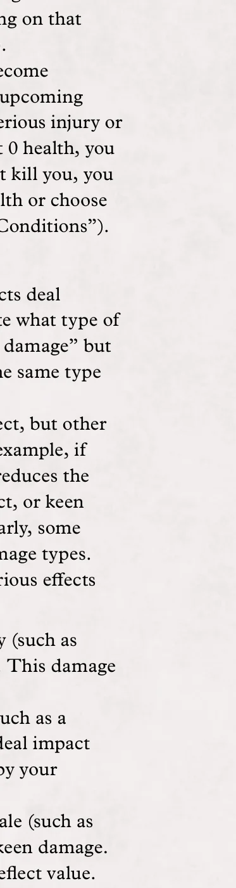
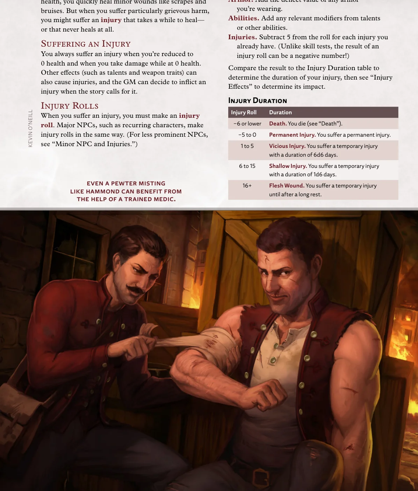
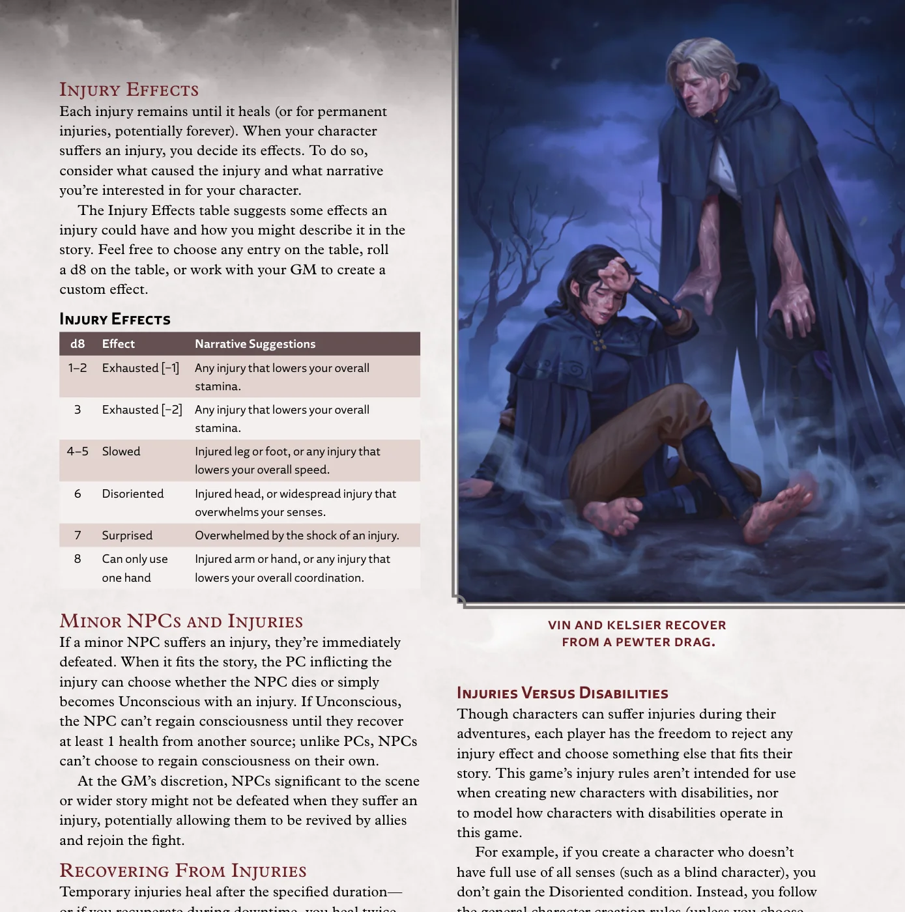
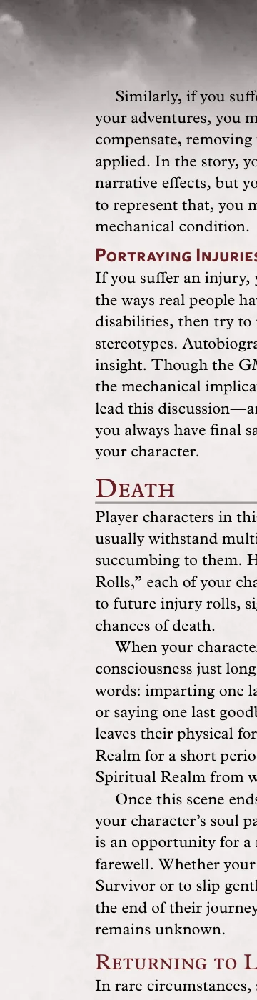
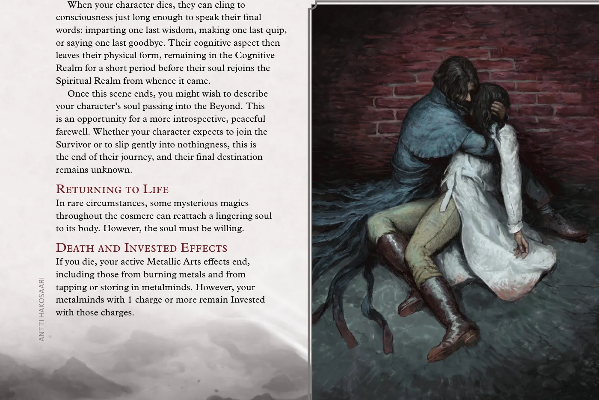
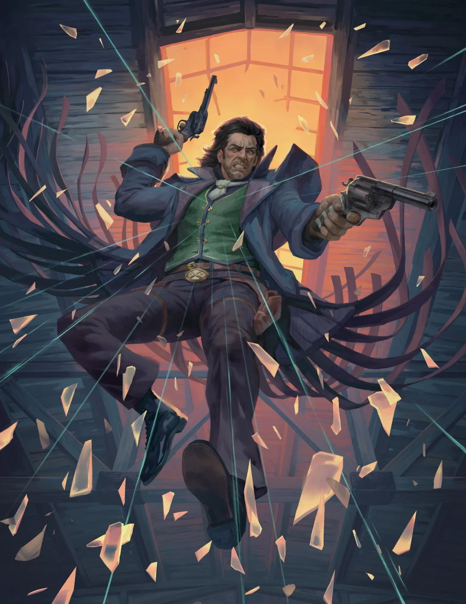

### 持續時間

某些效果，例如狀態（Condition），會持續指定的回合（Round）數。如果效果開始時你正處於戰鬥中，請記下它是在快速 PC 階段、快速 NPC 階段、慢速 PC 階段，還是慢速 NPC 階段開始，詳見第 10 章的「輪次階段」。效果會持續到下一回合該階段開始時。〔譯註：原文先稱指定回合數，此處仍寫下一回合；本段保留原文。〕其他效果則會明確說明結束的時機。例如，若效果在「你的下一個輪次（Turn）結束時」結束，那麼無論你的下一個輪次是快速還是慢速，效果都會在該輪次結束時結束。

### 食物與飲水

如果你每天沒有吃下足夠的食物、喝下足夠的水，就可能開始因疲憊而受苦。在有充足食物與飲水的地區冒險時，GM 通常不會要求你逐一記錄食物與飲水，而會假定你有吃飽喝足。不過，當取得食物與飲水的機會可能受限時，例如身在敵後，或搭乘補給不足的浮空船（Airship），GM 就可能要求你更仔細地記錄。為求簡便，食物與飲水都以天為單位記錄。一日份的食物或飲水，足供一名角色吃喝一天。如果你無法攝取足夠的食物或飲水，就會開始受到不良影響。

### 食物不足

你可以連續不進食的天數等同於你的意志（Willpower）數值，在這段時間過後才會開始受到不良影響。此後每一天沒有吃下足夠的食物，你都會獲得精疲力竭（Exhausted）[−1]。如果這讓你達到精疲力竭 [−10] 或更低，你就會死亡。當你吃下一日份的食物後，天數會重新計算，但你仍維持精疲力竭。你可以再度連續不進食等同於意志數值的天數，之後才會再因缺乏食物而加重精疲力竭。

### 飲水不足

你無法長時間不喝水。每一天沒有喝下足夠的水，你都會獲得精疲力竭 [−1]。如果這讓你達到精疲力竭 [−10] 或更低，你就會死亡。

### 傷害、傷勢與死亡

無論你是第一時代勇敢面對懸殊劣勢的反抗者，還是第二時代無畏地漫遊陌生土地的冒險者，受傷或死亡的風險始終存在。以下規則說明如何處理傷害與傷勢。

### 傷害

當你受到傷害（Damage）時，從目前的生命值（Health）扣除等量的數值，詳見第 3 章的「生命值」。如果你穿著護甲（Armor），偏轉值（Deflect）可能依傷害類型減少你受到的傷害，詳見第 3 章的「偏轉值」。當生命值降至 0 時，你會陷入昏迷（Unconscious）並承受一項傷勢（Injury），面臨重傷或死亡的風險，詳見後文「傷勢」。生命值為 0 時，每次受到傷害，你都會再承受一項傷勢。若傷勢沒有使你死亡，你就會持續昏迷，直到恢復生命值，或選擇恢復意識為止，詳見「狀態」的說明。

### 傷害類型

不同的武器、能力及其他效果，會造成不同的傷害類型（Damage Type）。大多數效果都會說明造成哪一種傷害。如果效果會「造成額外傷害」，卻未指定類型，則額外傷害的類型與原本造成的傷害相同。傷害類型通常不會改變效果本身，但其他規則可能對某些傷害類型產生影響。例如，若護甲提供偏轉值，就能減少你受到的能量、衝擊或銳利傷害，詳見第 7 章的「護甲」。同樣地，有些敵手較不受特定傷害類型影響。在決定故事中各種效果的傷害類型時，請參照以下指引：

**能量（Energy）。** 與熱和能量有關的效果，例如火焰與閃電，會造成能量傷害（Energy Damage）。你的偏轉值能減少這類傷害。

**衝擊（Impact）。** 擠壓或鈍擊的效果，例如決鬥杖（dueling cane）的打擊或一塊金屬的撞擊，會造成衝擊傷害（Impact Damage）。你的偏轉值能減少這類傷害。

**銳利（Keen）。** 切割、刺穿或貫穿的效果，例如匕首或尖銳木樁，會造成銳利傷害（Keen Damage）。你的偏轉值能減少這類傷害。

**靈魂（Spirit）。** 同時傷害你肉體與靈魂的效果，會造成靈魂傷害（Spirit Damage）。你的偏轉值無法減少這類傷害。

**命力（Vital）。** 考驗你體質的效果

，例如中毒、窒息與酷寒，會造成命力傷害（Vital Damage）。你的偏轉值無法減少這類傷害。

第 9 章：冒險 312

### 傷勢

如第 3 章所述，生命值（Health）代表你整體的身體狀況與體力。隨著生命值恢復，擦傷、瘀傷之類的小傷也會迅速癒合。但受到特別嚴重的傷害時，你可能承受需要一段時間才能痊癒的傷勢（Injury），甚至永遠無法痊癒。

### 承受傷勢

每當生命值降至 0，或在生命值為 0 時受到傷害，你都一定會承受一項傷勢。其他效果，例如天賦與武器特性，也可能造成傷勢。GM 也可以在符合劇情時，決定讓角色承受傷勢。

### 傷勢擲骰

承受傷勢時，你必須進行一次傷勢擲骰（Injury Roll）。重要 NPC，例如反覆登場的角色，也以相同方式進行傷勢擲骰。較不重要的 NPC 請見「次要 NPC 與傷勢」。

傷勢擲骰不是技能檢定（Skill Test）。進行傷勢擲骰時，擲一顆 d20，並套用以下修正：

**護甲。** 加上你身上所穿護甲的偏轉值（Deflect）。

**能力。** 加上天賦或其他能力提供的相關修正。

**傷勢。** 每有一項既有傷勢，擲骰結果就減去 5。與技能檢定不同，傷勢擲骰的結果可以是負數！

將結果與「傷勢持續時間」表比對，決定傷勢的持續時間，再參閱「傷勢效果」決定其影響。

### 傷勢持續時間

| 傷勢擲骰 | 持續時間 |
| --- | --- |
| −6 或更低 | 死亡（Death）。你死亡，詳見「死亡」。 |
| −5 至 0 | 永久傷勢（Permanent Injury）。你承受一項永久傷勢。 |
| 1 至 5 | 重度傷勢（Vicious Injury）。你承受一項持續 6d6 天的暫時傷勢。 |
| 6 至 15 | 輕度傷勢（Shallow Injury）。你承受一項持續 1d6 天的暫時傷勢。 |
| 16+ | 皮肉傷（Flesh Wound）。你承受一項暫時傷勢，直到完成一次長休息（Long Rest）後才痊癒。 |

*即使是哈姆德（Hammond）這樣的白鑞（Pewter）迷霧人（Misting），也能受惠於訓練有素的醫護人員協助。*

KEVIN O’NEILL

### 傷勢效果

每項傷勢（Injury）都會持續到痊癒為止；永久傷勢（Permanent Injury）則可能伴隨你一生。角色承受傷勢時，由你決定傷勢的效果。請考量造成傷勢的原因，以及你想為角色發展什麼樣的故事。「傷勢效果」表列出一些傷勢可能造成的效果，以及你可以如何在故事中描述它。你可以自由選擇表中的任何一項，也可以擲一顆 d8 查表，或與 GM 合作設計自訂效果。

### 傷勢效果

| d8 | 效果 | 敘事建議 |
| --- | --- | --- |
| 1–2 | 精疲力竭（Exhausted）[−1] | 任何降低整體體力的傷勢。 |
| 3 | 精疲力竭 [−2] | 任何降低整體體力的傷勢。 |
| 4–5 | 減速（Slowed） | 腿部或腳部受傷，或任何降低整體速度的傷勢。 |
| 6 | 迷惑（Disoriented） | 頭部受傷，或大範圍傷勢讓感官不堪負荷。 |
| 7 | 措手不及（Surprised） | 因受傷的衝擊而不知所措。 |
| 8 | 只能使用一隻手 | 手臂或手部受傷，或任何降低整體協調能力的傷勢。 |

### 次要 NPC 與傷勢

次要 NPC 一旦承受傷勢，就會立刻被擊敗。只要符合劇情，造成傷勢的 PC 可以選擇該 NPC 是死亡，還是僅帶著傷勢陷入昏迷（Unconscious）。若陷入昏迷，NPC 必須先透過其他來源恢復至少 1 點生命值（Health），才能恢復意識。與 PC 不同，NPC 不能自行選擇恢復意識。GM 可以視情況決定，對當前場景或整體故事有重要影響的 NPC，在承受傷勢時不會立刻被擊敗，讓盟友有機會救醒他們，再度投入戰鬥。

### 從傷勢中復原

暫時傷勢會在指定時間後痊癒。如果你在休整期（Downtime）休養，痊癒速度就會加倍，詳見本章前文的「休整期」。少數天賦與其他效果也能治癒傷勢。永久傷勢若沒有超自然力量介入，就不會痊癒，但角色可以適應傷勢，包括永久傷勢。失去一肢或原本慣用的感官功能，確實可能在生活中帶來挑戰，但你可以透過訓練、練習、專門的發明，或親友的支持來適應。

*紋（Vin）與卡西爾（Kelsier）從白鑞延燒（Pewter drag）中恢復。*

### 傷勢與身心障礙的區別

雖然角色可能在冒險中承受傷勢，但每位玩家都有權拒絕任何傷勢效果，改選其他符合自己故事的效果。這套遊戲的傷勢規則，並不是用來建立有身心障礙的新角色，也不是用來模擬有身心障礙的角色在遊戲中如何行動。例如，如果你建立的角色無法完整運用所有感官，例如一名失明的角色，你不會因此獲得迷惑狀態。除非你另有選擇，否則仍依一般角色建立規則處理，因為遊戲假定你已掌握各種因應日常生活的技巧與工具。在敘事上，無法看見可能會合理地限制你做某些事，但你也有一些優勢，例如不依賴視覺，也不會被純粹的視覺幻象欺騙。如果你的角色使用行動輔具，移動速率（Movement Rate）仍與所有角色一樣，由角色的速度（Speed）屬性決定。

ANDREW CHOU

第 9 章：冒險 314

同樣地，如果你在冒險中承受永久傷勢（Permanent Injury），終究可能學會彌補它，移除它所施加的任何狀態效果。在故事中，你仍會經歷這項傷勢的敘事影響，但你已找到適應的方法。為了呈現這一點，你甚至可以移除傷勢在規則上造成的狀態。

### 呈現傷勢與身心障礙

如果你承受傷勢，不妨研究現實中的人如何適應類似的傷勢與身心障礙，再試著寫實地呈現，避免流於刻板印象。當事人的自傳資料最能提供深入的理解。GM 或許會與你合作，建議傷勢在規則上會造成哪些影響，但這項討論應由你主導。而且，與遊戲中大多數部分不同，傷勢如何影響你的角色，始終由你做最後決定。

### 死亡

本遊戲的玩家角色相當強韌，通常能承受多項嚴重傷勢後才會喪命。不過，如「傷勢擲骰」所述，角色的每項傷勢都會對日後的傷勢擲骰施加減值，大幅提高死亡的機率。當角色死亡時，仍能勉強維持意識，說出最後的話：留下最後一句忠告、開最後一個玩笑，或道最後一聲再見。接著，角色的意識層面會離開肉體，在意識界（Cognitive Realm）短暫停留，之後靈魂便重返其原本來自的靈魂界（Spiritual Realm）。這個場景結束後，你或許想描述角色的靈魂進入 彼瑞（Beyond）。這是一次更深刻內省、平靜道別的機會。無論你的角色預期與倖存者（Survivor）相聚，或安然歸於虛無，這都是旅程的終點，而最終的歸宿依然無人知曉。

### 重返生命

在極少數情況下，寰宇（cosmere）中某些神祕魔法能將尚未離去的靈魂重新連回身體。不過，靈魂必須出於自願。

### 死亡與授予效果

如果你死亡，所有作用中的金屬技藝（Metallic Arts）效果都會結束，包括燃燒（Burn）金屬，以及從金屬意識庫（Metalmind）汲取（Tap）或向其中儲存（Store）所產生的效果。不過，具有至少 1 點充能（Charge）的金屬意識庫，仍會保有這些充能所帶來的授予。

### GM 提示：PC 與致命危險

在某些桌上角色扮演遊戲中，死亡只是一點小麻煩。但在迷霧之子（Mistborn）的故事裡，除少數例外，死亡就是永遠的終點。因此，GM 應慎重考量何時讓角色面對真正致命的危險。在戰鬥之外，如果玩家做出的選擇將使 PC 必死無疑，可以考慮跳出角色，先給玩家一個警告。在戰鬥中，這套遊戲的傷勢系統，能帶來死亡以外有分量的風險與後果。不過，玩家或許想述說一個高尚犧牲的故事。這種情況下，角色可能選擇忍著傷勢繼續奮戰，讓自己身陷險境！但那是玩家選擇的結果，通常比隨機的死亡更能帶來令人滿意的結局。

*「蕾希（Lessie）？」瓦（Wax）說。「蕾希！」她走了……他緊抱著她，從內心深處發出一聲低沉的哀號，那毫不掩飾的吶喊迴盪在夜色之中。*

ANTTI HAKOSAARI

