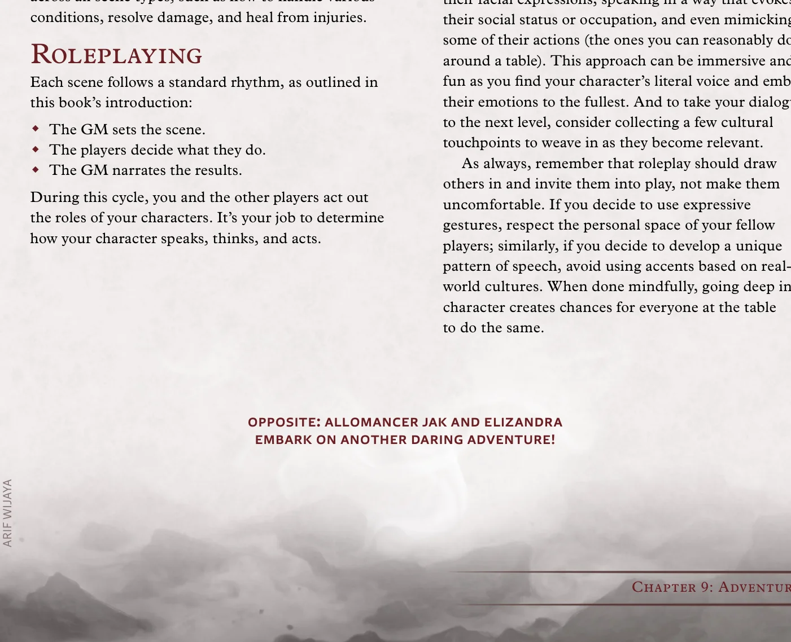
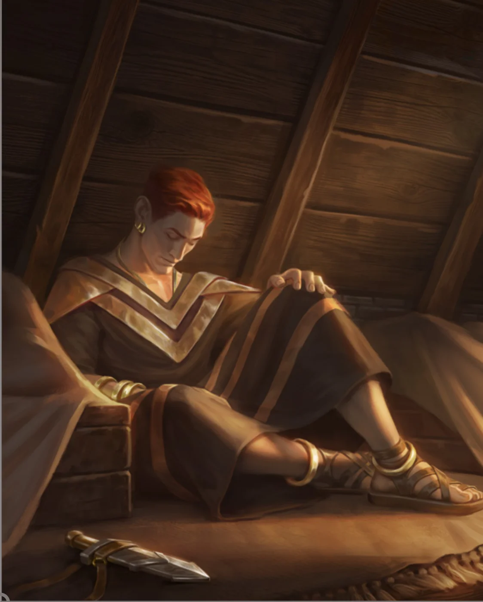
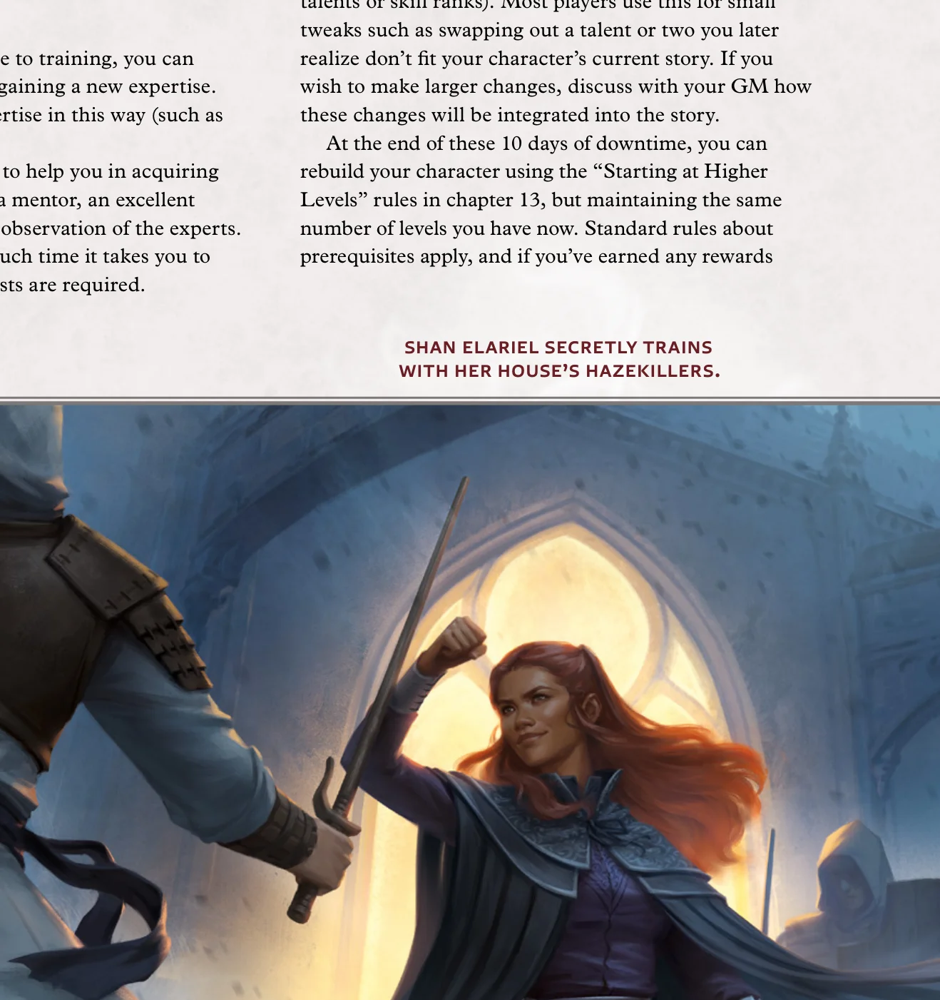
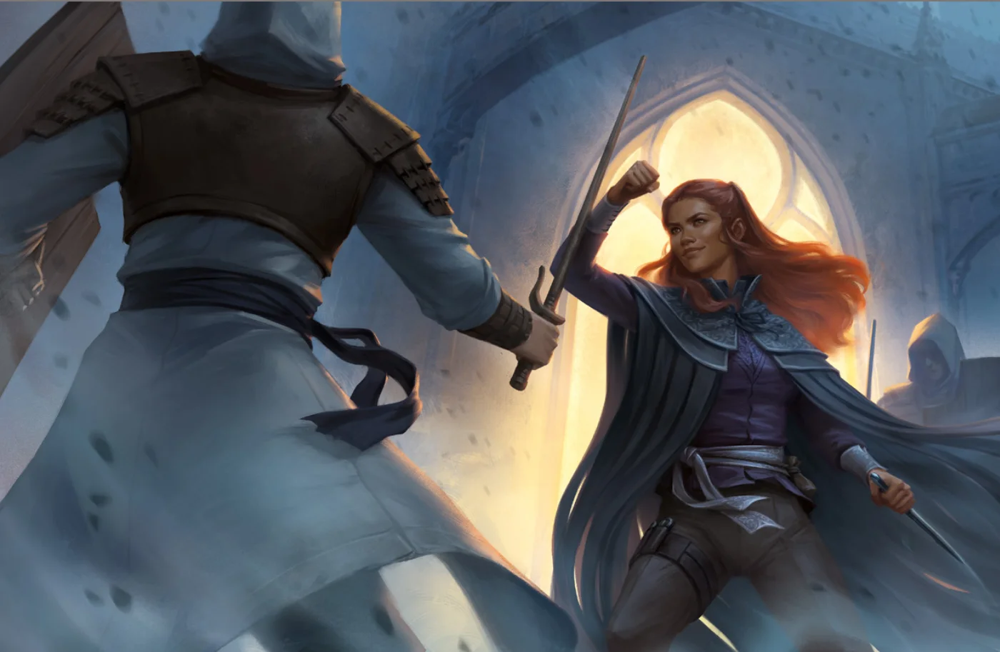

從在陸沙德（Luthadel）巷弄中為生存而戰，到攀上依藍戴（Elendel）高聳的摩天樓，無論境遇如何起落，你在司卡德利亞（Scadrial）的冒險，都在訴說個人的掙扎、意志的考驗，以及戰勝古老權力結構的故事。本書的規則適用於無數情境；取用其中有幫助的部分，但最終只保留能為故事服務的規則。本章介紹在司卡德利亞冒險的基本方式，以及如何利用本書規則協助遊玩。部分指引著重角色扮演，例如探索如何掌握故事節奏，以及運用遊戲中的三種場景類型，編織有趣的冒險。本章後半則著重各種場景中常用的具體規則，例如處理各種狀態、結算傷害，以及治癒傷勢。

### 角色扮演

每個場景都遵循標準節奏，如本書導論所述：

- GM 布置場景。

- 玩家決定要做什麼。

- GM 敘述結果。

在這個循環中，你和其他玩家扮演各自的角色。你的工作是決定角色如何說話、思考及行動。

### 角色扮演方式

扮演角色時，你多半會偏好兩種敘述方式之一：第一人稱或第三人稱角色扮演（roleplaying）。有些玩家大多使用同一種方式，有些則會依場景感受切換。兩者沒有對錯。請選擇讓你自在、適合想呈現的角色，也符合團體互動方式的做法。

### 第一人稱角色扮演

著重第一人稱角色扮演（first-person roleplaying）時，你會努力化身為角色。描述角色行動時，就像在說自己正在做的事。你常會直接以角色身分說話，甚至表演其表情、以符合其社會地位或職業的方式發言，並模仿部分動作（以坐在桌邊能合理做到的為限）。找到角色真正的聲音、充分表現其情緒，能讓這種方式既有沉浸感又有趣。想讓對話更上一層樓，可以蒐集幾項文化特色，在合適時融入。一如往常，角色扮演應吸引他人、邀請他們參與，而非讓他們不舒服。如果決定使用生動的手勢，請尊重其他玩家的個人空間；同樣地，如果想發展獨特的說話方式，請避免模仿現實文化的口音。只要顧及他人，深入角色就能讓全桌都有機會同樣投入。

*對頁：鎔金術師 Jak（Allomancer Jak）與 Elizandra 再度踏上大膽的冒險！*

ARIF WIJAYA

第 9 章：冒險 303

### 第三人稱角色扮演

著重第三人稱角色扮演（third-person roleplaying）時，你會用第三人稱傳達角色的行動。你以角色名字稱呼對方，描述其行動、對他人說的話，並敘述其心情與思考過程。在情緒強烈的場景，或任何讓你不自在、不想直接演出的時刻，這種方式尤其有用。第三人稱敘述也很適合讓其他玩家看見表象之後的內情，透過你的敘述了解角色的想法、情緒與心境。如果角色個性不體貼，或特別容易引發爭議，第三人稱扮演能幫助全桌把角色行為，與你本人認為可接受或公平的做法區分開。例如，你可以說：「因為我的角色的內在障礙（obstacle）是自私，所以他會想從團隊這次的戰利品裡多偷拿一份。」

### 角色知道什麼

扮演角色時，務必區分你（玩家）知道的事與角色知道的事。例如，你與角色擅長的事很可能不同；你也許立刻推理出答案，角色卻因不夠敏銳而毫無察覺。另一些時候，你對司卡德利亞及其歷史的了解可能比角色多（或反過來）；你也許記得小說中影響全世界的事件，但角色尚未開始經歷。遊玩本遊戲時，維持玩家與角色知識的區別很重要。

### 當你知道得比角色多

有些玩家很難抵抗誘惑，想利用「角色之外」的資訊為自己謀利，尤其當角色不知情可能造成「壞」結果時。另一些玩家則很享受自己與角色的認知落差，藉此把不知情的角色引向充滿戲劇性的處境。當你知道角色不知道的事，請著眼於角色的故事，思考如何運用自己的知識讓它更精彩。別讓角色根據不可能知道的未來資訊行動；你可以利用這些事實，替故事鋪陳有趣的戲劇反諷，或令人會心一笑的回應。

### 當角色知道得比你多

你不熟悉遊戲設定的某些部分，甚至全部，不代表角色也不熟悉！如果覺得角色合理上應知道某件你不知道的事，例如血統（ancestry）、文化（culture）、職業或專長（expertise）的細節，請向 GM 詢問相關資訊與背景。角色也不受 GM 知識所限。由 GM 描述角色如何成功通過檢定（test），固然令人滿足又能增添風味，但 GM 也可能只簡述情況，或許是為了讓故事繼續推進，或是不確定你的行動在司卡德利亞會如何展開。不論如何，請記得，即使鏡頭沒有拉近，角色依然在故事中做了一件很酷的事。

### 隊伍分頭行動

有時故事需要角色們分頭行動。你們可能想同時完成多件事，或讓角色追求互相衝突的目標。不過，分隊會讓故事節奏面臨許多挑戰，因為場景得在兩組以上的人馬間切換，沒在目前場景中的人坐在桌邊，卻幾乎無事可做。第 13 章提供 GM 帶領分隊遊戲的指引，但只要符合故事，把所有人留在一起通常會更順暢。大家都能參與時，遊戲最有趣。

### 時間

如同任何故事，時間流動也是角色扮演的核心。有時故事快速推進，一口氣跨越漫長時日；有時每次心跳都至關重要，情節逐刻展開，詳述角色的每個動作。GM 會依各種情況的發展，以非正式方式掌握時間節奏。這往往是細微的變化，隨著 GM 改變敘述的時間尺度而發生。例如，你可能從緩慢的「你們在南方統御區（Southern Dominance）旅行了好幾個小時」，迅速切換成緊迫的「看見迷霧中有身影接近，你立刻撲向掩護」。這時 GM 並未正式宣布時間流動方式改變，而是隨故事需求即時調整。

第 9 章：冒險 304

遊玩冒險時，故事自然會如此起伏。有時你會把鏡頭「拉遠」，讓時間流逝或事件發展；有時則「拉近」，詳細演出事件。這些細膩呈現的時刻稱為場景（scene），下一節將加以說明。故事快速推進的部分較有彈性。這些段落會跨過長段時間，讓你在艱辛的日子之間休息、進行長途旅行，或在冒險的緊湊時刻之間從事休整期活動。多數時刻都能像電影蒙太奇一樣帶過，但有些事（例如休息與休整期活動）會牽涉規則，本章稍後會討論。

### 場景

當情節的鏡頭「拉近」，你的個別行動會帶來後果時，就稱為場景。遊戲中的這些段落可以包含驚險戰鬥、棘手談判、刺激探索，以及更多情境。本遊戲的規則主要聚焦於場景，因為相較快速推進的敘述，場景通常需要更多指引。多數場景可歸為以下其中一種：

**戰鬥（combats）**發生在一名以上角色捲入武力衝突時。在打鬥與交戰中，每一秒都重要，站位必須精確，生命也危在旦夕。第 10 章提供戰鬥指引。

**對話（conversations）**著重你與其他角色溝通，而結果尚未確定、又對遊戲故事具有重要影響的時刻。包括激烈爭執、緊張談判、精密欺騙，以及類似互動。第 11 章提供對話指引。

**試煉（endeavors）**著重你試圖穿越、探索、發現、追逐或潛行的時刻。在這些場景中，主要對手通常不是其他角色，而是環境或情勢本身。第 12 章提供試煉指引。

並非所有段落都能明確歸入單一場景類型。例如，一段對話可能迅速演變成戰鬥。和本遊戲所有規則一樣，場景規則只是指引。GM 可以修改、只取其中一部分，或混合搭配，以最合適的方式講述冒險。例如，你可以在對話中使用戰鬥規則的行動揮出一拳，也可以在追逐試煉中，一邊與 NPC 交談，一邊抵抗對方的社交影響。

### 場景之間的轉換

良好的遊戲體驗需要持續推進的節奏。當一個場景的主要目標已經達成（或失敗），通常就該收尾，轉入下一個場景。這能幫助 GM 讓玩家保持興奮，也有動力繼續戰役（campaign）。回答一個問題，往往又帶出另一個。例如，角色們正慶祝阻止幫派侵入依藍戴，卻得知這恰好提供「組織」（the Set）下一步行動所需的空檔。或者，成功從滅絕（Ruin）的審判者（Inquisitors）手中拯救小鎮後，他們發現逼近的迷霧將迫使居民往中央統御區（Central Dominance）內遷，進入其他貴族控制的地帶。有時場景接連發生，一個場景中的事會大幅影響角色在下一個場景的能力與資源。另一些時候，尤其在特別激烈的場景後，隊伍可能需要休息恢復，或故事單純需要快轉至下一項重大發展。重要場景之間的這段時間稱為休整期（downtime；見後面的「休整期」）。

### 跨場景的數據

一個場景接續另一個時，角色數據通常維持前一場景結束時的狀態。例如，你目前的生命值（health）、專注點（focus）與授予（Investiture）都保持不變，直到有機會透過能力，或花費足夠時間休息來恢復（見後面的「休息」）。

### 事件

有時 GM 會在場景中引入事件（event）。這項選用工具用來呈現即將到來的情勢，一步步倒數，直到某個撼動場景的時刻。逐漸累積的期待，能讓任何場景更有層次。事件可以有利，也可以不利；無論如何，都是獨立於場景主要目標之外的倒數計時。GM 可能在一個遊戲場次（session）中安排兩三個事件，通常分布於不同場景，但如果情勢重大、同時有許多事情發生，同一場景也能包含多個事件。有些場次則完全沒有事件。它們不應像是每場隨機出現的轉折，而應是刻意運用的工具，為重要場景增加故事張力。

第 9 章：冒險 305

你可以把事件想成影響範圍更大的機遇（Opportunity）或變故（Complication）。例如，事件可能著重於逐漸西沉的太陽與將至的迷霧、附近克羅司（koloss）群日益高漲的怒氣、統御主（Lord Ruler）的衛兵即將抵達陸沙德街頭的衝突現場，或你在蠻橫區（the Roughs）執行工作、一直監視的火車終於進站。GM 引入事件時，就是在預示某件尚未發生、卻很可能在場景中實現的事。通常，你、其他玩家與 GM 為事件投入預定數量的機遇或變故後，事件就會觸發。

### 事件進度軌

除非另有說明（例如天賦效果），事件一律由 GM 規劃並發起。GM 準備引入事件時，會宣布內容及其有利或不利性質，再把事件卡放到桌子中央。雖然不一定需要卡片，但它是很好的視覺提醒，能讓大家記得事件正在進行。每個事件都有事件進度軌（event track），至少含兩個機遇格（Opportunity slots）或變故格（Complication slots），也可以兩者兼有；各類格數由 GM 選擇。事件在場時，只要有人擲出劇情骰（plot die），就能依下一節所述，把結果投入事件以推進它。

### 投入事件

玩家與 GM 可以選擇花費機遇與變故，填入事件進度軌的格子。這麼做時，就放棄了這些結果通常能產生的其他效果。玩家因此必須策略性權衡：照一般方式花費機遇或變故所帶來的立即後果，與投入事件進度軌所產生、更大且更長遠的後果。如此一來，事件就能為攸關重大的場景帶來強烈張力。

### 機遇

獲得機遇時，你可以選擇花在有利事件上，填滿一格。有時，把機遇花在立即好處上會更合理，例如恢復施展某項天賦迫切需要的專注點。但當事件正在進行，你可能更想推進某個時刻，讓整場戰鬥的局勢轉向有利於團隊的一方。

### 變故

獲得變故時，GM 可以選擇花在不利事件上，填滿一格。一如往常，GM 也能選擇花在其他地方。這份彈性讓 GM 能挑選戲劇效果最好的時機觸發不利事件，例如當你正要在戰鬥中擊敗對手時，敵方迷霧人（Misting）恰好抵達現場。

### NPC 的投入

NPC 也能像你一樣投入事件。不過請記得，除非是你的盟友（allies），否則 NPC 的機遇會填入對你不利的事件格，變故則填入對你有利的事件格。

### 觸發事件

事件進度軌的所有機遇格或變故格填滿後，那個隨每次擲骰逐步逼近的事件就會觸發。多數事件只追蹤機遇或變故其中一種。不過，為了呈現較複雜的結果，GM 可以選擇同時運作兩條事件進度軌，分別推進有利與不利結果的可能性。例如，你可能正等待急需的援軍，夕陽卻無可阻擋地西沉，敵人眼看就能藉迷霧逃走。在這個事件中，你可以投入機遇推進盟友抵達，變故則計入迷霧降臨的進度。哪個會先觸發呢？

### 休息

場景之間，你（但願）能找到時間休息調養。這讓你有機會恢復、進食、處理傷口，並規劃接下來的日子。休息有兩種：短休息與長休息。

### 短休息

短休息（short rest）是一段不受打斷、至少一小時的時間，你可以放鬆、恢復並處理傷口。

### 恢復生命值與專注點

短休息後，你可以擲恢復骰（recovery die），決定恢復程度（恢復骰的骰型見第 3 章「意志」）。把結果加到目前生命值、目前專注點，或分配到兩者。例如，恢復骰擲出 5，你可以選擇恢復 3 點生命值與 2 點專注點。

第 9 章：冒險 306

### 替代好處

如果願意，你可以放棄自身恢復，改用休息時間取得以下其中一項好處：

**照護他人（Tend to Others）。** 你可以替一同休息的一名以上自願盟友提供醫療協助。他們將你的醫學（Medicine）修正值加到恢復骰結果。

**採集（Forage）。** 你可以使用求生（Survival）技能採集資源（見第 3 章「求生」）。

**儲存於金屬意識庫（Store in Your Metalminds）。** 你可以在短休息期間為藏金術金屬意識庫充能；就此用途而言，一次短休息算作一個場景。

**其他。** 如果想在隊伍其他人休息時處理事情，你可以放棄休息好處，嘗試完成工作。一般而言，需要技能檢定（skill test）的事都太費心力，無法一邊處理一邊得到休息。

### 短休息的其他效果

有些天賦與其他效果，允許你在短休息期間或之後使用或啟動。除非另有說明，即使同時恢復生命值與專注點（或進行一項替代活動），仍能享有這些好處。

### 長休息

長休息（long rest）是一段不受打斷、至少八小時，而且能得到實質休息的時間。通常包括一段放鬆時間，以及一整晚的睡眠；也可能是睡半天，畢竟在敵後執行任務，只能抓住任何機會補眠。

### 恢復生命值與專注點

長休息後，你恢復所有失去的生命值與專注點。此外，精疲力竭（Exhausted）的減值降低 1（見本章後面的「狀態」）。

### 替代好處

如果願意，你可以放棄自身恢復，改用休息時間取得以下好處：

**儲存於金屬意識庫。** 你可以在長休息期間為藏金術金屬意識庫充能；就此用途而言，一次長休息算作兩個場景。以這種方式度過長休息後，你會陷入精疲力竭 [−1]。

### 長休息的其他效果

與短休息相同，有些天賦與效果會在休息時啟動。你可以在享有其好處的同一次休息中恢復。

### 休整期

你遊玩本遊戲的大多數時間都用於場景，但場景之外，角色的生活仍在繼續，例如躲藏、休息、工作或等待。如果只是休息幾小時或過夜，規則見「休息」。不過，場景之間較長的空檔就是休整期，各角色可以自由調養或追求進展，不必受隊伍共同目標限制。休整期時，GM 會讓你和其他玩家說明，各自在這段自由時間做什麼。有些活動可以和其他隊員一起進行，但角色往往也想暫時追求自己的短期目標（goals）。

### 帶入休整期

遊戲進入休整期時，GM 會告訴全團，角色再次需要出動前還有多少時間。有時角色知道自己有多少時間（「十二小時後回安全屋報到」），但有時，GM 會告訴你情節將在兩天後繼續，角色卻以為自己有一週假期（「兩天後，你會收到一封意想不到的信。這段時間你要做什麼？」）。GM 也會說明活動在故事上的限制。例如，你可能得避免引人注意，或必須留在邊境封閉、遭到封鎖的城市內。你能選的活動類型與能取得的進展，會隨空檔長短而變化。如果只休息幾天，外科醫師（Surgeon）角色可能選擇當巡迴醫生，例如在偏遠小鎮工作三天賺取 5 盒金（boxings）。迷霧人則可能與使用相同金屬的人一起訓練。長達數個月的休整期，影響就大得多。司卡（skaa）竊賊（Thief）可以提高自己在當地幫派間的地位，朝成為團隊領袖的遠大目標邁進。發明家（Inventor）也可能遊歷盆地，蒐集稀有材料與技術，準備下一項重大突破。

VALERIA CASALE

第 9 章：冒險 307

### 結算休整期

知道休整期長度與限制後，每名玩家簡述角色打算如何運用時間。「休整期活動構想」會建議活動，以及你與 GM 可以如何決定結果。簡述完畢後，GM 先與一名玩家共同判定該活動的結果，再依序處理其他玩家。

### 簡單與雄心勃勃的活動

你可以為角色選擇合理能完成的事，例如繼續做長久以來的工作，或完成已投入一段時間製作的金屬意識庫。經 GM 決定，許多此類活動無須檢定就能結算。其他簡單活動則可能需要一次相當容易的技能檢定。如果選擇的休整期活動特別有野心、困難，或對劇情至關重要，就很可能必須在檢定中提高賭注（raise the stakes）。請確認自己能接受出現變故的風險。不過，若檢定與劇情骰都擲得很糟，GM 也可能手下留情，給予某種小小的補償。

### 活動結果

完成所需檢定（如果需要）後，你與 GM 會考量檢定結果、機遇與變故，一起決定結果。GM 可以視情況給予故事上的獎勵、金錢、物品，或個人短期目標的進展。

### 場次之間的休整期

有些團體喜歡在遊戲場次結束時進入休整期，接著在下一場之前透過群組聊天處理活動，而非在場次中進行。你甚至可以在與 GM 判定結果後，利用場次之間的時間，把休整期活動寫成故事，分享給大家。

### 休整期活動構想

本節概述一些較常見的休整期活動，並建議所需時間與費用。不過，你仍能依自己的想法運用時間；只要與 GM 討論，對方就會協助判定如何處理。

### 工藝

你可以製作物品，例如第二時代威力強大的火器與爆裂物，規則見第 7 章「工藝（Crafting）」。製作可能依物品複雜程度花上許多天，因此最適合在休整期進行。

### 金屬技藝指導

如果有位贊助者（patron）特別精通你擁有的某項鎔金或藏金能力，對方可能願意指導你。你每花一天與導師訓練某項能力，就獲得一次優勢（advantage），可用於日後與該鎔金或藏金能力有關的檢定。你能儲存的優勢次數，最多等於鎔金術（Allomancy）或藏金術（Feruchemy）技能等級較高者；它們會持續到使用為止，或直到你下次與任何贊助者導師訓練。

### 休養

許多傷勢（injuries）都需要時間痊癒。如果能把休整期專用於恢復，就能大幅加快療程。你每專心休息調養一天，在傷勢治療進度上就算作兩天（見本章後面的「傷勢」）。

### 研究

混亂的冒險與旅行很少留下仔細研究的機會，因此休整期很適合求知。你甚至可能對逐漸揭露的寰宇（cosmere）謎團有所領悟。研究活動包括在實驗室測試新科技、在圖書館閱讀書籍，甚至尋找隱密行事的泰瑞司守護者（Terris Keeper），向對方求取知識。開始研究時，請告訴 GM 你希望發現什麼。GM 會決定這是否能找到或發現；如果可以，還會決定需要多少天休整期，以及有什麼限制。

第 9 章：冒險 308

研究通常需要至少 10 天，才能獲得真正重要的見解，每天的材料及其他費用為 3 盒金。此外，多數研究需要成功通過一次以上技能檢定。例如，你可能需要推理（Deduction）檢定，把不同資訊串聯起來；學識（Lore）檢定，想起與研究相關的作者；或說服（Persuasion）檢定，請專家協助。研究成功可能帶來許多好處，例如揭露冒險的重要資訊，或讓你對新發明、金屬技藝，以及世界的其他事實有所了解。

### 訓練

如果把休整期用於訓練，你就能精進自己，並可能獲得新專長。你能以此方式取得特殊專長（specialist expertise），例如克羅司巨劍專長。首先，找一項能幫助你學會專長的資源，可能是導師、優秀參考書，或大量觀察專家。接著 GM 會決定學習所需時間，以及是否需要任何技能檢定。

學會新專長通常需要至少 20 天，每天的材料及其他費用為 5 盒金。此外，多數訓練需要成功通過與所選主題相關的技能檢定，每次失敗都會增加所需時間，或帶來其他挑戰。

### 自省

經歷冒險中的激烈事件與體驗後，你可能想重新審視自己及自身價值觀。如果花至少 10 天自省（Self-Reflection），並每天支付 5 盒金，就能調整角色的機制，例如更換天賦或技能等級。多數玩家只用來小幅調整，例如替換一兩項後來才發現不適合角色目前故事的天賦。如果想做更大變動，請與 GM 討論如何融入故事。在這 10 天休整期結束時，你可以依第 13 章「從較高等級開始」的規則重建角色，但維持目前的等級數。仍須遵守一般前提條件規則；如果你在冒險中取得獎勵，也不能用來滿足較早等級的前提條件。例如，角色在等級 5 時才完整習得某種鎔金金屬，就不能在第一項天賦選擇該金屬的天賦。不論變動大小，重建都必須與 GM 合作，而且改動是否符合故事，由 GM 決定。請務必說明為何想重建，並一起討論它可能如何影響故事，以及角色在團體中的定位與關係。

*珊．埃拉瑞爾（Shan Elariel）祕密地與家族的殺霧者一同訓練。*

DEANDRA SCICLUNA

### 從事職業工作

你可以從事職業工作（working a profession），不論是在鎮上打零工，或管理離開已久的龐大產業。如果你有贊助者，或隸屬較大的組織，對方可能期待你為其工作。

### 狀態

許多效果會對你施加暫時狀態（condition），例如「你陷入減速」。在效果持續期間，狀態會改變你的能力，詳見後面的「持續時間」。如果效果沒有說明持續時間（或如何提前移除狀態），該狀態本身就會包含判定所需的全部規則。狀態通常只作用於角色，不作用於物品。例如，某條規則要求對指定區域內的目標施加狀態時，區域中的物品會忽略該狀態。不過，只要符合故事，GM 可以決定物品也受狀態影響，或受到類似的敘事效果。本遊戲包含以下狀態。

### 折磨

處於折磨（Afflicted）時，你會隨時間逐漸受到傷害。戰鬥中，每次你的輪次（turn）結束時，都受到施加此狀態的效果所指定數量與類型的傷害；這些資訊通常列在方括號內。例如，若處於折磨 [1d4 命力]，每次自己的輪次結束時就受到 1d4 傷害。戰鬥外，則改為每 10 秒，以及每次有人嘗試移除此狀態後受到該傷害。與多數狀態不同，你可以同時受到多個折磨效果影響。此時，請分別結算每個效果。

### 耗盡

某項能力處於耗盡（Depleted）時，你無法取得該能力所需的特定授予，因此無法使用它。耗盡期間，你不能花費授予啟動與該能力相關的效果；對與該能力相關的效果而言，你不算受授予的，也無法享有其初萌效果。如果某個效果讓你耗盡特定能力，會在狀態名稱後的方括號內指定該能力。例如，你有金鎔金術（Gold Allomancy）能力，卻陷入耗盡 [金]，就無法使用該能力、其天賦或其初萌版本。與多數狀態不同，你可以同時耗盡多項能力。使用第 5 章的飲用金屬液（Drink Vial）行動，可以移除此狀態。

### 堅定

處於堅定（Determined）時，檢定失敗後，你可以為結果增加一個機遇。選擇這麼做後，移除堅定狀態。

### 減損

處於減損（Diminished）時，你的一項屬性暫時降低，取得狀態時會在方括號內指定。指定屬性降低指定數值；不過，這不會改變防禦、生命值上限、專注點上限或授予上限。（各屬性影響的項目詳見第 3 章「屬性」。）例如，速度（Speed）為 3，且陷入減損 [速度 −2]，你會暫時受到以下不利影響：

- 敏捷（Agility）、輕型武器（Light Weaponry）、隱匿（Stealth）與竊術（Thievery）檢定承受 −2 減值。

- 任何直接使用速度的天賦承受 −2 減值。

- 移動速率（movement rate）從 30 呎降為 25 呎。

與多數狀態不同，減損的效果會累積，而且可同時有不只一項屬性處於減損。

### 迷惑

處於迷惑（Disoriented）時，你的感官受到干擾，難以完成大多數工作。你不能使用反應（reactions），感官一律視為受到遮蔽，感知（Perception）檢定與類似的感官運用檢定獲得劣勢（disadvantage）。

### 增益

處於增益（Enhanced）時，你的一項屬性暫時提高，取得狀態時會在方括號內指定。指定屬性獲得的加值等於

第 9 章：冒險 310

指定數值；不過，這不會改變防禦、生命值上限、專注點上限或授予上限。（各屬性影響的數據詳見第 3 章「屬性」。）例如，速度為 3，且獲得增益 [速度 +2]，你會暫時得到以下好處：

- 敏捷、輕型武器、隱匿與竊術檢定獲得 +2 加值。

- 任何直接使用速度的天賦獲得 +2 加值。

- 移動速率從 30 呎增為 40 呎。

與多數狀態不同，增益的效果會累積，而且可同時有不只一項屬性處於增益。

### 精疲力竭

處於精疲力竭時，你感到疲倦，技能檢定也更困難。取得此狀態時，方括號會列出一個負數。算出檢定結果後、結算效果前，套用等於該數值的減值。每次長休息後，精疲力竭的減值降低 1。減值等於 0 時，移除此狀態。與多數狀態不同，精疲力竭的效果會累積。再次獲得此狀態時，把新列出的減值加到目前的精疲力竭減值。例如，某效果讓你精疲力竭 [−2]，你所有檢定結果都要減 2；接著另一效果讓你精疲力竭 [−1]，減值就會增加，現在所有檢定結果都要減 3。一如往常，不論減值多少，最終檢定結果都不能低於 0。

### 集中

處於集中（Focused）時，你全神貫注於手邊工作。使用需要花費專注點的能力時，費用減少 1。

### 定身

處於定身（Immobilized）時，你的移動速率變為 0，無法移動，也無法被其他效果移動。

### 倒地

處於倒地（Prone）時，你平躺在地上。你同時處於減速（Slowed），對你進行的近戰攻擊獲得優勢。即使沒有掩護，你也能使用架防（Brace）行動。

你可以用 [自由行動] 起身並結束此狀態。起身後，移動速率降低 5，直到下次輪次開始。如果攀爬或飛行時倒地，你就會墜落並照常受到傷害（見第 10 章「墜落」）。

### 束縛

處於束縛（Restrained）時，你的移動速率變為 0。除了掙脫束縛的檢定之外，所有檢定都獲得劣勢。如果施加狀態的效果沒有說明掙脫 DC，能否提前移除狀態及移除方式，都由 GM 決定。

### 減速

處於減速時，你的移動速率減半。如果在移動途中陷入減速，把剩餘移動距離減半（無條件進位）。

### 震懾

戰鬥中處於震懾（Stunned）時，你失去所有反應，而且在自己的輪次少獲得兩個 [1行動]，也不獲得反應。戰鬥外處於震懾時，你不堪負荷，移動及對情況的反應都更遲緩，具體由 GM 決定。

### 措手不及

處於措手不及（Surprised）時，你失去所有反應，戰鬥開始或自己輪次時也不獲得反應；你不能採取快速輪次（fast turn），並少獲得一個 [1行動]。在你下次輪次之後移除此狀態。

### 昏迷

處於昏迷（Unconscious）時，你的移動速率變為 0，無法移動或溝通，也不知道周遭情況。取得此狀態時，你會倒地，並放下所有攜帶物。你不能與周遭環境互動，也不能使用任何行動或反應。戰鬥中，你一律採取慢速輪次，但在自己的輪次無法做任何事。敵人通常會忽略昏迷角色，除非有充分理由採取其他做法。如果你是 PC，可以選擇在自己的任何輪次結束時恢復意識（無須行動），或在某個效果把你治療至至少 1 點生命值時恢復。恢復時，其他角色能察覺你已清醒；你移除昏迷狀態，如果生命值為 0，還會恢復 1 點。不過請小心：生命值這麼低，很容易再受傷，而這次可能更危險，甚至致命。NPC 恢復 1 點生命值時會自動恢復意識。

第 9 章：冒險 311
