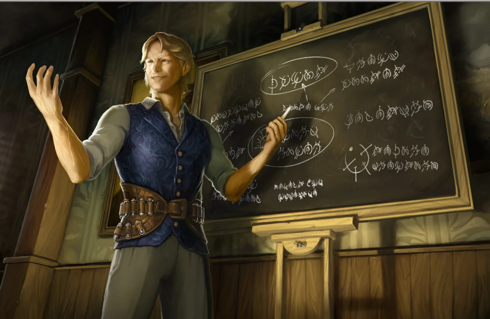

382

讀過本書，你已踏出前往司卡德利亞（Scadrial）旅程的第一步。有些讀者更深入認識這個深受喜愛的奇幻世界後，或許只想讓故事在想像中繼續發展，就已心滿意足。有些人或許會受到啟發，建立角色（character），構思錯綜複雜的背景故事，無論自己是否真的加入遊戲。若你想再進一步，開始遊玩寰宇 RPG（Cosmere RPG），一整個冒險世界正等著你。找其他玩家一起同樂，就能繼續你的旅程！

### 召集你的隊伍

寰宇 RPG 的設計，讓各式各樣的玩家都容易上手，也包括不熟悉《迷霧之子》（Mistborn）小說的人。多數團體裡，都會有初次接觸司卡德利亞的玩家。邀請這些玩家時，你可以用「擁有獨特魔法系統的黑暗奇幻世界」來介紹。你也可以向玩家說明，這款 RPG 屬於更廣大的寰宇（cosmere）的一部分。在這個宇宙中，每個世界都有自己的歷史、文化與魔法系統，藉此引起他們的興趣。

### 有角色扮演經驗的玩家

對其他桌上角色扮演遊戲的愛好者而言，寰宇 RPG 兼顧傳統規則與敘事上的創新。以 d20 進行技能檢定（skill tests）的核心機制，對多數玩家來說相當熟悉；其他特色，例如彈性的路徑（paths）、劇情骰（plot die）與戰鬥（combat）順序，則可能帶來新鮮感。無論玩家偏好講究戰術的地城探索，或是以角色為核心的即興演出，寰宇 RPG 都能支援不同的喜好與遊玩風格。

### 初次接觸角色扮演的玩家

這款 RPG 也為不熟悉桌上角色扮演的《迷霧之子》書迷而設計。如果這是你的第一款桌上角色扮演遊戲，可以考慮從《迷霧之子入門套組》（Mistborn Starter Set）中的冒險開始。這段冒險會在每個場景（scene）介紹不同的遊戲概念。完成冒險時，你們應該已經對系統有充分的掌握。再玩幾個遊戲場次（sessions）後，你應該就能熟悉規則，足以理解鎔金術（Allomancy）與藏金術（Feruchemy）等較進階的機制。

### 召集你的夥伴

找到玩家後，就該規劃第一場遊戲了。事先撥出時間進行「第零場次（session zero）」，按照第 13 章的說明，確認所有人對遊戲的內容、基調與安全工具（safety tools）都有共識。（大家一起即時討論最理想，但也可以透過電子郵件或通訊軟體來討論。）如果玩家剛接觸 RPG，第零場次也是協助大家建立角色的好時機。第零場次至少要預留一小時。準備場次時，請先確認自己熟悉規則。前往 CosmereRPG.com，列印玩家用的快速參考表。如果你們使用戰鬥地圖，請準備好微縮模型或指示物，以及印好的地圖或可擦寫地墊。安排舒適的遊戲空間，讓大家齊聚一堂。所有人都準備好後，就能開始第一個完整的遊戲場次！你們可以當面聚會、透過視訊，或使用虛擬桌面軟體（VTT，virtual tabletop）遊玩。第一場最好預留幾個小時，甚至更久，並留意時間。GM 的職責是推進劇情，確保每位玩家都有參與發揮的機會。別期待第一場就能盡善盡美，但只要大家都投入其中，這應該就會是難忘的體驗！

### 延伸閱讀與資源

除了這本手冊，你還能找到許多資源，豐富你的 RPG 體驗。《迷霧之子》小說並非必讀，但能讓你更深入認識這個世界，也增添樂趣。《迷霧之子世界指南》（Mistborn World Guide）是 GM 與玩家沉浸於司卡德利亞的絕佳途徑。不過，書末的敵手角色資料（adversary profiles）會透露遊戲內容，玩家通常應該避開。其他世界設定與背景知識，則能讓所有參與遊戲的人受益。如果玩家打算讀小說但還沒開始，請記住，《世界指南》包含許多

關於兩個時代的劇透。《Welcome to Scadrial》小冊子篇幅較短，介紹了兩個時代，同時避開故事劇透。至於遊戲中臨時查詢特定設定，我們不知道有哪項資源比 Coppermind.net 維基更好。Coppermind 由布蘭登．山德森（Brandon Sanderson）的官方粉絲網站 17thShard.com 維護，是查詢司卡德利亞以及其他世界中特定地點、人物或物品細節的好幫手。製作這款遊戲時，17th Shard 的成員提供了重要建議與設定方面的專業知識。對任何想深入了解布蘭登．山德森作品的人來說，Coppermind 都是無價的資源。最後，這是一款持續發展的 RPG，未來會不斷新增資源。前往 CosmereRPG.com，就能找到搶先預覽內容、數位補充資料，以及我們的線上角色建立工具。

### 《迷霧之子》之外

司卡德利亞這個迷霧籠罩的世界，有足夠的素材，讓你們在多個戰役（campaigns）中冒險多年。然而，司卡德利亞只是浩瀚宇宙中的一個世界，整個宇宙還有更多魔法、衝突，以及以角色為核心的故事。《迷霧之子玩家手冊》（Mistborn Handbook）是規模更大的寰宇 RPG 的一部分。這套系統已經包含飽受戰火蹂躪的羅沙（Roshar），並正持續擴展，讓你們能前往其他各具獨特魔法系統的世界冒險。寰宇 RPG 的所有內容，在編寫時都考慮了彼此相容。一支躍界者（worldhoppers）隊伍（party），可以包括燦軍（Radiant）、法器師（artifabrian）、雙生師（Twinborn）與御沙師（sand master）……他們的冒險也可以橫跨寰宇。司卡德利亞正在經歷巨變，逐步走向探索自身星球之外的天地，也將意外捲入波及整個宇宙的衝突。當不同世界的鬥士相遇交鋒，誰會成為英雄？誰又能勝出？在寰宇 RPG 裡，這段故事將成為你的故事。而永遠都有另一個秘密，所以請前往 CosmereRPG.com，繼續你的旅程！永遠都有另一個秘密。

KEVIN O’NEILL

