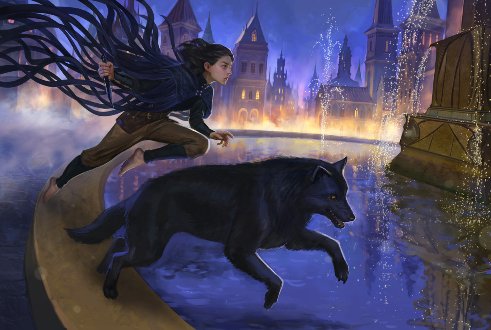
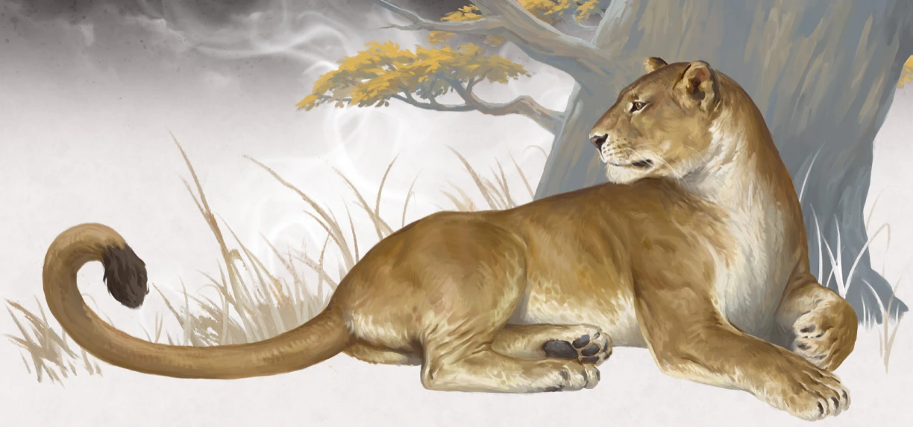

384

在司卡德利亞（Scadrial）兩個時代的冒險中，你的玩家角色（Player Character）可能遇見各式各樣的動物，從尋常的貓（Cat）、狗、馬（Horse）與渡鴉（Raven），到神祕的霧魅（mistwraith）。你甚至可能與其中一些成為朋友——不過，霧魅大概就免談了。

### 使用動物夥伴

當你完成一項短期目標（goal），GM 可以給你動物夥伴（Animal Companion）作為獎勵（Reward）；這份獎勵讓你能與某隻動物建立友誼並訓練牠。擁有這樣的動物夥伴，也符合獵手（Hunter）路徑（Path）的動物羈絆（Animal Bond）天賦（talent）之前提條件（Prerequisite）。下一節依階層（Tier）列出司卡德利亞一些最常見動物的夥伴資料區塊（Stat Block）。在這些資料區塊之後，則說明如何修改資料來呈現其他動物。

### 閱讀資料區塊

動物夥伴遵循本書第 13 章「使用敵手（adversary）」的規則。和其他資料區塊一樣，你的夥伴也能使用第 10 章的行動（Action）、自由行動（Free Action）與反應（Reaction）；例如，牠們使用移動（Move）行動來移動。

### 夥伴的行為

動物夥伴和其他 NPC 一樣，由 GM 控制，除非某個效果（例如獵手的動物羈絆天賦）讓你能在某種程度上指示牠的行動。不過，動物夥伴通常會以你的利益為優先，並依你角色的要求行事，但牠不會違背自身的本能。

### 生命值降至 0

當動物夥伴的生命值（Health）降至 0，牠會如同 PC 一樣陷入昏迷（Unconscious）。然而，與 PC 不同的是，夥伴無法自願恢復意識。牠只能透過另一個來源恢復至少 1 點生命值，才能醒來，例如在短休息（Short Rest）期間擲恢復骰（Recovery Die）。

如果夥伴昏迷的地點無法讓你安全地將牠帶回，牠的下場由 GM 決定；視情況而定，你可能會永遠失去牠。

### 動物夥伴資料區塊

以下資料區塊可作為動物夥伴獎勵。《迷霧之子世界指南》（Mistborn World Guide）收錄了更多資料區塊，經 GM 同意後也能用作夥伴；詳見「自訂資料區塊」。

### 第 1 階層夥伴

以下夥伴適合第 1 階層的角色（Character）。

### 貓

第 1 階層嘍囉（Minion）——小型（Small）動物

實體（Physical） | 意識（Cognitive） | 靈魂（Spiritual）

| 力量（str） | 防禦（def） | 速度（spd） | 智力（int） | 防禦 | 意志（wil） | 察覺（awa） | 防禦 | 風采（pre） |
| --- | --- | --- | --- | --- | --- | --- | --- | --- |
| 1 | 14 | 3 | 0 | 10 | 0 | 3 | 15 | 2 |

生命值：11（8–14） 專注點（Focus）：2 授予（Investiture）：0 移動：30 呎 感知（Senses）：20 呎（視覺） 實體技能（skill）：敏捷（Agility）+4、隱匿（Stealth）+5 靈魂技能：感知（Perception）+5、說服（Persuasion）+4、求生（Survival）+4

特徵（Feature）

強化感官（Enhanced Senses）。貓進行依賴視覺的非攻擊檢定（Test）時，獲得優勢（Advantage）。

悄行攀爬者（Furtive Climber）。攀爬與潛行（Sneaking）不會使貓陷入減速（Slowed）。

嘍囉。貓的攻擊（Attack）無法造成致命一擊（Critical Hit），且一旦受到傷勢（Injury）就會立刻被擊敗。

靈巧（Nimble）。貓可以穿越敵人的佔位（Space），並能在一名自願角色的佔位中結束自己的輪次（Turn）。與另一名角色共處同一佔位時，貓不會受到擦傷（Graze），且對貓的攻擊會獲得劣勢（Disadvantage）。

行動

[1行動] 打擊（Strike）：咬擊（Bite）。攻擊 +4，觸及範圍（Reach）5 呎，1d4 + 4 銳利傷害（Keen Damage）。

### 渡鴉

第 1 階層嘍囉——小型動物

實體 | 意識 | 靈魂

| 力量 | 防禦 | 速度 | 智力 | 防禦 | 意志 | 察覺 | 防禦 | 風采 |
| --- | --- | --- | --- | --- | --- | --- | --- | --- |
| 0 | 13 | 3 | 1 | 11 | 0 | 3 | 14 | 1 |

生命值：10（7–13） 專注點：2 授予：0

移動：30 呎，飛行（Flying）30 呎 感知：30 呎（視覺） 實體技能：敏捷 +5、隱匿 +4、竊術（Thievery）+4 意識技能：推理（Deduction）+3 靈魂技能：感知 +5

特徵

強化感官。渡鴉進行依賴視覺的非攻擊檢定時，獲得優勢。

嘍囉。渡鴉的攻擊無法造成致命一擊，且一旦受到傷勢就會立刻被擊敗。

天生飛翔（Skyborn）。渡鴉飛行時不會觸發反擊機會（Reactive Strike）。

迅捷抓取（Swift Swipe）。渡鴉進行爪擊（Claw）攻擊或竊術檢定時，如果牠在本輪次已朝目標（Target）直線移動至少 10 呎，該次檢定便獲得優勢。

行動

[1行動] 打擊：爪擊。攻擊 +5，觸及範圍 5 呎，1d4 + 5 銳利傷害。

### 獵狼犬（Wolfhound）

第 1 階層勁敵（Rival）——中型（Medium）動物

實體 | 意識 | 靈魂

| 力量 | 防禦 | 速度 | 智力 | 防禦 | 意志 | 察覺 | 防禦 | 風采 |
| --- | --- | --- | --- | --- | --- | --- | --- | --- |
| 3 | 16 | 3 | 0 | 11 | 1 | 3 | 14 | 1 |

生命值：15（11–19） 專注點：3 授予：0

移動：40 呎 感知：40 呎（嗅覺） 實體技能：敏捷 +4、運動（Athletics）+5 意識技能：威嚇（Intimidation）+3 靈魂技能：感知 +5、求生 +5

特徵

強化感官。獵狼犬進行依賴嗅覺的非攻擊檢定時，獲得優勢。

行動

[1行動] 打擊：咬擊。攻擊 +5，觸及範圍 5 呎，1d6 + 5 銳利傷害。命中（Hit）時，如果目標為大型（Large）或更小，獵狼犬可以花費 1 點專注點，使目標倒地（Prone），接著移動至多 10 呎，將目標拖在身後。

[自由行動] 群居本能（Pack Instincts）。獵狼犬在一名盟友（Ally）5 呎內時，可以用[自由行動]使用獲取優勢（Gain Advantage）行動。

[反應] 追獵（On the Hunt）。獵狼犬 30 呎內的一名敵人倒地後，獵狼犬朝該敵人移動，距離至多為自身移動速率（Movement Rate）的一半。

ANNA PAZYNIUK

### 第 2 階層夥伴

以下夥伴適合第 2 階層的角色。

### 馬

第 2 階層勁敵——大型動物

實體 | 意識 | 靈魂

| 力量 | 防禦 | 速度 | 智力 | 防禦 | 意志 | 察覺 | 防禦 | 風采 |
| --- | --- | --- | --- | --- | --- | --- | --- | --- |
| 3 | 17 | 4 | 0 | 11 | 1 | 3 | 14 | 1 |

生命值：25（19–31） 專注點：3 授予：0

移動：40 呎 感知：20 呎（視覺） 實體技能：敏捷 +7、運動 +6 靈魂技能：感知 +5

特徵

馱獸（Beast of Burden）。馬的負重能力（Carrying Capacity）為 500 磅。

行動

[1行動] 打擊：蹄擊（Hooves）。攻擊 +6，觸及範圍 5 呎，1d6 + 6 銳利傷害。

[2行動] 踢擊（Kick）。攻擊 +6，觸及範圍 10 呎，1d8 + 6 衝擊傷害（Impact Damage）。命中時，如果目標為中型或更小，就將其向後推 10 呎。

[2行動] 衝鋒（Charge）（花費 1 點專注點）。馬直線移動，距離至多為自身的移動速率，且不會觸發反擊機會。在這段移動期間，馬可以穿越中型及更小敵人的佔位，將其踐踏於蹄下。馬進入的佔位中，每名中型或更小的敵人都必須通過難度等級（Difficulty Class，DC）15 的運動檢定，否則便會倒地，並受到 2d6 衝擊傷害。

### 獅子（Lion）

第 2 階層勁敵——中型動物

實體 | 意識 | 靈魂

| 力量 | 防禦 | 速度 | 智力 | 防禦 | 意志 | 察覺 | 防禦 | 風采 |
| --- | --- | --- | --- | --- | --- | --- | --- | --- |
| 4 | 17 | 3 | 0 | 12 | 2 | 3 | 13 | 0 |

生命值：30（24–37） 專注點：4 授予：0

移動：40 呎 感知：40 呎（視覺） 實體技能：敏捷 +5、運動 +7、隱匿 +6 意識技能：威嚇 +5 靈魂技能：感知 +6

特徵

伏擊者（Ambusher）。每個場景（Scene）開始時，如果獅子未陷入措手不及（Surprised），牠可以進行隱匿檢定，對抗敵人中最高的靈魂防禦（Spiritual Defense）。成功時，獅子會在所有其他角色之前進行一個快速輪次（Fast Turn）（這不算牠在本回合（Round）的輪次）。

強化感官。獅子進行依賴視覺的非攻擊檢定時，獲得優勢。

無情獵食者（Ruthless Predator）。獅子攻擊並命中一名本回合尚未進行過輪次的敵人時，該次攻擊額外造成 1d8 傷害（Damage）。

行動

[1行動] 打擊：爪擊。攻擊 +7，觸及範圍 5 呎，1d8 + 7 銳利傷害。

[2行動] 飛撲（Pounce）（花費 1 點專注點）。獅子跳到一處未被佔據的佔位，距離至多為自身的移動速率。如果落在一名敵人 5 呎內，獅子便對該敵人進行一次爪擊攻擊。命中時，如果目標為中型或更小，獅子會使其倒地。

附錄：動物夥伴 386 附錄：動物夥伴

ANA GRIGORIEVA

### 自訂資料區塊

前面幾節的動物資料，只是司卡德利亞豐富生態中一些代表性生物的小小樣本。如果你想在冒險中呈現其他野獸，或許只要替現有資料區塊換個名字就行了——你忠實的坐騎也許不是馬，而是長頸鹿！或者，如果你想要的動物具有現有資料區塊無法呈現的獨特能力，經 GM 同意後，你可以修改本章的現有資料區塊，也可以修改其他《寰宇 RPG》（Cosmere RPG）資源書中的敵手資料區塊（例如《颶光典籍玩家手冊》（Stormlight Handbook）的「動物夥伴」附錄）。修改時，請考量以下事項：

- 將資料區塊改名為你想要的動物。

- 與 GM 合作，新增技能、特徵與能力，或替換現有的項目，調整出適合該動物的數據。

- 務必移除不適合該動物的特徵。一般而言，每當你為夥伴資料區塊增加一項技能、有益特徵或自訂行動，就應移除或降低一項現有的項目。除非 GM 另有決定，否則修改後的資料區塊應與修改前大致同樣強大。

- 如果動物夥伴使用其他《寰宇 RPG》資源書的敵手資料區塊，請移除所有「機遇（Opportunity）與變故（Complication）」段落，因為這些段落不適用於夥伴資料區塊。

### 自訂範例

以下幾節先提供可用於動物夥伴的特徵與行動建議，再舉例說明如何調整特定資料區塊，以呈現另一種動物。

### 特徵範例

以下特徵有助於呈現司卡德利亞的各種動物：

水棲（Aquatic）／善攀（Climber）／悄行（Furtive）／輕捷（Spry）（擇一）。游泳／攀爬／潛行／困難地形（Difficult Terrain）（擇一）不會使該動物陷入減速。

甲殼（Carapace）／厚皮（Hide）／鱗片（Scales）／硬殼（Shell）。該動物的偏轉值（Deflect）提高 +2。

強化感官。該動物進行依賴主要感官（Primary Sense）的非攻擊檢定時，獲得優勢。

閃避（Evasive）／天生飛翔／滑溜（Slippery）（擇一）。該動物在移動／飛行／游泳（擇一）時，不會觸發反擊機會。

迅捷（Fleet）。該動物的一種或多種移動速率提高 10 呎。

飛行（Flight）。賦予該動物 30 呎的飛行速率（Flying Rate）。

強健（Hearty）。該動物的生命值增加 10。

善跳（Jumper）。該動物無須進行檢定，就能跳躍平常兩倍的距離。

靈巧。該動物可以穿越敵人的佔位，並能在一名自願角色的佔位中結束自己的輪次。與另一名角色共處同一佔位時，該動物不會受到擦傷，且對牠的攻擊會獲得劣勢。

熟練（Skilled）。該動物在你選擇的一項技能上，額外獲得 1 個技能等級（Skill Rank）。當你達到第 2 階層時，改為額外獲得 2 個技能等級；達到第 3 階層時，則改為額外獲得 3 個技能等級。

纖巧（Sleek）。該動物擠入（Squeezing）較小空間時，視為比實際體型（Size）小一級。

上述某些特徵提供多種選項；你可以重複選擇這些特徵，每次選擇不同的效果。例如，你可以同時選擇水棲與善攀特徵，讓夥伴在游泳和攀爬時都能受益。這些特徵是用來提供靈感，並未涵蓋所有可能，因此你也可以與 GM 合作，創造新的特徵。

### 行動範例

如果你想調整資料區塊的行動，使其更符合另一種動物，可能只要替行動改名，或改變傷害類型（Damage Type）就行了。若要做更大幅度的調整，可以考慮以下構想：

延長觸及（Increased Reach）。將一次攻擊的觸及範圍增加 5 呎（例如，從 5 呎增加至 10 呎）。

強力攻擊（Powerful Attack）。提高一次攻擊的傷害骰（Damage Dice）骰型（例如，從 d4 提高至 d6）。

毒性攻擊（Venomous Attack）。為一次攻擊增加以下效果：命中時，該動物可以花費 1 點專注點，使目標陷入折磨（Afflicted）[1d4 命力（Vital）]，直到目標恢復至少 1 點生命值為止。附錄：動物夥伴 387

### 資料區塊修改範例

本節提供一些範例，說明如何調整前述資料區塊，創造新的動物夥伴，為你的修改提供靈感。這些範例新增的所有特徵，都列於「特徵範例」。

### 短吻鱷（Alligator）

若要創造短吻鱷，請對獅子的資料區塊進行以下修改：

- 新增鱗片（偏轉值 +2）。

- 新增水棲特徵（使牠游泳時不會陷入減速）。

- 將爪擊攻擊改為咬擊（傷害不變）。

- 移除飛撲行動。

- 將移動速率降低 10 呎（降至 30 呎）。

### 海豚（Dolphin）

若要創造海豚，請對獵狼犬的資料區塊進行以下修改：

- 賦予牠 40 呎的游泳速率。

- 將非游泳的移動速率降低 30 呎（降至 10 呎）。

- 將主要感官從嗅覺改為聽覺（包括強化感官特徵中的感官）。

- 新增滑溜特徵（游泳時不會觸發反擊機會）。

- 新增善跳特徵（跳躍距離加倍）。

- 移除威嚇的技能等級。

### 隼（Falcon）

若要創造隼，請對渡鴉的資料區塊進行以下修改：

- 新增迅捷特徵（飛行速率提高 10 呎）。

- 新增熟練特徵（選擇求生技能）。

- 將爪擊攻擊的傷害骰從 1d4 提高至 1d6，使其威力更強（見「行動範例」）。

- 移除推理的技能等級。

- 移除竊術的技能等級。

- 移除迅捷抓取特徵。

### 蛇（Snake）

若要創造蛇，請對貓的資料區塊進行以下修改：

- 新增鱗片（偏轉值 +2）。

- 將主要感官從視覺改為味覺（包括強化感官特徵中的感官）。

- 新增纖巧特徵（幫助牠擠入較小的空間）。

- 使咬擊攻擊帶毒（見「行動範例」）。

- 移除隱匿的技能等級。

- 移除說服的技能等級。

- 移除悄行攀爬者特徵。

附錄：動物夥伴 388
