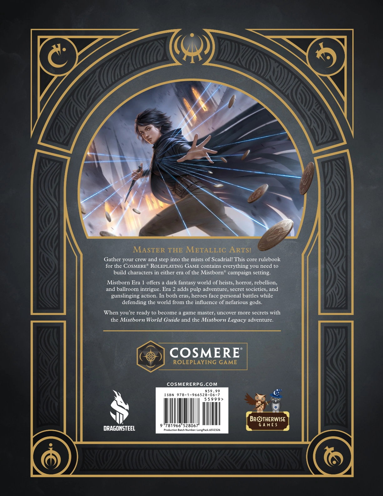

# 掌握金屬技藝（Metallic Arts）！

召集你的團隊，踏入司卡德利亞（Scadrial）的迷霧！這本《寰宇®角色扮演遊戲》（Cosmere Roleplaying Game）核心規則書，備齊了你在《迷霧之子®》（Mistborn）戰役（campaign）設定的任一時代建立角色（characters）所需的一切。

《迷霧之子》第 1 時代是一個充滿劫案、恐怖、反抗與舞會權謀的黑暗奇幻世界。第 2 時代則增添了通俗冒險、秘密社團與槍戰的刺激。不論在哪個時代，英雄們都得面對各自的人生難關，同時守護世界，抵禦邪惡神祇的影響。

當你準備好成為遊戲主持人（game master）時，就透過《迷霧之子世界指南》（Mistborn World Guide）與冒險《迷霧之子傳承》（Mistborn Legacy），揭開更多祕密。

寰宇®角色扮演遊戲

cosmererpg.com

Dragonsteel

Brotherwise Games

$59.99

ISBN 978-1-966528-06-7

55999>

9 781966 528067

印製批號：LongPack.6512326

