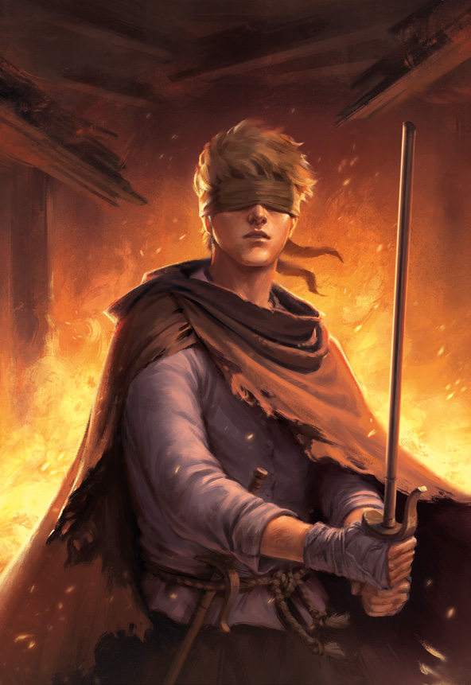
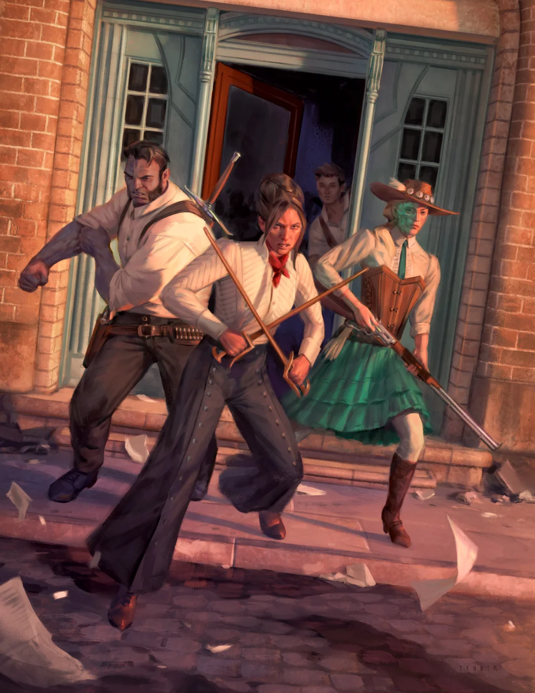

在遊戲中，你的角色（Character）會經歷冒險（Adventure）與逆境，結交朋友，也樹立敵人。在這個過程中，你會透過兩種重要方式成長。首先，完成個人的短期目標（goal）會讓你獲得獎勵（Reward），包括強大的物品、人脈與能力，詳見第 8 章。其次，隨著戰役（Campaign）進行，GM 會告訴你們，共同講述的故事何時達到了某個里程碑（Milestone）。這時，每位角色都會提升一個等級（Level），代表你在技能（skill）與經驗上有了重要的進展。

## 遊戲階層（Tier）

你逐步提升的等級分為五個階層。隨著冒險隊伍（Party）實力增長、面對更危險的敵人，每個階層都會帶來略有不同的遊戲體驗：

**階層 1（等級 1–5）。** 你正開始掌握自己的能力，認識自己在司卡德利亞（Scadrial）的定位。你會結交新盟友，面對主要影響自己與周遭人們的地方性挑戰，甚至可能發現自己原先不知道擁有的能力。

**階層 2（等級 6–10）。** 你開始處理司卡德利亞上更為重大的問題。到了這個階段，有些 PC 已經熟練運用金屬技藝（Metallic Arts）。如果你們在第二時代遊玩，你或許還會使用威力強大的火器。

**階層 3（等級 11–15）。** 你開始面對足以影響整個司卡德利亞的挑戰。有些金屬技藝使用者可能已成為專家，其他人則可能透過血金術（Hemalurgy），獲得危險的新能力。

**階層 4（等級 16–20）。** 你面對的挑戰不只侷限於司卡德利亞，還可能延伸至更廣大的寰宇（cosmere）。雖然你已大致掌握自己的能力，現在卻得面對來自其他世界的敵人，以及陌生的威脅。

**階層 5（等級 21+）。** 在等級 20 之後，你已接納自己的身分、能力與命運。你可能正帶領眾人對抗寰宇規模的威脅，也可能在功成身退之後，過著平靜的生活。

角色所處的階層主要決定目前冒險的規模，也會影響少數數據。例如，你會在每個階層的起始等級獲得血統（ancestry）天賦（talent），技能等級（Skill Rank）上限會隨階層提高，有些天賦也可能變得更強。

## 以較高等級開始遊戲

本遊戲的大多數角色都從等級 1 開始。如果 GM 請你們改為建立較高等級的角色，請參閱第 13 章的「以較高等級開始遊戲」。

## 提升等級

當你提升一個等級，也就是「升級」時，你的力量與能力都會增強，詳見本節的「角色成長」表。請依照以下步驟讓角色成長：

1. 將你的角色等級提高 1。
2. 如果這個等級有此標示，提升一項屬性（attribute）及其相關數據。
3. 增加你的生命值（Health）。
4. 獲得技能等級。
5. 獲得一項新天賦。

### 步驟 1：提升你的等級

你的角色從等級 1 開始遊戲。當 GM 表示你們的冒險達到一個里程碑時，你就提升一個等級。

### 步驟 2：提升一項屬性

如「角色成長」表所示，在等級 3、6、9、12、15 和 18 時，選擇一項屬性提高 1。（其他等級不會讓你提升屬性。）

你的屬性數值上限為 5，因此不能透過這個方式，將任何屬性提高到 5 以上。不過，如果某項天賦暫時提升了你的屬性，這項增加不受此上限限制。此外，少數效果能提高屬性數值上限，讓你能將一項屬性永久提升到 5 以上。

請記得在角色表上更新受此屬性影響的技能修正值（Skill Modifier）與其他數據。第 3 章的「屬性」一節會告訴你，每項屬性需要重新計算哪些數據。

第 1 章：角色建立 27

### 步驟 3：增加你的生命值

依照「角色成長」表中對應你等級的數量，同時增加生命值上限與目前生命值。

### 步驟 4：獲得技能等級

每次升級時，直到等級 20 為止，你都會獲得 2 個技能等級，自行選擇要提升哪些技能。如「角色成長」表所示，從等級 21 起，你必須在一個技能等級與一項天賦之間擇一獲得（見步驟 5），不能兩者兼得。

任何技能的等級都不能超過你目前階層的技能等級上限，詳見「角色成長」表的「技能等級上限」欄。不過，有些天賦能暫時提升技能，這類提升不受此上限限制。

除了上述限制，你可以將新獲得的技能等級分配給任何想要提升的技能，包括從金屬之子（Metalborn）路徑（Path）獲得的金屬技藝技能。

每獲得一個技能等級，就在角色表上該技能旁的方格做一個記號，並將該技能的修正值提高 1。

### 步驟 5：獲得一項天賦

每次升級時，直到等級 20 為止，你都會獲得一項天賦。如「角色成長」表所示，從等級 21 起，你必須在一個技能等級（見步驟 4）與一項天賦之間擇一獲得，不能兩者兼得。

此外，血統會在每個階層的起始等級（等級 1、6、11、16 和 21）給予你一項額外天賦（Bonus Talent）。第 2 章的「血統」一節詳細說明了你的血統可以選擇哪些額外天賦。

每次選擇天賦時，你都必須滿足其前提條件（Prerequisite），詳見下一節。

## 前提條件

某些能力，通常是天賦，會有前提條件。你必須先滿足這些條件，才能選擇該能力或受惠於它。例如，你可能必須先提高某項技能的等級，才能選擇特定天賦。此外，除了關鍵天賦（Key Talent）之外，每項天賦都要求你先擁有天賦樹（talent tree）中位於它前面的天賦，詳見第 4 章的「路徑成長」。

有些效果會永久提高你的數據，這些增加可用來滿足前提條件。但是，天賦、血金術尖刺（Hemalurgic Spike）及類似效果給予的暫時加成，不能用來滿足前提條件。例如，假設你是一名變成強壯人類（Human）外形的坎得拉（kandra），你的力量（Strength）會暫時增加。但是，這項加成會在你離開這個形體時結束，因此不能用來滿足要求特定力量數值的前提條件。

## 選擇獎勵

隨著角色成長，你會完成短期目標，並因此能選擇特殊獎勵（見第 8 章「短期目標與獎勵」）。你可以事先想一想，並與 GM 討論，你想朝哪些獎勵努力。如果你的角色成為使用稀有金屬的金屬之子，你很可能會花掉一些獎勵，取得這種昂貴金屬的來源。但這也會分散你原本能用來提升地位、資源（Resources），以及建立策略盟友關係的心力。

烈焰中的倖存者。

DEANDRA SCICLUNA

## 角色成長

| 階層 | 角色 等級 | 屬性 點數 | 獲得的 生命值 | 技能等級 上限 | 技能等級 | 獲得的天賦 |
| --- | --- | --- | --- | --- | --- | --- |
| 1 | 1 | 12 點屬性點數 | 10 + STR 生命值 | 2 | 4 個技能等級 （起始路徑另給予 +1） | 起始路徑給予 1 項天賦 加上血統額外天賦 |
|  | 2 | — | +5 生命值 | 2 | +2 個技能等級 | +1 項天賦 |
|  | 3 | +1 點屬性點數 | +5 生命值 | 2 | +2 個技能等級 | +1 項天賦 |
|  | 4 | — | +5 生命值 | 2 | +2 個技能等級 | +1 項天賦 |
|  | 5 | — | +5 生命值 | 2 | +2 個技能等級 | +1 項天賦 |
| 2 | 6 | +1 點屬性點數 | +4 + STR 生命值 | 3 | +2 個技能等級 | +1 項天賦，加上血統額外天賦 |
|  | 7 | — | +4 生命值 | 3 | +2 個技能等級 | +1 項天賦 |
|  | 8 | — | +4 生命值 | 3 | +2 個技能等級 | +1 項天賦 |
|  | 9 | +1 點屬性點數 | +4 生命值 | 3 | +2 個技能等級 | +1 項天賦 |
|  | 10 | — | +4 生命值 | 3 | +2 個技能等級 | +1 項天賦 |
| 3 | 11 | — | +3 + STR 生命值 | 4 | +2 個技能等級 | +1 項天賦，加上血統額外天賦 |
|  | 12 | +1 點屬性點數 | +3 生命值 | 4 | +2 個技能等級 | +1 項天賦 |
|  | 13 | — | +3 生命值 | 4 | +2 個技能等級 | +1 項天賦 |
|  | 14 | — | +3 生命值 | 4 | +2 個技能等級 | +1 項天賦 |
|  | 15 | +1 點屬性點數 | +3 生命值 | 4 | +2 個技能等級 | +1 項天賦 |
| 4 | 16 | — | +2 + STR 生命值 | 5 | +2 個技能等級 | +1 項天賦，加上血統額外天賦 |
|  | 17 | — | +2 生命值 | 5 | +2 個技能等級 | +1 項天賦 |
|  | 18 | +1 點屬性點數 | +2 生命值 | 5 | +2 個技能等級 | +1 項天賦 |
|  | 19 | — | +2 生命值 | 5 | +2 個技能等級 | +1 項天賦 |
|  | 20 | — | +2 生命值 | 5 | +2 個技能等級 | +1 項天賦 |
| 5 | 21+ | — | +1 生命值 | 5 | +1 個技能等級或 +1 項天賦，二擇一 （僅在等級 21 時另加血統額外天賦） |  |

第 1 章：角色建立 29

