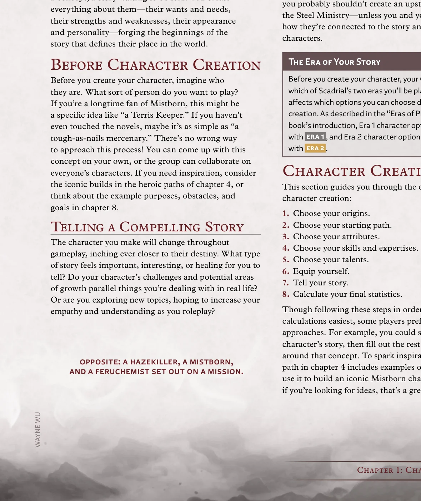
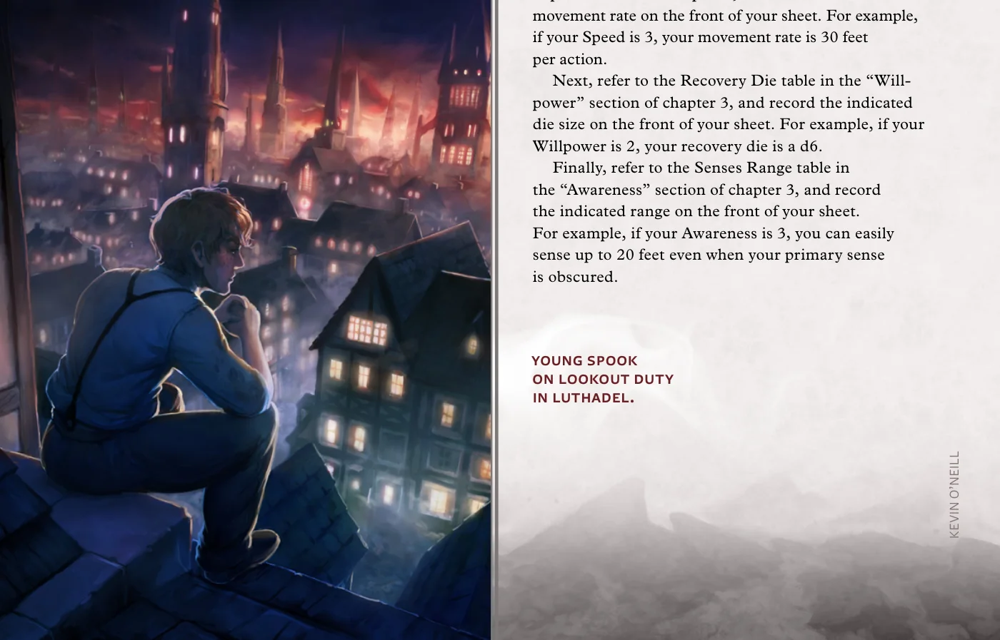
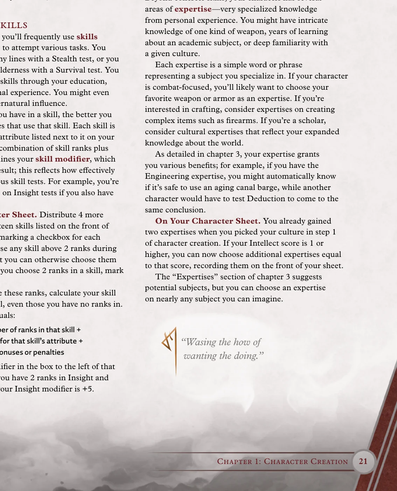
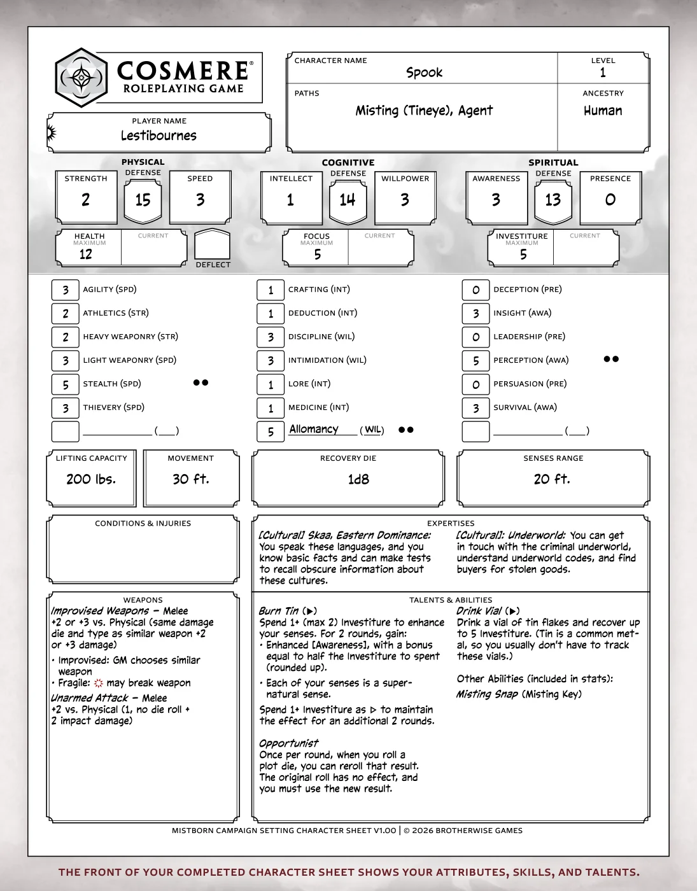
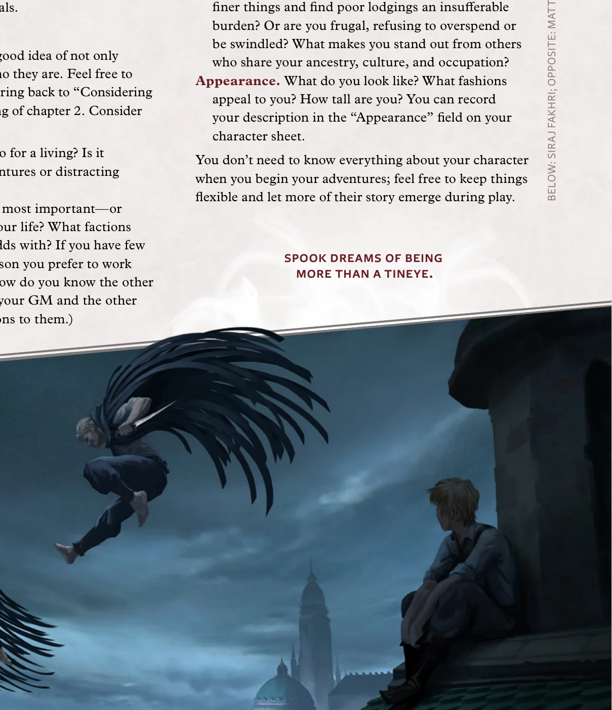
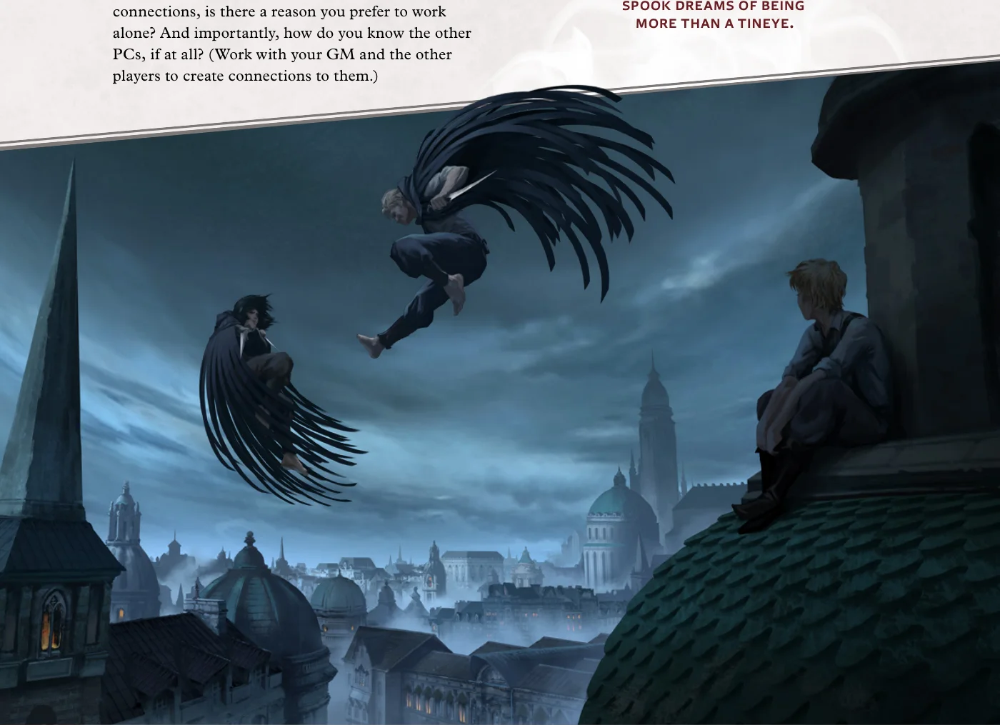
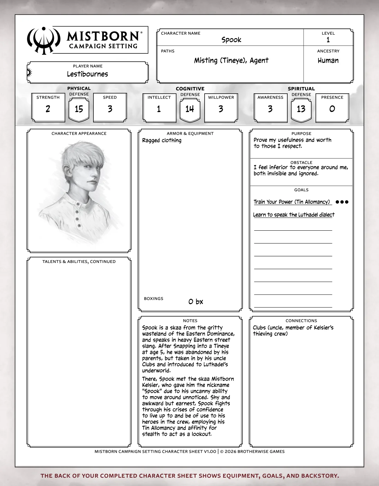

踏入司卡德利亞（Scadrial）的世界時，你首先要建立自己將在遊戲中扮演的角色（Character）。從某個角度來看，角色只是一組數據與能力，界定你在遊戲規則中能做哪些事。但更重要的是，角色是一個構想，是一段等待訴說的故事。你創造他的一切：渴望與需求、優點與弱點、外貌與個性，由此開啟他的故事，確立他在世界中的位置。

## 創角之前

建立角色之前，先想像他是誰。你想扮演什麼樣的人？如果你是《迷霧之子》（Mistborn）的老讀者，可能已有明確構想，例如「一位泰瑞司（Terris）守護者（Keeper）」。如果你從未讀過小說，想法也可以很簡單，例如「一個硬派傭兵」。構思角色沒有標準答案！你可以自己想，也可以和團體一起討論每個人的角色。如果需要靈感，可以參考第 4 章英雄路徑（heroic path）的經典構築，或想想第 8 章提供的核心目的（purpose）、內在障礙（obstacle）與短期目標（goal）範例。

### 講述引人入勝的故事

你建立的角色會在遊戲中持續改變，一步步走向自己的命運。對你而言，講述什麼樣的故事很重要、很有趣，或能帶來療癒？角色面臨的挑戰與可能成長的方向，是否呼應你在現實中正在經歷的事？還是你想探索新的主題，希望透過角色扮演，增進自己的同理心與理解？

### 一起創作故事

開始創角之前，GM 會告訴你冒險（Adventure）的大致主題。建立角色時，請做出能融入這個共同故事的選擇。例如，如果 GM 說每位玩家角色（Player Character）都屬於同一個地下團隊，你大概就不該建立一位正派的鋼鐵教廷（Steel Ministry）成員，除非你和 GM 能一起想出他與故事及其他角色之間的關聯。

### 故事的時代

建立角色之前，GM 會告訴你，這次遊戲設定在司卡德利亞兩個時代中的哪一個。這會影響創角時可用的選項。如本書導言〈遊戲時代〉側欄所述，第一時代的角色選項標示為 [第一時代]，第二時代的角色選項則標示為 [第二時代]。

## 創角步驟

本節會帶你完成創角的八個步驟：

1. 選擇你的出身。
2. 選擇你的起始路徑。
3. 選擇你的屬性。
4. 選擇你的技能與專長。
5. 選擇你的天賦。
6. 備妥裝備。
7. 講述你的故事。
8. 計算你的最終數據。

依照順序進行最容易計算，但有些玩家偏好其他方式。例如，你可以從角色的故事開始，再依這個構想補齊角色的其他部分。第 4 章的每個英雄路徑，都提供了如何運用該路徑，建立經典《迷霧之子》角色類型的範例。如果你正在尋找靈感，不妨從那裡開始。

對頁：一位殺霧者（Hazekiller）、一位迷霧之子與一位藏金術師（Feruchemist），踏上執行任務（Mission）的旅途。

WAYNE WU

第 1 章：角色建立 17

開始創角之前，請先準備一張寰宇 RPG（Cosmere RPG）角色紙，用來記錄角色的數據與獨特能力。你可以影印本書後方的角色紙，或至 CosmereRPG.com/character-sheets 下載並列印。

## 步驟 1：出身

確立角色的第一步，是選擇你的來處，包括血統（ancestry）與文化（Culture）。思考出身時，可以運用第 2 章開頭的提示，一併構思故事的其他面向；到了創角步驟 7，你會進一步確定這些細節。

### 選擇你的血統

血統代表你的種族淵源。在本遊戲中，你可以從司卡德利亞的三種智慧種族中選擇：人類（Human）、坎得拉（kandra）與克羅司混血（koloss-blooded）。血統會影響你的外貌，也可能依種族本身的能力，解鎖某些獨特的天賦（talent）。

**填寫角色紙。** 從第 2 章〈血統〉一節選擇一個血統，將名稱寫在角色紙正面，並將該血統的特殊規則記錄在對應欄位。（血統也會給予你一項或多項額外天賦（Bonus Talent）；你會在步驟 5 取得其他天賦時，一起選擇這些天賦。）

### 選擇你的文化

想想你成長的社會，或你待過最久的社會，可能不只一個。這些經歷以文化專長（cultural expertise）呈現，決定你最流利的語言，讓你知道如何在那些社會中應對進退，也很可能影響你看待世界的方式。

**填寫角色紙。** 從第 2 章〈文化〉一節選擇至多兩項文化專長，記錄在角色紙正面。（創角步驟 4 會進一步介紹專長（Expertise），你也可能在那時取得更多專長。）

### 選擇你的名字

名字蘊含力量。準備好為角色取名時，請將你的名字與角色的名字，都記錄在角色紙頂端。大多數人的名字會受到成長文化影響，第 2 章〈文化〉一節也為各種文化提供建議名字。不過，角色的名字不一定要取自自己的文化，你可以用任何喜歡的方式命名。畢竟，許多人在人生後來的階段，也會改用新名字。

## 步驟 2：起始路徑

玩家角色的大多數能力來自路徑（Path），反映角色的專精（specialty）、訓練與經驗。你選擇的路徑，會大幅影響你在遊戲中扮演的角色。如果你玩過其他角色扮演遊戲，可能熟悉「職業」這個概念；路徑與它相似，但彈性高得多。

一開始，你可以選擇英雄路徑，取得平凡但靈活的能力；也可以選擇金屬之子（Metalborn）路徑，取得鎔金術（Allomancy）或藏金術（Feruchemy）的力量（詳見第 5–6 章）。

### 選擇你的起始路徑

在這個創角步驟中，你要選擇第一條路徑，也就是起始路徑。第 4 章提供六個英雄路徑選項：密探（Agent）、使者（Envoy）、獵手（Hunter）、領袖（Leader）、學者（Scholar）與戰士（Warrior）。第 5 章則提供五個金屬之子路徑選項：單藏金術師（Ferring）、藏金術師、迷霧之子、迷霧人（Misting）與雙生師（Twinborn）。各路徑的簡介，請見「英雄路徑一覽」與「金屬之子路徑一覽」表。

日後，當角色提升等級（Level）並取得天賦時，你可以一直沿著同一路徑發展，從相同的天賦樹（talent tree）選擇新天賦。你也可以跨入多條路徑，有時稱為「多路徑發展」，依自己的故事，培養多樣化的能力。

**填寫角色紙。** 從第 4 章選擇一個英雄路徑，或從第 5 章選擇一個金屬之子路徑，將它記錄在角色紙正面，作為起始路徑。（目前只需要寫下路徑名稱，但你很可能會在步驟 4 從這個路徑獲得一項技能（skill），並在步驟 5 從中取得至少一項天賦。）

請注意，如果你選擇坎得拉血統，就不能選擇金屬之子路徑的天賦。

GAL OR

第 1 章：角色建立 18

### 英雄路徑一覽

| 路徑 | 主題 | 專精 | 起始技能 | 關鍵天賦（Key Talent）摘要 |
| --- | --- | --- | --- | --- |
| 密探 | 才華出眾的行動人員， 憑敏銳的心思或 靈巧的雙手解決問題。 | 調查員（Investigator） 反抗者（Rebel） 竊賊（Thief） | 洞察（Insight） | 伺機者（Opportunist）。每回合（Round） 可重擲一次劇情骰（Plot Die）。 |
| 使者 | 善於洞悉人心的談判者， 擅長影響他人。 | 信仰者（Faithful） 騙徒（Grifter） 導師（Mentor） | 紀律（Discipline） | 振奮人心（Rousing Presence）。使一位盟友（Ally） 獲得堅定（Determined）狀態。 |
| 獵手 | 身手精練的突擊手與 野外行家，尋找 並消除問題。 | 殺霧者 神射手（Sharpshooter） 追蹤者（Tracker） | 感知（Perception） | 追尋獵物（Seek Quarry）。選擇一個角色， 追蹤並在對抗他時獲得優勢（Advantage）。 |
| 領袖 | 沉著的指揮者， 引導他人發揮 最佳表現。 | 策劃者（Mastermind） 軍官（Officer） 政客（Politico） | 領導（Leadership） | 果斷指揮（Decisive Command）。為盟友的檢定（Test） 加入一顆 d4「指揮骰」（Command Die）。 |
| 學者 | 思路靈巧的思想家， 擅長規劃與建造。 | 發明家（Inventor）[第二時代] 策士（Strategist） 外科醫師（Surgeon） | 學識（Lore） | 博學（Erudition）。取得額外的技能等級（Skill Rank）， 並可重新分配。 |
| 戰士 | 憑技巧、蠻力或 不屈意志 奮戰的鬥士。 | 鬥士（Brawler） 槍手（Gunslinger）[第二時代] 士兵（Soldier） | 運動（Athletics） | 戒備架式（Vigilant Stance）。取得一種 能提升韌性的戰鬥架式。 |

### 金屬之子路徑一覽

| 路徑 | 主題 | 起始技能 | 金屬技藝（Metallic Arts） |
| --- | --- | --- | --- |
| 迷霧人 | 兩個時代皆有的專門鎔金術師（Allomancer）， 能成為精通單一能力的 無雙高手。 | 鎔金術 | 一種鎔金能力。 |
| 藏金術師* [第一時代] | 傳說中的金屬之子， 能在每一種金屬意識庫（Metalmind）中 儲存與汲取特質。 | 無 | 所有藏金能力。 |
| 迷霧之子* [第一時代] | 強大而令人畏懼的金屬之子， 能協同運用 所有鎔金能力。 | 無 | 所有鎔金能力。 |
| 單藏金術師 [第二時代] | 精通一種金屬意識庫的藏金術師， 能隨意儲存與汲取 自身的一種特質。 | 藏金術 | 一種藏金能力。 |
| 雙生師 [第二時代] | 唯一能靈活結合 鎔金術與藏金術的金屬之子。 | 紀律 | 一種鎔金能力與 一種藏金能力。 |

\*建議有經驗的玩家選擇。

## 步驟 3：屬性

角色的先天特質，以六種屬性（attribute）呈現：力量（Strength）、速度（Speed）、智力（Intellect）、意志（Willpower）、察覺（Awareness）與風采（Presence）。它們是技能、身心極限及其他面向的基礎，詳見第 3 章。

### 選擇你的屬性

想想哪些屬性最能代表你的優勢。大多數人類、坎得拉與克羅司混血的屬性值介於 0 到 5，數值越高，代表你在該方面越出色。提升等級時，你還能進一步提高屬性值。

**填寫角色紙。** 將 12 點以任意方式分配到六種屬性。你不必在每種屬性上投入點數，0 也是有效的屬性值。在這個創角步驟中，任何一種屬性都不能投入超過 3 點。例如，你可以分配為 0、3、2、3、3、1。將選定的各項屬性值記錄在角色紙正面。附近的防禦（Defense）、生命值（Health）、專注點（Focus）與授予（Investiture）欄位先不用填；這些數據會在步驟 8 計算。

### 記錄相關數據

屬性值決定你在相關領域的表現，包括但不限於以下項目：

- 力量決定你的舉重能力（Lifting Capacity），代表你能舉起的最大重量。

- 速度決定你的移動速率（Movement Rate），代表你在壓力下移動的速度與距離。

- 意志決定你的恢復骰（Recovery Die），代表你恢復生命值與專注點的效率。

- 察覺決定你的感知範圍（Senses Range）。當主要感官受到干擾時，例如身處濃霧或無光的房間，感知範圍決定你能以其他感官或能力，例如嗅覺、觸覺或直覺，感知多遠的事物。

智力與風采和上述屬性同樣重要，但在這個步驟中，不需要用它們來填寫角色紙上的其他數據。

**填寫角色紙。** 首先，查閱第 3 章〈力量〉一節的「舉重能力」表，將對應的舉重能力記錄在角色紙正面。例如，力量為 2，舉重能力就是 200 磅。

接著，查閱第 3 章〈速度〉一節的「移動速率」表，將對應的移動速率記錄在角色紙正面。例如，速度為 3，移動速率就是每行動（Action）30 呎。

接著，查閱第 3 章〈意志〉一節的「恢復骰」表，將對應的骰子面數記錄在角色紙正面。例如，意志為 2，恢復骰就是 d6。

最後，查閱第 3 章〈察覺〉一節的「感知範圍」表，將對應的範圍記錄在角色紙正面。例如，察覺為 3，即使主要感官受阻，你仍能輕易感知 20 呎內的事物。

年輕的鬼影（Spook）在陸沙德（Luthadel）擔任哨兵。

KEVIN O’NEILL

## 步驟 4：技能與專長

接下來，思考角色磨練了哪些技能與專長；這些與先天屬性不同。

### 取得起始技能等級

你在步驟 2 選擇的起始路徑，多半會給予一項相關的起始技能；這項技能對從該路徑起步的角色而言，是重要的核心。

**填寫角色紙。** 如果路徑提供起始技能，你就在該技能免費獲得一個技能等級（見前面的路徑一覽表，或該路徑的〈關鍵天賦〉一節）。在角色紙正面，勾選該技能旁的一個方格。

### 選擇你的技能

遊戲時，你會經常使用技能（詳見第 3 章）嘗試各種任務。你可能以隱匿（Stealth）檢定潛過敵方防線，或以求生（Survival）檢定在野外覓食。這些技能可能來自教育、工作或個人經歷，你甚至可能認為其中某些是超自然力量的影響。

一項技能的技能等級越高，你就越擅長使用它的檢定與能力。每項技能也會受到角色紙上所列對應屬性的強化。技能等級加上屬性值，決定你的技能修正值（Skill Modifier），你會將它加到檢定結果，反映你進行各種技能檢定（Skill Test）的能力。例如，察覺越高，你的洞察檢定也越容易成功。

**填寫角色紙。** 在角色紙正面的十八項技能中，額外分配 4 個技能等級，每個技能等級勾選一個方格。創角時，任何技能都不能超過 2 個技能等級；除此之外，你可以自由選擇分配方式。（如果選擇讓一項技能有 2 個技能等級，就在它旁邊勾選兩個方格。）分配完成後，計算每項技能的技能修正值，即使沒有投入任何技能等級的技能也要計算。技能修正值等於：

該技能的技能等級 + 該技能對應的屬性值 + 任何加值或減值

將每項技能的修正值記錄在該技能左側的方格。例如，洞察有 2 個技能等級，察覺為 3，你的洞察修正值就是 +5。

### 特殊技能

所有角色都能使用角色紙上的十八項技能。不過，你也可能獲得額外技能，代表你對金屬技藝的修習（見第 6 章〈使用金屬技藝〉），或寰宇（cosmere）中的其他奇幻要素。如果獲得額外技能，將它記錄在技能清單末端的空白行。你必須先取得該技能，才能在其中投入技能等級。

### 選擇你的專長

除了明確的技能，角色還有幾個專長領域，也就是從親身經歷累積的高度專門知識。你可能深入了解某種武器（Weapon）、多年鑽研某門學問，或對某個文化十分熟悉。

每項專長都以簡單的詞語或短句，代表你精通的主題。如果角色以戰鬥（Combat）為重心，你很可能會想選擇自己最喜歡的武器或護甲（Armor）作為專長。如果你對工藝（Crafting）有興趣，可以考慮製作槍械等複雜物品的專長。如果你是學者，可以考慮文化專長，反映你對世界更廣泛的認識。

如第 3 章詳述，專長能帶來各種好處。例如，如果你有工程學（Engineering）專長，或許能直接知道一艘老舊運河駁船能否安全使用；其他角色則必須進行推理（Deduction）檢定，才能得到同樣的結論。

**填寫角色紙。** 你在創角步驟 1 選擇文化時，已取得兩項專長。如果智力值為 1 或以上，你現在可以額外選擇等同該數值數量的專長，記錄在角色紙正面。第 3 章〈專長〉一節提供了一些建議主題，但你幾乎可以選擇任何想得到的主題作為專長。

> 「想做的，怎麼做的。」（“Wasing the how of wanting the doing.”）

第 1 章：角色建立 21

鬼影的角色紙，由 Lestbournes 扮演一位 1 級人類迷霧人（錫眼（Tineye））。填寫範例示範如何加入屬性、技能與天賦。

### 角色紙範例：正面

寰宇®角色扮演遊戲

|欄位|填寫內容|
|---|---|
|玩家姓名|Lestbournes|
|角色姓名|鬼影|
|等級|1|
|路徑|迷霧人（錫眼）、密探|
|血統|人類|
|力量|2|
|實體防禦（Physical Defense）|15|
|速度|3|
|智力|1|
|認知防禦（Cognitive Defense）|14|
|意志|3|
|察覺|3|
|靈性防禦（Spiritual Defense）|13|
|風采|0|
|生命值上限|12|
|目前生命值|留白|
|偏轉值（Deflect）|留白|
|專注點上限|5|
|目前專注點|留白|
|授予上限|5|
|目前授予|留白|

|技能（屬性）|修正值|已標記的技能等級|
|---|---|---|
|敏捷（Agility，SPD）|3|0|
|運動（STR）|2|0|
|重型武器（Heavy Weaponry，STR）|2|0|
|輕型武器（Light Weaponry，SPD）|3|0|
|隱匿（SPD）|5|2|
|竊術（Thievery，SPD）|3|0|
|工藝（INT）|1|0|
|推理（INT）|1|0|
|紀律（WIL）|3|0|
|威嚇（Intimidation，WIL）|3|0|
|學識（INT）|1|0|
|醫學（Medicine，INT）|1|0|
|鎔金術（WIL）|5|2|
|欺騙（Deception，PRE）|0|0|
|洞察（AWA）|3|0|
|領導（PRE）|0|0|
|感知（AWA）|5|2|
|說服（Persuasion，PRE）|0|0|
|求生（AWA）|3|0|

另有兩行額外技能欄留白。

|欄位|填寫內容|
|---|---|
|舉重能力|200 磅|
|移動|30 呎|
|恢復骰|1d8|
|感知範圍|20 呎|
|狀態與傷勢|留白|

**專長。**

- [文化] 司卡（skaa）、東方統御區（Eastern Dominance）：你會說這些語言，知道基本常識，也能進行檢定，回想與這些文化有關的冷僻資訊。
- [文化]：地下社會：你能聯繫犯罪地下社會、了解地下社會的暗語，並找到收購贓物的買家。

**武器。**

*臨時武器 — 近戰（Melee）*

+2 或 +3 對抗實體（Physical）（傷害（Damage）骰與類型和類似武器相同，+2 或 +3 傷害）

- 臨時（Improvised）：由 GM 選擇類似武器
- 易碎（Fragile）：[變故] 可能使武器損壞

*徒手攻擊（Attack） — 近戰*

+2 對抗實體（1，不擲骰 + 2 衝擊傷害（Impact Damage））

**天賦與能力。**

*燃燒錫（Burn Tin）（[1行動]）*

花費 1+（最多 2）授予，強化感官。在 2 回合內獲得：

- 增益（Enhanced）[察覺]，加值等於所花費授予的一半（無條件進位）。
- 你的每種感官都成為超自然感官。

以 [自由行動] 花費 1+ 授予，使效果額外維持 2 回合。

*伺機者*

每回合一次，當你擲劇情骰時，可以重擲該結果。原本的擲骰不生效，你必須使用新結果。

*飲用金屬液（Drink Vial）（[自由行動]）*

喝下一小瓶錫（Tin）屑，恢復至多 5 授予。（錫是常見金屬，因此通常不需要追蹤這些小瓶的數量。）

其他能力（已包含在數據中）：

*迷霧人綻裂（Misting Snap）（迷霧人關鍵天賦）*

《迷霧之子》戰役設定角色紙 V1.00 | © 2026 BROTHERWISE GAMES

填好的角色紙正面，呈現你的屬性、技能與天賦。

第 1 章：角色建立 22

## 步驟 5：天賦

每次提升等級時，路徑都讓你能從樹狀選項中選擇天賦。每項天賦都會給予一種好處或能力，代表使你與其他角色有所區別的專門本領。

### 取得你的關鍵天賦

你在步驟 2 選擇的起始路徑，決定了第一項天賦。這項關鍵天賦是一種重要能力，路徑中的其他天賦可能會進一步強化它。

**填寫角色紙。** 你取得起始路徑中的第一項天賦，詳見該路徑天賦樹頂端。將這項天賦記錄在角色紙正面。

### 選擇血統天賦

你在步驟 1 選擇的血統，會給予一項或多項額外天賦。

如果你是坎得拉，就取得自然形態（Natural Form）與坎得拉偽裝（Kandra Disguise）天賦（見第 2 章〈選擇坎得拉血統〉）。

如果你是克羅司混血，就取得克羅司耐力（Koloss Stamina）天賦（見第 2 章〈選擇克羅司混血血統〉）。

如果你是人類，就從英雄路徑額外取得一項天賦（見第 2 章〈選擇人類血統〉）。你可以選擇現有路徑中的另一項天賦，也可以選擇其他路徑的第一項天賦。

**填寫角色紙。** 依第 2 章〈血統〉一節的規則，選擇額外天賦，記錄在角色紙正面。如果天賦會影響其他數據，也將變動記錄在對應欄位。

## 步驟 6：裝備

為了反映角色的背景與興趣，你會取得一個起始套組（starting kit），內含裝備（Equipment）、貨幣與其他資源。有些套組還提供無形的好處，例如讓你與一位贊助者（Patron）建立連結（第 8 章會介紹），或加速你發現自己的金屬技藝能力（第 5 章會介紹）。

### 選擇你的起始套組

每個角色一開始都會取得第 7 章中的一個起始套組。套組的名稱不會限制你的故事，你可以任選喜歡的套組，再決定自己如何擁有這些物品與資源。例如，如果選擇貴族（Noble）套組，你可能從陸沙德的貴族家族繼承了這些物品，也可能是在司卡地下社會的犯罪生涯中，非法取得它們。

**填寫角色紙。** 從第 7 章選擇一個起始套組，將內容記錄在角色紙對應欄位，例如「武器」或「護甲與裝備」。

### 購買更多裝備

如果套組給予盒金（Boxing），也就是司卡德利亞的通用貨幣，你可以視需要用來購買更多裝備，也可以把盒金留到以後再用。你可以購買第 7 章列出的任何武器、護甲或裝備，但別忘了注意價格！初出茅廬的角色，還買不起其中許多裝備。

**填寫角色紙。** 如果購買額外裝備，將它記錄在角色紙對應欄位。

### 記錄你的偏轉值

有些護甲能降低衝擊、銳利（Keen）與能量傷害（Energy Damage）的影響（見第 3 章〈偏轉值〉）。偏轉值決定你能忽略多少這些類型的傷害。

**填寫角色紙。** 如果你在這個步驟中取得護甲，將它的偏轉值記錄在角色紙正面。否則，你的偏轉值多半是 0。

## 步驟 7：故事

現在你已經知道自己的能力，也大致了解哪些經歷塑造了你。接下來，要進一步確定在走到這一刻之前，你是什麼樣的人；更重要的是，今天的你又是誰。

### 選擇你的核心目的與內在障礙

核心目的是你的靈魂，也是你存在的理由。它不具有特定的機制效果，而是推動你、定義你，並激勵你在未來冒險中追尋遠大目標的動力。

相對地，內在障礙則是一再阻撓你實現核心目的的事物。它可能是驕傲、衝動、貪婪，或任何其他妨礙你發揮全部潛能的特質。

**填寫角色紙。** 依第 8 章〈核心目的與內在障礙〉一節的指引，選擇一個核心目的與至少一個內在障礙，將選擇記錄在角色紙背面。

### 選擇你的短期目標

角色在冒險中親自努力實現的具體目標，以短期目標呈現。它們是角色及其成長的重要部分，請仔細思考。每個短期目標都應該是你試圖完成的事，可以迫切如「逃出牢獄」，也可以雄心勃勃如「殺死統御主（Lord Ruler）」。短期目標不只界定你目前的動力，也讓你在冒險中有機會獲得強大的物品、人脈與資源。如第 8 章所述，完成一個短期目標時，你就會解鎖

第 1 章：角色建立 23

一項獎勵（Reward）。獎勵可能是物品，例如天金（Atium）或炸藥；可能是關係，例如旅伴或贊助者；也可能是身分地位的提升，例如取得貴族身分，以及其他形式的獎勵。

**填寫角色紙。** 依第 8 章〈短期目標〉一節的指引，一開始先建立一到兩個短期目標，記錄在角色紙背面。各目標右側的方格暫時不用理會；遊戲進行後，你會用它們標記達成短期目標的進度。

### 講述你的故事

到這時，你大概已經很清楚角色不只有什麼身分，也了解他是什麼樣的人。你可以參考第 2 章開頭〈思考你的出身〉，自由補充故事細節。可以考慮以下事項：

**職業。** 你靠什麼維生？這份工作將你帶向冒險，還是讓你分心、無暇冒險？

**關係。** 你生命中最重要，或最麻煩的人是誰？你與哪些派系結盟，或彼此敵對？如果你很少與人來往，是否有什麼原因讓你偏好獨自行事？還有一件重要的事：你認識其他 PC 嗎？如果認識，又是怎麼認識的？（和 GM 及其他玩家一起，建立你與其他角色的關係。）

**忠誠。** 你對朋友或派系的忠誠，是否曾與自己的價值觀或目標衝突？例如，你或許曾協助鎢都（Urteau）的「公民」（Citizen）掌權，如今卻對他治理這座城市的方式感到不安。

**個性。** 角色的個性會隨遊戲逐漸明確，但現在可以先勾勒輪廓。你喜歡什麼、討厭什麼？有什麼怪癖？整體性情如何？你享受精緻生活，覺得簡陋住宿令人難以忍受？還是節儉度日，不願多花錢，也不肯受人坑騙？與血統、文化和職業相同的人相比，你有什麼與眾不同之處？

**外貌。** 你長什麼樣？你喜歡什麼打扮？身高多少？你可以將描述記錄在角色紙的「外貌」欄位。

展開冒險時，你不必已經了解角色的一切。盡量保留彈性，讓更多故事在遊戲中逐漸浮現。

鬼影夢想著成為不只是一名錫眼的人。

下圖：SIRAJ FAKHRI；對頁：MATT DEMINO

鬼影的角色紙，由 Lestbournes 扮演一位 1 級人類迷霧人（錫眼）與密探。鬼影的鉛筆素描旁，列有護甲與裝備、背景筆記、向尊敬的人證明自身用處與價值的核心目的，以及他與卡西爾（Kelsier）團隊的關係。

### 角色紙範例：背面

迷霧之子®戰役設定

|欄位|填寫內容|
|---|---|
|玩家姓名|Lestbournes|
|角色姓名|鬼影|
|等級|1|
|路徑|迷霧人（錫眼）、密探|
|血統|人類|
|力量|2|
|實體防禦|15|
|速度|3|
|智力|1|
|認知防禦|14|
|意志|3|
|察覺|3|
|靈性防禦|13|
|風采|0|
|角色外貌|鬼影的肖像|
|護甲與裝備|破舊衣物|
|盒金|0 bx|
|核心目的|向我尊敬的人，證明我的用處與價值。|
|內在障礙|我覺得自己比不上身邊所有人，既無人看見，也沒人在意。|
|天賦與能力（續）|留白|

**短期目標。**

- 訓練你的能力（錫鎔金術）— 三個進度圓圈已標記。
- 學會陸沙德方言 — 沒有標記的進度圓圈。

其餘短期目標行留白。

**筆記。**

鬼影是出身東方統御區荒涼廢土的司卡，說話帶著濃重的東方街頭俚語。5 歲時，他綻裂（Snap）成為錫眼，之後遭到父母遺棄。但他的叔叔歪腳（Clubs）收留了他，帶他進入陸沙德的地下社會。

在那裡，鬼影遇見了司卡迷霧之子卡西爾。由於他總能神出鬼沒、不引人注意地移動，卡西爾給了他「鬼影」這個綽號。鬼影害羞、笨拙，卻十分真誠。他努力克服信心危機，希望不辜負團隊中那些他視為英雄的人，並成為他們的助力。他運用錫鎔金術與擅長潛行的本事，擔任哨兵。

**人脈（Connections）。**

歪腳（叔叔，卡西爾盜賊團的成員）

《迷霧之子》戰役設定角色紙 V1.00 | © 2026 BROTHERWISE GAMES

填好的角色紙背面，呈現裝備、短期目標與背景故事。

第 1 章：角色建立 25

## 步驟 8：最終計算

恭喜，你已做完所有重要決定！創角的最後一步，是依本節指示，計算並記錄其餘數據。第 3 章會詳細說明屬性如何影響這些數據，以及遊戲的其他面向。

計算時，別忘了加上天賦、裝備與其他效果提供的加值。例如，沉著（Collected）天賦會使認知防禦與靈性防禦各增加 2。

### 計算資源池

冒險時，你會動用三種資源池。每種資源都有一個上限，並會在遊戲過程中經常消耗與恢復（見第 3 章〈生命值、專注點與授予〉）。

#### 生命值

這項實體資源代表你的耐力，以及抵抗輕微傷害的能力，並隨著提升等級而增加。1 級時，生命值上限等於：

10 + 你的力量屬性 + 任何加值或減值

將生命值上限記錄在角色紙正面，再以相同數字填入目前生命值。例如，1 級時，如果力量為 2，且沒有相關天賦或其他效果，生命值上限與目前生命值都是 12。

#### 專注點

這項意識（Cognitive）資源代表心智決心，以及抵抗分心與情緒困擾的能力。專注點上限等於：

2 + 你的意志屬性 + 任何加值或減值

將專注點上限記錄在角色紙正面，再以相同數字填入目前專注點。例如，如果意志為 2，且沒有相關天賦或其他效果，專注點上限與目前專注點都是 4。

#### 授予

如果你選擇迷霧之子、迷霧人或雙生師作為起始路徑，這項靈魂（Spiritual）資源代表你燃燒金屬的能力。如果選擇其他路徑，你就無法使用授予，應將這個欄位留白。對迷霧之子、迷霧人與雙生師路徑而言，授予上限等於：

2 + 你的察覺或風采（取較高者）+ 任何加值或減值

將授予上限記錄在角色紙正面。接著，將目前授予記錄為 0。你需要燃燒一些金屬，才能獲得最初的授予。例如，如果風采為 2，且沒有相關天賦或其他效果，授予上限就是 4，目前授予則為 0。

### 計算防禦

三種防禦代表你抵抗攻擊、脅迫及其他不想承受的效果的能力。防禦越高，對手對你進行技能檢定時，就越難成功（見第 3 章〈防禦〉一節）。將三種防禦記錄在角色紙正面：

**實體防禦。** 實體防禦等於 10 + 你的力量屬性 + 你的速度屬性 + 任何加值或減值。例如，如果力量為 2、速度為 3，且沒有相關天賦或其他效果，實體防禦就是 15。

**認知防禦。** 認知防禦等於 10 + 你的智力屬性 + 你的意志屬性 + 任何加值或減值。例如，如果智力為 2、意志為 2，認知防禦就是 14。

**靈性防禦。** 靈性防禦等於 10 + 你的察覺屬性 + 你的風采屬性 + 任何加值或減值。例如，如果察覺為 3、風采為 0，靈性防禦就是 13。

### 填寫其餘欄位

角色紙只剩幾個欄位需要填寫：

**等級。** 在角色紙正面記錄角色為 1 級。這代表你目前的力量與經驗；隨著你繼續在寰宇中冒險，等級也會提高。（見本章〈角色成長〉一節。）

**狀態與傷勢。** 目前，你沒有任何生效中的狀態。這個欄位會用來追蹤遊戲中出現的暫時效果（見第 9 章〈狀態〉與〈傷勢〉）。

**筆記。** 你可以在這個欄位記錄任何想記下的事。

**人脈。** 冒險時，你會在這個欄位記錄自己與 NPC 及派系建立的特殊人脈。除非你在先前的創角過程中已取得人脈，否則目前應將這個欄位留白。（見第 8 章〈人脈〉。）

### 開始遊戲！

角色紙填好了，你也準備好開始遊戲了！

第 1 章：角色建立 26