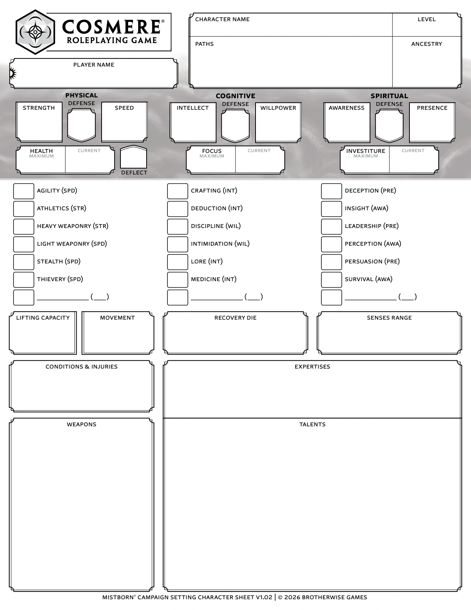
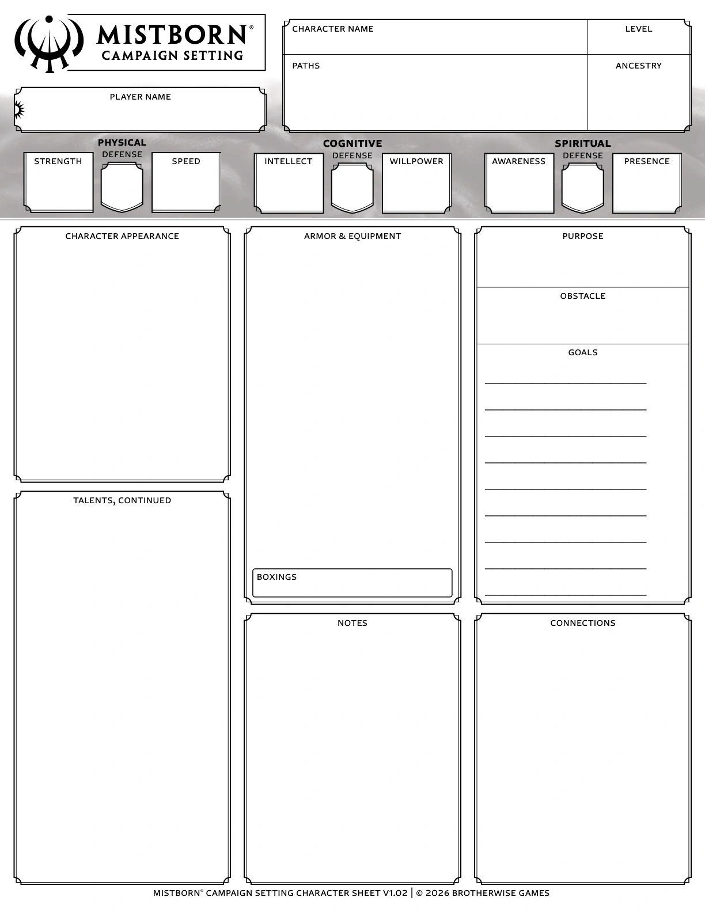
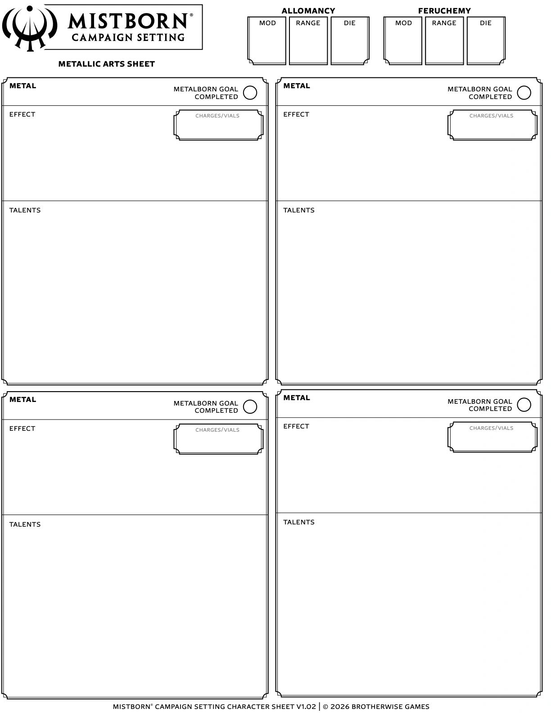

# 寰宇®角色扮演遊戲（Cosmere® Roleplaying Game）

- 玩家姓名
- 角色姓名
- 等級（Level）
- 路徑（Paths）
- 血統（Ancestry）
- 實體防禦（Physical Defense）
- 力量（Strength）
- 速度（Speed）
- 認知防禦（Cognitive Defense）
- 智力（Intellect）
- 意志（Willpower）
- 靈性防禦（Spiritual Defense）
- 察覺（Awareness）
- 風采（Presence）
- 生命值（Health）：上限；目前值
- 偏轉值（Deflect）
- 專注點（Focus）：上限；目前值
- 授予（Investiture）：上限；目前值
- 敏捷（Agility）（SPD）
- 運動（Athletics）（STR）
- 重型武器（Heavy Weaponry）（STR）
- 輕型武器（Light Weaponry）（SPD）
- 隱匿（Stealth）（SPD）
- 竊術（Thievery）（SPD）
- _____________ ( ___ )
- 工藝（Crafting）（INT）
- 推理（Deduction）（INT）
- 紀律（Discipline）（WIL）
- 威嚇（Intimidation）（WIL）
- 學識（Lore）（INT）
- 醫學（Medicine）（INT）
- _____________ ( ___ )
- 欺騙（Deception）（PRE）
- 洞察（Insight）（AWA）
- 領導（Leadership）（PRE）
- 感知（Perception）（AWA）
- 說服（Persuasion）（PRE）
- 求生（Survival）（AWA）
- _____________ ( ___ )
- 舉重能力（Lifting Capacity）
- 移動（Movement）
- 恢復骰（Recovery Die）
- 感知範圍（Senses Range）
- 狀態與傷勢（Conditions & Injuries）
- 專長（Expertises）
- 武器（Weapons）
- 天賦（Talents）

迷霧之子®戰役設定角色紙（Mistborn® Campaign Setting Character Sheet）v1.02 | © 2026 Brotherwise Games

# 迷霧之子®戰役設定（Mistborn® Campaign Setting）

- 玩家姓名
- 角色姓名
- 等級（Level）
- 路徑（Paths）
- 血統（Ancestry）
- 實體防禦（Physical Defense）
- 力量（Strength）
- 速度（Speed）
- 認知防禦（Cognitive Defense）
- 智力（Intellect）
- 意志（Willpower）
- 靈性防禦（Spiritual Defense）
- 察覺（Awareness）
- 風采（Presence）
- 角色外觀
- 天賦，續（Talents, Continued）
- 護甲與裝備（Armor & Equipment）
- 盒金（Boxings）
- 核心目的（Purpose）
- 內在障礙（Obstacle）
- 短期目標（Goals）
- ___________________________
- ___________________________
- ___________________________
- ___________________________
- ___________________________
- ___________________________
- ___________________________
- ___________________________
- ___________________________
- 筆記
- 人脈（Connections）

迷霧之子®戰役設定角色紙（Mistborn® Campaign Setting Character Sheet）v1.02 | © 2026 Brotherwise Games

# 迷霧之子®戰役設定（Mistborn® Campaign Setting）

## 金屬技藝記錄紙（Metallic Arts Sheet）

- 鎔金術（Allomancy）：修正值（Mod）；距離（Range）；骰子（Die）
- 藏金術（Feruchemy）：修正值；距離；骰子

### 左上

- 金屬
- 金屬之子短期目標（Metalborn Goal）已完成：○
- 效果
- 充能（Charges）／小瓶（Vials）
- 天賦（Talents）

### 右上

- 金屬
- 金屬之子短期目標已完成：○
- 效果
- 充能／小瓶
- 天賦

### 左下

- 金屬
- 金屬之子短期目標已完成：○
- 效果
- 充能／小瓶
- 天賦

### 右下

- 金屬
- 金屬之子短期目標已完成：○
- 效果
- 充能／小瓶
- 天賦

迷霧之子®戰役設定角色紙（Mistborn® Campaign Setting Character Sheet）v1.02 | © 2026 Brotherwise Games

