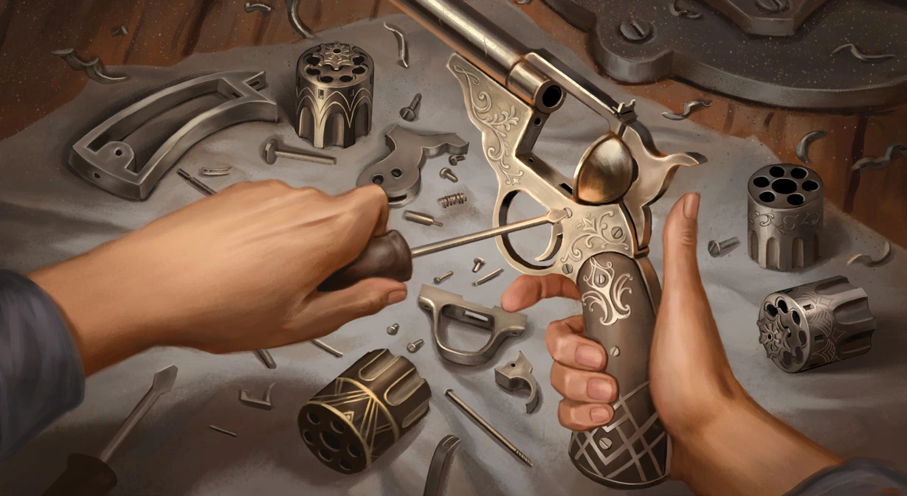
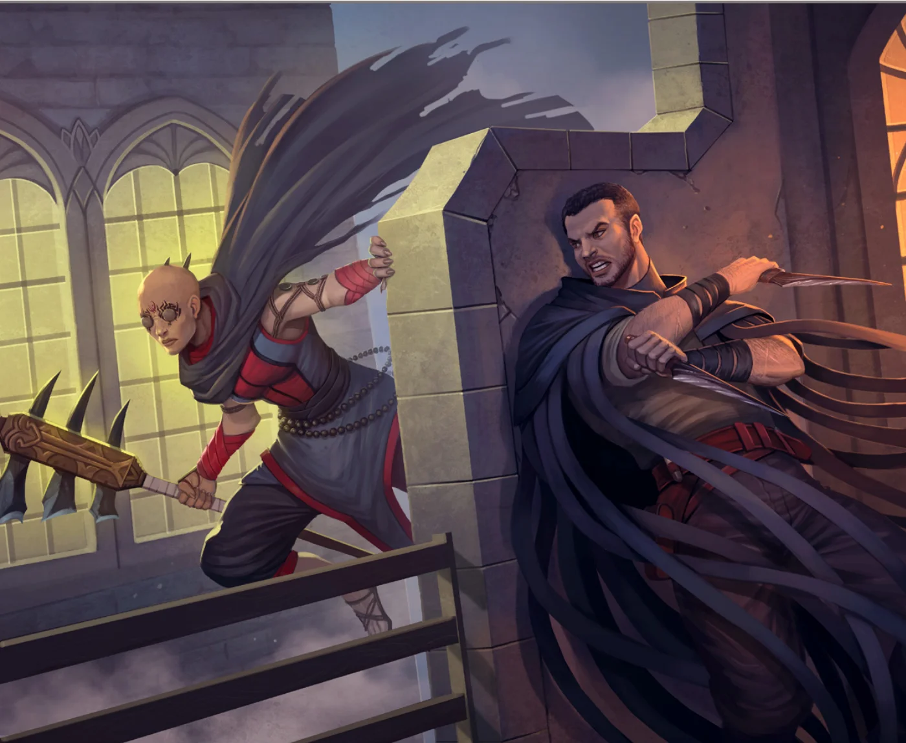

每個角色都會透過成長經歷、訓練、興趣與其他人生體驗，累積獨有的知識領域。當你的角色鑽研某個領域，就會取得該主題的專長（Expertise）。這代表你在特定領域擁有獨到的知識與能力，是沒有該專長的角色無法比擬的。

### 使用專長

如角色建立（Character Creation）步驟 4 所述，你的角色起始擁有第 2 章的兩項文化專長（cultural expertise），以及數量等同智力（Intellect）屬性（attribute）值的額外專長。每當智力值增加 1，你就能再取得一項專長。其他創角選擇、天賦（talent）、獎勵、冒險經驗或休整期（Downtime）的訓練，也可能讓你取得專長（見第 9 章〈訓練（Training）〉）。

大多數專長來源會指定你取得哪一項專長，或要求你從特定類別中選擇（見〈專長類別〉）。若未指定，你可以自行選擇一項護甲專長（Armor Expertise）、文化專長、實用專長（Utility Expertise）或武器專長（Weapon Expertise）。（除非 GM 破例允許，否則不能選擇特殊專長（Specialist Expertise）。）

#### 選擇專長

專長不像屬性、防禦（Defense）與技能（skill），並沒有固定、有限的清單。每項專長都指向一個概括的知識領域，但角色如何取得這項專長，以及它涵蓋哪些知識，則由你決定。例如，同樣擁有軍旅生活（Military Life）專長，一個角色可能是在最後帝國（Final Empire）駐軍服役的司卡（skaa），另一個則可能是研究古代戰爭的泰瑞司（Terris）守護者（Keeper）。雖然兩人擁有相同專長，知識卻可能截然不同。

選擇專長時，想想角色對哪些文化、武器、護甲或學問有豐富經驗。這些經驗可以來自背景故事，也可以受到當前冒險的影響。〈專長類別〉一節列出一些常見專長，但只要 GM 允許，你也可以自行創造新的專長。

專長越具體，對敘事的影響就越大。例如，角色在最後帝國時代擁有宗教（Religion）專長，通常會知道鋼鐵教廷（Steel Ministry）的事，但要回想早已遭統御主（Lord Ruler）消滅的宗教冷知識，可能仍須進行學識（Lore）檢定。反過來說，只要 GM 允許，你也可以選擇一項已消亡宗教的專長。這項專長無法協助你進行與鋼鐵教廷有關的檢定，卻能讓你不必檢定，就知道更多關於該古老宗教的事。

### 專長的益處

專長不會直接在角色紙上增加能力，但能在遊戲中提供多種協助。

#### 基本知識

你會自動知道專長領域的所有基本事實。其他角色可能得進行學識、推理（Deduction）或洞察（Insight）檢定，才能對該主題有所了解；你則不必檢定，就能回想起基本資訊。

#### 深入思考

除了自動掌握基礎知識，你對特定主題的深入了解，也讓你能嘗試其他角色根本無法進行的檢定。例如，隊伍想弄清楚敵人精密的實驗性火器如何運作，只有擁有軍火工藝（Munitions Crafting）專長的角色，才能進行推理檢定取得這項資訊。

進行其他與專長相關的檢定時，即使結果相同，你成功後得到的資訊，也可能比沒有經驗的角色更多。

#### 專業製作

有些專門物品必須擁有特定專長才能製作（見第 7 章〈工藝（Crafting）〉）。

#### 物品的專家特性

大多數武器與護甲，以及少數其他物品，都有專家特性（Expert Trait）（見第 7 章）。這些特性會為擁有指定專長的角色帶來額外好處。

#### 已知語言

如果你擁有某個國家或文化的文化專長，就能與使用該文化語言的人溝通。你對這些語言熟悉到什麼程度，由你決定：可能流利得聽不出任何口音，也可能只懂足以進行基本交易的幾個詞。

其他專長則可能讓你知道相關的術語或暗語。例如，地下社會（Underworld）專長可能讓你與當地盜賊公會秘密溝通；工程學（Engineering）專長則可能讓你用一番專業說法，把外行人說得暈頭轉向。

無論懂得哪些語言，所有玩家角色（PC）都視為能充分互相溝通，輕鬆交換資訊並共同擬定計畫。除非 GM 想把兩名玩家角色之間的語言隔閡，當成特定的情節重點。

第 3 章：角色數據（Character Statistics） 54

### 專長類別

所有專長都屬於五種類別之一。護甲、文化、實用與武器專長開放給所有角色，特殊專長則必須透過特別方式取得。這些分類主要用來描述專長，你可以擁有同一類別的多項專長。不過，有些天賦與其他能力只適用於特定類別的專長。

以下各節會列出各類常見專長的例子，但你的選擇不限於清單上的項目。如果想擁有其他領域的專長，請與 GM 討論。

#### 護甲專長

護甲專長涵蓋各類護甲的保養與穿戴知識。

如果你擁有某種護甲的專長，就熟悉如何清潔、保養，甚至製作那種護甲。你知道如何在戰鬥中妥善穿戴與使用它，因此可以使用該護甲的專家特性（見第 7 章）。

**範例。** 你可以選擇第 7 章列出的任何非特殊護甲種類作為護甲專長，例如皮甲（Leather Armor）專長。

#### 文化專長

文化專長涵蓋某個地區、文化、次文化或其他群體的地域、社會與語言知識。

如果你擁有某個群體的文化專長，就深入了解他們的傳統、習俗與迷信，也知道他們的歷史與當前政治。你能透過口語、手語與其他溝通方式，和該群體的人交流。

**範例。** 你可以選擇第 2 章〈文化〉一節的任何文化專長。例如，來自南方大陸的角色可能擁有 The Malwish 專長，而貴族角色可能擁有上流社會（High Society）專長。

#### 實用專長

實用專長涵蓋工具、行業、技術知識與類似的研究領域。

如果你擁有實用專長，就熟悉某個技術知識領域，例如製作某類裝備，或專攻軍事規劃與戰略等學問。你熟悉該領域的特定技術、專用裝備與專業術語。

**範例。** 你可以選擇動物照護（Animal Care）、護甲工藝（Armor Crafting）、工程學、裝備工藝（Equipment Crafting）、心理健康照護（Mental Health Care）、軍事戰略（Military Strategy）、軍火工藝、宗教或騎馬（Riding Horses）等主題，作為實用專長。

沒有人比 拉奈特（Ranette） 更懂槍械。

SAMI RYTKÖNEN

#### 武器專長

武器專長涵蓋特定種類武器的保養與使用知識。（有些罕見武器，例如巨大的克羅司（koloss）大劍，需要的是特殊專長，而非武器專長。）

如果你擁有某種武器的專長，就熟悉如何清潔、保養，甚至製作那種武器。你知道如何在戰鬥中妥善使用它，因此可以使用該武器的專家特性（見第 7 章）。

**範例。** 你可以選擇第 7 章列出的任何非特殊武器種類作為專長，例如左輪手槍（Revolver）專長。臨時武器（Improvised Weapon）與徒手攻擊（Unarmed Attack）雖然屬於特殊武器，你仍可以選擇它們的專長。

#### 特殊專長

特殊專長涵蓋取得受限制的知識領域，例如使用克羅司大劍這類巨大而罕見的武器。

如果你擁有特殊專長，就對某項已失傳，或一般人無從接觸的主題有深入了解。在司卡德利亞（Scadrial），這類知識可能包括統御主之前的失落歷史、新穎或取得受限制的武器與科技，以及由強大組織掌握的資訊。

**限制。** 當你因智力取得專長時，不能選擇特殊專長。特殊專長只能透過天賦、獎勵或 GM 許可取得。

#### 創意運用專長

人們對寰宇（cosmere）的認識既多樣又複雜，隨著新發現出現，各種研究領域也會持續成長、改變。因此，專長提供的所有知識與能力，不可能一一定義清楚。專長只是指出角色在哪些主題有所鑽研。實際知道哪些事，則由你與 GM 根據角色所處的寰宇地點與時代來決定。

如果你認為某項專長應該讓你能進行檢定、自動知道某件事，或取得當下情境的好處，就問問 GM！專長是幫助你有創意地訴說故事的工具。稍微延伸解釋，想出有趣的新用法，完全沒有問題。

## 生命值、專注點與授予

你的許多能力都仰賴三種可消耗的資源，或受到它們影響：生命值（Health）、專注點（Focus）與授予（Investiture）。這些資源主要依屬性計算，但也會受到天賦與其他效果的加值或減值影響。

### 生命值

生命值是實體資源，代表你的體力與抵抗輕傷的能力。建立角色時，生命值上限等於：

10 + 力量（Strength） + 任何加值或減值

提升等級時，生命值上限會依第 1 章〈角色成長（Character Advancement）〉表增加。力量改變時，也請參照同一張表重新計算生命值。

失去生命值時，你可能會呼吸急促、被沉重的一擊打得踉蹌、發現衣服沾上輕傷流出的血，或因使力而大喊。失去生命值的詳細說明，請見第 9 章〈傷害、傷勢與死亡（Damage, Injury, and Death）〉。

生命值降到 0，代表你受到重擊，無法繼續戰鬥。生命值降到 0 時，你會受到一項傷勢（Injury）並陷入昏迷（Unconscious）（見第 9 章〈狀態（Condition）〉），還可能遭受更嚴重的傷勢。

短休息（Short Rest）期間可以恢復部分生命值，長休息（Long Rest）後則會恢復全部生命值（見第 9 章〈休息（Resting）〉）。有些天賦與其他效果還會提供其他恢復方式。例如，擁有至少 1 個醫學（Medicine）技能等級的角色，可以在戰鬥中處理你的傷口（見本章後面的〈醫學〉）。

### 專注點

專注點是意識資源，代表你的心智決心、抵抗影響與分心的能力，以及執行複雜或精密動作的能力。專注點上限等於：

2 + 意志（Willpower） + 任何加值或減值

你可以花費專注點，為天賦與其他能力提供所需資源，或抵抗操弄（見第 11 章〈對話中的專注點（Focus in Conversations）〉）。

專注點耗盡時，你可能會注意力渙散、為了想通問題而全神貫注地盯著某處，或被挫折感與其他情緒淹沒。

短休息期間可以恢復部分專注點，長休息後則會恢復全部專注點（見第 9 章〈休息〉）。

第 3 章：角色數據 56

### 授予

授予是靈魂資源，代表你容納與取用授予的能力。授予是一種遍布寰宇的能量。在司卡德利亞，鎔金術師（Allomancer）會吞下並燃燒特定金屬，藉此取用授予。

如果你選擇運用鎔金術（Allomancy）的路徑，就會取得授予資源，其運作方式與專注點相近。此時，授予上限等於：

2 + 察覺（Awareness）或風采（Presence）兩者中較高者 + 任何加值或減值

使用授予的規則，請見第 5 章〈鎔金術：使用授予〉。

## 感知

在任何場景中，你的感知（Senses）與所知所覺都很重要。在晴朗的日子置身開闊田野，這可能很單純；但加上黑暗、牆壁，或籠罩整個世界的迷霧，感知就變得複雜多了。

感知不僅包含視覺，也包含聽覺、嗅覺、觸覺，甚至直覺。聽力出色的人，可能靠熟練的聽覺在漆黑中辨識方向。本遊戲不會為視覺與其他感官各訂一套規則，而是由你與 GM 決定，你最仰賴哪一種主要感官（Primary Sense）來探索周遭世界。

一名迷霧之子（Mistborn）試圖躲過審判者（Inquisitor）的追捕。

KIKI MOCH RIZKY

### 感知範圍

在大多數情況下，所有角色都視為能在合理距離內感知事物，實際距離由 GM 判定。不過，主要感官遭到完全遮蔽時，就會限制你能偵測到多遠之外的事物。視主要感官而定，憤怒人群的喧鬧、濃密的迷霧等，都可能遮蔽它。

感知範圍（Senses Range）決定主要感官遭到遮蔽時，你能輕易感知多遠之內的事物。這個範圍由察覺值決定（見本章前面的〈察覺〉）。

在這個範圍內，你可以藉由其他感官輕鬆偵測事物。但超出這個範圍，你就無法偵測物品與角色，必須靠近，或在無法感知的情況下嘗試選定目標，前提是你知道他們的存在。

#### 無法感知時選定目標

如果無法感知某個事物，許多能力就很難影響它。例如，某項能力的目標是「一個你能感知的角色」，但你的感知遭到遮蔽，就不能選擇感知範圍外的任何人作為目標。

即使能力不要求感知，你對無法感知的目標進行許多檢定時，仍會承受劣勢（Disadvantage）（見第 10 章〈選定目標與距離（Targeting and Range）〉）。

#### 感知躲藏的角色與物品

無論感知多敏銳，你都無法自動看穿各種欺瞞，也無法自動發現躲藏的角色或物品。如果某個物品刻意避開你的感知，例如透過隱匿（Stealth）技能藏好，你仍須通過一般所需的技能檢定才能發現它。

### 超自然感知

寰宇中的各種效果，例如錫鎔金術（Tin Allomancy）與錫藏金術（Tin Feruchemy），可以讓一種或多種感官超越常人的極限。如果你擁有超自然感知（Supernatural Senses），就可能取得額外的感官資訊，但代價是更容易受到過度刺激（Overstimulation）。

#### 使用超自然感知

某個效果賦予你超自然感知時，通常也會讓你獲得增益[察覺]（Enhanced [Awareness]）狀態（見第 9 章〈狀態〉）。除了這項好處，你與 GM 還可以想出其他有創意的感知用法。

在某些情況下，超自然感知可能讓你自動取得資訊，而使用一般感官的人必須通過檢定才能知道。例如，超自然聽覺可能讓你輕易聽見擁擠舞廳另一端的低聲交談。

在其他情況下，超自然感知甚至可能讓你進行感知（Perception）或推理等檢定，取得他人根本無從得知的資訊。例如，超自然觸覺可能讓你自動察覺石牆另一側敵人腳步的震動；如果還通過推理檢定，就可能知道有多少敵人在那裡等著你。

#### 過度刺激

超自然感知會讓你對突然湧入的感官刺激更加敏感，例如超自然聽覺遭遇巨響、超自然視覺遭遇閃光，或超自然嗅覺遭遇濃烈氣味。每個回合（Round）第一次受到與某種超自然感官相關的強烈刺激時，你都必須通過紀律（Discipline）檢定，才能避免過度刺激。這次檢定的 DC 等於 12 + 你的增益[察覺]狀態數值。失敗時，你會陷入迷惑（Disoriented），直到你的下一個輪次（Turn）結束。

### 感知與身心障礙

如果你平常仰賴某種感官，卻突然失去它，可能會擾亂你對世界的感知。例如，你主要靠視覺，但有人朝你眼睛撒了一把灰，就可能暫時陷入迷惑。不過，如果你早已習慣一種或多種感官受到限制，例如某些身心障礙角色的情況，你本來就會仰賴其他感官與周遭環境互動。

如果你建立一名已適應使用其他感官的身心障礙角色，就可以和沒有這類障礙的角色一樣，進行感知檢定與所有其他檢定。不過，如果希望障礙不只影響故事，也影響遊戲規則，你可以與 GM 共同決定，受限的感官在什麼情況下會讓某些檢定無法進行、讓其他檢定承受劣勢，甚至帶來優勢（Advantage），反映你運用其他感官的熟練程度。

第 3 章：角色數據 58
