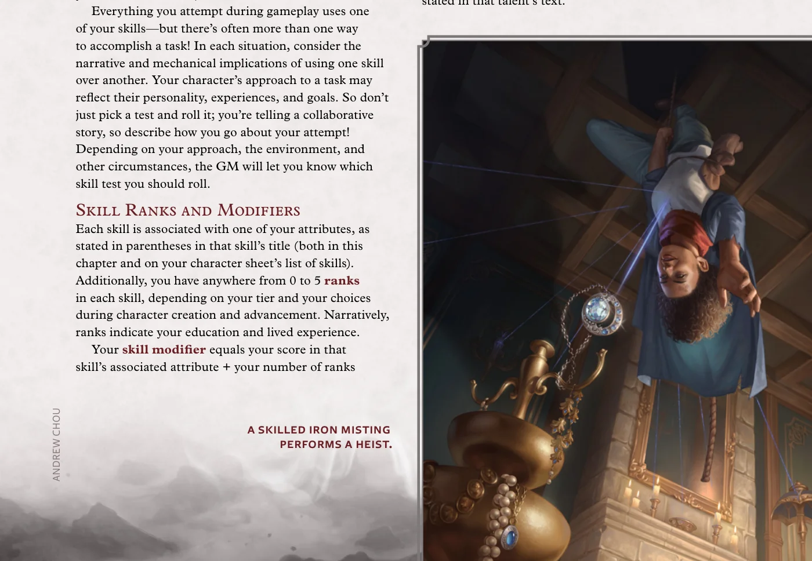
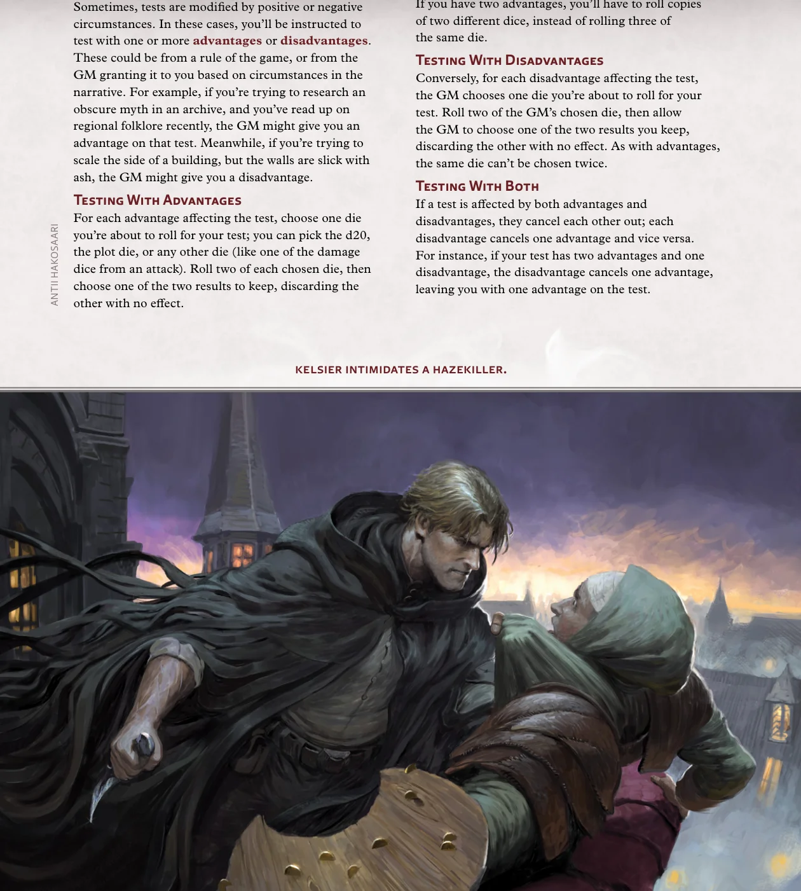
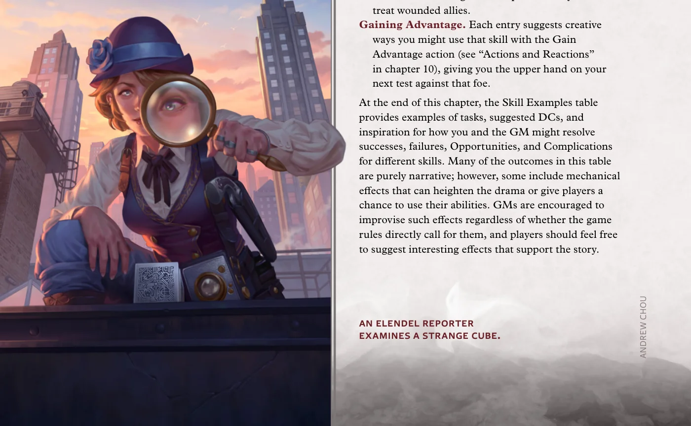
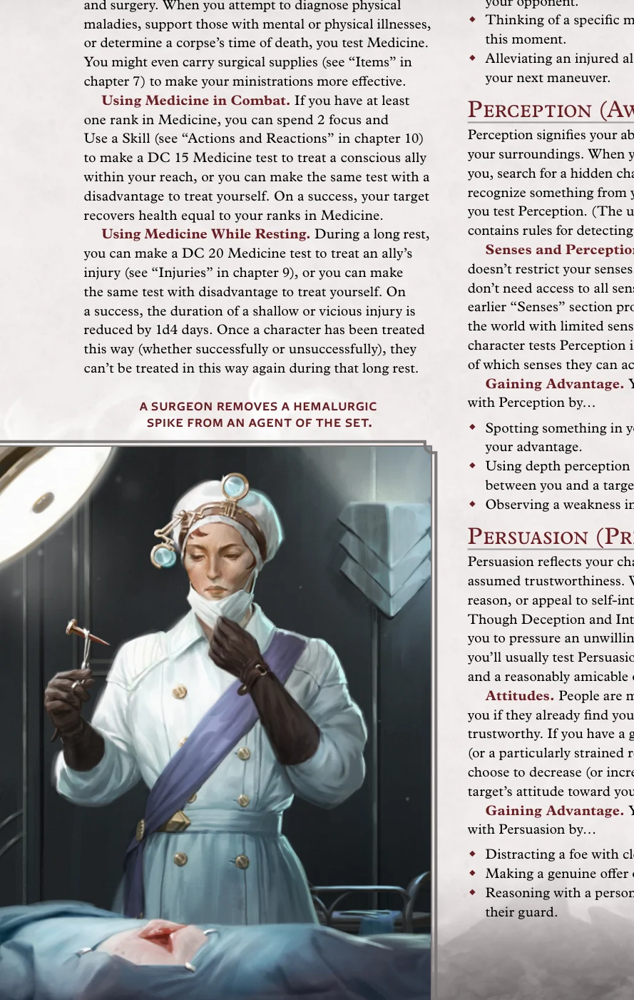
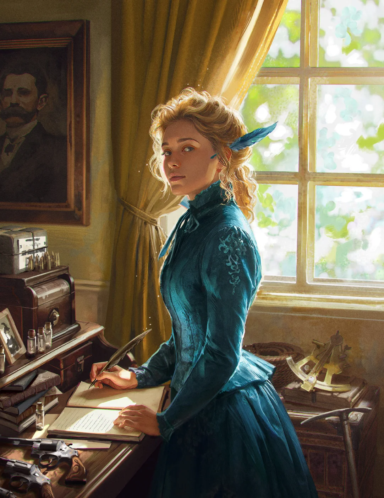

你的角色（Character）在遊戲開始時擁有十八項基本技能（skill），各自代表你在不同事務上的一般能力。本節先介紹技能與檢定（Test）的通則，再逐一說明各項技能。

## 使用技能

當你的角色嘗試可能失敗的事情，例如大膽攻擊、發表振奮人心的演說或悄悄行竊，GM 多半會要求你進行技能檢定（Skill Test），如本書導言〈進行技能檢定〉一節所述。NPC 與 GM 也遵循同樣的規則。無論 NPC 想攻擊你，還是攀上建築物外牆，GM 都會透過檢定判定嘗試的結果。（如果你嘗試的事情沒有壞處，或只要嘗試夠多次就終究能成功，GM 多半不會要求檢定。）

通常，即使某項技能沒有投入任何技能等級（Skill Rank），你也能進行該技能的檢定。不過，天生資質與相關訓練會提高成功機會。前者由技能對應的屬性（attribute）呈現，後者則由該技能的等級呈現。

你在遊戲中的每次嘗試都會用到某項技能，但完成事情往往不只一種方法！無論遇到什麼情況，都想想選用不同技能，在敘事與規則上會有什麼差別。角色處理事情的方式，可能反映其個性、經歷與短期目標（goal）。因此，別只是選一項檢定就擲骰。你們正在共同訴說故事，請描述你打算怎麼做！

GM 會根據你的做法、環境與其他情況，告訴你應該進行哪一項技能檢定。

### 技能等級與修正值

每項技能都對應一項屬性，在技能名稱後以括號標示。本章與角色紙的技能清單都是如此。此外，視你的階層（Tier），以及角色建立（Character Creation）與成長時的選擇而定，每項技能可以有 0 至 5 個技能等級。在故事中，技能等級代表你的教育與人生經驗。

技能修正值（Skill Modifier）等於該技能對應的屬性值 + 該技能的等級。每次進行該技能的檢定，都要加上這個修正值；它也會用在少數其他計算上。例如，攻擊命中時，要將技能修正值加到造成的傷害上（見第 10 章〈攻擊〉）。

## 難度等級

進行檢定時，擲一顆 d20，加上所選技能的修正值，再套用任何加值或減值。接著，將結果與檢定的難度等級（Difficulty Class，簡稱 DC）比較。DC 就是你要達到的目標數值。總和等於或高於 DC 就成功，代表你完成了要做的事，由 GM 敘述結果。總和低於 DC 就失敗，代表你的嘗試幾乎沒有進展，或完全沒有進展。

視情況而定，DC 可以由能力本身、目標的防禦（Defense）、GM，或兩個角色彼此進行的對抗檢定（Opposed Test）來決定。

### 固定難度等級

有些能力會指定成功所需的 DC。例如，使用戰地醫療（Field Medicine）天賦（talent）治療受傷盟友時，就要依該天賦的敘述，進行 DC 15 的醫學（Medicine）檢定。

一位身手熟練的鐵迷霧人（Misting）正在行竊。

ANDREW CHOU

### 防禦

當你以其他角色為目標進行技能檢定，例如扒竊或威脅對方，檢定的 DC 通常由該角色的某項防禦決定（見前面的〈防禦〉一節）。通常會使用與該技能同一類別的防禦。例如，威脅別人時，通常會以威嚇（Intimidation）對抗對方的認知防禦（Cognitive Defense）。不過，GM 或特定規則偶爾也會要求你改用其他防禦。例如，陰招（Cheap Shot）天賦可以讓你攻擊目標的認知防禦，而非實體防禦（Physical Defense）。

**調整 DC。** 相關防禦的數值會決定技能檢定的基礎 DC，但 GM 可能依其他情況進一步調整，並參考接下來的〈難度等級範例〉表，判斷適當的調整幅度。例如，某個角色對你特別友善，GM 就可能降低說服對方的 DC。假設對方的靈性防禦（Spiritual Defense）為 14，GM 可能將你的 DC 降為 11。反過來說，如果某個角色保持高度警戒，要扒竊對方就可能困難許多。與給予優勢（Advantage）或劣勢（Disadvantage）不同，GM 不一定要告訴你，是否有什麼因素正在影響角色的防禦，所以務必小心！

### GM 判定

許多情況下，GM 會依自己對事情難度的判斷，以及一般的 DC 範圍來設定 DC。〈難度等級範例〉表提供了一些參考，但 GM 可以選擇任何覺得適合的數字。

事情的難度應以一般類人生物的能力衡量，而非玩家角色（Player Character）的能力。例如，如果依藍戴（Elendel）的普通市民幾乎不可能跳過某道缺口，那麼跳過去所需的運動（Athletics）檢定就是 DC 30。

#### 難度等級範例

| 難度 | DC |
| --- | --- |
| 簡單 | 10 |
| 中等 | 15 |
| 困難 | 20 |
| 非常困難 | 25 |
| 幾乎不可能 | 30 |

### 對抗檢定

有時，兩個角色會主動想對彼此進行檢定，例如摔角。另一種情況則是，某個角色的行動，合理地決定了日後其他人試圖破壞該行動成果時的 DC。對抗檢定也能用來解決沒有特定規則可循的衝突。

發生這類衝突時，GM 可能要求雙方使用相關技能進行對抗檢定。此時，DC 並非固定數字，也不由 GM 判定，而是由對手的檢定結果決定。例如，扯手（Lurcher）試圖用鐵鎔金術（Iron Allomancy）將槍從你手中拉走，你就可能以運動對抗對方的鎔金術（Allomancy）。

要達到 DC 並成功，或阻止對方成功，你的檢定結果必須高於對手。請依以下方式判定：

**如果你擲得比對手高，**就達到 DC，完成自己的目的，即使目的只是抵抗對方。在扯手的例子中，運動檢定成功代表你仍牢牢握著槍。

**如果你擲得比對手低，**代表對方擲得比你高，因此達到了自己的 DC。對方檢定成功，你則失敗。在扯手的例子中，對方的鎔金術檢定成功，代表槍從你手中飛出，落到對方手裡。**如果你與對手平手，**就沒有人達到自己的 DC！此時，雙方可能都無法達成爭奪的目的；如果是一方主動挑起的對抗，結果則有利於試圖維持現狀的防守方。在扯手的例子中，槍本來就在你手裡。因此，即使雙方的對抗檢定都未成功，你還是能握住槍。

### 自動成功

有些效果會讓你的檢定自動成功（Automatic Success）。自動成功時不擲骰，直接獲得成功的好處，但不會產生機遇（Opportunity）或變故（Complication）。（極少數情況下，檢定可能自動失敗；處理方式相同，不必擲骰。）

第 3 章：角色數據（Character Statistics） 60

## 優勢與劣勢

有時，正面或負面的情況會影響檢定。此時，規則會要求你帶著一個或多個優勢、劣勢進行檢定。它們可能來自遊戲規則，也可能是 GM 依故事中的情況給予。例如，你在檔案館研究冷僻的神話，最近又剛好讀過當地民間傳說，GM 就可能讓該次檢定獲得一個優勢。相反地，如果你想攀上建築物外牆，但牆上積灰濕滑，GM 就可能給你一個劣勢。

### 帶著優勢檢定

每個影響檢定的優勢，都讓你選擇一顆即將用於該次檢定的骰子。你可以選擇 d20、劇情骰（Plot Die），或任何其他骰子，例如攻擊時的一顆傷害骰。每顆選定的骰子都擲兩顆，再從兩個結果中選一個保留，另一個則直接捨棄，不產生效果。

同一次檢定中，每顆骰子只能選擇一次。如果你有兩個優勢，就必須為兩顆不同的骰子各多擲一顆，而不能擲三顆相同的骰子。

### 帶著劣勢檢定

反過來說，每個影響檢定的劣勢，都由 GM 從你即將用於該次檢定的骰子中選擇一顆。將 GM 選定的骰子擲兩顆，然後由 GM 從兩個結果中選擇你必須保留的那個，另一個則直接捨棄，不產生效果。與優勢相同，同一顆骰子不能被選擇兩次。

### 同時有優勢與劣勢

如果檢定同時受到優勢與劣勢影響，兩者會互相抵銷。每個劣勢抵銷一個優勢，反之亦然。例如，檢定有兩個優勢與一個劣勢，該劣勢就會抵銷一個優勢，最後留下檢定的一個優勢。

卡西爾（Kelsier）正在威嚇一名殺霧者（Hazekiller）。

ANTII HAKOSAARI

### 影響多個目標

有些能力會要求你只進行一次檢定，對抗多個目標。不過，你可能只對其中部分目標有優勢或劣勢。這種情況下，先不擲那些額外的骰子，完成檢定，再另外擲出優勢或劣勢的骰子。這些骰子只套用在受影響目標的結果上，其他目標則不受影響。（詳見第 10 章〈對多個目標的攻擊〉。）

### 敵對 NPC 的檢定

如果敵對 NPC 的檢定有優勢或劣勢，GM 與玩家的角色就會對調。有優勢時，由 GM 選擇保留哪顆骰子；有劣勢時，則由一名玩家選擇。通常會請角色最受這次擲骰影響的玩家決定，免得大家討論而拖慢遊戲。

## 合作

當你在別人的協助下嘗試某件事，通常不會每個人各自檢定，而是依照以下規則合作進行一次檢定。

### 戰鬥中的協助

戰鬥中每一秒都很重要，要協助盟友並不容易。如果你想在戰鬥中幫忙，就必須使用援助（Aid）反應（Reaction）（見第 10 章〈行動與反應〉）。

### 戰鬥外的協助

戰鬥外，由帶領大家完成事情的人進行一次檢定，每個協助的角色都會讓該次檢定獲得一個優勢。通常可以選擇技能修正值最高的人帶領，但有些情況下，你們可能無從選擇。

GM 可能要求你具體描述如何協助這次檢定。角色只能協助自己合理有能力完成的檢定。例如，如果事情需要某項專長（Expertise）或工具，而角色沒有，就不能幫忙。此外，如果事情需要實際動手參與，每個協助的角色都必須能接觸並參與該工作。

### 複雜情況下的協助

涉及團體的事情如果複雜或特別重要，GM 可能會要求你們完成一項試煉（Endeavor）（見第 12 章），而非只進行一次帶有優勢的檢定。例如，潛入戒備森嚴的要塞，GM 多半不會只要求一次隱匿（Stealth）檢定。

## 多樣的檢定結果

基本上，DC 與檢定結果會決定你成功或失敗。不過，故事中的多數情況都遠比這複雜，也有趣得多。為了幫助你、其他玩家與 GM 共同訴說故事，本遊戲提供更多工具，讓結果的敘述更有意思。

### 成功與失敗的程度

雖然 DC 設定了明確的成功、失敗門檻，檢定結果卻可能從 1 到 30，甚至更高！檢定結果與 DC 的差距，可以啟發你更詳細地描述，這次嘗試成功得多漂亮，或失敗得多慘烈。

檢定結果非常接近 DC 時，成功或失敗的程度就低。你或 GM 可以描述角色勉強成功，或眼看就要成功，卻在最後一刻功敗垂成。

另一方面，如果檢定結果遠高於或遠低於 DC，成功或失敗的程度就高。你或 GM 可以描述角色把事情搞得一團糟，或是以精湛手法輕鬆克服。

### 機遇與變故

當 GM 提高賭注（Raise the Stakes）時，劇情骰會透過機遇與變故，讓檢定呈現多樣的結果。各種天賦與 d20 的高低點數，也能產生機遇或變故（見本書導言〈機遇與變故〉及接下來的〈機遇與變故範圍〉）。這些敘事上的附帶效果，讓結果有了有趣的組合。

擲劇情骰時，常會遇到好壞交雜的結果：成功卻伴隨變故，或失敗卻出現機遇。這些結果既能有力地推進故事，也能帶來轉折或新出路。本章末的〈技能範例〉表，提供了機遇與變故如何影響檢定的靈感。

偶爾，你會擲出帶有機遇的成功，或帶有變故的失敗，通常發生在擲出自然 20（Natural 20）或自然 1（Natural 1）時。這是最令人振奮或最令人沮喪的時刻，讓你氣勢如虹，或突然寸步難行。此時很適合將行動焦點轉到其他角色身上：藉著你的氣勢幫助別人，或在你失敗後，給其他人接手的機會。

第 3 章：角色數據 62

### 再次嘗試

技能檢定失敗後，只要時間與情況允許，你或許還能再試一次。有時，失敗只會花掉寶貴的時間，而每次重試，時間仍持續流逝。但在其他情況下，失敗會帶來更多後果，重試的風險也可能越來越高。

歸根究柢，你能重試幾次，厄運才會找上門，由 GM 決定。再次嘗試時，潛在風險可能只是故事中的後果，GM 也可能加入以下規則效果：

- 因為勉強使力或意外結果而失去專注點（Focus）。

- 因檢定帶來的危險而失去生命值（Health）。

- 提高賭注，承擔變故的風險，例如被逮到，或弄壞正在處理的裝置。

### 抵抗影響

你透過檢定成功在社交上影響某人，例如欺騙對方或說服對方幫忙時，對方可能花費一些專注點，抵抗你的影響。對方這麼做時，即使檢定成功，你仍無法影響對方。詳見第 11 章〈對話中的專注點（Focus in Conversations）〉。

### 持續的技能效果

有時，你會為了某個行動進行技能檢定，希望效果能持續一段時間。例如，進行竊術（Thievery）檢定，讓偽裝維持一整天。經 GM 判定，同一個檢定結果可能適用較長時間，但情況若有顯著變化，就可能必須重新檢定。

若要將同一次技能檢定套用於多個角色，例如穿過建築物時，利用原有的偽裝騙過多名守衛，請記下原本的結果。遇到其他角色時，將這個結果與各角色的相關防禦，或對抗檢定的結果比較。

## 機遇與變故範圍

如本書導言所述，d20 擲出很高或很低的點數，就能產生機遇或變故。進行檢定時，如果 d20 點數落在機遇範圍（Opportunity Range）內，你就獲得一個機遇。預設範圍的起點與終點都是 20，因此擲出自然 20 就獲得機遇。

同樣地，如果 d20 點數落在變故範圍（Complication Range）內，你就獲得一個變故。預設範圍的起點與終點都是 1，因此擲出自然 1 就獲得變故。不過，與劇情骰產生的變故不同，這個變故不會讓你的檢定獲得加值。

即使擲了劇情骰，d20 擲出落在這些範圍內的高低點數時，仍會產生機遇或變故。因此，同一次檢定有時可能出現多個機遇或變故。

### 擲多顆 d20 時的範圍

有時，通常因為優勢或劣勢，一次檢定會擲不只一顆 d20。此時，只有你或 GM 選擇套用到檢定上的那顆 d20，才能產生機遇或變故。

### 擴張 d20 範圍

有些效果會擴大擲骰產生機遇或變故的點數範圍。

如果效果擴張機遇範圍，就將範圍起點減少指定數值。例如，天賦讓工藝（Crafting）檢定的機遇範圍擴張 2，範圍就變成 18 至 20。因此，工藝檢定擲出自然 18、19 或 20 時，都會產生機遇。

如果效果擴張變故範圍，就將範圍終點增加指定數值。例如，天賦讓工藝檢定的變故範圍擴張 3，範圍就變成 1 至 4。因此，工藝檢定擲出自然 1、2、3 或 4 時，都會產生變故。

### 疊加範圍擴張

同一次檢定可以套用多個機遇範圍或變故範圍的擴張，也能同時擴張兩者，但這些效果的名稱必須不同（見第 4 章〈疊加天賦與效果〉）。例如，兩個不同效果各讓機遇範圍擴張 2，骰子擲出 16、17、18、19 或 20 時，就會產生機遇。

第 3 章：角色數據 63

## 技能與行動

技能檢定本身不一定需要花費行動（Action）或反應。例如，GM 可能要求所有人進行紀律（Discipline）檢定，不必花費行動，好在可怕的敵人面前穩住心神。不過，如果檢定所做的事情需要時間或專心處理，GM 通常會要求你花費[1行動]，使用第 10 章的使用技能（Use a Skill）行動。

如果檢定屬於另一個行動的一部分，就不必再花費[1行動]。

## 改變骰子大小

有些能力可以讓你改變骰子的大小。這裡指的不是實際尺寸，而是骰子有幾個面。

檢定使用的骰子大小增加時，將它換成下一種面數更多的骰子；減少時則反過來。例如，原本造成 1d4 傷害的攻擊，可能隨著等級提升而增加骰子大小，讓你改擲 1d6，之後再提升為 1d8、1d10，依此類推。

## 從遠處選定目標

有些檢定會從遠處選定其他角色或物體為目標。第 10 章〈選定目標與距離（Targeting and Range）〉會說明，各種檢定可以選哪些角色為目標。請注意，如果你無法感知某個角色，直接影響對方的檢定通常會承受一個劣勢，例如武器攻擊（Weapon Attack）與金屬技藝（Metallic Arts）的能力。

## 技能條目說明

接下來各節會介紹遊戲中所有角色都能使用的十八項基本技能。（除了這些技能，你也可能選擇金屬之子（Metalborn）路徑（Path），解鎖鎔金術或藏金術（Feruchemy）技能，詳見第 5 章。）每個條目包含以下資訊：

**名稱與屬性。** 每個條目的標題會先列出技能名稱，再列對應的屬性。如前面的〈技能等級與修正值〉所述，你會用這項屬性計算技能修正值。

**相關工作。** 每個條目會列出一些使用該技能的事情。這不是完整清單，任何想嘗試的事情，最適用哪項技能，都由你與 GM 決定。

**特殊情況。** 有些條目會指引你如何以特別的方式使用技能。例如，醫學技能就舉例說明，如何治療受傷的盟友。

**獲取優勢。** 每個條目都會提出有創意的用法，讓你能將該技能用於獲取優勢（Gain Advantage）行動（見第 10 章〈行動與反應〉），在下次對該敵人檢定時取得上風。

本章末的〈技能範例〉表列出事情的例子、建議 DC，以及你與 GM 可以如何處理各技能成功、失敗、機遇與變故的靈感。

表中許多結果純屬敘事，但也有些包含規則效果，能增添戲劇性，或讓玩家有機會使用自己的能力。不論遊戲規則有沒有明文要求，GM 都可以即興加入這類效果；玩家也不妨提出有趣的效果，幫助故事發展。

一名依藍戴記者正在檢查奇怪的方塊。

ANDREW CHOU

## 敏捷（速度，Speed）

敏捷（Agility）反映你在環境中靈活移動、駕馭坐騎、施展特技，以及精準操控載具的能力。當事情考驗你的反射、移動或轉向能力時，就進行敏捷檢定。

**獲取優勢。** 你可以用敏捷，透過以下方式獲取優勢……

- 靈巧翻滾，從意想不到的角度攻擊。

- 快速閃身挪步，讓對手失去平衡。

- 鑽入對手的防守空隙，讓對方更難防禦攻擊。

## 運動（力量，Strength）

運動反映你的體能、肌力、耐力，以及抵抗傷害與身體困境的能力。你可以運用力量克服障礙，例如舉起、推動、攀爬、水平或垂直跳躍，以及拉動物體。第 7 章〈武器〉所述的徒手攻擊（Unarmed Attack），也使用運動技能。

**跳躍。** 移動時，角色通常不必檢定，就能水平跳過等同自身體型的距離，或垂直跳起等同體型一半的距離（見第 10 章〈移動與站位（Movement and Positioning）〉）。想跳得更遠，就必須進行運動檢定。DC 由 GM 決定，但在司卡德利亞（Scadrial），對中型（Medium）角色而言，跳過 30 呎通常幾乎不可能，也就是 DC 30。

**獲取優勢。** 你可以用運動，透過以下方式獲取優勢……

- 撲跳到敵人身上，讓對方措手不及。

- 抓住敵人的盾牌，製造攻擊空檔。

- 威嚇般繃緊肌肉，動搖對手的決心。

### 敏捷還是運動？

敏捷掌管身體細緻、靈活或反射性的動作；運動則反映用力、抵抗或主動發力的能力。柔軟度、扭身技巧與反應速度，通常只由敏捷掌管，而非運動。不過，有些問題可以用任一技能解決。例如，要穿過屋頂的一道缺口，你可以用敏捷沿著伸出的橫樑跑過去，也可以用運動直接跳過去。

## 工藝（智力，Intellect）

工藝運用你的巧思與知識，利用手邊材料設計並製作實物。製作簡單機械、陷阱、陶器、木製品、素描、縫紉品或臨時工具等常見物品時，以工藝檢定判定是否成功。

**製作複雜物品。** 如果想製作武器、護甲、裝備、建築物、大型藝術品或特殊發明等較複雜的物品，就必須擁有相應專長，才能進行工藝檢定。完整的製作規則，請見第 7 章〈工藝〉。

**修理物品。** 本遊戲沒有針對既有物品的損壞或修理訂定特別規則，並假定你有能力妥善維護裝備。不過，故事需要時，GM 可能要求你進行工藝檢定，修理或重新組裝某件重要物品。

**獲取優勢。** 你可以用工藝，透過以下方式獲取優勢……

- 將灰塵或泥土裝進小袋，當作臨時投擲物，遮擋對手的視線。

- 在武器上繫上繩子或布，讓它的軌跡更難掌握。

- 使用臨時裝置，讓亮光閃入某人的眼睛。

## 欺騙（風采，Presence）

欺騙（Deception）衡量你透過公然說謊、巧妙暗示、誇大其詞與刻意省略資訊，誤導他人的能力。這項技能不只包含精心挑選說詞，也包括操弄情緒、轉移焦點、偽造證據與誤導性的身體語言。

**遠距欺騙。** 試圖從遠處欺騙他人，例如透過信使或書信時，無法控制的變數會讓欺騙更困難。遠方收信的人較不容易被令人信服的演技蒙騙，也比較可能運用你看不到的協助與證據。因此，如果目標無法感知你，你的欺騙檢定就會承受一個劣勢。

**獲取優勢。** 你可以用欺騙，透過以下方式獲取優勢……

- 假裝從某個方向瞄準或揮擊，卻在最後一刻改變方向。

- 在混亂的戰場上穿著敵人的制服。

- 對敵人說謊，擾亂對方的心緒。

第 3 章：角色數據 65

## 推理（智力）

想了解世界，就必須觀察、提問與驗證。運用邏輯、推論、蒐集並解讀證據，你可以進行推理（Deduction）檢定，更有把握地面對周遭的種種未知。

**獲取優勢。** 你可以用推理，透過以下方式獲取優勢……

- 觀察敵人的舉止，推斷弱點或隱藏的傷勢。

- 思考角色的說詞，辨別真正的動機。

- 找出敵人最有用的助力，以及如何妨礙它。

## 紀律（意志，Willpower）

紀律決定你在令人不安的情況下，控制外在反應與應對方式的能力。面對恐懼、憤怒、痛苦或悲傷時，紀律可以幫助你保持鎮定。這不代表你感受不到這些情緒，而是即使承受極大壓力，仍能格外清楚、沉著地思考與行動。

**克服困境。** 紀律可以主動運用，例如接近強大敵人時表現得毫無懼色；也可以用來應對恐懼、懷疑、分心或類似挑戰，設法擺脫影響。有時，GM 可能要求你進行紀律檢定，避免不利效果，例如影響心智與情緒的敵方能力，或在事後克服該效果。

**獲取優勢。** 你可以用紀律，透過以下方式獲取優勢……

- 等待最完美的出手時機。

- 面對敵人逼近仍不為所動，讓對方心生不安。

- 走進明顯的危險中，卻不露出絲毫恐懼。

## 重型武器（力量）

重型武器（Heavy Weaponry）代表你使用戰場上最具破壞力武器的經驗。使用錘子、克羅司（koloss）大劍等實際重量沉重的武器攻擊，或以其他方式運用它們時，就進行重型武器檢定。在第二時代，使用手砲（Hand Cannon）與霰彈槍（Shotgun）等後座力大的火器時，也使用這項技能。

**重型與輕型武器。** 使用重型武器技能的武器，通常比輕型武器更重，觸及範圍也更長。這提高了殺傷力，卻降低靈活性與精準度。第 10 章〈創意戰術（Creative Maneuvers）〉會提出一些運用重型武器戰鬥的創意方法。

**獲取優勢。** 你可以用重型武器，透過以下方式獲取優勢……

- 為看似危險的揮擊蓄勢，分散敵人的注意。

- 猛擊敵人的盾牌或護甲，讓對方失去平衡。

- 讓大口徑子彈呼嘯掠過敵人身旁，嚇阻對方。

## 洞察（察覺，Awareness）

洞察（Insight）衡量你分辨他人真實感受、看穿欺騙，以及憑直覺判斷情況是否不對勁的能力。當事情考驗你的社交本能、情緒理解力與直覺反應時，就進行洞察檢定。

**獲取優勢。** 你可以用洞察，透過以下方式獲取優勢……

- 挑動適當的情緒，讓對方反應失當，露出破綻。

- 順著直覺，發現勁敵正虛張聲勢，裝得比實際更強大。

- 訴諸敵人內心深處、與當前行動相牴觸的渴望。

### 感受也是資訊

感知（Perception）幫助你蒐集周遭環境的事實；洞察則幫助你解讀自己對其他角色的言語、身體語言與類似線索，所產生的潛意識印象。當然，偏見可能讓你誤入歧途，使感受變得不那麼可靠。既有偏見可能讓洞察檢定承受一個劣勢；如果洞察檢定失敗或產生變故，你也可能得到誤導性的資訊。

第 3 章：角色數據 66

## 威嚇（意志）

威嚇反映你讓其他角色心生恐懼，進而服從的能力。展現體能上的壓倒性優勢、提出明示或暗示的威脅，或刻意將情況說得極為可怕時，就進行威嚇檢定。

**虛張聲勢的威脅。** 多數威脅多少帶有誇張，例如誇大自己付諸實行的意願或能力。只要對方覺得威脅可信，虛張聲勢就不影響檢定方式。但如果你假裝的事情荒謬至極，例如明明病得站不起來，卻自稱是可怕的戰士，威嚇檢定就會承受一個劣勢。

**獲取優勢。** 你可以用威嚇，透過以下方式獲取優勢……

- 嘲弄敵人。

- 在危急的情況下愉快地大笑。

- 揚言敵人若不退開，就會面臨殘酷的下場。

## 領導（風采）

領導（Leadership）代表你激勵人心、吸引注意與指揮盟友的能力。訴諸某人的是非觀時，就進行領導檢定。你也可以用這項技能分派工作、管理群眾、誘使敵人上鉤，或引導不完全受你指揮的盟友。

**獲取優勢。** 你可以用領導，透過以下方式獲取優勢……

- 向敵人提出一對一單挑的挑戰。

- 招呼附近盟友分散敵人的注意。

- 請附近的同伴幫忙。

## 輕型武器（速度）

輕型武器（Light Weaponry）代表你使用小型武器的熟練程度。這些武器仰賴技巧，而非純粹的力氣。使用刀、隨身武器、投石索與類似武器攻擊，或以其他方式運用它們時，就進行輕型武器檢定。在第二時代，使用靴筒手槍（Boot Pistol）與左輪手槍（Revolver）等後座力較小的火器時，也使用這項技能。

**輕型與重型武器。** 雖然輕型武器的距離與傷害不及重型武器，卻更迅速、隱密且精準。第 10 章〈創意戰術〉會提出一些運用輕型武器戰鬥的方法。

**獲取優勢。** 你可以用輕型武器，透過以下方式獲取優勢……

- 耍出繁複花招佯攻，將敵人的注意引離真正的威脅。

- 刻意拍一拍藏著的武器，讓對方注意到它。

- 以精準、華麗的特技射擊，將注意從另一個行動移開。

## 學識（智力）

學識（Lore）代表你對歷史、時事、民間傳說、宗教、地點與科學的熟悉程度。試圖回想自己因背景而可能知道的資訊時，就進行學識檢定。

**學識與專長。** 除了一般性的學識技能，專長則代表你在特定領域的知識（見前面的〈專長〉一節）。如果想回想與自身專長相關的基本資訊，GM 通常應直接告訴你，不必檢定。相反地，如果想知道某個主題的祕密、禁忌或其他冷僻知識，即使擁有專長，也可能需要檢定。若你在沒有相關專長的情況下，通過檢定想起這些隱祕知識，仍可能無法得知足夠的關鍵細節，掌握事情全貌。

**獲取優勢。** 你可以用學識，透過以下方式獲取優勢……

- 指出目標的行為與宣稱堅守的信念不一致。

- 回想目標本身的弱點或顧忌。

- 認出環境中某樣事物的有用特性。

第 3 章：角色數據 67

## 醫學（智力）

醫學衡量你運用解剖學、心理學與外科知識，治療自己與他人的能力。診斷身體疾病、幫助身心患病者，或判斷屍體的死亡時間時，就進行醫學檢定。你甚至可以攜帶外科醫療用品（Surgical Supplies）（見第 7 章〈物品〉），提升治療效果。

**戰鬥中使用醫學。** 如果你有至少 1 個醫學技能等級，可以花費 2 點專注點並使用技能（見第 10 章〈行動與反應〉），進行 DC 15 的醫學檢定，治療觸及範圍內一名清醒的盟友。你也可以進行相同檢定治療自己，但承受一個劣勢。成功時，目標恢復等同你醫學技能等級的生命值。

**休息時使用醫學。** 長休息（Long Rest）期間，你可以進行 DC 20 的醫學檢定，治療盟友的一項傷勢（Injury）（見第 9 章〈傷勢〉）。你也可以進行相同檢定治療自己，但承受一個劣勢。成功時，一項輕度傷勢（Shallow Injury）或重度傷勢（Vicious Injury）的持續時間減少 1d4 天。角色一旦接受過這種治療，無論成功或失敗，同一次長休息期間都不能再接受同樣的治療。

**獲取優勢。** 你可以用醫學，透過以下方式獲取優勢……

- 找出對手先前受過、可供利用的傷勢。

- 想到此刻能派上用場的特定藥物。

- 減輕受傷盟友的痛苦，讓對方能協助你的下一個動作。

## 感知（察覺）

感知代表你注意周遭細節的能力。查看周圍、搜尋躲藏的角色或物品，或試著根據記憶或描述辨認事物時，就進行感知檢定。（接下來的〈隱匿〉一節，會說明發現躲藏角色的規則。）

**感官與感知。** 本遊戲不將感官限於視覺與聽覺，你也不必能使用所有感官，才能進行感知檢定。前面的〈感知〉一節，會指引你如何運用受限的感官探索世界。但一般而言，不論能使用哪些感官，每個角色進行感知檢定的方式都相同。

**獲取優勢。** 你可以用感知，透過以下方式獲取優勢……

- 找出周遭環境中可供利用的事物。

- 運用距離感，估算自己與目標之間的精確距離。

- 觀察敵人姿勢中的弱點。

## 說服（風采）

說服（Persuasion）反映你的魅力、社交手腕，以及他人認為你值得信任的程度。討價還價、辯論、講道理或訴諸對方的利益時，就進行說服檢定。雖然欺騙與威嚇檢定可以迫使不情願的目標服從，但如果你希望達成共識，並得到大致友好的結果，通常就使用說服檢定。

**態度。** 如果別人本來就認為你討喜、聰明且值得信任，會更容易答應你。若你與某人關係融洽，或關係特別緊張，GM 可以降低或提高 DC，反映目標對你的態度。

**獲取優勢。** 你可以用說服，透過以下方式獲取優勢……

- 用機智的交談分散敵人的注意。

- 真誠提出和平相處的建議。

- 和對方講道理，讓對方放下戒心。

一位外科醫師（Surgeon）正在從「組織」（The Set）的密探（Agent）身上，取出一根血金術尖刺（Hemalurgic Spike）。

JANNA SOPHIA

## 隱匿（速度）

隱匿代表你避免受到注意，或擺脫注意的能力。悄悄移動、躲藏、混入人群，或以類似方式避人耳目、甩開追兵時，就進行隱匿檢定。

**戰鬥中躲藏。** 戰鬥中，你可以使用技能（見第 10 章〈行動與反應〉），以隱匿對抗某個角色的靈性防禦，嘗試躲過對方的注意。你必須處於掩護（Cover）中、位於會遮蔽目標主要感官（Primary Sense）的區域，例如黑暗中，或讓目標與你之間沒有效果線（Line of Effect），才可以躲藏（見第 10 章〈選定目標與距離〉）。如果想躲過不只一個角色的注意，就將檢定結果與各角色的靈性防禦比較。

每個被你成功躲過的角色，都會失去你的蹤跡，無法再感知你。直到你攻擊或採取其他按理會暴露位置的行動前，對方都不知道你的確切位置。你可以用[自由行動]，暗中向一名或多名你能感知的盟友示意，讓對方知道你的位置。

想搜尋你的角色可以使用技能，進行感知檢定。DC 等於你原先隱匿檢定的結果；如果你處於掩護中，或位於會遮蔽搜尋者主要感官的區域，該感知檢定承受一個劣勢。成功時，該角色就能感知你。

**獲取優勢。** 你可以用隱匿，透過以下方式獲取優勢……

- 短暫躲出視線外，掩飾正在做的事。

- 使用事先藏在袖子裡的物品。

- 假裝往一個方向移動，卻改往另一個方向。

### 領導還是說服？

進行說服檢定時，你通常透過協商、訴諸邏輯或對方的利益，以及指出決定的實際影響，說服別人幫忙。進行領導檢定時，你通常試圖激勵對方、訴諸更高的理想，並憑魅力掌控局勢。有些問題可以用任一技能解決，但視目標與你的意圖而定，兩種檢定的 DC 可能相差很大。

## 求生（察覺）

求生（Survival）反映你取得重要資源與庇護、避開環境威脅，以及理解動物行為的能力。追蹤人或事物、與野生動物互動，或在陌生地域辨認方向時，就進行求生檢定。

**野外採集。** 短休息（Short Rest）期間，你可以嘗試蒐集食物、飲水或藥草等資源。這麼做時，你會放棄休息的其他好處，改為進行求生檢定。成功時，你辨認出有用的天然資源，並安全取得一些。例如，你可以花一次短休息，尋找紅殼蝸牛，或刮取 callowfield 樹的黃色樹皮，製成一瓶染料，日後販售或用來製作假制服。

採集的 DC 取決於地點，以及你是否正在尋找特定事物。如果該地區沒有值得狩獵或採集的東西，或採集風險太高，GM 可以不允許這麼做。

**獲取優勢。** 你可以用求生，透過以下方式獲取優勢……

- 與動物夥伴（Animal Companion）協調攻擊。

- 運用地形知識，找到適合行動的位置。

- 根據天候調整遠程攻擊。

## 竊術（速度）

竊術涵蓋各種需要精細手部技巧，或適合用於不法勾當的事情。扒竊、開鎖、耍手法、掙脫綑綁、打結或製作偽裝時，就進行竊術檢定。

**戰鬥中扒竊。** 你可以使用技能（見第 10 章〈行動與反應〉），進行竊術檢定，扒竊觸及範圍內角色身上的物品。進行這次檢定時，提高賭注。DC 等於目標的靈性防禦；如果目標知道你在場，你承受一個劣勢。

**獲取優勢。** 你可以用竊術，透過以下方式獲取優勢……

- 用手法讓手中物品彷彿憑空消失。

- 悄悄拔出武器，讓敵人措手不及。

- 穿戴事先準備的可笑服飾配件，讓目標大吃一驚。

第 3 章：角色數據 69

## 技能範例

| 事情 | 檢定 DC | 成功 | 失敗 | 機遇 | 變故 |
| --- | --- | --- | --- | --- | --- |
| 為了抵達窗戶，Thess 進行敏捷檢定，沿著高處狹窄的壁架挪動十呎。 | DC 13 | 她抵達窗戶。 | 她腳下一滑，只能用手攀著壁架，掛在半空。 | 她在沿途找到可供抓握的地方，之後通過這裡的檢定獲得一個優勢。 | 她弄鬆了一塊石頭，驚動守衛前來查看聲響。 |
| Jateuse 開不了鎖，決定改用運動檢定，踹開厚重的木門。 | DC 20 | 她一腳踹碎木門。 | 她的腳重重撞上門，木頭卻完好無缺。 | 守衛聽到聲響，開門查看外面。 | 她的腳陣陣抽痛，受到 1d4 點衝擊傷害（Impact Damage）。 |
| Hedwarn 進行工藝檢定，修理前次槍戰時摔壞的獵用步槍（Hunting Rifle）。 | DC 12 | 他修好步槍，下次打起來時就能使用。 | 他把槍弄得更糟了，必須取得新的材料，才能再次嘗試修理。 | 這把槍多年來從沒這麼乾淨過！他下次用這把步槍攻擊時，獲得一個優勢。 | 卡在槍裡的子彈意外擊發，讓他不小心擦傷（Graze）一名盟友。 |
| Gill 穿上偷來的制服，進行欺騙檢定，在繁忙的市場廣場冒充警員。 | DC 17 | 人們紛紛讓路，即使 Gill 進入管制區，也沒有人盤問。 | Gill 的制服穿法不對，被真正的警員當面質問。 | 制服口袋裡有關於一名貪腐政客的筆記，可以用來敲詐對方。 | 一位市民淚流滿面地來找 Gill，懇求幫忙救出落入罪犯手中的兄弟。 |
| Ray 一心想串起線索，進行推理檢定，思考隊伍找到的蛛絲馬跡。 | DC 16 | 他提出合理的假設，也找到能確實證實或推翻它的方法。 | 他仍差了一步；隊伍還需要一個細節，才能拼出全貌。 | 一條新線索突然浮現。 | 新發展讓人懷疑先前某條線索的真實性。 |
| 精疲力竭（Exhausted）又受傷的 Juli，困在猛烈的落灰中（第一時代）或暴風雪中（第二時代），進行紀律檢定，掙扎著保持清醒。 | DC 18 | 她勉強維持清醒，繼續前進。 | 她倒了下去，失去意識。 | 她意外聽見正在尋找她的搜救隊的聲音。 | 她的傷口惡化。將一項傷勢的恢復時間增加 1d4 天（見第 9 章〈傷勢〉）。 |
| Astrine 教導一群村民保衛家園、抵抗盜匪。她進行重型武器檢定，訓練大家使用沉重的臨時武器（Improvised Weapon）（第一時代）或霰彈槍（第二時代）。 | DC 12 | 她的示範清楚易懂，大家似乎更有信心，也更能準備好迎接未來的攻擊。 | 大家跟不上她的指導，沒有從練習中學到任何東西，面對未來攻擊仍準備不足。 | 她發現一位村民比其他人更有經驗，便請對方協助防守一處重要位置。 | 一名村民控制不住武器，意外打中 Astrine！她受到 1d8 點衝擊傷害。 |
| Gindanwyl 懷疑商人在坑她，進行洞察檢定，觀察對方的舉止。 | DC 15 | 她看到商人嘴角勾起奸詐的笑容。他確實開價過高。 | 商人的舉止無法幫她判斷價格是否公道。 | 她發現商人偷偷用布蓋住部分商品。 | 她專心盯著商人時，一名扒手試圖掏她的口袋。 |
| Erma 默默解開背後克羅司大劍的繫帶，單手將它拿起，進行威嚇檢定，想嚇得敵方斥候吐露祕密。 | DC 15 | 她讓斥候開口了。 | 斥候毫不畏縮，保持沉默，寧願死也不回答。 | 她發現斥候包裡露出一角敵營地圖。 | 一發投射物鏗地擊中附近石頭，彈了開來。斥候並非孤身一人。 |

第 3 章：角色數據 70

## 技能範例，續

| 事情 | 檢定 DC | 成功 | 失敗 | 機遇 | 變故 |
| --- | --- | --- | --- | --- | --- |
| Kwandel 進行領導檢定，呼喊指示，帶領居民撤離受威脅的街區。 | DC 17 | 他協助所有願意離開的市民及時撤離。 | 他幫助最脆弱的居民撤離，但敵方戰鬥人員抵達時，仍有數百名平民留在原地。 | 他湊出一小隊勇敢的志願者，幫忙作戰。 | 敵人特別注意到 Kwandel，第一波齊射就以他為目標。 |
| Sveikki 進行輕型武器檢定，耍弄小刀，想讓酒館客人刮目相看。 | DC 14 | 她的技巧顯然讓觀眾印象深刻。 | 她失手了，表演到一半，小刀就掉了下來。 | Sveikki 趁大家分心，更靠近一直在跟蹤的間諜。 | Sveikki 過程中割傷自己，受到 1d4 點銳利傷害（Keen Damage）。 |
| Doug 進行學識檢定，試圖回想冒充警員的處罰。 | DC 20 | 她知道這會招致高額罰款，而且很可能入獄。 | 她想不起來，得去官署查閱。 | 她碰巧遇上當地慶典，能免費吃喝與觀賞娛樂。 | 官署因公務活動而關閉，大部分警員也不值勤。 |
| Flossie 在長休息期間，進行醫學檢定幫助受傷盟友。 | DC 20 | 她讓盟友一項傷勢的恢復時間減少 1d4 天。 | 她安慰了盟友，卻沒能縮短恢復時間。 | 盟友受到 Flossie 的幫助而振作，變得堅定（Determined）。 | Flossie 的照護讓她耗盡心力。長休息後，她比平常少恢復 1 點專注點。 |
| Nilzan 穿過巷子時仔細聆聽，進行感知檢定，確認是否有人跟蹤。 | DC 15 | Nilzan 聽到身後有兩組腳步聲，一輕一重；當 Nilzan 放慢腳步，兩組腳步聲也停了下來。 | 附近沒有傳來任何異常聲響。 | Nilzan 發現前方有一處哨站。 | 一位匆忙的路人轉過街角，撞上 Nilzan。Nilzan 失去 2 點專注點並倒地（Prone）。 |
| 重要工作前夕，Larker 進行說服檢定，想借用一件尚未測試、獨一無二的發明原型。 | DC 22 | 發明家允許她借用原型，並給出嚴格的使用指示。 | 她未獲准領用這件實驗性發明。 | 對方願意提供一件較差、但測試更完善的裝置。 | 發明家期待她日後回報這份天大的人情。 |
| 外頭暴動正烈，CheOon 進行隱匿檢定，潛入貴族莊園，想偷走一份契約。 | DC 12 | CheOon 避開所有守衛與人員，溜進領主的辦公室。 | CheOon 撞見正要去地窖多拿些酒的僕人。 | CheOon 發現一條密道，能更容易地逃出莊園。 | CheOon 並不知道，預定的逃跑路線上有一名守衛駐守。 |
| 旅途中一次短休息期間，Lened 不休息恢復，改為進行求生檢定，獵捕小型動物。 | DC 12 | 他抓到三隻松鼠，煮成午餐。 | 他什麼都沒抓到。 | 他找到別人遺落的一把短弓（Shortbow）（第一時代）或獵用步槍（第二時代）。 | 他被石頭絆倒，滾落一處矮崖（見第 10 章〈墜落（Falling）〉）。 |
| 在商人攤位前，U-wen 趁商人被另一位客人分心，試圖將一件商品藏進手掌，以竊術對抗商人的靈性防禦。 | DC 15 | 他將物品塞進背包，沒被商人發現。 | 商人看見他拿起物品，開始熱情推銷。 | 一名當地小偷注意到他，覺得很佩服。 | 一名當地小偷看到這次行竊，等 U-wen 走到較隱密的地方，就質問他為何搶自己的地盤。 |

GAL OR

