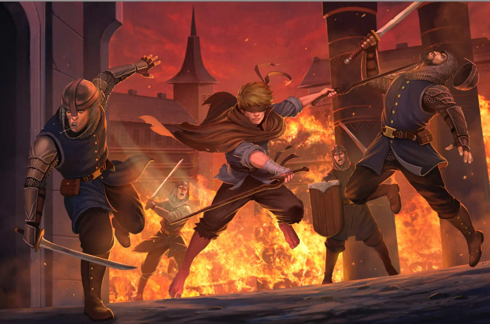
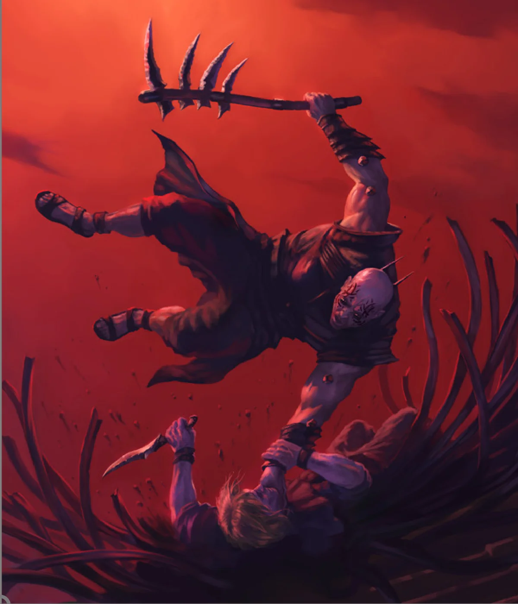
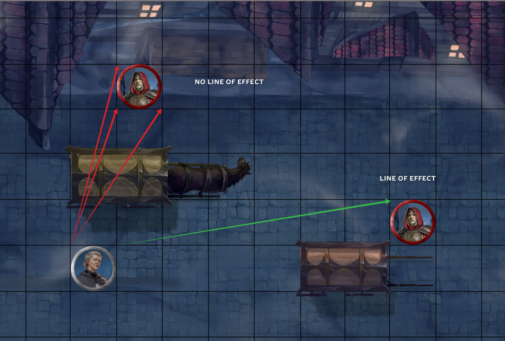
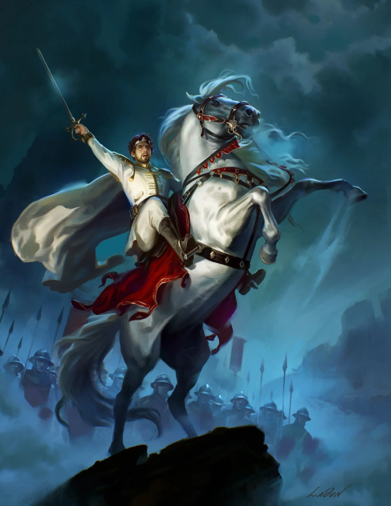

現代的司卡德利亞（Scadrial）雖然少有大規模戰爭，居民的生活卻仍不時遭遇暴力。行竊失風、兩個貴族家族的仇怨升溫、依藍戴警署（Elendel Constabulary）突襲，或是「組織」（The Set）發動攻擊——無論你生活在哪個時代，都可能發現自己正被一根決鬥杖（dueling cane）指著。衝突一旦無法只靠一兩次技能檢定（Skill Test）解決，就會成為戰鬥（Combat），依本章規則進行。這可能是一場參戰者眾多、各有盤算的混戰、兩位迷霧之子（Mistborn）的一對一決鬥，甚至可以是沒有暴力，卻分秒必爭、站位至關重要的場景（Scene）。

### 戰鬥順序

交戰時，每個人都同時行動，每一秒都很重要。為了呈現這一點，本遊戲將時間分成一連串回合（Round）。每個回合中，PC、敵人及其他參與者都各有一次輪次（Turn），可以在其中採取各種行動。

### 回合與輪次

每個回合，你都可以選擇快速或慢速輪次。你的選擇會決定你獲得多少行動（Action），代表你在自己輪次中能做的各種事情（見「獲得行動與反應」）：

**採取快速輪次（Fast Turn）。** 如果你選擇快速行動，就會先於任何敵人進行輪次，但在自己的輪次中只能使用兩個行動（ [2行動] ）。

**採取慢速輪次（Slow Turn）。** 如果你選擇慢速行動，就會在所有快速行動的敵人之後進行輪次，但能獲得三個行動（ [3行動] ），而非兩個。

你每回合都能改變選擇，也不必在回合開始時就決定。如果其他 PC 已經完成快速輪次，而你決定自己也想快速行動，就能當場決定接著進行輪次。建議你和選擇同類輪次的其他玩家協調。若無法決定誰先行動，就由速度（Speed）最高的角色先行；若同分，各擲一顆 d20，點數最高者先行。

### 輪次階段（Turn Phase）

每個戰鬥回合都依照以下順序進行：

1. PC 快速輪次。想採取快速輪次的 PC 依任意順序行動，各獲得兩個行動（以及一個反應）。
2. NPC 快速輪次。GM 選擇哪些敵手（adversary）或其他 NPC 要採取快速輪次，並決定其先後順序。這些 NPC 各獲得兩個行動（以及一個反應）。
3. PC 慢速輪次。其餘 PC 進行自己的輪次，各獲得三個行動（以及一個反應）。
4. NPC 慢速輪次。其餘敵人與其他 NPC 進行自己的輪次，各獲得三個行動（以及一個反應）。
5. 開始下一回合。每個角色都進行過一次輪次後，該回合結束，下一回合開始。重複以上步驟，直到戰鬥結束。

### 友方 NPC 的輪次

若有友方 NPC 與 PC 並肩作戰，其輪次與敵方 NPC 同時進行。這些 NPC 在該階段何時行動，由 GM 決定。

*對頁：瓦希黎恩．拉德利安（Waxillium Ladrian）汲取（Tap）鐵意識（Ironmind）以增加自身重量，撞破天窗，突襲「組織」的一處巢穴。*

DENMAN ROOKE

第 10 章：戰鬥 317

### 獲得行動與反應

你每回合能做的事情，大多分為行動或反應（Reaction）。稍後的「行動與反應」一節會詳述兩者各能做些什麼。

### 獲得反應

戰鬥開始時，除非你處於措手不及（Surprised）狀態，否則會獲得一個反應（ [反應] ），可在你的第一個輪次開始前隨時使用。此外，你的每個輪次開始時，無論選擇快速或慢速輪次，都會獲得一個新的反應。（某些天賦（talent）及其他能力能額外給予一個反應。）每個反應都保留到你的下一個輪次開始時，或直到你將其用掉。你可以在回合中的任何時點，於自己的輪次內外，針對特定觸發條件使用反應；這代表你在戰場上本能地回應某人或某事的能力。

### 獲得行動

你的每個輪次開始時，都會獲得一定數量的行動（ [1行動] ），代表只能在自己輪次中進行的活動。如本節前文所述，獲得的行動數取決於你選擇的輪次：快速輪次獲得 [2行動]，慢速輪次獲得 [3行動]。（某些天賦及其他能力能提供額外行動。）行動只能在你的輪次中使用，因此輪次結束時，所有剩餘行動都會失去。

### 我數到十……

一個戰鬥回合結算起來可能需要一段時間，但在故事中只過了短短幾瞬。規則上，角色輪流進行輪次，只是為了方便安排所有人的決定。在故事裡，你與周遭的人其實同時行動，置身於一片混亂的戰局。如果敘事中的某個環節需要知道戰鬥的確切時間，就假設每個戰鬥回合約為十秒。

### 突襲（Surprise）

許多戰鬥始於一方伏擊另一方。有時則是戰鬥爆發時，場景中某些角色完全沒有察覺。這些情況下，毫無戒心的角色會獲得措手不及狀態（Condition）。戰鬥開始時，由 GM 決定誰措手不及。若一方在開戰前試圖隱藏行蹤或欺瞞對手，可以用隱匿（Stealth）對抗對方的感知（Perception），或以欺騙（Deception）對抗對方的洞察（Insight）進行檢定。任何未能察覺的對方角色都會措手不及。每個角色的第一個輪次結束後，移除其措手不及狀態。

### GM 提示：其他場景中的戰鬥規則

本章許多規則也能用於戰鬥以外的情境，儘管未必完全適用。例如，許多行動及其規則有助於處理對話（Conversation）和試煉（Endeavor），但這些場景中的時間流動方式不同，角色不會藉由快速或慢速輪次來決定獲得多少行動。無論是否在戰鬥中，都請和玩家共同運用適合當前場景與故事的規則。

### 行動與反應

戰鬥中幾乎每件事都要花時間，所以每個輪次能做的事有限。你會使用輪次開始時獲得、很快就會耗盡的行動與反應，以及運用較自由的自由行動（Free Action），來記錄這些限制。本節列出的行動、自由行動和反應適用於所有角色，包括敵人。天賦及其他效果也能為這三者提供額外選項。

### 行動與反應

| 類型 | 費用 | 類型 | 費用 |
| --- | --- | --- | --- |
| 援助（Aid） | [反應] | 互動（Interact） | [1行動] |
| 閃避危險（Avoid Danger） | [反應] | 移動（Move） | [1行動] |
| 交談（Banter） | [自由行動] | 反擊機會（Reactive Strike） | [反應] |
| 架防（Brace） | [1行動] | 預備（Ready） | * [1行動] |
| 脫離（Disengage） | [1行動] | 恢復（Recover） | [2行動] |
| 閃避（Dodge） | [反應] | 推撞（Shove） | [2行動] |
| 放下（Drop） | [自由行動] | 打擊（Strike） | [1行動] |
| 獲取優勢（Gain Advantage） | [1行動] | 使用技能（Use a Skill） | [1行動] |
| 擒抱（Grapple） | [2行動] |  |  |

*你必須為預備花費 [1行動]，並額外支付預備行動所需的任何 [1行動]。

第 10 章：戰鬥 318

### 行動

行動（以 [1行動] 標示）只能在戰鬥中自己的輪次使用。除非另有說明，每種具名行動每輪次只能使用一次。天賦及其他效果提供的行動也適用此規則，無論是否有特定名稱。有些行動比其他行動更耗時。本書每個行動都會列出啟動時須花費多少 [1行動]：可能是 [1行動]、[2行動] 或 [3行動]。（每輪次可用的行動數，見「戰鬥順序」。）在你的輪次中，可以花費可用的 [1行動]，執行以下任一行動，或天賦及其他效果提供的行動，例如鎔金術師（Allomancer）可用的飲用金屬液（Drink Vial）行動。

### 架防（ [1行動] ）

你躲到距離自己 5 呎內的掩護（Cover）後方（見「地形」），抵禦來襲攻擊。只要你留在掩護後方，所有對你發動的攻擊（Attack）都獲得一個劣勢（Disadvantage）。一旦你攻擊或移動，此行動的好處就會結束。你只會受到保護，免於掩護另一側的攻擊，而且掩護必須足夠堅實，才能合理地擋下該攻擊。例如，你可以緊貼牆面或伏在障礙物後，但敵人若繞過轉角朝你而來，就能不帶劣勢地攻擊你。若你持有具防禦型（Defensive）特性的武器（Weapon），例如盾牌（Shield），可以用它為自己製造可移動的掩護。此時，你必須持續舉著該武器，讓它擋在你與任何潛在攻擊者之間。

### 脫離（ [1行動] ）

你小心地遠離敵人，同時防備，使其無法抓住破綻攻擊。移動 5 呎，且不觸發反擊機會。

### 獲取優勢（ [1行動] ）

你運用一項技能（skill），透過巧妙戰術、出其不意的佯攻或過人力量，在對抗對手時佔據上風。說明你的做法，再使用合適技能，對抗目標（Target）的相應防禦（Defense）進行檢定。成功時，你下一次以不同技能對該目標進行的檢定，獲得一個優勢（Advantage）。例如，你可以用推理（Deduction）猜測對手下一步，再將優勢用於下一次輕型武器（Light Weaponry）檢定；但你不能先用輕型武器檢定，再把優勢用於另一次輕型武器檢定。（更多獲取優勢的檢定範例，見第 3 章「技能」。）

### 互動（ [1行動] ）

你迅速與觸手可及的物體互動。不同於使用技能行動，此行動通常不需要技能檢定。例如，你可以互動來：

- 打開或關上門。

- 撿起物品。

- 拔出武器或將其入鞘。

- 從背包取出東西。

- 將東西交給盟友（Ally）。

- 快速吃點食物。

- 穿上或脫下一件簡單衣物。

每個輪次中，你可以多次使用互動行動。

### 移動（ [1行動] ）

你移動不超過自身移動速率（Movement Rate）的距離。如果你正在爬行、攀爬、游泳或隱密行動，這次移動會受到減速（Slowed），使你能移動的距離縮短。移動中若包含跳躍或攀爬，可能需要敏捷（Agility）或運動（Athletics）檢定。每個輪次中，你可以多次使用移動行動。

### 打擊（ [1行動] ）

你使用徒手攻擊（Unarmed Attack），或手中持用的武器，對抗一個目標的實體防禦（Physical Defense）發動攻擊。每個輪次中，你可以多次使用打擊行動，但每次攻擊都必須使用不同的手。若使用副手（Offhand）攻擊，必須花費 2 專注點（Focus）。

### 特殊戰術與精準射擊

武器的用法並非只有一種——儘管想出不同尋常的招式吧。本章稍後的「創意戰術」一節，會提供創意運用武器的指引。

### 使用技能（ [1行動] ）

你使用一項技能，執行戰場上的困難任務。例如，以感知檢定搜索環境、以隱匿檢定躲藏，或以醫學（Medicine）檢定治療盟友。這個行動涵蓋你可能嘗試的許多創意任務。若你的點子似乎不適用這個行動，更多選項見「即興行動」旁註。

第 10 章：戰鬥 319

### 擒抱（ [2行動] ）

你憑力量與技巧抓住對手，或控制其動作，使其受束縛並專注於你。對觸及範圍（Reach）內的一名角色，以運動對抗其實體防禦進行檢定。成功時，對方受到束縛（Restrained），直到你昏迷（Unconscious）、你選擇結束效果（ [自由行動] ），或對方不再位於你的觸及範圍內（見推撞行動）。

### 預備（ [1行動] *）

你準備好回應戰場上的某件事。選擇你等待的觸發條件，例如某角色使用特定行動或獲得特定狀態，並選擇你想用來回應的行動或自由行動。如果在你的下一個輪次開始前，該條件觸發，你就可以用選定的行動回應，即使當時不是你的輪次。若你選擇不回應，已花費的行動也不會恢復。預備的行動必須遵守其他所有規則，視同你在自己的輪次中使用。例如，你已使用過脫離行動，就不能再預備第二次脫離行動。

* 使用此行動時，你必須為預備本身花費 [1行動]，並額外花費你所預備行動需要的 [1行動] 數量。

### 恢復（ [2行動] ）

你深吸一口氣，振作精神。擲恢復骰（Recovery Die），如同剛完成一次短休息（Short Rest）般，恢復生命值（Health）及／或專注點。每個場景只能使用一次恢復行動。

### 即興行動

本遊戲的戰鬥規則有助於你在複雜混亂的場景中協調許多變數，但規則終究是為了支持你與角色的故事。你想像得到的事，角色幾乎都能做到，至少也能嘗試，所以別覺得自己受限於本書列出的行動。若想嘗試創意做法，就向 GM 描述。許多事情都能用使用技能這類涵蓋廣泛的行動處理；若無法涵蓋，GM 會告訴你這項任務是否可能，以及如何判斷是否成功。

### 推撞（ [2行動] ）

你憑力量與技巧，強行改變對手的位置。對觸及範圍內的一名角色，以運動對抗其實體防禦進行檢定。成功時，將目標水平推開或拉近 5 呎。若你成功推撞一名正擒抱你的角色，就會結束該擒抱效果。

### 自由行動

自由行動（以 [自由行動] 標示）遵守其他行動的相同規則，但不消耗你可用的行動。除非某個狀態或其他效果正在阻止你採取行動，否則在自己的輪次中，你可以使用不限數量、不同種類的自由行動。不過，如同行動，除非另有說明，每種自由行動每輪次只能使用一次，包含天賦及其他效果提供的自由行動。

### 交談（ [自由行動] ）

你在自己的輪次中隨時可以自由說話，其他角色也可以簡短回應。不過，每個回合只有約 10 秒，GM 可能會將你每輪次能說的話限制在幾句以內。若你想更細緻地運用言語，例如說服別人，或做其他需要技能檢定的事情，就必須投入足夠注意力，改為使用技能。

### 放下（ [自由行動] ）

你放下手中或其他附肢拿著的任意數量物體。（若想在別人的輪次這麼做，必須使用預備行動。）

### 反應

反應（以 [反應] 標示）用來回應戰場上發生的特定事件（Event），稱為觸發條件。每個反應都會說明自己的觸發條件。反應雖然能在自己的輪次觸發，但通常是在其他角色的輪次，回應其所作所為。你通常每回合只有一個反應。若某個效果讓你同時擁有多個反應，也不能對同一個觸發條件同時使用兩個反應；但你可以對兩次不同的觸發事件，使用相同種類的反應。例如，盟友在其輪次中分別進行兩次檢定時，你可以各使用一次援助。你可以花費可用的 [反應]，使用以下任一反應，或天賦及其他效果提供的反應。

第 10 章：戰鬥 320

### 援助（ [反應] ）

你出手幫助盟友。在盟友進行技能檢定前，你可以使用此反應並花費 1 專注點，使其檢定獲得一個優勢。援助盟友時，你必須有所準備，並處於能合理協助對方的距離。例如，你可以從側面牽制與你交戰的敵人、分散其注意力，協助盟友攻擊；或是在能交談的距離內，與盟友協調搜索藏身的敵人。

### 閃避危險（ [反應] ）

當周遭環境讓你陷入危險，例如站在迎面而來的馬車路徑上，或被推出陽臺時，你可以使用此反應嘗試自救。這可能讓你在墜落前抓穩、閃過巨石，或以類似方式避開危害。進行敏捷檢定來避開危險。若是在回應一次檢定，例如攻擊或推撞行動，DC 等於該次檢定結果；否則 DC 為 15。失敗時，你未能避開危險。成功時，你在合理程度內避開危險，具體由 GM 決定。例如，你試圖閃避一波錢幣掃射的範圍攻擊（Area Attack）時，GM 可能裁定成功即可移動 5 呎。若這段移動讓你離開攻擊區域，就不會被命中；但若區域更大，你大概仍會受到一定影響。越偏向敘事的危險，你越可能完全避開，但任何可能造成的傷害（Damage）或後果，都由 GM 裁定。

### 閃避（ [反應] ）

在敵人以攻擊將你選為目標前，你可以使用此反應並花費 1 專注點，使其攻擊檢定增加一個劣勢。你不能用此反應應付範圍攻擊，或以多名角色為目標的攻擊，但你或許可以使用閃避危險來移出攻擊區域。

### 反擊機會（ [反應] ）

敵人撤退時，你抓住破綻攻擊。當敵人自願離開你的觸及範圍，你可以使用此反應並花費 1 專注點，以近戰武器攻擊（Weapon Attack）或徒手打擊，對抗該敵人的實體防禦。你不能用此反應攻擊瞬間移動的角色，例如《颶光典籍玩家手冊》（Stormlight Handbook）中，使用傳輸（Transportation）波力（Surge）的燦軍（Radiant）。

### 攻擊

攻擊目標時，你會擲骰，判斷這次攻擊打得如何。這些攻擊可以是使用打擊行動進行的武器攻擊、天賦提供的特殊攻擊，甚至是運用金屬技藝（Metallic Arts）能力的攻擊。攻擊一定包含攻擊檢定，這是一種帶有少許額外規則的特殊技能檢定，詳見「進行攻擊」。攻擊與其他技能檢定最主要的差別，是攻擊旨在對目標造成傷害。

### 進行攻擊

除非另有說明，所有攻擊都遵循以下步驟：

1. 選擇目標。
2. 擲攻擊檢定與傷害骰。
3. 結算傷害。

### 步驟 1：選擇目標

使用能力進行攻擊時，選擇一個或多個符合資格的目標。

**目標數量。** 多數攻擊一次只能以一名角色為目標，但有些允許多個目標。

**近戰（Melee）攻擊。** 進行近戰攻擊時，目標必須在你的觸及範圍內。

**遠程（Ranged）攻擊。** 進行遠程攻擊時，目標可以位於指定距離內的任何位置。

**符合資格的目標。** 許多攻擊，包括武器攻擊，都需要效果線（Line of Effect）。若你無法同時感知到目標，攻擊檢定可能會獲得一個劣勢。選擇目標的更多說明，見稍後「選定目標與距離」一節，以及你的能力規則。

### 步驟 2：擲攻擊檢定與傷害骰

選定目標後，對抗其指定防禦進行技能檢定。各能力都會指定攻擊檢定使用哪項技能，以及由哪種防禦決定檢定 DC；武器攻擊則見第 7 章武器表。例如，打擊行動對抗實體防禦，而鬥士（Brawler）的猛力反擊（Wallop）對抗靈性防禦（Spiritual Defense）。

**傷害骰（Damage Dice）。** 擲出技能檢定慣用的骰子時，也同時擲出該攻擊指定數量的傷害骰。但別把傷害骰加進檢定結果；你會另外計算它們，判斷造成多少傷害。

第 10 章：戰鬥 321

### 步驟 3：結算傷害

技能檢定結果會決定你對目標造成多少傷害：

**未命中（Miss）。** 檢定失敗時，你未命中目標，不造成傷害。（不過，你可以在此時決定改為擦傷對方。）

**擦傷（Graze）。** 當你未命中一個或多個目標，可以對其中任意目標各花費 1 專注點，改為擦傷該目標。如此造成的傷害，等於傷害骰擲出點數的總和。

**命中（Hit）。** 檢定成功時，你命中目標。造成的傷害等於傷害骰擲出點數的總和，加上此次檢定所用技能的調整值。

**致命一擊（Critical Hit）。** 攻擊命中時，你可以花費 [機遇]，找到弱點，將此次命中改為致命一擊。這會使該攻擊對所有目標的傷害骰結果最大化：將所有傷害骰都視為擲出最高點數。

### 傷害類型與偏轉值

每個攻擊都會指定造成的傷害類型（Damage Type）。所有傷害類型的基本效果相同，但某些敵人可能對特定傷害類型具有特殊防護或弱點，因而受到較少或較多傷害。請記得，若你的攻擊造成衝擊（Impact）、銳利（Keen）或能量傷害（Energy Damage），該傷害會受到目標的偏轉值（Deflect）減免。傷害類型的更多說明，見第 9 章「傷害、傷勢與死亡」。

### 武器攻擊

最常見的攻擊方式是使用武器，通常透過打擊行動或你的天賦。進行武器攻擊時，選擇你目前手中持用的一件武器。第 7 章的武器表列出各武器使用的技能與傷害骰。要用武器攻擊目標，對方必須在你的觸及範圍內（近戰攻擊），或武器指定的距離內（遠程攻擊），而且必須與你有通暢的效果線（見「選定目標與距離」）。

### 同時持用多件武器

第 7 章「持用武器」一節說明使用主手（Main Hand）與副手武器進行攻擊的規則。

### 徒手攻擊與臨時武器

徒手攻擊與臨時武器（Improvised Weapon）攻擊雖然不用一般武器，其規則同樣列於第 7 章「武器」一節。

### 近戰攻擊

對身旁目標進行的攻擊稱為近戰攻擊。其目標必須在你的觸及範圍內，通常是距離你 5 呎內，詳見稍後「效果距離」一節。有些武器能進一步延伸觸及範圍。若用遠程武器攻擊身旁目標，並不算近戰攻擊；這類攻擊見「遠程攻擊與觸及範圍」。若近戰武器具有投擲（Thrown）特性，也能用來進行遠程攻擊。

### 遠程攻擊

遠程攻擊包括發射遠程武器、投擲具有投擲特性的武器，甚至使用鋼鎔金術（Steel Allomancy）將錢幣射向對手。目標必須在該武器或攻擊指定的距離內（見「選定目標與距離」）。

### 遠程攻擊與觸及範圍

當你位於任何敵人的觸及範圍內進行遠程攻擊，該攻擊獲得一個劣勢，因為你必須小心避免讓附近敵人有機可乘。當你對位於盟友 5 呎內的目標進行遠程攻擊，須為攻擊檢定提高賭注（Raise the Stakes）。若這次攻擊未命中目標，且你擲出變故（Complication），GM 可以花費該變故，使你的攻擊自動擦傷盟友，無須花費專注點。

### 立足不穩

若你立足不穩，例如正在游泳、在空中飛行，或站在搖搖欲墜的高處，遠程攻擊會獲得一個劣勢，因為你必須小心穩住自己。

### 多目標攻擊

某些攻擊有多個目標。這類攻擊照常只擲一次攻擊檢定與傷害骰，再將結果分別與每個目標的相應防禦比較，個別判定結果。若想擦傷多個未命中的角色，必須為每個想擦傷的目標各花費 1 專注點。

第 10 章：戰鬥 322

### 範圍攻擊

範圍攻擊以特定區域內的所有角色，或其中指定的一部分角色為目標。某些能力及其他本領能讓你進行這類強力攻擊。進行範圍攻擊時，遵循多目標攻擊規則，並參照稍後「選定目標與距離」一節，判定效果的區域。

### 創意戰術（Creative Maneuvers）

無論是繳掉敵人的武器，還是將對方的手釘在桌上，替戰鬥增添變化都很有趣。為了維持簡單，本遊戲沒有為一長串戰鬥招式各訂規則，但這不表示它們不能成為故事的一部分。一般而言，若你想用武器施展創意戰術，屬於打擊行動的範疇（見本章前文「行動與反應」）。打擊時，描述你想如何攻擊；若 GM 同意這個招式可行，就會選擇你要對抗的防禦，並可能依招式複雜程度，加上一個或多個劣勢。若攻擊檢定成功，除了正常造成的傷害外，GM 也會判定這個招式的敘事或機制效果。

重型武器通常適合破壞環境中的東西、逼退敵人，或以其他方式發揮武器重量與觸及範圍的招式。進行重型武器（Heavy Weaponry）檢定時，善用這些長處的招式可能被 GM 施加較少劣勢。輕型武器則通常適合精準招式，例如割下敵人腰帶上的物品，或瞄準其特定身體部位。進行輕型武器檢定時，這類招式可能被 GM 施加較少劣勢。例如，你想射擊敵人持槍的手臂來繳械。若 GM 同意這招合理，可能要求你對抗敵人的認知防禦（Cognitive Defense）進行攻擊；使用輕型武器獲得一個劣勢，使用重型武器則獲得兩個。

### 選定目標與距離（Targeting and Range）

許多攻擊、天賦及其他能力只能影響某些類型的角色或物體，或只能影響特定距離內的目標。以下有些限制主要在戰鬥中重要；若在對話或試煉中使用能力，是否套用相同規則由 GM 決定。

KIKI MOCH RIKZY

### 以角色與物體為目標

有些能力經 GM 裁定後，可以不受目標位置或彼此是否能感知的限制。這類能力常用於蒐集或分享資訊，例如讀信時進行洞察檢定，或寫信時進行說服（Persuasion）檢定。但若你想直接對角色或物體施加機制效果，例如恢復生命值、施加狀態或以其他方式改變其數據，就適用以下限制。一如往常，最符合敘事的做法由 GM 決定；GM 可能允許你選擇規則正式規定以外的目標，也可能裁定當前情況下，無論規則如何，都無法合理地影響某個目標。

### 效果線

你與目標之間若有阻礙，許多能力就無法使用。當能力要求你與目標之間具有效果線時，只有在能從你身體任一部分，向目標任一部分直接畫出一條假想直線，且不碰觸實心物體、不穿過小得不合理的開口時，才能以該角色或物體為目標。門縫便屬於這類開口，具體尺寸由 GM 裁定。

### 定位與感知目標

除非效果另有說明，只有當你知道某個特定角色或物體位於距離內的某個確切位置，才能以其為目標。若你相信自己知道目標的位置，卻無法感知對方來確認，則針對該目標、影響其肉體的攻擊與其他檢定，都獲得一個劣勢。以此方式進行的攻擊檢定不能造成擦傷。只有透過其他方式得知目標存在及可能位置時，才能如此檢定，例如以青銅鎔金術（Bronze Allomancy）感知到對方，或有人告知其位置。

### 影響目標

某些效果要求你能影響（Influence）目標。為此，目標必須在合理的溝通距離內、能感知你，且能理解你的手勢、發聲或類似溝通方式所要表達的意圖。除非另有說明，你們不必使用相同語言，因為你可以透過強勢指點、粗魯比手勢、鼓勵地喊話等方式表明意圖。詳見第 11 章「你能影響誰？」及「抵抗影響」。

### 效果距離（Effect Range）

許多能力會限制效果能作用到多遠。所有攻擊，以及多數其他檢定與效果，都受限於特定距離。

### 距離（Range）

有些能力讓你能從遠處施加效果。這些效果會註明特定距離，也就是從起點（通常是你）算起，效果能到達的最遠處。多數有距離限制的能力，都會在說明中列出距離。不過，武器攻擊的距離取決於你使用的武器（見第 7 章「武器」）。

### 長距離與短距離

所有遠程武器、投擲武器，以及某些能力，都會同時指定短距離（Short Range）與長距離（Long Range），通常以呎為單位，並用斜線分隔。在短距離內照常檢定；位於長距離的檢定則獲得一個劣勢。例如，一把距離為 [20/60] 的斧頭（Axe），短距離為 20 呎，長距離為 60 呎。你不能用它攻擊距離超過 60 呎的角色；若攻擊距離超過 20 呎的角色，該檢定就獲得一個劣勢。

### 觸及範圍

某些能力，以及所有近戰攻擊，都要求目標位於你的觸及範圍內。無論你使用手臂、爪子、其他附肢、武器或金屬技藝觸及對方，都適用此規則。這種特殊距離包含同時位於效果線內、且距離你的佔位（Space）5 呎內的所有位置（見本章稍後「體型與佔位」）。某些武器與效果能將觸及範圍擴展到 5 呎以上，但無論距離多遠，仍必須有通暢的效果線。

### 區域效果（Area Effect）

某些金屬技藝能力與其他能力，能影響一大片實際區域中的任何角色，或其中指定的一部分角色。這些區域效果會指定該區域的大小，通常以呎為單位。常見的表示方式是正方形，例如「一個 10 呎正方形內的每名角色」，或以某起點為中心的距離，例如「鎔金手榴彈（Allomantic Grenade）5 呎內的每名角色」。不過，這些都只是為求簡便的抽象表示；區域通常不必是完美的正方形或圓形，GM 可以依能力的合理運作方式，自由描述效果並允許例外。在合理範圍內，佔位與區域效果大致重疊的每名角色都會受到影響。例如，10 呎正方形雖然嚴格來說是二維的，只要符合故事，站在高於地面的凳子上的角色，通常仍會和坐在地上的角色受到相同區域效果影響。

第 10 章：戰鬥 324

### 放置區域效果

當能力允許你選擇效果區域時，只要區域其中一邊觸及效果的最大距離，就能將區域放在該處。例如，若效果以「你觸及範圍內的一個 10 呎正方形」為目標，整個 10 呎正方形不必全部在觸及範圍內，只要你能碰到其中一個角點即可。

### 區域效果與感知

區域效果會在實際區域中產生現象，無論其中有誰，因此即使你無法感知區域中的任何角色或物體，也可以使用。（這不同於指定一名或多名角色的效果；那類效果通常要求你能感知目標，或至少知道對方存在。）

### 區域效果與屏障

多數區域效果無法穿透牆壁之類的實心障礙物，但效果能否合理地越過障礙物或繞過轉角，由 GM 決定。例如，錢幣掃射很可能被堅固牆壁擋下，但紅銅雲（Coppercloud）會延伸到這類實體屏障之外。

### 目標類型（Target Type）

天賦及其他能力常會指定效果能以誰或什麼為目標。每個目標通常屬於以下一種類別，但一如往常，最終仍由 GM 判定：

**角色（Character）。** 本遊戲多數效果以角色為目標。這個詞包含玩家角色（Player Character）、NPC、動物，以及其他具有數據，並具備一定活動力、意識或自主性的存在。你也是角色，因此若規則允許以「一名角色」為目標，就能選擇自己。（經 GM 裁定，你或許可以創意運用通常以角色為目標的效果，改為影響物體或區域。這類效果如何運作，一律由 GM 決定。）

**物體。** 若某個東西不是角色，卻能合理地被拿起或移動，大概就算物體。石頭肯定是物體，但它原本所屬的山大概不算。

**敵人。** 敵人是目前傾向反對你的計畫、抵抗你的檢定、攻擊你、對你採取敵意行動，或以其他方式對你的存在感到不快的角色。

**盟友。** 盟友不必與你站在同一陣線，但通常對你抱持中立或友善態度。他們願意幫你，或任由你行事；只要你不干涉他們，他們也不會妨礙你。當你對抗盟友的防禦進行檢定時，經 GM 裁定，該盟友可以選擇讓你的檢定自動成功。注意：你不算自己的盟友。

**你。** 本書主要以第二人稱寫成，因此經常使用「你」，但你仍必須能使用相應天賦或其他效果，該規則才對你適用。更確切地說，「你」指的是「本節前文所表明，此規則預期適用的對象」。

**目標。** 作為名詞時，目標泛指你能施加效果的任何人或事物，包括角色與物體。本書許多規則要求選擇一個「目標」，卻未指定是角色或物體。未指定時，在合理範圍內兩者都可。不過，多數規則假設你以角色為目標，因此效果可能包含物體無法做到的事，例如受到束縛。以物體為目標時，請忽略或調整不相干的效果。

**其他類型。** 有些效果會指定規則未定義的其他目標；這類通常是為了保留彈性、依常識即可判斷的情況。例如，若能力允許你以表面為目標，就可以依故事中合理的方式影響許多區域，不必糾結於精確定義。

### 移動與站位（Movement and Positioning）

戰場很少是平坦開闊的地形。你往往得攀爬、跳躍，施展各種身手才能穿越其間。使用移動、脫離行動，或任何讓你在戰場上移動的能力時，請留意以下指引。

### 體型與佔位

每名角色能在戰鬥中控制多少空間，取決於其體型（Size）。一頭高踞戰場的老年克羅司（koloss），觸及範圍遠比一名持矛士兵（Soldier）寬廣。

### 角色體型（Character Size）

本遊戲所有角色分為五種體型。角色的體型不直接反映實際身體尺寸，而是代表其在戰鬥中控制的空間。（例如，若效果以「與你同體型或更小」的生物為目標，也包含身材比你魁梧、卻仍屬同一體型類別的生物。）（譯註：原文此處寫五種，但下一頁角色體型表實列六種；兩者均依原文保留。）

第 10 章：戰鬥 325

想像角色控制一個大致呈立方體的三維區域；該區域的概略大小決定角色體型，如角色體型表所示。（各角色區域的確切形狀與尺寸由 GM 裁定；依角色或效果的性質，不一定必須是立方體。）

### 角色體型

| 角色體型 | 控制區域 |
| --- | --- |
| 小型（Small） | 2.5 呎 |
| 中型（Medium） | 5 呎 |
| 大型（Large） | 10 呎 |
| 巨型（Huge） | 15 呎 |
| 超巨型（Gargantuan） | 20 呎 |
| 極巨型（Colossal） | 30+ 呎 |

### 物體大小（Object Size）

效果有時會提到特定大小的物體。這些使用與角色體型相同的類別。

### 佔位

每名角色都填滿與其體型類別相應的佔位。佔位不一定是身體實際填滿的區域，而是代表其能輕易影響及活動的範圍。除非另有說明，同一時間一個佔位只能由一名角色佔據，但你可以穿過願意讓路的生物佔位，詳見「繞行其他角色」。這會限制有多少角色能移到某個物體或角色身旁。若足夠多名大型角色圍住一名小型角色，就不再有空間容納其他人。

### 擠過狹小區域

由於你的身體並未實際填滿整個佔位，因此能擠入（Squeezing）比自己小一級的佔位。不過，以此方式擠入時，你受到減速，且對你發動的攻擊獲得一個優勢，因為你無法四處挪動來避開危險。若你是小型角色，目前的身形能合理地擠過多狹窄的空間，由 GM 決定。

### 移動方式（Movement Type）

移動行動及其他移動能力通常使用你的移動速率（見第 3 章「速度」）。但若想飛行，就需要另外取得飛行速率（Flying Rate），例如由鋼鎔金術等效果提供。

### 一般移動（Standard Movement）

使用移動行動或以類似方式移動時，通常假設你以步行或類似方式在地面前進，受重力法則約束。不過，只要遵守遊戲規則，你可以隨意描述這種移動：奔跑、轉動輪椅、蹦跳皆可。以下規則適用於運用移動速率進行較困難的移動方式。

### 攀爬、爬行與游泳

攀爬、爬行或游泳時，你在這部分移動中受到減速。若攀爬或游泳極為困難，例如表面濕滑或水流洶湧，可能需要成功通過運動檢定才能前進。

### 跳躍

若移動途中需要跳過缺口或躍向空中，水平跳躍距離不超過自身體型，或垂直跳躍高度不超過體型一半時，通常不需要檢定。更遠的跳躍，見第 3 章「運動」。

### 潛行（Sneaking）

潛行時（見第 3 章「隱匿」），你受到減速。此外，你必須避開對手的效果線，否則有被發現的風險。

### 飛行（Flying）

當你具有飛行速率，並使用移動行動或以其他方式移動時，可以選擇使用一般移動速率在地面移動，或使用飛行速率在空中移動，但不能兩者並用。飛行時，你可以從戰場上方通過，不必穿過下方角色或地形的佔位。不過，你仍必須繞過同在空中的角色與地形。飛行時使用槍械及其他遠程武器很困難。由於立足不穩，所有遠程攻擊都獲得一個劣勢（見本章前文「遠程攻擊」）。若被擊倒而處於倒地（Prone）狀態，你會墜落，並可能受到傷害（見稍後「墜落」一節）。

### 繞行其他角色

你可以穿過願意讓路的角色所佔據的區域。這假設你們兩人能在該空間中調整位置，彼此避讓。不過，除非效果另有允許，否則你不能穿過不願讓路的角色佔位。無論是哪種情況，任何移動結束時，都不能與其他角色停留在同一佔位，不論對方是敵是友。

第 10 章：戰鬥 326

### 強制移動（Forced Movement）

某些行動或能力能強迫角色移動，例如推動或拉動對方。強制移動不受該角色移動速率或任何影響該速率的事物限制。此外，強制移動不會觸發反擊機會反應，也不會觸發其他以角色離開你的觸及範圍為條件的能力。

### 墜落（Falling）

從至少 10 呎高處墜落時，你會在撞上下方表面時受到傷害。落地後，每墜落 10 呎受到 1d6 衝擊傷害（Impact Damage）。（若某能力讓你能跳超過 10 呎，那不算墜落。）若墜落造成任何傷害，你落地時處於倒地狀態。

### 地形（Terrain）

某些地形會影響參戰者在戰場上的移動與站位。

### 掩護

若附近障礙物能阻斷敵人對你的效果線，或能合理地擋下武器、抵擋投射物，或讓你更難被察覺，就能當作掩護。位於掩護 5 呎內時，你可以使用架防行動，使多數來襲攻擊增加一個劣勢。

### 困難地形（Difficult Terrain）

困難地形需要攀越、艱難跋涉，或因其他原因難以前進。穿過困難地形時，你受到減速。

### 危險地形（Dangerous Terrain）

危險地形會造成身體傷害，例如走過餘燼或尖刺。當你移入危險地形，或在其中開始輪次時，受到該地形指定的傷害。若地形未註明傷害，GM 可以參考危險地形表。

### 危險地形

| 地形範例 | 傷害 |
| --- | --- |
| 酸池 | 1d10 命力（Vital） |
| 酷寒 | 1d4 命力 |
| 熊熊烈火 | 1d8 能量（Energy） |
| 毒煙 | 1d6 命力 |
| 木尖刺 | 1d4 銳利 |

### 變體：使用網格

許多戰鬥中，你可以依靠 GM 對環境與參戰者的描述，在腦海劇場裡想像行動如何展開。不過，較複雜的戰鬥中，有些團體覺得視覺輔具有助於追蹤戰局，讓所有人掌握相同狀況。這時，GM 通常會用模型代表角色，並以正方形網格（Grid）記錄距離與站位。實體遊玩時，GM 常在大型、可擦拭的塑膠地圖上繪圖，這類地圖可在網路或附近的遊戲用品店購得。地形與障礙物可以畫在網格上，或用立體地形模型表示。線上遊玩時，GM 常使用虛擬桌面顯示地形與角色指示物。若你使用正方形網格呈現戰鬥，以下各節提供將本書規則套用至網格的指引。

### 戰術網格（Tactical Grid）

多數團體使用每格 1 吋的網格。這個尺寸適合市面上多數角色扮演模型。在這種網格中，每格邊長代表 5 呎。本遊戲多數尺寸、距離與範圍都能被 5 整除，因此很容易換算到這個尺寸。例如，一名中型角色或一個中型效果佔滿

ARTUR MOSCA

第 10 章：戰鬥 327

一個 5 呎正方形。（若團體經常使用網格，可以將移動速率與距離除以 5，換算為對應格數，再記在角色表上以便參照。）有些團體偏好六角網格；其運作方式與正方形網格大致相同，但移動更寫實、更有彈性。

### 移動

移動角色時，你會在網格上逐格移動。每進入一個新格，代表移動 5 呎。無論橫向、縱向或斜向移動，都同樣耗費 5 呎移動距離。（斜向距離嚴格來說較長，但這條規則能大幅簡化遊戲中的移動。）要進入一格，必須至少還有 5 呎可移動；若受到減速，則須有 10 呎。

### 角點

若斜向移動會穿過被敵人、牆壁或其他阻擋該格的地形佔據的角點，就不能如此移動。

### 距離與效果線

判定你與其他參戰者的距離時，計算從你到該對象的最短路徑，如同你正移動前往該處。若進行遠程攻擊，可忽略投射物能合理飛越的障礙物。要判定另一格是否位於效果線內（見前文「選定目標與距離」），從你所在格的一個角點，向該格任一角點畫一條假想直線。若能畫出一條不穿過、也不碰觸實心物體的線，該格就位於你的效果線內。

### 體型與效果區域

每名角色的佔位（見前文「體型與佔位」）依其體型填滿一格或多格。若你使用的模型尺寸不完全符合，也無妨；為求簡便，只要依模型底面判定它在戰場上佔幾格即可。不過，計算其他所有規則時，仍使用角色在遊戲中的體型。判定效果區域時，以 5 呎為尺寸增量，沿網格線劃定邊界。判定效果起點時，可從任何與你佔據格相鄰的格子開始效果，區域不必包含你的佔位。若效果只影響小型區域（直徑 2.5 呎），通常仍影響整個 5 呎格，因為這是網格最小單位；但若符合敘事，GM 可以在處理結果時作些創意調整。

*無效果線*

*有效果線*

地圖：DALLIN BIFANO，指示物：DEANDRA SCICLUNA

### 騎乘戰鬥（Mounted Combat）

你可以選擇在戰鬥中騎乘坐騎（Mount）。坐騎必須比你大，而且合理地具備承載你的能力。你能以什麼作為坐騎，最終由 GM 裁定。

### 騎乘坐騎

要安全地上坐騎或下坐騎，必須使用 [2行動]。騎乘時，你與坐騎佔據相同佔位；在自己的輪次中移動時，使用坐騎的移動速率，取代自己的速率。一般情況下，不必進行技能檢定就能使坐騎移動。較困難的動作，GM 可能要求以求生（Survival）檢定駕馭坐騎；若坐騎抗拒，則提高賭注。GM 可以花費這次檢定，或你騎乘時進行的其他檢定所產生的 [變故]，使你跌落坐騎，在地面倒地。

### 使用坐騎能力

若你擁有騎乘該種坐騎的實用專長（Utility Expertise），例如騎馬（Riding Horses）專長，就能花費自己的資源（Resources），包括專注點、[1行動] 與 [反應]，啟動其資料區塊（Stat Block）中的能力。這些能力在你的輪次中發生，坐騎不另有輪次。若你沒有騎乘該種坐騎的專長，坐騎就不會自行採取任何行動。

### 攻擊坐騎

你可以用攻擊與其他能力以坐騎或騎手為目標，敵人也同樣可以！例如，你騎乘時觸發反擊機會，敵人可能選擇攻擊坐騎，而非你。若你對騎手發動近戰攻擊，而其坐騎比你大，則該攻擊獲得一個劣勢，除非你也騎著同體型或更大的坐騎。

### 戰鬥中的機遇與變故

某些天賦與敵人資料區塊會建議機遇（Opportunity）和變故的用法（見本書導論「劇情骰」），但有些最精采的故事，來自對劇情骰（Plot Die）結果的創意詮釋。善用環境與敵人的優缺點，創造令人難忘又有趣的效果吧！擊敗敵人雖然通常是戰鬥的主要目的，你往往還想達成別的事，例如逃跑、保護他人，或取得關鍵物品。想想如何運用機遇與變故，推進或阻礙你在這個場景中想達成的其他目的。沒錯，你正在攻擊對手，但為什麼？戰鬥機遇與變故表提供可能結果的靈感。

### 戰鬥機遇與變故

| 機遇 | 變故 |
| --- | --- |
| 友方增援抵達。 | 敵方增援抵達。 |
| 受傷的敵人決定逃跑或以其他方式投降。 | 一名盟友絆倒或失足，陷入倒地。 |
| 一名無辜旁觀者逃到安全之處。 | 一名盟友或旁觀者陷入危險，必須救援。 |
| 一名敵人分心，使所有對其發動的攻擊獲得一個優勢。 | 一名敵人察覺你的存在。 |
| 一名敵人掉落武器或裝備。 | 你掉落或損壞自己的武器或裝備。 |
| 你發現可以利用的有利位置或其他環境特徵。 | 迷霧湧至，遮蔽戰場。 |
| 你發現能從對手身上偷走的金屬瓶（Metal Vial）或金屬意識庫（Metalmind）。 | 你的金屬耗盡，或金屬意識庫失去一份充能（Charge）。 |
| 你的鎔金能力（Allomantic Power）效果比預期強。 | 你的鎔金能力效果比預期弱。 |
| 你發現一名藏身的對手，讓盟友得知其位置。 | 趁你分心時，一名對手從你身邊溜走，未觸發反擊機會。 |
| 一名對手因過度自信，不慎洩露秘密。 | 你意外殺死原本打算留活口問話的敵人。 |
| 你有效率地使用藏金能力（Feruchemical Power），其好處多持續 1 回合。 | 你一次汲取太多金屬意識庫儲量，能力的好處少持續 1 回合。 |
| 一項環境特徵改變，使對手暴露或受到阻礙。 | 一項環境特徵改變，迫使你移動，否則就要承受後果。 |

第 10 章：戰鬥 329

LADON

