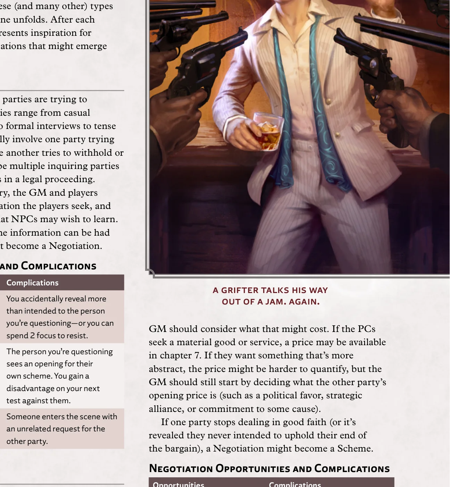
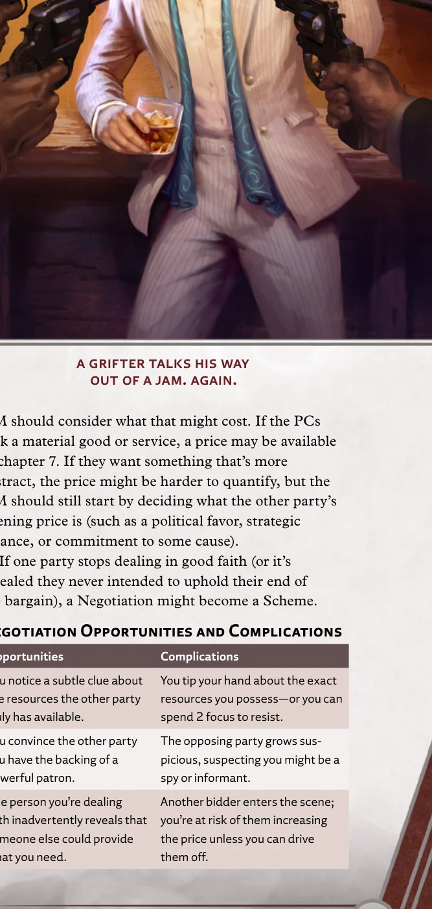
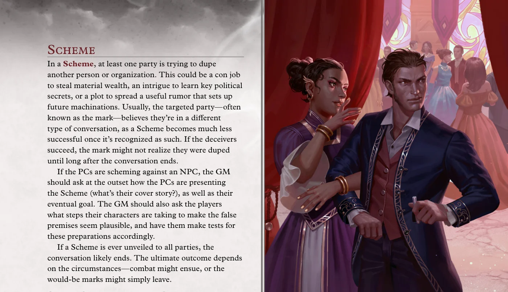

### 對話類型

對話（Conversation）會依參與者的目的呈現許多不同形式。本節提供幾種對話類型的進行建議，但隨著目的改變、場景展開，對話可以在這些類型及其他許多類型之間自然轉換。每種類型後方都有一張表，提供這類對話可能出現的機遇（Opportunity）與變故（Complication）構想。

### 詢問

在詢問（Inquiry）中，一方或多方試圖取得資訊。詢問可以是隨意打聽消息、正式訪談，也可以是緊繃的盤問。通常是一方試圖取得資訊，另一方則設法隱瞞或模糊資訊。但也可能像法律程序中那樣，有多個動機不同的詢問者。詢問開始時，GM 與玩家應討論玩家想取得哪些資訊，GM 也應考量 NPC 可能想知道什麼。如果發現只要付出代價就能取得資訊，詢問便可能轉變成談判。

### 詢問的機遇與變故

| 機遇 | 變故 |
| --- | --- |
| 透過提問，你發現自己與受詢問者有共同目標或敵人。 | 你不小心向受詢問者透露了超出原先打算的資訊；你也可以花費 2 點專注點（Focus）來抵抗。 |
| 你謹慎的暗示或含糊的威脅讓受詢問者心神不寧。下次針對對方進行的檢定（Test）獲得一次優勢（Advantage）。 | 受詢問者看見了推進自身詭計的機會。下次針對對方進行的檢定獲得一次劣勢（Disadvantage）。 |
| 受詢問者看見與你合作的機會，因此放下戒心。 | 有人進入場景，向另一方提出無關的請求。 |

### 談判

在談判（Negotiation）中，兩個以上有利害關係的團體試圖從彼此手中取得所需，通常也想盡量減少自身資源的耗費。談判是競爭與合作的奇特結合，雙方都試圖運用手邊的一切有利條件。不過，若要讓雙方獲利，就必須有得有失，否則其中一方可能直接離場。談判開始時，GM 與玩家應討論玩家想取得什麼，GM 則應考量可能需要付出什麼代價。如果 PC 想取得實體物品或服務，第 7 章或許有其價格。如果想取得的是較抽象的事物，價格可能較難衡量，但 GM 仍應先決定另一方的開價，例如一份政治人情、一項策略聯盟，或支持某項理念的承諾。如果一方不再誠心交易，或被揭露根本沒打算履行約定，談判就可能轉變成詭計。

### 談判的機遇與變故

| 機遇 | 變故 |
| --- | --- |
| 你注意到細微線索，得知另一方真正能動用哪些資源。 | 你洩漏了底牌，讓對方知道你確切擁有哪些資源；你也可以花費 2 點專注點來抵抗。 |
| 你讓另一方相信，自己有一位有權勢的贊助者（Patron）撐腰。 | 對方心生疑慮，懷疑你可能是間諜或線民。 |
| 與你交涉的人無意間透露，其他人也能提供你需要的東西。 | 另一名競標者進入場景。除非你能趕走對方，否則價格可能被抬高。 |

*一名騙徒（Grifter）靠口才脫離困境。又一次。*

JORDAN KERBOW

第 11 章：對話 335

### 詭計

在詭計（Scheme）中，至少有一方試圖欺騙另一個人或組織。這可能是騙取財物的騙局、刺探重要政治祕密的陰謀，或散播有用謠言、為後續算計鋪路的計畫。被盯上的一方通常稱為「肥羊」，往往以為自己正在進行另一種類型的對話，因為詭計一旦被識破，成功機會就會大減。如果騙人者成功，肥羊可能在對話結束很久之後，才發現自己受騙。如果 PC 正對 NPC 施展詭計，GM 應在開始時詢問 PC 打算如何包裝這場騙局，也就是他們用什麼說詞掩飾，以及最終目的是什麼。GM 也應詢問玩家，角色採取了哪些準備，讓虛假的前提看起來可信，並據此要求他們為這些準備進行檢定。如果所有人都識破詭計，對話很可能就此結束。最終結果取決於當時情況：可能爆發戰鬥，原本的肥羊也可能直接離開。

### 詭計的機遇與變故

| 機遇 | 變故 |
| --- | --- |
| 肥羊無意間透露自身資訊，提供能讓你日後獲取更多利益的細節。 | 一名中立 NPC 顯露出自己其實是對方的密探。 |
| 一名中立 NPC 誤以為你是權威人物，或某位值得信任的特定人士，因而印證了你的說詞。 | 除非你付錢給第三方，或設法將其趕走，否則對方就會揭露你的詭計。 |
| 你提供少量樣品或搶先展示，讓肥羊放下戒心。 | 一名調查員在最不恰當的時機抵達。 |

### 社交

在社交（Social）對話中，角色想與他人建立情誼、讓潛在盟友留下好印象，並拓展人際關係。社交通常出於真心，但不代表所有參與者都必須完全誠實。角色可能暗中另有所圖，敵對的 NPC 也可能設法破壞 PC 的努力。社交場景開始時，GM 應詢問玩家，角色是否有任何具體目的，並鼓勵玩家透過敘事追求這些目的。同樣地，GM 也應考量 NPC 在故事中的目的，讓他們能在對話冷場時主動追求。如果一個以上的團體決定推進自身計畫，GM 與玩家可以視情況，讓社交轉變成其他任何一種對話類型。

### 社交的機遇與變故

| 機遇 | 變故 |
| --- | --- |
| 你注意到細微的暗示，察覺某人隱藏的情緒。 | 你不小心透露某個細節，或說出一句讓自己遭人嘲笑的話。 |
| 你占了上風，恢復 1d4 點專注點。 | 對話讓你惱怒或心力耗竭，失去 1 點專注點。 |
| 你讓交談對象留下好印象，讓對方日後更願意幫助你。 | 你發現有機會推進自己的某個目標，但這麼做會打斷目前的對話。 |

JUST HIEU

第 11 章：對話 336

