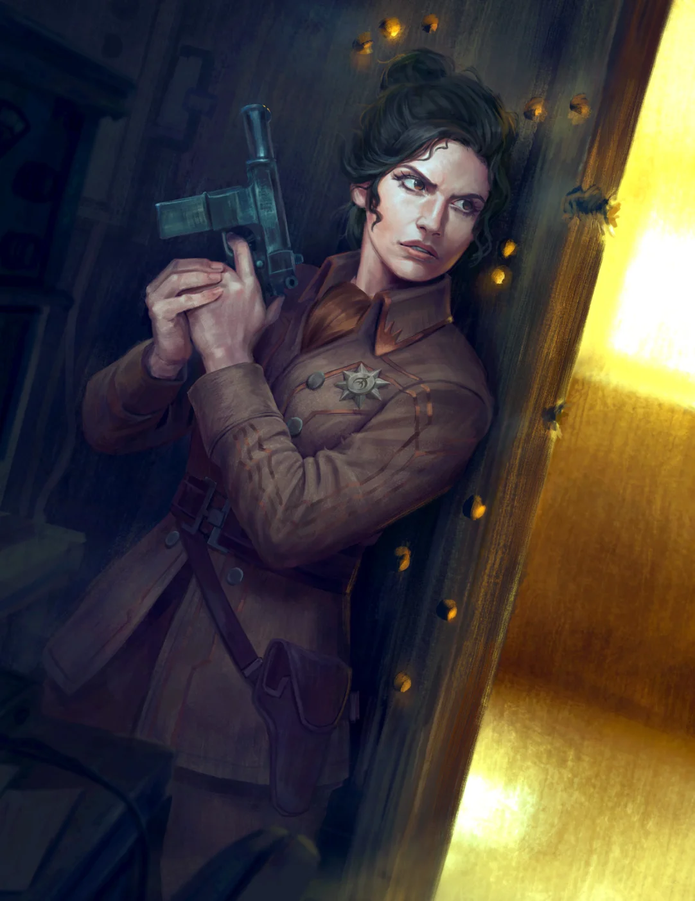

### 對話範例

以下遊戲範例示範一場對話（Conversation）如何進行。Delphette、Rastes 和 Nessenwy 一直在設法扳倒 Teniert 家族。他們在 Buvidas 家族的舞會上，看到了一個散播謠言的好機會。

**遊戲主持人（Game Master，GM）：** Sylveen Buvidas 女士跳了一個小時的舞，終於停下來休息。你們走上前時，她上下打量你們一番，露出一抹刻意擺出的冷笑，才點頭讓 Delphette 和 Rastes 在她那桌坐下。如果你們想散播謠言，我們就用詭計（Scheme）來處理。你們打算怎麼做？想達成什麼目標？

**Harper（扮演 Nessenwy）：** 我們知道 Teniert 家族的稽查員在 Buvidas 家族的駁船附近鬼鬼祟祟的。我們應該讓 Sylveen 相信，Teniert 家族正利用 Buvidas 家族的駁船走私貨物。對了，我現在在哪裡？

**GM：** Sylveen 女士讓 Delphette 和 Rastes 坐下。你是侍從官，照理說應該站著，擺出氣派的樣子。

**Harper（扮演 Nessenwy）：** 太好了。我會確保其他人沒辦法靠近這桌偷聽。我就往那裡一站，散發壓迫感。

**Lucas（扮演 Rastes）：** 說到壓迫感，誰也比不上 Nessenwy。

**Akua（扮演 Delphette）：** 我想先閒聊幾句，讓 Sylveen 放鬆下來，再暗示我有情報可以賣。

**GM：** 好，這個做法不錯。做一次說服（Persuasion）檢定（Test），讓她對你的提議感興趣。不過她顯然很懷疑你，所以要提高賭注（Raise the Stakes）。

*Akua 同時擲出一顆 d20 和劇情骰（Plot Die）。d20 擲出 6，劇情骰則擲出[機遇]（Opportunity）。她加上自己的說服調整值 +4，合計為 10。結果低於 Sylveen 的靈性防禦（Spiritual Defense），也就是 GM 設定的 DC，所以 GM 沒有讓 Sylveen 花費專注點（Focus）來抵抗影響（Influence）。*

**GM：** Sylveen 帶著客套的微笑聽你說話，但你還沒講到細節，她就插話了。「就算最近的稽查確實比較頻繁，我對一個穿著寒酸的無名小卒帶來的空泛傳聞，還是沒什麼興趣。」她不相信你的說法，不過多虧了你的機遇，她剛才說溜了嘴，透露出稽查的某些事讓她有點緊張。但她還是想嚇退你，讓你別再煩她。

*GM 為 Sylveen 擲一顆 d20。由於 Sylveen 正試圖威嚇 Delphette，GM 將 DC 設為 Delphette 的認知防禦（Cognitive Defense）。Sylveen 的 d20 擲出 14，GM 再加上她的威嚇（Intimidation）調整值 +4，合計為 18。結果高於 Delphette 的認知防禦，也就是 GM 設定的 DC。*

**GM：** 好，Akua，你可以選擇花費 2 專注點抵抗影響，或是退讓，不再繼續這場對話。

**Akua（扮演 Delphette）：** 糟了。我花 2 專注點。Delphette 咬著牙擠出笑容，準備換個策略。接下來換誰？

**Lucas（扮演 Rastes）：** 我有個點子！你剛剛說 Sylveen 看起來有點緊張？

**GM：** 喔，當然。她夠精明，知道自己剛才透露的比原先打算的還多。

**Lucas（扮演 Rastes）：** 太好了！我可以偷偷用煽動（Rioting）把那種情緒加強。希望這樣能讓 Delphette 更容易把事情談成。

**GM：** 沒問題。不過這裡有聖務官（obligator），其中可能有人是搜尋者（Seekers）。提高賭注，看看你能不能瞞過 Sylveen，讓她沒發現你的煽動。

*Lucas 花費 1 授予（Investiture），煽動緊張情緒。為了嘗試隱藏煽動，Lucas 同時擲出一顆 d20 和劇情骰。d20 擲出 17，劇情骰則擲出[變故]（Complication）4。加上自己的鎔金術（Allomancy）調整值 +2，以及劇情骰的 +4，合計為 23。結果高於 Sylveen 的靈性防禦，所以她沒發現自己受到了情緒鎔金術（Emotional Allomancy）的影響。*

**GM：** Sylveen 現在真的開始冒汗了。不過，因為那個變故……一位聖務官似乎正朝你們走來。

**Lucas（扮演 Rastes）：** 看來我該溜了。Rastes 會找個理由告辭，往洗手間走。

**Harper（扮演 Nessenwy）：** Nessenwy 俯下身，引起 Sylveen 的注意。「女士，根據資源廷（Canton of Resource）的運輸倫理守則第六條，如果 Teniert 家族被查出有不法情事，您的家族也得負責。」

**GM：** 你想用學識（Lore）檢定，還是威嚇檢定？

**Harper（扮演 Nessenwy）：** 我說得完全一本正經，把泰瑞司侍從官（Terris Steward）那種若無其事的態度發揮到極致。我覺得應該算學識檢定。

*Harper 擲一顆 d20，擲出 14。她加上自己的學識調整值 +5，合計為 19。結果高於 Sylveen 的認知防禦，也就是 GM 設定的 DC。GM 決定讓 Sylveen 在這裡讓步。*

**GM：** 多虧 Rastes 的煽動，Sylveen 準備上鉤了。她不花任何專注點抵抗影響，甚至答應，只要情報值得她花時間聽，就付給你們 500 盒金（boxings）。你們的詭計成功引她入局，關於 Teniert 家族的謠言很快就會像野火一樣傳開。不過，當你們向 Sylveen 說明細節時，你們可能會注意到，不遠處有一位看起來很不高興的聖務官，正在尋找 Rastes……

第 11 章：對話 337

