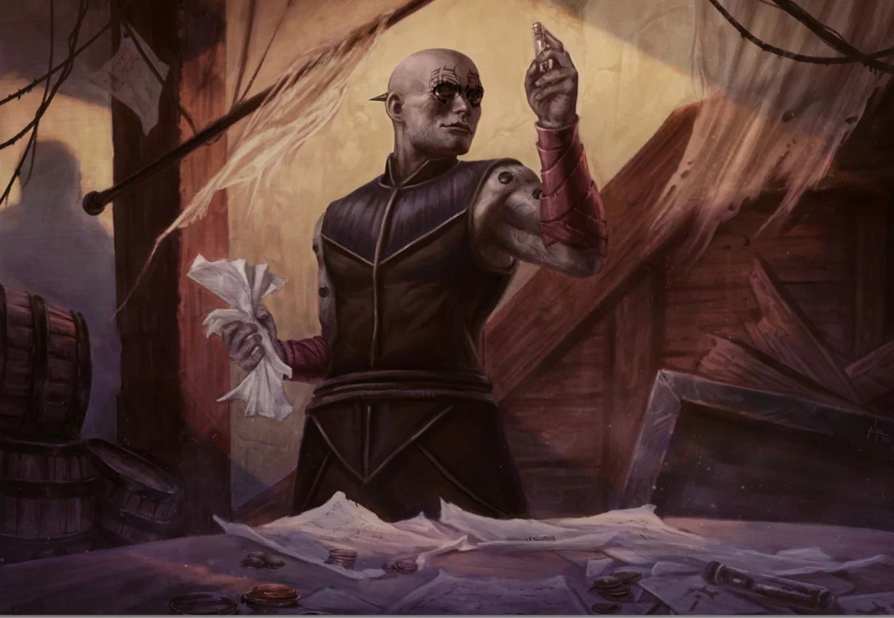
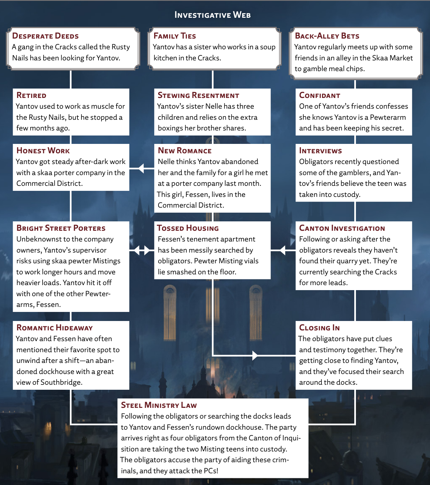

### 調查試煉

在調查（Discovery）試煉（Endeavor）中，角色會探究魔法、歷史與時事中的謎團。這些場景著重於未知之事，也為尋求解答開闢道路。這類試煉不只用一個單純的門檻來追蹤團體進度，而是以調查網（Investigative Web）呈現進展。網中的線索（Clue）彼此相連，讓角色能順著情節自然發現。每條線索又連向更多線索，逐步引領角色接近真相。

### 進行調查

調查試煉為謎團的調查過程提供架構。不過，這樣詳盡的安排需要 GM 事先準備，通常約需十到三十分鐘。因此，如果遊戲途中突然需要展開原本沒規劃的調查，GM 可以決定等到下次遊戲場次，或休息過後再開始。遇到這種情況時，GM 可以先給個理由，說明隊伍為什麼還無法尋找答案。例如，當局尚未完成自己的調查，犯罪現場仍然封鎖；或是重要證人暫時不在，等等。接著引導隊伍先去追求別的目標，並記下要儘快回來展開這場調查。進行調查時，GM 會透過調查網追蹤你們的進度，並在每回合提醒你們目前掌握的頭緒（Lead）與線索。

### 調查網

無論你們是想弄清楚從浮空船（Airship）上取回的奇怪徽章（Medallion）原本有什麼用途，還是偵破一位貴族遭到謀殺的案件，多半都會先從幾條頭緒著手。GM 可以建立調查網，安排要提供的資訊。這張網就是調查的地圖：其中包含調查過程中可以找到的每條線索，以及每條線索衍生的頭緒，指向其他線索。最終，其中一條或多條線索應該會通往試煉的目標，也就是團體想查明的事。本節稍後的「調查範例」提供了一張調查網範例。

### 不設成功門檻

在調查試煉中，調查網取代了團體成功門檻。GM 不必只記錄成功次數，而是記錄哪些線索已被找到，以及這些線索通往哪裡。當團體沿著調查網找到目標，試煉便告結束。這類試煉的進展不是直線前進，而是在分支交錯的選項中探索。視故事情況而定，GM 仍可能想追蹤失敗次數。如果你們在查明答案之前就達到失敗門檻，試煉便會失敗。

### 頭緒

調查開始時，GM 會提供玩家角色（Player Character，PC）幾條頭緒，通常是二到四條。這些頭緒可能是 NPC 分享的細節，也可能是隊伍自行得知的零碎資訊。每條頭緒都是一個入口，往下延伸出一串線索，也就是線索鏈（Lead Line）。角色開始輪流行動，各自在 GM 提示下進行相關檢定（Test），設法找出線索鏈上的下一條線索，或開啟另一條線索鏈。

### 線索

每條線索都可能揭露線索鏈上的下一條線索，直到取得最後一項資訊為止。PC 通常需要依照採取的做法進行相關檢定，才能取得線索。不過，像是提出誘人的賄賂這類行動，GM 可以酌情決定讓角色略過檢定。如果 PC 追查頭緒失敗，通常可以由自己或其他角色再次嘗試，除非情節發展導致這條頭緒斷了。但每次失敗都會讓團體更接近失敗門檻，所以再次嘗試時應該審慎行事。即使一條頭緒斷了，通常仍有其他頭緒能引向最終目標。好的調查網應該有多條路徑通往解答，讓團體能從各種不同方向展開調查。

### 結果

當隊伍查明想知道的資訊，或達到失敗門檻時，調查便告結束。如果調查失敗，後果取決於故事中面臨的風險：也許競爭對手先一步取得資訊、敵方士兵追上隊伍，或是再也無法取得想要的資訊。

第 12 章：試煉 342

### 特殊規則：憑直覺一搏

即使團體因為達到規定的失敗次數而在調查中失敗，仍可能已經從幾條線索中得知足夠的資訊，能做出有根據的猜測。要憑直覺一搏（Betting on a Hunch），角色就一起商量，為這場調查提出一個推測。如果猜對了，就視為角色成功完成調查。如果猜錯了，就利用情況尚不明朗這一點，為故事帶來新的轉折。角色及其玩家進入下一個場景時，可能會以為自己的結論是對的。但如果猜錯了，最終仍得承擔憑直覺一搏的後果。

### 調查範例

任何技能都能用於試煉。下方的「調查範例」表提供一些靈感，說明角色可以如何完成某些任務，並各舉一個機遇（Opportunity）與變故（Complication）的例子。

### 調查範例

| 技能 | 用途 |
| --- | --- |
| 推理（Deduction） | 解讀現有頭緒中的一條線索。 |
| 洞察（Insight）或感知（Perception） | 觀察人們的反應或檢視物證，發掘新線索。 |
| 威嚇（Intimidation）或說服（Persuasion） | 威逼或軟言勸誘，讓人提供線索或新的頭緒。 |
| 學識（Lore） | 回想或查考有助於調查的相關事實。 |
| 隱匿（Stealth）或求生（Survival） | 在繁忙的市集中尾隨或追蹤行蹤不定的嫌疑人。 |
| 劇情骰（Plot Die） | 結果 |
| 機遇 | 洗清一位遭到錯誤指控的嫌疑人的冤屈，贏得對方的忠誠。 |
| 變故 | 驚動一名嫌疑人，讓對方有機會逃走，因而中斷一條線索鏈。 |

*一位鋼鐵審判者（Steel Inquisitor）正在調查竊賊團夥的藏身處。*

ALEX NGO

第 12 章：試煉 343

### 調查網範例

「調查網」圖示範 GM 可以如何安排線索，供玩家角色發現。在這場調查中，一位住在陸沙德（Luthadel）的盟友懇求隊伍尋找失蹤的司卡（skaa）少年 Yantov。這位盟友是名叫 Rutger 的司卡工匠。他一直留意著這名少年，打算吸收他加入司卡地下組織。他擔心 Yantov 可能惹上了麻煩。

GM 以 Rutger 提供的下列資訊開始這場試煉：Cracks 街區有個叫 Rusty Nails 的幫派，一直在找 Yantov。Yantov 有個姊妹在 Cracks 的施粥所工作。Yantov 經常和幾個朋友在 Skaa Market 的一條巷子裡碰面，拿餐食代幣當賭注。Rutger 原本約了 Yantov 昨晚一起吃飯，但 Yantov 沒出現，而這不像他平常的作風。

### 調查網

| 節點 | 內容 |
| --- | --- |
| 冒險之舉（Desperate Deeds） | Cracks 街區有個叫 Rusty Nails 的幫派，一直在找 Yantov。 |
| 家人牽絆（Family Ties） | Yantov 有個姊妹在 Cracks 的施粥所工作。 |
| 暗巷賭局（Back-Alley Bets） | Yantov 經常和幾個朋友在 Skaa Market 的一條巷子裡碰面，拿餐食代幣當賭注。 |
| 退出幫派（Retired） | Yantov 以前替 Rusty Nails 當打手，但幾個月前已經不做了。 |
| 悶在心裡的怨氣（Stewing Resentment） | Yantov 的姊妹 Nelle 有三個孩子，仰賴 Yantov 分給她的額外盒金（boxings）過活。 |
| 知心好友（Confidant） | Yantov 的一位朋友坦承，她知道 Yantov 是白鑞臂（Pewterarm），一直替他保守這個祕密。 |
| 正當工作（Honest Work） | Yantov 在商業區（Commercial District）的一家司卡搬運公司找到了一份穩定的夜間工作。 |
| 新戀情（New Romance） | Nelle 認為 Yantov 為了上個月在搬運公司認識的一個女孩，拋下了她和家人。這個女孩叫 Fessen，住在商業區。 |
| 問話（Interviews） | 聖務官（obligators）最近找幾個賭客問過話。Yantov 的朋友認為，這名少年已經遭到拘捕。 |
| Bright Street Porters | 公司老闆並不知情，但 Yantov 的主管冒險僱用司卡白鑞迷霧人（Pewter Mistings），讓他們工作更久、搬更重的貨物。Yantov 和另一位白鑞臂 Fessen 很投緣。 |
| 遭到翻搜的住處（Tossed Housing） | 聖務官把 Fessen 在出租公寓裡的住處翻得一片凌亂。白鑞迷霧人用的金屬液瓶摔碎在地上。 |
| 聖務官的調查（Canton Investigation） | 跟蹤聖務官，或打聽他們的行蹤，就能得知他們還沒找到追捕的對象。他們目前正在 Cracks 搜尋更多頭緒。 |
| 情侶的秘密去處（Romantic Hideaway） | Yantov 和 Fessen 常常提到，他們下工後最喜歡去一處地方放鬆：一棟廢棄的碼頭房舍，從那裡可以欣賞 Southbridge 的美景。 |
| 逐漸逼近（Closing In） | 聖務官已經拼湊出線索與證詞，離找到 Yantov 越來越近。他們已將搜尋重點放在碼頭一帶。 |
| 鋼鐵教廷執法（Steel Ministry Law） | 跟蹤聖務官或搜尋碼頭，就會找到 Yantov 和 Fessen 躲藏的破舊碼頭房舍。隊伍抵達時，四位來自審判廷（Canton of Inquisition）的聖務官正要拘捕這兩名迷霧人少年。聖務官指控隊伍協助這些罪犯，並向 PC 發動攻擊！ |

| 節點一 | 節點二 | 原圖連線 |
| --- | --- | --- |
| 冒險之舉 | 退出幫派 | 相連（未標箭頭） |
| 退出幫派 | 正當工作 | 相連（未標箭頭） |
| 正當工作 | Bright Street Porters | 相連（未標箭頭） |
| Bright Street Porters | 情侶的秘密去處 | 相連（未標箭頭） |
| 情侶的秘密去處 | 鋼鐵教廷執法 | 相連（未標箭頭） |
| 家人牽絆 | 悶在心裡的怨氣 | 相連（未標箭頭） |
| 悶在心裡的怨氣 | 新戀情 | 相連（未標箭頭） |
| 新戀情 | 遭到翻搜的住處 | 相連（未標箭頭） |
| 暗巷賭局 | 知心好友 | 相連（未標箭頭） |
| 知心好友 | 問話 | 相連（未標箭頭） |
| 問話 | 聖務官的調查 | 相連（未標箭頭） |
| 聖務官的調查 | 逐漸逼近 | 相連（未標箭頭） |
| 逐漸逼近 | 鋼鐵教廷執法 | 相連（未標箭頭） |
| 新戀情 | 正當工作 | 單向箭頭（節點一指向節點二） |
| Bright Street Porters | 遭到翻搜的住處 | 雙向箭頭 |
| 聖務官的調查 | 遭到翻搜的住處 | 單向箭頭（節點一指向節點二） |
| 遭到翻搜的住處 | 逐漸逼近 | 單向箭頭（節點一指向節點二） |

GAL OR

