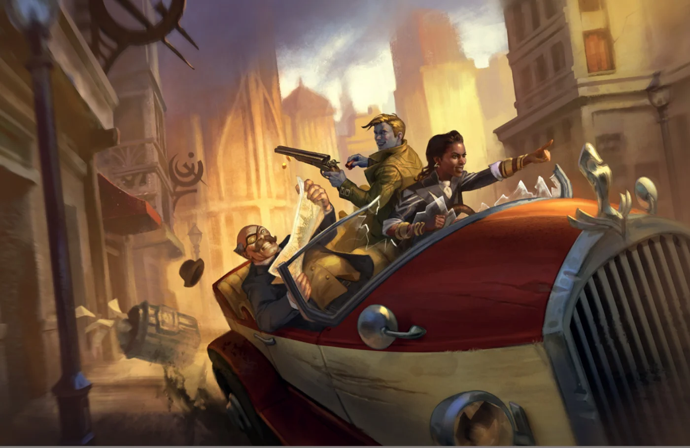
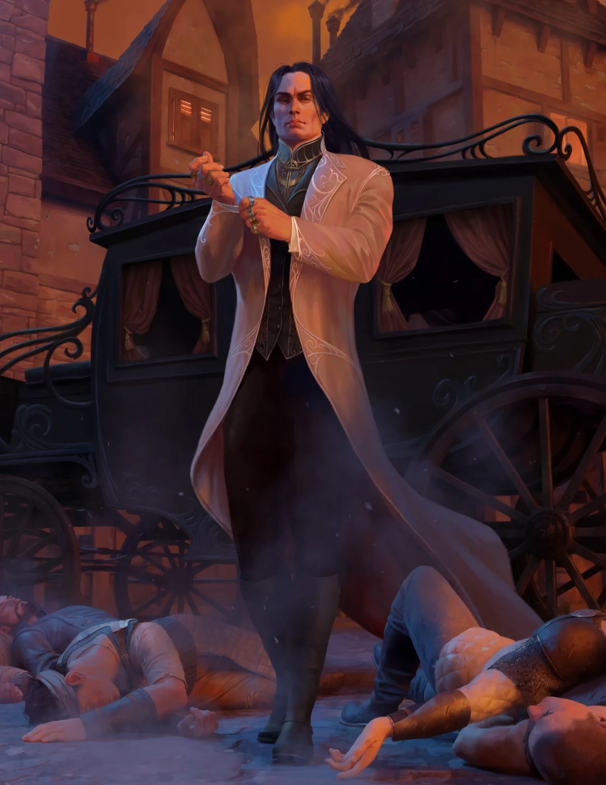

### 試煉範例

以下遊戲範例示範一場試煉（Endeavor）如何進行。Ardashwy、Rubble Roger 和 Harven 受一位 Malwish 大使僱用，要從依藍戴（Elendel）的兩名竊賊手中，取回遭竊的科技裝置。

**遊戲主持人（Game Master，GM）：** 竊賊的汽車在第八區（Eighth Octant）繁忙的道路上疾馳。女駕駛低著頭，旁邊那個壯碩的乘客則盯著你們。我們用追逐（Pursuit）試煉來處理。起始距離（Starting Distance）是 3，逃脫距離（Escape Distance）是 6。你們要怎麼做？

**Akua（扮演 Ardashwy）：** 「他們的車怎麼比得上我這輛 Terris Peak Motors 出品的 4型 Mountaineer！」

**Harper（扮演 Harven）：** Harven 哀號。「說真的，你每次幫他們打廣告，他們都會付你錢嗎？」

**Akua（扮演 Ardashwy）：** 「那還用說！」我要在其他汽車之間穿梭，盡可能咬住他們。

**GM：** 先做一次敏捷（Agility）對抗檢定（Opposed Test）。不過路上人很多，所以要提高賭注（Raise the Stakes）。

*Akua 同時擲出一顆 d20 和劇情骰（Plot Die）。d20 擲出 13，劇情骰則是空白。她加上自己的敏捷調整值 +4，合計為 17。GM 為駕駛擲一顆 d20，擲出 12，再加上駕駛的敏捷調整值 +3，合計為 15。Akua 在對抗檢定中成功。*

**GM：** 好，很棒，目前距離（Current Distance）降到 2。有幾個行人得趕快閃開，不過沒人受傷。

**Lucas（扮演 Rubble Roger）：** 我能開槍打爆一個輪胎嗎？還有，我上一個場景開始燃燒的白鑞（Pewter），現在還在燒嗎？

**GM：** 可以，也還在燒。提高賭注。你要燃燒多少白鑞？

**Lucas（扮演 Rubble Roger）：** 嗯，我就花 1 授予（Investiture）來燃燒，每回合再維持就好。

*Lucas 記下花費 1 授予。他同時擲出一顆 d20 和劇情骰。d20 擲出 2，劇情骰則擲出[變故]（Complication）2。他加上自己的重型武器（Heavy Weaponry）調整值 +4、劇情骰的 +2，以及白鑞鎔金術（Pewter Allomancy）賦予的增益（Enhanced）[力量（Strength）+1] 所帶來的 +1，合計為 9。結果低於駕駛上一次敏捷檢定的 15，也就是 GM 設定的 DC。*

**GM：** 你射偏了，把一家鞋店的玻璃打得粉碎。目前距離增加到 3。

**Harper（扮演 Harven）：** 「Roger！別再殃及無辜了！」

**GM：** 那個壯碩的竊賊盯著 Roger 的槍，伸出手，好像要接住什麼東西。他是鐵迷霧人（iron Misting）！這又是一次對抗檢定。Lucas，做一次運動（Athletics）檢定。

*Lucas 擲一顆 d20，擲出 18。他加上自己的運動調整值 +3，以及增益[力量+1] 所帶來的 +1，合計為 22。GM 為鐵迷霧人擲一顆 d20，擲出 18，再加上鐵迷霧人的鎔金術（Allomancy）調整值 +3，合計為 21。Lucas 在對抗檢定中成功。*

**GM：** 好險！不過你抓緊了槍，目前距離又降回 2。

**Harper（扮演 Harven）：** Harven 幾十年前住過第八區。我能不能推算出竊賊可能會走哪條路？

**GM：** 可以，做一次推理（Deduction）檢定。

*Harper 擲一顆 d20，擲出 13，再加上自己的推理調整值 +5，合計為 18。結果高於駕駛的意識防禦（Cognitive Defense），也就是 GM 設定的 DC。*

**GM：** 你看得出他們正要穿過 Little Rashekin。目前距離降到 1！你們差一點就追上了，但駕駛開始急了。她猛然轉彎，把車開上鐵軌！

**Akua（扮演 Ardashwy）：** 我有不好的預感。

**GM：** 如果你們要跟著開上鐵軌，來做個紀律（Discipline）對抗檢定，看你能不能穩住膽子，怎麼樣？

**Akua（扮演 Ardashwy）：** 「不入虎穴，焉得虎子！大使還指望著我們呢。」

*Akua 擲一顆 d20，擲出 12。她加上自己的紀律調整值 +2，合計為 14。GM 為駕駛擲一顆 d20，擲出 15，再加上駕駛的紀律調整值 +2，合計為 17。駕駛在對抗檢定中成功。*

**GM：** 目前距離增加到 2。這一回合很精彩！現在，鐵迷霧人看到你們也開上了鐵軌，眼裡突然閃過一股瘋勁。他拿起一件偷來的 Malwish 裝置，咧嘴一笑，把那個小方塊扔到你們車前！方塊一啟動，你們這輛可靠的 Mountaineer 就被鎖在原地，竊賊卻繼續往前飛馳。目前距離增加到 3。你們得先讓車脫困，才能繼續追。

**Lucas（扮演 Rubble Roger）：** 我試著靠近那個方塊！能把它弄壞嗎？

**GM：** 做一次工藝（Crafting）檢定，並提高賭注。

*Lucas 同時擲出一顆 d20 和劇情骰。d20 擲出 17，劇情骰則擲出[變故]4。他加上自己的工藝調整值 +1，以及劇情骰的 +4，合計為 22。結果高於 GM 設定的 DC。*

**Lucas（扮演 Rubble Roger）：** 我工藝是不太行啦，但這一骰也太漂亮了！還有一個變故。

第 12 章：試煉 350

**GM：** 你總算在小方塊上找到一處脆弱的地方。你把它往鐵軌上一砸，車子就能動了！不過這花了你一個行動，目前距離增加到 4。至於那個變故……你能感覺到鐵軌傳來一陣隆隆震動。

**Lucas（扮演 Rubble Roger）：** 我跳回車上，叫 Ardashwy 把油門踩到底！喔，還有，我維持燃燒。

*Lucas 記下花費 1 授予。*

**Harper（扮演 Harven）：** 我能不能靠對這一帶的熟悉，找條超棒的捷徑？

**GM：** 聽起來是學識（Lore）檢定。不過有班 3:10 發車、開往 Tathingdwel 的列車，所以要提高賭注。

*Harper 同時擲出一顆 d20 和劇情骰。d20 擲出自然20（Natural 20），劇情骰則擲出[機遇]（Opportunity）。Harper 在 d20 的點數上加上自己的學識調整值 +5，合計為 25。結果高於 GM 設定的 DC。而且，多虧了劇情骰和自然20，Harper 有兩個機遇！*

**Harper（扮演 Harven）：** 雙機遇！

**GM：** 有雙機遇，那我們就額外降低兩次距離。目前距離是 1。只要 Ardashwy 成功，這場追逐就搞定了。

**Akua（扮演 Ardashwy）：** 我這輛 Terris Peak Motors 出品的 4型 Mountaineer，開始狂飆！

**GM：** 再做一次敏捷對抗檢定。你們看見火車來了，提高賭注！

*Akua 同時擲出一顆 d20 和劇情骰。d20 擲出 10，劇情骰則是空白。她加上自己的敏捷調整值 +4，合計為 14。GM 為駕駛擲一顆 d20，擲出 3，再加上駕駛的敏捷調整值 +3，合計為 6。Akua 在對抗檢定中成功。*

**GM：** 目前距離降到 0！Mountaineer 猛地衝離鐵軌，飛快穿過幾條小路捷徑，停在竊賊面前。不過他們還不打算投降，所以我們切換成戰鬥（Combat）場景吧……

JORDAN KERBOW

第 12 章：試煉 351

