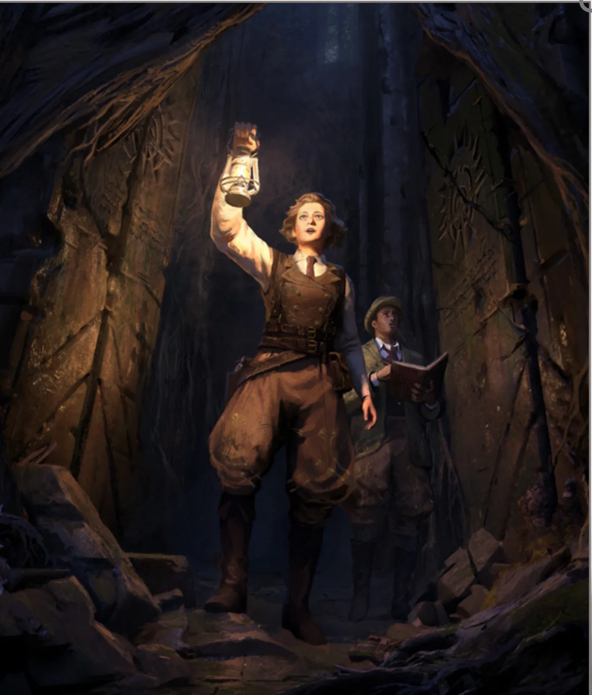

### 探索試煉

探索（Exploration）試煉（endeavors）中，角色會穿越難以預測或危險的環境，可能氣候嚴苛、暗藏陷阱，或有其他類似危險。有些探索是前往已知地點的艱險旅程，有些則是在未知之地尋找重要事物。例如，隊伍可能穿過陸沙德（Luthadel）迷宮般的貧民區、深入海司辛深坑（the Pits of Hathsin）尋找坎得拉家園（kandra Homeland），或橫越泰瑞司統御區（Terris Dominance）冰封的山坡。

### 帶領探索

探索的環境，能為玩家沿途面對的挑戰增添層次與風味。這些試煉中，危險無所不在。有時簡直像司卡德利亞（Scadrial）本身正在與居民作對。遠離文明時，如果不會辨認可食植物、尋找安全水源、驅退掠食者，或在夜晚迷霧中辨認方向，死亡就等在前方。不論隊伍的探索目標為何，評估環境威脅、管理資源時，都必須保持警覺。這反映在面對險境時，全團一起進行的克服險境（Against the Odds）檢定中（見「特殊規則：克服險境」）。雖然多數探索呈現的是旅途過程，但用心安排這些試煉，就不只是讓角色抵達終點的手段。沿途，角色可能發現有用資訊、意想不到的盟友，以及令人屏息的美景。

### 決定目標

每次探索都有目標。最常見的是前往特定目的地，或在指定區域內尋找所需事物，但只要以環境為主要焦點，就屬於探索。如果角色正在旅行，就應規劃如何抵達目的地。GM 可以提出多種方式或路線讓玩家選擇，並估算旅程距離或所需時間。如果探索目標不是旅行，例如清除克羅司（koloss）攻擊後堵住道路的殘骸，GM 就會明確訂出需要多少進展，才算成功完成試煉。

### 描述環境

GM 可以運用感官細節，替新環境增添風味與深度，預示危險，也暗示有用資源。結合不同感官、試著喚起多種情緒，會讓這些細節最有趣。有時，角色預期會感受到的事物反而不存在，就能製造不安。有些環境描述是警告，有些則為敏銳的玩家提供實用資訊，讓他們思考如何利用環境解決問題。

### 推進探索

探索開始後，GM 會提供待解的問題、需要做出的選擇，以及了解周遭環境的機會，引導玩家行動。探索中的貢獻（contributions）有許多形式。角色可以運用各種技能，進行偵察、採集、潛行、搭建避難所、驅退敵人、與路過商人交換資訊，或解讀受損地圖。如果角色擁有相關專長（expertise）或獎勵（reward），例如在該地區深具影響力的贊助者（patron），就能經 GM 判斷，運用這些資源自動通過某些檢定。角色的短期目標（goals）若與環境研究或建立外交關係有關，甚至可能在探索途中推進個人短期目標。

### 結果

達成探索目標時，例如走完所需距離抵達目的地，或找到並取得想要的物品，角色就成功完成探索試煉。如果失敗的貢獻太多，或全團嚴重偏離原定方向，GM 可以判定探索失敗，讓角色自行決定未達原定目標後，要如何繼續。探索失敗可能表示抵達時，另一群人已從遺跡取走重要文物；也可能表示無法取得約定貨物，因而無法完成關鍵交易。

第 12 章：試煉 345

### 特殊規則：克服險境

每次探索中，隊伍至多會遭遇一次超出一般荒野求生困境的額外危險，也就是除了追求目標時進行的檢定之外，還得面對險境。GM 引入這些危險時，每名角色都必須進行相關檢定，例如求生（Survival）、運動（Athletics）或領導（Leadership），面對險境並避免後果。每名檢定失敗的角色，都承受自己所面對危險的效果。「克服險境範例」表提供一些可能效果的範例。

### 克服險境範例

| 險境 | 建議 DC | 失敗效果 |
| --- | --- | --- |
| 脫水 | 14 | 失去專注點，僅剩 1 點。 |
| 金屬瓶破裂 | 10 | 你的金屬瓶只剩兩瓶完好，其餘全部破裂。如果有稀有金屬瓶破裂，你可以放棄一次長休息的好處，搶救其中內容物。 |
| 精力流失 | 14 | 陷入精疲力竭（Exhausted）[−1]。 |
| 感官受阻 | 18 | 陷入迷惑（Disoriented），直到場景結束。 |
| 衣物髒破 | 15 | 說服（Persuasion）與領導檢定獲得劣勢（disadvantage），直到你洗澡。護甲失去得體（Presentable）特性，直到修復為止。 |
| 食物污染 | 12 | 受到 2d4 命力傷害（vital damage）。 |

### 探索範例

試煉可以使用任何技能；「探索範例」表提供靈感，說明角色可能如何完成某些工作，也列出機遇（Opportunities）與變故（Complications）的範例。

### 探索範例

| 技能 | 用途 |
| --- | --- |
| 敏捷（Agility）或隱匿（Stealth） | 避開強盜、士兵或執法者等敵人。 |
| 運動 | 爬上有利的瞭望點，或穿越危險地形。 |
| 工藝（Crafting） | 修理因落灰或耗損而故障的交通工具或裝備。 |
| 推理（Deduction）或感知（Perception） | 留意危險徵兆、辨認水源，或發現逼近的威脅。 |
| 紀律（Discipline） | 熬過口糧不足或缺水的艱難時期。 |
| 領導 | 鼓舞隊伍的信心與決心。 |
| 學識（Lore） | 運用生物學或地質學知識。 |
| 醫學（Medicine） | 辨認有毒的食物來源、不潔水源或受污染的食物。 |
| 求生 | 運用追蹤與狩獵知識。 |

| 劇情骰（Plot Die） | 結果 |
| --- | --- |
| 機遇 | 發現能協助隊伍應付下一個場景的物品或天然資源。 |
| 變故 | 偶然遇上一群凶暴的亡命之徒；如果試煉失敗，下一個場景就是戰鬥。 |

### 任務試煉

任務（Mission）試煉是急迫且戰術複雜的場景，例如滲透敵方地點、完成劫案或營救人質。不論角色是司卡（skaa）竊盜團隊，還是警署突擊隊，都得把實體、意識與靈魂方面的本領推至極限，才能成功完成任務。

### 帶領任務

規劃任務時，GM 會訂出主要目標，以及團體成員可能感興趣的次要目標，並思考隊伍為了達成目標，必須克服哪些阻礙。最後，GM 決定全團有多少遊戲內時間可以完成任務（見「特殊規則：倒數計時」）。這通常取決於任務的故事背景，以及哪些因素可能妨礙任務。

由於任務攸關重大，GM 應準備一份相關機遇與變故清單，其中變故尤其應準備充分。

JOSHUA CHIA

### 任務簡報

開始時，GM 通常會讓一名 NPC 向角色說明任務簡報，包含地點、依優先順序排列的目標，以及遊戲內時程。如果 PC 是自行規劃任務，而非接受委託者指派，就由他們列出自己的目標，再由 GM 介紹地點、訂出預定時限。適當時，GM 也可以預告完成各項目標後，相應可能出現的結果。

### 維持急迫感

任務的每個回合（round）都應令人緊張、難以預測。GM 應在多數擲骰中提高賭注（raise the stakes），增添急迫感。玩家與不斷流逝的時間賽跑，合作完成目標，趕在時間用盡、情勢全面失控之前收工。隨著變故累積，玩家隨時都能放棄部分目標，避免落入悲慘下場。即使最優秀的突擊隊，也知道何時該及時停損、趕緊脫身。

### 特殊規則：倒數計時（The Ticking Clock）

任務開始前，GM 決定隊伍大約有多少時間，能安全完成任務。每個回合結束，GM 就推進計時。此外，PC 擲出變故時，GM 也可以選擇花費它來推進時間，推進多少由 GM 決定。變故夠多或耗時夠久，角色終將超過預定時限，GM 則會暗示危險即將到來。超過 GM 訂定的時限後，每多進行一個回合，就觸發更嚴重的問題。這些問題會持續累積，可能徹底打亂全團的任務。例如，隊伍可能在夜間闖入鋼鐵教廷（Steel Ministry）的建築。他們也許能在二十分鐘內不被發現，每個變故則推進五分鐘，雖然 GM 可以讓不同變故推進不同時間。二十分鐘過去後，問題開始出現：某名加班的聖務官（obligator）可能經過並看見角色，或衛兵依例換班，發現異狀。任務的急迫性，讓玩家合作與隊伍各種本領的運用成為焦點。

### 任務範例

試煉可以使用任何技能；「任務範例」表提供靈感，說明角色可能如何完成某些工作，也列出機遇與變故的範例。

### 任務範例

| 技能 | 用途 |
| --- | --- |
| 敏捷 | 靈巧地穿行不尋常的路徑，例如頭頂的屋梁，或兩座裝飾陽臺之間的空隙。 |
| 運動 | 悄悄擊昏僕人、普通衛兵，或巡邏中的警員。 |
| 工藝 | 臨時製作工具協助隊伍滲透，或讓某區域的照明失效。 |
| 欺騙（Deception） | 說服哨兵相信你獲准進入禁區，或設法分散注意。 |
| 推理 | 辨認區域的防禦措施，或在浪費時間與資源前識破誘餌。 |
| 洞察（Insight） | 判斷區域中的人何時最可能放鬆警戒。 |
| 領導 | 面對壓倒性的阻力或風險時，激勵團隊。 |
| 學識 | 運用建築學知識在貴族堡邸內找路，或運用都市規劃知識，判斷在某個街區該走哪條路。 |
| 隱匿 | 無聲移動、藏身陰影，或避免引起他人對團體的注意。 |
| 竊術（Thievery） | 開鎖、以巧手偷取或扒走鑰匙，或解除陷阱。 |

| 劇情骰 | 結果 |
| --- | --- |
| 機遇 | 你得知有搜尋者（Seeker）在場，或找到一批藏放的金屬瓶。 |
| 變故 | 一名休班衛兵意外返回，尋找放錯地方的紀念物。 |

第 12 章：試煉 347
