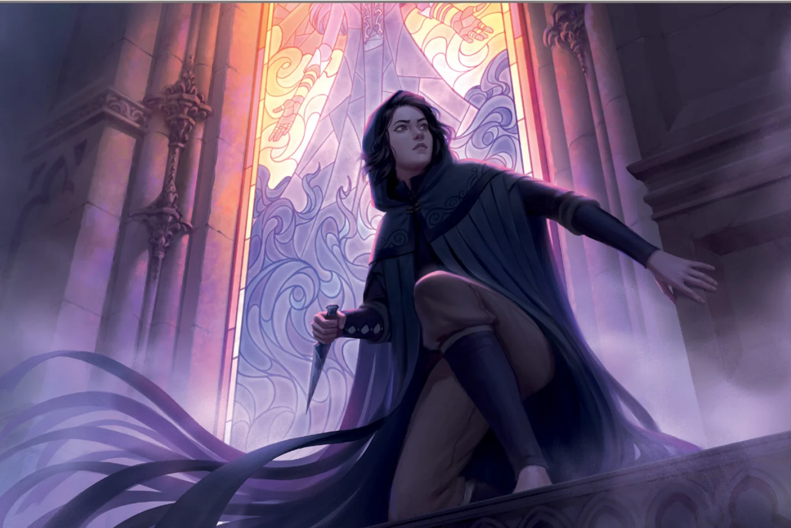

### 追逐試煉

追逐場景講求緊扣當下，追逐者也得隨時應變，跟上目標的機智與衝勁。如果角色失敗，也許再也沒有機會逮住目標；如果他們才是被追的一方，結果可能更加凶險。追逐（Pursuit）試煉（Endeavor）可以發生在陸地、空中或海上。

### 進行追逐

GM 準備時，應畫一張供自己參考、不給玩家看的草圖，粗略標出從追逐起點到目標目的地的路線。這條路線可能橫越城市、蠻橫區（The Roughs）、泰瑞司山脈（Terris Mountains），或任何可能發生追逐的地方。即使只是以大致形狀與線條畫成的簡圖，也能讓 GM 想到：追逐者逼近時，目標可以往哪裡走來甩開他們。

### 要不要用地圖？

追逐可以使用網格地圖，但以想像呈現場景的玩法可能較不受限制，讓追逐規模更大，也讓 GM 更能靈活調整。如果玩家只顧著數格子，沒有投入追逐的氣氛，過程就可能變得沒那麼有趣。為了彌補視覺資訊的不足，GM 可以像電影蒙太奇那樣處理追逐場景，隨著各個區域進入角色視野，再加以描述。不過，如果團體不容易想像口頭描述的畫面，或只是偏好有圖像可參考，也可以提供一張不帶網格的地圖，不必著重精確距離與角色位置。

### 隨環境變化應變

GM 應盡可能發揮巧思，調整目標或追逐者的移動與行動，充分考驗角色的能力。尤其在不使用實體遊戲地圖與模型時，GM 可以持續想出新方法，讓目標保持領先，直到玩家達到追逐的成功或失敗門檻。

*紋（Vin）閃身躲出視線，一名審判者（Inquisitor）正在追趕她。*

DEANDRA SCICLUNA

### 追逐中的對抗檢定

追逐著重於用你的技能，對抗一名直接阻撓你行動的對手，因此這類試煉很適合使用對抗檢定（Opposed Test），詳見第 3 章的「難度等級」。選擇並結算技能檢定（Skill Test）時，請考量你的行動是否與目標的行動直接對抗。例如，目標正試圖在後巷甩開你，而你想跟上對方，或找出躲藏的對方；又或者，你正試圖將對方擒抱在地。這些都很適合使用對抗檢定。大量使用對抗檢定的 GM 應留意，有些 NPC 的數據，尤其較高階層的 NPC，會讓他們遠比其他目標難以對付。如果目標使用自己特別擅長的技能進行檢定，可能很快就會讓團體追逐失敗。場景進行時，請記得這一點，視需要調整團體門檻（Collective Threshold），或改用對固定 DC 進行的一般檢定。

### 特殊規則：縮短距離

追逐的核心，是追逐者與目標之間的距離。你不是逐步累積到成功或失敗，而是竭盡所能縮短與目標的距離，或拉開與追逐者的距離。因此，追逐試煉不使用一般的團體門檻，而由 GM 以距離軌（Distance Track）記錄追逐者與目標有多接近。這並非實際距離，而是一個抽象數值，用來追蹤追逐者離抓住目標還有多近或多遠。使用距離軌時，GM 先選定起始距離與逃脫距離，再追蹤雙方的目前距離：

**起始距離（Starting Distance）。** 追逐開始時，GM 決定目標與追逐者之間最初相隔多遠。

**逃脫距離（Escape Distance）。** 接著，GM 決定目標需要與追逐者拉開多遠，才能真正逃脫並結束追逐。

**目前距離（Current Distance）。** 這是目標與追逐者目前的間距。追逐者檢定成功時，間距縮短 1；失敗時，間距拉大 1。同樣地，目標檢定成功時，間距拉大 1；失敗時，間距縮短 1。

當目前距離達到零，表示目標被抓住；達到逃脫距離，則表示目標逃脫。兩者任一發生時，追逐便告結束。「縮短距離」表提供了一些建議距離。

### 縮短距離

| 範例 | 起始距離 | 逃脫距離 |
| --- | --- | --- |
| 在堡壘的走廊間奔跑。 | 2 | 4 |
| 在陸沙德（Luthadel）的屋頂上逃離迷霧之子（Mistborn）的追捕。 | 3 | 6 |
| 穿越蠻橫區的多變地貌，追捕一名罪犯。 | 4 | 8 |

### 追逐範例

任何技能都能用於試煉，但「追逐範例」表提供了一些靈感，說明角色可以如何完成某些任務，並各舉一個機遇與變故的例子。如前文所述，標有星號的技能特別適合用於對抗檢定。

### 追逐範例

| 技能 | 用途 |
| --- | --- |
| 敏捷（Agility）* | 迅速穿越人群或衝入幽暗巷道，跑得比追逐者或目標更快。 |
| 運動（Athletics）* | 穿過或爬越障礙，或從一個屋頂跳到另一個屋頂。 |
| 欺騙（Deception）* | 製造騷動，為追逐者留下假蹤跡，或迷惑目標。 |
| 推理（Deduction）或洞察（Insight） | 找出捷徑、猜測目標下一步的行動，或對抗目標的欺騙檢定。 |
| 工藝（Crafting） | 破壞目標的交通工具，或修復自己的交通工具受到的損壞。 |
| 威嚇（Intimidation）或說服（Persuasion） | 說服旁觀者幫你尋找目標，或甩開追逐者。 |
| 感知（Perception） | 對抗目標的隱匿檢定，或察覺追逐者正在逼近。 |
| 隱匿（Stealth）* | 閃身躲出視線，或躲進隱密的小巷。 |
| 求生（Survival） | 避開環境危險，或利用天然捷徑。 |
| 竊術（Thievery） | 闖入建築，藉此躲避追逐者或追趕目標。 |

| 劇情骰（Plot Die） | 結果 |
| --- | --- |
| 機遇（Opportunity） | 你幸運地找到一條出路，或有 NPC 意外現身提供援助。 |
| 變故（Complication） | 你的行動危及無辜旁觀者，或造成嚴重的波及傷害。 |

第 12 章：試煉 349