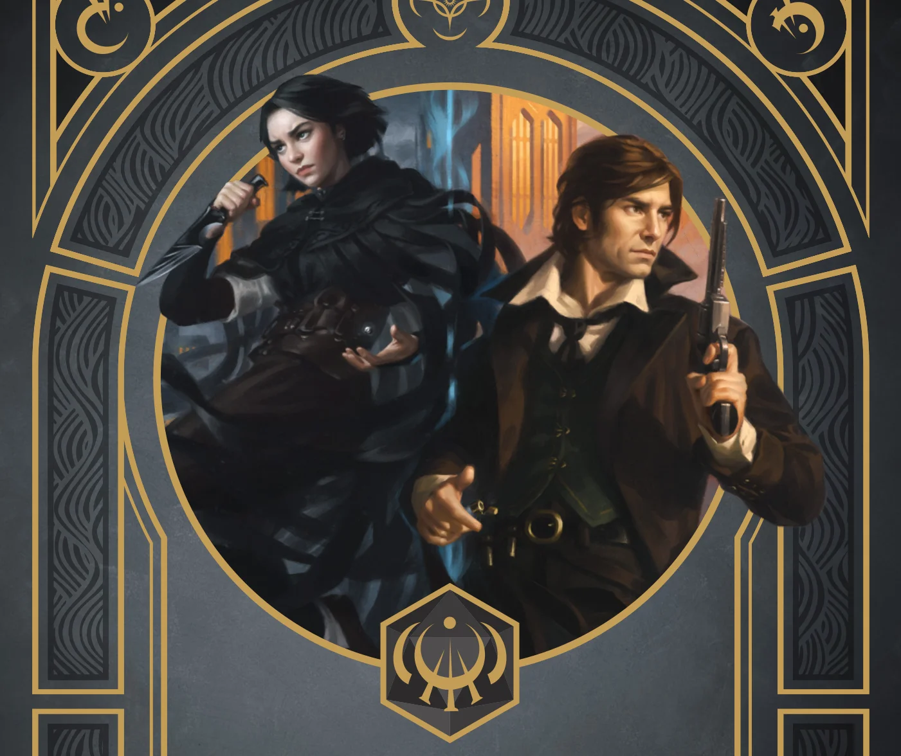
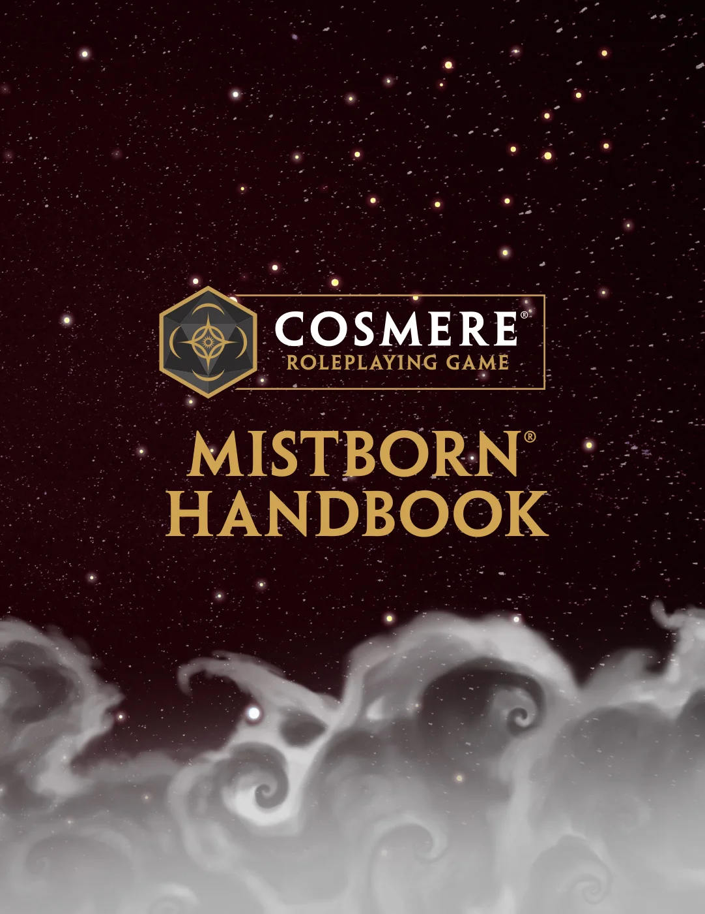
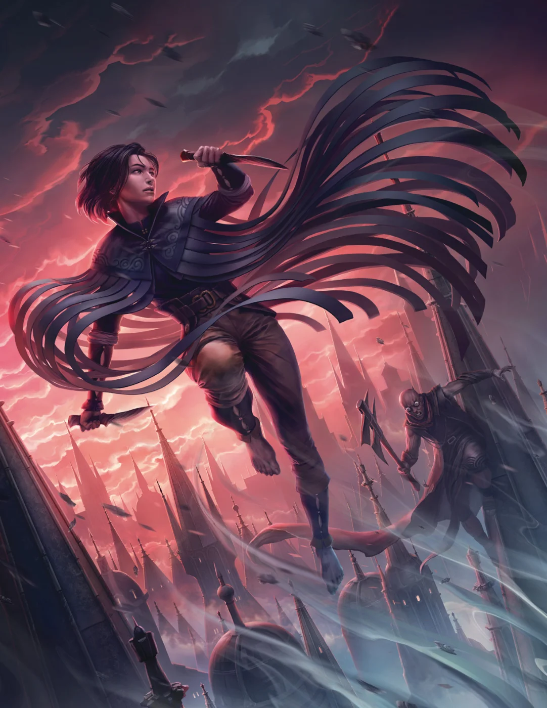

## 《迷霧之子®玩家手冊》

在布蘭登．山德森（Brandon Sanderson）的《迷霧之子》系列世界中，體驗桌上角色扮演遊戲

## 寰宇®角色扮演遊戲

## 《迷霧之子®玩家手冊》

## 寰宇®角色扮演遊戲

寰宇® RPG 由 Brotherwise Games 與 Dragonsteel Entertainment 共同創作。

**執行製作人：** 布蘭登．山德森

**製作人：** Isaac Stewart 與丹．威爾斯（Dan Wells）

**創意總監：** Johnny O’Neal

**書籍與設計負責人：** Andrew Fischer 與 Lydia Suen

**設計顧問：** Max Brooke

**規則設計：** Imogen Gingell, Laura Hirsbrunner, Ross Leiser, Amber Litke，以及 Ruvaid Virk

**其他設計：** ace baldwin, Welden Bringhurst, Sen H.H.S., Sen-Foong Lim, Meric Moir，以及 Matthew Wiens

**編輯：** Laura Hirsbrunner 與 Eli Scovill

**設定連貫性編輯：** Karen Ahlstrom

**歌世者（Worldsingers）：** David Behrens, Joshua Harkey, Eric Lake, Ben Marrow, Ian McNatt，以及 Evgeni “Argent” Kirilov

**敏感議題協調：** Basil Wright

**敏感議題顧問：** Em Carlson, Daniel Delgado, Basheer Ghouse，以及 Helen Gould

**槍械顧問：** Abby Daniel

**無障礙顧問：** Chris Hopper

**校對：** James Kauffman 與 Karen Twelves

**品牌與行銷：** Adam Horne, Matt Molandes，以及 Jillian Schumacher

**美術總監：** Matt DeMino 與 Ben McSweeney

**平面設計：** Gordon McAlpin

**概念美術：** Marie Seeberger

**封面繪師：** Nia Kovalevski

**蝴蝶頁繪師：** Svetlana Kostina

**內頁繪師：** David Astruga, Valeria Casale, Guilherme Castro, Joshua Chia, Andrew Chou, Kari Christensen, Billy Christian, Rodrigo Clark, Justine Cruz, Daarken, Carson Daniel, Matt DeMino, Tu Do, Micah Epstein, Siraj Fakhri, Logan Feliciano, Bear Frymire, Doruk Golcu, Ana Grigorieva, Antii Hakosaari, Amirul Hhf, It’s Just Hieu, Joel Chaim Holzman, White Horn, Satoshi Kamanaka, Jordan Kerbow, Nele Klumpe, Svetlana Kostina, Katerina Ladon, Alexandr Leskinen, Linda Lithén, Marie Magny, Miranda Meeks, Artur Mosca, Alexander Ngo, Alex Ngo, Kevin O’Neill, Gal Or, Anna Pazyniuk, Sam Perin, Anna Podedworna, Steve Prescott, Saeed Ramez, Kiki Moch Rikzy, Denman Rooke, Sami Rytkönen, Deandra Scicluna, Marie Seeberger, Lie Setiawan, Cynthia Sheppard, Kevin Sidharta, Janna Sophia, Darko Stojanovic, Raymond, Swanland, Jenny Tan, Bryan Taylor, Lucas Torquato, Randy Vargas, Anna Verhoog, Joe Watson, Arif Wijaya, Aleksandra Wojtas, Wayne Wu, Zuzanna Wuzyk, Kieran Yanner

**Dragonsteel 美術團隊：** Shawn Boyles, Rachael Lynn Buchanan, Anna Earley, Hayley Lazo, Jennifer Neal, Ben McSweeney，以及 Priscilla Spencer

## 寰宇 RPG 核心團隊

**首席設計師：** Andrew Fischer 與 Lydia Suen

**主筆：** Meric Moir

**主編：** Laura Hirsbrunner

**首席平面設計師：** Gordon McAlpin

**專案負責人：** Lyla McBeath Fujiwara

© 2026 Brotherwise Games, LLC。改編自布蘭登．山德森的《迷霧之子®》系列小說，小說著作權 © 2006, 2007, 2008, 2011, 2015, 2016, 2022 歸 Dragonsteel Entertainment, LLC 所有，並經 Dragonsteel Entertainment, LLC 明確授權使用。

Plotweaver™ 遊戲系統 © 2025 Brotherwise Games, LLC。

ISBN: 978-1-966528-06-7

首次印刷（v1.02）

中國印製

Dragonsteel

Brotherwise Games

## 目錄

| 章節 | 原書頁碼 |
| --- | --- |
| 導論 | 3 |
| 本書使用方式 | 4 |
| 歡迎來到司卡德利亞（Scadrial） | 5 |
| 什麼是角色扮演遊戲？ | 7 |
| 使用寰宇 RPG 骰子 | 9 |
| 遊戲慣例 | 13 |
| 冒險與成長 | 13 |
| 遊戲範例 | 14 |
| 第 1 章：創建角色（Character） | 17 |
| 創角步驟 | 17 |
| 角色成長 | 27 |
| 第 2 章：出身 | 31 |
| 思考你的出身 | 31 |
| 血統（Ancestry） | 32 |
| 文化（Culture） | 40 |
| 第 3 章：角色數據 | 49 |
| 認識你的數據 | 49 |
| 屬性（Attributes） | 50 |
| 防禦（Defenses） | 53 |
| 偏轉值（Deflect） | 53 |
| 專長（Expertises） | 54 |
| 生命值（Health）、專注點（Focus）與授予（Investiture） | 56 |
| 感官 | 57 |
| 技能（Skills） | 59 |
| 第 4 章：英雄路徑（Heroic Paths） | 73 |
| 使用路徑（Paths）與天賦（Talents） | 73 |
| 密探（Agent） | 78 |
| 使者（Envoy） | 86 |
| 獵手（Hunter） | 94 |
| 領袖（Leader） | 102 |
| 學者（Scholar） | 110 |
| 戰士（Warrior） | 118 |
| 第 5 章：金屬之子（Metalborn）路徑 | 127 |
| 使用金屬之子路徑 | 127 |
| 迷霧人（Misting） | 134 |
| 迷霧之子（Mistborn） | 138 |
| 藏金術師（Feruchemist） | 144 |
| 單藏金術師（Ferring） | 148 |
| 雙生師（Twinborn） | 152 |
| 第 6 章：金屬技藝（Metallic Arts） | 161 |
| 使用金屬技藝 | 161 |
| 司卡德利亞的金屬 | 166 |
| 鋁（Aluminum）鎔金術（Allomancy） | 172 |
| 天金（Atium）鎔金術 | 173 |
| 彎管合金（Bendalloy）鎔金術 | 176 |
| 黃銅（Brass）鎔金術 | 179 |
| 青銅（Bronze）鎔金術 | 182 |
| 鎘（Cadmium）鎔金術 | 185 |
| 鉻（Chromium）鎔金術 | 188 |
| 紅銅（Copper）鎔金術 | 190 |
| 硬鋁（Duralumin）鎔金術 | 192 |
| 電金（Electrum）鎔金術 | 194 |
| 金（Gold）鎔金術 | 196 |
| 鐵（Iron）鎔金術 | 198 |
| 鎳鉻（Nicrosil）鎔金術 | 201 |
| 白鑞（Pewter）鎔金術 | 203 |
| 鋼（Steel）鎔金術 | 205 |
| 錫（Tin）鎔金術 | 208 |
| 鋅（Zinc）鎔金術 | 210 |
| 鋁藏金術（Feruchemy） | 213 |
| 天金藏金術 | 215 |
| 彎管合金藏金術 | 217 |
| 黃銅藏金術 | 219 |
| 青銅藏金術 | 222 |
| 鎘藏金術 | 224 |
| 鉻藏金術 | 226 |
| 紅銅藏金術 | 229 |
| 硬鋁藏金術 | 232 |
| 電金藏金術 | 234 |
| 金藏金術 | 236 |
| 鐵藏金術 | 238 |
| 鎳鉻藏金術 | 240 |
| 白鑞藏金術 | 241 |
| 鋼藏金術 | 243 |
| 錫藏金術 | 246 |
| 鋅藏金術 | 249 |
| 血金術（Hemalurgy） | 251 |
| 第 7 章：物品 | 253 |
| 使用物品 | 253 |
| 貨幣 | 254 |
| 起始套組（Starting Kits） | 254 |
| 武器（Weapons） | 255 |
| 護甲（Armor） | 264 |
| 金屬小瓶 | 267 |
| 裝備（Equipment） | 267 |
| 旅行 | 272 |
| 工藝（Crafting） | 273 |
| 第 8 章：短期目標（Goals）與獎勵（Rewards） | 281 |
| 核心目的（Purpose）與內在障礙（Obstacle） | 281 |
| 短期目標 | 283 |
| 獎勵 | 285 |
| 夥伴（Companions） | 286 |
| 血金術尖刺 | 288 |
| 稀有製品 | 292 |
| 稀有金屬 | 295 |
| 贊助者（Patrons） | 296 |
| 組織 | 297 |
| 藏身處 | 300 |
| 第 9 章：冒險（Adventuring） | 303 |
| 角色扮演 | 303 |
| 時間 | 304 |
| 場景（Scenes） | 305 |
| 事件（Events） | 305 |
| 休息 | 306 |
| 休整期（Downtime） | 307 |
| 狀態（Conditions） | 310 |
| 持續時間 | 312 |
| 食物與飲水 | 312 |
| 傷害（Damage）、傷勢（Injury）與死亡 | 312 |
| 第 10 章：戰鬥（Combat） | 317 |
| 戰鬥流程 | 317 |
| 行動（Actions）與反應（Reactions） | 318 |
| 攻擊 | 321 |
| 選定目標與距離 | 323 |
| 移動與站位 | 325 |
| 變體規則：使用方格地圖 | 327 |
| 騎乘戰鬥（Mounted Combat） | 329 |
| 第 11 章：對話（Conversations） | 331 |
| 設定場景 | 331 |
| 對話流程 | 331 |
| 對話中的專注點 | 333 |
| 對話類型 | 335 |
| 對話範例 | 337 |
| 第 12 章：試煉（Endeavors） | 339 |
| 設定場景 | 339 |
| 試煉流程 | 340 |
| 發現試煉 | 342 |
| 探索試煉 | 345 |
| 任務（Mission）試煉 | 346 |
| 追逐（Pursuit）試煉 | 348 |
| 試煉範例 | 350 |
| 第 13 章：主持遊戲 | 353 |
| 要求技能檢定（Skill Tests） | 354 |
| 使用劇情骰（Plot Die） | 355 |
| 使用機遇（Opportunities）與變故（Complications） | 357 |
| 敘事優勢（Advantages）與劣勢（Disadvantages） | 358 |
| 安排遊戲場次（Session） | 358 |
| 使用敵手 | 359 |
| 設計戰鬥場景 | 363 |
| 冒險 | 367 |
| 安排戰役（Campaign） | 367 |
| 給予成長獎勵 | 368 |
| 從較高等級（Levels）開始 | 369 |
| 運用不同時代 | 371 |
| 使用其他背景設定的內容 | 374 |
| 正史與設定連貫性 | 375 |
| 安全指南 | 377 |
| 另一個秘密 | 382 |
| 附錄：動物夥伴（Animal Companions） | 384 |
| 詞彙表與索引 | 389 |
| 致謝 | 400 |
| 角色紙 | 402 |

