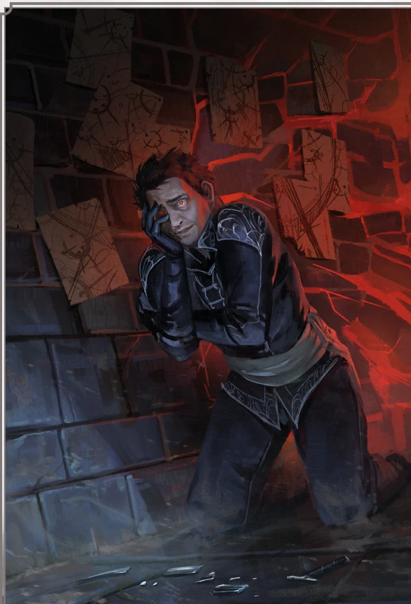
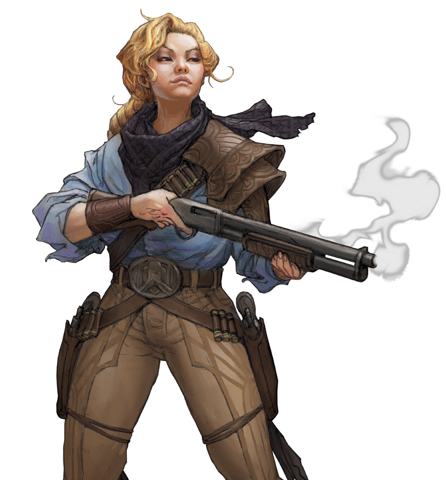

### 冒險（Adventure）

戰役（Campaign）中每一段自成一體的故事，都是一場冒險。有些冒險是簡短的單場冒險（One-shot），在一次遊戲場次（Session）內就能結束。有些冒險則由數個章節組成，每章都需要數次遊戲場次才能完成。每場冒險都需要清楚的開頭、發展與結尾。開場應有引人入勝的引子，過程中安排多項有待克服的挑戰，並逐步邁向高潮結局。冒險不該強迫玩家沿著預定路線前進，也不該一成不變；不過，充分準備能幫助你做出精彩的即興發揮。因此，你可以隨心所欲地規劃故事，但別忘了，玩家的點子與敘事選擇應當隨時影響結果。已出版的冒險能提供實用的架構，對忙碌或經驗較少的 GM 尤其有幫助。其他 GM 則偏好修改官方劇本，或設計自己的自製冒險。

### 已出版的冒險

展開你的寰宇 RPG（Cosmere RPG）旅程時，可以考慮遊玩下列官方出版的冒險：

《迷霧之子入門套組》（Mistborn Starter Set）包含一場專為新玩家設計的 1 等級（Level）冒險，並附有預製角色、地圖、指示物與骰子，讓遊戲體驗更加豐富。《迷霧之子傳承》（Mistborn Legacy）則是涵蓋整個戰役篇幅的精裝冒險，故事橫跨兩個時代，帶領玩家從 1 等級一路成長至 9 等級。

這類冒險包含原創設定、預先寫好的劇本、地圖與敵手（adversary）。運用這些資源，你就能減少準備時間，專心主持遊戲。你不必完整跑完一部已出版的冒險，才能從中獲益。你可以把它當作戰役起點，隨後讓故事朝另一個方向發展；也可以調整情節，配合角色的短期目標（goal）與內在障礙（obstacle）。其中或許也有實用的場景（Scene）、地圖或敵手，可直接取用，放進你自己的自製冒險。無論如何運用，一部冒險都能帶來寶貴靈感，讓你更深入了解司卡德利亞（Scadrial）。

### 自製冒險

親自設計冒險，能讓你踏入司卡德利亞的世界，發揮創意，獲得成就感。這類冒險通常稱為「自製」冒險，往往最適合用來打造以玩家為主的故事，將角色各自的短期目標、核心目的（purpose）與內在障礙融入敘事。這套

寰宇 RPG 的設計，以自製冒險為預設遊玩方式，並提供各種類型場景的建構指引。如果你要自製《迷霧之子》的遊戲內容，也應備妥一本《迷霧之子世界指南》（Mistborn World Guide），其中收錄了各式各樣敵手的角色資料（Profile）。

### 安排戰役架構

戰役會跟隨同一群角色經歷多場冒險。將冒險串連起來，玩家就能看著自己的角色從卑微的竊賊與工人成長為迷霧之子（Mistborn）及司卡德利亞的英雄，最終成為踏遍整個寰宇（cosmere）的躍界冒險者。視你希望隊伍（Party）的故事如何配合《迷霧之子》小說逐步展開的情節而定，一場冒險可以毫無間歇地接續下一場，也可以在故事篇章之間安排一些休整期（Downtime）。若採用後者，請運用第 9 章的休整期規則，討論每位角色在冒險之間可能進行的活動。

備受滅絕（Ruin）折磨的 詹（Zane）。

CARSON DANIEL

在較長的戰役中，有些玩家可能從頭到尾都扮演同一位 PC，其他 PC 則可能只參與部分故事。有些角色可能死亡，有些可能退休，也有些會因其他原因離開隊伍。如果團內持續參與遊戲的玩家因上述原因讓角色離隊，你可以讓他建立一位符合隊伍目前等級的新角色，詳見後文「從較高等級開始」。不過，在長期戰役中，玩家來來去去也完全正常。你可以讓新玩家加入團隊，也可以讓玩家「客串」幾次遊戲場次。

### 給予成長

玩家角色（Player Character）隨著故事發展，會成長、學習、結交盟友（Ally），並變得更加出色。規則上，這表現為提升等級（見第 1 章「角色成長（Character Advancement）」）與獲得獎勵（Reward；見第 8 章「獎勵」）。主要規則見各對應章節，本節則進一步說明何時給予等級與獎勵，以及給予的頻率。你需要決定如何分配等級與獎勵，藉此塑造戰役的步調與風格。

### 等級

等級代表隊伍持續練習，逐漸累積運用自身能力的經驗。因此，在整場戰役中，提升等級的間隔應該相對均勻。在重要且令人滿足的時刻給予等級，是很好的做法。你可以選在隊伍抵達具有意義的故事里程碑（Milestone），或歷經許多艱難考驗、證明自身能力之時。這些時候，提升等級會讓玩家覺得實至名歸，獲得滿足，也讓隊伍的成長具有意義與目的。

### 等級一致

除非有重要的故事理由，讓某位角色的等級與其他人不同，否則建議讓隊伍中所有 PC 維持相同等級。就算某位角色缺席幾次遊戲場次，也可以在回來時直接升級。

### 升級頻率

究竟多久讓 PC 提升一次等級，取決於你的戰役及其故事。每個遊戲階層（Tier）都代表不同類型的故事與體驗，因此，你需要安排好角色升級的步調，讓他們的能力與你希望他們在故事中完成的事相符。（各階層可預期的遊戲內容，見第 1 章「角色成長」

的指引。）如果你的故事還沒準備好擴大到更史詩的規模，讓角色緩慢而穩定地成長，通常會比較明智。已出版的冒險會建議角色應有的等級，以及何時給予額外等級。不過，主持自己的戰役時，請考量故事的完整發展，並用以下兩個問題決定升級步調：

- 你預計故事的各個部分需要多少次遊戲場次？

- 在這些故事段落中，你希望玩家體驗哪個遊戲階層？

例如，你預計讓階層 1 的角色在陸沙德（Luthadel）街頭勉強度日，花上約四次遊戲場次，接著再用約六次遊戲場次取得並學習金屬技藝（Metallic Arts）。這表示你希望他們在約十次遊戲場次中，走過兩個完整的遊戲階層（10 個等級），因此大約每次遊戲場次都要給予一個等級。另一方面，如果你預計主持更長期的戰役，可能就會希望每兩至三次遊戲場次才給予一個等級。

### 獎勵

等級的成長相對線性，獎勵則是較有彈性的成長方式。你可以依敘事發展，以及角色個人的成就來給予玩家獎勵。角色追求短期目標時取得的任何有力量或價值的事物，都可以是獎勵。雖然大部分獎勵是在角色完成個人短期目標時取得，你也可以在值得給予獎勵的重要故事時刻發放。第 8 章從玩家的角度說明短期目標與獎勵，本節則進一步說明如何及何時設定、推進與完成短期目標。

### 設定短期目標

玩家向你提出新的角色短期目標構想時，請與他合作，確認這個目標適合你的故事、角色的階層，以及短期目標應有的範圍。就故事而言，想想你打算讓 PC 在接下來的遊戲場次完成什麼。這個短期目標能夠達成嗎？它是否合適，並且符合角色的其他行動與動機？若不符合，試著提出方向相近、又能配合你規劃的建議。就階層而言，想想合適的獎勵，並考慮 PC 完成短期目標時，你預期他們會處於哪個階層。那份獎勵適合該階層嗎？如果過於強大，可以考慮鼓勵 PC 先朝中間步驟努力。最後，就範圍而言，想想角色可能需要多久才能完成這個短期目標。如果預計所需時間遠超過幾次遊戲場次，最好與玩家合作，將它拆成較小的短期目標。

第 13 章：主持遊戲 368

### 推進短期目標

務必定期確認 PC 的短期目標，確保玩家有機會推進進度。遊戲場次結束時，很適合逐一與玩家聊聊，看看他們是否覺得自己的角色在這次遊戲場次中，朝短期目標取得了實質進展。如果有，給予一格里程碑勾選框的進度便很合適。取得重大成就時，若你覺得適當，也可以給予兩點進度。如此一來，積極追求的短期目標大多需要 2–3 次遊戲場次才能完成（若角色沒有取得實質進展，所需時間就會長得多）。請記得，就故事而言，並非所有短期目標都能迅速完成；重大任務可能需要遠超過三次遊戲場次。在這種情況下，你可以放慢給予進度的速度，或如前文所述，與玩家一起重新評估短期目標，將它拆成較小的任務。

### 角色死亡

司卡德利亞的世界動盪不安，死亡是這裡的故事常見的一部分。就算角色取得金藏金術（Gold Feruchemy）這類強大的治療（Healing）能力，某些威脅仍可能突破他們驚人的生存能力，詳見第 9 章「傷害、傷勢與死亡（Damage, Injury, and Death）」。有些故事以 PC 死亡作結，並無不可，但務必讓玩家覺得自己能決定角色的遭遇。PC 的生命值（Health）降至 0 時，會陷入昏迷（Unconscious）並受到一項傷勢（Injury）。不過，如昏迷狀態（Condition）所述，敵人通常應該忽略倒下的 PC（除非故事上有理由採取其他做法），而玩家可以決定自己的 PC 何時恢復意識。因此，PC 通常只有在倒下後反覆起身多次，而非繼續保持昏迷時，才可能死亡。務必讓玩家清楚知道，這麼做有死亡風險。為某個理念犧牲（或因任何符合角色故事的理由死去），能為角色的故事發展帶來極為令人滿足的結局，但玩家應當參與這段共同說故事的過程。

### 完成短期目標

角色勾滿三個里程碑框、完成短期目標時，就該給予獎勵了！大多數短期目標都有明確而顯然的獎勵，例如「製作一件金屬意識庫（Metalmind）」。不過，有些目標的獎勵可能較不明確；也可能因其他故事上的理由，你不希望 PC 取得那份理所當然的獎勵。請記得，你給予的獎勵不一定得是角色原本追求的事物。角色獲得的不是自己想要的，而是自己需要的，往往也是合適的安排；但無論角色想要什麼，都要留意玩家是否會對獎勵感到滿意。例如，角色可能沒能購得一批天金（Atium），卻在四處聯絡、尋找金屬的過程中，得到一位有權勢的貴族（Noble）作為贊助者（Patron）。

### 從較高等級開始

並非每場冒險都從角色能力低微時開始。如果你想講述的故事，一開始就讓角色成為經驗豐富的金屬之子（Metalborn），或能力相當的冒險者，那麼從較高等級展開戰役就很合適。這類戰役通常從某個階層的起始等級開始（6、11 或 16 等級），但你也可以選擇任何起始等級。從較高等級展開戰役時，請提供玩家以下角色建立（Character Creation）指示，補充第 1 章的說明。此外，也務必告訴他們你希望角色具備的其他內容，例如挑選裝備（Equipment），或建立背景故事中的細節。較高等級的角色通常有過往冒險的經歷，因此，你可以根據共同故事開始之前發生的事，安排不同的故事引子或人脈（Connections）。

### 建立較高等級角色

大部分戰役都從 1 等級開始，因此以下角色建立選項，只有得到 GM 許可的玩家才能使用。如果 GM 希望你們的遊戲從較高等級開始、你的上一位角色已經死亡，或你正加入角色等級較高的既有團隊，GM 可能就會提供這些指示（在最後一種情況下，GM 大概會讓你建立與其他 PC 等級相同的新角色）。

第 13 章：主持遊戲 369

### 建立角色並逐級提升

先按照角色建立指示，像建立 1 等級角色一樣完成角色，接著依序做出每個等級的選擇（分配屬性（attribute）、增加生命值等等）。

### 選擇獎勵與物品

除了角色建立與成長的一般選項外，你的較高等級角色，在此前的人生中，也會因自身行動與冒險取得某些物品及獎勵。請用「較高等級起始獎勵」表，決定你獲得多少盒金（Boxing；可用來購買物品），以及能從第 8 章選擇多少項獎勵。請與 GM 合作挑選獎勵，確保它們符合即將展開的戰役敘事。GM 也能協助你編織故事，說明角色如何獲得這些獎勵。

### 獎勵前提條件（Prerequisite）

某些天賦（talent）或角色成長的其他項目，可能有與獎勵相關的前提條件。逐級處理角色成長時，請視為你在每個階層的第一個等級，就已取得該階層的每項獎勵。如果你扮演金屬之子角色，請記得，你必須透過金屬之子短期目標（Metalborn Goal）與獎勵，解鎖每項能力（或每對能力）。為此，你需要訓練自己的鎔金能力（Allomantic Power），或製作自己的藏金術（Feruchemy）金屬意識庫（見第 5 章「金屬之子短期目標與獎勵」）。在此之前，你只能使用該能力的初萌能力（Nascent Power）版本，不能選擇任何金屬之子路徑（Metalborn Path）或金屬技藝能力（Metallic Art Power）的天賦。例如，你建立一位階層 3 角色，想扮演擁有鋼鎔金術（Steel Allomancy）與錫藏金術（Tin Feruchemy）的雙生師（Twinborn）。你必須先用掉兩個階層 1 獎勵，完成兩項能力各自的短期目標，才能選擇那些天賦樹中的天賦。不想成為金屬之子（或故事上無法成為金屬之子）的英雄角色，通常會透過獲得強力裝備、夥伴（Companion）與贊助者等獎勵，展現自身提升的力量。

### 較高等級起始獎勵

| 起始階層 | 盒金 | 獎勵：階層 1 | 階層 2 | 階層 3 | 階層 4+ |
| --- | --- | --- | --- | --- | --- |
| 階層 1（2–5 等級） | 100 bx（第一時代）或 200 bx（第二時代） | 1 | — | — | — |
| 階層 2（6–10 等級） | 500 bx（第一時代）或 1,000 bx（第二時代） | 2 | 1 | — | — |
| 階層 3（11–15 等級） | 1,000 bx（第一時代）或 2,000 bx（第二時代） | 2 | 1 | 1 | — |
| 階層 4–5（16+ 等級） | 2,500 bx（第一時代）或 5,000 bx（第二時代） | 2 | 1 | 1 | 1 |

*蠻橫區（The Roughs）的亡命之徒*

370

STEVE PRESCOTT

