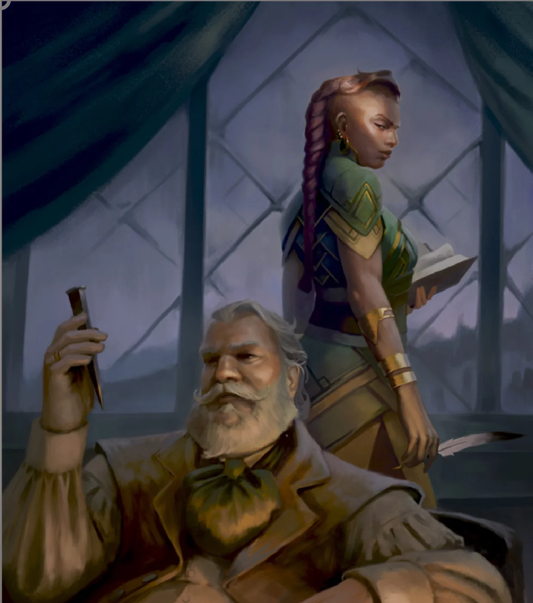

本規則書其他部分主要面向玩家及其遊戲體驗，接下來的內容則直接對你，也就是遊戲主持人（game master），說話。擔任 GM 可能讓人望而生畏。畢竟，其他玩家只需要顧好自己的一名角色，你卻得兼顧他們、一大群 NPC，以及所有人如何融入一場宏大冒險的故事！幸好，遊戲規則的設計能讓你的工作更輕鬆。劇情骰（Plot Die）、機遇（Opportunity）與變故（Complication）讓玩家有能力協助你述說故事，不同的場景類型也能協助你裁定棘手情況。掌握遊戲節奏後，主持遊戲可以是既有趣又充滿成就感的體驗。

### 開始主持

許多書籍與網路資源，都提供安排 RPG 劇情及採用不同主持風格的一般指引。如果你想首次嘗試主持，研究並閱讀各種做法，能幫助你建立基本概念。本章並不著重這類較宏觀的建議，當然，你不讀其他資源也完全可以主持這套遊戲。本章會引導你運用本遊戲獨特的系統，以及司卡德利亞（Scadrial）的獨有特色，帶領引人入勝的遊戲。歸根究柢，身為 GM，你的主要目的是為玩家創造難忘、安全又有趣的體驗，並確保桌邊每個人，包括你自己，都玩得開心。別忘了，你是遊戲的裁定者，由你說了算。本書的規則與指引是來幫助你的，但它們終究只是工具：需要時取用，不需要時就擱在一旁。你可以自由調整，甚至打破這裡的規則，讓遊戲為全桌帶來最好的體驗。

### 第一步

準備投入主持工作時，第一步就是召集玩家。無論你安排的是預定一場結束的遊戲，通常稱為單場冒險（one-shot），還是會進行許多場次的長期戰役（Campaign），都應先與玩家確認彼此的期待。

### 安排時間

維持長期角色扮演戰役最困難的事情之一，就是安排時間，因此請事先與所有玩家確認。讓大家知道你預計戰役會進行多少場次、多久聚一次，以及每次遊戲平均預計需要多久。

### 主題

在玩家答應參加之前，最好先讓所有人知道冒險的主題。你預想的是在最後帝國（Final Empire）反抗統治的戲劇性故事？依藍戴盆地（Elendel Basin）輕鬆的日常生活？還是在蠻橫區（The Roughs）拔槍闖蕩的旅程？請確認玩家都喜歡你想營造的氛圍。

### 安全

討論主題時，也同樣需要了解團體中每個人需要什麼，才能感到安全、自在，並充分做自己。本章末尾的「安全指南」提供相關指引，幫助大家對能接受哪些主題與行為取得共識。

### 對世界設定的了解

玩家不需要事先讀過《迷霧之子》（Mistborn）小說，也能享受這套遊戲。身為 GM，如果你了解每位玩家對小說的熟悉程度，就更容易帶領所有人共同參與故事。司卡德利亞與更廣闊的寰宇（cosmere）相當複雜，有許多細緻的歷史與魔法系統。知道每位玩家了解哪些內容，能幫助你調整資訊的呈現方式：讓需要入門的人容易理解，也讓熟悉設定的人能欣賞其中的深度。

*對頁：一千年來，統御主（Lord Ruler）看著一場場叛亂興起又消亡。*

DAARKEN

第 13 章：主持遊戲 353

### 角色建立

召集好團體後，就該建立角色了！你可以讓玩家事先完成，也可以先舉行一次介紹性質的「第零場次（session zero）」，讓大家在桌邊一起建立角色。無論採用哪種方式，都務必讓玩家知道角色的起始等級（Level）。通常是等級 1，但本章的「從較高等級開始」會討論其他選擇。也請告訴玩家，在讓角色融入世界時，有哪些故事上的考量需要注意：所有角色是否都必須以竊賊團夥成員的身分開始遊戲？故事是否假定他們全都隸屬依藍戴警署（Elendel Constabulary）？

### 找到合適的角色

每位玩家都應喜歡自己的角色，也滿意角色的規則能力如何配合逐漸發展的故事。如果戰役進行到一半，有玩家對角色的某個部分不滿意，可以考慮允許玩家修改角色。第 9 章「休整期（Downtime）」提供自省（Self-Reflection）選項，讓玩家投入少許時間與盒金（Boxing），就能依自己的意願調整角色。若改變是由角色在故事發展中的經歷所推動，這是很好的選擇。不過，有時玩家根本不滿意自己在角色建立與成長時做出的選擇，無論只是後悔選了一項天賦（talent），還是對整套能力配置感到失望。遇到這類情況，可以考慮免除休整期的要求，讓玩家立即免費重建角色。別忘了，規則是來支持大家享受遊戲的，不是限制樂趣！

### 規則在對誰說話？

本書其他部分的規則，會直接以「你」稱呼玩家。但這不代表所有指引都只適用於玩家角色（Player Character，PC）！任何適用於 PC 的規則，也適用於你控制的 NPC。他們同樣可以進行檢定（Test）、在戰鬥中使用行動（actions），並積極參與故事。PC 與 NPC 最主要的差異在於建立方式。《迷霧之子世界指南》（Mistborn World Guide）與多數已出版冒險，會提供 NPC 的角色資料（Profile）與資料區塊（Stat Block），詳見本章後文的「使用敵手」。這些資料區塊使用許多與 PC 相同的數據，但不遵循同一套角色建立規則，而且可能擁有 PC 沒有的特殊能力。

### 何時要求技能檢定

應該多常要求技能檢定（Skill Test），並沒有標準答案，詳見第 3 章的「技能」。身為 GM，你可以自由尋找適合自己與團體的平衡。有些 GM 偏重角色扮演與述說故事，通常只在真正需要隨機性的關鍵時刻擲骰，其餘時間則依角色扮演與 PC 的能力判定情況。其他 GM 喜歡經常要求檢定，隨著骰子將故事帶往有趣的新方向，當場應變、即興決定結果。如果你不確定是否該要求檢定，可以問自己幾個問題：

**成功與失敗都有可能嗎？** 判斷任務難度時，如果對某名角色而言，事情簡單到幾乎不可能失敗，或困難到幾乎不可能成功，可能就不值得擲骰。遇到這類情況，你可以不要求檢定，直接敘述結果。

**這會改變故事嗎？** 問問自己，檢定成功或失敗，會如何影響故事或隊伍周遭的情況。如果不會改變任何事，通常就不值得擲骰。

**這可能帶來有趣的後續影響嗎？** 無論檢定成功或失敗，角色的行動是否可能引發其他事情？如果會，你可以讓玩家在這次檢定中提高賭注（Raise the Stakes），看看劇情骰會不會帶來有趣的附帶效果。

BEAR FRYMIRE

第 13 章：主持遊戲 354

