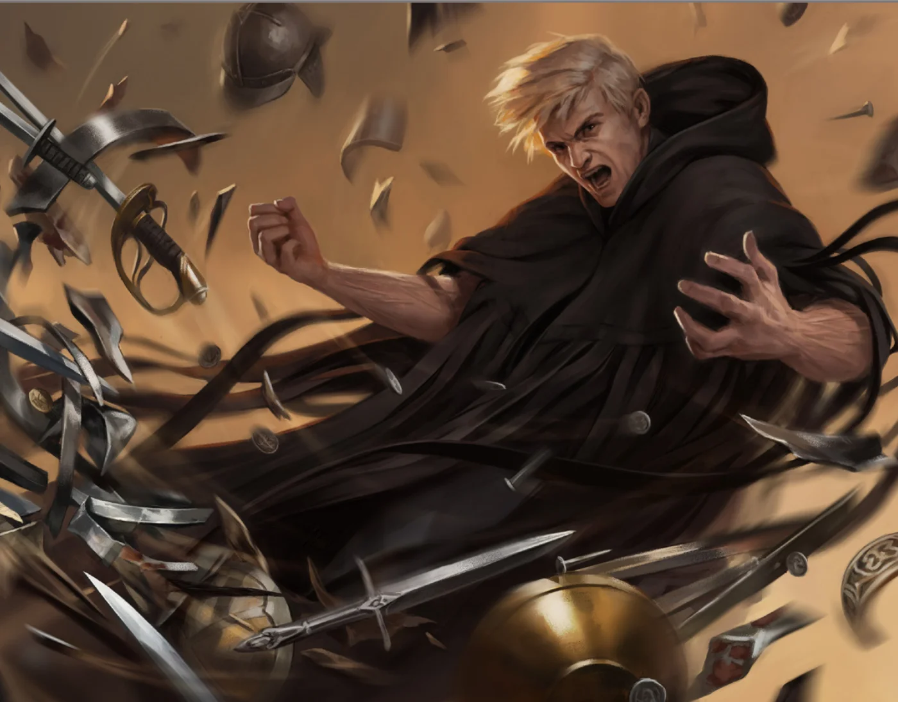
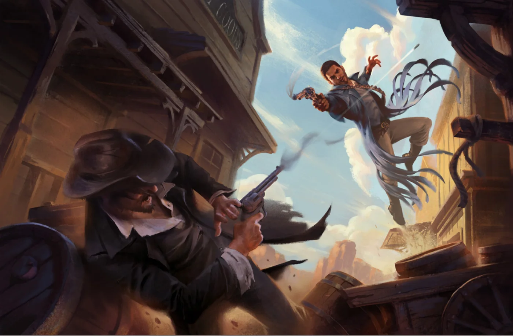

### 運用敵手

《迷霧之子世界指南》（Mistborn World Guide）第 8 章提供各式敵手（adversary）角色資料（profiles），以及各自獨特的數據，供你在冒險中使用。多數出版冒險也包含可用的敵手。此外，本書附錄的動物夥伴資料區塊也採用相同格式。

### 角色資料

每份敵手角色資料都包含該敵手的背景資訊，接著是「戰術（Tactics）」，在你不確定如何於戰鬥中運用特定資料區塊時，提供指引。不過，這些戰術只是建議；你可以依戰鬥進展及場景需求調整。每份角色資料末尾，都會以資料區塊（stat block）呈現該敵手的獨特規則。

### 資料區塊

每名敵手的獨特規則與數據，都詳列於稱為資料區塊的特殊部分。敵手資料區塊是玩家角色能力與數據的簡化版本，讓你在戰鬥中更容易操作。本節提供一份取自《迷霧之子世界指南》的資料區塊範例。如果你使用寫好的冒險，而某場景要求帶入敵手，冒險通常會告訴你要使用哪些敵手，並以粗體標示名稱，表示有對應資料區塊可用。例如，冒險寫著「兩名殺霧者接近」，就使用兩份殺霧者資料區塊。

*卡西爾（Kelsier）展現對鋼與鐵的精湛掌握，以推拉之力捲起金屬風暴。*

SVETLANA KOSTINA

### 資料區塊範例：偵探（Detective）

階層 2 勁敵 — 中型類人生物

##### 實體

| 力量（STR） | 防禦（DEF） | 速度（SPD） |
| --- | --- | --- |
| 2 | 15 | 3 |

##### 意識

| 智力（INT） | 防禦（DEF） | 意志（WIL） |
| --- | --- | --- |
| 5 | 18 | 3 |

##### 靈魂

| 察覺（AWA） | 防禦（DEF） | 風采（PRE） |
| --- | --- | --- |
| 3 | 15 | 2 |

生命值（Health）：50（40–60）

專注點（Focus）：5

授予（Investiture）：0

偏轉值（Deflect）：1（皮甲）

移動：30 呎

感知：20 呎（視覺）

實體技能：敏捷（Agility）+4、重型武器（Heavy Weaponry）+5、輕型武器（Light Weaponry）+6

意識技能：推理（Deduction）+8、紀律（Discipline）+6

靈魂技能：洞察（Insight）+6、感知（Perception）+6

##### 特徵

**緊追不捨（Dogged Pursuit）。** 角色被偵探追逐期間，若擲出變故，GM 可以花費 [變故]，讓偵探加入場景。

**執法目光（Eye of the Law）。** 角色對偵探進行的欺騙（Deception）檢定失敗時，該角色失去 1 點專注點。

##### 行動

###### [1行動] 打擊：決鬥杖（Dueling Cane）。

攻擊 +6、觸及範圍 5 呎、1d8 + 6 衝擊傷害。命中時，偵探還可以花費 1 點專注點，使大型或更小的目標倒地（Prone）。

###### [1行動] 打擊：小刀（Knife）。

[第一時代] 攻擊 +6、觸及範圍 5 呎或距離 20/60 呎、1d4 + 6 銳利傷害。如果是遠程攻擊，偵探可以花費 1 點專注點，使目標減速（Slowed）。

###### [1行動] 打擊：短管手槍（Snub Nose Pistol）。

[第二時代] 攻擊 +6、距離 20/60 呎、1d4 + 6 銳利傷害。穿刺（Pierce）：此傷害不能被目標的偏轉值降低。裝填（Loaded）[6]：以 [1行動] 將此武器彈藥重新裝滿。

###### [2行動] 找出弱點（Spot the Weakness）。

偵探對距離自身 60 呎內、能感知到的目標進行洞察檢定，對抗其實體防禦。成功時，目標的偏轉值變為 0，直到該目標下個輪次結束；偵探下次對該目標的打擊額外造成 2d6 傷害，而且偵探可以用 [自由行動] 脫離（Disengage）。

###### [反應] 協助或妨礙（Help or Harm；花費 1 點專注點）。

在偵探能影響的角色進行技能檢定前，偵探使該次檢定獲得優勢（advantage）或劣勢（disadvantage）。

每份資料區塊都包含數個部分，詳見接下來各節。除非另有說明，否則遵循與玩家角色相同的規則。

### 名稱

依敵手而定，名稱可能包含其物種、職能或其他描述。有些冒險中的重要 NPC 會使用以其姓名命名的獨特資料區塊，《迷霧之子世界指南》的敵手則使用較通用的名稱。

### 詳細資訊

敵手名稱下方，會列出「階層 2 首領 — 中型類人生物」之類的詳細資訊。這一行提供以下資訊：

**階層（Tier）。** 敵手的階層能幫你為每個場景選擇挑戰程度合適的敵手（見本章後面的「建立戰鬥場景」）。

**角色定位（Role）。** 敵手分成三種角色定位：嘍囉（Minion）、勁敵（Rival）與首領（Boss）。這代表其在該階層內的相對重要性，以及戰鬥中的複雜程度。各定位詳見接下來的「角色定位」。

**體型（Size）。** 與 PC 相同，敵手體型反映其在戰鬥中控制的空間：小型（2.5 呎）、中型（5 呎）、大型（10 呎）、巨型（15 呎）、超巨型（20 呎）與極巨型（30 呎以上）。

**類型。** 敵手的類型概括其基本性質，例如類人生物或動物。類型沒有固定清單，也不影響資料區塊的運作，只是描述用語。不過，符合故事時，有些效果可能以特殊方式影響特定敵手類型，尤其是類人生物。

### 角色定位

資料區塊第二行會將敵手的角色定位與其他詳細資訊一同列出。每種定位遵循不同規則：

**嘍囉**敵手比其他敵手弱。每名嘍囉都有嘍囉特徵：「嘍囉的攻擊無法造成致命一擊（critical hit），而且受到傷勢時立刻被擊敗。」**勁敵**敵手沒有額外規則，為冒險者提供標準挑戰。**首領**敵手能挑戰整支隊伍。他們比其他敵手更具威脅，操作起來也更複雜。每名首領都有首領特徵：「首領每個回合都能同時採取快速輪次（fast turn）與慢速輪次（slow turn）。敵人的輪次結束後，首領可以花費 1 點專注點，立刻額外使用一個 [1行動] 或 [自由行動]。此外，首領可以在自己的輪次花費 1 點專注點，移除自身的一個狀態。」

第 13 章：遊戲主持 360

如果你要自行規劃戰鬥遭遇，每種定位都代表不同的威脅程度，詳見後面的「建立戰鬥場景」。

### 屬性與防禦

敵手與 PC 使用相同的基本數據，包括六項屬性（attribute）：力量（Strength）、速度（Speed）、智力（Intellect）、意志（Willpower）、察覺（Awareness）與風采（Presence），以及三項防禦：實體防禦（Physical defense）、意識防禦（Cognitive defense）與靈魂防禦（Spiritual defense）。如果這些數值看來與資料區塊的其他數字對不上，不必擔心。許多資料區塊已在背後套用加值或減值，就像 PC 的天賦一樣，因此修正值或其他數據有時會與你預期的不同。

### 生命值、專注點與授予

和 PC 一樣，敵手具有生命值、專注點，以及某些情況下的授予。

### 目前值與上限

這些資源列出的數值，同時代表其上限與目前值。如果 PC 在多個場景遇到同一名 NPC，請考慮對方是否有機會恢復部分或全部資源，或是在未達上限的情況下進入下一個場景。

### 調整生命值

如果想讓敵手更容易或更難擊敗，可以在括號提供的範圍內調整生命值（見後面的「調整敵手生命值」）。

### 被擊敗的敵手

敵手生命值降至 0 時，就被擊敗。實際情況會依 PC 攻擊時的意圖、GM 希望故事如何發展，以及類似因素而有所不同。戰鬥中，多數敵手降至 0 生命值後，視為死亡，見第 9 章「傷害、傷勢與死亡」。不過，經 GM 決定，在故事中扮演重要角色的 NPC 可以改為昏迷（Unconscious），並像 PC 一樣進行傷勢擲骰。此外，如果 PC 想以非致命方式擊敗任何敵手，給予最後一擊的 PC 可以選擇讓 NPC 昏迷並受到一項傷勢。被擊敗的 NPC 會保持昏迷，直到從其他來源恢復至少 1 點生命值；他們不能像 PC 一樣自行選擇恢復意識。

### 偏轉值

敵手的偏轉值代表護甲、天生防禦與特殊能力。與 PC 相同，所有受到的衝擊、銳利與能量傷害，都減去列出的偏轉值。如果敵手沒有列出偏轉值，就視為 0。數值後的括號會標明這份防護的主要來源，例如「皮甲」。有時名稱只是增添風味，但如果與第 7 章某件護甲同名，PC 可能在擊敗敵人後取得它。

### 移動

和 PC 一樣，敵手的移動速率（movement rate）決定一次移動（Move）行動能走多遠。少數資料區塊包含特殊移動能力，例如游泳或飛行。與 PC 不同，敵手不會因資料區塊列出的任何移動方式而陷入減速狀態。

### 感知

和 PC 一樣，主要感官受遮蔽時，敵手的感知範圍（senses range）決定感官所及的界限。每份資料區塊會標明該敵手常見的主要感官，但你可以依個別 NPC 的故事，改成合適的感官。少數敵手的感官有特殊能力或限制，會註明在感知範圍後的括號中。

### 免疫

有些敵手免疫（immunity）特定效果，通常是狀態。例如，資料區塊的免疫欄寫著「定身（Immobilized）」，該敵手即使成為施加定身狀態的能力目標，也能自由移動。和本遊戲所有規則一樣，免疫由 GM 裁量，玩家也可能找到有創意的方法來繞過敵手的免疫。

### 技能

敵手可以使用第 3 章的任何技能，但為了簡化，資料區塊只列出具有技能等級的技能。技能分為實體、意識與靈魂三類，不過敵手未必每類都有技能等級。如果想使用未列出修正值的技能，就以對應屬性作為修正值，例如運動（Athletics）檢定加上力量屬性。

第 13 章：遊戲主持 361

### 金屬技藝技能

如果敵手能燃燒鎔金金屬或使用藏金術金屬意識庫，資料區塊就會列出對應的授予技能（Invested skills），也就是鎔金術（Allomancy）、藏金術（Feruchemy），或兩者都有；同時列出技能修正值、技能等級數，以及能藉此運用的能力。例如，某名單藏金術師（Ferring）敵手只能使用金藏金術，其資料區塊可能寫著「金屬技藝技能：藏金術 +6（2 個技能等級；金）」。為了方便使用，各資料區塊的特徵與行動都提供簡化版金屬技藝能力。如果能力需要花費授予或金屬意識庫充能，費用通常會列在特徵或行動名稱後的括號內（以授予驅動能力的規則見第 5、6 章）。如果敵手使用金屬意識庫，就會有一項特徵標明儲存的充能數；通常每個場景開始時，都有這麼多充能，但若是反覆登場的角色，你可以依故事發展調整。使用資料區塊的簡化金屬技藝時，不必再套用敵手的技能等級與修正值，因為特徵或行動已經計算在內。不過，如果希望享有玩家角色完整金屬技藝規則的彈性，也儘管使用！凡效果隨技能等級變化的能力，請參照敵手列出的技能等級判定。

### 特徵

敵手特徵（features）提供影響敵手的特殊規則，但不直接需要行動、自由行動或反應才能使用，通常類似 PC 的「常駐」或「特殊啟動」能力。例如，某項特徵可能讓敵手在特定情況下造成額外傷害。這些特徵如何計算數據及花費資源，詳見「行動」。

### 行動

每份資料區塊都提供該敵手獨特的行動、自由行動及／或反應。它們遵循與 PC 行動相同的規則，因此同一輪次不能使用同名行動超過一次。敵手也能使用第 10 章列出的行動、自由行動與反應。例如，任何敵手都能，而且往往應該使用移動行動、獲取優勢（Gain Advantage）行動及反擊機會（Reactive Strike）反應。

具有授予儲量的司卡德利亞敵手，也能使用第 5 章的飲用金屬液（Drink Vial）行動。符合故事時，GM 可以假設敵手攜帶足夠的金屬液。如果行動限於特定時代，會以符號標示：[第一時代] 或 [第二時代]。

### 攻擊

多數敵手至少有一項攻擊，列出攻擊修正值、觸及範圍或距離，以及命中的結果，通常包含傷害。有些攻擊是敵手的基本打擊（Strike）行動，其他則包含更強的效果。如果攻擊能影響多個目標，或有額外效果，也會在攻擊內說明。除非另有說明，所有敵手攻擊都對抗目標的實體防禦。PC 武器具有雙手（Two-Handed）等特定標籤，但敵手的武器名稱只是描述，不會自動啟用特殊規則。敵手攻擊在故事中如何運作，由你決定；例如，列出觸及範圍的攻擊通常是近戰攻擊，列出距離的則是遠程攻擊。合理時，你可以限制這些攻擊；一般而言，應以創造生動、能挑戰 PC 的場景為優先。

### 傷害

造成傷害的行動會告訴你，要擲哪些傷害骰、擲骰結果加上哪些修正值，以及造成哪種類型的傷害。例如，攻擊造成 1d4 + 6 銳利傷害，就擲一顆 d4，再將結果加 6。如果該行動是攻擊，必須命中目標才能造成完整傷害。不過，你仍可照常為每個目標花費 1 點專注點造成擦傷（graze），傷害等於傷害骰擲出的總和。

### 武器特性

有些攻擊使用具備特定特性的武器，例如穿刺、裝填與爆破（Blast）。攻擊說明會在特性名稱後摘要其效果，第 7 章「武器特性」有更詳細的介紹。如果某個遊戲效果會與該特性互動，也會以相同方式與敵手的這項攻擊互動。

### 鋁製武器

有些敵手攻擊指定使用鋁製武器或彈藥。這些武器，以及使用它們的攻擊，都不受鐵鎔金術、鋼鎔金術或其他授予能力影響（見第 6 章「鎔金惰性材料」）。

第 13 章：遊戲主持 362

### 反擊機會

和 PC 一樣，敵手能使用反擊機會反應，在敵人自願離開其觸及範圍時，花費 1 點專注點攻擊。敵手可以使用任何花費 [1行動]、且列有觸及範圍的攻擊行動進行這次攻擊，但不能使用只列出距離的攻擊。

### 重複名稱

如果敵手資料區塊的行動，與本手冊某項行動同名，就視為重複行動，即使敵手版本可能有特殊特性，也不能在同一輪次兩者都用。

### 已包含計算結果

如果行動或特徵需要檢定，或以其他方式用到敵手數據，所需計算都已完成。例如，每項攻擊都列出該次檢定的修正值，如「攻擊 +11」，因此不必再查技能來判斷要加多少。

### 花費資源

如果行動或其他特徵需要花費敵手的專注點或授予，費用會列在行動名稱後的括號內（每次使用都要花費時），或行動內文中（花費時機取決於其他因素時）。

### 機遇與變故

敵手的檢定不能提高賭注（raise the stakes），因此通常不擲劇情骰（plot die）。不過，敵手仍會透過以下方式受到機遇（Opportunities）與變故（Complications）影響。

### 敵手的擲骰

雖然敵手不擲劇情骰，仍可能偶爾因 d20 結果獲得機遇或變故（見第 3 章「機遇與變故範圍」）。

### PC 的擲骰

PC 在場景中擲出變故時，少數敵手，主要是首領，具有可讓你花費該變故使用的特殊能力。不過，這項能力也帶來弱點：PC 擲出機遇時，可以花在該敵手的機遇效果上，以某種方式妨礙敵手。

### 機遇與變故構想

如果敵手擲出機遇，你可以使用其資料區塊提供的任何選項，或選擇其他符合故事的效果。請考慮以下構想：

- 敵手或其盟友的下次檢定獲得優勢。

- 敵手獲得 1 點專注點，不超過上限。

- 敵手下次使用通常需要費用的行動時，無須花費專注點或授予。

- 敵手對目標施加一個狀態，直到敵手下個輪次開始。

- 敘事稍微轉向有利於敵手的一方。

如果敵手擲出變故，或 PC 擲出機遇，請讓玩家建議情況如何發展。請考慮以下構想：

- 敵手或其盟友的下次檢定獲得劣勢。

- 敵手失去 1 點專注點。

- 敵手受到一個狀態，直到其下個輪次結束。

- 敘事稍微轉向有利於隊伍的一方。

### 敵手模組

你可以在資料區塊加入選用的敵手模組（adversary modules），賦予更多能力，通常也會提高其威脅值。《迷霧之子世界指南》的模組能把任何資料區塊變成坎得拉（kandra）或克羅司混血（koloss-blooded）角色、賦予鎔金或藏金能力，或植入血金術尖刺（Hemalurgic spike）。模組使用指引見《迷霧之子世界指南》第 8 章。

### 建立戰鬥場景

對話與試煉依劇情需求掌握節奏，這些較自由的場景更容易即興發揮及修改。相較之下，要規劃得宜的戰鬥場景就比較棘手。戰鬥十分仰賴系統背後的數學，要設計既有趣、又能為玩家帶來適當挑戰的戰鬥，可能不容易。出版冒險會提供專為該故事與隊伍預期等級設計的戰鬥場景；但若想利用冒險或《迷霧之子世界指南》的敵手角色資料，自行創造戰鬥，本節會指引你依隊伍等級及戰鬥能力平衡難度。

第 13 章：遊戲主持 363

### 判定遊戲階層

PC 提升等級後會變得更強，需要更大的考驗才能形成挑戰。每名敵手都歸屬某個遊戲階層（1–4），對應隊伍的階層，如第 1 章末「角色成長」所列。敵手階層指出設計上最適合與其交戰的等級。不過，你也能在更高或更低階層使用敵手，為隊伍創造獨特、出乎意料的戰鬥（指引見「選擇敵手」）。

### 決定場景難度

為場景選擇敵手前，先決定希望有多大挑戰。這是一場危險戰鬥，打完角色應花時間調養，還是穿越城市途中一場短暫打鬥？答案會影響你選擇的敵手數量與種類。戰鬥難度由敵手的威脅值，相對於參戰玩家角色的人數決定。每名敵手都有依角色定位而定的威脅值（threat value）。如下節所述，為場景選擇敵手時，各敵手的威脅值加總，應大致符合你希望該場景對角色形成的總威脅值（total threat）。以下基準可作為判斷戰鬥難度的起點：

**簡單**戰鬥的總威脅值等於隊伍 PC 人數的一半。例如，有四名玩家時，簡單場景的總威脅值為 2。隊伍能輕鬆應付這些場景。

**一般**戰鬥的總威脅值等於隊伍的 PC 人數。例如，有四名玩家時，中等難度戰鬥的總威脅值為 4。隊伍打完兩至三場這類戰鬥後，可能需要長休息。

**困難**戰鬥的總威脅值等於隊伍 PC 人數的一點五倍。例如，有四名玩家時，困難戰鬥的總威脅值為 6。兩次長休息之間，隊伍很可能無法應付超過一場這類戰鬥。

### 一般隊伍

敵手威脅值假設隊伍的長處多元，有些 PC 擅長戰鬥，另一些在非戰鬥場景表現出色。如果多數 PC 都針對戰鬥最佳化，或玩家特別善於策略，你可能需要提高戰鬥場景的總威脅值。如果多數

PC 的長處在戰鬥之外，或玩家不太重視戰鬥策略，你可能反而需要降低總威脅值。

### 戰力躍升

敵手按階層分級，但 PC 在每個遊戲階層中，剛進入時較弱，即將升入下一階層前則較強。其他因素也可能大幅提高玩家角色的戰鬥力，例如火器與額外攻擊行動，像是毀滅重擊（Devastating Blow）天賦。判斷什麼難度能挑戰隊伍時，請考慮這些傷害提升；你可能需要更多敵手。

### 選擇敵手

如「運用敵手」所述，每名敵手都有角色定位，標明整體複雜程度，並賦予特定特殊規則。定位也決定每名敵人為戰鬥增加多少威脅值：

**嘍囉（0.5 威脅值）。** 嘍囉敵手的威脅值等於半名 PC。生命值低，而且攻擊無法造成致命一擊。

**勁敵（1 威脅值）。** 勁敵敵手的威脅值等於一名 PC。資料區塊沒有附帶額外規則。

**首領（4 威脅值）。** 首領敵手的威脅值等於四名 PC。每個戰鬥回合都能同時採取慢速輪次與快速輪次，也能花費專注點採取額外行動，或移除自身狀態。

上述威脅值只適用於該敵手原本設計的遊戲階層；跨階層調整威脅值，請見「跨階層調整威脅值」。

### 計算總威脅值

知道期望的戰鬥難度後（見「決定場景難度」），就逐步加入敵手，直到威脅值總和符合期望的總威脅值。例如，為四名玩家規劃困難戰鬥，需要總威脅值 6。你可以使用一名首領加兩名勁敵，或四名勁敵加四名嘍囉，或其他類似組合。

### 跨階層調整威脅值

敵手威脅值假設其與角色處於相同遊戲階層（見「判定遊戲階層」）。你可以利用「敵手威脅值換算」表換算，也能自行計算：敵手比 PC 每高一個階層，威脅值就加倍；敵手比 PC 每低一個階層，威脅值就減半，並取至最接近的四分之一。例如，隊伍為階層 1 時，階層 2 的勁敵威脅值為 2；隊伍為階層 2 時，同一敵手的威脅值為 1；隊伍為階層 3 時，同一敵手的威脅值為 0.5。

第 13 章：遊戲主持 364

### 敵手威脅值換算

| 隊伍階層與敵手階層比較 | 嘍囉威脅值 | 勁敵威脅值 | 首領威脅值 |
| --- | --- | --- | --- |
| 比敵手低 3 個階層 | 4 | 8 | 32 |
| 比敵手低 2 個階層 | 2 | 4 | 16 |
| 比敵手低 1 個階層 | 1 | 2 | 8 |
| 與敵手相同階層 | 0.5 | 1 | 4 |
| 比敵手高 1 個階層 | 0.25 | 0.5 | 2 |
| 比敵手高 2 個階層 | 0 | 0.25 | 1 |
| 比敵手高 3 個階層 | 0 | 0 | 0.5 |

### 調整敵手生命值

決定場景難度並選好敵手後，你可能想進一步微調戰鬥，例如補償針對戰鬥最佳化的隊伍。調整敵手生命值是簡單的做法。降低生命值，能幫助較弱的隊伍維持推進節奏；提高生命值，則讓敵手撐得更久，讓強大角色充分發揮能力。每份敵手資料區塊都包含一個固定生命值，以及較寬的生命值範圍。你可以用此範圍調整個別或整群敵手的生命值，微調相對於隊伍的難度，或讓同類敵手有所差異。例如，敵手生命值是「60（48–72）」，你可以使用預設的 60、降低至 48、提高至 72，或選擇之間的任何數值。

*一名雙生師（Twinborn）槍手優雅地閃過攻擊。*

JORDAN KERBOW

第 13 章：遊戲主持 365

### 為戰鬥場景增添變化

戰鬥場景有許多互相牽動的要素，也大量使用精確規則，因此每演出一分鐘「遊戲內」時間，花費的現實時間最多。為了維持遊戲節奏，請斟酌使用戰鬥；戰鬥出現時，盡量讓每場都有些獨特之處。以下是幾項建議。

### 變換地形

加入高低差、讓 PC 與敵人的起始距離不同，或放入危險地形與困難地形。相同敵人換個位置或戰場，就能形成截然不同的戰鬥。

### 考量前一個場景

引發戰鬥的場景，往往能改變戰鬥如何開始。談判失敗可能使 PC 帶著所剩不多的專注點進入戰鬥，深夜伏擊則可能讓 PC 還來不及備妥裝備。請思考戰鬥前發生什麼事，以及如何反映在起始狀況中。

### 提供非戰鬥目標

如果打鬥的目的只是殺死敵人，就會相當單調。但多數戰鬥屬於更大故事的一部分，雙方除了殺死對手，還想達成別的事。可能是阻止軍隊突破城門、營救人質、讓旁觀者留下深刻印象，或逮住逃跑的目標。不論目的為何，請以戰術調度，迫使 PC 在交戰與追求目標之間選擇，為他們創造有趣又艱難的抉擇。

### 提供資源與機遇

你可以在戰場散布足智多謀的 PC 能用來取得優勢的資源：搖搖欲墜、隨時能推落的巨石、附近的鎔金金屬，或擺在空地上的易爆炸藥。富有創意的玩家可能不必提示，就能找到利用方式；但如果無人上鉤，你可以鼓勵玩家花費機遇，以運用這些資源的方式發展情節。

### 混合搭配敵人

敵手角色資料中的能力，設計上可以彼此互補、相互配合。混合搭配不同敵人類型，就能以新方式挑戰 PC。

### 挑戰金屬之子

高等級金屬之子（Metalborn）PC 強大到能輕鬆飛越障礙，或加速治療時，GM 可能很難規劃有意義的挑戰。幸好，司卡德利亞有工具能幫上忙。當故事需要真正挑戰金屬之子 PC 的史詩時刻，可以考慮使用：

**鎔金手榴彈（Allomantic Grenades）。** [第二時代] 南司卡德利亞稱為 Malwish 鎔金術方塊（primer cubes）的鎔金手榴彈，讓鎔金術師能在遠處運用能力。例如，鉻迷霧人可以用手榴彈，讓一個區域內的所有人失去授予。

**鋁（Aluminum）。** 鋁會阻礙黃銅、鐵、鋼與鋅鎔金術，也可能以奇特方式干擾其他鎔金能力。

**天金（Atium）。** [第一時代] 燃燒天金的敵手幾乎無敵，迫使 PC 撤退，或設法撐到敵人的天金耗盡。

**槍械。** [第二時代] 當人人都能像射幣（Coinshot）一樣射擊，許多金屬之子能力就不再那麼神奇。

**殺霧者（Hazekillers）。** 運用能預判並反制金屬之子能力的敵人。他們應採取戰術行動，利用金屬之子資源不足的時機。

**其他金屬之子。** 特定群體合作，能帶來令人難忘的挑戰，例如鉻與鎳鉻迷霧人主動使用能力進攻、青銅迷霧人負責防禦，或第一時代的迷霧之子或藏金術師協同對抗 PC。

**移除資源。** 想要迅速打亂局勢時，可以利用變故，讓敵手偷走金屬意識庫或破壞金屬瓶，但這種令人挫折的做法應少用。

**白沙（White Sand）。** 來自其他世界，或與鬼血（Ghostbloods）有人脈的人，可能取得白沙。這種奇特物質通常呈深黑色，接觸授予後則轉為白色。它能偵測某些金屬之子能力的存在，尤其適合 PC 想保持隱密的緊張時刻。

這些都很適合偶爾用來挑戰高等級隊伍，但請小心：反覆使用可能讓遊戲變得沒那麼有趣。除了單純提高難度，也請思考如何設計無法以蠻力解決的遭遇。以陰謀、謎團與更重大的責任，吸引 PC 投入。

第 13 章：遊戲主持 366
