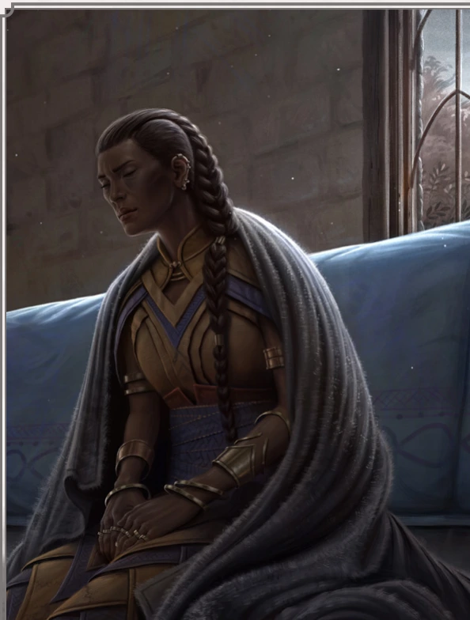

### 運用其他設定的內容

寰宇（cosmere）廣大而多元。人們在數十顆不同的行星與星系建立了宏偉的社會。各星系居民運用授予（Investiture）的方式各不相同，取決於哪些碎力（Shards）居於該星系。數千年來，這些社會完全不知道彼此的存在。然而，隨著科技進步，以及人們逐漸掌握意識界（Cognitive Realm），越來越多人開始認識其他行星，彼此分享各自世界的奇觀。在《寰宇 RPG》（Cosmere RPG）中，即將推出的《躍界者玩家手冊》（Worldhopper Handbook）會提供完整規則，讓你遊歷寰宇，扮演曾在多個世界冒險的角色。不過，如果你只使用《颶光典籍》與《迷霧之子》（Mistborn）設定的資料，並想將兩者結合，本節提供將這些內容整合到同一場戰役（Campaign）的基本指引。一般而言，兩本書中的所有物品、獎勵（Reward）、敵手（adversary）及其他遊戲要素，都能相互搭配，無須多少額外工作或準備。身為 GM，你主要應考量的是：一個設定中的哪些素材，適合出現在另一個設定的主題之中。請運用《颶光典籍世界指南》（Stormlight World Guide）與《迷霧之子世界指南》（Mistborn World Guide），協助你選擇符合故事調性的內容。

### 來自其他世界的角色

在本書與《颶光典籍玩家手冊》（Stormlight Handbook）所呈現的年代中，司卡德利亞（Scadrial）與羅沙（Roshar）的大多數居民，都不知道彼此存在，更不用說其他有人居住的行星。然而，仍有極少數外來者能穿越意識界，從一顆行星來到另一顆行星。有些是透過鬼血（Ghostbloods）等組織的謀畫，有些則像霍德（Hoid）這類神祕的躍界者（worldhoppers），在漫遊中來到此地。身為 GM，你決定是否納入來自其他世界的角色。偶爾加入一名穿梭世界的 NPC，可以增添趣味、神祕感與變化。如果有玩家想扮演來自另一個世界的角色，務必與他合作，確保角色的背景故事符合你的戰役。

### 英雄路徑

《迷霧之子》與《颶光典籍》都有相同的六條英雄路徑（heroic paths）。其中有些專精（specialties）為兩種設定共用；只要專精在兩本書中的名稱相同，就能在任一設定中自由使用。另有一些專精只出現在其中一種設定的玩家手冊中。這些專精大多代表該世界常見的人物類型，但其中大多數，其他世界的人也能鑽研！如果司卡德利亞的玩家想使用《颶光典籍玩家手冊》中的英雄專精，或反過來，而且角色構想既符合專精，也契合設定，建議你讓他使用。

### 特定設定的專精

少數英雄專精與特定設定的關係更緊密，因為它們需要該世界特有的科技或知識。這些專精應只供出身於該設定的角色使用，或供曾在那裡待上足夠時間、學會所需專門知識的角色使用。《颶光典籍玩家手冊》中的下列專精屬於特定設定：

- **學者（Scholar）：法器師（Artifabrian）。** 法器師運用羅沙的寶石與光，創造各種奇妙事物。只有了解這些資源，而且能取得它們的角色，才能使用此專精。

- **戰士（Warrior）：碎刃師（Shardbearer）。** 碎刃師精通羅沙的碎刃（Shardblades）與碎甲（Shardplate）。只有了解這些強大物品，而且能取得它們的角色，才能使用此專精。

*羅沙及其三顆月亮：迷辛（第三月亮）（Mishim）、薩拉思（第一月亮）（Salas）與諾蒙（第二月亮）（Nomon）。*

BRUCE BRENNEISE

第 13 章：主持遊戲 374

《迷霧之子玩家手冊》（Mistborn Handbook）中的下列專精屬於特定設定：

- **獵手（Hunter）：殺霧者（Hazekiller）。** 殺霧者運用各種技巧，獵殺司卡德利亞的金屬之子（Metalborn）。只有認識金屬之子能力的角色，才能使用此專精。

- **學者：發明家（Inventor）。** 發明家設計實驗性裝置與火器。只有具備工業科技知識的角色，才能使用此專精。

- **戰士：槍手（Gunslinger）。** 槍手使用可快速射擊的手持火器。只有具備火器知識，或認識火器的角色，才能使用此專精。

### 授予之術

有些授予之術（Invested Arts）與其起源的行星系統密不可分，其他則比較容易取得及使用。只有具有司卡德利亞血緣的人，才會自然出現鎔金術師（Allomancers）與藏金術師（Feruchemists）。其他世界的角色，唯有植入血金術尖刺（Hemalurgic spike）、燃燒 Lerasium，或使用藏金術徽章（Feruchemical medallion），才能取得這些能力。這幾種獎勵都在本書第 8 章介紹。另一方面，任何人只要前往羅沙，並與靈（spren）建立納海聯繫（Nahel bond），就能取得波力（Surges）。靈與角色締結聯繫後，在特定情況下，雙方便能一起探索更廣闊的寰宇。因此，有些角色最終可能學會運用多種授予之術，但取得這些能力相當困難。請與玩家共同決定，混合來自不同世界的能力，是否會帶來後果，以及會有什麼後果。例如，角色的靈可能會因血金術尖刺而感到不安。身為 GM，你有權決定哪些能力可以取得、哪些可以結合，以及會產生什麼影響。

### 同時運用波力與鎔金術

如果角色同時取得封波術（Surgebinding）與鎔金術（Allomancy），兩者會以下列方式互動：

- **技能（Skills）。** 角色照常取得所有適用的技能。

- **共用授予池。** 封波師通常從颶光（Stormlight）取得授予，鎔金術師則藉由燃燒金屬取得授予。不過，為了簡化遊戲，本遊戲採用單一授予池，不將不同授予之術的授予分開計算。

- **為波力與鎔金術提供燃料。** 只要角色能取得足夠的颶光（或其他形式的光）以及所需金屬，就能花費授予，為波力與鎔金能力提供燃料，無須追蹤這些授予來自哪一種來源。例如，這類角色以吸納颶光（Breathe Stormlight）行動恢復授予後，之後可以將這些授予花在鎔金能力上。

- **同時恢復資源。** 只要角色能取得足夠的颶光與所需金屬，就能同時消耗兩者：使用吸納颶光行動（[2行動]）取得授予時，也能同時獲得飲用金屬液（Drink Vial）行動的利益，無須額外花費行動，取代原本所需的 [1行動]。

- **無法取得颶光或金屬。** 當角色交互使用多種授予來源時，耗盡（Depleted）狀態的適用方式與飲用金屬液行動相同，詳見第 6 章。角色使用行動恢復授予時，若未消耗某項波力或鎔金能力對應的授予來源，該項能力便會陷入耗盡。因此，只要角色無法取得足夠的某一授予來源，例如颶光或鎔金金屬，就不能用授予為相應的授予之術提供燃料，即使他仍有其他來源的授予也一樣。例如，角色目前無法取得颶光，就不能使用波力；目前無法取得某種鎔金金屬，就不能使用對應能力。

### 正史與連貫性

《迷霧之子》小說提供豐富的資訊與資源，供角色扮演玩家納入遊戲。鎔金術、藏金術（Feruchemy）、血金術（Hemalurgy）、坎得拉（kandra）與克羅司（koloss），都是司卡德利亞設定的根本。不過，知道每座灰山（Ashmount）的名字，或會說上皇族語（High Imperial），雖然能增添風味，卻不是玩好遊戲的必要條件。

### 營造司卡德利亞的氛圍

在司卡德利亞進行角色扮演時，小細節往往最能讓你沉浸於這個世界。例如，你可以描寫迷霧之子角色看見藍線連向附近的金屬、灰燼隨午後微風飄落，以及陰鬱太陽始終投下的一片紅光，營造鮮明的第一時代體驗。若要喚起第二時代的調性，你可以描寫角色讀到報紙上一則奇特的廣告、汽車駛過街角時的低沉轟鳴，以及木面具後一雙陰沉的眼睛。

第 13 章：主持遊戲 375

### 連貫性

規畫冒險時，先想想戰役所處的時代與確切時間點，再運用當時的事件，為整場戰役增添脈絡與推進力。你可以考慮重大叛亂、政治論辯、傳奇英雄、碎力力量的消長，以及在暗處活動的祕密組織。但某件事在小說中發生過，不表示它在你的遊戲中也得以同樣的方式發生。你可以改變未來，甚至司卡德利亞的歷史，配合團體想探索的故事。

### 你們的司卡德利亞

團體開始遊戲前，先討論大家希望遊戲多忠於正史。盡情在遊戲桌上探索你們自己的司卡德利亞，讓你與團體有無限可能，塑造這個世界的各個時代。有些團體可能不想受連貫性束縛，讓戰役朝意想不到的方向發展。變動可以很大，例如讓你們的玩家角色（player characters）取代書中主角；也可以很細微，例如調整既有正史事件的時間與細節。這種玩法雖然給玩家更多自由，但也可能使遊戲偏離《迷霧之子》小說未來的事件。你們也可以不玩第一或第二時代，而將遊戲設定在古典時期的司卡德利亞（Classical Scadrial），也就是最早的迷霧人（Mistings）開始綻裂（Snap）的年代。雖然該時代的官方資源較少，卻也留有充分的創作空間，讓你們打造世界。不論遊戲位於時間線的哪個時點，都別讓瑣碎知識與糾正蓋過遊戲本身。有些玩家可能喜歡查詢線上維基，協助裁定學識（Lore）檢定的結果；另一些則可能偏好即興給出答案，讓遊戲繼續進行。事先討論大家的偏好，有助於遊戲順暢進行。

### 正史中的司卡德利亞

《迷霧之子》戰役的預設設定橫跨兩個時代：最初的《迷霧之子》三部曲，或《瓦與韋恩》系列。《迷霧之子》首部小說《最後帝國》（The Final Empire）呈現了統御主（Lord Ruler）統治即將終結時的世界樣貌。這段第一時代的時期，很適合遊玩頑強反抗軍對抗壓迫而幾乎無敵的政府，或大家族（Great Houses）的迷霧之子繼承人，投身宮廷風波、爭奪青睞與天金（atium）的戰役。

在第二時代，《悼環》（The Bands of Mourning）與《The Lost Metal》事件之間的那些年，你們可以是一群雙生師（Twinborn）組成的劫盜團，劫掠剝削他人的企業，將所得分給生活困苦的人；也可以扮演內心掙扎的警員，奉命逮捕這些人，將他們繩之以法。大多數團體希望遊戲能大致融入正史故事，讓世界隨未來的長篇與中篇小說一同改變、成長。司卡德利亞不斷演變，足以容納許多重要故事同時存在！如果遊玩遵循正史的戰役，請參考本書末尾「接下來」一節所提到的各類資源。如果有些玩家尚未閱讀或讀完這個系列，也沒關係，只要他們能接受可能出現的劇透。遊戲進行時，團體可以一起回想並補充細節。

### 新玩家與正史

完全不熟悉小說的玩家，可以選擇扮演躍界者，或來自司卡德利亞偏遠地區的人，與角色一起認識這個世界。新玩家也可以閱讀 CosmereRPG.com 上的「歡迎來到司卡德利亞」指南。這份簡明易讀的概覽，介紹最後帝國（Final Empire）或依藍戴盆地（Elendel Basin）的一般居民會知道哪些世界知識。

### 那正史怎麼辦？

《迷霧之子》源自布蘭登．山德森（Brandon Sanderson）的想像。他的角色及其故事，活在他的書頁之中。現在，輪到你了。司卡德利亞是舞台，你們的團體會說出什麼故事？比起正史，更重要的是創造一個所有玩家都能自在享受的故事，所以請讓世界配合這個故事！志同道合的玩家，可能很享受在與《迷霧之子》設定一模一樣的世界中遊玩，但嚴格執行正史，只有在所有人都贊同時才有趣。許多團體，尤其是有設定新手的團體，會受益於較輕鬆的做法。當 GM 與玩家能自由調整世界知識時，團體可能更覺得有趣、更能投入。例如，小說沒有著重描述最後帝國使用哪些手語，但這不表示手語不存在。在你們的司卡德利亞，也許就連不依賴手語的人也普遍會用，讓失聰角色能輕鬆與遇見的人溝通。

第 13 章：主持遊戲 376

### 關於 GM 風格

GM 可以像導遊一樣，帶玩家走過司卡德利亞的世界，在適當時機分享引人入勝的世界知識。GM 也可以簡略帶過世界建構細節，讓新玩家更容易親近這個設定，或讓情節以明快節奏推進。每位 GM 都不同，兩種風格都行得通。最終，重點是與同桌好友一起說出精采故事，打造出色的冒險！

### 安全指南

角色扮演會創造一種奇妙的魔法。我們得以玩想像遊戲、嘗試新事物、紓解壓力，並成為某種特別事物的一分子。在 RPG 中，安全的核心，是同桌每個人共享的自在感、認同與空間。大多數人都希望在遊戲時體貼彼此、相互合作。本節的工具與建議，以基本禮貌為出發點，並針對司卡德利亞遊戲中較敏感的層面加以調整。

### 第零場次

第零場次（session zero）是大家共同參與的準備場次。同桌每個人可以建立角色，討論設定、調性與主題，並就遊戲期待達成共識。建議在第零場次涵蓋下列話題：

戰役期待。討論設定，例如選定的司卡德利亞時間點與起始地點，以及冒險的主題與調性。你們也可以討論設定有多危險、自創內容、自訂規則，以及可能預見的小說正史變動。此外，也要決定戰役長度：這是一場持續進行的長篇戰役，還是較短的遊戲？這有助於同桌所有人安排投入時間與期待。遊戲桌期待。討論並共同約定桌邊禮節及遊戲方式。多久聚會一次？每場大約持續多久？中間是否安排一次或多次休息，讓大家吃喝一下？桌上可以用手機嗎？還是大家比較希望需要額外刺激的人改用塗鴉、著色或編織？大家是否能自在接受一些成人用語與主題，還是希望遊戲適合闔家同樂？

安全工具（Safety Tools）。雖然第零場次本身就是一種安全工具，但它也讓大家有機會討論其他工具，協助處理遊戲中遇到的困難，詳見「運用安全工具」。也務必規畫，若同桌有人違反大家共同訂出的準則，應如何處理。找出有趣與不有趣的話題。遊戲是為了大家一起享受樂趣。因此，只要有人對某個話題感到不自在，包括 GM 在內，就代表團體應該將重心轉向其他話題。接下來的「界線與帷幕」及「值得考量的話題」會提供處理遊戲敏感話題的指引。戰役開始前，可以將團體列出的話題整理成共享文件，方便任何人在遊戲時快速查閱。即使如此，遊戲中仍可能意外出現傷害或不適。建議團體暫停，視需要運用安全工具調整。遊戲指引。簡單複習遊戲如何進行，並討論玩家可能有的問題。你們可以製作規則卡或速查表，方便查閱核心機制。角色建立。有些玩家可能偏好獨自建立角色，但玩家仍可以討論角色構想、背景故事，以及角色如何融入團體與設定。

### 布蘭登的話

在我的書中，我講述的世界與我們的世界一樣充滿缺陷。《迷霧之子》系列（Mistborn Saga）描繪了一顆籠罩在灰燼與壓迫中的行星。有權勢的人對司卡（skaa）與泰瑞司（Terris）人民犯下暴行；坎得拉被迫服侍他人，否則便面臨滅絕；就連貴族之間，殘酷行徑也屢見不鮮。到了第二時代，情況已大幅改善，但權力失衡依舊引發紛爭。無論你選擇哪個時代，都請與團體達成共識：哪些主題要加重，哪些主題要避免著墨。我建議特別留心如何處理奴役，以及情緒虐待、身體虐待與性虐待的主題。讀小說時，你會發現我將這些事視為最後帝國文化的缺陷，但不會在場景中持續詳加描寫。司卡德利亞有無數故事，所以請選擇每次遊戲時，所有人都會期待再次回到其中的故事。

——布蘭登．山德森

第 13 章：主持遊戲 377

### 運用安全工具

每個團體運用安全工具的方式都不同。有些偏好正式工具，另一些則比較依賴非正式交談。本指南中的工具旨在鼓勵自在而公平的遊戲。不過，就像本書其他內容一樣，GM 與玩家可以視需要調整這些原則，搭配其他工具使用。主動預防雖然有助於避免問題，但問題發生後，也需要有意識地提供協助。最好將安全工具視為持續演變的資源，不斷延伸，以滿足同桌所有人的需求。如果想探索更多資源，TTRPGSafetyToolkit.com 提供豐富的免費安全工具。TTRPG Safety Toolkit 是桌上角色扮演社群成員設計的線上彙整資源，供玩家與 GM 在桌邊使用，由 Kienna Shaw 與 Lauren Bryant-Monk 共同策畫維護。

### 界線與帷幕

每個人對各種話題的接受程度都不同。討論「界線」與「帷幕」（Lines and Veils），有助於大家說明團體希望完全避開哪些話題，以及哪些話題可以略微暗示，但必須迅速帶過。（界線與帷幕的概念，由遊戲設計師 Ron Edwards 於 2004 年提出。）

### 界線

劃有界線的話題完全不納入遊戲，這些界線不應跨越。只要有人對某個話題「劃下界線」，它就不該出現在遊戲中。例如，玩家可能決定將傷害動物列為界線。如此一來，你們的遊戲中就絕不會有動物受到威脅，除此之外，團體也要避免任何暗示動物可能在「鏡頭外」受傷的內容。

### 帷幕

拉上帷幕的話題，只會發生在幕後。可以暗示或承認這類事件存在，但不談具體細節；涉及這些話題的場景，絕不應實際演出，也不應成為戰役情節的核心。團體可以將它記為某人的背景故事，或以「淡出至黑畫面」的方式處理，再切換到另一個場景。例如，玩家可能決定將傷害動物列為帷幕。這表示他可以接受故事承認動物受到傷害，但不應在場景中描寫或長篇討論動物的痛苦。

### 遊戲進行時

即使團體留心彼此的界線與帷幕，有時仍可能不慎觸及這些話題，也可能有人在場景進行到一半時，才發現自己需要將新話題加入界線或帷幕。遇到這種情況時，大家應共同合作，溫和而有效率地刪去該話題，繼續往下進行。

### 關心彼此

遊戲時，請留意別人的感受。如果有人看起來不自在，就問問他還好嗎。創造機會，讓大家能開口，也能被聽見。休息。有時遊戲會變得緊張，情緒高漲；有時我們只是餓了，或需要伸展。無論是心靈還是身體需要休息幾分鐘，休息都能大幅幫助團體重新投入。即時協助。如果你察覺有人對某個情況感到不自在，請立刻處理。迅速而真誠地道歉，能帶來很大幫助。別人提醒你某話題不納入遊戲時，無須急著辯解。只要感謝對方提醒，並據此調整。如果不確定如何適當調整場景，隨時都能求助：「我們可以改用什麼方式處理？」不論在角色內外，富有創意地解決問題，都是令人滿足的角色扮演不可或缺的一環。

### 承認真實的生命經驗

當某人的身分或創傷被拿來當笑點時，遊戲就不再有趣。如果有人表示對某個話題或場景不自在，不應要求他辯論自己的顧慮是否合理。信任是良好角色扮演的根本，而信任來自承認彼此的經歷。因此，當有人分享這樣的真實感受時，無須追問或要求解釋。GM 與玩家在日常生活中，早已不得不面對、處理痛苦與創傷；遊戲時間，每個人都值得獲得喘息。

> 人是有價值的，紋主人（Mistress Vin），所以——因此——他們的信仰也是。

第 13 章：主持遊戲 378

### 值得考量的話題

討論團體安全時，請記得以下一般性話題，以及與設定相關的話題。

### 階級歧視與奴役

第一時代的最後帝國雖然有最鮮明的階級分野，但在司卡德利亞的整段歷史中，直到第二時代，階級歧視始終是分隔不同人民與文化的因素。第一時代，泰瑞司人、司卡、坎得拉與克羅司等群體所遭受的不公勞動條件與奴役，是最後帝國許多人生活的現實。他們完全遭到剝奪權力，服從與溫馴只是求生手段。奴役對他們而言既不愉快，也不可接受，對任何人都是如此。你們的團體希望直接處理這些傷害，視需要使用界線與帷幕，還是調整正史，淡化這些主題？第二時代聚焦於一群新興貴族，並引入與當代世界許多地方相似的經濟及警政制度。世代創傷與貧富差距，仍是這個時代的重要因素。值得討論的問題包括：隊伍角色在這個世界的權力結構中處於什麼位置？他們在社會中的相對地位，會在遊戲中占多大分量？玩家對自己的 PC 在遊戲中受到警察盤查、執法與監禁，有多大接受程度？

### 優生學

統御主試圖在基因層面改造司卡德利亞的各群人民，推進自己的計畫，包括限制他人取得力量、強化人們的身體以適應嚴酷世界，以及塑造更溫馴、更容易控制的人口。他相信自己是為了更大的福祉而這麼做，然而現實世界的掌權者，在施行駭人優生政策時，也曾提出幾乎相同的說詞。最終，統御主試圖操控各群人口的生理與智力資質，大多沒有成功。但這些行為仍對個人與社會造成了實質傷害。例如，他的強制育種計畫（Breeding Program）削弱了泰瑞司人的藏金術傳承，而鋼鐵教廷（Steel Ministry）則以謊言教導人們，聲稱貴族與司卡在生育及智力上有所差異，公然鼓勵偏見。團體應事先討論，想深入接觸優生學到什麼程度。探索這些暴行的故事，往往會強烈偏向恐怖類型，因此事先規畫並維護團體安全標準至關重要。

### 同意與虐待

司卡德利亞有深厚的傷害歷史，往往源於未經同意的行為。其中包括酷刑、強迫生育、閹割與性侵等創傷行為，但不限於此；這些通常是遊戲桌上的絕對界線。請記住，即將發生的情節越可能侵犯 PC 的自主權，就越應事先告知玩家，讓他能自由同意或拒絕。除了這些傷害，司卡德利亞世界中的某些魔法，尤其是煽動（Rioting）、安撫（Soothing）與血金術，也能讓角色受到外力影響，甚至意志遭到掌控。如果打算在遊戲中使用這類魔法，值得討論團體希望將這種失去控制的情況推進到什麼程度。虐待遠不只刻板印象中的純粹身體虐待。有沒有某些情況，應將暴力、言語虐待、權力失衡與情緒操控行為省略，或拉上帷幕？例如針對兒童、發生在家人之間，或其他弱勢群體之中的情況？

### 精神疾病

《迷霧之子》中有患精神疾病的角色，不過，疾病與外在影響的界線有時並不清楚。真實的精神疾病是敏感而脆弱的話題，不應為了娛樂而加以遊戲化。如果想建立患有特定精神疾病的角色，請先做研究，並與團體確認，在你們桌上探索這個話題是否安全。如果決定繼續，請保持尊重、真誠與同理心。

### 物種歧視與血金術

第一時代的坎得拉與克羅司等群體，依賴血金術尖刺維生，但他們仍然是人。他們在人類手中，遭受過從輕視、奴役到種族滅絕的各種對待。請特別關照他們的經驗。扮演坎得拉或克羅司混血（koloss-blooded）角色的玩家，希望淡化角色遭到邊緣化的處境，還是有興趣將其作為主要主題，在遊戲中主動檢視？詳見「負責任地納入邊緣化」。無論選哪一種，GM 與玩家始終都應給予這些血統與人類同等的尊重、同理與體諒。

### 性別與性傾向

司卡德利亞存在基於性別的不平等，第一時代尤其如此，不過性別角色並不像階級角色那麼鮮明或壓迫。角色若有機會探索多種服裝與外在呈現方式，可能就能充分表達真實的自我認同，甚至體驗到性別欣悅。然而，被強加性別角色的角色，尤其是透過極端傷害而被強加的人，仍可能在努力面對創傷的後續影響，詳見「同意與虐待」。關於性別，你們的團體能自在探索哪些主題？司卡德利亞的性傾向，也可以自由探索與慶祝。角色可能想探索自己受哪些性別吸引，以及如何感受浪漫吸引力與性吸引力，也可能完全不感受這些吸引力。角色也可能受到其他物種的對象吸引，但請留意權力關係，避免將跨物種伴侶關係異國情調化或戀物化。只有在團體希望如此時，性傾向與吸引力才需要成為衝突來源。

第 13 章：主持遊戲 379

### 親密互動

在遊戲中納入親密互動時，需要格外體貼與謹慎。請務必事先告知，討論界限及何時「淡出至黑畫面」，並在遊戲中經常確認，確保所有人仍感到自在。只要任何玩家露出一絲不適，就結束場景，繼續往下進行。GM 與玩家絕不應讓自己的角色，在未得到另一角色明確而熱切的同意前，親密觸碰對方。有些玩家可能對調情、浪漫或帶有性暗示的場景感到不自在，可以要求為這些場景拉上帷幕，或完全省略。（也請注意，角色之間的吸引與同意，不代表玩家之間的吸引或同意。）性內容的界限應一視同仁，不論各角色的性別為何。每位玩家的自在感雖然最重要，但這絕不構成對親密互動的界線與帷幕採取雙重標準的理由。

### 身心障礙

扮演身心障礙角色的玩家，有權掌握自己角色的敘事。角色會經歷哪些額外限制，完全由玩家決定。如果玩家願意，可以與 GM 合作，決定障礙是否會帶來合理的規則影響，以及會是什麼影響。這可以在角色建立時進行，也可以在角色於某場遊戲中成為身心障礙者之後處理。玩家也可能希望角色不受到功能限制，並生活在一個能充分包容、提供無障礙條件，讓各種不同能力身體都能自在生活的世界。

*泰瑞司人在最後帝國時期，忍受了剝奪人性尊嚴的對待。*

### 暴力、血腥與恐怖

暴力有許多形式，包括各種虐待，詳見「同意與虐待」。在本就包含逆境與戰鬥的遊戲中，角色與敵手之間很可能會發生某種程度的暴力。請務必與團體討論，桌上適合出現哪些類型及程度的暴力。在現實中目睹血腥場面，可能造成極深的創傷。虛構的血腥內容，也可能喚起真實血腥經驗的記憶，或帶來侵入性的影像與念頭。大家能自在接受多大程度的血腥？例如，團體可能約定，只提到血與完整的屍體，不超過這個程度。與所有其他話題一樣，關於血腥的界線與帷幕也應受到認真對待。同樣地，也請考量恐怖題材的其他面向，哪些有助於團體享受遊戲，哪些沒有。評估暴力內容時，每個時代都有各自需要考慮的情況。第一時代，你們能自在觀看公開處刑嗎？製造或植入血金術尖刺的暴力過程呢？第二時代，你們對槍枝暴力這個話題有多大接受程度？槍枝尤其值得慎重考量，當它與警政等制度權力結合時，可能與現實世界的傷害十分相似。

SAM PERIN

第 13 章：主持遊戲 380

### 粗話

玩家的年齡或偏好，是否需要大家用語溫和，還是所有人都能自在接受髒話？世界內的說法，例如「鏽蝕與滅絕（Rust and Ruin）！」，算不算粗話？

### 交織性

考量邊緣化與壓迫時，務必思考交織性。一個人若遭遇多種形式的歧視，對生活會產生累積影響，其複雜程度遠超過各部分簡單相加。這種經驗會影響玩家與角色的自我認同，也可能改變他們能以何種方式自在地與司卡德利亞社會及整場遊戲互動。

### 負責任地納入邊緣化

壓迫，尤其是文化與階級上的壓迫，是《迷霧之子》兩個時代中，司卡德利亞的重要主題。有些玩家可能希望淡化這些內容，享受較輕鬆的體驗；另一些則可能想深入探索。以下指引，能協助你們在遊戲中有意義地解構邊緣化。

### 留出空間

尤其在第一時代，偏執歧視通常透過受害者的視角呈現。這能將關注與權力從加害者身上移開。當下，角色或許沒有公開捍衛自己，但團體可以留出空間，傾聽他的想法與經驗，將力量還給他。有意識地分配敘事空間，梳理傷害，就能承認並譴責傷害。如果同桌所有人都能自在探索玩家角色遭受偏見的某些面向，請考慮以下做法：

取得同意。任何 PC 遭到邊緣化之前，

扮演「加害者」的 GM 或玩家，可以先與被針對的玩家確認，確保對方知道即將展開的場景方向，並對此感到自在。轉移視角。當 PC 遭到另一角色傷害或歧視時，不要以造成傷害的角色為中心。請給被邊緣化角色的玩家更多時間，讓他在回應傷害時分享自身經驗。彼此支持。在特別緊張的場景結束後，GM 與玩家可以出聲支持被邊緣化的角色。

這三種做法，能避免草草帶過仇恨言論、歧視性辱稱與其他傷害行為，進而將它們視為常態。（也請記住，現實生活中的歧視性辱稱，絕不適合在遊戲中使用。）

### 謹慎處理隊內邊緣化

一般而言，讓角色根據現實中遭受迫害的身分來邊緣化彼此，並不是好主意，尤其當玩家本身不具備那些身分時。《迷霧之子》第一時代以階級歧視作為各群人民的主要分野，第二時代則呈現更接近我們的世界，而且大多透過享有特權與權力的視角來看。隨著設定選項日益多元、人口更加眾多，你們第二時代的隊伍更可能涵蓋多種階級與文化背景，因此也更可能出現隊內邊緣化。如果團體想在桌上處理這些主題，請考量如何謹慎進行。避免使用源自他人真實生命經驗的有害刻板印象。如果某個話題或邊緣化面向對你很重要、值得探索，請與團體討論，並釐清受影響角色之間的關係。定期確認彼此感受，是避免遊戲衝突滲入現實衝突的關鍵。

### 描繪持續變動的世界

在不同時代之間，司卡德利亞經歷了行星與社會層面的劇變。第一時代的景象，從最後帝國的紅色天空與威權政體，走向隨後充滿慶祝與不確定的時期：人們獲得自由，卻伴隨饑荒與日益濃厚的迷霧；之後則是新帝國（New Empire）的形成與戰爭。這個時代以落灰之終（Catacendre）作結，行星重塑，北方綠意盎然，南方卻陷入毀滅性的冰河時期。此後，迅速的重建與創新，帶來了類似我們世界早期工業革命的時期。許多歧視性的做法與思想，在這些劇變中迅速改變，其他則隨時間淡去。然而，即使社會在各時代歷經大幅重整，祖輩創傷與文化流失的餘波，仍在每次重塑後持續影響世界。到了第二時代，陰險的社會與階級因素依然存在，只是不再那麼明顯。選擇遊戲的時期與設定時，請記住，壓迫的餘震不會一夜消失。當代世界映照著過往，由歷史中的傷害與慶祝共同塑成。

第 13 章：主持遊戲 381
