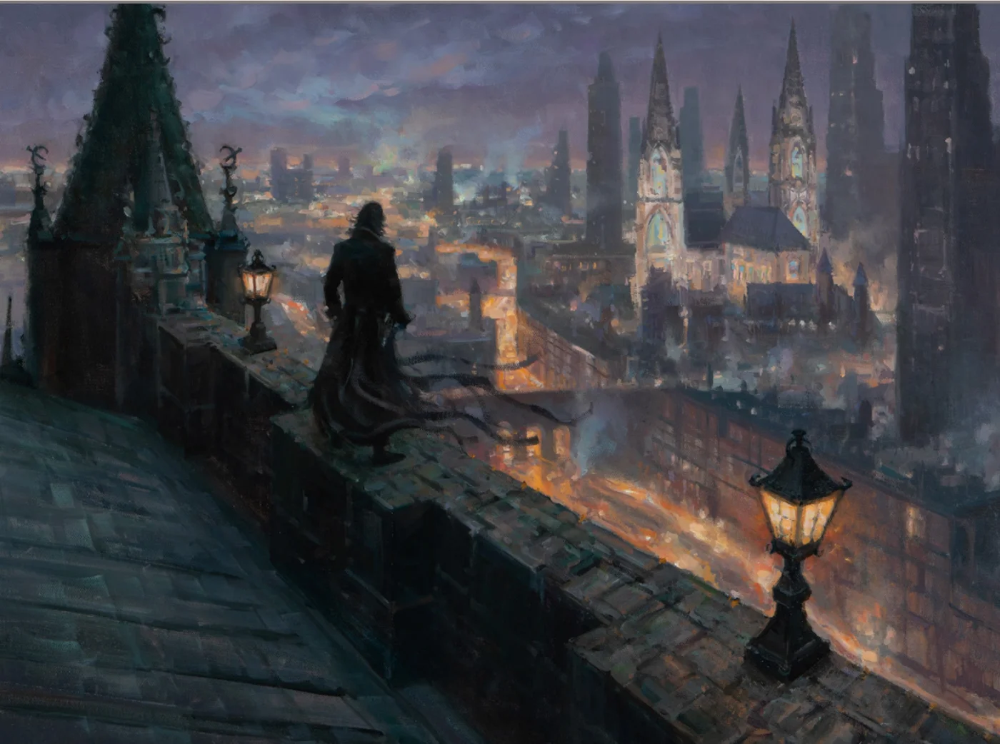

### 運用各個時代

從生活在她身上的人類所經歷的種種適應——不論出於自願或被迫——到各個時代地貌的劇烈變遷，司卡德利亞（Scadrial）始終是寰宇（cosmere）中我最喜愛的學術研究對象。

——Elis 女公爵可芮莎拉（Khrissalla）

《司卡德利亞星系》（The Scadrian System）

本書涵蓋的兩個時代僅相隔 300 年，但這兩個時代的司卡德利亞，卻可能讓人誤以為是不同的行星。本節提供如何在冒險中運用第一時代（Era 1）與第二時代（Era 2）的指引。如需更完整的行星歷史，請參閱《迷霧之子世界指南》（Mistborn World Guide）。

### 選擇時代

決定將司卡德利亞冒險設定在「何時」，可能比「何地」更重要。首先應考量玩家對敏感主題或題材的接受意願與容忍程度。檢視兩個時代的主要差異，想想哪個時代最適合你想說的故事，以及哪些限定時代的角色選項最能讓玩家感到興奮。情況允許的話，事先與玩家討論目標和興趣，能幫助你選出最契合的時代。選定時代後，向玩家介紹概況、建立共同期待，並一起討論角色構想和目標，讓它們與世界設定相符。

### 天壤之別：優勢與限制

有些故事或冒險會更適合特定時代：

第一時代的風格鮮明，獨具特色的設定元素

（包括作為系列招牌、也為系列命名的迷霧之子〔Mistborn〕），讓司卡德利亞有別於其他奇幻世界。小說《最後帝國》（The Final Empire）、《昇華之井》（The Well of Ascension）與《永世英雄》（The Hero of Ages）皆以此為舞臺。第二時代則有更多變化。相較於第一時代較有限的選項，第二時代容許更多元的角色典型、起源，以及英雄路徑（heroic path）或金屬之子（Metalborn）路徑。小說《執法鎔金》（The Alloy of Law）、《Shadows of Self》、《悼環》（The Bands of Mourning）與《The Lost Metal》皆以此為舞臺。

### 關於劇透的提醒

你可以只使用《最後帝國》的內容，將戰役（campaign）設定在第一時代。若你的戰役會透露後續小說的情節，應事先告知玩家。

### 兩個時代的主要差異

本節概述兩個時代在遊戲上的主要差異。

### 起源

人類（human）與坎得拉（kandra）血統（ancestry）在兩個時代都可選用，但克羅司混血（koloss-blooded）血統僅限第二時代。文化專長（cultural expertise）會標示為第一時代（例如陸沙德〔Luthadel〕專長）、第二時代（例如泰瑞司聚居地〔Terris Enclaves〕專長），或跨時代（例如坎得拉家園〔Kandra Homeland〕專長）。每個時代都有獨特的背景考量。在最後帝國（Final Empire），司卡（skaa）與貴族受嚴格的種姓制度約束；到了第二時代，階級之間的界線則更有流動性。第一時代的泰瑞司（Terris）人是種族滅絕的倖存者，但到了第二時代，他們經歷了文化復興。坎得拉角色在第一時代很可能遵守初約（First Contract）；到了第二時代，他們則可能是和諧（Harmony）的代理人。

### 英雄路徑

大多數英雄路徑在兩個時代都能遊玩，但有些路徑受到時代限制，另一些則只是更適合其中一個時代。「各時代的英雄路徑」表列出限定時代的路徑，也列出雖然兩個時代都可使用，但特別推薦用於其中一個時代的路徑。

### 各時代的英雄路徑

| 時代 | 英雄路徑 | 專精（specialty） |
| --- | --- | --- |
| 第一時代 | 密探（Agent） | 竊賊（Thief）、反抗者（Rebel）（推薦） |
|  | 獵手（Hunter） | 殺霧者（Hazekiller）（推薦） |
|  | 領袖（Leader） | 軍官（Officer）（推薦） |
| 第二時代 | 密探 | 調查員（Investigator）（推薦） |
|  | 獵手 | 神射手（Sharpshooter）（推薦） |
|  | 學者（Scholar） | 發明家（Inventor）[第二時代] |
|  | 戰士（Warrior） | 槍手（Gunslinger）[第二時代] |

### 金屬技藝

金屬技藝（Metallic Arts）雖然存在於所有時代，但某些金屬之子路徑（Metalborn path）與其金屬是否可用，會隨時代而異，詳見「各時代的金屬之子路徑」表。各時代有哪些金屬可用，請參閱第 6 章的「司卡德利亞的金屬」一節。血金術（Hemalurgy）在兩個時代都仍充滿謎團。在第一時代，主要只有鋼鐵審判者（Steel Inquisitors）運用這門技藝。到了第二時代，「組織」（the Set）正在重新發掘血金術，鬼血（Ghostbloods）也有少量使用。

第 13 章：主持遊戲 371

### 各時代的金屬之子路徑

| 時代 | 金屬之子路徑 | 可用金屬 |
| --- | --- | --- |
| 第一時代 | 藏金術師（Feruchemist）與迷霧之子 | 天金（Atium）、黃銅（brass）、青銅（bronze）、紅銅（copper）、金（gold）、鐵（iron）、白鑞（pewter）、鋼（steel）、錫（tin）、鋅（zinc）* |
|  | 迷霧人（Misting） | 天金、黃銅、青銅、紅銅、鐵、白鑞、鋼、錫、鋅* |
| 第二時代 | 單藏金術師（Ferring）、迷霧人與雙生師（Twinborn） | 鋁（Aluminum）、彎管合金（bendalloy）、黃銅、青銅、鎘（cadmium）、鉻（chromium）、紅銅、硬鋁（duralumin）、電金（electrum）、金、鐵、鎳鉻（nicrosil）、白鑞、鋼、錫、鋅 |

*接近第一時代末期時，鋼鐵教廷（Steel Ministry）以外的人開始知道鋁、硬鋁與電金，也知道金迷霧人的存在。

### 物品與獎勵

任何從第一時代留存下來的迷霧披風（mistcloaks）和尺寸巨大的克羅司巨劍（koloss blades），在後來的時代都會被視為奇特的古董。鋁襯帽（aluminum-lined hats）、鎔金手榴彈（Allomantic grenades）、火器（firearms）與浮空船（airships）等創新物品，則僅限第二時代。

### 第一時代：灰燼世界

第一時代的司卡德利亞是一顆歷經末日浩劫的行星。灰燼從天而降，夜晚的迷霧遮蔽群星，這個時代是神祕刺客、不屈反抗者與腐敗寡頭的理想舞臺。

### 冒險構想

第一時代的冒險應善用《迷霧之子》原始三部曲獨特的角色典型與設定特色。設計第一時代的冒險時，可用下列概念與主題範例作為靈感：

主題。壓迫、希望、信任、腐敗、宮廷陰謀、貪婪、貧富、抵抗與革命、極權統治、克服偏見、灰色道德。冒險（反抗者）。一個反抗組織的小隊打算解放最後帝國的偏遠地區。一名自稱同情他們理念的聖務官（obligator），出乎意料地主動提出協助。冒險（竊賊）。一個沒落貴族家族的倖存者加入司卡竊賊團夥，躲避敵對家族的趕盡殺絕，卻沒料到下一次劫案的目標竟是童年好友。

### 最後帝國的安全與敏感議題

第一時代的內容與基調比第二時代更陰暗。性侵害、奴隸制度、種族滅絕與兒童虐待，都是最後帝國文化與社會根深蒂固的一部分。

開始第一時代的戰役前，應預先向玩家提出這些題材的內容警告，並確保已備妥適當的安全準則與工具（請見後文的「正典與連貫性」及「安全指南」章節）。定期與玩家一起檢視並擴充安全措施，有助於處理遊戲桌上可能出現的困難情況或情緒。溝通是安全且投入的共同敘事之鑰。

### 第二時代：變遷與革命

到了第二時代，司卡德利亞成為一個持續演變的世界：科技不斷進步，人們對金屬技藝的理解日益深入，原本互相隔絕的國家也開始往來。第二時代的世界深受類型小說影響，有魯莽的執法者、聰明的偵探、表裡不一的間諜，以及熱切的尋寶者（其中大多數都有槍）。

### 冒險構想

規劃冒險時，跳脫框架思考，善用第二時代的多樣性。設計第二時代的冒險時，可用下列概念與主題範例作為靈感：

主題。變遷與轉變、科技革命、文化衝突、冒險、欲望與責任的拉扯、神意指引與個人自主的拉扯。冒險（依藍戴〔Elendel〕）。一位來自

蠻橫區（Roughs）、有志角逐參議員席次的人，雇用隊伍協助競選；然而，現任議員試圖破壞這位熱情新候選人的選情。冒險（蠻橫區）。一艘 Malwish 浮空船出發探勘陸沙德遺跡時，鬼血與「組織」的特務都混進了船員之中。

### 跨越時代

較長的戰役可能橫跨多個時代。例如，《迷霧之子傳承》（Mistborn Legacy）冒險就同時包含第一時代與第二時代的內容。

### 其他時代

司卡德利亞的歷史並不限於第一時代與第二時代。你可以將戰役設定在其他時代，但需要投入更多創意與心力。在其他時代中，讓故事符合正典也可能更困難。不過，只要多花一些工夫，你就能在古典時期的司卡德利亞（Classical Scadrial）或初代時代（Age of the Originators）等歷史時期，創作自己的冒險。

第 13 章：主持遊戲 372

### 古典時期的司卡德利亞

在統御主（Lord Ruler）昇華（Ascension）之前，一名克雷尼恩（Khlenni）青年被奉為泰瑞司預言中的英雄，注定要拯救世界，擺脫深暗（Deepness）令人窒息的觸鬚。在這個時代遊玩時，請考量以下事項：

世界設定。除了日益濃重的迷霧，古典時期司卡德利亞的地理與第二時代相似。坎得拉、克羅司（koloss）與霧魅（mistwraiths）尚不存在。科技程度與第一時代相近。金屬技藝。鎔金術（Allomancy）十分罕見，世人對它所知甚少。迷霧之子尚不存在。泰瑞司藏金術師向外人隱瞞自己的技藝。血金術鮮為人知，但已以儀式獻祭與典禮穿刺的形式存在。推薦閱讀。《最後帝國》

與《昇華之井》各章開頭的引文，以及沙賽德（Sazed）對昇華前文化與宗教的描述，是這個時代的主要資料來源。

### 初代時代

和諧拯救世界後，落灰之終（Catacendre）的倖存者——也就是初代（Originators）——從零開始重建文明。迷霧之子大人（Lord Mistborn，原名鬼影〔Spook〕）統治依藍戴盆地（Elendel Basin）早期的聚落，卡西爾（Kelsier）團隊中倖存的成員則協助塑造這個新世界。在這個時代遊玩時，請考量以下事項：

世界設定。最初，依藍戴盆地人口稀少，聚落也十分簡樸。槍械、汽車與電力等技術歷經多年才發展出來，直到第二時代之前不久才問世。金屬技藝。初代時代可能是司卡德利亞歷史上，唯一曾讓迷霧之子與雙生師短暫共存的時期。推薦閱讀。《永世英雄》

與《Secret History》的尾聲，有助於確立初代時代的起點。

*瓦希黎恩．拉德利安（Waxillium Ladrian）凝望依藍戴不斷變遷的面貌。*

BRYAN TAYLOR

