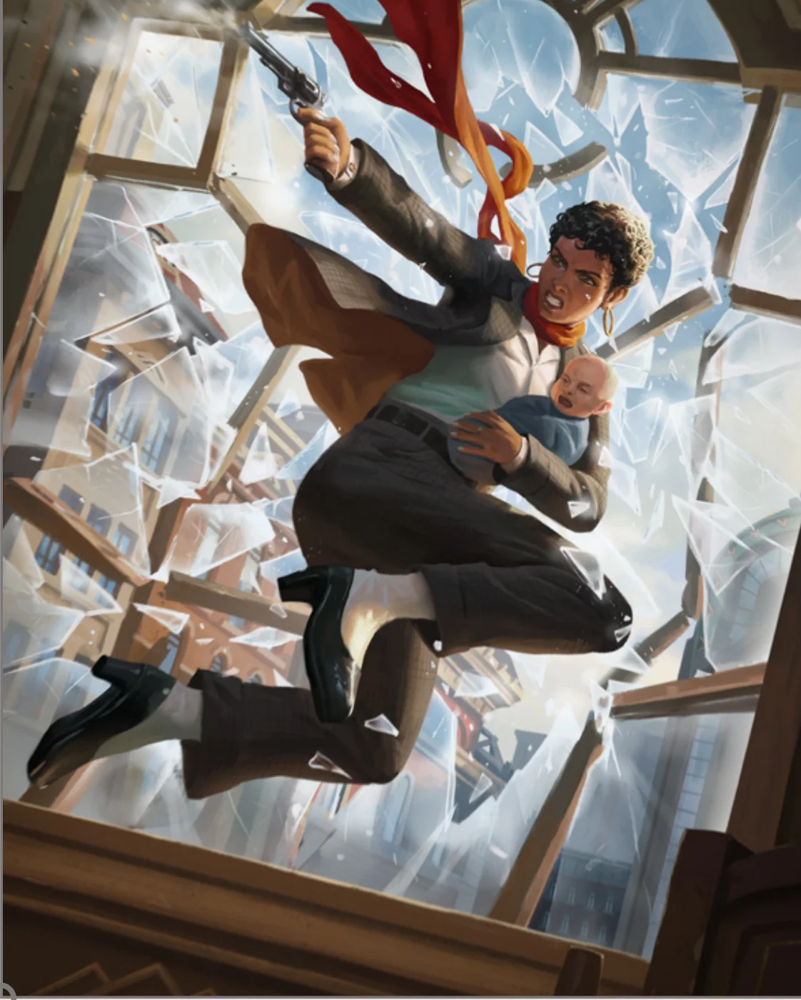

### 運用劇情骰

劇情骰（Plot Die）是強而有力的敘事工具，能在遊戲中創造生動、刺激又出人意料的時刻。情勢緊張時，它能激勵 PC，讓角色完成連自己都沒想過的壯舉。遭逢失敗時，它也能成為一線希望，給 PC 繼續前進的動力。無論劇情骰帶來的是驚人的成功、慘痛的失敗，還是付出代價才換來的成功，都能協助你們創造動人的故事。多年以後，你和玩家仍會興高采烈地回味，或一起感嘆當年的遭遇。

### 提高賭注

身為 GM，由你決定何時為技能檢定（Skill Test）提高賭注（Raise the Stakes），請玩家在擲骰時加入劇情骰（見本書導論的「使用寰宇 RPG 骰子」）。掌握使用的時機與方式十分重要。如果太常提高賭注，就會失去刺激感；但劇情骰用得太少，又會錯失它推動故事的力量。你不必只在重大而緊張的檢定中使用劇情骰。只要想強調某次檢定對故事、某個角色或這場遊戲的重要性，都可以提高賭注。例如，角色嘗試用有創意的方法解決問題，或玩家順著角色的動機行事時，你都可以提高賭注。後者的例子包括：因為符合角色的信念，而選擇一個「不是最佳解」的計畫。記住，劇情骰反映的不是檢定有多難；難度是由優勢（Advantage）和劣勢（Disadvantage）來反映。劇情骰反映的是這次檢定在敘事上有多重要。大致而言，你應該為約三分之一的檢定提高賭注，不過仍要視你要求檢定的頻率而定。PC 身處緊張激烈的故事場景時，你可能幾乎每次檢定都提高賭注；輕鬆的支線活動則可能完全不用。本節會介紹哪些情況通常適合，或不適合使用劇情骰。

### 戰鬥之外的劇情骰

舉個在戰鬥之外使用劇情骰的例子：假設隊伍正進行一場任務（Mission），要潛入聖務廷（Canton）的建築，救出一位遭到拘捕的團隊成員。

### 風險較低的活動

PC 準備潛入時，很可能會先偵察或蒐集情報，尋找聖務廷維安的漏洞；找尋可能有辦法讓他們進入建築的人脈；或製作偽裝。

這些偽裝能讓他們冒充鋼鐵教廷（Steel Ministry）成員。雖然這些活動都有助於完成任務，但不是為了達成這個目標而進行的每次檢定，都需要提高賭注。這些活動都沒有特別高的風險，提高賭注多半也無法讓故事更精彩。

### 風險較高的活動

不過，如果隊伍蒐集情報時找上了一名可能向聖務廷通報的 NPC、試圖說服忠於聖務廷的人協助他們，或打算在陸沙德（Luthadel）的街上偷竊聖務廷成員的東西，這些危險或許就足以值得提高賭注。同樣地，一旦隊伍開始潛入，危險與緊張便無處不在。從聖務廷正門進入時進行的隱匿（Stealth）或欺騙（Deception）檢定，或爬向敞開窗戶時進行的運動（Athletics）檢定，都能藉由擲劇情骰增添戲劇張力。

### 別具意義的時刻

準備過程和實際潛入期間，也可能出現對特定角色別具意義的時刻。每個 PC 都有核心目的（purpose）、內在障礙（obstacle），以及至少一個短期目標（goal）。因此，同一次檢定對某個角色可能格外有意義，對另一個角色卻未必如此。身為 GM，你可以指出其中的關聯；玩家也可能認為當前情況與自己的角色息息相關，主動要求提高賭注。不論是哪一種情況，你都可以提高賭注，凸顯這個時刻的重要性。

### 劇情轉折

在對話（Conversation）和試煉（Endeavor）中，留意那些重要、緊張又危險的關鍵技能檢定。這時突然出現的機遇（Opportunity）或變故（Complication），可能改變這場遊戲或角色故事的走向。機遇可能讓角色發現先前沒注意到的潛入路線；變故則可能觸動警報，迫使他們改變策略。這些時刻重現了精彩故事中的曲折轉變，正適合加入劇情骰。

### 艱難的選擇

尤其當任務有時間限制時，你可以運用劇情骰讓玩家做選擇：隊伍想採取緩慢而安全的方法，還是更快、風險也更高的方法？例如，潛入聖務廷時，玩家可能得知要營救的團隊成員預定在隔天中午遭到處決。你可以問隊伍：「你們要賄賂一名工人，躲在他送進去的物資裡；還是趁聖務廷白天開放時，試著溜過守衛身邊？賄賂工人再混進去要花幾個小時，每個人還得付 10 盒金（boxings），不過你們也許能做一次說服（Persuasion）檢定，少付一點。直接潛入現在就能開始，但得做一次提高賭注的隱匿檢定。」這樣既能把決定權留在玩家手上，也能讓風險與報酬之間的取捨成為引人投入的選擇。

第 13 章：遊戲主持 355

### 戰鬥中的劇情骰

不論隊伍在潛入建築時被發現，還是需要與牢房外的守衛交戰，潛入過程中都很可能至少發生一次戰鬥。

### 戲劇性的時刻

和對話、試煉一樣，你不應讓玩家在戰鬥場景中每次攻擊或進行其他檢定時，都提高賭注。雖然每次檢定確實都有助於任務，最好還是著重於凸顯戰鬥中的重要時刻。是不是剛有一位隊伍成員的生命值（Health）降到 0，其他 PC 才驚覺，敵方的人數優勢正迅速壓垮己方？你可以考慮讓剩下每個角色在下個輪次的第一次檢定提高賭注，呈現恐懼與腎上腺素驟升的感受。是不是有一位聖務官（obligator）突然從轉角現身，攻擊某個 PC？你可以考慮讓那個 PC 在自己的輪次中，每次攻擊都提高賭注。有沒有 PC 是一位遭另一個大家族（Great House）害得家道中落的貴族？遇到與這段過往直接衝突的檢定，例如試著和該家族的繼承人交朋友，你可以考慮為其中一些檢定提高賭注。

### 慎選時機

一般而言，戰鬥中使用劇情骰的頻率應比戰鬥之外低，因為即使小小的機遇或變故，也可能大幅影響戰鬥的發展。挑出幾個關鍵時刻提高賭注，就能讓戰鬥更生動刺激，尤其是面對重要反派的戰鬥。不過，也別太少使用劇情骰。有些天賦提供了花費機遇的特殊方式，玩家自然會樂見有更多機會運用。另一方面，某些敵手也有花費變故的特殊方式，你可以用這些能力讓玩家膽戰心驚。

### 合作運用劇情骰

劇情骰擲出後，身為 GM，你的職責是協助判定檢定結果。除了判定檢定的目標達成得如何，你也要協助處理機遇或變故。劇情骰上的每個符號都有標準的規則效果，但如果團體能想出切合當前情況的敘事結果，這場遊戲就會更加生動。

### 玩家要求提高賭注

別忘了，GM 不是孤軍奮戰！桌邊還有其他玩家，也和你一樣投入心力，想說出引人入勝的故事。因此，當玩家覺得情節觸及角色的核心目的、內在障礙或短期目標時，鼓勵他們主動要求提高賭注。這樣你就能專心思考，何時提高賭注對整體情勢最合適，而不必同時顧慮每個 PC 的個別情況。

### 玩家提議結果

擲出機遇或變故時，你不必自己想出所有可能的效果或結果。開放玩家提出自己的建議吧！如果是機遇，由擲出機遇的玩家決定如何使用。如果是變故，你可能會驚訝地發現，玩家提出的後果比你原本想的還嚴厲。他們為了精彩的故事，可能很願意，甚至很開心地讓自己的角色受苦。

### 增加玩家自主權

合作運用劇情骰，不僅能減輕你思考時的負擔，也能讓玩家對情節發展有更多自主權。他們很可能會更加投入，更仔細留意情勢與角色所處的環境，好提出最切合情境的建議。提高賭注時，整個團體都可能興奮起來。他們還不知道這是好是壞，卻知道一定有有趣的事即將發生。鼓勵大家熱衷於提點子，一起討論什麼結果最有趣，或最能讓故事令人滿足。人人都參與時，劇情骰才最有樂趣。不過，最終仍由身為 GM 的你決定，某個敘事結果是否可行；如果是變故，也由你決定如何花費。

第 13 章：遊戲主持 356

### 運用機遇與變故

提高賭注並擲出劇情骰後，就要處理接下來的影響。如本書導論所述，PC 獲得機遇或變故時，可以用幾種方式處理：

- 一名盟友的下一次檢定獲得優勢（機遇）或劣勢（變故）。

- PC 獲得 1 專注點（Focus）（機遇），或失去 1 專注點（變故）。

- 一次命中（Hit）變成致命一擊（Critical Hit）（機遇）。

- 發生敘事上的附帶效果。

第四種選擇能讓遊戲彷彿有了自己的生命：檢定帶來意料之外的後果，讓故事朝著出人意料又有趣的方向前進。思考機遇或變故可能代表什麼，是一項有趣而富有創意的活動，能加深桌邊共同說故事的體驗，但也可能令人卻步。這些結果應該帶來哪些敘事元素？如果毫無靈感，又該怎麼辦？以下幾節會說明如何有效運用機遇與變故。別一次套用所有做法，而是把它們當成看待機遇與變故的不同角度，從中獲得處理結果的靈感。

### 另一條軸線

有些 GM 喜歡把檢定結果想成一張有 X 軸和 Y 軸的圖。一條軸線代表檢定本身的結果，另一條則代表機遇與變故。例如，想像某個角色正在做竊術（Thievery）檢定來開鎖。其中一條軸線代表角色進行檢定的目標：是在看鎖開得好不好、開得快不快，還是開鎖時有多安靜？主要目標就在這條軸線上，而檢定結果決定角色有多接近成功或失敗。這不只是通過或沒通過的問題，因為你可以依照結果，調整成功或失敗帶來的效果程度。第二條軸線則代表角色主要目標以外，可能發生的其他結果。如果主要目標是看角色開鎖的本事如何，第二條軸線就可以代表開鎖有多快。角色在第二條軸線上落在哪裡，取決於機遇與變故。如果檢定是在看角色能否打開一把難開的鎖，機遇可能表示他以破紀錄的速度完成。或者，如果檢定是在看角色能否頂著壓力快速開鎖，變故可能表示他在過程中弄壞了開鎖工具。這條軸線不會改變主要目標的成敗，卻確實會影響場景的其他面向。

### 其他技能

你也可以想想角色還有哪些技能，以及那些技能能如何在這次檢定中派上用場。機遇或變故可能讓其中一項技能影響結果。例如，角色可能正運用運動技能與對手纏鬥，但擲出機遇時，竊術本領也許能讓他同時摸走對手口袋裡的東西。（反過來說，變故也可能表示對手對他做了同樣的事！）

### 純粹的巧合

機遇與變故不必總是直接關乎進行檢定的角色，也可以代表同時碰巧發生的事，例如運氣使然或偶然的巧合。舉例來說，角色試圖欺騙一群人卻擲出變故時，可能發現人群中有個從前認識的人。這和角色欺騙群眾的本事無關，卻很可能在之後帶來麻煩。相對地，角色在疾駛的火車頂上戰鬥時擲出機遇，對手可能正好被頭頂掠過的樹枝撞倒。

第 13 章：遊戲主持 357

### 推動故事

歸根究柢，機遇與變故都是用來加深故事、讓情節朝有趣方向發展的工具。如果你打算在某個場景揭露特定事件或劇情轉折，何不把它和擲出的機遇或變故連在一起？也許你原本就計畫在場景稍後安排強盜伏擊隊伍。與其讓他們突然冒出來，不如等玩家擲出變故，再讓強盜選在那一刻現身。把這些事情與劇情骰相連，會讓它們更像是遊戲機制自然發展的一部分，而不是刻意安排的劇情橋段。有些機遇可能讓 PC 得知玩家根本沒想到要問的祕密。遇到這種機遇時，你可以提出願意揭露一個重要祕密，讓玩家決定要不要把機遇用在這件事上。

### 運用事件

有時，你心中想好的附帶效果規模太大，不適合只靠一個機遇或變故就觸發。這時，你可以累積多個機遇與變故，逐步引向一個事件（Event）（見第 9 章的「事件」）。

### 敘事優勢與劣勢

判斷何時該讓檢定獲得優勢或劣勢，可能並不容易（見第 3 章的「優勢與劣勢」）。留意角色是否對檢定涉及的事物有獨到的了解，或比平常更缺乏相關認識。遇到這些情況，你可以讓角色在檢定中獲得優勢或劣勢，反映其背景帶來的影響。就規則而言，數據相同的兩個角色，面對同一個 DC 時，檢定成功的機率也相同。優勢與劣勢能讓你凸顯每個角色故事中的不同面向。因此，當檢定涉及較冷門的主題，而某個角色對此恰好有不同的勝算時，要多加留意。

許多 GM 對給予檢定敘事優勢（Narrative Advantage），比對給予劣勢更有把握。如果角色對檢定涉及的事物幾乎一無所知，給予敘事劣勢（Narrative Disadvantage）通常很合適。例如，竊術修正值很高的角色，一般都很擅長開鎖。但如果他從未見過專為射幣（Coinshot）開啟而設計的鎖，就貿然嘗試開鎖，你可以讓這次檢定獲得劣勢，反映他對這種陌生用途的不熟悉。

### 安排遊戲場次

視你的遊戲風格而定，一場遊戲可以有嚴謹的安排，也可以隨著當下靈感即興發揮。但不論你採取哪種敘事方式，故事都會依照情節需要，由一個接一個的場景推展（見第 9 章的「場景」）。例如，在 Tathingdwel 搜尋失蹤線人的調查（Discovery）試煉，可能引向與暗巷商人的一場對話，接著又與她的地下社會人脈對話，之後與這些人的幫派成員交戰。當隊伍發現打不過時，又可能轉成橫越全城的追逐（Pursuit）試煉。而在這整段過程中，可能始終有個事件在醞釀：「組織」（the Set）的陰謀正在幕後推進（見第 9 章的「事件」）。場景之間，隊伍有機會休息或進入休整期（Downtime）時，無論是因為需要療傷，還是情節暫時平靜，你都可以運用第 9 章「休息」與「休整期」的指引，為這些喘息時刻安排適當的段落。

### 要安排多少個場景？

兩次長休息（Long Rest）或休整期之間，應該準備多少場戰鬥？和本書所有規則一樣，這取決於故事的需要。遊戲提供許多讓角色擲恢復骰（Recovery Die）的方式，只有在不長休息就無法繼續前進時，他們才需要長休息。這讓 GM 有充分的彈性，能在一天的冒險中安排符合敘事需要的場景數量。規劃與建立戰鬥場景時（下節會說明），可以用戰鬥難度作為指引。幾場簡單的戰鬥能讓玩家感覺自己是英雄，又不致過度消耗。兩場中等難度的場景，則會在資源穩定消耗的同時，考驗他們的戰術。一場困難的場景，就可能讓這一天到此為止；更有挑戰性的場景，甚至能占滿一整天，把角色推向極限，乃至超越極限。

KEVIN SIDHARTA

第 13 章：遊戲主持 358
