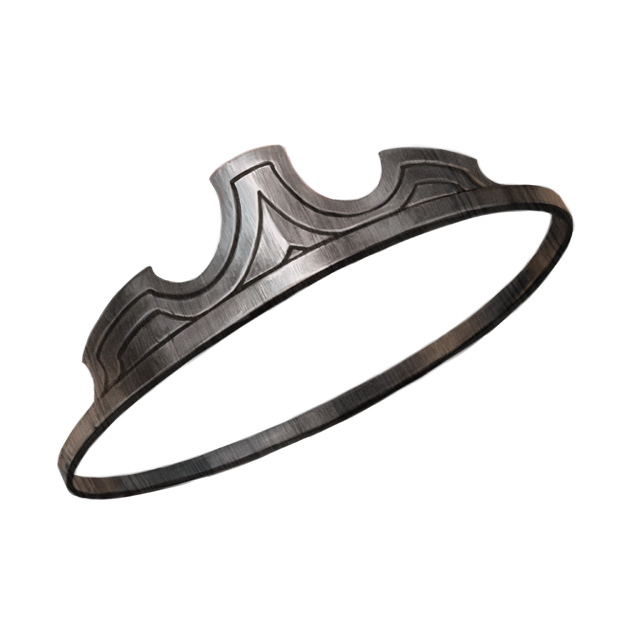
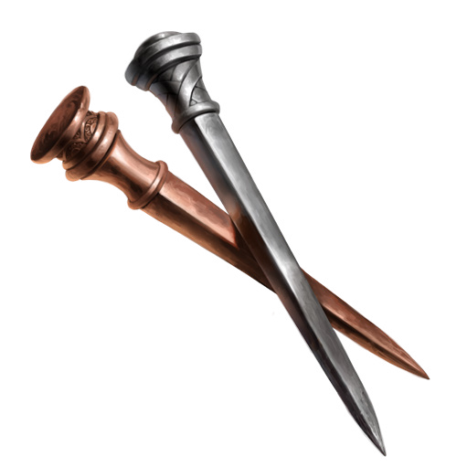
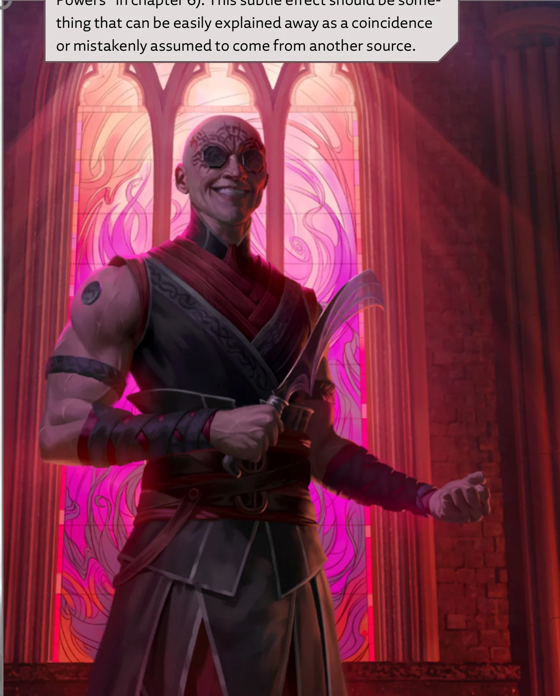
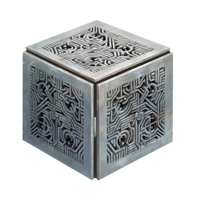
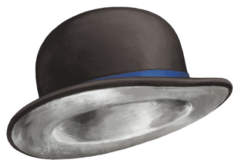
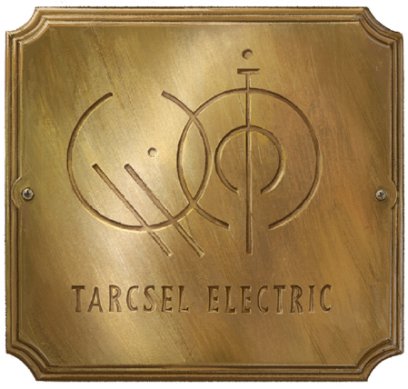
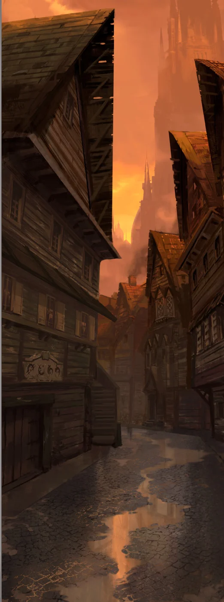

### 短期目標

了解角色的核心目的（purpose）與內在障礙（obstacle）後，就能據此思考要追求哪些短期目標（goals）。在本遊戲中，短期目標有兩種用途：首先，它們是角色想達成的具體目標；其次，當角色追求短期目標時，你可以用它們追蹤角色在故事中的成長。你起初有一至兩項短期目標，遊戲中也能取得更多。角色紙上的每項短期目標都有三個里程碑（milestone）方格，代表完成它的進度。你和 GM 要一起決定，怎樣才算達成各項短期目標。結束短期目標時，你會得到獎勵（reward；見本章後面的「獎勵」）。結束可以表示達成目標，也可以表示角色成長後不再追求它、發現某件事而以新目標取代它，或完成另一件事，並體會到那對自己更重要。

### 建立短期目標

每當你接受個人成長或成就的新機會，都可以為角色新增短期目標。GM 可能向你建議新目標，你也可以自行決定，或因天賦（talent）或其他效果而獲得新目標。發生這些情況時（包括角色建立時），請和 GM 一起擬定短期目標，並思考以下問題：

**角色的目標。** 你的角色如何理解這項短期目標？

**玩家的目標。** 身為玩家，我希望角色在追求這項短期目標的過程中，做些什麼、學會什麼，或經歷什麼？

**推進短期目標。** 有哪些具體方式可以推進這項短期目標？

決定短期目標前（見「短期目標範例」），請先與 GM 討論，確保它適合戰役（campaign）的共同故事。你和 GM 達成共識後，把短期目標記在角色紙背面；GM 也應記在自己的筆記中，並記下你對完成方式的建議。隨著戰役進展，你可能結束原有的短期目標，暫時沒有目標（只要符合故事情境即可）。不過，仍應打算在不久後補上新目標。大多數角色會積極追求自己的短期目標，但你的角色也可能未曾意識到它，或不願承認。例如，角色可能是名聖務官（obligator），潛意識中不斷破壞自己已深惡痛絕的體制，卻仍緊守著

對統御主（Lord Ruler）的信仰。你甚至可以講述一個悲劇：角色從未發揮全部潛能，並因越來越糟的決定而深陷泥淖。不過，最好先想想，這樣的發展對你和其他玩家來說是否令人滿意。如果你選擇角色可能永遠無法達成的目標，請參閱「結束短期目標」，了解如何處理這種張力。

### 短期目標範例

以下是幾項能以具體方式推進的短期目標範例：

**取得有利可圖的商業合約（Secure a Lucrative Business Contract）。** 你正在與重要客戶建立良好關係，為自己或代表的團體增加財富。

**集結劫案專家（Gather Specialists for a Heist）。** 你正組成一支多元團隊，成員各有明確專長，以實現你的計畫。

**彌補過往的錯誤（Make Amends for Past Wrongdoing）。** 你認為自己必須為過去的失敗負責。在竭盡所能彌補之前，你無法放下。

**發明新技術（Invent a Novel Technology）。** 你有個足以改變世界的構想，但首先得想出如何把它做出來。

**向某人復仇（Get Revenge on Someone）。** 你受到極大的傷害，為了讓應負責的人付出代價，你將不惜一切。

### 推進短期目標

當角色做出的決定有助於推進短期目標時，GM 會告訴你為該目標增加一個里程碑（在角色紙上相應的位置打勾）。通常，每項短期目標在每個遊戲場次（session）中大約能推進一次。在格外重要的時刻，GM 可能讓你推進同一項目標兩次。每場遊戲結束時，如果你在場次中沒有替某項目標打勾，就想想角色是否做過任何能推進它的事；如果有，請與 GM 討論。你也能利用休整期（downtime）追求短期目標（見第 9 章「休整期」）。

### 金屬之子短期目標

要解鎖金屬之子（Metalborn）能力的完整潛能，你必須完成一項短期目標（見第 5 章「金屬之子短期目標與獎勵」）。這類目標與其他短期目標不同，並非由 GM 給予，而是來自你選擇的天賦。完成這類目標後，它的獎勵會賦予你該天賦的強大能力，並讓你日後能進一步發展那項能力。

第 8 章：短期目標與獎勵 283

### 玩家如何充分運用短期目標

對玩家而言，短期目標是很好用的工具，能告訴 GM 你希望角色參與哪類故事。它們也能追蹤角色在故事中的進展。請試著主動追求短期目標。看見機會時，可以向 GM 提出，但記得與其他玩家分享聚光燈。如果你的角色知道另一名角色的短期目標，甚至可以協助對方追求它。最後，每次勾選里程碑時，不妨在角色紙的「筆記」欄記下發生的事，讓你最終結束目標時，能回顧角色的故事發展。你大概不會在每個場次推進所有目標，但如果發現某項目標已好幾場沒有進展，請和 GM 討論，看看往後如何把它融入故事，或重新調整，讓它更符合持續發展的劇情。

### GM 如何充分運用短期目標

對 GM 而言，短期目標是玩家發出的訊號，告訴你他們希望角色在故事中做些什麼。每個場次都盡量給每名角色至少一次追求其中一項目標的機會。你可以在場次中或結束後推進目標。每場遊戲結束時，很適合回想角色們這次做了什麼。如果有任何與角色目標相關的時刻讓你印象深刻，就告訴該玩家推進目標，並說明原因。

### 建議短期目標

身為 GM，你可能會想到適合角色的新目標，盡管向該角色的玩家建議。尤其當角色剛完成前一項、目前沒有目標時，這能幫助玩家展開新的故事篇章，鼓勵角色朝某些方向成長。例如，角色救了一名有權勢的貴族後，你可以提出一項目標：取得該貴族的信任，讓他成為提供庇護的贊助者（patron；見本章後面的「獎勵」）。如果玩家不想接受，也沒關係。他們可以從中得到靈感，換成別的目標，或提出自己想出的目標。角色要接受哪些短期目標（或是否接受），最終由玩家決定，但身為 GM，你仍可適度鼓勵。

### 結束短期目標

當某項短期目標累積三個里程碑（以勾選表示），你可以在該場遊戲中或場次之間告訴 GM，你想結束它。第三次打勾後不必立刻結束；你可以請 GM 等到戲劇效果更合適的時刻。告知 GM 後，請一起討論角色將如何在故事中結束這項目標。這是雙方共同創作的過程，應為角色的故事發展帶來高潮。目標結束後，你會得到獎勵（見接下來的「獎勵」），並繼續追求其他目標。你一路推進里程碑所累積的戲劇張力，此刻終於能得到回報。你和 GM 都應根據沿途達成的里程碑，對故事中的結局提出想法。如果結局主要發生在角色內心，你可能有較多決定權；如果它會大幅影響遊戲世界，GM 可能有較多決定權。無論如何，都應由雙方討論，不過任何不確定之處仍由 GM 決定如何處理。結束短期目標，不一定代表你在劇情中達成了它。除了以成功結束，你也可能因角色成長，甚至失敗而結束。

### GM 提示：何時結束短期目標

如果你擔任 GM，而玩家想在進行中的遊戲場次結束某項短期目標，請考慮它是否應在本場完成，或你需要更多時間，把合適的戲劇時刻融入故事的自然進展。若是後者，請優先安排在下一場結束它。有時當場結束最令人滿意，有時卻可能嚴重打斷目前的故事。一如往常，請自行妥善判斷，不必覺得一定要等，也不必急著完成。

第 8 章：短期目標與獎勵 284

### 以成功結束

結束短期目標最直接的方式，就是在故事中達成它。你做到了原先打算做的事。也許你完成復仇、洗清受損的名聲，或保住家中的農場。無論如何，享受片刻喘息、慶祝勝利，或至少讓自己有所了結。明天，你就得面對「接下來呢？」這個難題。

### 以成長結束

成功不一定是故事中最令人滿意的結局。你可能刻意替角色選擇不可能完成的目標，藉此探索故事；也可能決定，成功對現在的角色並非最好的結果。角色可能有所成長，發現目標有害或無法維持，因而放下；也可能認清它只是另一個動機的表現，而自己先前還不完全了解那個動機。這些深刻的領悟可以和實際成功一樣具有戲劇性，當然也能算作完成短期目標。

### 以失敗結束

也許有點出乎意料，角色也能因失敗而結束短期目標。不論在司卡德利亞（Scadrial）或我們的世界，人們有時都無法實現抱負，但失敗也可能是重要的老師與動力。明確地在某項目標上失敗，可能幫你塑造下一項目標、聚焦角色的個人成長，或以其他方式形塑角色，其影響不亞於成功。請想想角色面對失敗會如何成長，以及現在會選擇什麼新目標。

### 獎勵

獎勵是角色在故事中得到的重大助益。你可能獲得供金屬技藝（Metallic Arts）能力使用的稀有金屬持續供應，得到與你一同冒險的夥伴（companion），甚至成為某個組織（organization）的領袖。獎勵可以透過結束短期目標取得，如本章前文所述；GM 也能在特定劇情事件合理地導致某項獎勵時給予。

### 短期目標獎勵

結束短期目標時，你會根據追求過程中做過的事得到獎勵。有時獎勵很明確：如果目標是取得可靠的鎳鉻（nicrosil）來源，那麼獎勵就是與供應商達成協議。有時獎勵與目標結局只有較抽象的關聯。例如，你原本想把惡名昭彰的罪犯繩之以法並領取懸賞，卻發現對方是遭執法人員陷害。如果此時把逃犯交出去已不符合角色的想法，你也不會因此失去獎勵機會。目標結束時，你反而可能得到這名蒙冤逃犯作為盟友（ally），並很可能展開新目標：對抗腐敗體制，洗清你們兩人的名聲。另一些目標可能沒有明確對應的獎勵。解開謎團或獲得個人成長，未必附帶任何物質報酬，但 GM 能利用故事中的這些時刻，帶入對角色有意義的獎勵。即使獎勵與角色預期不同，也應讓你展現角色的成長，並創造追求後續目標的機會。

*依藍德的王冠*

LUCAS TORQUATO

第 8 章：短期目標與獎勵 285

### 即興獎勵

GM 可以自行決定，有時在符合故事情境時給予即興獎勵（Spontaneous Rewards）。例如，要取得一顆 Lerasium 之類極度罕見的金屬，通常得有驚人的準備與運氣。不過，如果你碰巧擊敗攜帶稀有金屬的敵人，就可能無須完成短期目標，便得到它，以及隨之而來的所有麻煩。另一方面，如果 GM 事先知道，你想在第二時代成為完整的迷霧之子（Mistborn），完成這項聞所未聞的壯舉，就能和你一起訂出分成數個步驟的短期目標，例如遍尋世界追查 Lerasium 金屬珠的傳聞、策畫精密的劫案，再全身而退。

### 人脈

許多獎勵會讓你與其他生命建立連結，例如忠誠的夥伴或願意幫忙的贊助者。你可以把這些獎勵記在角色紙的「人脈（Connections）」欄，連同冒險途中與其他角色建立的重要關係一起記錄。

### GM 提示：提供有意義的獎勵

有時玩家希望角色得到什麼獎勵十分明確，而且可能早已和你討論過。這種情況只提供一項獎勵即可。另一些時候，你可能想用獎勵給玩家驚喜。除非確定玩家會喜歡，否則請提供來自兩個不同類別的獎勵選項。這既能讓玩家參與決定角色得到的獎勵，也能讓你提供出乎意料的選擇。角色越常得到即興獎勵（或預期自己會得到），有些玩家就越可能失去追求短期目標的動力。如果知道某位玩家想要某項獎勵，你可以鼓勵對方訂立相關目標。

### 獎勵類別

獎勵幾乎可以採取 GM 與玩家選定的任何形式，不過大多屬於以下類別。各類別都會建議不同獎勵適合的角色階層（tier）。

#### 夥伴

夥伴是故事中以某種方式效忠或支持你角色的 NPC。他們在世界中仍有自己的生活與計畫，但通常會以符合自身情況的方式協助你。視個人而定，夥伴的忠誠可能只是替你處理小事或取得情報，也可能願意為你冒生命危險。夥伴可以是人、動物，或經 GM 同意的其他角色。如果夥伴是人（人類、坎得拉〔kandra〕、克羅司混血〔koloss-blooded〕或其他有智慧的生命），就應是同輩、盟友、朋友、戀人、聯絡人，或其他與你的角色保持對等關係的個體。

### 夥伴的活動

如果情境合理，夥伴可以跟你同行，但也可能住在特定地方，在你聯絡求助時提供支援。夥伴通常會在合適時主動協助你，而幫忙的方式很多：直接協助、寄信提供重要情報，或代你取得補給等。例如，保鑣或助手可能經常隨侍在側，臥底密探則可能在遠方活動，只在收到重要情報時傳回。一名因私人關係而非雇用關係與你建立羈絆的夥伴（例如朋友、愛慕對象或勁敵），可能大多數時間都在追求自己的計畫，只在故事情境合適時偶爾與你碰面、提供協助。

*蠻橫區的追蹤者與他的動物夥伴。*

ALEKSANDRA WOJTAS

第 8 章：短期目標與獎勵 286

### 各階層夥伴範例

| PC 階層 | 角色定位與數量 | NPC 資料範例 | 成長加值 |
| --- | --- | --- | --- |
| 1 | 1 名嘍囉 | 渡鴉*、警員、駐軍、亡命之徒，或其他階層 1 以下、非首領的 NPC | — |
| 2 | 2 名嘍囉或 1 名勁敵 | 馬*、殺霧者、社交名流，或其他階層 2 以下、非首領的 NPC | 嘍囉：所有檢定 +2、生命值 +10 |
| 3 | 3 名嘍囉或 1 名勁敵 | 坎得拉、血金嵌合獸，或其他階層 3 以下、非首領的 NPC | 嘍囉：所有檢定 +4、生命值 +20；勁敵：所有檢定 +2、生命值 +10 |
| 4+ | 5 名嘍囉、2 名勁敵或 1 名首領 | 克羅司或任何階層的其他 NPC | 嘍囉：所有檢定 +6、生命值 +40；勁敵：所有檢定 +4、生命值 +20 |

*見「動物夥伴」附錄。

### 場景中的夥伴

無論是戰鬥（combat）或其他場景（scene），所有夥伴都由 GM 控制。不過，只要不違背更根本的目標（例如求生），夥伴通常願意聽你的話。需要夥伴的數據時，請與 GM 一起，從本書「動物夥伴」附錄或《迷霧之子世界指南》（Mistborn World Guide）第 8 章選擇合適的 NPC 資料。「各階層夥伴範例」表建議 GM 在各角色階層可用的 NPC 數據，包括夥伴建議的角色定位（見第 13 章「建立戰鬥場景」）、資料範例，以及隊伍提升等級時可能得到的加值。本書「動物夥伴」附錄收錄的資料以星號標示；其餘資料見《迷霧之子世界指南》第 8 章。（表中部分資料範例刻意不同於「角色定位與數量」欄的一般建議。）

**多名夥伴。** 階層較高時，你可能同時擁有不只一名夥伴，建議數量列在「角色定位與數量」欄的 NPC 類型旁。

**成長加值（Development Bonuses）。** 如果夥伴的階層低於你，其數據會提高。請套用表中「成長加值」欄的加值；這不只適用於新獲得的夥伴，也適用於現有夥伴。例如，夥伴是階層 1 的嘍囉（Minion），而你剛升至階層 2，就給予表中階層 2 PC 的嘍囉加值。（但若對方是階層 1 的勁敵〔Rival〕，就要等你達到階層 3 才獲得加值，因為表中沒有列出階層 2 的勁敵成長加值。）

### 夥伴範例：雇用打手

司卡德利亞歷經不同時代，運用權力的工具不斷演變，但權力交易的本質始終相去不遠。有財力的人，往往會雇人替自己處理見不得光的事。某個時代裡，他們可能是手持木盾與棍棒、受過特別訓練的殺霧者（hazekiller）；另一個時代則是持有致命步槍、冷酷無情的亡命之徒。但工作始終相同。

**資料。** 在階層 1，典型的雇用戰士可以使用駐軍或亡命之徒的資料區塊（stat block）。第一時代中，他們可能配備木盾與棍棒；第二時代則常攜帶左輪手槍、獵用步槍與小刀。

### 夥伴範例：嚮導

嚮導擁有你欠缺的特定知識或專長，通常與某個地區或冷僻主題有關。尤其在蠻橫區（the Roughs）及其他遠離完善基礎設施的地方，有沒有荒野嚮導，可能就是生死之別。這名夥伴未必總跟著隊伍，而是在你碰到符合其專長的問題、需要協助時出現。

**資料。** 在階層 1，典型嚮導可以使用平民資料區塊，但感知（Perception）與求生（Survival）各額外增加 3 個技能等級。

第 8 章：短期目標與獎勵 287

### 夥伴範例：專家

每件工作都有獨特需求，而現有團隊有時缺乏必要經驗。專家夥伴往往在自己的領域具備獨特資格，或能使用特定的金屬技藝。例如，你要偷取藏在保險箱中的危險化學品，而保險箱又有搜尋者（Seeker）看守，化學家、開鎖高手與煙陣（Smoker）的本領可能都不可或缺。

**資料。** 在階層 1，專家可以使用平民、亡命之徒或反抗者的資料區塊，但某項相關技能額外增加 2 個技能等級。其資料區塊甚至可能加上鎔金術（Allomancy）或藏金術（Feruchemy）模組（見《迷霧之子世界指南》第 8 章「敵手模組」）。

### 金屬之子獎勵

如果你選擇金屬之子路徑，其關鍵天賦（key talent）會給予你一項短期目標，用來解鎖完整能力。完成前，你只能運用能力的初萌版本。如何推進這項目標及領取獎勵，詳見第 5 章「金屬之子短期目標與獎勵」。

#### 血金術尖刺

身為玩家角色（player character），你無法製造血金術尖刺（Hemalurgic spikes）；它們的可怕程度正如其不祥的名稱。不過，你可以學會使用現有尖刺，並可能透過獎勵取得。第 6 章「血金術」介紹這門禁忌技藝，接下來的各節則提供使用現有已充能尖刺的規則。如果未來出版的《迷霧之子》小說出現更人道的手法，後續《寰宇 RPG》（Cosmere RPG）內容可能會支援製造血金術尖刺及為其充能。遊戲中使用尖刺時，建議參考第 13 章「安全指南」。

### 血金術獎勵

血金術尖刺，以及使用它們所需的血金術師（Hemalurgist）特殊專長，都透過獎勵獲得。GM 也能讓你以其他方式取得尖刺，例如在戰鬥中從敵人身上拔下（見後面的「移除敵人的尖刺」）。或者，GM 可以允許你在戰鬥結束後花些時間，妥善收取未受損的尖刺。

血金術獎勵受階層限制，見「各階層血金術獎勵」表。（各尖刺的細節見後面的「血金術尖刺效果」。）

### 各階層血金術獎勵

| PC 階層* | 獎勵 |
| --- | --- |
| 1 | 血金術師特殊專長 |
| 2 | 由紅銅、鐵、錫或鋅製成的血金術尖刺 |
| 3 | 由彎管合金、黃銅、青銅、鎘、電金、金、白鑞或鋼製成的血金術尖刺 |

*如果你已持有同金屬的尖刺，後續尖刺的獎勵階層會提高（見「取得同金屬尖刺」）。

### 取得同金屬尖刺

你可以取得多根相同金屬的尖刺，但獎勵階層會因此提高。你每持有一根某種金屬的尖刺，之後取得該金屬尖刺的獎勵階層就增加 1。例如，鐵尖刺原本是階層 2 獎勵，但如果已持有兩根鐵尖刺，第三根就算作階層 4 獎勵。當身體植入多根相同金屬的尖刺時，效果會疊加。例如，植入兩根鐵尖刺，力量（Strength）合計增加 2（而非 1）。和任何額外尖刺一樣，這些尖刺也會降低靈性防禦（Spiritual defense），見後面的「血金術尖刺效果」。

*紅銅與鐵製的血金術尖刺*

LUCAS TORQUATO

第 8 章：短期目標與獎勵 288

### 血金術師專長

血金術師特殊專長讓你能替自己與其他自願角色植入血金術尖刺，賦予尖刺的能力，也能移除這些尖刺。GM 可以給予你的角色這項專長；經 GM 同意，你也可以把它選為階層 1 獎勵。具備此專長的角色熟悉人類、坎得拉與克羅司身上大多數血金術接合點（Hemalurgic bind points）。你知道大多數自身能取得的金屬有什麼血金術用途，也知道如何妥善保存尖刺，避免它在兩次使用之間流失大量力量。最後，你的專業知識讓你能使用植入尖刺（Implant Spike）與移除尖刺（Remove Spike）行動，並嘗試移除敵人的尖刺。

### 植入與移除血金術尖刺

施行血金術就像動手術，在野外會困難許多，風險也更高。短休息（short rest）或長休息（long rest）期間，你可以運用血金術師專長，小心地替自己或自願角色植入或移除一根以上尖刺，無須檢定。但在場景中，就必須改用植入尖刺或移除尖刺行動，並成功通過該行動的醫學（Medicine）檢定。每名 PC 身體內的尖刺數量最多等於其階層（上限為 3）。尖刺越多，靈網（spiritweb）受到的擾亂越嚴重，也越可能受到碎力（Shard）影響，見後面的「血金術尖刺效果」各節。（如果你是坎得拉，請見後面的「坎得拉祝福與血金術尖刺」旁欄，了解祝福〔Blessing〕如何與其他尖刺互動。）

### 植入尖刺 [3行動]

進行 DC 20 醫學檢定，把階層不高於你的血金術尖刺，植入自己或你能觸碰的自願角色身上的正確接合點。成功時，尖刺植入，目標獲得其效果（見「血金術尖刺效果」）。失敗時，目標受到 1d10 命力傷害（vital damage），尖刺沒有植入。

*鋼鐵審判者卡爾（Kar）。*

### 以祕密尖刺開始遊戲

如果你想扮演一名不知自己擁有血金術尖刺的角色（例如多年來一直佩戴的耳環），請與 GM 討論這是否可行，以及可以選擇哪些金屬。建立角色時，請注意尖刺最初的限制。

**缺乏認知。** 一個人很容易終其一生都未曾意識到，自己具有從未預期會有的能力。為了說明你為何尚未發現能力，可以把尖刺設定成深具意義的小飾品，或過往經歷的一部分。

**用途有限。** 即使故事中你可能已持有尖刺多年，仍須完成一項短期目標，才能正式把它當作獎勵並解鎖完整能力。例如，你可以訂下查明自身過去真相的目標。你也必須滿足血金術尖刺的其他要求；例如，移除尖刺仍須具備血金術師特殊專長，而且達到該尖刺對應的階層前，不能享有它的好處。

**GM 裁量。** 在極少數情況下，在解鎖尖刺完整能力前，GM 可能允許角色無意識地使用尖刺所賦予的初萌鎔金或藏金能力（見第 6 章「初萌能力」）。這種細微效果應很容易被解釋成巧合，或誤認為來自其他來源。

RODRIGO CLARK

### 移除尖刺 [1行動]

進行 DC 10 醫學檢定，從自己或你能觸碰的自願角色身上的接合點拔出血金術尖刺。成功時，尖刺移除，其效果結束（但尖刺仍可在日後使用）。失敗時，目標受到 1d4 命力傷害，尖刺仍留在體內。

### 移除敵人的尖刺

血金術尖刺能賦予你驚人的力量，但那些門路最廣的敵人也一樣。與身懷血金術尖刺的角色戰鬥時，你可以運用血金術師專長，嘗試移除對方其中一根尖刺，藉此占上風。多數情況下，移除敵人的尖刺，需要以運動（Athletics）檢定對抗其實體防禦（Physical defense）並成功。不過，你並不限於運動檢定，可以發揮創意。例如，想趁敵人尚未察覺時拔出尖刺，你可以問 GM，能否以竊術（Thievery）檢定對抗敵人的認知防禦（Cognitive defense）。（請記得，尖刺是受授予的物品，因此能抵抗鐵拉與鋼推等移除手段。）視敵人本身、其警覺程度，以及是否察覺你的意圖而定，移除尖刺可能更困難。某些情況下，GM 可能要求你先達成以下其中一項：

**束縛目標。** 有些移除尖刺的檢定，若目標未處於束縛（Restrained）狀態，幾乎不可能成功。

**填滿事件進度軌。** 如果移除尖刺對故事很重要，GM 可能在關鍵時刻引入移除尖刺事件（event），通常是在隊伍得知尖刺及其移除方法之後。準備迎戰敵人時，你與盟友就能為事件進度軌（event track）貢獻機遇（Opportunities）。事件觸發後，你可以進行合適的檢定，從敵人身上移除尖刺。若檢定失敗，事件進度軌重設；必須再次填滿，才能重新嘗試。

**擊敗目標。** 極端情況下，你可能必須先在戰鬥中擊敗敵人，才能移除其尖刺。

從剛死去的屍體移除仍可用的尖刺，遠比從活著的敵人身上容易。如果 GM 允許戰鬥後有片刻平靜，而且尖刺未受損、仍可使用，你就能運用血金術師專長小心移除，無須檢定。有些資料區塊以可搜取（Lootable）特徵表示這點（見《迷霧之子世界指南》第 8 章「血金術尖刺模組」）。

### 血金術尖刺效果

「已知血金術尖刺效果」表概述第一與第二時代已知的各種尖刺效果。尖刺植入體內期間，你就獲得它的效果。尖刺還遵循以下規則：

**新能力。** 如果尖刺賦予單一鎔金或藏金能力，你就能使用該能力的完整版本，如同已完成解鎖它的金屬之子短期目標。你也獲得對應的鎔金術或藏金術技能，以及授予（Investiture）數值（若原本沒有）。升級時，你能選擇該能力天賦樹中的天賦，也能增加金屬技藝技能的技能等級。

**現有能力。** 如果尖刺賦予你已擁有的鎔金或

藏金能力，你在對應技能上視為額外具有一個技能等級。這一級不計入該技能的技能等級上限。

**並非金屬意識庫。** 在本遊戲中，除非 GM 允許，否則不能把

血金術尖刺當作金屬意識庫（metalmind）使用。

**靈網受擾。** 每根血金術尖刺都會擾亂你的靈網（見後面的「靈網擾亂」）。每種金屬的第一根尖刺使靈性防禦降低 2；之後每根同金屬尖刺使靈性防禦降低 5。每個場景開始時，如果體內至少有一根尖刺，且靈性防禦為 9 以下，你就陷入迷惑（Disoriented），直到場景結束。

如果尖刺被移除（無論是否自願），其所有效果都會結束，包括透過它獲得的能力、屬性加值、資源、技能等級、行動與天賦。你可以利用自省（Self-Reflection）休整期活動，重新分配因此無法使用的天賦。

第 8 章：短期目標與獎勵 290

### 已知血金術尖刺效果

| PC 階層* | 金屬 | 效果 |
| --- | --- | --- |
| 2 | 紅銅 | 賦予心智能力的韌性。智力增加 1。 |
|  | 鐵 | 賦予力量。力量增加 1。 |
|  | 錫 | 賦予敏銳感官。察覺增加 1。 |
|  | 鋅 | 賦予情緒韌性。意志增加 1。 |
| 3 | 彎管合金 | 賦予一種靈魂類藏金能力。從鋁、鉻、硬鋁或鎳鉻藏金術中選擇。 |
|  | 黃銅 | 賦予一種意識類藏金能力。從黃銅、青銅、紅銅或鋅藏金術中選擇。 |
|  | 青銅 | 賦予一種意志類鎔金能力。從黃銅、青銅、紅銅或鋅鎔金術中選擇。 |
|  | 鎘 | 賦予一種時序類鎔金能力。從彎管合金、鎘、電金或金鎔金術中選擇。 |
|  | 電金 | 賦予一種增強類鎔金能力。從鋁、鉻、硬鋁或鎳鉻鎔金術中選擇。 |
|  | 金 | 賦予一種混合類藏金能力。從彎管合金、鎘、電金或金藏金術中選擇。 |
|  | 白鑞 | 賦予一種實體類藏金能力。從鐵、白鑞、鋼或錫藏金術中選擇。 |
|  | 鋼 | 賦予一種實體類鎔金能力。從鐵、白鑞、鋼或錫鎔金術中選擇。 |

*如果你已取得同金屬的尖刺，後續尖刺的獎勵階層會提高（見「取得同金屬尖刺」）。

### 靈網擾亂

每根血金術尖刺都會擾亂你的靈網。尖刺越多，你就越容易受到碎力持續不懈的影響，可能嚴重削弱你的核心目的與自我意識。身為 PC，你同時最多只能在體內植入三根血金術尖刺。如果角色因任何原因擁有四根以上，就會完全屈服於碎力的影響。此時，你的

角色將無法再作為 PC 遊玩。如果超過此限制，請與 GM 討論角色的命運，以及如何把下一名角色引入遊戲。（如果角色是坎得拉，「坎得拉祝福與血金術尖刺」旁欄提供其尖刺數量上限的指引。）

### 坎得拉祝福與血金術尖刺

每名坎得拉都擁有一對特殊血金術尖刺，稱為祝福（坎得拉 PC 達到階層 3 後，也能再獲得一項祝福作為獎勵）。坎得拉祝福通常依照第 2 章的坎得拉血統規則，而非一般血金術尖刺規則運作；以下說明兩者如何互動。

**加入血金術尖刺。** 如第 2 章「坎得拉祝福」所述，你必須移除成對祝福尖刺中的一根，才能享有另一根血金術尖刺的好處。

**祝福與尖刺數量上限。** 每名 PC 植入的血金術尖刺數量最多等於其階層（上限為 3）。身為坎得拉，留下的那根祝福尖刺也計入上限。因此，如果角色是階層 2，就只能再植入一根血金術尖刺（另加原有的一根祝福尖刺）；若為階層 3+，則可以植入兩根本章所述的血金術尖刺（另加原有的一根祝福尖刺）。不過，此限制只在你擁有至少一根本章所述的血金術尖刺時適用。因此，如果沒有其他血金術尖刺，就能安全地擁有兩項祝福（每項都需要一對尖刺），不會超過上限。同樣地，沒有其他血金術尖刺時，你的祝福尖刺不會降低靈性防禦。

### 碎力的影響

當你擁有至少一根血金術尖刺（不含坎得拉祝福尖刺）時，碎力可能試圖與你溝通。想帶入碎力影響的 GM，可以參閱《迷霧之子世界指南》第 3 章，其中介紹司卡德利亞的碎力及其溝通方式：第一時代的存留（Preservation）與滅絕（Ruin），以及第二時代的和諧（Harmony）。這些碎力通常相信自己所做的是對的，但也可能操弄他人，有時甚至十分殘酷。請與 GM 及其他玩家共同確認，對於角色和神一般的存在之間各種互動，大家能接受到什麼程度。

第 8 章：短期目標與獎勵 291

**簡短互動。** 碎力與血金術師聯繫時，通常十分簡短。它們可能植入想法、左右意見，或提供重要情報，促使對方採取符合自身計畫的行動；但與碎力長談的情況極其少見。交談時請記得，冗長的私下對話可能讓其他團員感到無趣，甚至打斷遊戲。

**與碎力交談時的檢定。** 碎力何時主動聯繫血金術師角色，完全由 GM 控制。如果過去曾與碎力溝通，你可以試著引起對方注意，但它可能正分心，或當時沒興趣與你交談。「碎力影響範例」表提供交談時可能進行的檢定靈感。檢定難度會隨碎力的力量與介入能力而改變。例如，遭囚禁的碎力，其影響可能適合 DC 15 的檢定；同樣的檢定，面對能施展全部力量的碎力時，可能是 DC 20。

**抵抗碎力的影響。** 特殊情況下，碎力可能試圖迫使你做某件事，但你能像抵抗其他角色那樣抵抗其影響（見第 11 章「抵抗影響」）。你抵抗時，碎力雖可能消耗你的專注點（focus），卻無法強迫你做任何事，除非角色的血金術尖刺多到完全受其控制。此時角色就會變成 NPC（如前面的「靈網擾亂」所述）。

### 碎力影響範例

| 聯繫情境 | 檢定 DC | 成功 | 失敗 |
| --- | --- | --- | --- |
| Veda 與另一名迷霧之子持黑曜石小刀交戰時，進行紀律檢定，試圖忽略滅絕的侮辱。 | DC 15 | Veda 保持沉著，專心應戰。 | Veda 心神大亂，失去 2 點專注點。 |
| 和諧含糊地道歉後，Rendell 進行欺騙檢定，試圖誘使祂說出是誰背叛自己的團隊。 | DC 25 | 和諧勸 Rendell 放下少年時期的恩怨，卻也因此洩露叛徒的身分。 | 和諧察覺意圖，結束對話。 |

#### 稀有造物

從著名的迷霧披風（mistcloak）、威力強大的克羅司巨劍（koloss blade），到翱翔天際的浮空船（airship），有些特殊物品唯有付出非凡努力才能取得，或由技藝超群的工匠打造。第 7 章「工藝」提供製作原型火器等奇妙物品的規則，但其他物品只能作為獎勵取得。本節介紹以下可作為獎勵的稀有造物（rare creations）：鎔金手榴彈、鋁襯帽、藏金術徽章、坎得拉真體，以及未綁定金屬意識庫。此外，第 7 章也有幾項物品只能作為獎勵取得。「各階層特殊物品」表依獎勵階層列出這些物品。

### 各階層特殊物品

| PC 階層 | 物品 |
| --- | --- |
| 1 | 迷霧披風、迷霧外套 [第二時代] |
| 2 | 克羅司巨劍 |
| 3+ | 浮空船 [第二時代] |

### 鎔金手榴彈

[第二時代]

第二時代的奇妙科技包括 Malwish 鎔金術方塊（primer cubes），北司卡德利亞人稱之為鎔金手榴彈（Allomantic grenades）。南司卡德利亞（Southern Scadrial）的 Malwish 使用神祕的 ettmetal 製造這些方塊，儲存鎔金充能，稍後再釋放。你接觸鎔金手榴彈並為某項能力花費授予時，可以選擇讓能力暫不生效，改將花費的授予注入手榴彈。授予會留存兩小時，或直到手榴彈被使用。其授予容量上限由獎勵階層決定，見「各階層鎔金手榴彈」表。

*鎔金手榴彈*

ANNA VERHOOG

第 8 章：短期目標與獎勵 292

你可以使用 [1行動]，把注入授予的手榴彈擲向距你 30 呎內的佔位，釋放其中的授予。確切效果請與 GM 一起決定；一般而言，手榴彈會向四面八方釋放，產生類似所儲存能力的效果。儲存的授予越多，效果就越驚人。手榴彈注入某項能力期間，不能再注入來自其他能力的授予。例如，注入鋼鎔金術時，不能同時注入黃銅鎔金術。授予釋放後，就能再次注入任何鎔金能力。

### 各階層鎔金手榴彈

| PC 階層 | 手榴彈授予上限 |
| --- | --- |
| 1 | 1 點授予 |
| 2 | 3 點授予 |
| 3+ | 5 點授予 |

### 鋁襯帽

[第二時代]

鋁襯帽（aluminum-lined hat）在第二時代的富人與時尚人士間很受歡迎，帽內嵌有鋁，可以阻擋鎔金術的影響。佩戴時，你不受影響思想或情緒的授予之術（Invested Arts）作用。（此帽為階層 1 獎勵。）

*鋁襯圓頂硬禮帽*

### 藏金術徽章

[第二時代]

南司卡德利亞製作的藏金術徽章（Feruchemical medallions）令人驚嘆，能暫時賦予任何人藏金能力。它們是南司卡德利亞許多傑出科技發展的關鍵。徽章的製作方法是嚴守的祕密，在北司卡德利亞幾乎無人知曉。其構造極為精密，需要多種金屬，以及稱為切割盤（Excisor）的神祕工具。大多數徽章只賦予一種藏金能力，但極其複雜、製作精良的徽章最多可以具有三種。任何能力組合都有可能，不過某些組合因為搭配實用而常見得多。

### 使用藏金術徽章

佩戴藏金術徽章時，你可以使用製作時注入其中的任何藏金能力。你可以使用互動（Interact）行動摘下或戴上徽章，同時只能佩戴一枚。徽章注入的能力有以下限制：

**充能上限。** 每枚徽章的每種藏金能力最多可容納 8 點充能（charges）。如果徽章賦予多種能力，各能力充能分別追蹤。首次作為獎勵取得時，由 GM 決定初始充能數。多數徽章起初有 8 點充能，但主要用於儲存（Store）效果的徽章（例如鐵）可能從 0 點開始。

**花費與儲存充能。** 汲取徽章時，充能的運作大致與一般金屬意識庫相同：使用汲取（Tap）行動就會花費，0 點充能的徽章無法汲取。不過，向徽章儲存與金屬意識庫不同：儲存期間，你仍獲得儲存行動的效果，但徽章吸收的特質極少，不會產生充能。因此，你可以無限期儲存特質，卻只能有限度地汲取。

**能力數量。** 每枚徽章製作時具有一、二或三種藏金能力，每種都讓你能使用對應的儲存與汲取行動（見第 6 章）。

### 徽章再充能

北司卡德利亞人不知道如何製造藏金術徽章，也不知道如何重新充能；即使在南司卡德利亞，也只有專家知曉。因此，徽章耗盡後，你必須取得新徽章，而非重新充能。你可以完成「換取新徽章（Exchange for a New Medallion）」短期目標來替換；如果你有能聯絡的 Malwish 贊助者，也可以請對方協助交換。透過任一方式替換時，新徽章可以賦予相同的藏金能力，也可以經 GM 同意改為不同能力。

ANNA VERHOOG

第 8 章：短期目標與獎勵 293

### 徽章獎勵階層

徽章的獎勵階層由其能力決定。GM 給予藏金術徽章作為獎勵時，會從「藏金術徽章能力」表中選擇金屬（最多三種）。表中列出單一能力徽章的獎勵階層。若徽章具有不只一種能力，請把各能力的獎勵階層相加，總和就是徽章的獎勵階層。

### 藏金術徽章能力

| 金屬 | 藏金特質 | PC 階層 |
| --- | --- | --- |
| 鋁 | 身分 | 1 |
| 彎管合金 | 養分 | 1 |
| 黃銅 | 溫暖 | 1 |
| 青銅 | 清醒 | 2 |
| 鎘 | 呼吸 | 1 |
| 鉻 | 運氣 | 2 |
| 紅銅 | 記憶 | 1 |
| 硬鋁 | 牽繫 | 1 |
| 電金 | 決心 | 2 |
| 金 | 健康 | 2 |
| 鐵 | 重量 | 1 |
| 鎳鉻 | 授予 | * |
| 白鑞 | 力量 | 2 |
| 鋼 | 速度 | 2 |
| 錫 | 感官 | 1 |
| 鋅 | 心智速度 | 1 |

*玩家角色無法取得。

### 坎得拉真體

在故鄉時，許多坎得拉會選擇使用真體（True Body），也就是圍繞坎得拉工匠製作的人造骨骼塑成的身形。坎得拉可以讓這種身形呈半透明，讓別人看見通常由奇特材料製成的骨骼。這些材料讓坎得拉能發揮創意，也可能帶來某些好處。身為坎得拉角色，只要你能找到工匠，或工藝（Crafting）技能等級不低於骨骼的獎勵階層，就能取得真體骨骼作為獎勵。你可以使用坎得拉偽裝（Kandra Disguise）天賦，像吞食人體一樣吞入這些骨骼；一如往常，這會暫時以真體列出的屬性取代你的屬性。「坎得拉真體範例」表建議可用來打造真體的材料及各自的獎勵階層。有些真體還有額外好處，詳見表後說明。

### 坎得拉真體範例

| PC 階層 | 材料 | 力量 | 速度 | 察覺 | 特殊能力 |
| --- | --- | --- | --- | --- | --- |
| 1 | 木材 | 0 | 2 | 3 | — |
| 1 | 石材 | 4 | 0 | 1 | — |
| 2 | 水晶 | 2 | 1 | 3 | 水晶魅力 |
| 3 | 金屬 | 4 | 2 | 3 | 骨架金屬意識庫 |
| 4 | 鋁 | 3 | 3 | 3 | 鎔金惰性 |

**水晶魅力（Crystalline Allure）。** 你影響其他坎得拉的檢定獲得優勢（advantage）。

**骨架金屬意識庫（Skeletal Metalmind）。** 選擇一種非鋁的

藏金金屬來製作這些骨骼。如果你能運用對應藏金能力（例如透過血金術尖刺），就能把骨骼作為該能力的金屬意識庫。

**鎔金惰性（Allomantically Inert）。** 使用授予之術以你為目標的檢定獲得劣勢（disadvantage）。如果你能運用鋁藏金術（例如透過血金術尖刺），就能把骨骼作為該能力的金屬意識庫。

### 未綁定金屬意識庫

金屬意識庫通常只有製作者能使用，但有些透過非凡手段移除了這項限制。未綁定金屬意識庫（unkeyed metalmind）可以由任何藏金金屬製成，具有以下效果：

- 任何能運用對應金屬藏金能力的人，都能汲取它。

- 它有預先決定的充能上限，其餘汲取方式與一般金屬意識庫相同。

- 任何具有該藏金能力的人，都能花費其中儲存的充能，就像充能是自己儲存的一樣。例如，未綁定紅銅金屬意識庫能讓人取出別人儲存的記憶。

- 充能耗盡後，有些贊助者可以協助換成有充能的金屬意識庫；你也能完成「換取新金屬意識庫（Exchange for a New Metalmind）」短期目標來交換。

- 如果你把充能存入未綁定金屬意識庫，它就不再處於未綁定狀態，而會成為你的備用金屬意識庫。

「各階層未綁定金屬意識庫」表建議這項獎勵適合的充能上限。

### 各階層未綁定金屬意識庫

| PC 階層 | 充能上限 |
| --- | --- |
| 2 | 充能上限為 4 的未綁定金屬意識庫 |
| 3+ | 充能上限為 8 的未綁定金屬意識庫 |

第 8 章：短期目標與獎勵 294

#### 稀有金屬

在司卡德利亞，稀有金屬（rare metals）能帶來強大力量。它們為鎔金術師的能力提供燃料，被藏金術師製成金屬意識庫，有時還有更玄奧的用途。較常見的金屬能在當地市集輕鬆以合理價格買到，其他金屬則不易取得。稀有金屬本身就能作為獎勵，持續供應這些金屬的來源也一樣，對鎔金術師尤其珍貴。各金屬的詳情見第 6 章「司卡德利亞的金屬」；一般市場價格見第 7 章「金屬瓶」。

### 稀有金屬意外收穫

GM 可以給予你一定數量的稀有金屬作為獎勵。可能是一塊可用於帽子內襯的鋁，也可能是一顆能讓你成為完整迷霧之子的傳說金屬 Lerasium。實際數量由 GM 決定，但應總是足以提供持久好處（就像物品或其他獎勵），且超過你目前財力所能負擔的數量。任何稀有金屬都可能成為意外收穫；「稀有金屬意外收穫範例」表則提供幾種珍貴金屬的給獎指引。

### 稀有金屬意外收穫範例

| PC 階層 | 金屬 | 數量 |
| --- | --- | --- |
| 1 | 鋁 | 10 公克 |
| 2 | 天金 [第一時代] | 3 顆金屬珠 |
| 3 | Lerasium 合金* [第一時代] | 1 顆金屬珠 |
| 4+ | 純 Lerasium* [第一時代] | 1 顆金屬珠 |

*見「Lerasium 與鎔金能力」旁欄。

### 稀有金屬持續供應

如果你經常使用某種稀有金屬，很可能是用來驅動鎔金能力，那麼取得持續供應確實是珍貴的獎勵。這可以是與礦業或工業公司簽訂正式合約、和走私集團的掮客私下交易，甚至是你直接監督的採礦與製造事業。不論形式如何，這項獎勵都讓你能透過祕密交貨點、自行提貨或送貨，穩定補充存量。除非供應中斷，否則你可以假設自己有足夠的該種金屬，能免費加入每一瓶常見金屬瓶。「稀有金屬供應」表列出各稀有金屬的獎勵階層（可取得的時代詳見第 6 章）。

### 稀有金屬供應

| 金屬 | PC 階層 |
| --- | --- |
| 鋁 | 1 |
| 天金 | 3 |
| 彎管合金 | 2 |
| 鎘 | 1 |
| 鉻 | 2 |
| 硬鋁 | 1 |
| 電金 | 1 |
| 金 | 1 |
| 鎳鉻 | 2 |

### Lerasium 與鎔金能力

Lerasium 極度罕見，其起源隱藏在最後帝國（Final Empire）建立之前的歷史深處。Lerasium 及其合金只在第一時代出現，能賦予原本沒有鎔金能力的人能力，或強化現有鎔金術師的能力。吞下並燃燒一顆 Lerasium 金屬珠時，效果取決於它是純金屬還是合金。

**純 Lerasium（Pure Lerasium）。** 燃燒一顆純 Lerasium 金屬珠時，你立刻獲得迷霧之子路徑的一項天賦。如果這棵天賦樹中尚未有任何天賦，就必須選擇迷霧之子綻裂（Mistborn Snap）關鍵天賦；即使已有另一項綻裂（Snap）或傳承（Heritage）天賦，也能選擇。如果你已是迷霧之子，可以選擇一項符合前提條件的迷霧之子天賦，再將授予上限增加 2。

**Lerasium 合金（Lerasium Alloy）。** 燃燒一顆由 Lerasium 與另一種鎔金金屬構成的合金珠時，你獲得對應該金屬的鎔金能力。如果尚未能使用該金屬的完整能力，就會獲得它（如同已完成解鎖它的金屬之子短期目標），並獲得鎔金術技能（若原本沒有）及授予數值（若原本沒有）。升級時，你可以選擇該能力天賦樹中的天賦，也能增加鎔金術技能等級。如果你已有該能力，就可以選擇該能力中一項符合前提條件的天賦，再將授予上限增加 2。

*一顆珍貴的天金金屬珠*

ANNA VERHOOG

第 8 章：短期目標與獎勵 295

#### 贊助者

贊助者是故事中的 NPC，能提供你原本無法取得的支援、資源或指引，並期待你付出一定程度的忠誠作為回報。

### 贊助者的期待

贊助者的支持能打開許多門路，但對方也期待成果。例如，司卡德利亞貴族家族的家主雇你滲透敵對家族，就會期待你定期回報對方的計畫。如果家主認為你未帶來重要情報，就可能停止支援，甚至乾脆向敵對家族揭露你的身分，好擺脫你。只要你追求的目標符合贊助者的目標，通常就能動用其資源。隨著你的階層提高，贊助者也會願意提供更多資源。

### 贊助者的好處

如果你獲得贊助者作為獎勵，通常會得到兩種好處。每名贊助者都有特定加值，詳見個別條目。此外，在贊助者或其代理人具有影響力的情況下，對方也可能提供你與夥伴旅行待遇（見第 6 章「旅行」；譯註：實際為第 7 章「旅行」），如「各階層贊助者待遇」表所列。不過，你並非隨時都能享用這些待遇，只有贊助者認為可行且合適時才有。如果贊助者對你的某項鎔金或藏金能力特別精通，也可能在休整期指導你（見第 9 章「休整期活動構想」），取代通常提供的贊助者好處。下節提供一種贊助者範例，更多範例見《迷霧之子世界指南》第 5 章。

### 各階層贊助者待遇

| PC 階層 | 待遇 |
| --- | --- |
| 1 | 舒適等級的住宿與旅行 |
| 2 | 富裕等級的住宿與旅行 |
| 3 | 貴族等級的住宿與旅行 |
| 4+ | 貴族等級的住宿與旅行，並提供個人服務（例如當地跑腿人） |

### 贊助者範例：司卡德利亞貴族家族

司卡德利亞的貴族家族歷史悠久，往往在數百年的謀略與權力角逐中，累積龐大財富與權勢。得到他們支持，就能接觸社會最頂層。

**權勢巔峰（Pinnacles of Power）。** 除了待遇，你也能運用貴族家族的人脈。每次你或隊伍應貴族家族要求承接計畫時，家主會提供若干資源、引薦及類似人脈，協助你完成任務，見「各階層貴族人脈」表。（如果隊伍中多名角色擁有同一贊助者，每項計畫全隊仍只獲得一次這些好處。）如果你是階層 1 或 2，贊助者可能提供以下人脈：上流社會活動的邀請、引薦上流社會人士、免費光顧高級服飾店、熟練機械師的服務、免費禮儀或其他主題課程，或其他組織的正式文件（經 GM 決定，也可能是偽造的）。這些較低階層的好處通常只供你（以及其他同樣擁有該贊助者的角色）使用，不會擴及其他人。如果你是階層 3 以上，上述人脈可以依你的要求提供給任意數量的人，而非僅限你自己。或者，贊助者也可能提供以下人脈（但不擴及其他人）：政府活動的邀請、免費光顧武器大師的店鋪、免費使用熟練偽造師的服務，或可自行支配的 250 盒金（第一時代）或 1,250 盒金（第二時代）。

### 各階層貴族人脈

| PC 階層 | 人脈數量 |
| --- | --- |
| 1 | 2 |
| 2 | 3 |
| 3 | 4 |
| 4+ | 5 |

第 8 章：短期目標與獎勵 296

#### 組織

與贊助者類似，組織是有力量的團體，可以支持你追求抱負，並期待你給予一定支持。你與組織的關係會隨時間演變，最終甚至可能成為其領袖。你可能為了物質支援、穩定收入或理念，加入司卡德利亞眾多組織之一。

### 加入組織

加入既有組織時，你從成員做起，向一名 NPC 領袖報告。通常必須從基層逐步往上爬，不過具備熱門技能或顯赫聲望的角色，也可能直接獲得較高職位。身為成員，你必須努力推進組織的短期目標，並因此享有好處。

### 組織的好處

加入組織會帶來某些好處，由其類型與規模決定。接下來幾頁提供組織類型的範例，以及它們能賦予成員的好處。此外，《迷霧之子世界指南》第 5 章介紹特定組織，例如第一時代的鋼鐵教廷（Steel Ministry）與第二時代的依藍戴警署。該章以贊助者的形式呈現其短期目標與獎勵，但你也能將之視為組織短期目標與成員好處。

### 領導組織

組織的領導者必須做出重要決定：如何部署資源、分派哪些短期目標給成員，以及如何管理人員。多數組織不會永遠由同樣的人領導；展現潛力、逐步晉升的成員，可能進入領導職位。這可以是計畫中的安排，角色必須追求組織目標來證明自己；也可能因現任領導者意外離開或身亡而突然發生。

### 組織的演變

隨著成員增加或領導權易手，組織的重心有時也會改變。例如，反抗小組成功推翻當地政府後，可能成為政治團體；而企業的領導者一旦決定無視地方法律，也可能迅速變成犯罪集團。這些轉變是否發生、如何發生，一如往常由 GM 最終裁定。

### 組織規模

每個組織都有規模（scale），用來抽象表示組織大小，由領袖的角色階層決定；若有多名領袖，則以最高角色階層為準。規模決定組織成員能同時維持的組織短期目標數量上限，見「組織規模」表。

### 組織規模

| 領袖階層 | 規模上限 | 同時進行的組織短期目標上限 |
| --- | --- | --- |
| 1 | 規模 1 | 1 |
| 2 | 規模 2 | 2 |
| 3 | 規模 3 | 3 |
| 4 | 規模 4 | 4 |
| 5 | 規模 5 | 5 |

### 組織短期目標與獎勵

組織透過分派組織短期目標（organization goals）給成員來運作。完成目標會讓組織升級，進而提供更多成員好處。領袖決定追求哪項組織短期目標，並指派給一名角色，由該角色加入個人短期目標。經 GM 同意，領袖可以把同一項組織目標分派給兩名以上角色，讓他們共同貢獻、一起完成。領袖同時能分派的組織短期目標數量上限，由組織規模決定，見「組織規模」表。和 PC 的個人短期目標相同，組織短期目標通常每個遊戲場次能推進一次。GM 可依故事情境與遊戲進展調整速度。角色完成組織短期目標後，得到的獎勵是組織升級，而非個人獎勵。

第 8 章：短期目標與獎勵 297

### 組織升級

角色完成組織短期目標後，領袖從「組織升級」表選擇一項升級。如果領袖是 PC，也可以和 GM 一起設計獨特升級，反映希望新增或擴展的功能。除非效果另有說明，每個組織的每項升級都只能選擇一次。

### 組織升級

| 名稱 | 說明 | 效果 |
| --- | --- | --- |
| 進階裝備 | 組織取得了有助於活動的工具或裝備。 | 獲得一件以上對組織成功不可或缺的物品。可以包含原本只能作為獎勵取得的物品，但所需階層不得高於組織規模。 |
| 擴展人脈網 | 組織能迅速召來專家，幫你完成原本可能辦不到的工作。 | 每個遊戲場次一次，一名以上組織成員可以請求專家支援。選擇一名成員；接下來一週，該角色視為擁有一名由團體選定的專家夥伴（見前面的「夥伴」）。 |
| 民間英雄 | 組織與更廣大的社區建立關係，獲得民眾支持。 | 成員在組織活動地區附近的一般民眾之間旅行時，可以獲得飲食、住處（簡樸等級住宿），必要時還能獲得掩護，躲避當局。 |
| 藏身處 | 組織有一處成員可用的藏身處。 | 組織取得新藏身處（見後面的「藏身處」），或為現有藏身處增加一項升級。 |
| 招募 | 你努力擴大組織，吸收許多新成員。 | 組織規模增加 1。這項升級最多可選四次，但不能讓組織超過由領袖階層決定的規模上限。 |
| 運輸網 | 組織掌握一支船隊、一套鐵路網，甚至一艘浮空船。 | 運輸網讓成員能在多個地點間迅速、安全地運送人員與補給。 |

### 組織範例：商業企業

不論是公會、傳統商號或投機事業，商業企業（commercial enterprise）的目的都是為某人創造並保護利潤。經 GM 決定，企業可能必須達到一定營業量，甚至必須依當地主管機關要求從事特定生意。

**利潤率（Profit Margin）。** 成功的商業企業除了讓隊伍有從事交易的管道，也會產生利潤。如果角色採取必要措施維持營運健全，並保護事業免受威脅，就會產生「商業企業組織好處」表列出的收入。這些利潤來自角色外出追求更大機會時，企業持續進行的日常營運，由組織領袖決定如何花費。

### 商業企業組織好處

| 規模 | 每月利潤（第一時代） | 每月利潤（第二時代） |
| --- | --- | --- |
| 1 | 50 bx | 100 bx |
| 2 | 125 bx | 250 bx |
| 3 | 250 bx | 500 bx |
| 4+ | 500 bx | 1,000 bx |

MARIE SEEBERGER

第 8 章：短期目標與獎勵 298

### 組織範例：犯罪集團

從緊密團結的竊賊小團體到龐大犯罪組織，犯罪集團（crime ring）通常透過共同犯罪讓成員致富。成員常使用暗碼與信號，悄悄溝通並辨識彼此。此外，只要與地下社會同業關係良好，必要時就能請求其他同類組織協助。

**犯罪人脈（Criminal Connections）。** 每個遊戲場次一次，一名以上犯罪集團成員可以請求地下社會支援，詳見「犯罪集團好處範例」表。使用此能力時，成員必須身處合理能運用人脈的地方。不過，盜亦有道：如果借來的資源受損或人員遭到苛待，其他犯罪組織日後可能要求相當的人情回報。這些冒犯另一犯罪組織的行為最終造成什麼影響，由 GM 最終裁定。

### 犯罪集團好處範例

| 名稱 | 效果 |
| --- | --- |
| 借調打手 | 組織成員召來專家。選擇一名成員；接下來一週，該角色視為擁有等同組織規模數量的雇用打手夥伴（見前面的「夥伴」）。 |
| 順利脫身 | 組織成員安排逃亡，讓最多三匹馬在指定時間出現在指定地點。如果組織規模為 3 以上，還能提供一輛由兩匹馬拉的驛馬車（需要時也有車夫），或最多再提供三匹馬。 |
| 「快遞」服務 | 組織成員把一件小型物品走私到自選地點。物品體型上限隨組織規模增加：規模 3 為中型、規模 4 為大型、規模 5 為巨型。 |

### 組織範例：政治團體

政治團體（political body）因共同利益或理念團結，試圖說服他人支持自身主張，並推動社會中的權力運作。成功政治團體的成員能參與治理，或至少有機會發聲，影響決策者。除了這些正式人脈，政治團體的成員身分也能讓你接觸一般角色無法接近的人物、地點與活動。

**政治人情（Political Favors）。** 每個遊戲場次一次，一名以上政治團體成員可以請政治人脈運用影響力，讓他們接觸重要人物、進入戒備場所，或參加通常無法透過合法手段取得資格的不公開活動。「政治團體好處範例」表列出組織規模提高時，可取得的接觸機會如何擴展。一如往常，這些人情能幫到什麼程度，由 GM 最終裁定。

### 政治團體好處範例

| 規模 | 重要人物 | 戒備場所 | 不公開活動 |
| --- | --- | --- | --- |
| 1 | 小鎮鎮長、小公司負責人，或小貴族家族家主。 | 參觀工廠，或進入一般市民的住家或商家。 | 小貴族的私人宴會，或出席人數受限的公共活動。 |
| 2 | 城市市長、區域行政長官、貴族家族家主，或大公司負責人。 | 進入區域政府設施內部，或參觀大型生產設施。 | 大貴族家族的晚宴，或大公司的投資人會議。 |
| 3 | 國家元首或軍事領袖。 | 進入國家軍事或行政設施內部。 | 檢閱軍隊、國宴，或國際盛會。 |
| 4+ | 祕密組織的領袖，或來歷不明的外國勢力領袖。 | 隱密團體的祕密聖所。 | 影響力超越司卡德利亞的權勢人物高峰會。 |

### 組織範例：反抗小組

面對壓迫勢力，民眾可能被迫組成有組織的地下運動，奮起反抗。這些反抗運動讓受壓迫者有機會把對體制的不滿化為直接行動。此外，反抗小組（resistance cell）能帶給成員使命感與同袍情誼，幫助他們每天仍選擇投入看似無望的戰鬥。

**為了理念（For the Cause）。** 每個場景一次，反抗小組成員可以花費 [2行動]，喚起自己或另一名能與之溝通的同組織成員的責任感。目標獲得由組織規模決定的有利效果，見「反抗小組好處範例」表。每名角色每個遊戲場次最多只能受益於此效果一次。

第 8 章：短期目標與獎勵 299

### 反抗小組好處範例

| 規模 | 效果 |
| --- | --- |
| 1 | 恢復 1d4 生命值或 1 點專注點。 |
| 2 | 恢復 1d8 生命值或 1d4 專注點。 |
| 3 | 恢復 2d10 生命值及 1d4 專注點，並獲得堅定狀態。 |
| 4+ | 恢復 3d12 生命值及 1d6 專注點，並獲得堅定或集中狀態。 |

### 組織範例：社交俱樂部

無論是否有明定任務，社交俱樂部（social club）的根本目標都是促進成員互動。除了帶來情誼與連結，社交俱樂部也是打聽最新八卦的最佳途徑之一。角色與同俱樂部其他成員互動時，可以得知俱樂部所在社區的新近傳聞。此外，經 GM 同意，角色也可以透過俱樂部在社區內散播傳聞，不論內容是真是假。

**流言四起（Swirling Whispers）。** 加入組織的角色有機會與其他成員往來，能依自己的想法與之交際，並試圖影響對方。此外，每個遊戲場次一次，一名以上組織成員可以散播一則傳聞。它會在組織內流傳，經 GM 決定，也可能傳到更廣大的社區。此外，第一位為了利用這則傳聞而進行檢定的成員，獲得「社交俱樂部好處範例」表列出的效果。

### 社交俱樂部好處範例

| 規模 | 效果 |
| --- | --- |
| 1 | 傳聞看似合理；成員的檢定獲得優勢，並可將目標的認知與靈性防禦視為各降低 1。 |
| 2 | 傳聞頗具說服力；成員的檢定獲得優勢，並可將目標的認知與靈性防禦視為各降低 2。 |
| 3 | 傳聞非常有說服力；成員的檢定獲得優勢，並可將目標的認知與靈性防禦視為各降低 3。 |
| 4+ | 傳聞令人深信不疑；成員的檢定獲得優勢，並可將目標的認知與靈性防禦視為各降低 4。 |

#### 藏身處

不論與你共事的是反抗者、企業同僚、政治運動組織者或執法人員，團隊都能受惠於藏身處（hideout）。組織成員與未加入組織的人，都需要一個在冒險間休養及補充裝備的地方；藏身處正是重大故事事件之間進行休整的理想場所。角色或組織得到此獎勵時，會取得基本藏身處。如果已有藏身處，可以改為改善其中一處，依「藏身處升級」表擴充功能。

### 基本藏身處

基本藏身處（basic hideout）是一處安全屋，角色能在其中低調躲藏，不受打擾，除非刻意把麻煩帶到自己門前。它可能是酒館地板下的房間、一排倉庫中某間破舊的倉庫，或在不起眼土地下挖出的地下室。不論形式為何，基本藏身處的設施都很簡陋。角色在此休息，視為享有簡樸等級住宿。

### 藏身處升級

基本藏身處通常只是一個安全但有些不舒服的地方，用來策畫陰謀、睡上幾小時。不過，經過幾項升級，就能成為藏在人們眼皮下的出色據點。每當角色得到藏身處升級（hideout upgrade）作為獎勵，就為藏身處增加一項新設施。可以從「藏身處升級」表選擇，也能由 GM 與玩家共同設計、詳述專屬設施。經 GM 同意，藏身處所有者也能建造、設法取得，甚至直接購買升級。以這種方式擴充藏身處的費用，由 GM 根據升級的具體形式及增設的難度，最終裁定。

### 搬遷藏身處

藏身處通常應是安全港，但若真的因 PC 的行動而暴露，或組織單純想搬家，就能遷往新地點。這至少需要幾天；依目前地點與內部物品而定，也可能久得多，並可能需要你提供後勤支援或出資，由 GM 決定。搬遷完成後，藏身處保留先前所有升級，以及在新地點仍合理的敘事特色。

第 8 章：短期目標與獎勵 300

### 藏身處升級

| 名稱 | 說明 | 效果 |
| --- | --- | --- |
| 軍械庫 | 藏身處武裝齊全。 | 在藏身處完成短休息或長休息後，角色可以補滿所有遠程武器的一般彈藥，或取得一件武器或護甲，價值上限為 25 bx（第一時代）或 150 bx（第二時代）。 |
| 精緻陳設 | 藏身處布置宜人，讓團隊住得舒適。 | 這項升級最多可選三次，住宿品質依選擇次數提升：舒適（1 次）、富裕（2 次）或貴族（3 次）。 |
| 金屬儲備 | 藏身處有專用的金屬儲藏室，讓團隊的金屬技藝補給充足。 | 在藏身處完成短休息或長休息後，角色可以取得一瓶金屬，價值上限為 50 bx（第一時代）或 250 bx（第二時代）。 |
| 機動性 | 藏身處位於可移動的交通工具或船隻內，讓你輕鬆搬遷。 | 藏身處位於火車車廂或某種船隻等可移動物體中。它能被移動，甚至可能無須你介入就自行移動。 |
| 食品庫 | 藏身處有裝滿食物與飲料的食品儲藏處。 | 在藏身處完成短休息或長休息後，角色取得一天份的街頭食物。 |
| 儲藏室 | 藏身處有專門存放實用補給的空間。 | 在藏身處完成短休息或長休息後，角色可以取得一件非武器物品，價值上限為 10 bx（第一時代）或 50 bx（第二時代）。 |
| 工作臺 | 藏身處設有工作空間，備有製作新物品的工具與材料。 | 角色在藏身處製作物品的所有檢定都獲得優勢。 |

*歪腳的木工坊曾是卡西爾團隊的藏身處。*

LOGAN FELICIANO

