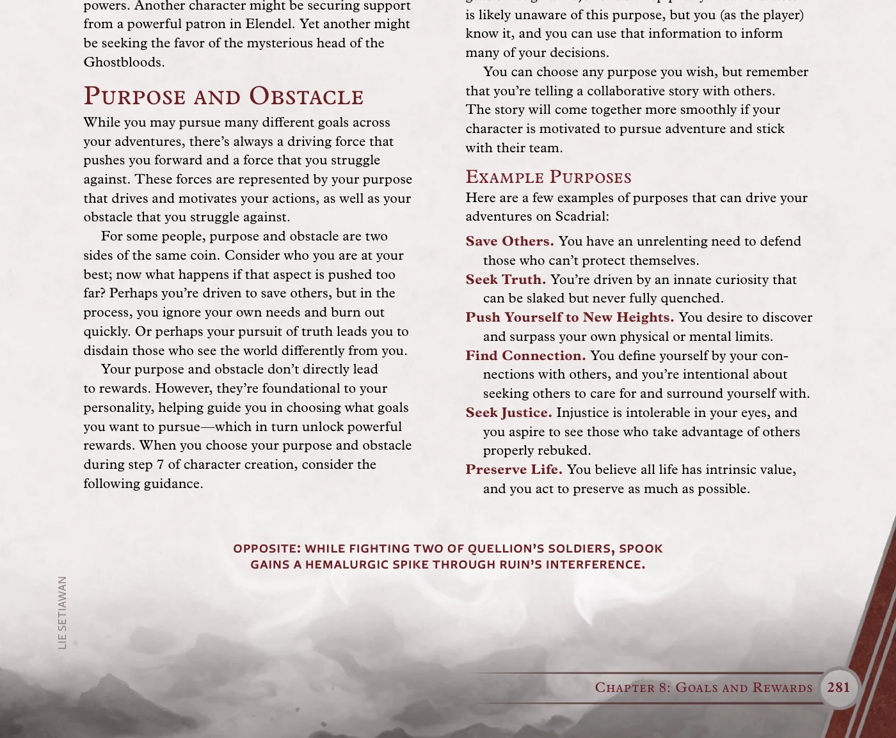
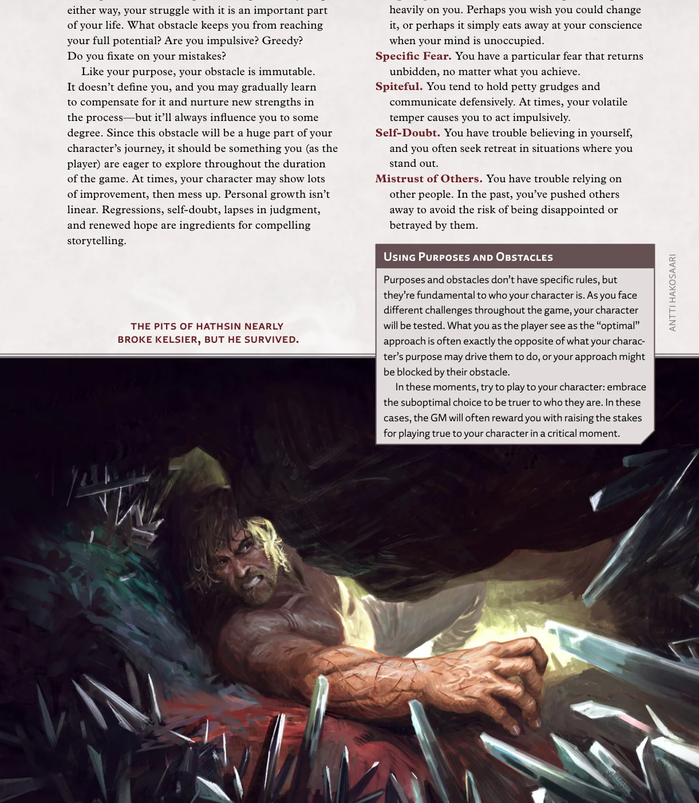

當你的角色在司卡德利亞（Scadrial）各地冒險時，成長不只來自提升等級，也來自完成個人的短期目標（goal）。提升等級請見第 1 章的「角色成長（Character Advancement）」。完成短期目標後，你會獲得獎勵（Reward），取得強大的物品、人際關係或能力。整支隊伍或許正為一個更大的目標努力，但每個短期目標及隨之而來的獎勵，都屬於你個人與你的故事。一名角色可能正努力打造藏金術（Feruchemy）使用的金屬意識庫（Metalmind），以便充分運用自己的藏金能力（Feruchemical Power）。另一名角色可能正在爭取依藍戴（Elendel）一位有權勢的贊助者（Patron）支持。還有一名角色，可能想贏得鬼血（Ghostbloods）那位神祕領袖的青睞。

### 核心目的與內在障礙

在冒險的過程中，你可能追求許多不同的短期目標，但始終會有一股力量推動你前進，也有一股力量是你必須奮力對抗的。前者是引導並激勵你行動的核心目的（purpose），後者則是你持續掙扎對抗的內在障礙（obstacle）。對某些人來說，核心目的與內在障礙是一體兩面。想想你在最佳狀態時是什麼樣子；要是這項特質走向極端，又會發生什麼事？也許你一心想拯救他人，卻因此忽略自己的需求，很快就心力耗竭。又或者，你對真相的追尋，讓你鄙視那些以不同眼光看待世界的人。核心目的與內在障礙不會直接帶來獎勵，但它們是你性格的根基，能幫助你決定想追求哪些短期目標，進而解鎖強大的獎勵。在角色建立的步驟 7 選擇核心目的與內在障礙時，請參考以下指引。

### 核心目的

核心目的是你最根本的需求。你會不由自主地依循它行動，並在行為中展現它；若你好好培養，它就可能成為你最大的力量。你這一生最想做、也最出於本能的事是什麼？拯救他人？伸張正義？做出重要的發現？選擇一個持續推動你人生的核心目的，而非具體、能夠達成的短期目標。這是角色與生俱來的一部分，除非角色經歷重大危機或頓悟，否則不會改變。你的角色很可能沒有意識到這個核心目的，但身為玩家的你知道，也能據此做出許多決定。你可以自由選擇任何核心目的，但別忘了，你正與其他人合作講述一個故事。如果你的角色有動力投入冒險，並與隊友同行，故事就會更順暢地發展。

### 核心目的範例

以下幾個核心目的的範例，可以推動你在司卡德利亞的冒險：

**救助他人（Save Others）。** 你有一股無法抑止的渴望，想保護那些無力自保的人。

**追尋真相（Seek Truth）。** 天生的好奇心驅使著你。它可以暫時得到滿足，卻永遠無法徹底平息。

**挑戰自身極限（Push Yourself to New Heights）。** 你渴望找出自己身體或心智的極限，並超越它。

**尋求連結（Find Connection）。** 你透過與他人的關係來定義自己，也會主動尋找值得關懷、值得相伴的人。

**追求正義（Seek Justice）。** 在你眼中，不公不義令人無法容忍。你期盼那些占他人便宜的人受到應有的譴責。

**守護生命（Preserve Life）。** 你相信所有生命都有其本身的價值，並盡己所能保護生命。

*對頁：鬼影（Spook）與 魁利恩（Quellion） 的兩名士兵交戰時，因滅絕（Ruin）介入而被刺入一根血金術尖刺（Hemalurgic Spike）。*

LIE SETIAWAN

第 8 章：短期目標與獎勵 281

### 內在障礙

內在障礙（obstacle）會持續妨礙你實踐核心目的（purpose）或追求短期目標（goal）。它可能是伴隨你一生的特質，也可能源自過往的經歷。無論如何，與它的掙扎都是你生命中的重要部分。是什麼內在障礙讓你無法充分發揮潛力？你是否衝動？貪婪？還是總對自己的錯誤耿耿於懷？如同核心目的，內在障礙也不會改變。它並不能定義你，而你也可能逐漸學會彌補它，並在過程中培養出新的長處，但它始終會對你造成某種程度的影響。這項內在障礙將在角色的旅程中占有很大分量，因此，請選擇一項你身為玩家願意在整場遊戲中持續探索的內在障礙。有時，角色可能進步許多，接著卻又犯了錯。個人成長並非一路向前。退步、自我懷疑、判斷失準，以及重新燃起的希望，都是讓故事引人入勝的要素。

### 內在障礙範例

以下幾個內在障礙的範例，可以在冒險過程中為你帶來挑戰：

**深切悔恨（Deep Regret）。** 你曾做過某件事，如今它沉重地壓在心上。也許你希望能改變這件事，也許它只是在你閒下心來時，不斷啃噬你的良心。

**特定恐懼（Specific Fear）。** 你有一種特定的恐懼。不論你有何成就，它都會不請自來。

**心懷怨恨（Spiteful）。** 你往往會記住一些微不足道的怨懟，與人溝通時也常帶著防備。有時，你陰晴不定的脾氣會讓你衝動行事。

**自我懷疑（Self-Doubt）。** 你很難相信自己。在讓你顯得突出的場合，你常會想退縮。

**不信任他人（Mistrust of Others）。** 你很難依賴別人。過去，為了避免失望或遭到背叛的風險，你曾將別人拒於千里之外。

### 運用核心目的與內在障礙

核心目的與內在障礙沒有具體的規則，但它們是角色本質的一部分。在遊戲中面對各種挑戰時，你的角色會受到考驗。身為玩家，你所認為的「最佳」做法，往往恰好與角色的核心目的所驅使他採取的行動相反；也可能是角色的內在障礙阻擋了你的做法。在這些時刻，試著忠於角色來扮演：接受並非最佳的選擇，更真實地展現角色的本性。當你在關鍵時刻忠於角色時，GM 往往會以提高賭注（Raise the Stakes）來獎勵你。

*海司辛深坑（Pits of Hathsin）幾乎摧毀了卡西爾（Kelsier），但他活了下來。*

ANTTI HAKOSAARI

