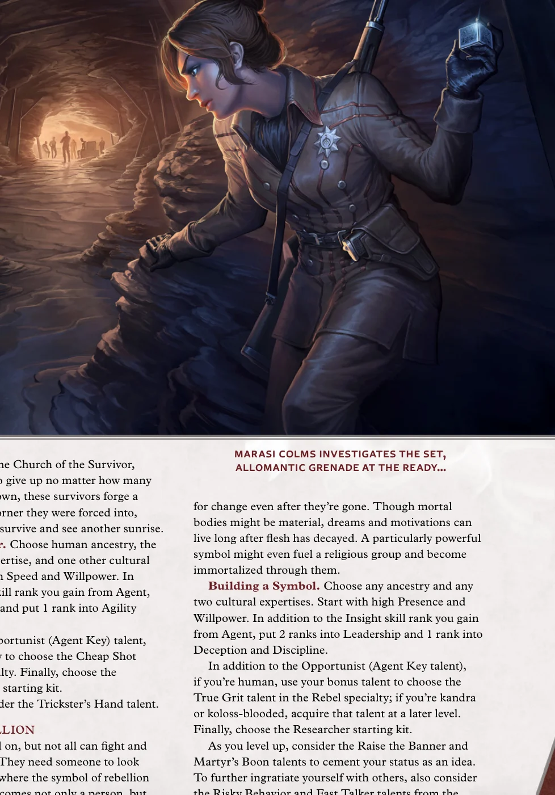
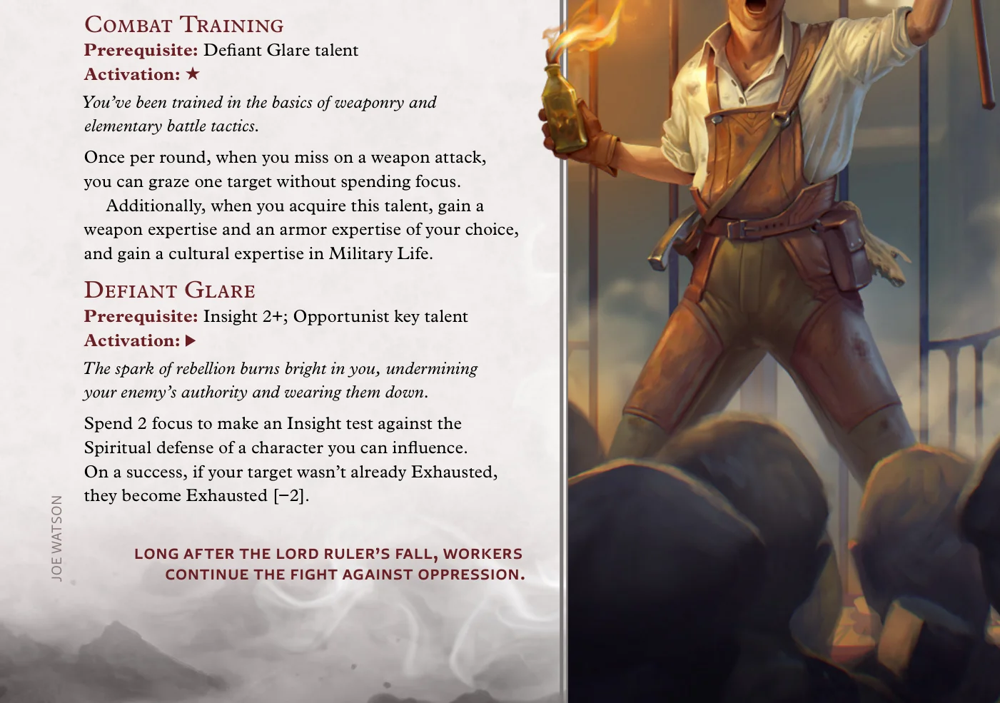
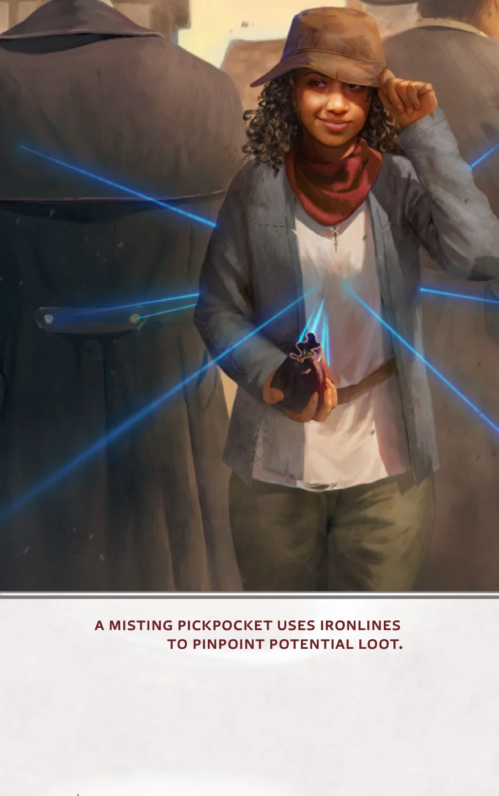
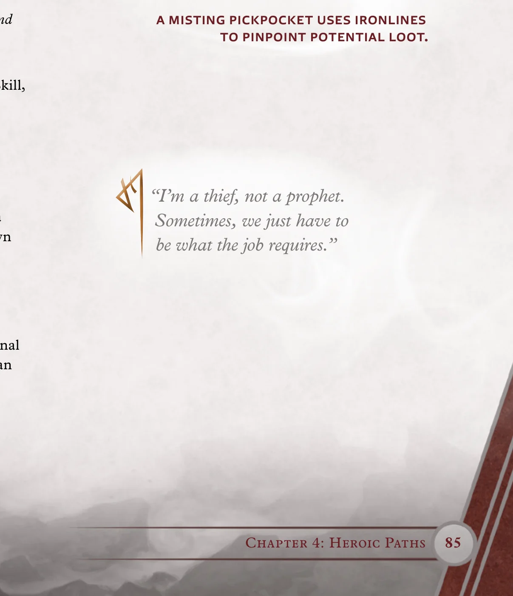

## 密探（Agent）

英雄路徑（Heroic Path）

密探精於欺瞞與破壞，將命運的絲線握在掌中，等待最佳時機出手，拆散他人精心安排的計畫。無論是獨立行事、為神祇效力，還是受僱於私人組織，各方密探都在暗影掩護下，為自己的秘密奮戰，甚至送命。正規教育對密探並不重要。他們大多觀察入微，不是自學成才，就是在團隊行動中磨練本領。外界訂下的規章，只是可以規避甚至徹底無視的玩物；密探只遵循自己的行事準則。面對不可能的任務，他們以狡黠微笑和敏銳機智迎戰，只為再次與死亡擦身而過的刺激而活。

### 密探專精

密探路徑的天賦（Talent）分為三項專精（Specialty）：

- **調查員（Investigator）。** 預感往往不可靠，但調查員會培養值得信賴的直覺，學會傾聽、合作，並追問別人沒想到的問題、尋找答案。（建議用於第二時代。）

- **反抗者（Rebel）。** 掌權者行事不公，受壓迫者終將起身反抗。反抗者承載人民的不滿，為改革而戰，支撐眾人的希望。太多時候，暴力是權貴唯一聽得懂的語言，因此反抗者也熟諳此道。他們有時高聲吶喊，有時低聲細語，但始終對抗壓迫。（建議用於第一時代。）

- **竊賊（Thief）。** 敏捷的頭腦固然是無價之寶，竊賊也會鍛鍊身體，讓身手跟得上思緒。無論出於生存需要或野心，他們都願意賭上一切，突破橫在自己與戰利品之間、看似無法克服的難關。（建議用於第一時代。）

### 建立密探角色

下方〈司卡德利亞的密探〉提供幾種代表性角色的配置範例。如果你另有構想，可以參考以下建議，建立能發揮所長的密探：

- **屬性（Attribute）。** 通常可以優先提高察覺（Awareness）、智力（Intellect）與速度（Speed）。

- **技能（Skill）。** 敏捷（Agility）、欺騙（Deception）、推理（Deduction）、洞察（Insight）、輕型武器（Light Weaponry）與竊術（Thievery）都很實用。

- **其他英雄路徑。** 獵手（Hunter）與學者（Scholar）都是發展多路徑時的絕佳選擇。

- **獎勵（Reward）。** 選擇獎勵時，保鑣夥伴（Companion），以及來自地下世界或上流社會（High Society）的贊助者（Patron），都是穩妥的選擇。

### 司卡德利亞的密探

如果你想從《迷霧之子》（Mistborn）小說汲取靈感，可以考慮以下幾種代表性密探角色的配置。

#### 鬼血新進者（Ghostblood Initiate）[第二時代]

鬼血（Ghostbloods）的新成員憑藉自身行動與成就獲得招募，成為組織在各地的第一線人手。他們能接觸大量祕密知識，代價則是承擔這個龐大組織的許多日常工作。他們留意地方傳聞，回報可能另有隱情的奇聞異事；他們與當地人打好關係，隨時尋找可能派上用場的人脈（Connections）；他們也傳遞情報、運送補給，並協助行政事務。新進者期待有朝一日晉升鬼血高層。在那之前，他們已準備好不惜一切，投身保護司卡德利亞（Scadrial）的戰鬥。

**建立鬼血新進者。** 選擇任意血統（Ancestry）、旅行者（Wayfarer）專長（Expertise），以及另一項文化專長（Cultural Expertise）。將起始察覺與智力設為較高數值。除了密探提供的 1 個洞察技能等級（Skill Rank），再將推理、洞察、說服（Persuasion）與隱匿（Stealth）各提升 1 個技能等級。除了伺機者（Opportunist）這項密探關鍵天賦（Key Talent），如果你是人類（Human），就用額外天賦（Bonus Talent）選擇調查員專精的引人開口（Get ’Em Talking）；如果你是坎得拉（Kandra）或克羅司混血（Koloss-Blooded），則在之後升級時取得這項天賦。最後，選擇地下社會（Underworld）起始套組（Starting Kit）。隨著等級提升，可以考慮蒐集證據（Gather Evidence）與結案（Close the Case）。你也可以考慮竊賊專精的地下社會人脈（Underworld Contacts），代表你能運用鬼血的情報資源網絡。

#### 街頭倖存者（Survivor of the Streets）

無論社會多麼進步，讓多數人受益的體制，仍會遺棄某些人。安逸很少落到他們手中，因此他們只能堅持下去，依靠自己的機靈、人脈，以及一點運氣。

第 4 章：英雄路徑 78

無論受到倖存者教會（Church of the Survivor）的影響，還是單純倔強到不論被擊倒多少次都不肯放棄，這些倖存者都會從被逼入的角落闢出前路。他們竭盡所能求生，只為再見一次日出。

**建立倖存者。** 選擇人類血統、地下社會文化專長，以及另一項文化專長。將起始速度與意志（Willpower）設為較高數值。除了密探提供的 1 個洞察技能等級，將竊術提升 2 個技能等級，敏捷與求生（Survival）各提升 1 個技能等級。除了伺機者這項密探關鍵天賦，利用人類血統選擇竊賊專精的陰招（Cheap Shot）。最後，選擇地下社會或逃亡者（Runaway）起始套組。隨著等級提升，可以考慮騙徒巧手（Trickster’s Hand）。

#### 反抗象徵（Symbol of Rebellion）

許多人受盡欺壓，卻不是每個人都有能力獨自挺身反抗。他們需要能夠仰望、帶領他們的人。反抗象徵便在這樣的處境中崛起：這個人物不再只是一個人，更成為一種信念。他們推動改變，即使自己已不在人世，仍能激勵他人前進。凡人的身軀或許有形有質，但夢想與動機能在血肉腐朽後長存。影響深遠的象徵，甚至能支撐一個宗教團體，並透過信眾流傳不朽。

**建立反抗象徵。** 選擇任意血統，以及任意兩項文化專長。將起始風采（Presence）與意志設為較高數值。除了密探提供的 1 個洞察技能等級，將領導（Leadership）提升 2 個技能等級，欺騙與紀律（Discipline）各提升 1 個技能等級。除了伺機者這項密探關鍵天賦，如果你是人類，就用額外天賦選擇反抗者專精的堅毅（True Grit）；如果你是坎得拉或克羅司混血，則在之後升級時取得這項天賦。最後，選擇研究者（Researcher）起始套組。隨著等級提升，可以考慮高舉旗幟（Raise the Banner）與殉道者恩惠（Martyr’s Boon），鞏固自己作為信念象徵的地位。如果想進一步與他人打好關係，也可以考慮竊賊專精的冒險行事（Risky Behavior）與快嘴（Fast Talker）。

*瑪拉席．科姆斯（Marasi Colms）調查「組織」（The Set），手中已備妥鎔金手榴彈（Allomantic Grenade）……*

第 4 章：英雄路徑 79

AMIRUL HHF

#### 伺機者（密探關鍵天賦）

啟動（Activation）：[特殊啟動]

前提條件（Prerequisite）：無

每回合（Round）一次，當你擲劇情骰（Plot Die）時，可以重擲該次結果。原結果不生效，你必須採用新結果。

### 調查員天賦樹（Talent Tree）

#### 警覺目光（Watchful Eye）

啟動：[反應]

前提條件：推理 1+

解鎖來源：伺機者（密探關鍵天賦）

對 20 呎內一名自願盟友（Ally）的劇情骰使用伺機者。

#### 引人開口

啟動：[2行動]

前提條件：洞察 2+

解鎖來源：伺機者（密探關鍵天賦）

花費 1 點專注點（Focus），對靈性防禦（Spiritual Defense）進行推理檢定（Test），得知目標（Target）的動機。在本場景（Scene）中，你可以在利用此動機進行檢定時提高賭注（Raise the Stakes）。

#### 快速分析（Quick Analysis）

啟動：[自由行動]

解鎖來源：警覺目光

花費 2 點專注點，取得[2行動]，僅能透過使用技能（Use a Skill）、獲取優勢（Gain Advantage）或密探天賦，進行意識（Cognitive）檢定。

#### 懾人（Baleful）

啟動：[常駐]

解鎖來源：引人開口

角色（Character）若要抵抗你的影響（Influence），必須額外花費等同你階層（Tier）的專注點。

#### 蒐集證據

啟動：[常駐]

前提條件：洞察 2+

解鎖來源：快速分析

取得法律條文（Legal Codes）專長。對目標的意識檢定成功時，你獲得集中（Focused）狀態。

#### 強健（Hardy）

啟動：[常駐]

解鎖來源：懾人

每個等級（Level）的生命值（Health）上限 +1，包含先前已取得的等級。

#### 偵探直覺（Sleuth’s Instincts）

啟動：[常駐]

前提條件：推理 3+

解鎖來源：強健

對已知動機的角色進行意識檢定時，獲得一個優勢（Advantage）。你知道這些角色何時對你說謊。

#### 結案

啟動：[3行動]

前提條件：推理 3+

解鎖來源：強健

花費 3 點專注點，對認知防禦（Cognitive Defense）進行推理檢定。如果知道目標的動機，就獲得一個優勢。失敗時，目標對你獲得一個優勢；成功時，目標退讓。

#### 圖示說明

| 圖示 | 意義 |
| --- | --- |
| [1行動] | 1 行動 |
| [2行動] | 2 行動 |
| [3行動] | 3 行動 |
| [自由行動] | 自由行動（Free Action） |
| [反應] | 反應（Reaction） |
| [特殊啟動] | 特殊啟動（Special Activation） |
| [常駐] | 常駐（Always Active） |

第 4 章：英雄路徑 80

密探

英雄路徑

### 反抗者天賦樹

#### 堅毅

啟動：[常駐]

前提條件：領導 1+

解鎖來源：伺機者（密探關鍵天賦）

你或盟友獲得[變故]後，你恢復 1 點專注點。

#### 不屈怒視（Defiant Glare）

啟動：[1行動]

前提條件：洞察 2+

解鎖來源：伺機者（密探關鍵天賦）

花費 2 點專注點，對靈性防禦進行洞察檢定，使目標精疲力竭（Exhausted）[−2]。

#### 高舉旗幟

啟動：[常駐]

前提條件：領導 2+

解鎖來源：堅毅

援助（Aid）盟友時，該盟友恢復 1 點專注點。

#### 戰鬥訓練（Combat Training）

啟動：[特殊啟動]

解鎖來源：不屈怒視

取得一項武器（Weapon）專長、一項護甲（Armor）專長，以及軍旅生活（Military Life）專長。每回合一次，可以不花費專注點造成擦傷（Graze）。

#### 善用異議（Leverage Dissent）

啟動：[常駐]

解鎖來源：高舉旗幟

取得公開演說（Public Speaking）專長。劇情骰擲出[變故]時，將你的領導技能等級加到獲得的加值上。

#### 毫不留情（Merciless）

啟動：[常駐]

解鎖來源：戰鬥訓練

對精疲力竭、定身（Immobilized）或束縛（Restrained）的目標進行攻擊（Attack）時，獲得一個優勢。

#### 小道消息（Through the Grapevine）

啟動：[特殊啟動]

前提條件：洞察 3+

解鎖來源：善用異議

長休息（Long Rest）後，進行洞察檢定，得知兩項資訊。成功時，兩項都是真實資訊；失敗時，一真一假。

#### 殉道者恩惠

啟動：[特殊啟動]

前提條件：領導 3+

解鎖來源：善用異議

遭到命中（Hit）後，選擇數量不超過你領導技能等級的盟友。他們取得[反應]，只能用於恢復（Recover）行動。

### 竊賊天賦樹

#### 冒險行事

啟動：[特殊啟動]

前提條件：洞察 2+

解鎖來源：伺機者（密探關鍵天賦）

花費 1 點專注點，為你的檢定提高賭注。

#### 陰招

啟動：[1行動]

解鎖來源：伺機者（密探關鍵天賦）

花費 1 點專注點，使用竊術對認知防禦進行徒手攻擊（Unarmed Attack），並提高賭注。命中時，目標震懾（Stunned）。

#### 加倍下注（Double Down）

啟動：[特殊啟動]

解鎖來源：冒險行事

使用伺機者時，可以再重擲一次；但若擲出[變故]，你失去 2 點專注點。

#### 步履穩健（Surefooted）

啟動：[常駐]

解鎖來源：陰招

你的移動速率（Movement Rate）增加 10。墜落（Falling）與危險地形（Dangerous Terrain）造成的傷害（Damage），減少等同你階層兩倍的數值。

#### 地下社會人脈

啟動：[特殊啟動]

前提條件：有來自犯罪地下世界的贊助者或夥伴

解鎖來源：加倍下注

取得犯罪組織（Criminal Groups）專長。花費 2 點專注點，在對罪犯的社交檢定中加入[機遇]。

#### 暗影步（Shadow Step）

啟動：[自由行動]

前提條件：竊術 3+

解鎖來源：步履穩健

脫離（Disengage）後，花費 2 點專注點，對每名敵人的認知防禦進行竊術檢定，嘗試躲藏。若你位於掩護（Cover）或遮蔽中，就獲得一個優勢。

#### 快嘴

啟動：[自由行動]

前提條件：洞察 3+

解鎖來源：加倍下注

花費 2 點專注點，取得[2行動]，僅能透過使用技能、獲取優勢或密探天賦，進行靈魂（Spiritual）檢定。

#### 騙徒巧手

啟動：[自由行動]

前提條件：竊術 3+

解鎖來源：步履穩健

花費 2 點專注點，取得[2行動]，僅能透過使用技能、獲取優勢或密探天賦，進行實體（Physical）檢定。

DEANDRA SCICLUNA & GAL OR

### 密探關鍵天賦

密探的關鍵天賦伺機者，能解鎖密探的各項專精。起始技能（Starting Skill）：洞察。如果你選擇密探作為起始路徑（Starting Path），就免費取得 1 個洞察技能等級。

#### 伺機者（密探關鍵天賦）

前提條件：無

啟動：[特殊啟動]

你本能地察覺關鍵時刻。當局勢在災難與榮耀之間搖擺，你能逼自己一把，也推動運氣，讓結果朝有利的方向傾斜。

每回合一次，當你擲劇情骰時，可以重擲該次結果。原結果不生效，你必須採用新結果。

### 調查員專精

以下天賦屬於密探天賦樹的調查員專精，依英文名稱的字母順序排列。

#### 懾人

前提條件：引人開口天賦

啟動：[常駐]

你以嚴厲目光瓦解對手的決心，只有最沉著的人才能不為所動。

角色若要抵抗你的影響，必須額外花費等同你階層的專注點。

#### 結案

前提條件：推理 3+；強健天賦

啟動：[3行動]

你已蒐集目標的動機與處境資訊。現在，只要針對對方的欲望、弱點或罪惡感施壓，就能說服對方退讓。

每場景一次，花費 3 點專注點，對一名你能影響的角色之認知防禦進行推理檢定。如果知道目標目前的動機，這次檢定獲得一個優勢；若不知道，則承受一個劣勢（Disadvantage）。失敗時，目標對你進行的所有檢定都獲得一個優勢，直到其下一個輪次（Turn）結束。成功時，你影響目標，使其退讓。對方不再反對你在本場景中的眼前目的，甚至可能離開場景。目標可以抵抗這項影響，但抵抗後，直到其下一個輪次結束，所有檢定都承受一個劣勢。

#### 蒐集證據

前提條件：洞察 2+；快速分析天賦

啟動：[常駐]

觀察環境中的線索，你逐步在腦中建構眼前謎團的全貌。

對另一名角色的意識檢定成功後，你獲得集中狀態，直到你的下一個輪次結束。此外，取得這項天賦時，獲得法律條文實用專長（Utility Expertise）。

#### 引人開口

前提條件：洞察 2+；伺機者關鍵天賦

啟動：[2行動]

你用引導性的問題或尖銳言詞，促使別人暴露自己的動機。

花費 1 點專注點，對一名你能影響的角色之靈性防禦進行推理檢定。成功時，你得知目標參與本場景的動機。直到場景結束，當你利用此動機對目標進行檢定時，可以提高賭注。

#### 強健

前提條件：懾人天賦

啟動：[常駐]

你鍛鍊身體，忍受疼痛與疲勞，堅持奮戰到最後一刻。

取得這項天賦時，你每有一個等級，生命值上限與目前生命值就各增加 1。這適用於先前與未來取得的所有等級。例如，你在等級 6 選擇此天賦時，須追溯將生命值增加 6。

#### 快速分析

前提條件：警覺目光天賦

啟動：[自由行動]

你的頭腦迅速歸檔、整理資訊，讓你即使承受壓力，仍能根據資訊立即行動。

花費 2 點專注點，取得[2行動]。這些行動僅能透過以下方式進行意識檢定：使用技能、獲取優勢，或任何密探天賦提供的行動。在對話（Conversation）或試煉（Endeavor）中，經 GM 判定，你可以改為使用全部[2行動]，在該回合額外作出一次貢獻（Contribution）。

第 4 章：英雄路徑 82

#### 偵探直覺

前提條件：推理 3+；強健天賦

啟動：[常駐]

破解謎團時，你知道「為什麼」可能與「是誰」或「怎麼做」同樣重要。一旦了解動機，其他細節就容易歸位。

對一名你知道其動機的角色進行意識檢定時，獲得一個優勢。你可能透過引人開口得知這項動機，也可能透過調查對方等其他活動得知。此外，一名你知道其動機的角色對你說謊後，你會自動知道對方在欺瞞你，但不會因此得知謊言的細節。

#### 警覺目光

前提條件：推理 1+；伺機者關鍵天賦

啟動：[反應]

盟友既可能是助力，也可能帶來麻煩，因此你會留意他們，既保護他們，也保護自己。

當你 20 呎內一名自願、且你能影響的盟友擲劇情骰時，可以使用此反應，對該劇情骰使用伺機者，如同它是你自己的骰子。

### 反抗者專精

以下天賦屬於密探天賦樹的反抗者專精，依英文名稱的字母順序排列。

#### 戰鬥訓練

前提條件：不屈怒視天賦

啟動：[特殊啟動]

你已接受基本武器操作與基礎戰術訓練。

每回合一次，當你的武器攻擊（Weapon Attack）未命中（Miss）時，可以對一個目標造成擦傷，而不花費專注點。此外，取得這項天賦時，獲得自選的一項武器專長（Weapon Expertise）與一項護甲專長（Armor Expertise），並獲得軍旅生活文化專長。

#### 不屈怒視

前提條件：洞察 2+；伺機者關鍵天賦

啟動：[1行動]

你心中反抗的火花熊熊燃燒，動搖敵人的威勢，消磨對方的力量。

花費 2 點專注點，對一名你能影響的角色之靈性防禦進行洞察檢定。成功時，如果目標原本並未精疲力竭，就使其精疲力竭[−2]。

#### 善用異議

前提條件：高舉旗幟天賦

啟動：[常駐]

你的聲音穿透人群的喧鬧，說服他人挺身行動。

劇情骰擲出變故（Complication）時，將你的領導技能等級加到獲得的加值上。此外，取得這項天賦時，獲得公開演說實用專長。

*統御主（Lord Ruler）倒台多年後，工人仍持續對抗壓迫。*

JOE WATSON

#### 殉道者恩惠

前提條件：領導 3+；善用異議天賦

啟動：[特殊啟動]

敵人傷害你時，你鼓舞人心的存在激起他人的憤慨。他們熱血沸騰，重拾繼續為正義奮戰的目標。

每場景一次，一名敵人的攻擊命中你之後，選擇數量不超過你領導技能等級、且你能影響的盟友。這些盟友取得[反應]，只能用來獲得恢復行動的好處。

#### 毫不留情

前提條件：戰鬥訓練天賦

啟動：[常駐]

該讓你的威脅成真了。敵人從不在乎公平決鬥，這次就照他們的規矩來。

對精疲力竭、定身或束縛的目標進行攻擊檢定時，獲得一個優勢。

#### 高舉旗幟

前提條件：領導 2+；堅毅天賦

啟動：[常駐]

你與夥伴為重要的理念團結，在他們有需要時巧妙支援，激勵共同反抗的同伴。

對盟友使用援助反應時，該盟友恢復 1 點專注點。

#### 小道消息

前提條件：洞察 3+；善用異議天賦

啟動：[特殊啟動]

憑藉上下各階層的人脈，你蒐集情報與支援，為理念帶來可能無比珍貴的助力。

長休息後，你可以進行洞察檢定，蒐集自選人物或團體的資訊。GM 根據這個對象有多隱祕、難以查知，設定 DC。成功時，GM 提供兩項真實資訊；失敗時，GM 提供兩項資訊，一真一假，但不告訴你哪項為真、哪項為假。

#### 堅毅

前提條件：領導 1+；伺機者關鍵天賦

啟動：[常駐]

你在混亂中如魚得水。別人因突發問題手忙腳亂時，你卻重拾專注，繼續前進。

你或你 20 呎內的盟友獲得變故後，你恢復 1 點專注點。

### 竊賊專精

以下天賦屬於密探天賦樹的竊賊專精，依英文名稱的字母順序排列。

#### 陰招

前提條件：伺機者關鍵天賦

啟動：[1行動]

你知道該擊中哪裡，才能讓敵人疼得頭昏眼花。有些人或許認為這不光彩，但確實有效。

空出一隻手時，花費 1 點專注點，使用竊術對一名體型（Size）與你相同或更小的敵人之認知防禦進行徒手攻擊，並在此時提高賭注。命中時，目標還會獲得震懾狀態，直到其下一個輪次結束。命中或擦傷時，你也可以花費一個機遇（Opportunity），偷走目標身上一件未被拿在手上或持用的物品，例如鎔金術師（Allomancer）的一瓶金屬液。能偷取的具體物品，由 GM 判定。

#### 加倍下注

前提條件：冒險行事天賦

啟動：[特殊啟動]

決定冒險時，你就全心投入，追求最大的回報。

使用伺機者後，你可以額外重擲該骰一次。你必須採用這個最終結果；如果其中含有[變故]，就失去 2 點專注點。

#### 快嘴

前提條件：洞察 3+；加倍下注天賦

啟動：[自由行動]

伶牙俐齒讓你脫困，也同樣常讓你惹上麻煩，但你從不放過插話的機會。

花費 2 點專注點，取得[2行動]。這些行動僅能透過以下方式進行靈魂檢定：使用技能、獲取優勢，或任何密探天賦提供的行動。在對話或試煉中，經 GM 判定，你可以改為使用全部[2行動]，在該回合額外作出一次貢獻。

#### 冒險行事

前提條件：洞察 2+；伺機者關鍵天賦

啟動：[特殊啟動]

你知道風險與回報是形影不離的旅伴，也樂於跟著它們看看會走到哪裡。

進行檢定之前，你可以花費 1 點專注點，提高賭注。

第 4 章：英雄路徑 84

#### 暗影步

前提條件：竊術 3+；步履穩健天賦

啟動：[自由行動]

你熟知騙術高手（Con Artist）逃避後果的各種手法，也能輕易溜出他人視線。

脫離後，你可以花費 2 點專注點進行竊術檢定，將結果分別與每名能感知你的敵人之認知防禦比較。如果你位於掩護中，或目標的主要感官（Primary Sense）在你所在區域受到遮蔽，例如黑暗，你在此檢定獲得一個優勢。對某名敵人成功時，你便對該敵人隱藏，如同以隱匿檢定成功躲藏。

#### 步履穩健

前提條件：陰招天賦

啟動：[常駐]

你自信而迅速地穿越險惡地形。

取得這項天賦時，移動速率增加 10。此外，在受到危險地形或墜落傷害之前，將該次傷害減少等同 2 × 你的階層的數值。

#### 騙徒巧手

前提條件：竊術 3+；步履穩健天賦

啟動：[自由行動]

你施展狡詐手法時既細膩又靈巧，讓目標難以看清。

花費 2 點專注點，取得[2行動]。這些行動僅能透過以下方式進行實體檢定：使用技能、獲取優勢，或任何密探天賦提供的行動。在對話或試煉中，經 GM 判定，你可以改為使用全部[2行動]，在該回合額外作出一次貢獻。

#### 地下社會人脈

前提條件：有身為犯罪地下世界成員的贊助者或夥伴；加倍下注天賦

啟動：[特殊啟動]

與聲名狼藉的人往來時，你的贊助者或夥伴之名特別有分量。

對犯罪人士或團體進行社交互動檢定之前，你可以花費 2 點專注點，在結果中加入一個機遇。此外，取得這項天賦時，獲得犯罪組織實用專長。

*一名迷霧人（Misting）扒手利用鐵線（ironlines），鎖定可能下手的財物。*

> 「我是竊賊，不是先知。有時候，工作需要我們成為什麼樣的人，我們就得成為那樣的人。」

第 4 章：英雄路徑 85

ALEKSANDRA WOJTAS

