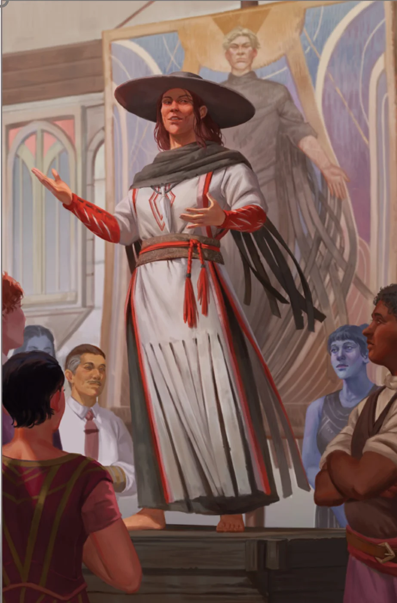

## 使者（Envoy）

英雄路徑（Heroic Path）

當希望脆弱、前景黯淡時，司卡德利亞（Scadrial）各地的使者會帶來慰藉，鼓勵眾人繼續向前。他們深知，心智與情感的力量幾乎能克服一切。他們以熱切的言語引導，而非發號施令，幫助他人面對內心的掙扎，發揮全部潛能。

每位使者的道德準則，都會影響自己與世界互動的方式。這些準則可能來自既有信仰，也可能是自己建立的一套非傳統倫理。除了選擇相信什麼，更重要的是，使者必須謹慎選擇相信誰。他們的引導如同熔爐，能將平凡之人塑造成歷史上長久被記得的人物。

### 使者專精

使者路徑的天賦（Talent）分為三項專精（Specialty）：

**信仰者（Faithful）。** 信仰者向神祇尋求意義與方向。他們知道，前進的道路未必平坦，卻仍必須走下去。他們在平凡之處發現奇蹟，並緊緊追隨神祇的典範。

**騙徒（Grifter）。** 騙徒不受一般道德準則約束，深知最好的謊言總有幾分真實。信任騙徒通常是錯誤的決定，但他們對他人的信任卻既稀少，又珍貴。

**導師（Mentor）。** 導師時時留心觀察，努力了解學生的各個面向，再引導他們調整、成長，成就非凡。

### 建立使者角色

接下來的〈司卡德利亞的使者〉提供幾種代表性角色的配置範例。如果你有其他構想，可以參考以下建議，打造能充分發揮的使者：

**屬性（Attribute）。** 通常可以優先考慮風采（Presence）與意志（Willpower）。

**技能（Skill）。** 紀律（Discipline）對大多數使者都很重要。其他實用技能包括欺騙（Deception）、領導（Leadership）、學識（Lore）與說服（Persuasion）。

**其他英雄路徑。** 密探（Agent）、領袖（Leader）與學者（Scholar）都很適合搭配，作為多路徑選擇。

**獎勵（Reward）。** 選擇獎勵時，有影響力的贊助者（Patron）總是不錯的選擇。

### 司卡德利亞的使者

如果你想從《迷霧之子》（Mistborn）小說汲取靈感，可以參考以下幾種代表性的使者角色配置。

#### 騙術高手（Con Artist）

與一般人的想像不同，許多騙術高手夢想著更好的世界。他們看待社會規律與規則的方式不同，有時甚至解讀得過於有創意；伸張正義的方式，也比多數義警更加隨性。對他們來說，欺瞞就像精心調校的樂器，運用起來得心應手。每個計謀都是為了讓人學到迫切需要的教訓、拉平雙方的差距，或糾正嚴重的不公。過程中要是還能打扮得俐落有型，那只是額外的好處。

**建立騙術高手角色。** 選擇任意血統（Ancestry），以及地下社會（Underworld）與上流社會（High Society）這兩項文化專長（Cultural Expertise）。起始時，以較高的察覺（Awareness）與風采為優先。除了使者提供的紀律技能等級（Skill Rank）之外，將 2 個技能等級投入欺騙，並各將 1 個投入洞察（Insight）與說服。

除了振奮人心（Rousing Presence）這項使者關鍵天賦（Key Talent）之外，如果你是人類（Human），就用額外天賦（Bonus Talent）選擇騙徒專精的虛假奉承（False Flattery）；如果你是坎得拉（Kandra）或克羅司混血（Koloss-Blooded），就在之後的等級取得這項天賦。最後，選擇地下社會起始套組（Starting Kit）。

隨著等級（Level）提升，可以考慮合理藉口（Plausible Excuse）、荒唐俏皮話（Outrageous Quip）與狠狠挖苦！（Got ’Em Good!）等天賦。

#### 倖存者教祭司（Priest of the Survivor）

倖存者教祭司效法海司辛倖存者（Survivor of Hathsin），行事精於盤算、意志堅決。他們通常以務實的方式處理問題，也不怕違逆常規。他們經常反省自身，堅信最重要的是相信自己，並從過去的英雄身上尋找靈感、韌性與毅力，以面對接踵而來的挑戰。

**建立倖存者教祭司角色。** 選擇人類血統，依你所處的時代，選擇中央統御區（Central Dominance）或依藍戴（Elendel）文化專長，再選擇另一項文化專長。起始時，以較高的察覺與智力（Intellect）為優先。除了使者提供的紀律技能等級之外，將 2 個技能等級投入求生（Survival），並各將 1 個投入威嚇（Intimidation）與學識。

除了使者關鍵天賦振奮人心之外，用人類血統提供的天賦選擇信仰者專精的激勵（Galvanize）。最後，選擇研究者（Researcher）起始套組。

隨著等級提升，可以考慮善用激勵（Applied Motivation）、沉穩（Composed）與慣常衣著（Customary Garb）等天賦。

第 4 章：英雄路徑 86

#### 泰瑞司侍從官（Terris Steward）[第一時代]

泰瑞司侍從官兼任僕役與顧問，通常剃光頭，穿著色彩鮮豔、裝飾華麗，帶有 V 形圖樣的長袍。許多侍從官的身世充滿失落，卻又被要求終生奉獻，為主人提供服務、陪伴與同理。他們的身分迫使自己表現順從，但每位泰瑞司侍從官都有自己的觀點、傳統與希望。他們有策略地向侍奉的對象進言，藉此在迫切需要改變的世界中發揮影響力。

**建立泰瑞司侍從官角色。** 選擇人類血統，以及泰瑞司統御區（Terris Dominance）與上流社會這兩項文化專長。起始時，以較高的智力與風采為優先。除了使者提供的紀律技能等級之外，將 2 個技能等級投入領導，並各將 1 個投入學識與說服。

除了使者關鍵天賦振奮人心之外，用人類血統提供的天賦選擇導師專精的中肯建言（Sound Advice）。最後，選擇貴族（Noble）起始套組。

隨著等級提升，可以考慮耐心指導（Lessons in Patience）、強勁（Mighty）與先見之明（Foresight）等天賦。

### 使者關鍵天賦

使者的關鍵天賦振奮人心，能解鎖使者專精。

起始技能（Starting Skill）：紀律。如果你選擇使者作為起始路徑（Starting Path），就免費取得 1 個紀律技能等級。

#### 振奮人心（使者關鍵）

前提條件（Prerequisite）：無

啟動（Activation）：[1行動]

你以一個手勢、一個表情，或寥寥幾句話，激勵他人發揮所長。

選擇一名你能影響（Influence）的盟友（Ally）。對方獲得堅定（Determined），直到從這項狀態（Condition）受益，或場景（Scene）結束為止。

即使身處毀滅的年代，沙賽德（Sazed）仍幫助司卡（Skaa）找到希望。

第 4 章：英雄路徑 87

BEAR FRYMIRE

#### 振奮人心（使者關鍵）

啟動：[1行動]

前提條件：無

選擇一名你能影響的盟友。對方獲得堅定，直到從這項狀態受益，或場景結束為止。

### 信仰者天賦樹

| 天賦 | 解鎖來源 | 啟動及額外前提 |
| --- | --- | --- |
| [慣常衣著](#慣常衣著) | [振奮人心](#振奮人心使者關鍵) | 常駐 |
| [激勵](#激勵) | [振奮人心](#振奮人心使者關鍵) | 2 行動 |
| [熱忱感召](#熱忱感召devoted-presence) | [慣常衣著](#慣常衣著) | 特殊啟動；學識 1+ |
| [沉穩](#沉穩) | [激勵](#激勵) | 常駐 |
| [堅定感召](#堅定感召stalwart-presence) | [熱忱感召](#熱忱感召devoted-presence) | 特殊啟動；紀律 2+ |
| [善用激勵](#善用激勵) | [激勵](#激勵) | 常駐；紀律 2+ |
| [明智忠告](#明智忠告sage-counsel) | [堅定感召](#堅定感召stalwart-presence) | 特殊啟動；學識 3+ |
| [鼓舞熱忱](#鼓舞熱忱inspired-zeal) | [善用激勵](#善用激勵) 或 [堅定感召](#堅定感召stalwart-presence) | 特殊啟動；紀律 3+ |

#### 慣常衣著

啟動：[常駐]

解鎖來源：振奮人心（使者關鍵）

穿著具有得體（Presentable）特性的護甲（Armor），或合宜的衣服時，你的實體防禦（Physical Defense）與靈魂防禦（Spiritual Defense）提高 2。

#### 激勵

啟動：[2行動]

解鎖來源：振奮人心（使者關鍵）

一名盟友擲恢復骰（Recovery Die），並恢復等同結果的專注點（Focus）。

#### 熱忱感召（Devoted Presence）

啟動：[特殊啟動]

前提條件：學識 1+

解鎖來源：慣常衣著

使用振奮人心時，花費 1 點專注點，移除目標的倒地（Prone）、減速（Slowed）、震懾（Stunned）與措手不及（Surprised）。

#### 沉穩

啟動：[常駐]

解鎖來源：激勵

你的專注點上限與目前專注點，各提高等同你階層（Tier）的數值。

#### 堅定感召（Stalwart Presence）

啟動：[特殊啟動]

前提條件：紀律 2+

解鎖來源：熱忱感召

使用振奮人心時，花費 1 點專注點，讓目標的一項防禦（Defense）提高 2。

#### 善用激勵

啟動：[常駐]

前提條件：紀律 2+

解鎖來源：激勵

你使角色恢復專注點時，該角色額外恢復等同你學識技能等級一半的專注點。

#### 明智忠告（Sage Counsel）

啟動：[特殊啟動]

前提條件：學識 3+

解鎖來源：堅定感召

你援助（Aid）一名角色時，花費 1 點專注點，讓對方獲得振奮人心。

#### 鼓舞熱忱（Inspired Zeal）

啟動：[特殊啟動]

前提條件：紀律 3+

解鎖來源：善用激勵或堅定感召

盟友使用堅定時，選擇其他盟友，讓他們各恢復 1 點專注點，人數最多等同你的紀律技能等級。

第 4 章：英雄路徑 88

## 使者

英雄路徑

### 騙徒天賦樹

| 天賦 | 解鎖來源 | 啟動及額外前提 |
| --- | --- | --- |
| [虛假奉承](#虛假奉承) | [振奮人心](#振奮人心使者關鍵) | 常駐 |
| [這次我來擋](#這次我來擋this-ones-on-me) | [振奮人心](#振奮人心使者關鍵) | 反應；紀律 1+ |
| [合理藉口](#合理藉口) | [虛假奉承](#虛假奉承) | 反應；欺騙 1+ |
| [長線騙局](#長線騙局the-long-con) | [這次我來擋](#這次我來擋this-ones-on-me) | 常駐 |
| [荒唐俏皮話](#荒唐俏皮話) | [合理藉口](#合理藉口) | 1 行動；欺騙 2+ |
| [狠狠挖苦！](#狠狠挖苦) | [這次我來擋](#這次我來擋this-ones-on-me) | 反應；紀律 2+ |
| [高明唬騙](#高明唬騙exceptional-bluff) | [荒唐俏皮話](#荒唐俏皮話) | 特殊啟動；欺騙 3+ |
| [落井下石](#落井下石insult-to-injury) | [荒唐俏皮話](#荒唐俏皮話) | 特殊啟動；紀律 3+ |

#### 虛假奉承

啟動：[常駐]

解鎖來源：振奮人心（使者關鍵）

你可以對非盟友使用振奮人心，再奪取其堅定狀態提供的機遇（Opportunity）。

#### 這次我來擋（This One’s on Me）

啟動：[反應]

前提條件：紀律 1+

解鎖來源：振奮人心（使者關鍵）

花費 1 點專注點，移動（Move）到盟友與其遠程（Ranged）攻擊者之間。攻擊改為命中你，盟友則獲得堅定。

#### 合理藉口

啟動：[反應]

前提條件：欺騙 1+

解鎖來源：虛假奉承

獲得巧手戲法（Sleight of Hand）專長（Expertise）。鬼祟行動被發現時，花費 2 點專注點，假裝自己無辜。

#### 長線騙局（The Long Con）

啟動：[常駐]

解鎖來源：這次我來擋

獲得一名贊助者，其優渥的待遇可供你旅行、棲身與製作偽裝。

#### 荒唐俏皮話

啟動：[1行動]

前提條件：欺騙 2+

解鎖來源：合理藉口

以欺騙對靈魂防禦進行檢定（Test），使目標措手不及。

#### 狠狠挖苦！

啟動：[反應]

前提條件：紀律 2+

解鎖來源：這次我來擋

盟友對意識防禦（Cognitive Defense）或靈魂防禦檢定成功時，出言巧妙挖苦。目標失去 2 點專注點；若其專注點隨後為 0，則獲得迷惑（Disoriented）。

#### 高明唬騙（Exceptional Bluff）

啟動：[特殊啟動]

前提條件：欺騙 3+

解鎖來源：荒唐俏皮話

在進行影響角色的意識（Cognitive）或靈魂（Spiritual）檢定前，花費 2 點專注點，改以欺騙進行檢定。

#### 落井下石（Insult to Injury）

啟動：[特殊啟動]

前提條件：紀律 3+

解鎖來源：荒唐俏皮話

花費虛假奉承提供的[機遇]，使目標遭受一項傷勢（Injury）。

### 導師天賦樹

| 天賦 | 解鎖來源 | 啟動及額外前提 |
| --- | --- | --- |
| [中肯建言](#中肯建言) | [振奮人心](#振奮人心使者關鍵) | 反應 |
| [實作示範](#實作示範practical-demonstration) | [振奮人心](#振奮人心使者關鍵) | 自由行動；領導 1+ |
| [耐心指導](#耐心指導) | [中肯建言](#中肯建言) | 常駐；紀律 2+ |
| [強勁](#強勁) | [實作示範](#實作示範practical-demonstration) | 常駐 |
| [建立信心](#建立信心instill-confidence) | [耐心指導](#耐心指導) | 特殊啟動；一名夥伴（Companion） |
| [引導演說](#引導演說guiding-oration) | [強勁](#強勁) | 常駐；領導 2+ |
| [先見之明](#先見之明) | [建立信心](#建立信心instill-confidence) | 常駐；紀律 3+ |
| [振奮呼喊](#振奮呼喊rallying-shout) | [引導演說](#引導演說guiding-oration) | 常駐；領導 3+ |

#### 中肯建言

啟動：[反應]

解鎖來源：振奮人心（使者關鍵）

花費 1 點專注點，對技能檢定（Skill Test）失敗的盟友使用振奮人心。

#### 實作示範（Practical Demonstration）

啟動：[自由行動]

前提條件：領導 1+

解鎖來源：振奮人心（使者關鍵）

你獲取優勢（Gain Advantage）或攻擊命中時，以[自由行動]使用振奮人心。

#### 耐心指導

啟動：[常駐]

前提條件：紀律 2+

解鎖來源：中肯建言

獲得激勵演說（Motivational Speech）專長。使用振奮人心時，目標恢復 1 點專注點。

#### 強勁

啟動：[常駐]

解鎖來源：實作示範

武器（Weapon）或徒手攻擊（Unarmed Attack）命中時，每花費[1行動]，額外造成等同 1 + 你階層的傷害（Damage）。

#### 建立信心（Instill Confidence）

啟動：[特殊啟動]

前提條件：一名夥伴（Companion）

解鎖來源：耐心指導

振奮人心可以改為讓盟友獲得集中（Focused），而非堅定。

#### 引導演說（Guiding Oration）

啟動：[常駐]

前提條件：領導 2+

解鎖來源：強勁

獲取優勢後，距離你目標 10 呎內的一名盟友，下次對該目標進行檢定時獲得優勢（Advantage）。

#### 先見之明

啟動：[常駐]

前提條件：紀律 3+

解鎖來源：建立信心

每個輪次（Turn）獲得一個額外[反應]。

#### 振奮呼喊（Rallying Shout）

啟動：[常駐]

前提條件：領導 3+

解鎖來源：引導演說

振奮人心能喚醒昏迷（Unconscious）的盟友；若對方的生命值（Health）為 0，就恢復等同其恢復骰 + 你的領導技能等級的生命值。

### 圖示意義

| 圖示 | 意義 |
| --- | --- |
| [1行動] | 1 個行動（Action） |
| [2行動] | 2 個行動 |
| [3行動] | 3 個行動 |
| [自由行動] | 自由行動（Free Action） |
| [反應] | 反應（Reaction） |
| [特殊啟動] | 特殊啟動（Special Activation） |
| [常駐] | 常駐（Always Active） |

DEANDRA SCICLUNA & GAL OR

### 信仰者專精

以下天賦依英文字母順序排列，均出現在使者天賦樹的信仰者專精中。

#### 善用激勵

前提條件：紀律 2+；激勵天賦

啟動：[常駐]

你熟練地用言語激勵他人，讓他們專注於目標。

你使角色恢復專注點時，該角色額外恢復等同你學識技能等級一半的專注點，向上取整。

#### 沉穩

前提條件：激勵天賦

啟動：[常駐]

透過練就的沉著，你能挑戰自己的極限，而不會分心或忽略威脅。

取得這項天賦時，你的專注點上限與目前專注點，各提高等同你階層的數值。階層提高 1 時，專注點上限與目前專注點也都提高 1。

#### 慣常衣著

前提條件：振奮人心關鍵天賦

啟動：[常駐]

你長年穿著制服或傳統服飾，早已習慣得如同第二層皮膚，讓你行動自如，也帶來深厚的自信。

當你明顯穿著具有得體特性的護甲，或符合自己身分的服裝時，實體防禦與靈魂防禦提高 2。

#### 熱忱感召

前提條件：學識 1+；慣常衣著天賦

啟動：[特殊啟動]

你的話語讓同伴充滿目標感，幫助他們擺脫不適或驚愕。

你對一名或多名盟友使用振奮人心時，可以為每名目標花費 1 點專注點，移除對方身上任意數量的下列狀態：倒地、減速、震懾與措手不及。

#### 激勵

前提條件：振奮人心關鍵天賦

啟動：[2行動]

你以富有感染力的熱情對盟友說話，讓對方重新專注於共同的目標。

每個場景一次，選擇一名你能影響的盟友。對方可以擲恢復骰，不需行動，並恢復等同結果的專注點。

#### 鼓舞熱忱

前提條件：紀律 3+；善用激勵天賦或堅定感召天賦

啟動：[特殊啟動]

盟友達到新高度時，你大聲讚揚對方的成就，鼓舞身邊的眾人。

你能感知的一名盟友使用堅定狀態，在檢定中增添一個機遇後，你可以選擇其他你能影響的盟友，人數最多等同你的紀律技能等級。每名目標恢復 1 點專注點，不需行動。

一名倖存者教祭司在 Bilming 向群眾傳道。

第 4 章：英雄路徑 90

ZUZANNA WUZYK

#### 明智忠告

前提條件：學識 3+；堅定感召天賦

啟動：[特殊啟動]

你在動手協助的同時，提供令人安心的指引，讓盟友有信心，知道自己得到你的肯定。

對盟友使用援助反應後，花費 1 點專注點，讓對方獲得振奮人心的好處，不需行動。

#### 堅定感召

前提條件：紀律 2+；熱忱感召天賦

啟動：[特殊啟動]

你的話語帶著堅定信念，連信仰不同的人也能因此獲得支持、更加堅忍。

使用振奮人心時，你可以花費 1 點專注點，讓目標的一項防禦提高 2，由你選擇提高哪一項，持續到下一個回合（Round）結束。

### 騙徒專精

以下天賦依英文字母順序排列，均出現在使者天賦樹的騙徒專精中。

#### 高明唬騙

前提條件：欺騙 3+；荒唐俏皮話天賦

啟動：[特殊啟動]

你對自己僅略知一二的話題，也能裝出無人能及的權威架勢。長篇大論中夾雜相關術語，讓門外漢常常迷失在你的資訊洪流裡。

在進行影響角色的意識或靈魂檢定前，你可以花費 2 點專注點，改以欺騙進行檢定，而非使用原本的技能。

#### 虛假奉承

前提條件：振奮人心關鍵天賦

啟動：[常駐]

你的甜言蜜語能卸下他人的戒心，連本該更明理的人也不例外，讓你在局面難料時占上風。

你可以對不是盟友、也尚未獲得堅定的角色使用振奮人心。該角色下次檢定失敗時，必須使用堅定狀態增添一個機遇，但這個機遇由你取得，而非對方。

#### 狠狠挖苦！

前提條件：紀律 2+；這次我來擋天賦

啟動：[反應]

你耐心等待盟友在鬥智中勝出，再巧妙指出對方的錯誤，讓這個倒楣鬼更加慌亂。

盟友對一名你能影響的目標之意識防禦或靈魂防禦檢定成功後，你可以使用這個反應，出言巧妙挖苦。目標失去 2 點專注點；若之後的專注點為 0，還會獲得迷惑，直到你的下一個輪次開始。

#### 落井下石

前提條件：紀律 3+；荒唐俏皮話天賦

啟動：[特殊啟動]

有時，要讓人得到應有的報應，還需要有人推一把……而你很樂意伸出這隻手。

每個場景一次，你透過虛假奉承取得機遇時，可以花費那個機遇，讓該角色遭受一項傷勢。

#### 荒唐俏皮話

前提條件：欺騙 2+；合理藉口天賦

啟動：[1行動]

你面不改色地說出笑話、挖苦或荒唐的觀察，讓對手徹底摸不著頭緒。

對一名你能影響的角色之靈魂防禦進行欺騙檢定。成功時，目標獲得措手不及，直到你的下一個輪次開始。

#### 合理藉口

前提條件：欺騙 1+；虛假奉承天賦

啟動：[反應]

多年的祕密行動，讓你學會當場掩飾真相，就算行為再可疑，也能編出合理的藉口。

你在藏匿或其他鬼祟行動中被發現後，可以使用這個反應，並花費 2 點專注點，裝作正在做無辜的事情。你影響所有能感知你的角色，讓他們相信這個藉口。角色可以抵抗這項影響，但抵抗後，還會額外失去等同你欺騙技能等級的專注點。此外，取得這項天賦時，獲得巧手戲法的實用專長（Utility Expertise）。

第 4 章：英雄路徑 91

#### 長線騙局

前提條件：這次我來擋天賦

啟動：[常駐]

只要人脈（Connections）適當，就能成就任何事。多年來，你縝密布局，終於取得有錢有勢者的歡心。

取得這項天賦時，你獲得一名贊助者。與 GM 一起決定對方的身分，以及你和對方之間的過往。決定贊助者待遇時，將你的階層視為高一階，詳見第 8 章〈贊助者好處〉。

此外，只要你能使用該贊助者提供的待遇，其中也包含足以製作任何非超自然偽裝的服裝與配件。

#### 這次我來擋

前提條件：紀律 1+；振奮人心關鍵天賦

啟動：[反應]

沒錯，你是騙術高手，但你很忠誠。為了保護身陷危險的盟友，你甚至願意替對方擋子彈，或硬幣。

盟友被遠程攻擊命中或擦傷之前，你可以花費 1 點專注點，以反應使用移動行動。這麼做時，你必須在該盟友與攻擊者之間的佔位（Space）結束移動。你成為這次攻擊的新目標；無論你的防禦為何，攻擊都會自動命中你，而你保護的盟友則獲得堅定。

> 他一直懷念這種感覺。騙局。像吹笛子般操弄他人的刺激，把他們繞得團團轉，讓他們的思緒打結。

### 導師專精

以下天賦依英文字母順序排列，均出現在使者天賦樹的導師專精中。

#### 先見之明

前提條件：紀律 3+；建立信心天賦

啟動：[常駐]

艱苦的親身經歷，讓你學會即使周圍看來安全，也始終保持警覺。

戰鬥（Combat）開始時，以及你的每個輪次開始時，獲得一個額外[反應]。

#### 引導演說

前提條件：領導 2+；強勁天賦

啟動：[常駐]

你迅速而有效的溝通，讓盟友能充分利用你的行動。

獲取優勢檢定成功後，你可以選擇一名你能影響、且距離你目標 10 呎內的盟友。直到對方的下一個輪次結束，其下次對該目標進行檢定時，獲得一個優勢。

#### 建立信心

前提條件：擁有一名夥伴；耐心指導天賦

啟動：[特殊啟動]

你的存在帶來清晰與鼓勵，幫助他人專注於目標。

使用振奮人心時，你可以改為讓目標獲得集中，持續到場景結束，而非獲得堅定。

#### 耐心指導

前提條件：紀律 2+；中肯建言天賦

啟動：[常駐]

面對生活中的不確定，你鼓勵他人緩慢而持續地追求目標，而不是逼得自己心力耗盡。

使用振奮人心後，目標恢復 1 點專注點。此外，取得這項天賦時，獲得激勵演說的實用專長。

第 4 章：英雄路徑 92

#### 強勁

前提條件：實作示範天賦

啟動：[常駐]

你揮擊、出拳與踢腿的動作，因反覆練習而俐落有效。

以武器或徒手攻擊命中時，這次攻擊行動每使用[1行動]，造成的傷害就增加 1 + 你的階層。例如，你的等級為 6，進行一次花費[2行動]的攻擊，每[1行動]都會額外造成 1 + 2 點傷害，總計增加 6 點傷害。

#### 實作示範

前提條件：領導 1+；振奮人心關鍵天賦

啟動：[自由行動]

你的教導實際而直接，為他人提供了出色的榜樣。

攻擊或獲取優勢的檢定成功後，你可以用[自由行動]使用振奮人心。

卡西爾（Kelsier）的導師蓋穆爾（Gemmel），身在 Mantiz 城中。

#### 振奮呼喊

前提條件：領導 3+；引導演說天賦

啟動：[常駐]

你的話語能穿透疼痛、疲憊，甚至昏迷，在關鍵時刻幫助盟友重新站起來。

使用振奮人心時，你可以選擇一名你能感知的昏迷盟友作為目標。這麼做時，目標不再昏迷；如果其生命值為 0，就擲恢復骰，並恢復等同結果 + 你的領導技能等級的生命值。

#### 中肯建言

前提條件：振奮人心關鍵天賦

啟動：[反應]

你知道失敗可以是出色的老師，但前提是了解失敗的原因，因此你鼓勵盟友從難免遭遇的挫折中成長。

一名你能影響的盟友技能檢定失敗後，你可以花費 1 點專注點，以[反應]對其使用振奮人心。

> 「現在聽好。你就好好聽一回。我來這裡是要教你打鬥，不是教你說話。你早就會說話了。我們來這裡，不是為了讓你像從前一樣，大搖大擺地走進來裝貴族。我不會讓你靠嘴巴混過去，不會。你是迷霧之子。你就得打。」

第 4 章：英雄路徑 93

NELE KLUMPE

