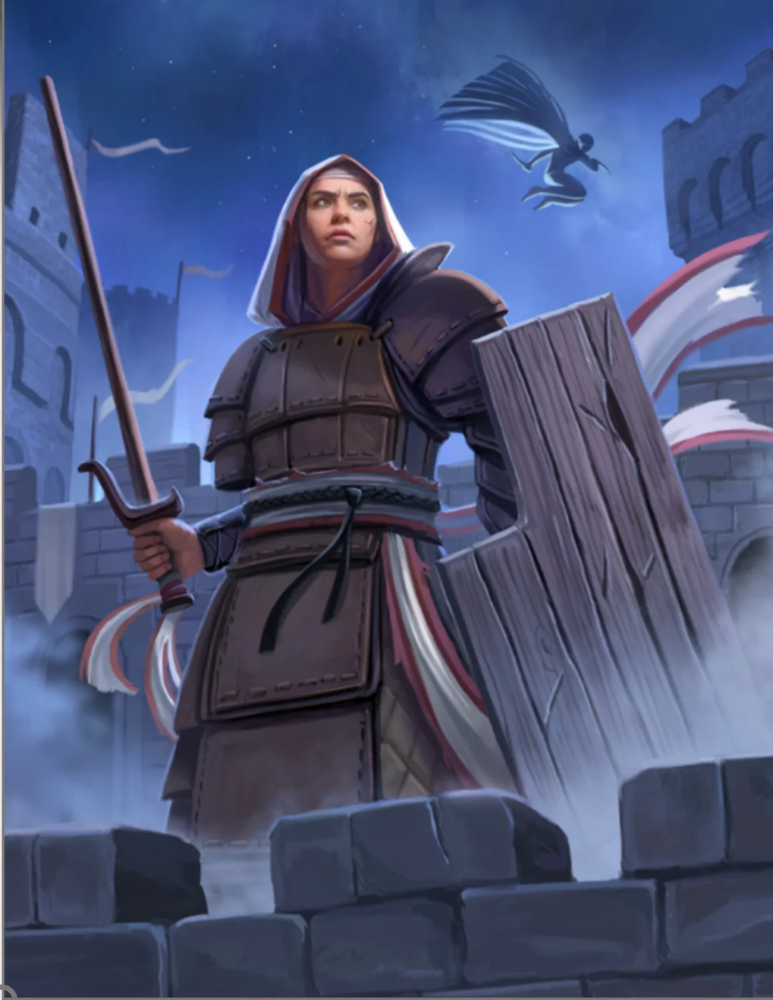

## 獵手（Hunter）

英雄路徑（Heroic Path）

獵手耐心監視目標時，追獵的興奮感始終在心中鼓動。再細小、再不起眼的線索，都不能輕忽。經驗教會他們最重要的一課：只要準備得比獵物更周全，就不必比對方更強大。即使是鎔金術師（Allomancer），也有能以合適工具與技巧利用的弱點。獵手精心規劃，決定出手的時間與地點，巧妙運用陷阱、高地與突襲占得上風。順利的話，獵物察覺襲擊者時，一切早已來不及。有些獵手偏好從遠處俐落殺敵；另一些則喜歡近身下手，享受獵物發自本能的驚恐。對他們而言，沒有什麼比縝密準備終於化為一場痛快猛攻更暢快。

### 獵手專精

獵手路徑的天賦（Talent）分屬三項專精（Specialty）：

- **殺霧者（Hazekiller）。** 專門接受對抗敵方鎔金術師的訓練，也配有相應裝備。殺霧者常使用木製護甲（Armor）、聲響棒（Soundstick）等特殊裝備，抵銷敵人的優勢。（建議用於第一時代。）

- **神射手（Sharpshooter）。** 無論偏好哪種遠程（Ranged）武器，神射手幾乎都能在任何衝突中為盟友提供寶貴支援，只是通常謹慎地保持距離。敏銳的眼力、細緻的瞄準與穩定的手，讓老練的神射手成為強勁對手。（建議用於第二時代。）

- **追蹤者（Tracker）。** 無論身處城市或邊疆，追蹤者都能靈活穿越變化多端的地貌，追尋獵物。動物夥伴（Animal Companion），或少見的動物形態坎得拉（kandra），會幫助他們偵察險惡地形、追蹤難覓的獵物，並設下危險陷阱。

### 建立獵手

接下來的〈司卡德利亞的獵手〉提供幾位代表性角色的建立範例。若你另有構想，可以參考以下建議，建立能力出色的獵手：

- **屬性（Attributes）。** 通常適合優先提高察覺（Awareness）、力量（Strength）與速度（Speed）。

- **技能（Skills）。** 實用的技能包括敏捷（Agility）、感知（Perception）、隱匿（Stealth）、求生（Survival），以及重型武器（Heavy Weaponry）或輕型武器（Light Weaponry）。

- **其他英雄路徑。** 戰士（Warrior）與密探（Agent）都很適合搭配修習。

- **獎勵（Rewards）。** 選擇動物夥伴、組織成員身分或私人藏身處，都是穩妥的選項。

### 司卡德利亞的獵手

如果你想從《迷霧之子》小說汲取靈感，可以參考以下代表性獵手角色的建立方式。

### 家族斥候（House Scout）　第一時代

顯赫家族彼此交戰時，盡可能摸清對手的行動至關重要，從找出藏身處，到分析行為模式，都不可少。家族斥候熟練地跟蹤迷霧人（Misting）與其他家族的密探，蒐集重要情報，設計並避開巧妙的陷阱，還要活得夠久，將發現帶回給家主。

**建立家族斥候。** 選擇人類（Human）血統（Ancestry），以及陸沙德（Luthadel）與上流社會（High Society）文化專長（Cultural Expertise）。起始時提高察覺，再提高智力（Intellect）或速度。除了獵手提供的感知技能等級，在敏捷、推理（Deduction）、隱匿與求生各投入 1 個技能等級（Skill Rank）。除了追尋獵物（Seek Quarry）這項獵手關鍵天賦（Key Talent），也運用人類血統，選擇追蹤者專精的致命陷阱（Deadly Trap）天賦。最後，選擇廷臣（Courtier）或地下社會（Underworld）起始套組（Starting Kit）。升級時，逐步取得獵手優勢（Hunter’s Edge）天賦，也可以考慮密探的調查員（Investigator）專精天賦，幫助你追蹤敵方密探的動向。

### 獵殺小隊成員（Kill Squad Member）

訓練勝過天賦，是派去對抗敵方金屬之子（Metalborn）的獵殺小隊奉行的信條。他們受雇於家族或私人組織，接受專門訓練，並運用鋁（Aluminum）製武器等裝備，抵銷敵人的許多優勢。

**建立獵殺小隊成員。** 選擇任意血統與任意兩項文化專長。起始時提高察覺，再提高力量或速度。除了獵手提供的感知技能等級，在紀律（Discipline）、重型武器、輕型武器與感知各投入 1 個技能等級。除了追尋獵物這項獵手關鍵天賦，如果你是人類，運用額外天賦（Bonus Talent）選擇殺霧者專精的追尋鎔金術師（Seek Allomancer）；如果你是坎得拉或克羅司混血（koloss-blooded），就在之後升級時取得。最後，選擇傭兵（Mercenary）起始套組。升級時，逐步取得殺霧者武裝（Hazekiller Weaponry）與細膩手法（Delicate Touch）天賦。

第 4 章：英雄路徑 94

### 法外狙擊手（Outlaw Sniper）　第二時代

在蠻橫區（The Roughs）與團隊共同行動時，有人占據高處、掌握全局至關重要。提供掩護火力、除掉毫無防備的敵手，或只是與燃燒白鑞（Pewter）的打手（Thug）保持距離，都可能決定成敗。**建立法外狙擊手。** 選擇人類或克羅司混血血統、蠻橫區文化專長，以及另一項文化專長。起始時提高察覺與力量。除了獵手提供的感知技能等級，在重型武器投入 2 個技能等級，並在隱匿與求生各投入 1 個技能等級。除了追尋獵物這項獵手關鍵天賦，如果你是人類，運用血統選擇神射手專精的射擊紀律（Fire Discipline）；如果你是克羅司混血，就在之後升級時取得。最後，選擇傭兵起始套組。升級時，選擇敏銳目光（Sharp Eye），再逐步取得致命瞄準（Deadly Aim）。也可以考慮殺霧者專精的追尋鎔金術師，以及密探的竊賊（Thief）專精中的暗影步（Shadow Step）。

### 獵手關鍵天賦

獵手的關鍵天賦追尋獵物，能解鎖獵手的各項專精。

**起始技能（Starting Skill）：感知。** 如果你選擇獵手作為起始路徑（Starting Path），就免費獲得 1 個感知技能等級。

#### 追尋獵物（獵手關鍵天賦）

前提條件（Prerequisite）：無

啟動（Activation）：[特殊啟動]（Special Activation）

一旦找到獵物的蹤跡，你就會緊追不捨，在最險惡的地形中研究對方的動向。

花費 1 分鐘做好心理準備後，選擇一名你能感知或曾經遇過的角色。該角色成為你的獵物（Quarry），直到你選擇以自由行動（Free Action，[自由行動]）結束這項效果，或指定新的獵物為止。此外，你在尋找、攻擊或研究獵物的檢定（Test）中獲得一個優勢（Advantage），例如獲取優勢（Gain Advantage）行動所用的檢定。

一名神射手轉身迎戰敵人。

SAEED RAMEZ

第 4 章：英雄路徑 95

#### 追尋獵物（獵手關鍵天賦）

啟動：[特殊啟動]

選擇一名角色作為獵物，在尋找、攻擊與研究該角色的檢定中獲得一個優勢。

### 殺霧者

| 天賦 | 解鎖來源 | 啟動及額外前提 |
| --- | --- | --- |
| [追尋鎔金術師](#追尋鎔金術師) | [追尋獵物](#追尋獵物獵手關鍵天賦) | 反應；感知 1+ |
| [殺霧者武裝](#殺霧者武裝) | [追尋獵物](#追尋獵物獵手關鍵天賦) | 常駐 |
| [沉著](#沉著collected) | [追尋鎔金術師](#追尋鎔金術師) | 常駐 |
| [細膩手法](#細膩手法) | [殺霧者武裝](#殺霧者武裝) | 常駐；感知 2+ |
| [領先兩步](#領先兩步two-steps-ahead) | [沉著](#沉著collected) 或 [熄滅](#熄滅) | 常駐；感知 2+ |
| [熄滅](#熄滅) | [細膩手法](#細膩手法) 或 [領先兩步](#領先兩步two-steps-ahead) | 反應；洞察 3+ |
| [魯莽猛攻](#魯莽猛攻reckless-ferocity) | [領先兩步](#領先兩步two-steps-ahead) | 2 行動 |
| [先見之明](#先見之明foresight) | [熄滅](#熄滅) | 常駐；感知 3+ |

#### 追尋鎔金術師

前提條件：感知 1+

解鎖來源：追尋獵物天賦

啟動：[反應]（Reaction）

花費 1 點專注點（Focus），將花費授予（Investiture）的目標指定為獵物。此外，敵方獵物位於 200 呎內時，你的感知範圍（Senses Range）加倍。

#### 殺霧者武裝

解鎖來源：追尋獵物天賦

啟動：[常駐]（Always Active）

取得一項武器專長（Weapon Expertise）或軍火工藝（Munitions Crafting）專長。用來反制授予之術（Invested Arts）的武器獲得快拔（Quickdraw）特性，並造成等同你洞察（Insight）技能等級的額外傷害。

#### 沉著（Collected）

解鎖來源：追尋鎔金術師天賦

啟動：[常駐]

你的意識防禦（Cognitive Defense）與靈魂防禦（Spiritual Defense）各提高 2。

#### 細膩手法

前提條件：感知 2+

解鎖來源：殺霧者武裝天賦

啟動：[常駐]

忽略易碎（Fragile）特性。使用易碎武器時，機遇範圍（Opportunity Range）擴大 2。

#### 領先兩步（Two Steps Ahead）

前提條件：感知 2+

解鎖來源：沉著天賦或熄滅（Extinguish）天賦

啟動：[常駐]

敵方獵物位於觸及範圍（Reach）內時，你不會受到擦傷（Graze），且該獵物必須額外花費 [1行動] 才能脫離（Disengage）。

#### 熄滅

前提條件：洞察 3+

解鎖來源：細膩手法天賦或領先兩步天賦

啟動：[反應]

在獵物恢復授予前，進行反擊機會（Reactive Strike）。命中（Hit）或擦傷時，對方只恢復一半授予，並陷入震懾（Stunned）。

#### 魯莽猛攻（Reckless Ferocity）

解鎖來源：領先兩步天賦

啟動：[2行動]

對實體防禦（Physical Defense）進行兩次近戰（Melee）武器攻擊。第二次攻擊承受一個劣勢（Disadvantage）。

#### 先見之明（Foresight）

前提條件：感知 3+

解鎖來源：熄滅天賦

啟動：[常駐]

每個輪次（Turn）額外獲得一個 [反應]。

### 圖示意義

| 圖示 | 意義 |
| --- | --- |
| [1行動] | 1 個行動（Action） |
| [2行動] | 2 個行動 |
| [3行動] | 3 個行動 |
| [自由行動] | 自由行動 |
| [反應] | 反應 |
| [特殊啟動] | 特殊啟動 |
| [常駐] | 常駐 |

第 4 章：英雄路徑 96

## 獵手

英雄路徑

### 神射手

| 天賦 | 解鎖來源 | 啟動及額外前提 |
| --- | --- | --- |
| [敏銳目光](#敏銳目光) | [追尋獵物](#追尋獵物獵手關鍵天賦) | 特殊啟動；感知 1+ |
| [射擊紀律](#射擊紀律) | [追尋獵物](#追尋獵物獵手關鍵天賦) | 特殊啟動 |
| [穩定瞄準](#穩定瞄準steady-aim) | [敏銳目光](#敏銳目光) | 1 行動；敏捷 1+ |
| [靈巧伏地](#靈巧伏地deft-drop) | [射擊紀律](#射擊紀律) | 1 行動；敏捷 1+ |
| [沉穩](#沉穩composed) | [穩定瞄準](#穩定瞄準steady-aim) | 常駐 |
| [迅速鎖定](#迅速鎖定swift-targeting) | [穩定瞄準](#穩定瞄準steady-aim) | 自由行動；敏捷 2+ |
| [致命瞄準](#致命瞄準) | [沉穩](#沉穩composed) | 常駐；感知 3+ |
| [神準射擊](#神準射擊crack-shot) | [靈巧伏地](#靈巧伏地deft-drop) | 特殊啟動；敏捷 3+ |

#### 敏銳目光

前提條件：感知 1+

解鎖來源：追尋獵物天賦

啟動：[特殊啟動]

觀察目標後，以感知對意識防禦進行檢定，得知對方最低的屬性、最低的防禦，或生命值（Health）、專注點或授予是否低於一半。

#### 射擊紀律

解鎖來源：追尋獵物天賦

啟動：[特殊啟動]

取得一項裝填（Loaded）武器的專長，以及弩具保養（Crossbow Maintenance）或槍械保養（Gun Maintenance）專長。裝填武器未命中時，不必花費專注點就能造成擦傷。

#### 穩定瞄準（Steady Aim）

前提條件：敏捷 1+

解鎖來源：敏銳目光天賦

啟動：[1行動]

武器射程提高一半，並造成等同你感知技能等級的額外傷害。

#### 靈巧伏地（Deft Drop）

前提條件：敏捷 1+

解鎖來源：射擊紀律天賦

啟動：[1行動]

下坐騎並倒地（Prone），然後預備（Ready）一個行動或重新裝填武器。

#### 沉穩（Composed）

解鎖來源：穩定瞄準天賦

啟動：[常駐]

你的專注點上限與目前值各提高等同階層（Tier）的數值。

#### 迅速鎖定（Swift Targeting）

前提條件：敏捷 2+

解鎖來源：穩定瞄準天賦

啟動：[自由行動]

獲取優勢；倒地時花費 0 點專注點，否則花費 2 點。成功時，目標也成為你的獵物。

#### 致命瞄準

前提條件：感知 3+

解鎖來源：沉穩天賦

啟動：[常駐]

以感知獲取優勢後，你的雙手（Two-Handed）遠程武器對該目標獲得致命（Deadly）特性。

#### 神準射擊（Crack Shot）

前提條件：敏捷 3+

解鎖來源：靈巧伏地天賦

啟動：[特殊啟動]

倒地時以雙手遠程武器進行檢定，可以花費 1 點專注點，將機遇範圍擴大 2，並選擇一顆骰子，使其不受劣勢影響。

### 追蹤者

| 天賦 | 解鎖來源 | 啟動及額外前提 |
| --- | --- | --- |
| [致命陷阱](#致命陷阱) | [追尋獵物](#追尋獵物獵手關鍵天賦) | 2 行動；求生 1+ |
| [動物羈絆](#動物羈絆animal-bond) | [追尋獵物](#追尋獵物獵手關鍵天賦) | 特殊啟動；動物夥伴 |
| [老練捕獸者](#老練捕獸者experienced-trapper) | [致命陷阱](#致命陷阱) | 特殊啟動；感知 2+ |
| [守護羈絆](#守護羈絆protective-bond) | [動物羈絆](#動物羈絆animal-bond) | 1 行動 |
| [步履穩健](#步履穩健surefooted) | [老練捕獸者](#老練捕獸者experienced-trapper) | 常駐 |
| [野性連結](#野性連結feral-connection) | [守護羈絆](#守護羈絆protective-bond) | 常駐；求生 2+ |
| [獵手優勢](#獵手優勢) | [老練捕獸者](#老練捕獸者experienced-trapper) | 常駐；求生 3+ |
| [群獵](#群獵pack-hunting) | [守護羈絆](#守護羈絆protective-bond) | 反應；感知 3+ |

#### 致命陷阱

前提條件：求生 1+

解鎖來源：追尋獵物天賦

啟動：[2行動]

隱藏一個 5 呎的陷阱。

纏繞陷阱（Entangling Trap）：求生對意識防禦，2d4 衝擊傷害（Impact Damage）。目標陷入定身（Immobilized），該區域成為困難地形（Difficult Terrain）。

穿刺陷阱（Impaling Trap）：求生對實體防禦，2d4 銳利傷害（Keen Damage）。目標陷入折磨（Afflicted）[命力傷害等於 3 + 求生技能等級]。

#### 動物羈絆（Animal Bond）

前提條件：動物夥伴

解鎖來源：追尋獵物天賦

啟動：[特殊啟動]

夥伴位於 10 呎內時，你的各項防禦提高 1。使用 [自由行動] 讓夥伴獲得 [1行動] 或 [2行動]。夥伴能用 [2行動] 追蹤（Track），將其觸及範圍內的一個目標指定為你的獵物。

#### 老練捕獸者（Experienced Trapper）

前提條件：感知 2+

解鎖來源：致命陷阱天賦

啟動：[特殊啟動]

採集資源，供養最多等同你求生技能等級數量的角色。以求生製作天然工具。你的致命陷阱傷害提高為 2d6，持續時間提高為 2 個回合（Round）。

#### 守護羈絆（Protective Bond）

解鎖來源：動物羈絆天賦

啟動：[1行動]

你的動物夥伴保護 30 呎內的一名盟友，並將動物羈絆的加值交給該盟友。

#### 步履穩健（Surefooted）

解鎖來源：老練捕獸者天賦

啟動：[常駐]

你的移動速率（Movement Rate）提高 10。墜落或危險地形（Dangerous Terrain）造成的傷害，減少等同你階層兩倍的數值。

#### 野性連結（Feral Connection）

前提條件：求生 2+

解鎖來源：守護羈絆天賦

啟動：[常駐]

取得動物照護（Animal Care）專長。提高動物夥伴的生命值、防禦與檢定加值。

#### 獵手優勢

前提條件：求生 3+

解鎖來源：老練捕獸者天賦

啟動：[常駐]

動物夥伴對獵物獲得一個優勢。你的致命陷阱傷害提高為 2d8，持續時間提高為 3 個回合。

#### 群獵（Pack Hunting）

前提條件：感知 3+

解鎖來源：守護羈絆天賦

啟動：[反應]

花費 1 點專注點，將你的求生技能等級，加到盟友對獵物的攻擊或傷害擲骰。

DEANDRA SCICLUNA & GAL OR

### 殺霧者專精

以下天賦依英文字母順序排列，皆出現在獵手天賦樹（Talent Tree）的殺霧者專精中。

#### 沉著

前提條件：追尋鎔金術師天賦

啟動：[常駐]

你學會兼顧眼前目標與內心重視的價值，因此身處混亂也能保持平穩。

取得這項天賦時，你的意識防禦與靈魂防禦各提高 2。

#### 細膩手法

前提條件：感知 2+；殺霧者武裝天賦

啟動：[常駐]

你捨棄優質材料製成的耐用武器，專精於出人意料的手段。你的武器與彈藥雖然易碎，卻同樣致命，即使對手是擅長逃過一死的金屬之子也不例外。

你忽略易碎特性的效果。此外，使用易碎武器進行攻擊檢定時，該次攻擊的機遇範圍擴大 2。

#### 熄滅

前提條件：洞察 3+；細膩手法天賦或領先兩步天賦

啟動：[反應]

你知道自己從一開始就處於劣勢，但這場不公平的較量反而激起鬥志，讓你不肯輕易倒下。

你的獵物在觸及範圍內恢復授予之前，你可以對其使用反擊機會反應，視同對方自願離開你的觸及範圍。如果該次攻擊命中或擦傷，對方只恢復一半授予，並陷入震懾，直到其下一個輪次結束。

#### 先見之明

前提條件：感知 3+；熄滅天賦

啟動：[常駐]

親身經歷的艱難教訓，讓你學會即使周遭看似安全，也要隨時保持警覺。

戰鬥（Combat）開始時，以及你每個輪次開始時，都額外獲得一個 [反應]。

#### 殺霧者武裝

前提條件：追尋獵物關鍵天賦

啟動：[常駐]

子彈不一定像表面看來那麼單純。你仔細準備刀刃與彈藥，欺騙那些膽大妄為、憑本能行動的鎔金術師。

當你持用設計來反制授予之術的武器，例如玻璃匕首（Glass Dagger）、黑曜石斧（Obsidian Axe）、決鬥杖（Dueling Cane）、聲響棒，或裝有殺霧彈（Hazekiller Round）的槍械時，該武器獲得快拔武器特性。以該武器命中或擦傷時，造成等同你洞察技能等級的額外傷害。

此外，取得這項天賦時，你可以獲得軍火工藝實用專長（Utility Expertise），或自選一項武器專長。

#### 魯莽猛攻

前提條件：領先兩步天賦

啟動：[2行動]

一擊得手，你毫不猶豫地再度出手。對付受傷的敵人，即使攻擊不夠俐落，也值得一試。

對一名目標的實體防禦進行兩次近戰武器攻擊。第二次攻擊承受一個劣勢。

JENNY TAN

第 4 章：英雄路徑 98

#### 追尋鎔金術師

前提條件：感知 1+；追尋獵物關鍵天賦

啟動：[反應]

鎔金術師暴露身分時，你的腎上腺素立刻湧現。你一面研究對方的動作與技巧，一面提高感官的敏銳度。

你能感知的角色花費授予後，如果你知道對方這麼做，就可以使用這個反應，並花費 1 點專注點，將對方指定為獵物。

此外，取得這項天賦後，只要身為敵人的獵物位於你 200 呎內，你的感知範圍就會加倍。

#### 領先兩步

前提條件：感知 2+；沉著天賦或熄滅天賦

啟動：[常駐]

你靈巧地閃避敵方鎔金術師帶來的傷害，躲過那些足以傷及較生疏殺霧者的攻擊。

身為敵人的獵物位於你的觸及範圍內時，敵人的攻擊無法對你造成擦傷，而且該獵物必須額外花費 [1行動] 才能脫離。

### 神射手專精

以下天賦依英文字母順序排列，皆出現在獵手天賦樹的神射手專精中。

#### 沉穩

前提條件：穩定瞄準天賦

啟動：[常駐]

透過練就的沉著，你能突破極限，同時不分心，也不忽略周遭威脅。

取得這項天賦時，你的專注點上限與目前值，各提高等同你階層的數值。

你的階層每提高 1，專注點上限與目前值也各提高 1。

#### 神準射擊

前提條件：敏捷 3+；靈巧伏地天賦

啟動：[特殊啟動]

瞄準時，你排除所有干擾，控制呼吸以穩住射擊，然後精準開火，造成毀滅性的打擊。

當你倒地，準備使用雙手遠程武器進行檢定時，可以先花費 1 點專注點，將該次檢定的機遇範圍擴大 2。如果該次檢定有劣勢，你還可以選擇一顆骰子。這麼做時，GM 不能將該骰指定為劣勢骰，必須改選另一顆。

#### 致命瞄準

前提條件：感知 3+；沉穩天賦

啟動：[常駐]

無論是否身處戰場，你都能迅速看出面前敵人與障礙的弱點。

以感知成功獲取優勢後，你的雙手遠程武器對該次檢定的目標獲得致命特性，直到你的輪次結束。

#### 靈巧伏地

前提條件：敏捷 1+；射擊紀律天賦

啟動：[1行動]

你伏身倒地，為眼前的危險做好準備。

獲得倒地狀態（Condition）；如果正在騎乘坐騎，就安全地下坐騎，接著選擇以下一項：

- 使用預備行動，照常支付你所預備的行動所需的行動點數。

- 將一把裝填武器重新裝滿彈藥。

#### 射擊紀律

前提條件：追尋獵物關鍵天賦

啟動：[特殊啟動]

你知道如何安全、精準地持用與保養發射投射物的武器。

每個回合一次，以裝填武器進行攻擊而未命中時，你可以不花費專注點，對該次攻擊的一個目標造成擦傷。

此外，取得這項天賦時，獲得一種裝填武器的武器專長，以及弩具保養或槍械保養（第二時代）的實用專長。

#### 敏銳目光

前提條件：感知 1+；追尋獵物關鍵天賦

啟動：[特殊啟動]

你練就的眼力能看穿敵人的長處與弱點，尤其是你選定的獵物。

觀察獵物 [1行動]，或觀察另一名角色至少 1 分鐘後，對其意識防禦進行感知檢定。成功時，自選得知以下一項：

- 目標最低的屬性值。

- 目標最低的防禦。

- 目標的生命值、專注點或授予，是否已失去超過上限一半的數值（三選一）。

第 4 章：英雄路徑 99

#### 穩定瞄準

前提條件：敏捷 1+；敏銳目光天賦

啟動：[1行動]

即使距離遠得令人目眩，你的射擊仍能命中目標。

直到你的輪次結束，你遠程武器的短距離（Short Range）與長距離（Long Range）範圍各提高一半，而且以遠程武器攻擊命中時，造成等同你感知技能等級的額外傷害。

#### 迅速鎖定

前提條件：敏捷 2+；穩定瞄準天賦

啟動：[自由行動]

你迅速專注於目標，排除周遭一切不必要的細節，追尋這個新獵物。

花費 2 點專注點，對一名你能感知的敵人，以 [自由行動] 使用獲取優勢行動。如果你已倒地，使用這項天賦就不花費專注點。以這種方式成功獲取優勢後，如果你還沒有獵物，該次檢定的目標也會成為你的獵物。

### 追蹤者專精

以下天賦依英文字母順序排列，皆出現在獵手天賦樹的追蹤者專精中。

#### 動物羈絆

前提條件：擁有動物夥伴；追尋獵物關鍵天賦

啟動：[特殊啟動]

你的動物夥伴不只是朋友或工作用的野獸，更是搭檔。牠提醒你注意危險，預先察覺你的需求，並聽從你的命令……至少大多數時候如此。

取得這項天賦時，你會強化一隻已透過獎勵取得的動物夥伴（見第 8 章〈夥伴〉）。你能與動物夥伴溝通簡單的概念，而牠通常也會盡力依你的請求提供幫助。場景需要用到牠的資料區塊（Stat Block）時，請見〈動物夥伴〉附錄。

動物夥伴會提醒你注意來襲的危險。當你能感知位於自己 10 呎內的夥伴時，你的各項防禦提高 1。你移動時，動物夥伴會自動隨你同行。

戰鬥中，動物夥伴遵循盟友 NPC 的規則（見第 10 章〈回合與輪次〉）。不過，如果動物夥伴在這個回合尚未行動，你可以使用 [自由行動]，叫牠在你的輪次行動。這麼做時，牠會獲得 [1行動] 或 [2行動]（由你選擇），立刻執行你選擇的行動；到了牠下一個輪次開始時，獲得的 [1行動] 數量就比平常少相同數量。除了第 10 章與動物夥伴資料區塊中的行動，牠也能使用特殊的追蹤行動：

**[2行動] 追蹤。** 動物夥伴幫助獵手追蹤一名角色，由獵手選擇，且夥伴必須能在自己的觸及範圍內感知該角色。該目標成為獵手追尋獵物天賦的獵物。

如果動物夥伴的生命值降到 0，牠不會陷入昏迷（Unconscious），而是停止戰鬥，撤退到安全處。（不過，動物夥伴仍可能因傷勢（Injury）或故事原因死亡。）如果你失去動物夥伴，可以在 GM 認為適當的時機，與新的動物建立羈絆。

#### 扮演帶著坎得拉夥伴的追蹤者

動物羈絆天賦只適用於動物，不適用於具智慧的夥伴。不過，如果你的坎得拉夥伴願意化為動物形態，GM 可以允許對方視為這項天賦所需的動物夥伴。即使如此，坎得拉夥伴仍保有自主性，不一定會服從你的命令。但只要對方願意，你們仍能以獵手與夥伴的身分並肩作戰。

#### 致命陷阱

前提條件：求生 1+；追尋獵物關鍵天賦

啟動：[2行動]

你知道如何製作陷阱與套索，捕捉野生動物，甚至更致命的獵物！

使用採得的材料或專門裝備，在觸及範圍內製作並隱藏一個陷阱。選擇纏繞陷阱或穿刺陷阱：

**纏繞陷阱（求生對意識防禦）。** 以繩索、雜物或其他能纏住目標的物品製作陷阱。命中時，目標受到 2d4 衝擊傷害，並陷入定身 1 個回合。接著，陷阱所在區域成為困難地形，直到場景結束。

**穿刺陷阱（求生對實體防禦）。** 以蒺藜釘、尖刺或其他尖銳物製作陷阱。命中時，目標受到 2d4 銳利傷害，並陷入折磨 [命力傷害等於 3 + 你的求生技能等級]，持續 1 個回合。你還可以花費 [機遇]（Opportunity），使目標遭受一項傷勢。

第 4 章：英雄路徑 100

陷阱覆蓋地面或其他用來隱藏陷阱的表面，範圍是直徑 5 呎的圓形。陷阱會持續存在，直到觸發後耗用。角色接觸該表面時，陷阱就會觸發。以你的求生，對該種陷阱列出的防禦進行一次攻擊；若目標是你的獵物，就獲得一個優勢。命中時，目標承受陷阱效果。這次攻擊不能造成擦傷。

你同時維持的有效陷阱數量，上限等於求生技能等級。有效陷阱的範圍不能互相重疊。其他角色進行檢定以搜尋或拆除陷阱時，DC 等於你的靈魂防禦。

#### 老練捕獸者

前提條件：感知 2+；致命陷阱天賦

啟動：[特殊啟動]

你擅長就地取材，能自信地運用陷阱狩獵，也能在野外採集資源。

短休息（Short Rest）期間採集時，不必全神貫注，因此仍能照常擲恢復骰（Recovery Die）或從事其他活動。進行求生檢定以採集食物與飲水時，只要所需資源存在於環境中，而且沒有因素妨礙採集，就會自動成功。你採得的資源，可以供養等同求生技能等級數量的角色。

此外，在野外完成長休息（Long Rest）後，你可以用天然材料製作工具，改用求生修正值代替工藝（Crafting）（見第 7 章〈工藝〉）。工具可以是長矛、投石索、帳篷，或其他能以當地材料製作的求生工具，由 GM 判定。

最後，取得這項天賦時，致命陷阱天賦的傷害從 2d4 提高為 2d6；該天賦施加狀態時，持續時間從 1 個回合提高為 2 個回合。

#### 野性連結

前提條件：求生 2+；守護羈絆天賦

啟動：[常駐]

動物夥伴在你的照料下成長茁壯，也學會像相信自身本能一樣，相信你的直覺。

取得這項天賦時，動物夥伴的生命值上限與目前值，各提高 5 × 你的階層。你的階層提高時，動物夥伴的生命值也隨之提高。

牠的實體防禦、意識防禦與靈魂防禦也各提高 2。動物夥伴進行檢定時，獲得等同你求生技能等級的加值。

此外，取得這項天賦時，獲得動物照護實用專長。

#### 獵手優勢

前提條件：求生 3+；老練捕獸者天賦

啟動：[常駐]

你充分運用陷阱與動物夥伴，以手上所有工具造成毀滅性的傷口。

動物夥伴對你的獵物進行檢定時，獲得一個優勢。

此外，取得這項天賦時，致命陷阱天賦的傷害從 2d6 提高為 2d8；該天賦施加狀態時，持續時間從 2 個回合提高為 3 個回合。

#### 群獵

前提條件：感知 3+；守護羈絆天賦

啟動：[反應]

如同成群狩獵的掠食者，你揭露獵物的弱點，讓盟友能與你並肩作戰，展現令人膽寒的協調默契。

位於你效果線（Line of Effect）內的盟友攻擊你的獵物時，你可以使用這個反應，並花費 1 點專注點，將求生技能等級加到對方的攻擊檢定結果或傷害擲骰，二選一。

#### 守護羈絆

前提條件：動物羈絆天賦

啟動：[1行動]

一句話或一個手勢，你就能命令動物夥伴保護他人。

指派動物夥伴保護你 30 呎內的一名盟友，夥伴會移到該盟友身邊。只要動物夥伴留在盟友的觸及範圍內，你就失去動物羈絆提供的防禦加值，改由該盟友獲得這個加值。若你位於動物夥伴 30 呎內，且能影響（Influence）牠，就可以用 [1行動] 結束這項效果，夥伴也會回到你身邊。否則，效果會在場景結束時終止。

#### 步履穩健

前提條件：老練捕獸者天賦

啟動：[常駐]

你自信而迅速地穿越險惡地形。

取得這項天賦時，你的移動速率提高 10。

此外，承受危險地形或墜落造成的傷害之前，將該傷害減少 2 × 你的階層。

第 4 章：英雄路徑 101
