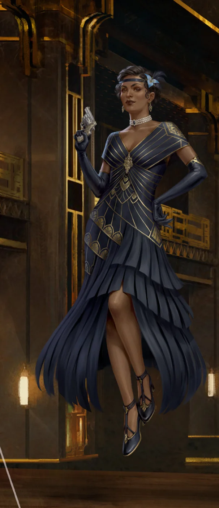
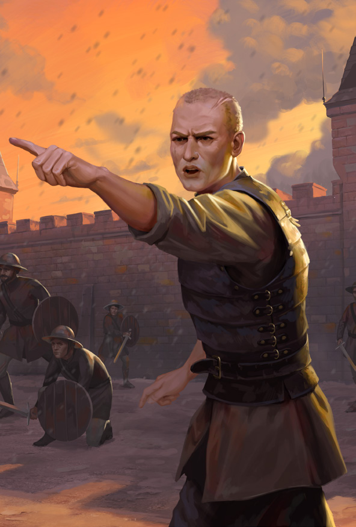
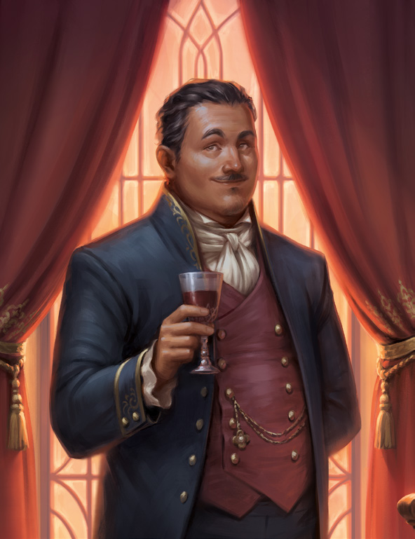

## 領袖（Leader）

英雄路徑（Heroic Path）

領袖不只是決策者，更是激勵人心的燈塔，也是抵擋恐懼浪潮的磐石。他們肩負責任、引導與教導他人的重擔，有人靠頑強毅力堅持，有人則始終深信自己會成功。有了出色領袖支撐團隊，即使身陷災難，也能扭轉為勝利。他們大膽抓住命運的韁繩，再自信地將它交到盟友手中。

### 領袖專精

領袖路徑的天賦（Talent）分為三項專精（Specialty）：

- **策劃者（Mastermind）。** 最好的計畫未必是最先想到的，而是最後能夠奏效的。策劃者運用策略與規劃的天分，讓團隊成就大事。相信計畫，也相信策劃者。

- **軍官（Officer）。** 軍官在戰鬥與衝突的極度混亂中維持秩序。他們在戰場上分派指令與資源，協調眾人邁向勝利。

- **政客（Politico）。** 政客善於做戲、操弄，並在需要快速思考或應對的場合，不著痕跡地削弱敵人。

### 建立領袖角色

接下來的〈司卡德利亞的領袖〉提供幾種代表性角色的配置範例。如果你有其他構想，可以參考以下建議，打造能充分發揮的領袖：

- **屬性（Attribute）。** 戰鬥取向的領袖可以優先考慮風采（Presence）、力量（Strength）與意志（Willpower）。領導社交或商業團體的角色，則可以優先考慮智力（Intellect）與察覺（Awareness）。

- **技能（Skill）。** 運動（Athletics）、欺騙（Deception）、推理（Deduction）、重型武器（Heavy Weaponry）或輕型武器（Light Weaponry）、威嚇（Intimidation）、領導（Leadership）與說服（Persuasion）都很實用。

- **其他英雄路徑。** 視你想達成什麼而定，密探（Agent）、使者（Envoy）與戰士（Warrior）都是很好的多路徑選擇。

- **獎勵（Reward）。** 選擇獎勵時，華麗的馬車、有影響力的人脈（Connections），或足以雇用戰鬥好手的資源（Resources），都能讓你受益。

### 司卡德利亞的領袖

如果你想從《迷霧之子》（Mistborn）小說汲取靈感，可以參考以下幾種代表性的領袖角色配置。

#### 家主（Head of House）

每個貴族家族指定的家主，不只要在家族內鬥中引導成員，也必須肩負維繫家族成員生存的責任。從創造財務上的機會，到抵擋政敵，強大的家主必須謹慎穿行於城市與世界政治的險惡局勢，同時確保不可或缺的金屬之子（Metalborn）成員補給充足、平安無事。

**建立家主角色。** 選擇人類（Human）血統（Ancestry）、上流社會（High Society）文化專長（Cultural Expertise），再選擇陸沙德（Luthadel）文化專長（第一時代），或依藍戴（Elendel）文化專長（第二時代）。起始時，以較高的察覺與風采為優先。除了領袖提供的領導技能等級（Skill Rank）之外，將欺騙、推理、洞察（Insight）與說服各提升 1 個技能等級。除了果斷指揮（Decisive Command）這項領袖關鍵天賦（Key Talent）之外，用人類血統提供的天賦選擇政客專精的狠辣戰術（Cutthroat Tactics）。最後，選擇貴族（Noble）起始套組（Starting Kit）。

隨著等級（Level）提升，可以考慮懾人（Baleful）與挑起對立（Set at Odds）等天賦。

#### 蠻橫區執法者（Roughs Lawkeeper）[第二時代]

依藍戴的法律管不到蠻橫區（The Roughs）的生活，但當地人也不應任由殺戮與混亂擺布。蠻橫區的執法者（Lawkeeper）可能各有動機，然而缺乏中央警察機構的資源，他們必須互相依靠。團結成行動一致的隊伍，對生存至關重要；新進者也需要堅定、經驗豐富的人帶領。

**建立蠻橫區執法者角色。** 選擇人類或克羅司混血（Koloss-Blooded）血統，以及蠻橫區與地下社會（Underworld）這兩項文化專長。起始時，以較高的風采與速度（Speed）為優先。除了領袖提供的領導技能等級之外，將欺騙、輕型武器、感知（Perception）與說服各提升 1 個技能等級。除了領袖關鍵天賦果斷指揮之外，如果你是人類，就用額外天賦（Bonus Talent）選擇軍官專精的穿越混戰（Through the Fray）；如果你是克羅司混血，就在之後的等級取得這項天賦。最後，選擇傭兵（Mercenary）起始套組。

隨著等級提升，可以考慮協同突擊（Synchronized Assault）天賦。

第 4 章：英雄路徑 102

*多克森（Dockson）有天才般的組織能力，也是天生的領袖。*

#### 盜賊團隊管理者（Thieving Crew Operator）[第一時代]

陸沙德每一場出色的劫案背後，都有一位出色的組織者，負責幕後的後勤事務，確保團隊能潛入、完成工作、脫身，並拿到報酬。團隊管理者處理補給、人脈，以及可能讓行動半途停擺的突發阻礙。他們擅長把不可能變成可能。

**建立團隊管理者角色。** 選擇人類血統，以及陸沙德與地下社會這兩項文化專長。起始時，以較高的智力與意志為優先。除了領袖提供的領導技能等級之外，將紀律（Discipline）、洞察、感知與說服各提升 1 個技能等級。除了領袖關鍵天賦果斷指揮之外，用人類血統提供的天賦選擇軍官專精的沉穩（Composed）。最後，選擇研究者（Researcher）起始套組。

隨著等級提升，可以考慮補給充足（Well Supplied），並朝策劃者專精的順利執行（Smooth Execution）天賦邁進。

### 領袖關鍵天賦

領袖的關鍵天賦果斷指揮，能解鎖領袖專精。

**起始技能（Starting Skill）：領導。** 如果你選擇領袖作為起始路徑（Starting Path），就免費取得 1 個領導技能等級。

#### 果斷指揮（領袖關鍵）

前提條件（Prerequisite）：無

啟動（Activation）：[1行動]

*你的聲音有如鋼鐵般堅定，戰術眼光遠近馳名。這份在戰場上累積的智慧，讓聽從你的人受益。*

取得這項天賦時，你獲得一顆指揮骰（Command Die），起始為 d4，最高可以提升至 d12。

花費 1 點專注點（Focus），選擇你 20 呎內一名你能影響（Influence）的盟友（Ally）。在對方下一個輪次（Turn）結束之前，其下次進行檢定（Test）時，可以將你的指揮骰與該檢定的其他骰子一起擲出。擲骰後，對方可以從該檢定中選擇一個擲骰結果，劇情骰（Plot Die）除外，再加上指揮骰的結果。有些領袖天賦讓你能以其他方式使用指揮骰；即使目前有盟友持有你給的指揮骰，你仍然能這麼做。

第 4 章：英雄路徑 103

SVETLANA KOSTINA

#### 果斷指揮（領袖關鍵）

啟動：[1行動]

花費 1 點專注點，給予 20 呎內一名盟友一顆 d4 指揮骰。對方可將它加到下次檢定中的一個擲骰結果。

### 策劃者天賦樹（Talent Tree）

| 天賦 | 解鎖來源 | 啟動及額外前提 |
| --- | --- | --- |
| [全盤計畫](#全盤計畫master-plan) | [果斷指揮](#果斷指揮領袖關鍵) | 2 行動；推理 1+ |
| [沉穩](#沉穩) | [果斷指揮](#果斷指揮領袖關鍵) | 常駐 |
| [照計畫行事](#照計畫行事stick-to-the-plan) | [全盤計畫](#全盤計畫master-plan) | 反應 |
| [小心身後！](#小心身後behind-you) | [沉穩](#沉穩) | 反應；領導 2+ |
| [等我信號](#等我信號on-my-signal) | [照計畫行事](#照計畫行事stick-to-the-plan) | 特殊啟動；推理 2+ |
| [精準指揮](#精準指揮precise-command) | [小心身後！](#小心身後behind-you) | 特殊啟動；領導 2+ |
| [順利執行](#順利執行) | [等我信號](#等我信號on-my-signal) | 特殊啟動；領導 3+ |
| [正好有這個](#正好有這個ive-got-just-the-thing) | [等我信號](#等我信號on-my-signal) | 1 行動；推理 3+ |

#### 全盤計畫（Master Plan）

啟動：[2行動]

前提條件：推理 1+

解鎖來源：果斷指揮（領袖關鍵）

與 GM 合作，建立一個有 3 個以上機遇格（Opportunity Slot）的事件（Event）。事件觸發時，你的隊伍（Party）獲得重大好處。

#### 沉穩

啟動：[常駐]

解鎖來源：果斷指揮（領袖關鍵）

你的專注點上限與目前專注點，各提高等同你階層（Tier）的數值。

#### 照計畫行事（Stick to the Plan）

啟動：[反應]

解鎖來源：全盤計畫

你或盟友的劇情骰擲出空白時，花費 2 點專注點，在你的全盤計畫事件中填滿一格。

#### 小心身後！（Behind You!）

啟動：[反應]

前提條件：領導 2+

解鎖來源：沉穩

你可以代盟友閃避危險（Avoid Danger）或閃避（Dodge），並且每回合（Round）獲得一個[反應]，供你這麼做。

#### 等我信號（On My Signal）

啟動：[特殊啟動]

前提條件：推理 2+

解鎖來源：照計畫行事

你的全盤計畫事件即將觸發時，可以將效果延後到本場景（Scene）稍後發生。

#### 精準指揮（Precise Command）

啟動：[特殊啟動]

前提條件：領導 2+

解鎖來源：小心身後！

提高指揮骰的骰型（Die Size）。花費 1 點專注點，將指揮骰加到你的推理、領導或學識（Lore）d20 擲骰結果。

#### 順利執行

啟動：[特殊啟動]

前提條件：領導 3+

解鎖來源：等我信號

全盤計畫事件觸發時，你與盟友獲得集中（Focused）。

#### 正好有這個（I’ve Got Just the Thing）

啟動：[1行動]

前提條件：推理 3+

解鎖來源：等我信號

花費 1 點專注點，拿出一件物品，如同你先前已買下它，例如裝備（Equipment）、建築藍圖或信件。

#### 圖示意義

| 圖示 | 意義 |
| --- | --- |
| [1行動] | 1 個行動（Action） |
| [2行動] | 2 個行動 |
| [3行動] | 3 個行動 |
| [自由行動] | 自由行動（Free Action） |
| [反應] | 反應（Reaction） |
| [特殊啟動] | 特殊啟動（Special Activation） |
| [常駐] | 常駐（Always Active） |

第 4 章：英雄路徑 104

領袖

英雄路徑

### 軍官天賦樹

| 天賦 | 解鎖來源 | 啟動及額外前提 |
| --- | --- | --- |
| [沉穩](#沉穩-1) | [果斷指揮](#果斷指揮領袖關鍵) | 常駐 |
| [穿越混戰](#穿越混戰) | [果斷指揮](#果斷指揮領袖關鍵) | 1 行動；說服 1+ |
| [補給充足](#補給充足) | [沉穩](#沉穩-1) | 特殊啟動；說服 2+ |
| [慣常衣著](#慣常衣著customary-garb) | [穿越混戰](#穿越混戰) | 常駐 |
| [不懈行軍](#不懈行軍relentless-march) | [自信指揮](#自信指揮) | 常駐；說服 3+ |
| [自信指揮](#自信指揮) | [慣常衣著](#慣常衣著customary-garb) | 特殊啟動；領導 2+ |
| [協同突擊](#協同突擊) | [權威](#權威) | 3 行動；領導 3+ |
| [權威](#權威) | [自信指揮](#自信指揮) | 常駐；在組織中擔任有權威的職位，或由贊助者賦予權威 |

#### 沉穩

啟動：[常駐]

解鎖來源：果斷指揮（領袖關鍵）

你的專注點上限與目前專注點，各提高等同你階層的數值。

#### 穿越混戰

啟動：[1行動]

前提條件：說服 1+

解鎖來源：果斷指揮（領袖關鍵）

20 呎內一名盟友可以用[反應]脫離（Disengage）或獲取優勢（Gain Advantage）。

#### 補給充足

啟動：[特殊啟動]

前提條件：說服 2+

解鎖來源：沉穩

獲得軍事後勤（Military Logistics）專長（Expertise）。花費 2 點專注點，在徵調資源的檢定中加入[機遇]。

#### 慣常衣著（Customary Garb）

啟動：[常駐]

解鎖來源：穿越混戰

穿著具有得體（Presentable）特性的護甲（Armor），或合宜的衣服時，你的實體防禦（Physical Defense）與靈魂防禦（Spiritual Defense）提高 2。

#### 不懈行軍（Relentless March）

啟動：[常駐]

前提條件：說服 3+

解鎖來源：自信指揮（Confident Command）

果斷指揮讓目標的移動速率（Movement Rate）提高 10 呎，並讓對方忽略精疲力竭（Exhausted）、減速（Slowed）與措手不及（Surprised）的效果。

#### 自信指揮

啟動：[特殊啟動]

前提條件：領導 2+

解鎖來源：慣常衣著

提高指揮骰的骰型。花費 1 點專注點，將指揮骰加到你的威嚇、領導或說服 d20 擲骰結果。

#### 協同突擊

啟動：天賦樹未印；PDF 第 111 頁的完整天賦敘述列為[3行動]

前提條件：領導 3+

解鎖來源：權威（Authority）

花費 2 點專注點，對敵人的意識防禦（Cognitive Defense）進行領導檢定。成功時，數量不超過你領導技能等級的盟友取得[1行動]，可用來對該目標額外打擊（Strike）。失敗時，只有一名盟友取得[1行動]。

#### 權威

啟動：[常駐]

前提條件：在組織中擔任有權威的職位，或由贊助者賦予權威

解鎖來源：自信指揮

影響盟友的領袖天賦，範圍加倍，能影響的盟友人數也加倍。

### 政客天賦樹

| 天賦 | 解鎖來源 | 啟動及額外前提 |
| --- | --- | --- |
| [狠辣戰術](#狠辣戰術) | [果斷指揮](#果斷指揮領袖關鍵) | 特殊啟動；欺騙 1+ |
| [戰術詭計](#戰術詭計tactical-ploy) | [果斷指揮](#果斷指揮領袖關鍵) | 1 行動 |
| [謠言推手](#謠言推手rumormonger) | [狠辣戰術](#狠辣戰術) | 特殊啟動；一名贊助者 |
| [衣著講究](#衣著講究well-dressed) | [謠言推手](#謠言推手rumormonger) | 特殊啟動 |
| [懾人](#懾人) | [謠言推手](#謠言推手rumormonger) | 常駐 |
| [挑起對立](#挑起對立) | [懾人](#懾人) | 2 行動；領導 3+ |
| [精明指揮](#精明指揮shrewd-command) | [謠言推手](#謠言推手rumormonger) | 特殊啟動；領導 2+ |
| [驚天騙局](#驚天騙局grand-deception) | [精明指揮](#精明指揮shrewd-command) | 3 行動；欺騙 3+ |

#### 狠辣戰術

啟動：[特殊啟動]

前提條件：欺騙 1+

解鎖來源：果斷指揮（領袖關鍵）

盟友可以改為提高賭注（Raise the Stakes），而不擲你的指揮骰；若擲出[變故]，你恢復 1 點專注點。

#### 戰術詭計（Tactical Ploy）

啟動：[1行動]

解鎖來源：果斷指揮（領袖關鍵）

對意識防禦進行欺騙檢定，讓目標失去一個[反應]，並在下次意識（Cognitive）或靈魂（Spiritual）檢定承受一個劣勢（Disadvantage）。

#### 謠言推手（Rumormonger）

啟動：[特殊啟動]

前提條件：一名贊助者

解鎖來源：狠辣戰術

獲得醜聞（Scandal）專長。散播假消息或蒐集傳聞的檢定中，花費 2 點專注點加入機遇（Opportunity）。

#### 衣著講究（Well Dressed）

啟動：[特殊啟動]

解鎖來源：謠言推手

獲得時尚（Fashion）專長。穿著具有得體特性的護甲，或時髦的服裝時，你進行的首次欺騙、領導或說服檢定獲得一個優勢（Advantage）。

#### 懾人

啟動：[常駐]

解鎖來源：謠言推手

角色（Character）若要抵抗你的影響，必須額外花費等同你階層的專注點。

#### 挑起對立

啟動：[2行動]

前提條件：領導 3+

解鎖來源：懾人

花費等同你想分化的目標（Target）人數的專注點。對他們最高的靈魂防禦進行領導檢定，使他們彼此敵對。

#### 精明指揮（Shrewd Command）

啟動：[特殊啟動]

前提條件：領導 2+

解鎖來源：謠言推手

提高指揮骰的骰型。花費 1 點專注點，將指揮骰加到你的欺騙、洞察或領導 d20 擲骰結果。

#### 驚天騙局（Grand Deception）

啟動：天賦樹未印；PDF 第 111 頁的完整天賦敘述列為[3行動]

前提條件：欺騙 3+

解鎖來源：精明指揮

花費 3 點專注點，進行欺騙檢定（DC 15），揭露一個改變某項細節的騙局。

DEANDRA SCICLUNA & GAL OR

### 策劃者專精

以下天賦依英文字母順序排列，均出現在領袖天賦樹的策劃者專精中。

#### 小心身後！

前提條件：領導 2+；沉穩天賦

啟動：[反應]

你磨練察覺危險的敏銳眼光，也時時留心周遭環境，因而能預判威脅，引導盟友避開傷害。

當一名自願、且你能感知並影響的盟友，符合閃避危險或閃避反應的條件時，你可以如同自己位於對方的佔位（Space）一樣，使用該反應。由你代為花費反應與所需專注點，並讓對方獲得該行動的好處，而非你自己。此外，戰鬥（Combat）開始時，以及你的每個輪次開始時，你獲得一個額外[反應]，只能用於這項天賦的效果。

#### 沉穩

前提條件：果斷指揮關鍵天賦

啟動：[常駐]

透過練就的沉著，你能挑戰自己的極限，而不會分心或忽略威脅。

取得這項天賦時，你的專注點上限與目前專注點，各提高等同你階層的數值。階層提高 1 時，專注點上限與目前專注點也都提高 1。

#### 正好有這個

前提條件：推理 3+；等我信號天賦

啟動：[1行動]

大家都知道你總愛多帶些東西，但你總能拿出適合工作的工具，就算工作不太正當也一樣。

每個場景一次，花費 1 點專注點，選擇一件你目前沒有，但過去有可能合理取得的物品，例如一件裝備、建築藍圖、信件，或其他能隨身攜帶的類似物品。接著，你從隨身物品中拿出它，如同你先前已在畫面外購買，或以其他方式取得它。如果這件物品通常有價格（見第 7 章所列），用這項天賦取得物品時，也必須支付該費用。能拿出什麼物品，由 GM 做最後判定。

#### 全盤計畫

前提條件：推理 +1；果斷指揮關鍵天賦

啟動：[2行動]

周詳的思慮加上一點運氣，讓你的全盤計畫像精密機械般順利運轉。

每個場景一次，你可以揭露一項全盤計畫。與 GM 合作，建立一個對你和盟友有利的事件（見第 9 章〈事件〉）。這項全盤計畫事件，代表你在畫面外所做的規劃與努力，目的是在故事中促成重大的有利變化。同一時間，你只能維持一個這樣的事件。預設情況下，全盤計畫有一條包含三個機遇格的事件進度軌（Event Track），你和盟友都能對它作出貢獻。建立事件時，你可以增加進度軌的格數，增加的數量最多等同你的推理技能等級；這會讓事件更難觸發，但效果也更顯著。你和盟友可以在你的下一次長休息（Long Rest）前，填滿進度軌以觸發事件。若屆時仍未觸發，事件便告失敗。例如，三個機遇格的事件，可以代表你設法讓政治勁敵（Rival）落入社交圈套，使其失去一名關鍵盟友。五個機遇格的事件，則可以代表你設法賄賂整班守衛，讓他們在特定時間恰好去休息。

#### 等我信號

前提條件：推理 2+；照計畫行事天賦

啟動：[特殊啟動]

你和團隊做事謹慎有效，事先準備妥當，才能在最佳時機出手。

你和盟友填滿全盤計畫事件的所有機遇格時，可以選擇不立刻觸發。在當前場景中，你可以決定在任何一次檢定結算後，或任何角色的輪次結束時觸發，不需行動。

#### 精準指揮

前提條件：領導 2+；小心身後！天賦

啟動：[特殊啟動]

你早已想好達成目標的方法，也算清了沿途的每一步。現在，你專心引導盟友，將精心擬定的計畫付諸實行。

當你進行推理、領導或學識檢定時，可以花費 1 點專注點，擲指揮骰，並將結果加到你的 d20 擲骰結果上。此外，取得這項天賦時，將指揮骰的骰型提高一級，例如從 d4 提高至 d6。

第 4 章：英雄路徑 106

#### 順利執行

前提條件：領導 3+；等我信號天賦

啟動：[特殊啟動]

很少有什麼比順利執行計畫更令人滿足。你與盟友沉浸在勝利的興奮中，接下來就能一路順風。

全盤計畫事件觸發時，你與每名你能影響的盟友都獲得集中，持續到各目標的下一個輪次結束。

#### 照計畫行事

前提條件：全盤計畫天賦

啟動：[反應]

只要反應靈活，故障與失誤未必會釀成災難。稍加即興應變，就能在局面惡化前修正方向。

你或一名你能感知的盟友，其劇情骰擲出空白時，你可以使用這個反應，花費 2 點專注點，依擲出機遇時的方式，在你的全盤計畫事件中填滿一格。

### 軍官專精

以下天賦依英文字母順序排列，均出現在領袖天賦樹的軍官專精中。

#### 權威

前提條件：領導一個組織，或有賦予你領導他人權限的贊助者；自信指揮天賦

啟動：[常駐]

指揮經驗讓你能在更遠距離，協調更龐大的群體。

你那些影響盟友的領袖天賦，原本若有範圍，現在範圍加倍；能影響的盟友人數上限，也提高為平常的兩倍。

#### 沉穩

前提條件：果斷指揮關鍵天賦

啟動：[常駐]

透過練就的沉著，你能挑戰自己的極限，而不會分心或忽略威脅。

取得這項天賦時，你的專注點上限與目前專注點，各提高等同你階層的數值。階層提高 1 時，專注點上限與目前專注點也都提高 1。

#### 自信指揮

前提條件：領導 2+；慣常衣著天賦

啟動：[特殊啟動]

你說話謹慎而堅定，讓言語在受你指揮的人心中迴盪。

在進行威嚇、領導或說服檢定之前，你可以花費 1 點專注點，擲指揮骰，並將結果加到你的 d20 擲骰結果上。此外，取得這項天賦時，將指揮骰的骰型提高一級，例如從 d4 提高至 d6。

#### 慣常衣著

前提條件：穿越混戰天賦

啟動：[常駐]

你長年穿著制服或傳統服飾，早已習慣得如同第二層皮膚，讓你行動自如，也帶來深厚的自信。

當你明顯穿著具有得體特性的護甲，或符合自己身分的服裝時，實體防禦與靈魂防禦提高 2。

*德穆（Demoux）將軍帶領一次訓練操演。*

NELE KLUMPE

#### 不懈行軍

前提條件：說服 3+；自信指揮天賦

啟動：[常駐]

你鼓舞部隊，幫助他們在最艱困的處境下，頂住恐懼、疼痛與疲憊，繼續前進。

對盟友使用果斷指揮後，直到對方的下一個輪次結束，其移動速率提高 10 呎，並忽略精疲力竭、減速與措手不及狀態的效果。

#### 協同突擊

前提條件：領導 3+；權威天賦

啟動：[3行動]

你看出敵人陣勢的弱點，接著指揮小隊，將全部力量集中在一名關鍵敵人身上。

花費 2 點專注點，對一名你能感知的敵人之意識防禦進行領導檢定。成功時，選擇數量不超過你領導技能等級的盟友。失敗時，選擇一名你能影響的盟友。在每名選定盟友的下一個輪次，他們取得[1行動]，只能用來對該敵人使用打擊。這次打擊不計入持握該武器的手所能執行的打擊行動次數。

#### 穿越混戰

前提條件：說服 1+；果斷指揮關鍵天賦

啟動：[1行動]

你熟練地看出占上風的機會，並在盟友展開行動時，與他們協調配合。

選擇你 20 呎內一名你能影響的盟友。在你的輪次結束之前，對方可以用[反應]執行脫離或獲取優勢行動。

#### 補給充足

前提條件：說服 2+；沉穩天賦

啟動：[特殊啟動]

你熟練地推動軍事體系運作，取得部隊維持戰力所需的補給。

當你進行徵調或分配資源的檢定時，可以花費 2 點專注點，在結果中加入一個機遇。

此外，取得這項天賦時，獲得軍事後勤的實用專長（Utility Expertise）。

第 4 章：英雄路徑 108

### 政客專精

以下天賦依英文字母順序排列，均出現在領袖天賦樹的政客專精中。

#### 懾人

前提條件：謠言推手天賦

啟動：[常駐]

你以嚴厲目光瓦解對手的決心，只有最鎮定的人才能不為所動。

角色若要抵抗你的影響，必須額外花費等同你階層的專注點。

#### 狠辣戰術

前提條件：欺騙 1+；果斷指揮關鍵天賦

啟動：[特殊啟動]

你學會了，想要成果就必須冒險。向盟友說明情勢時，你有時會淡化危險，提升他們的信心，也提高獲勝的機會。

盟友在檢定中擲你的指揮骰之前，可以選擇不擲，改為對該次檢定提高賭注。如果這麼做並擲出變故（Complication），你恢復 1 點專注點。

#### 驚天騙局

前提條件：欺騙 3+；精明指揮天賦

啟動：[3行動]

你深思熟慮、巧妙誤導，散播一則連盟友都信以為真的傳聞。日後揭開騙局的真相時，敵人便陷入混亂。

花費 3 點專注點，進行 DC 15 的欺騙檢定。成功時，選擇自上一個場景開始以來，你曾確立的一項細節，揭露那其實是個騙局。這個騙局必須合情合理。例如，透露自己把一件強大的寶物藏在與先前聲稱不同的地方，或透露自己的軍隊其實向東而非向西移動，都是合理的。但透露一件普通物品其實是無價之寶，或在先前聲稱本區域沒有盟友後，突然宣布自己招募了一支軍隊，就不合理。能揭露何種騙局，由 GM 做最後判定。

#### 謠言推手

前提條件：擁有一名贊助者；狠辣戰術天賦

啟動：[特殊啟動]

在流言四起的社交圈中，你贊助者的名號能激起巨大的漣漪。

當你進行散播假消息或蒐集傳聞的檢定時，可以花費 2 點專注點，在結果中加入一個機遇。

此外，取得這項天賦時，獲得醜聞的實用專長。

#### 挑起對立

前提條件：領導 3+；懾人天賦

啟動：[2行動]

嫉妒、貪婪、猜疑，對你而言都只是工具。它們能點燃派系間的對立，也能在激戰中分化敵人。

選擇兩名或更多你能影響的角色，花費等同人數的專注點，在他們之間埋下分裂的種子。描述一個可能引發衝突的原因，例如猜疑或嫉妒，接著進行領導檢定，DC 等同這些目標中最高的靈魂防禦。成功時，你影響每名目標，使其對其他目標抱持敵意，引發爭吵、戰鬥或其他衝突，直到他們找到化解的方法。

目標可以抵抗這項影響，但抵抗後，還會額外失去等同你領導技能等級的專注點。如果只有部分目標抵抗，其他目標依舊抱持敵意，但這場衝突可能變得較容易化解。

#### 精明指揮

前提條件：領導 2+；謠言推手天賦

啟動：[特殊啟動]

你以尖銳的言詞，或別有用意的一眼，直指對話的核心。

在進行欺騙、洞察或領導檢定之前，你可以花費 1 點專注點，擲指揮骰，並將結果加到你的 d20 擲骰結果上。

此外，取得這項天賦時，將指揮骰的骰型提高一級，例如從 d4 提高至 d6。

#### 戰術詭計

前提條件：果斷指揮關鍵天賦

啟動：[1行動]

你巧妙地省略資訊、暗示假象，削弱敵人的信心，迫使對方質疑自己的防備。

對一名你能影響的敵人之意識防禦進行欺騙檢定。成功時，目標失去一個[反應]，並在下次意識或靈魂檢定承受一個劣勢。

目標可以抵抗這項影響，但抵抗後，在你的下一個輪次結束前，你下次以對方為目標的檢定獲得一個優勢。

#### 衣著講究

前提條件：謠言推手天賦

啟動：[特殊啟動]

你巧妙地讓服裝配合場合，總能傳達最恰當的形象。

當你明顯穿著具有得體特性的護甲，或時髦的服裝時，你在每個場景中進行的首次欺騙、領導或說服檢定，獲得一個優勢。

此外，取得這項天賦時，獲得時尚文化專長。

*Edgard．拉德利安（Ladrian），綽號「微風」（Breeze），是黃銅（Brass）迷霧人（Misting）與政客。*

DEANDRA SCICLUNA

