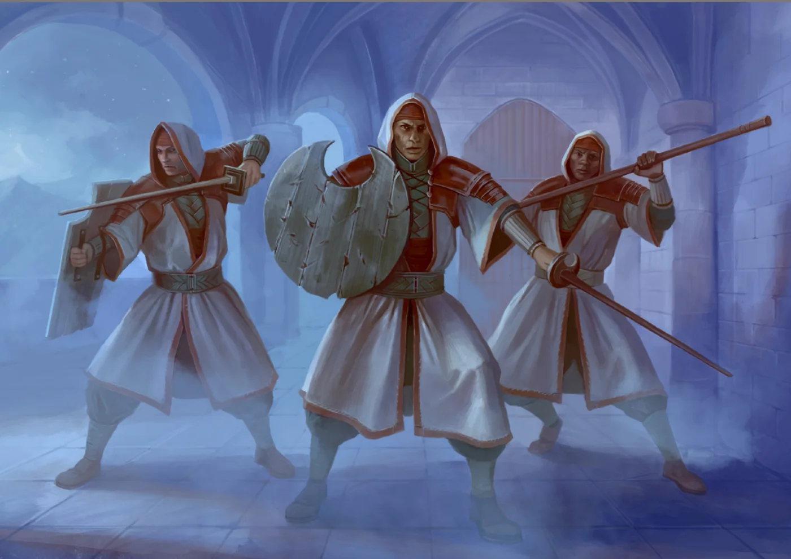

《迷霧之子》（Mistborn）戰役（Campaign）中的角色都是英雄：他們幫助需要援手的人、拯救無辜生命，並對抗統御主（Lord Ruler）、滅絕（Ruin）與「組織」（The Set）等壓迫勢力。本章介紹的六條英雄路徑（heroic path），代表每位英雄在世上留下印記所憑藉的非超自然本領。無論你是身手高明的密探（Agent）、學識淵博的學者（Scholar），或意志不屈的戰士（Warrior），路徑及其天賦（talent）都代表你在司卡德利亞（Scadrial）闖蕩時，獨有的技巧與手段組合。

### 使用路徑與天賦

身為玩家角色（Player Character），角色紙上的能力主要來自天賦（見本節後面的〈使用天賦〉）。你會在角色建立（Character Creation）時取得第一項天賦，並隨著等級提升選擇更多天賦。路徑為選擇天賦提供了架構。每條路徑都從一項關鍵天賦（Key Talent）開始，選取後就能解鎖該路徑三項專精（specialty）中的天賦。例如，選擇戒備架式（Vigilant Stance）這項戰士關鍵天賦後，就能接觸戰士路徑中的鬥士（Brawler）、槍手（Gunslinger）與士兵（Soldier）專精。

### 英雄路徑與金屬之子路徑

在冒險生涯中，玩家角色可以從多條路徑與專精選擇天賦，而且大多數人都會這麼做。這些選擇可以包括其他英雄路徑或金屬之子（Metalborn）路徑。你也可能從其他來源選擇獨有天賦，例如第 2 章的坎得拉（kandra）天賦樹（talent tree）或克羅司混血（koloss-blooded）天賦樹。

所有玩家角色起始都要選擇一條英雄路徑或金屬之子路徑，並從中取得一項天賦。本章介紹六條英雄路徑：

- **密探。** 憑敏銳頭腦或靈巧身手解決問題的能幹行動人員。密探的專精包括調查員（Investigator）、反抗者（Rebel）與竊賊（Thief）。

- **使者（Envoy）。** 善於洞察、熟練影響他人的談判者。使者的專精包括信仰者（Faithful）、騙徒（Grifter）與導師（Mentor）。

- **獵手（Hunter）。** 擅長打擊敵人與野外活動，主動尋找並排除問題。獵手的專精包括殺霧者（Hazekiller）、神射手（Sharpshooter）與追蹤者（Tracker）。

- **領袖（Leader）。** 沉著的指揮者，引導他人發揮最佳表現。領袖的專精包括策劃者（Mastermind）、軍官（Officer）與政客（Politico）。

- **學者。** 思慮靈活、擅長規劃與建造的人。學者的專精包括發明家（Inventor）[第二時代]、策士（Strategist）與外科醫師（Surgeon）。

- **戰士。** 憑戰技、蠻力或不屈意志作戰的鬥士。戰士的專精包括鬥士、槍手[第二時代]與士兵。

有些角色提升等級時，仍專注於這些英雄路徑；但許多角色會在建立角色時，或隨故事發展，走上第 5 章的金屬之子路徑。金屬之子路徑讓你能運用鎔金術（Allomancy）與藏金術（Feruchemy）。這兩種強大的金屬技藝（Metallic Arts），利用司卡德利亞的金屬創造種種奇蹟。

*對頁：史特芮絲（Steris）證明，只要計畫得宜，英雄也能與任何金屬之子一樣有所作為。*

第 4 章：英雄路徑 73

ANNA PODEDWORNA

### 後續章節的術語

本章會使用本書各處的術語。如果你還沒讀過後面的章節，可能會遇到不熟悉的詞。若想先翻閱相關內容，這個側欄列出可能影響天賦的重要規則。第 9 章介紹冒險的一般規則，請特別留意以下各節：

- **休息（Resting）。** 暫停冒險、稍作休息時，你可能恢復生命值（Health）、採集資源，或取得其他好處。

- **狀態（Condition）。** 有些天賦會施加短暫的有害或有利效果。例如，減速（Slowed）狀態會暫時讓目標的移動速率（Movement Rate）減半。

- **傷害、傷勢與死亡（Damage, Injury, and Death）。** 傷害會降低生命值，但有些傷害類型對你的影響可能比其他類型更大。生命值降到 0 時，你會陷入昏迷（Unconscious）狀態，並有受傷或死亡的風險。

第 10 章介紹戰鬥與類似時間緊迫情境的規則，請特別留意以下各節：

- **回合與輪次。** 戰鬥以回合（Round）劃分。每個回合，你都要選擇採取快速輪次（Fast Turn）或慢速輪次（Slow Turn）。快速輪次讓你先於對手行動；慢速輪次則讓你在自己的輪次（Turn）中有更多行動。

- **行動與反應。** 每個回合，你都能決定角色要做什麼。你通常在自己的輪次使用行動（Action），但少數反應（Reaction）讓你能在其他角色的輪次中行動。

- **攻擊。** 你可以使用近戰（Melee）武器、遠程（Ranged）武器、金屬技藝能力或其他能力攻擊敵人，降低對方的生命值。

- **選定目標與距離（Targeting and Range）。** 在戰鬥中選定角色為目標時，可能受到對方位置、與你的距離，以及你是否能感知對方等條件限制。

- **移動與站位（Movement and Positioning）。** 你在戰場上的移動能力，由移動速率、附近地形（Terrain）、對手體型（Size）等因素決定。

第 11 章介紹以社交互動為主的場景規則，請特別留意以下一節：

- **抵抗影響（Resisting Influence）。** 結算以社交方式影響角色的效果時，對方可以花費專注點（Focus）抵抗你的影響。

### 打造你的英雄

每條路徑的條目都以導言開頭，描述其三項專精（英雄路徑適用）、建議建立角色時優先考慮的數據，並列出幾位可用該路徑打造的代表性《迷霧之子》角色。條目其餘部分會依專精介紹該路徑的天賦。建立角色與選擇第一條路徑的說明，請見第 1 章。

#### 創角建議

建立角色時，務必考慮角色的能力配置在各種場景中能如何發揮，而不只著眼於戰鬥（見第 9 章〈場景〉）。任何路徑的角色，幾乎都能搭配各種屬性（attribute）、技能（skill）與天賦組合，但有些組合特別契合。各路徑導言中的一般建議，可以幫助你起步；不過，可能的組合無窮無盡，這些建議未必適用於你想讓角色扮演的特定定位。

### 沿路徑成長

每條路徑都包含一棵天賦樹；英雄路徑則是每項專精各有一棵獨立的樹。角色每提升一級，就能取得一項新天賦，沿著天賦樹前進。取得天賦後，就能解鎖路徑深處更強大的天賦。

#### 關鍵天賦

選擇新天賦時，只要符合前提條件（Prerequisite）（見第 1 章末尾的〈前提條件〉），就一定能選擇關鍵天賦，也就是各路徑最上方的天賦。取得關鍵天賦後，就能解鎖該路徑的專精與天賦。你可以自由走上任意數量的路徑與專精。你甚至可能決定選擇一條強大的金屬之子路徑（見第 5 章）；它的關鍵天賦與英雄路徑的關鍵天賦一樣，都能選取。

第 4 章：英雄路徑 74

### 取得其他天賦的資格

你也可以選擇既有路徑中更深處的天賦，前提是符合它們的其他前提條件。這些較深處的天賦，會出現在解鎖它們的天賦下方或旁邊，並以線條相連。你可以選擇任何與已取得天賦相連的天賦。（除了查看樹上的連線，也可以閱讀各天賦的文字，確認哪些天賦能解鎖它。）

#### 帶有短期目標的天賦

如果天賦給你一項特定短期目標（goal），就必須先完成它，才能選擇該天賦樹後續的天賦。例如，你先前選擇迷霧人（Misting）路徑的迷霧人綻裂（Misting Snap）關鍵天賦，但尚未完成其「訓練你的能力（Train Your Power）」短期目標，就還不能選擇授予充沛（Invested）或本能燃燒（Instinctual Burn）天賦。

#### 同名天賦

不同路徑有些天賦名稱相同，例如強健（Hardy）同時出現在密探與戰士路徑。若你已擁有同名天賦，就視為在每條路徑都已擁有該天賦，因此你可以，而且必須，跳過樹上的重複天賦。

### 起始路徑與起始技能

建立本遊戲的角色時，你會選擇起始路徑（Starting Path）。這條最初的路徑，會讓你免費取得該路徑頂端所列起始技能（Starting Skill）的 1 個技能等級（Skill Rank）。之後若轉往其他路徑，並不會取得它們的起始技能，因為它們不是你的起始路徑。不過，隨著等級提升，你會取得更多可以自由分配的技能等級；將它們分配到與路徑相關的技能，就是很好的選擇。

### 天賦摘要

每條路徑的天賦樹都附有各天賦的簡短摘要，供你快速查閱。不過，仍須閱讀天賦的完整文字，才能了解其所有規則。

### 使用天賦

每項天賦都代表你透過經驗或訓練取得的特定能力或其他好處。可能是能主動啟動的能力，例如新的攻擊方式；也可能是數據的永久加值，例如提高認知防禦（Cognitive Defense）；甚至可能是讓你以特殊方式塑造故事的效果。

#### 天賦的組成

所有天賦，包括其他章節的天賦，都包含以下要素：

- **名稱。** 天賦的名稱。

- **前提條件。** 選擇天賦時，它必須是關鍵天賦，或你必須已經取得天賦樹上與它相連的天賦（見〈沿路徑成長〉）。此外，有些天賦還列有選取前必須符合的其他前提條件（見第 1 章末尾的〈前提條件〉）。可能包括取得技能等級，或在故事中達成某些抱負，例如獲得贊助者（Patron）的支持。

- **啟動。** 每項天賦都會列出啟動（Activation）時間，代表開始或完成該天賦能力所需的時間（見接下來的〈啟動天賦〉一節）。為方便查閱，天賦樹會在名稱旁標示對應啟動類型的圖示。

- **敘事描述（Narrative Description）。** 每項天賦會簡短描述其效果如何融入你們共同的故事。這不影響規則，而是提供背景與風味，幫助你、其他玩家與 GM 想像能力在故事中如何呈現。你可以自由調整這些描述，讓它們符合角色或當下情境。

- **效果描述（Effect Description）。** 每項天賦至少包含一項新能力，或其他與角色數據及能力互動的機制效果。天賦會說明該效果的新規則，例如花費專注點的新方式、你或其他角色可能必須進行的檢定、如何結算效果結果，以及其他相關事項。

> 他瞪大眼睛看著她。幾位留下的官員圍了過來，一面查看她的地圖、指示與計畫，一面點頭。「您的才能，」總督低聲說，「過去一直被埋沒了，拉德利安（Ladrian）夫人。」

第 4 章：英雄路徑 75

### 啟動天賦

每項天賦都會在前提條件後列出啟動類型，包括以下幾種：

- **行動（[1行動]）。** 許多天賦必須使用一個或多個行動，才能啟動效果。啟動這類天賦效果時，遵循一般行動規則（見第 10 章〈行動與反應〉）。

- **自由行動（Free Action，[自由行動]）。** 有些天賦必須在你的輪次啟動，但因為它們是自由行動，不會妨礙你同時做其他事。這些天賦遵循一般自由行動規則（見第 10 章〈行動與反應〉）。

- **反應（[反應]）。** 有些天賦只能回應觸發條件使用，也就是天賦文字中指定的效果。觸發條件出現時，你不一定要使用天賦；但如果想使用，就必須依一般反應規則使用你的反應（見第 10 章〈行動與反應〉）。有些天賦讓你以反應啟動另一項通常需要行動的能力。這時，除了啟動時間之外，該能力的所有規則都照常適用。

- **特殊啟動（Special Activation，[特殊啟動]）。** 有些天賦不一定需要花費行動或反應。

你會改用其他指定方式選擇啟動它們，例如進行短休息（Short Rest）或長休息（Long Rest）、在其他行動中花費專注點，或直接選擇重擲一顆骰子而不需行動。啟動規則會寫在該天賦的描述中。如果沒有指定行動類型，描述的情況出現時，你就能自由啟動效果。

- **常駐（Always Active，[常駐]）。** 有些天賦會持續影響角色。這類效果有時稱為「被動」或「持續」效果，不需要使用行動或做其他事，就能獲得好處。例如，永久提高生命值的天賦就是常駐效果，你不必選擇何時受益。相對地，如果天賦需要有意識地選擇，例如重擲骰子，即使每次遇到該情況都能使用，仍視為特殊啟動（[特殊啟動]）。

*殺霧者雖然本身沒有任何超自然力量，仍會訓練多年，準備迎戰鎔金術師（Allomancer）。*

JOEL CHAIM HOLZMAN

### 在戰鬥外使用天賦

行動與反應雖然常用於戰鬥，天賦在其他情況也能派上用場！在這些非戰鬥場景中，GM 可能讓天賦發揮完整效果，也可能調整它以符合當下情境。在試煉（Endeavor）與對話（Conversation）中（見第 11、12 章），需要行動或反應的天賦效果，可以作為一次貢獻（Contribution）使用；需要自由行動的效果，則隨時都能使用。大多數特殊啟動天賦也能使用，由 GM 判定。在其他場景中，使用天賦所需的時間，由 GM 決定。

### 天賦的目標

有些天賦只影響你自己，有些則讓你能以特殊方式與其他角色、物品或環境互動。以角色或物品為目標的效果，遵循第 10 章〈選定目標與距離〉一節的規則。

### 天賦與效果的時機

天賦、NPC 能力與其他效果，會在不同時機結算。你可以藉由以下用詞，判斷效果何時開始、何時結束：

- **當……時（When）。** 效果在某件事發生「時」出現，表示它會在觸發事件的結算過程中發生。有時會以「之前」或「之後」進一步釐清時機，詳見接下來的說明。如果效果分成多個不同步驟，控制該效果的玩家決定何時結算。例如，效果在「你攻擊時」發生，就能在攻擊過程中的任何時點結算。但如果寫的是「你攻擊時，在結算傷害之前」，就必須在宣告攻擊之後、目標扣除生命值之前的某個時點結算。

- **之前（Before）。** 效果在某件事發生「之前」出現，表示它會在觸發事件已宣告，但還沒有人開始結算該事件時生效。例如，效果在「你被武器攻擊命中之前」發生，就要在攻擊者對你的攻擊檢定成功後、你扣除生命值或套用該次命中其他效果之前，結算這項效果。

- **之後（After）。** 效果在某件事發生「之後」出現，表示它會在觸發事件結算完畢後生效。例如，效果在「你被武器攻擊命中之後」發生，就要先完整結算攻擊，包括扣除生命值，再套用效果。

- **期間（While）。** 效果在某件事發生「期間」出現，表示它只在指定情況下適用，該情況結束時，效果也會結束。例如，效果在「你穿著這件護甲（Armor）期間」適用，脫下護甲時就會結束。

- **直到（Until）。** 效果持續「直到」指定時間或觸發事件，表示在所述期間結束時，效果也隨之結束。例如，效果持續「直到你的下一個輪次結束」，就會維持到那個時點，然後結束。

如果你有兩項或更多能力在同一時機發生，由你選擇結算順序。

### 天賦與效果的疊加

以下規則決定天賦或其他效果是否能重複生效。

#### 選擇重複天賦

有些天賦名稱會出現在多條路徑中，但不能選擇兩次。如何跳過這些天賦，請見前面的〈沿路徑成長〉一節。

#### 同名效果

如果兩個類似效果來自不同名的能力，就能在同一目標上疊加（Stacking）。不過，若兩個類似效果來自同名能力，即使天賦屬於不同路徑，也不能同時影響同一目標。例如，兩名角色各使用一項天賦，讓你在一次檢定中獲得優勢（Advantage）：若兩項天賦不同名，你會獲得兩個優勢；若同名，就只能獲得一個優勢。如果兩項能力同名，但效果的持續時間或強度不同，套用效果最顯著的天賦。例如，一名角色給你 +2 加值，另一名角色給你 +3 加值，你就只獲得 +3 加值。

#### 重複專長

許多天賦會提供專長（Expertise）。如果天賦給你的文化、實用、武器或護甲專長，是你已經擁有的，就可以經 GM 允許，改選同類別的另一項專長。

第 4 章：英雄路徑 77

