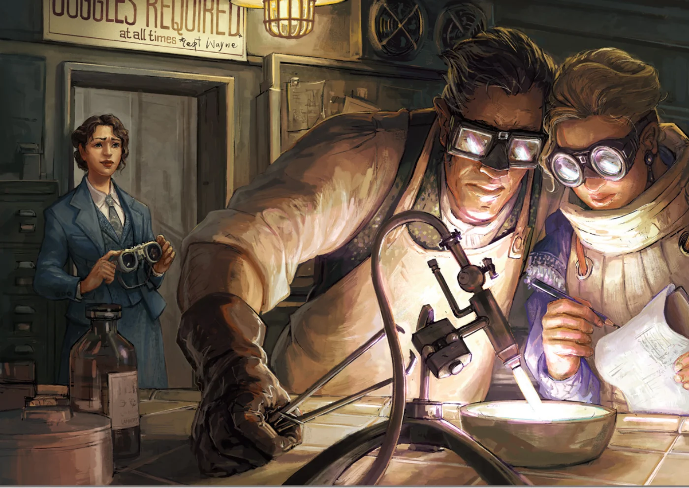
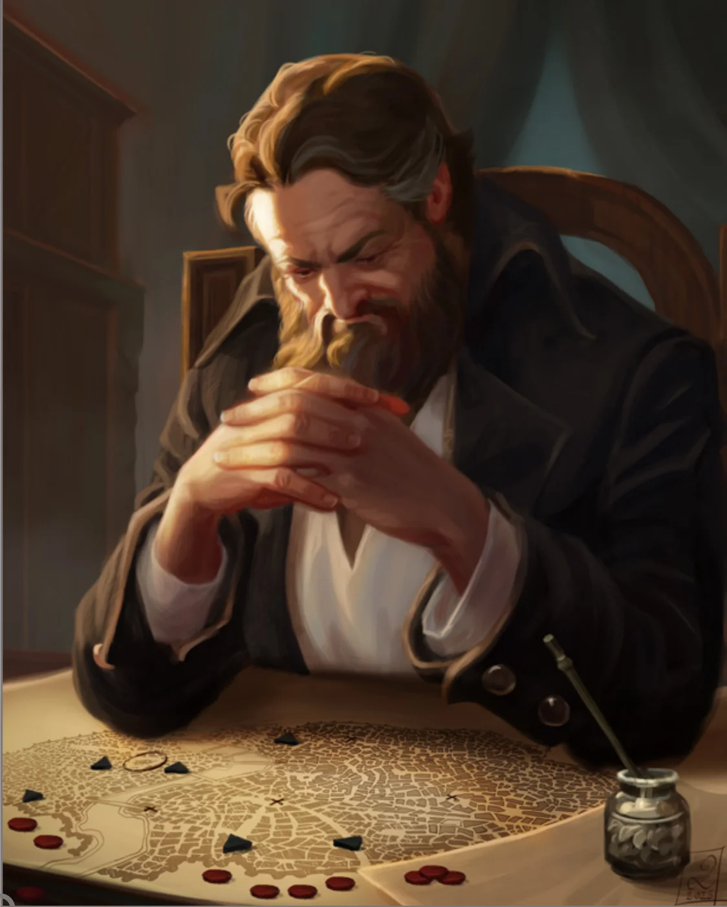

## 學者（Scholar）

英雄路徑（Heroic Path）

學者總在追尋下一項發現。他們既有自信追求自己的想法，也能謙遜地在必要時改變方向。他們對所學技藝的熱情，支撐著他們在積滿落灰的田野，或滿是火藥與吃剩三明治氣味的工作坊裡，長時間埋首鑽研。學者從不滿足於對世界的一知半解，總是不斷探索、學習與創造。沒有哪份好奇心毫無價值；意想不到的題材，也能帶來重大突破。科學進步是一把雙面刃，既推動文明前進，也可能使文明轟然崩毀。聲名卓著的學者會與能提供充裕研究資源的勢力合作，其中有些人對贊助者的動機並不太在意。另一些人則對自己的成果珍惜有加，只願將最好的發明留給自己認為值得的人。

### 學者專精（Specialty）

學者路徑（Path）提供三種專精的天賦（Talent）：

- **策士（Strategist）。** 策士以機智為利刃，預先布局，讓敵人措手不及。

- **外科醫師（Surgeon）。** 外科醫師必須在瞬息之間作出生死攸關的決定，憑藉充分的訓練與穩定的雙手挽救生命。

- **發明家（Inventor）[第二時代]。** 發明家總在擺弄新零件，並以改良和精修自己的作品為傲。（僅限第二時代。）

### 建立學者

下方的「司卡德利亞的學者」提供幾種代表性角色的建立範例。如果你另有構想，可以參考以下建議，建立能發揮所長的學者：

**屬性（Attribute）。** 通常建議優先提高智力（Intellect），其次是風采（Presence），再依你想在戰鬥中發揮的作用，選擇速度（Speed）或力量（Strength）。

**技能（Skill）。** 實用的技能包括工藝（Crafting）、推理（Deduction）、學識（Lore）與醫學（Medicine）。

**其他英雄路徑。** 獵手（Hunter）與領袖（Leader）都很適合用來兼修路徑。

**獎勵（Reward）。** 選擇獎勵時，能資助研究的富有贊助者（Patron）、能幫忙測試發明的夥伴（Companion），或一枚鎔金手榴彈（Allomantic Grenade），都是不錯的選擇。

### 司卡德利亞（Scadrial）的學者

如果你想從《迷霧之子》（Mistborn）小說汲取靈感，可以考慮以下幾種代表性學者角色的建立方式。

#### 依藍戴發明家（Elendel Inventor）[第二時代]

依藍戴（Elendel）城處處都有新的可能。快速的工業化，以及電力引進等重大的技術躍進，激勵發明家挑戰各行各業的現狀。不論是專業槍械匠，或設計巧妙工具來協助鎔金術師（Allomancer）的創新者，依藍戴城的發明家為了進步與改良，總是不放過任何機會。有些人追逐轉瞬即逝的名聲，有些人追求難以企及的自我滿足，但每位創新者都無比渴望下一項重大突破。

**建立依藍戴發明家。** 選擇人類（Human）血統（Ancestry）、依藍戴文化專長（Cultural Expertise），以及另一項文化專長。起始時提高智力與風采。除了學者提供的 1 級學識，將工藝提高 2 級，推理與說服（Persuasion）各提高 1 級。你的博學（Erudition，學者關鍵）天賦所提供的額外專長（Expertise），選擇一項專業領域，例如電學（Electricity）、機械學（Machinery）或結構工程（Structural Engineering）；額外技能等級（Skill Rank）則分配給工藝與學識。運用人類血統，選擇發明家專精的熟練操作者（Proficient Operator）天賦。最後，選擇工匠（Artisan）起始套組（Starting Kit）。

升級時，選擇快速調整（Hasty Adjustment）天賦，並朝取得應該就在這裡（It’s in Here Somewhere）的方向發展。

#### 泰瑞司史學家（Terris Historian）[第一時代]

依照泰瑞司（Terris）的傳統，檔案保管者致力保存歷史、宗教與其他珍貴的文化資訊，儘管統御主（Lord Ruler）積極阻止這類知識的保存與傳播。這些史學家努力分享自己對最後帝國（Final Empire）成立以前世界的認識，盼望那樣的世界有朝一日能夠重現。好奇心與智慧驅使他們求知。有些人為席諾德（Synod）效力，但每位泰瑞司史學家都在為自己期盼的未來努力，希望司卡德利亞的所有人都能迎向那個未來。

**建立泰瑞司史學家。** 選擇人類血統、泰瑞司統御區（Terris Dominance）文化專長，以及另一項文化專長。起始時提高智力與意志（Willpower）。除了學者提供的 1 級學識，將紀律（Discipline）提高 2 級，推理與洞察（Insight）各提高 1 級。你的博學（學者關鍵）天賦所提供的額外專長，選擇一項歷史主題，例如民俗（Folklore）、古代宗教（Ancient Religions），

第 4 章：英雄路徑 110

*瓦（Wax）與史特芮絲（Steris）以 Harmonium 進行實驗。*

*插圖告示：「任何時候都必須戴護目鏡——韋恩（Wayne）除外。」*

或昇華前諸國（Pre-Ascension Kingdoms）；額外技能等級則分配給紀律與學識。運用人類血統，選擇策士專精的擬定計策（Strategize）天賦。最後，選擇研究者（Researcher）起始套組。升級時，選擇策士專精的沉穩（Composed）與深入思索（Deep Contemplation）天賦。如果你想成為守護者（Keeper），可以考慮選擇第 5 章藏金術師（Feruchemist）路徑的天賦，從藏金術師傳承（Feruchemist Heritage）關鍵天賦開始。

#### 坎得拉外科醫師（Kandra Surgeon）[第二時代]

醫師會考量身體中的各種系統，以及它們如何彼此連結。許多人研讀圖表、研究遺體，以了解這些系統如何運作。但也有少數醫師更偏好以字面上的方式「消化」知識。坎得拉（Kandra）外科醫師從骨骼逆向重建身體，藉此學習醫術。他們運用製造器官、血管、肌肉等構造的經驗，開發新的方法，修補傷勢、強健凡人病患的身體。

**建立坎得拉外科醫師。** 選擇坎得拉血統、坎得拉家園（Kandra Homeland）文化專長，以及另一項文化專長。起始時提高智力與風采。除了學者提供的 1 級學識，將醫學提高 2 級，欺騙（Deception）與推理各提高 1 級。你的博學（學者關鍵）天賦所提供的額外專長，選擇一項人體解剖學領域，例如骨骼系統（Skeletal System）、肌肉系統（Muscular System）或消化系統（Digestive System）；額外技能等級則分配給推理與醫學。最後，選擇工匠起始套組。升級時，選擇外科醫師專精的戰地醫療（Field Medicine）與情緒智慧（Emotional Intelligence）天賦，將情緒智慧提供的額外技能等級分配給說服，並朝取得解剖洞見（Anatomical Insight）與復甦（Resuscitation）的方向發展。

第 4 章：英雄路徑 111

MARIE SEEBERGER

#### 博學（學者關鍵）

啟動（Activation）：[特殊啟動]

暫時獲得一項文化或實用專長（Utility Expertise），以及兩項非授予技能（Invested Skill）的意識（Cognitive）技能各 1 級。進行能使用圖書館的長休息（Long Rest）後，可以重新分配。

### 發明家天賦樹（Talent Tree）[第二時代]

| 天賦 | 解鎖來源 | 啟動及額外前提 |
| --- | --- | --- |
| [熟練操作者](#熟練操作者) | [博學](#博學學者關鍵) | 常駐 |
| [快速調整](#快速調整) | [博學](#博學學者關鍵) | 1 行動；工藝 1+ |
| [敏銳審視](#敏銳審視acute-scrutiny) | [熟練操作者](#熟練操作者) 或 [快速調整](#快速調整) | 反應；學識 2+ |
| [槍械匠](#槍械匠gunsmith) | [熟練操作者](#熟練操作者) 或 [快速調整](#快速調整) | 常駐；工藝 2+ |
| [應該就在這裡](#應該就在這裡) | [敏銳審視](#敏銳審視acute-scrutiny) | 3 行動；工藝 2+ |
| [排除故障](#排除故障out-of-a-jam) | [槍械匠](#槍械匠gunsmith) | 反應；學識 2+ |
| [現代科技迷](#現代科技迷modern-marveller) | [應該就在這裡](#應該就在這裡) | 常駐；工藝 3+ |
| [爆破專家](#爆破專家detonation-expert) | [排除故障](#排除故障out-of-a-jam) | 特殊啟動；學識 3+ |

#### 熟練操作者

啟動：[常駐]

解鎖來源：博學（學者關鍵）

當你在壓力下從事熟練的工作時，可以使用互動（Interact）行動（Action），取代使用技能（Use a Skill）。

#### 快速調整

啟動：[1行動]

前提條件（Prerequisite）：工藝 1+

解鎖來源：博學（學者關鍵）

進行工藝檢定（Test），設置陷阱或改良工具、機械，並能結合其他零件獲得優勢（Advantage）。你可以使用求生（Survival）搜尋廢料。

#### 敏銳審視（Acute Scrutiny）

啟動：[反應]

前提條件：學識 2+

解鎖來源：熟練操作者或快速調整

當角色使用物品時，花費 1 專注點（Focus），以工藝對抗意識防禦（Cognitive Defense）。成功時，物品無法運作。

#### 槍械匠（Gunsmith）

啟動：[常駐]

前提條件：工藝 2+

解鎖來源：熟練操作者或快速調整

獲得軍火工藝（Munitions Crafting）專長。製作物品時，你的機遇範圍（Opportunity Range）擴大 2，材料費用減半。

#### 應該就在這裡

啟動：天賦樹未顯示（完整天賦：[3行動]）

前提條件：工藝 2+

解鎖來源：敏銳審視

進行工藝檢定，以備用零件組裝所需物品。

#### 排除故障（Out of a Jam）

啟動：[反應]

前提條件：學識 2+

解鎖來源：槍械匠

花費 1 專注點，替武器重新裝填，或進行工藝檢定來修復武器。

#### 現代科技迷（Modern Marveller）

啟動：[常駐]

前提條件：工藝 3+

解鎖來源：應該就在這裡

獲得汽車維修（Automobile Mechanic）專長，以及一輛附帶暗格的汽車。

#### 爆破專家（Detonation Expert）

啟動：[特殊啟動]

前提條件：學識 3+

解鎖來源：排除故障

獲得炸藥（Dynamite）專長。你可以進行學識檢定，以炸藥攻擊。獲得 [1行動]，用來與爆裂物互動，或脫離（Disengage）、移動（Move）以遠離它。

第 4 章：英雄路徑 112

## 學者

英雄路徑

### 策士天賦樹

| 天賦 | 解鎖來源 | 啟動及額外前提 |
| --- | --- | --- |
| [擬定計策](#擬定計策) | [博學](#博學學者關鍵) | 特殊啟動；推理 1+ |
| [身心並進](#身心並進mind-and-body) | [博學](#博學學者關鍵) | 常駐 |
| [沉穩](#沉穩) | [擬定計策](#擬定計策) | 常駐 |
| [掌握時機](#掌握時機know-your-moment) | [身心並進](#身心並進mind-and-body) | 常駐；推理 2+ |
| [深入思索](#深入思索) | [沉穩](#沉穩) | 2 行動；學識 2+ |
| [敏銳洞見](#敏銳洞見keen-insight) | [深入思索](#深入思索) | 常駐 |
| [應變準備](#應變準備contingency) | [沉穩](#沉穩) | 反應；學識 3+ |
| [轉捩點](#轉捩點turning-point) | [應變準備](#應變準備contingency) | 2 行動；推理 3+ |

#### 擬定計策

啟動：[特殊啟動]

前提條件：推理 1+

解鎖來源：博學（學者關鍵）

使用博學提供的技能獲取優勢（Gain Advantage）後，將該優勢給予一名盟友（Ally）。花費 2 專注點，還能阻止目標對該盟友使用反應（Reaction）。

#### 身心並進（Mind and Body）

啟動：[常駐]

解鎖來源：博學（學者關鍵）

獲得一項武器專長（Weapon Expertise）。博學額外提供一項技能。你現在可以用博學選擇實體（Physical）技能。

#### 沉穩

啟動：[常駐]

解鎖來源：擬定計策

你的專注點上限與目前專注點各增加等同於你階層（Tier）的數值。

#### 掌握時機（Know Your Moment）

啟動：[常駐]

前提條件：推理 2+

解鎖來源：身心並進

從每個回合（Round）開始，直到你進行自己的輪次（Turn）前，你的各項防禦（Defense）提高 2。

#### 深入思索

啟動：[2行動]

前提條件：學識 2+

解鎖來源：沉穩

重新分配博學提供的技能與專長，合計最多 2 項。

#### 敏銳洞見（Keen Insight）

啟動：[常駐]

解鎖來源：深入思索

獲取優勢後，目標必須抵抗你的影響（Influence），否則下次檢定具有劣勢（Disadvantage）。

#### 應變準備（Contingency）

啟動：[反應]

前提條件：學識 3+

解鎖來源：沉穩

花費 2 專注點，從 20 呎內一名盟友的檢定中移除一個 [變故]（Complication）。

#### 轉捩點（Turning Point）

啟動：[2行動]

前提條件：推理 3+

解鎖來源：應變準備

花費 2 專注點，以推理對抗敵方領袖的意識防禦；若是慢速輪次（Slow Turn），此次檢定具有優勢。成功時，你和盟友在各自的下一個輪次獲得 [1行動]。

### 外科醫師天賦樹

| 天賦 | 解鎖來源 | 啟動及額外前提 |
| --- | --- | --- |
| [戰地醫療](#戰地醫療) | [博學](#博學學者關鍵) | 1 行動；醫學 1+ |
| [情緒智慧](#情緒智慧) | [博學](#博學學者關鍵) | 常駐 |
| [解剖洞見](#解剖洞見) | [戰地醫療](#戰地醫療) | 特殊啟動 |
| [沉著](#沉著collected) | [情緒智慧](#情緒智慧) | 常駐 |
| [迅捷醫者](#迅捷醫者swift-healer) | [戰地醫療](#戰地醫療) | 自由行動；醫學 2+ |
| [應用醫學](#應用醫學applied-medicine) | [沉著](#沉著collected) | 常駐；學識 2+ |
| [持續照護](#持續照護ongoing-care) | [迅捷醫者](#迅捷醫者swift-healer) | 特殊啟動；學識 3+ |
| [復甦](#復甦) | [迅捷醫者](#迅捷醫者swift-healer) | 特殊啟動；醫學 3+ |

#### 戰地醫療

啟動：[1行動]

前提條件：醫學 1+

解鎖來源：博學（學者關鍵）

花費 1 專注點並進行醫學檢定（DC 15），治療一名有意識的角色。成功時，在其恢復骰（Recovery Die）結果加上你的醫學等級。

#### 情緒智慧

啟動：[常駐]

解鎖來源：博學（學者關鍵）

獲得診斷（Diagnosis）專長。博學額外提供一項技能。你現在可以用博學選擇靈魂（Spiritual）技能。

#### 解剖洞見

啟動：[特殊啟動]

解鎖來源：戰地醫療

徒手攻擊（Unarmed Attack）命中時，花費 1 專注點或一個 [機遇]（Opportunity），使目標精疲力竭（Exhausted）[− 你的醫學等級的一半]。

#### 沉著（Collected）

啟動：[常駐]

解鎖來源：情緒智慧

你的意識防禦與靈魂防禦（Spiritual Defense）提高 2。

#### 迅捷醫者（Swift Healer）

啟動：[自由行動]

前提條件：醫學 2+

解鎖來源：戰地醫療

以 [自由行動] 使用戰地醫療。你的治療能力額外恢復等同於你醫學等級的生命值（Health）。

#### 應用醫學（Applied Medicine）

啟動：[常駐]

前提條件：學識 2+

解鎖來源：沉著

你的治療能力額外恢復等同於你學識等級的生命值。

#### 持續照護（Ongoing Care）

啟動：[特殊啟動]

前提條件：學識 3+

解鎖來源：迅捷醫者

獲得心理健康照護（Mental Health Care）專長。休息期間進行醫學檢定（DC 10），移除受傷盟友的一項狀態（Condition）。

#### 復甦

啟動：[特殊啟動]

前提條件：醫學 3+

解鎖來源：迅捷醫者

使用戰地醫療時花費 3 專注點，使一名昏迷（Unconscious）或剛死去不久的角色甦醒。

### 圖示意義

| 圖示 | 意義 |
| --- | --- |
| [1行動] | 1 行動 |
| [2行動] | 2 行動 |
| [3行動] | 3 行動 |
| [自由行動] | 自由行動（Free Action） |
| [反應] | 反應 |
| [特殊啟動] | 特殊啟動（Special activation） |
| [常駐] | 常駐（Always active） |

DEANDRA SCICLUNA & GAL OR

### 學者關鍵天賦（Key Talent）

學者的關鍵天賦「博學」能解鎖學者的各項專精。起始技能（Starting Skill）：學識。如果你選擇學者作為起始路徑（Starting Path），免費獲得 1 級學識。

#### 博學（學者關鍵）

前提條件：無

啟動：[特殊啟動]

你訓練自己的頭腦，迅速吸收、

歸檔並回想資訊。經過短暫卻密集的研讀，你就能以令人驚豔的熟練程度，運用自己最新專注的領域。

取得此天賦時，你變得善於整理思緒。選擇一項你尚未擁有的文化或實用專長，以及兩項不同且不屬於授予技能的意識技能。進行檢定時，你視為擁有所選專長，且所選的兩項技能各視為額外擁有 1 級。透過此天賦獲得的技能等級，可以超過你通常的技能等級上限。此天賦提供的專長與技能等級是暫時的，不能用來滿足前提條件。完成一次期間能使用圖書館的長休息後，你可以重新分配此天賦提供的任何專長與技能等級。重新選擇時，遵循與最初取得此天賦時相同的規則。

### 發明家專精 第二時代

以下天賦出現在學者天賦樹的發明家專精中，依英文名稱字母順序排列。（此專精僅限第二時代。）

#### 敏銳審視

前提條件：學識 2+；熟練操作者天賦或快速調整天賦

啟動：[反應]

你憑藉專業的眼光，迅速看出粗劣的構造與潛在的故障。透過誤導或直接破壞，你能確保意外在最恰當的時刻發生。

當你能感知的一名角色，嘗試使用一件屬於自己、或在場景開始時就已在場的物品，且該物品不是受授予的（Invested）物品時，你可以使用此反應，並花費 1 專注點，以工藝檢定對抗該角色的意識防禦。成功時，該物品無法繼續運作；由 GM 決定故障時會發生什麼事。

#### 爆破專家

前提條件：學識 3+；排除故障天賦

啟動：[特殊啟動]

危險絲毫不減你的戲劇性，卻

確實讓你的腳步更加敏捷。沒有什麼比腳底著火，更能讓你趕緊行動。

當你的輪次開始時，若你在一個能感知且尚未引爆的爆裂物 30 呎內，你獲得 [1行動]，只能用來與該爆裂物互動，或脫離、移動以遠離它。此外，使用炸藥進行攻擊檢定時，你可以使用學識取代重型武器（Heavy Weaponry）。最後，取得此天賦時，獲得炸藥武器專長。

#### 槍械匠

前提條件：工藝 2+；熟練操作者天賦或快速調整天賦

啟動：[常駐]

製作具備各種精巧功能的槍械，是門難以掌握的技藝，但你對此特別在行。

進行製作物品的檢定時，你在該次檢定的機遇範圍擴大 2，取得原料所需的任何費用都減半。此外，取得此天賦時，獲得軍火工藝實用專長；你可以運用此專長，以原型設計發明槍械（見第 7 章「發明槍械（Inventing Firearms）」）。

#### 快速調整

前提條件：工藝 1+；博學關鍵天賦

啟動：[1行動]

即使時間緊迫，你仍是臨場應變的

機械大師。別人眼中的垃圾，在你看來卻是滿載可能性的寶庫。

進行工藝檢定，臨時製作陷阱或類似裝置，或改造、提升工具或機械的用途，使其超越通常的功能。你可以結合自己擁有的另一件工具或機械的零件，使此次檢定具有優勢。成功時，與 GM 一同決定新物品的效果。此外，取得此天賦時，你學會在城市等工業區域中，使用求生技能搜尋廢料與備用零件。

第 4 章：英雄路徑 114

#### 應該就在這裡

前提條件：工藝 2+；敏銳審視天賦

啟動：[3行動]

你的袋子裡塞滿各式各樣的作品，但正是這種時刻，

才能證明你為何總把它們全帶在身邊。

你嘗試製作一件能在此場景派上用場的物品。你可以使用手邊的材料，或使用你有足夠盒金（Boxing）購買的常見材料，視為你已在先前的場景買妥。進行工藝檢定，決定是否成功；大多數物品的檢定 DC 為 15，但若使用非標準材料（Nonstandard Materials），DC 為 20（見第 7 章「以非標準材料製作物品」）。

#### 現代科技迷

前提條件：工藝 3+；應該就在這裡天賦

啟動：[常駐]

你深諳各種現代便利設施。從

工作坊到道路上，沒有什麼能阻擋你。

取得此天賦時，獲得汽車維修實用專長，以及一輛附帶暗格的汽車（見第 7 章「載具」）。這個秘密收納空間可以藏起體積不超過汽車四分之一的物品。

#### 排除故障

前提條件：學識 2+；槍械匠天賦

啟動：[反應]

照料槍械已成為你的本能。你沉著地

處理武器故障，動作毫不遲滯。

在你觸及範圍（Reach）內的一件武器耗盡已裝填彈藥或損壞後，你可以使用此反應，並花費 1 專注點，為武器重新裝填，或進行工藝檢定來修復它。

#### 熟練操作者

前提條件：博學關鍵天賦

啟動：[常駐]

你能輕鬆完成那些會讓其他人在

壓力下手忙腳亂的工作。

當你在壓力下嘗試複雜的工作時，若那是你在較輕鬆的情況下能可靠且迅速完成的工作，就不必使用技能並成功通過檢定。你可以改用互動行動，如同自己並未承受壓力。

例如，在緊張的情況下，你可以用互動完成下列其中一項工作：

- 打一個複雜的繩結。

- 寫一張字條並傳出去。

- 操作載具。

- 操作多個按鈕或拉桿。

- 在書中查找資料。

- 清點錢幣。

- 裝載易損的貨物。

由 GM 決定你能否運用此天賦，對一場試煉（Endeavor）作出實質貢獻。

### 策士專精

以下天賦出現在學者天賦樹的策士專精中，依英文名稱字母順序排列。

#### 沉穩

前提條件：擬定計策天賦

啟動：[常駐]

經過訓練的鎮定，讓你能突破極限，而不會

分心或忽略威脅。

取得此天賦時，你的專注點上限與目前專注點，各增加等同於你階層的數值。你的階層每提高 1，你的專注點上限與目前專注點也各提高 1。

#### 應變準備

前提條件：學識 3+；沉穩天賦

啟動：[反應]

歷史中滿是未能記取

往事教訓的人留下的殘局。你下定決心，不願步上後塵，因此預先防備一切可能打亂計畫的事。

在距你 20 呎內、且你能影響的一名盟友擲出變故後，你可以使用此反應，並花費 2 專注點，從其檢定中移除一個變故。

#### 深入思索

前提條件：學識 2+；沉穩天賦

啟動：[2行動]

你有條不紊地搜尋腦中的資料庫，尋找

有助於解決當前處境的事實與資訊。

重新分配你從博學獲得的技能與專長，合計最多 2 項。

第 4 章：英雄路徑 115

#### 敏銳洞見

前提條件：深入思索天賦

啟動：[常駐]

人人都有弱點，而你特別善於找出並利用它們。

獲取優勢的檢定成功後，你利用目標某項關鍵的特質、長處或缺陷。除非目標抵抗你的影響，否則其在此次遭遇中的下一次檢定具有劣勢。

#### 掌握時機

前提條件：推理 2+；身心並進天賦

啟動：[常駐]

衝突有其節奏，隨著各方勢力爭奪主導權而起伏。你對策略、修辭與歷史的認識，指引你在最能發揮效果的時刻行動。

每個回合開始之後，你的各項防禦提高 2，直到你的輪次開始。

#### 身心並進

前提條件：博學關鍵天賦

啟動：[常駐]

你將密集研習的範圍從心智學問，擴展到武術與體能訓練。

取得此天賦時，你的博學天賦額外提供一項技能，而且你可以用博學選擇不屬於授予技能的實體技能。此外，獲得一項自選武器專長。

#### 擬定計策

前提條件：推理 1+；博學關鍵天賦

啟動：[特殊啟動]

你仔細觀察，從新的角度評估問題，擬定巧妙的計畫，以排除阻礙、取得先機，或反制敵人的下一步。

以博學提供的技能成功通過獲取優勢的檢定後，你可以選擇一名你能影響的盟友，不需花費行動。由該盟友取代你，獲得此次獲取優勢行動的好處。使用此天賦時，你還可以花費 2 專注點，使你獲取優勢的目標，在你的下一個輪次結束前，都不能對你所選的盟友使用反應。

*灰侯．塞特（Ashweather Cett），策士。*

#### 轉捩點

前提條件：推理 3+；應變準備天賦

啟動：[2行動]

戰局常因一個關鍵時刻而逆轉。你藉由研究戰爭史，學會辨識這樣的機會，取得上風。

每個場景一次，你可以花費 2 專注點，找出敵方群體策略中的弱點。進行推理檢定，對抗此場景中位階最高的敵方領袖的意識防禦；你必須能感知該領袖，才能將其作為目標。如果你採取慢速輪次，此次檢定具有優勢。成功時，你以及你能影響的盟友，在各自的下一個輪次額外獲得 [1行動]。

### 外科醫師專精

以下天賦出現在學者天賦樹的外科醫師專精中，依英文名稱字母順序排列。

第 4 章：英雄路徑 116

DARKO STOJANOVIC

#### 解剖洞見

前提條件：戰地醫療天賦

啟動：[特殊啟動]

你的解剖知識能幫助你擊中要害，

使敵人失去戰力，同時盡量減少永久性的傷害。

當你以徒手攻擊命中與你同體型（Size）或更小的目標時，可以花費 1 專注點或一個 [機遇]，使目標陷入精疲力竭狀態。此狀態的減值等於你醫學等級的一半，無條件進位。

#### 應用醫學

前提條件：學識 2+；沉著天賦

啟動：[常駐]

你研習過化學、解剖學、社會行為，

以及更多領域。憑藉這份廣博的基礎，你能靈活而自信地施展複雜的醫術。

當你使一名角色恢復生命值時，該角色額外恢復等同於你學識等級的生命值。

#### 沉著

前提條件：情緒智慧天賦

啟動：[常駐]

你專注於眼前的目標，同時不忘

自己深層的價值，在混亂中依然保持平穩。

取得此天賦時，你的意識防禦與靈魂防禦提高 2。

#### 情緒智慧

前提條件：博學關鍵天賦

啟動：[常駐]

你磨練直覺與對他人的理解，

從而察覺隱藏症狀與複雜情緒中容易被忽略的徵兆。

取得此天賦時，你的博學天賦額外提供一項技能，而且你可以用博學選擇不屬於授予技能的靈魂技能。此外，獲得診斷實用專長。

#### 戰地醫療

前提條件：醫學 1+；博學關鍵天賦

啟動：[1行動]

你為同伴處理輕傷，替其包紮

傷口、敷上藥膏，或將脫臼的關節復位。

花費 1 專注點，進行 DC 15 的醫學檢定，治療你觸及範圍內一名有意識且自願接受治療的角色，並在此次檢定中一併擲目標的恢復骰。如果你治療自己，此次檢定具有劣勢。成功時，目標恢復的生命值等於其恢復骰結果 + 你的醫學等級。失敗時，目標只恢復等同於其恢復骰結果的生命值。

#### 持續照護

前提條件：學識 3+；迅捷醫者天賦

啟動：[特殊啟動]

醫療照護可能是漫長艱辛的過程，需要耐心，

也需要定期重新評估。你研究身心健康的關聯，學會在漫長的康復之路上，同時照顧兩者。

你可以放棄短休息（Short Rest）或長休息通常提供的好處，改用這段時間治療你觸及範圍內的一名盟友。該次休息結束後，進行 DC 10 的醫學檢定；目標除了第一項傷勢（Injury）外，每多一項傷勢，難度就提高 5。成功時，移除目標某一項傷勢造成的一項狀態或類似效果，但傷勢本身仍會保留，直到痊癒為止。同一目標每 24 小時（或 1 天）最多只能受惠於此天賦一次。此外，取得此天賦時，獲得心理健康照護實用專長。

#### 復甦

前提條件：醫學 3+；迅捷醫者天賦

啟動：[特殊啟動]

你有效率地救治重傷垂死的生物，設法

將其從死亡邊緣拉回。你可能為其綁上止血帶、給予解毒劑，甚至讓停止運作的器官重新運作。

你可以使用戰地醫療天賦，嘗試救回倒下的角色。如此使用時，花費 3 專注點，取代原本的 1 專注點，選擇你觸及範圍內一名昏迷的角色，或死亡至今的回合數不超過你醫學等級的角色。目標除了第一項傷勢外，每多一項傷勢，該天賦的檢定 DC 就提高 5。失敗時，目標不會恢復生命值。成功時，目標依該天賦通常的規則恢復生命值；如果目標已死亡，便會復活。如果目標昏迷，則可以選擇移除該狀態。

#### 迅捷醫者

前提條件：醫學 2+；戰地醫療天賦

啟動：[自由行動]

即使戰況瞬息萬變，

你熟練的雙手仍能迅速包紮傷口。

你可以用 [自由行動] 使用戰地醫療。此外，取得此天賦時，你更擅長治療。當你使用能讓另一名角色恢復生命值的能力時，該角色額外恢復等同於你醫學等級的生命值。

第 4 章：英雄路徑 117
