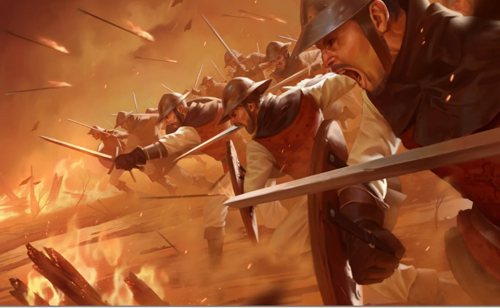
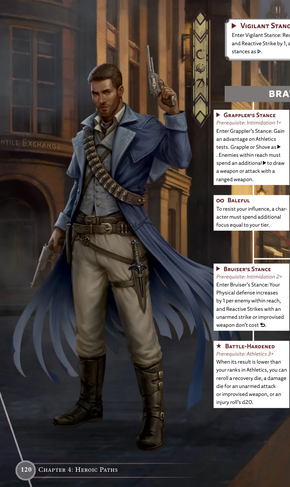
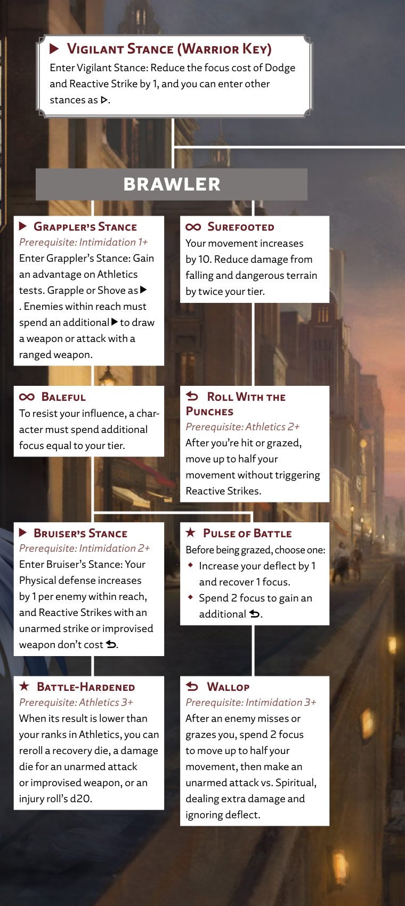
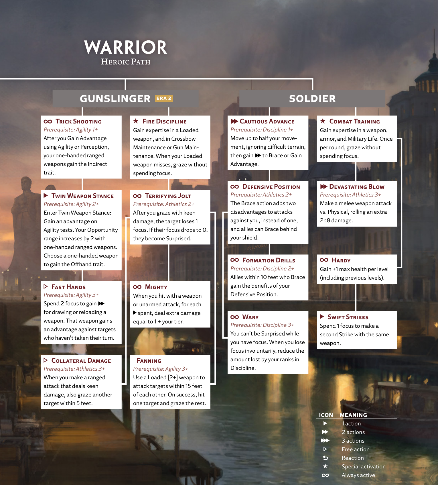
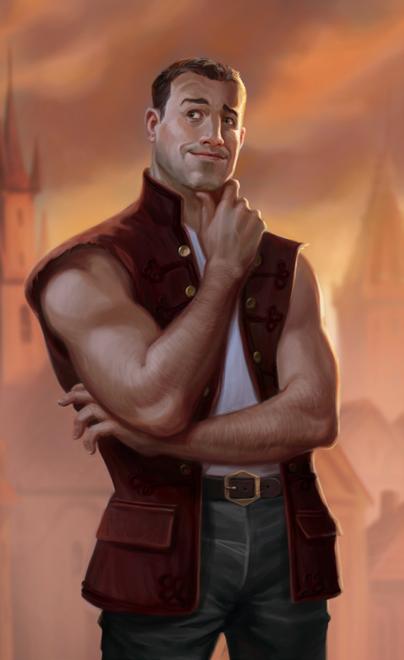
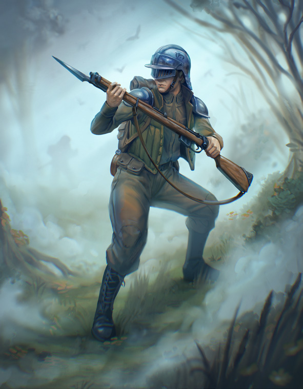
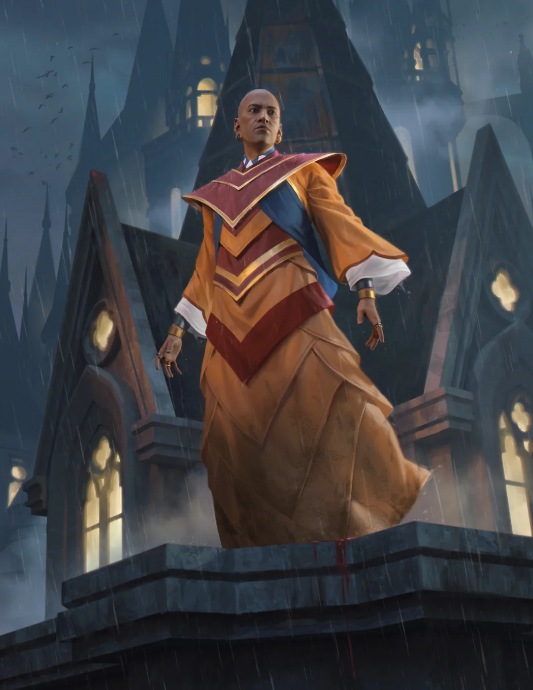

## 戰士（Warrior）

英雄路徑（Heroic Path）

司卡德利亞（Scadrial）是變化不息的戰場。無論身處落灰或摩天大樓的陰影下，戰士都展現著傳奇般的身手。戰鬥雖然需要大量行動（Action），勝負卻從心念開始。要贏得勝利，除了進取心，也需要耐力與應變能力；戰士反覆鍛鍊這三者，直到自己的直覺比敵人的刀鋒還銳利。

優秀的戰士知道自己為何而戰。當其他人忙著發表宏大的宣言、策劃精密的布局時，戰士以身體的力量實踐信念。直視死亡只會讓他們更加強大；即使走到生命盡頭，他們也要轟轟烈烈地綻放最後的光芒。

### 戰士專精（Specialty）

戰士路徑（Path）的天賦（Talent）分為三種專精：

- **鬥士（Brawler）。** 鬥士反應敏捷，凡事親身上陣，樂於挑戰以寡敵眾的局面。

- **槍手（Gunslinger）[第二時代]。** 槍戰很容易變成數量的較量，而槍手認為兩把槍總比一把好。（僅限第二時代。）

- **士兵（Soldier）。** 士兵不願放棄希望，信任領袖的指引，勇敢地與同袍並肩作戰。

### 建立戰士

下方「司卡德利亞的戰士」提供經典角色的建立範例。如果你另有構想，可以參考以下建議，打造有力的戰士：

- **屬性（Attribute）。** 通常可以優先提高速度（Speed）與力量（Strength），再考慮察覺（Awareness）與意志（Willpower）。

- **技能（Skill）。** 適合戰士的技能包括敏捷（Agility）、運動（Athletics）、紀律（Discipline）、輕型武器（Light Weaponry）、重型武器（Heavy Weaponry）、威嚇（Intimidation）、領導（Leadership）與說服（Persuasion）。

- **其他英雄路徑。** 領袖（Leader）與獵手（Hunter）都是兼修路徑的好選擇。

- **獎勵（Reward）。** 選擇獎勵時，克羅司巨劍（Koloss Blade）、鐵製血金術尖刺（Hemalurgic Spike），或能與你並肩作戰的夥伴（Companion），都很合適。

### 司卡德利亞的戰士

如果你想從《迷霧之子》（Mistborn）小說汲取靈感，可以參考以下經典戰士角色的建立方式。

### 司卡傭兵（Skaa Mercenary） 第一時代

不是每個士兵都為自己的信念而戰。有些司卡（skaa）新兵加入統御主（Lord Ruler）的鎮壓行動（Suppression Campaigns），通常不是出於忠誠，而只是為了活下去。同胞視他們為叛徒，他們卻也因此得到原本無緣接觸的戰鬥訓練。他們在最後帝國（Final Empire）的旗幟下作戰，但有些人暗中反抗帝國，反咬那隻殘酷的餵食之手。了解敵人很重要；司卡傭兵努力在這般惡劣的處境中，找出對自己最有利的做法。

**建立司卡傭兵。** 選擇人類（Human）血統（Ancestry）、司卡文化專長（Cultural Expertise），以及另一項文化專長。起始時以速度和力量為高屬性。除了戰士給予的 1 個運動技能等級（Skill Rank），將 2 個技能等級投入紀律，並各將 1 個技能等級投入重型武器與輕型武器。除了戒備架式（Vigilant Stance，戰士關鍵天賦），運用人類血統選擇士兵專精的戰鬥訓練（Combat Training）天賦。最後，選擇傭兵（Mercenary）起始套組（Starting Kit）。隨著等級提高，可以考慮隊形操練（Formation Drills）天賦。

### 幫派打手（Gang Muscle） 第二時代

在犯罪事業裡，恐懼是一種貨幣，能換來同夥的忠誠與敵人的屈服。幫派倚靠打手，清楚傳達要求並迫使他人遵從。當敵對派系互不退讓、決定揭穿對方的虛張聲勢時，就由打手出面算帳。一場衝突不只是解決紛爭的手段，也是長久留在人們心中的警告。

**建立幫派打手。** 選擇人類或克羅司混血（koloss-blooded）血統、地下社會（Underworld）文化專長，以及另一項文化專長。起始時以力量和意志為高屬性。除了戰士給予的 1 個運動技能等級，將 2 個技能等級投入威嚇，並各將 1 個技能等級投入運動與竊術（Thievery）。除了戒備架式（戰士關鍵天賦），如果你是人類，運用額外天賦（Bonus Talent）選擇鬥士專精的擒抱架式（Grappler’s Stance）天賦；如果你是克羅司混血，則在之後的等級取得該天賦。最後，選擇地下社會起始套組。隨著等級提高，可以考慮懾人（Baleful）天賦。

第 4 章：英雄路徑 118

### 蠻橫區執法者（Roughs Enforcer） 第二時代

在蠻橫區（The Roughs）當賞金獵人，生活充滿刺激與危險。有時，這些執法者與他們追捕的法外之徒，唯一的差別就是自以為站在道德高處。每位蠻橫區執法者都有名聲要維持，因此有些人還會刻意增添幾分瀟灑。在蠻橫區，正義與土地一樣狂野，每一天都是冒險。

**建立蠻橫區執法者。** 選擇人類或克羅司混血血統、蠻橫區文化專長，以及另一項文化專長。起始時以察覺和速度為高屬性。除了戰士給予的 1 個運動技能等級，將 2 個技能等級投入輕型武器，並各將 1 個技能等級投入推理（Deduction）與洞察（Insight）。除了戒備架式（戰士關鍵天賦），如果你是人類，運用血統選擇槍手專精的射擊紀律（Fire Discipline）天賦；如果你是克羅司混血，則在之後的等級取得該天賦。最後，選擇傭兵起始套組。隨著等級提高，朝雙武器架式（Twin Weapon Stance）天賦發展。

駐軍士兵衝入戰陣。

### 戰士關鍵天賦（Key Talent）

戰士的關鍵天賦「戒備架式」讓你能夠取得戰士專精的天賦。

**起始技能（Starting Skill）：運動。** 如果你選擇戰士作為起始路徑（Starting Path），免費獲得 1 個運動技能等級。

#### 戒備架式（戰士關鍵天賦）

前提條件（Prerequisite）：無

啟動（Activation）：[1行動]

你研習特殊的戰鬥風格，以應付不同的敵人與戰術。其中最基本的姿態重視警覺，以及對迫近威脅的迅速反應。

取得此天賦時，你學會使用架式（Stance）。起初你會使用戒備架式，可以花費 [1行動] 進入：

**戒備架式。** 處於此架式時，閃避（Dodge）與反擊機會（Reactive Strike）反應（Reaction）的專注點（Focus）成本降低 1。此外，你可以花費 [自由行動] 進入另一種你會使用的架式。

你可以花費該天賦標示的行動數，進入你會使用的架式。如果你花費 [自由行動] 結束架式、進入另一種架式，或場景（Scene）結束，你目前的架式就會結束。處於架式時，你暫時獲得它提供的任何行動、加值與其他效果；架式結束時，這些效果也隨之結束。

通常，你只能在戰鬥（Combat）中使用架式，不能在其他場景使用。

ANDREW CHOU

第 4 章：英雄路徑 119

#### 戒備架式（戰士關鍵天賦）

啟動：[1行動]

進入戒備架式：閃避與反擊機會的專注點成本降低 1，且你可以花費 [自由行動] 進入其他架式。

### 鬥士

#### 擒抱架式

前提條件：威嚇 1+

解鎖條件：戒備架式天賦

啟動：[1行動]

進入擒抱架式：運動檢定（Test）獲得 1 個優勢（Advantage）。可以花費 [1行動] 擒抱（Grapple）或推撞（Shove）。觸及範圍（Reach）內的敵人拔出武器或以遠程武器攻擊時，必須額外花費 [1行動]。

#### 步履穩健（Surefooted）

解鎖條件：戒備架式天賦

啟動：[常駐]

你的移動增加 10。墜落（Falling）與危險地形（Dangerous Terrain）造成的傷害（Damage）減少你階層（Tier）的兩倍。

#### 懾人

解鎖條件：擒抱架式天賦

啟動：[常駐]

角色若要抵抗你的影響（Influence），必須額外花費等同你階層的專注點。

#### 順勢移步（Roll With the Punches）

前提條件：運動 2+

解鎖條件：步履穩健天賦

啟動：[反應]

你被命中（Hit）或擦傷（Graze）後，移動至多移動速率（Movement Rate）的一半，且不會觸發反擊機會。

#### 搏鬥架式（Bruiser’s Stance）

前提條件：威嚇 2+

解鎖條件：懾人天賦

啟動：[1行動]

進入搏鬥架式：觸及範圍內每有一名敵人，你的實體防禦（Physical Defense）就增加 1；使用徒手打擊或臨時武器（Improvised Weapon）的反擊機會不花費 [反應]。

#### 戰鬥脈動（Pulse of Battle）

解鎖條件：懾人天賦

啟動：[特殊啟動]

在受到擦傷前，選擇一項：

- 偏轉值（Deflect）增加 1，並恢復 1 專注點。

- 花費 2 專注點，額外獲得 1 次 [反應]。

#### 身經百戰（Battle-Hardened）

前提條件：運動 3+

解鎖條件：搏鬥架式天賦

啟動：[特殊啟動]

當結果低於你的運動技能等級時，你可以重擲恢復骰（Recovery Die）、徒手攻擊（Unarmed Attack）或臨時武器的傷害骰，或傷勢擲骰（Injury Roll）的 d20。

#### 猛力反擊（Wallop）

前提條件：威嚇 3+

解鎖條件：戰鬥脈動天賦

啟動：[反應]

敵人未命中或擦傷你後，花費 2 專注點，移動至多移動速率的一半，再對靈魂防禦（Spiritual Defense）進行徒手攻擊，造成額外傷害並忽略偏轉值。

第 4 章：英雄路徑 120

## 戰士

英雄路徑

### 槍手 [第二時代]

#### 花式射擊（Trick Shooting）

前提條件：敏捷 1+

解鎖條件：戒備架式天賦

啟動：[常駐]

你使用敏捷或感知（Perception）獲取優勢（Gain Advantage）後，單手遠程武器獲得曲射（Indirect）特性。

#### 射擊紀律

解鎖條件：戒備架式天賦

啟動：[特殊啟動]

獲得一種裝填（Loaded）武器的專長（Expertise），以及弩具保養（Crossbow Maintenance）或槍械保養（Gun Maintenance）專長。你的裝填武器未命中時，不需花費專注點即可造成擦傷。

#### 雙武器架式

前提條件：敏捷 2+

解鎖條件：花式射擊天賦

啟動：[1行動]

進入雙武器架式：敏捷檢定獲得 1 個優勢。使用單手遠程武器時，你的機遇範圍（Opportunity Range）增加 2。選擇一件單手武器，使其獲得副手（Offhand）特性。

#### 驚嚇衝擊（Terrifying Jolt）

前提條件：運動 2+

解鎖條件：射擊紀律天賦

啟動：[常駐]

你以銳利傷害（Keen Damage）造成擦傷後，目標失去 1 專注點。如果其專注點降至 0，便會措手不及（Surprised）。

#### 快手（Fast Hands）

前提條件：敏捷 3+

解鎖條件：雙武器架式天賦

啟動：[自由行動]

花費 2 專注點，獲得可用來拔出武器或重新裝填的 [2行動]。該武器攻擊尚未進行輪次（Turn）的目標時，獲得 1 個優勢。

#### 強勁（Mighty）

解鎖條件：驚嚇衝擊天賦

啟動：[常駐]

使用武器或徒手攻擊命中時，每花費 [1行動]，就造成等同 1 + 你的階層的額外傷害。

#### 波及傷害（Collateral Damage）

前提條件：運動 3+

解鎖條件：驚嚇衝擊天賦

啟動：[自由行動]

進行造成銳利傷害的遠程攻擊時，也擦傷 5 呎內的另一個目標。

#### 撥錘連射（Fanning）

前提條件：敏捷 3+

解鎖條件：驚嚇衝擊天賦

啟動：[3行動]

使用裝填 [2+] 武器，攻擊彼此相距 15 呎內的目標。成功時，命中一個目標，並擦傷其他目標。

### 士兵

#### 謹慎推進（Cautious Advance）

前提條件：紀律 1+

解鎖條件：戒備架式天賦

啟動：[2行動]

移動至多移動速率的一半，忽略困難地形（Difficult Terrain），然後獲得可用於架防（Brace）或獲取優勢的 [2行動]。

#### 戰鬥訓練

解鎖條件：戒備架式天賦

啟動：[特殊啟動]

獲得一種武器、一種護甲（Armor）與軍旅生活（Military Life）的專長。每回合（Round）一次，不需花費專注點即可造成擦傷。

#### 防禦站位（Defensive Position）

前提條件：運動 2+

解鎖條件：謹慎推進天賦

啟動：[常駐]

架防行動會使對你進行的攻擊承受 2 個劣勢（Disadvantage），而非 1 個；盟友（Ally）也可以在你的盾牌後方架防。

#### 毀滅重擊（Devastating Blow）

前提條件：運動 3+

解鎖條件：戰鬥訓練天賦

啟動：[2行動]

對實體防禦進行近戰武器攻擊，額外擲 2d8 傷害。

#### 隊形操練

前提條件：紀律 2+

解鎖條件：防禦站位天賦

啟動：[常駐]

10 呎內架防的盟友，獲得你防禦站位的效益。

#### 強健（Hardy）

解鎖條件：戰鬥訓練天賦

啟動：[常駐]

每個等級的生命值（Health）上限增加 1（包括先前的等級）。

#### 警戒（Wary）

前提條件：紀律 3+

解鎖條件：防禦站位天賦

啟動：[常駐]

只要你還有專注點，就不會措手不及。非自願失去專注點時，失去的數量減少等同你的紀律技能等級。

#### 迅捷打擊（Swift Strikes）

解鎖條件：強健天賦

啟動：[1行動]

花費 1 專注點，以同一件武器進行第二次打擊（Strike）。

### 圖示意義

| 圖示 | 意義 |
| --- | --- |
| [1行動] | 1 行動 |
| [2行動] | 2 行動 |
| [3行動] | 3 行動 |
| [自由行動] | 自由行動（Free Action） |
| [反應] | 反應 |
| [特殊啟動] | 特殊啟動（Special activation） |
| [常駐] | 常駐（Always active） |

DEANDRA SCICLUNA & GAL OR

### 鬥士專精

以下天賦出現在戰士天賦樹（Talent Tree）的鬥士專精，依英文名稱字母順序排列。

#### 懾人

前提條件：擒抱架式天賦

啟動：[常駐]

你嚴厲的目光足以擊潰對手的決心，唯有最沉得住氣的人才能抵抗。

角色若要抵抗你的影響，必須額外花費等同你階層的專注點。

#### 身經百戰

前提條件：運動 3+；搏鬥架式天賦

啟動：[特殊啟動]

你在許多戰場灑過血，有敵人的，也有自己的。你憑著凶猛、毅力與艱苦磨練出的直覺，一路存活至今。

每回合一次，當下列其中一顆骰子的結果低於你的運動技能等級時，你可以重擲該骰：恢復骰、徒手攻擊或臨時武器的傷害骰，或傷勢擲骰的 d20。

#### 搏鬥架式

前提條件：威嚇 2+；懾人天賦

啟動：[1行動]

你調整重心與站位，抵擋多名敵人，同時警戒來自四面八方的威脅。

取得此天賦時，你學會一種新的架式，可以花費 [1行動] 進入：

**搏鬥架式。** 處於此架式時，你觸及範圍內每有一名敵人，實體防禦就增加 1（最多 +5）。此外，敵人觸發反擊機會時，你可以不花費 [反應] 進行該次反擊機會。你仍須照常花費專注點，且必須以徒手打擊或臨時武器攻擊該敵人。每回合只能以此方式攻擊同一名敵人一次。

#### 擒抱架式

前提條件：威嚇 1+；戒備架式關鍵天賦

啟動：[1行動]

你擺好姿勢，準備抓住並拋摔敵人；隨時能欺近對手，或在敵人拔槍的瞬間推開槍口。

取得此天賦時，你學會一種新的架式，可以花費 [1行動] 進入：

**擒抱架式。** 處於此架式時，非攻擊的運動檢定獲得 1 個優勢，且你可以花費 [1行動]（而非 [2行動]）擒抱或推撞。此外，觸及範圍內的敵人拔出武器，或使用行動以遠程武器攻擊時，必須額外花費 [1行動]。（如果多名處於擒抱架式的角色都能觸及該敵人，此效果不會疊加。）

哈姆德（Hammond），白鑞（Pewter）迷霧人（Misting）與鬥士。

DARKO STOJANOVIC

第 4 章：英雄路徑 122

#### 戰鬥脈動

前提條件：懾人天賦

啟動：[特殊啟動]

當你掌握戰鬥的節奏，時間彷彿慢了下來。你憑直覺偏轉擦身而過的攻擊，也能感覺到何時該上前反擊。

在攻擊對你造成擦傷前，你可以選擇下列一項效果（不需行動）：

- 你對該次攻擊的偏轉值增加 1，並恢復 1 專注點。

- 花費 2 專注點，額外獲得 1 次 [反應]。

#### 順勢移步

前提條件：運動 2+；步履穩健天賦

啟動：[反應]

你借用敵人的猛烈攻勢，靈巧地穿過他們出招時露出的空隙。

你被攻擊命中或擦傷後，可以使用此反應移動至多移動速率的一半，且不會觸發反擊機會。

#### 步履穩健

前提條件：戒備架式關鍵天賦

啟動：[常駐]

你從容而迅速地穿越險惡地形。

取得此天賦時，你的移動速率增加 10。

此外，在承受危險地形或墜落造成的傷害前，該傷害減少 2 × 你的階層。

#### 猛力反擊

前提條件：威嚇 3+；戰鬥脈動天賦

啟動：[反應]

你閃過攻擊，回敬對手一記猛烈的反擊拳，讓他暈頭轉向、武器脫手，甚至跌倒在地。

當距離你 10 呎內的敵人以攻擊未命中或擦傷你後，你可以使用此反應並花費 2 專注點，移動至多移動速率的一半，然後對該攻擊者的靈魂防禦進行一次徒手攻擊。為此攻擊擲傷害時，額外增加 2d6 傷害。此攻擊忽略目標的偏轉值。

你可以花費此攻擊的 [機遇]（Opportunity），施加下列一項效果：

- **眼冒金星（Bellringer）。** 目標陷入迷惑（Disoriented），直到你下一輪次結束。

- **繳械（Disarm）。** 目標必須成功通過敏捷檢定（DC 等於你的攻擊檢定結果），否則掉落一件正拿著的武器。你可以撿起該武器，或將它推至多 10 呎遠（不需行動）。

- **擊倒（Knockdown）。** 目標被擊至倒地（Prone）。

你的猛力反擊隨階層提高而增強：階層 3 時，你可以指定 15 呎內的敵人為目標，且額外擲 4d6 傷害（而非 2d6）；階層 4 時，可以指定 20 呎內的敵人，且額外擲 6d6 傷害；階層 5 時，可以指定 25 呎內的敵人，且額外擲 8d6 傷害。

### 槍手專精 第二時代

以下天賦出現在戰士天賦樹的槍手專精，依英文名稱字母順序排列。（此專精僅限第二時代。）

#### 波及傷害

前提條件：運動 3+；驚嚇衝擊天賦

啟動：[自由行動]

你巧妙瞄準，射碎掩護物，讓飛散的木屑或石片擊中固守陣地的敵人。

進行造成銳利傷害的遠程攻擊時，選擇距離原目標 5 呎內的另一個目標。你的攻擊也會擦傷該目標。

#### 快手

前提條件：敏捷 3+；雙武器架式天賦

啟動：[自由行動]

你的拔槍速度比多數人都快；到目前為止，這項本事讓你一直活得好好的。

花費 2 專注點，獲得 [2行動]，只能以互動（Interact）行動拔出武器或重新裝填。直到你的輪次結束，使用該武器攻擊本回合尚未進行輪次的目標時，檢定獲得 1 個優勢。

#### 撥錘連射

前提條件：敏捷 3+；驚嚇衝擊天賦

啟動：[3行動]

你連續快速撥動槍械的擊錘，向周圍的敵人射出一輪彈雨。

當你有一隻空手時，使用具備裝填 [2+] 特性的武器進行一次遠程攻擊檢定，並選擇該武器射程內的一點。你可以指定該點半徑 15 呎內的敵人為目標，數量至多等於武器已裝填的彈藥數（最多 6 名）。你消耗的彈藥數等於目標數量。

第 4 章：英雄路徑 123

此檢定的 DC 等於所有目標中最高的實體防禦。如果目標敵人數超過你的敏捷技能等級，每多一名敵人，此檢定就承受 1 個劣勢。成功時，你命中一個自行選擇的目標，並擦傷其餘每個目標。

你可以花費 [機遇]，對一個被你命中的目標造成致命一擊（Critical Hit），或對一個被你擦傷的目標造成命中。

#### 射擊紀律

前提條件：戒備架式關鍵天賦

啟動：[特殊啟動]

你知道如何安全、精準地使用及保養發射投射物的武器。

每回合一次，當你以裝填武器進行的攻擊未命中時，可以不花費專注點，對該攻擊的一個目標造成擦傷。

此外，取得此天賦時，獲得一種裝填武器的武器專長（Weapon Expertise），以及弩具保養或槍械保養（第二時代）的其中一項實用專長（Utility Expertise）。

#### 強勁

前提條件：驚嚇衝擊天賦

啟動：[常駐]

你擅長瞄準能造成沉重打擊的位置。

以武器或徒手攻擊命中時，該攻擊行動每使用 [1行動]，你造成的傷害就增加 1 + 你的階層。例如，你是等級 6 的角色，進行一次花費 [2行動] 的攻擊，則每 [1行動] 額外造成 1 + 2 傷害，合計增加 6 傷害。

#### 雙武器架式

前提條件：敏捷 2+；花式射擊天賦

啟動：[1行動]

你雙手各持一件武器，擺出平衡的架式，從多個方向威脅敵人，讓他們難以判斷你的下一步。

取得此天賦時，你學會一種新的架式，可以花費 [1行動] 進入：

**雙武器架式。** 處於此架式時，敏捷檢定獲得 1 個優勢，且以單手遠程武器進行攻擊檢定的機遇範圍擴大 2。此外，選擇一件你正持用的單手武器，使其暫時獲得副手特性。

#### 驚嚇衝擊

前提條件：運動 2+；射擊紀律天賦

啟動：[常駐]

你瞄準能造成最大心理壓力的位置，縱使打不中，也能讓敵人不敢抬頭。

你以造成銳利傷害的攻擊擦傷目標後，該目標失去 1 專注點。如果這使其專注點降至 0，便會措手不及，直到其下一輪次結束。

#### 花式射擊

前提條件：敏捷 1+；戒備架式關鍵天賦

啟動：[常駐]

讓子彈反彈以擊中掩護物後方的目標，絕非簡單的小把戲；但你也不是普通的槍手。

你成功使用敏捷或感知獲取優勢後，單手遠程武器獲得曲射特性，直到你的輪次結束。

### 士兵專精

以下天賦出現在戰士天賦樹的士兵專精，依英文名稱字母順序排列。

#### 謹慎推進

前提條件：紀律 1+；戒備架式關鍵天賦

啟動：[2行動]

你了解環境中的危險與戰局的流動，能在戰場上找出最安全的路線。

移動至多移動速率的一半，忽略困難地形，然後獲得只能花費於架防或獲取優勢行動的 [2行動]。

#### 戰鬥訓練

前提條件：戒備架式關鍵天賦

啟動：[特殊啟動]

你受過基礎武器訓練，也學過基本的戰鬥戰術。

每回合一次，當你的武器攻擊未命中時，可以不花費專注點，對一個目標造成擦傷。

此外，取得此天賦時，獲得一項自選的武器專長與一項自選的護甲專長（Armor Expertise），以及軍旅生活文化專長。

第 4 章：英雄路徑 124

#### 防禦站位

前提條件：運動 2+；謹慎推進天賦

啟動：[常駐]

你學會判斷何時該撤退，何時該堅守位置，毫不退縮。

架防行動會使對你進行的攻擊承受 2 個劣勢，而非 1 個。

此外，當你使用盾牌架防時，距離你 5 呎內的盟友可以視同擁有掩護（Cover）或盾牌而架防。

#### 毀滅重擊

前提條件：運動 3+；戰鬥訓練天賦

啟動：[2行動]

要揮出致命一擊，除了技巧，還需要決心。你學會拋開傷害他人的本能抗拒；當你出手殺敵時，便不再留情或猶豫。

對一個目標的實體防禦進行一次近戰武器攻擊。為此攻擊擲傷害時，額外增加 2d8 傷害。

此天賦隨階層提高而增強：階層 3 時，額外擲 3d8 傷害（而非 2d8）；階層 4 時，額外擲 4d8 傷害；階層 5 時，額外擲 5d8 傷害。

#### 隊形操練

前提條件：紀律 2+；防禦站位天賦

啟動：[常駐]

你協調盟友，與你一同以防禦隊形行進。

當距離你 10 呎內的盟友受益於架防行動時，也能受益於你的防禦站位，視同該盟友自己擁有此天賦。

#### 強健

前提條件：戰鬥訓練天賦

啟動：[常駐]

你鍛鍊身體承受痛苦與疲勞，好讓自己在戰鬥中撐到最後一刻。

取得此天賦時，你的生命值上限與目前生命值每個等級都增加 1。這適用於先前及未來的所有等級；例如，你在等級 6 選擇此天賦，就追溯增加 6 生命值。

#### 迅捷打擊

前提條件：強健天賦

啟動：[1行動]

你憑直覺跟上戰鬥節奏，在關鍵時刻持續向敵人施壓。

花費 1 專注點，以你在本輪次已用來進行打擊的手，進行第二次打擊行動。

#### 警戒

前提條件：紀律 3+；防禦站位天賦

啟動：[常駐]

你在危險地區生活的經驗，讓你學會保持專注，並迅速應對突如其來的危險。

只要你還有至少 1 專注點，就不會措手不及。此外，當你抵抗影響或非自願失去專注點時，失去的專注點數量減少等同你的紀律技能等級（最低仍失去 1 專注點）。

隨著與 Malwish 的關係日漸緊張，盆地的軍力也逐漸擴張。

JOE WATSON

第 4 章：英雄路徑 125

