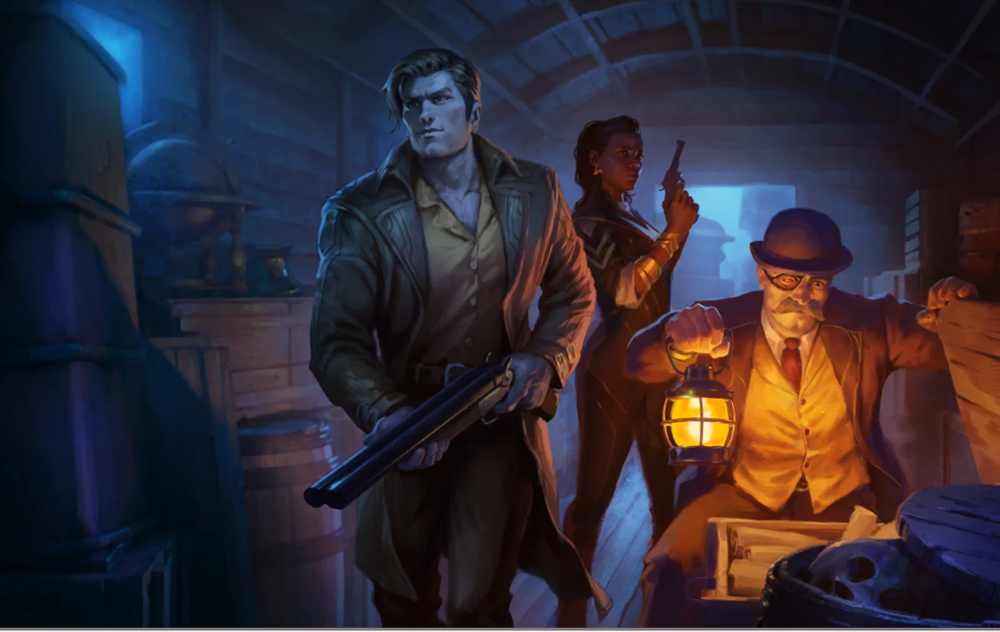
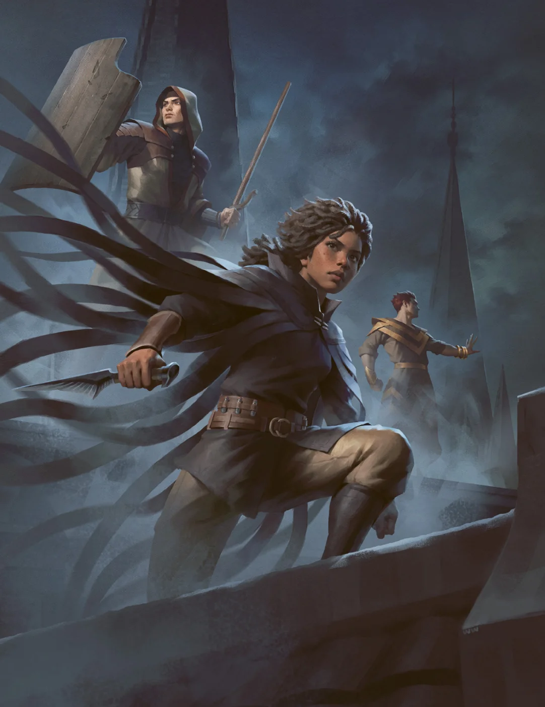

本節節錄一段冒險（Adventure）進行到一半時的遊戲過程。PC 正試著從一群疑似「組織」（The Set）密探的人身上竊取情報。策劃者（Mastermind）Ardashwy（she/her）、扯手（Lurcher）Harven（they/them）與白鑞臂（Pewterarm）Rubble Roger（he/him）都已登上火車，分散了目標的注意力，現在正要採取下一步行動。

**遊戲主持人（Game Master，GM）：** Roger 正在設法引開注意，Ardashwy 和 Harven 則進入臥鋪車廂。車廂左右搖晃，狹窄的走廊裡，只聽得見你們腳下鐵軌傳來喀噠喀噠的聲音。走廊內側的牆上，一扇扇木門通往車廂裡的臥鋪包廂。

**Akua（扮演 Ardashwy）：** 情報說他們住在右邊數過去第三間。我和 Harven 朝那扇門走過去，我要跪下來試著把門打開。希望 Roger 有成功引開他們的注意……

**GM：** 你拿出開鎖工具，做一次竊術（Thievery）檢定（Test）。

*Akua 因為開鎖工具而獲得優勢（Advantage），所以擲兩顆 d20，分別擲出 9 和 18。她選擇較高的骰點，這又是竊術檢定，因此加上她的竊術調整值 +4，總計為 22。*

**GM：** 你輕鬆打開這道簡單的鎖，門應聲而開。

**Harper（扮演 Harven）：** 我要偷偷溜進去。Ardashwy，幫忙把風。

**GM：** 你沒被人發現，順利進入疑似「組織」密探的臥鋪包廂。夕陽從房裡唯一的窗戶灑進來，窗外的景色飛快掠過。

**Akua（扮演 Ardashwy）：** 既然 Harven 進去了，我就走到走廊那頭、車廂相接的角落靠著，拿出報紙，一邊把風，一邊盡量裝得不引人注意。

**Harper（扮演 Harven）：** 我開始搜索這裡，同時留意有沒有聽到 Ardashwy 的暗號。

**GM：** 你不太確定自己到底要找什麼，就做一次推理（Deduction）檢定，看看搜索時能不能把線索串起來。不過這裡得分秒必爭，所以我們來提高賭注（Raise the Stakes）吧。

*Harper 擲一顆 d20 和劇情骰（Plot Die），d20 擲出 13，劇情骰擲出 [變故] 2。加上自己的推理調整值 +3，以及劇情骰的 +2，總計為 18。*

前言 14

JORDAN KERBOW

**Harper（扮演 Harven）：** 好，18 還不錯，不過我擲出了變故（Complication）。

**GM：** 一開始，你找到的東西看起來都很普通，但接著，線索漸漸串了起來。來自 Bilming 的貨運清單、稀有礦物合約，還有一張提到「序列」（the Sequence）的字條——住在這間包廂的人，幾乎可以確定是「組織」的成員。不過，就在你想通這件事時，你的變故也發生了：Ardashwy，你看見三個穿著體面的人提前回到了臥鋪車廂。

**Akua（扮演 Ardashwy）：** 鏽蝕與滅絕（Ruin）啊！看來 Roger 沒能把人引開多久。我把報紙摺起來，開始吹口哨，給 Harven 暗號。

**GM：** Harven，你聽到了暗號。Roger，因為 Ardashwy 站的位置，你在另一節車廂也聽到了。

**Lucas（扮演 Rubble Roger）：** 對啊，我一開始就搞砸了，就覺得這樣大概拖不住他們。聽到口哨後，我就開始準備我們的逃跑計畫。我要找最容易的路上車頂。

**GM：** 你在其他人隔壁的車廂。你走到車廂連接處，從工作人員用的門溜出去。爬上車頂時，強風吹過你身旁。你上了車頂，但這個回合（Round）來不及再到另一節車廂。Harven，你在做什麼？

**Harper（扮演 Harven）：** 你剛剛是不是說我發現了稀有礦物合約？那肯定就是我們要找的東西！我能不能抓了就跑？

**GM：** 可以，但你要是花時間把那些東西收好，就來不及全身而退了。

**Harper（扮演 Harven）：** 我才不要空手回去！我開始把那些全都抓過來。

**Akua（扮演 Ardashwy）：** 呃，我看 Harven 沒及時出來，就拿出筆記本，走向迎面而來的那幾個人：「不好意思，我的員工正在打掃臥鋪車廂。麻煩各位稍等幾分鐘，我們很快就能收拾好，把床鋪都替各位整理妥當。」

**GM：** 你說自己是工作人員？你不是還穿著之前那套正式服裝嗎？

**Akua（扮演 Ardashwy）：** ……對。欸，我可沒說這是什麼妙計。

**GM：** 好，做一次欺騙（Deception）檢定。你這鋪陳實在太糟了，加上一個劣勢（Disadvantage）。

*Akua 因為劣勢而擲兩顆 d20，分別擲出 3 和 18。GM 選擇較低的骰點，Akua 再加上她的欺騙調整值 +3，總計為 6。*

**Akua（扮演 Ardashwy）：** 糟了。我從筆記本上方看著他們，不好意思地笑了笑。

**GM：** 那幾個穿著體面的人眼中閃過警覺。其中一人伸手要抓你，其他人則拔出銀白色手槍，衝向自己的包廂。他們猛地推開門，舉槍瞄準 Harven。

**Harper（扮演 Harven）：** 我燃燒鐵（Iron），試著把他們手上的槍拉過來。

**GM：** 你的視野裡出現一道道藍線，指向車廂裡的每一根鉚釘和橫梁——但沒有任何一條指向他們的槍。事實上，他們兩人身上，沒有任何地方連著藍線。

**Harper（扮演 Harven）：** 和諧（Harmony）保佑我！上次的經驗已經讓我們知道，這些傢伙不留活口。好，現在換我出個妙計了……我從窗戶跳出去！

**GM：** 從正在行駛的火車上？

**Harper（扮演 Harven）：** 沒錯！然後我在半空中燃燒鐵，用鐵拉（Ironpull）把自己拉回去，進到隔壁那節車廂！

**GM：** 還真是個計畫啊！你縱身躍出，玻璃在你身後碎裂。做一次鎔金術（Allomancy）檢定，這次你絕對得再提高賭注！

*Harper 花費 1 點授予（Investiture），使用自己的鐵拉行動（Action）。接著擲一顆 d20 和劇情骰，d20 擲出 2，劇情骰擲出 [機遇]。加上自己的鎔金術調整值 +5，總計為 7。*

**Harper（扮演 Harven）：** 好，7 真的很糟，我猜是辦不到了。我的機遇（Opportunity）有沒有辦法救我？Roger 在哪裡？

**Lucas（扮演 Rubble Roger）：** 對耶！我能不能抓住 Harven？

**GM：** 我想他也許幫得上忙。Harven，你飛出車廂，迎面撞上疾風，拚命用鐵拉拉住車廂，卻還是失控偏離了方向。你飛過車廂上方時，一隻有力的手抓住你的手臂，你們兩個一起滾倒在車頂上。

**Lucas（扮演 Rubble Roger）：** 抓到你了！Ardashwy 呢？

**Akua（扮演 Ardashwy）：** 正在揍這個想抓我的傢伙。

**GM：** 對，我就覺得我們大概得開打了。Ardashwy，看來第一個快速輪次（Fast Turn）就由你先來？

*玩家們沒多少時間計畫，就立刻投入戰鬥（Combat）……*

前言 15

