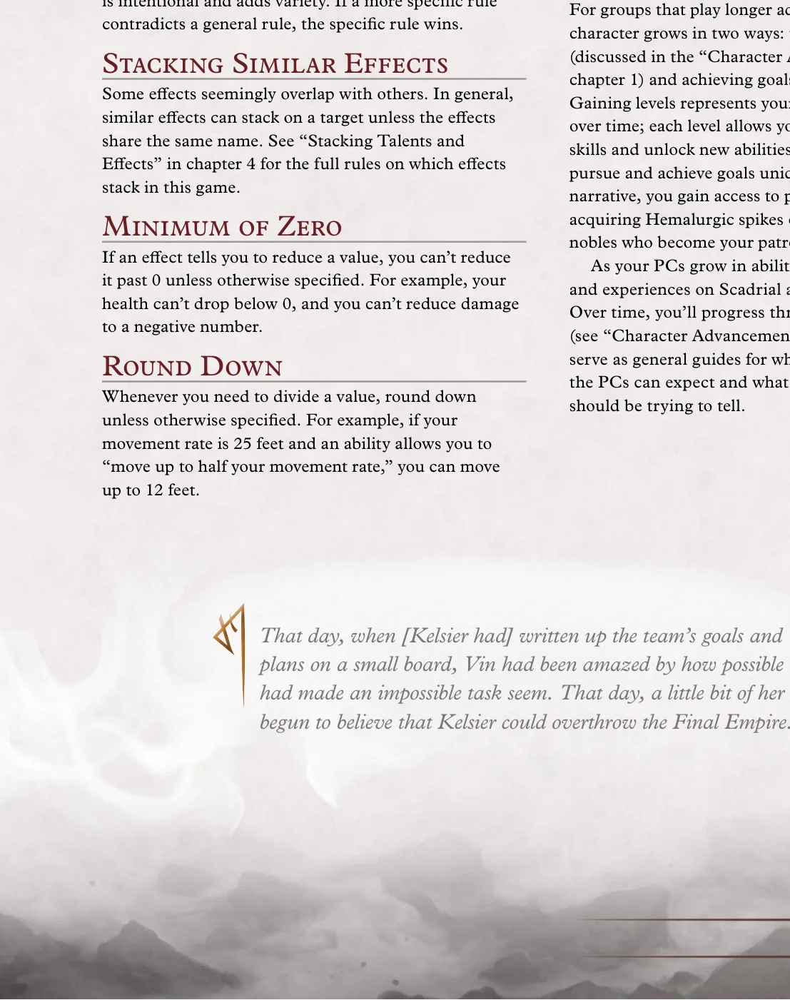

以下通則適用於本遊戲的所有規則。

### GM 有最終決定權

如果對於遊戲規則的適用方式有任何疑問或歧見，由 GM 決定。

### 特定規則優先於一般規則

遊戲的一般規則，例如如何擲骰（Roll）、在檢定（Test）中使用技能（skill），以及進行戰鬥（Combat），構成了遊戲的基礎。然而，角色（Character）的天賦（talent）、能力、物品或其他要素賦予的許多特定規則，看似會「打破」一般規則。這是刻意的設計，能讓遊戲更有變化。如果較具體的規則與一般規則牴觸，以較具體的規則為準。

### 疊加相似效果

某些效果看似與其他效果重疊。一般而言，相似效果可以在同一目標（Target）身上疊加，但名稱相同的效果除外。關於本遊戲哪些效果可以疊加的完整規則，請參閱第 4 章的「疊加天賦與效果」。

### 最低為零

除非另有說明，否則當效果要求你降低某個數值時，你不能將它降至 0 以下。例如，你的生命值（Health）不能低於 0，也不能將傷害（Damage）減至負數。

### 無條件捨去

每當你需要將某個數值做除法運算時，除非另有說明，否則一律無條件捨去小數。例如，你的移動速率（Movement Rate）為 25 呎，而某項能力允許你「移動（Move）至多為移動速率一半的距離」，你就能移動至多 12 呎。

## 冒險與成長

你們透過寰宇 RPG（Cosmere RPG）講述的故事，長度和複雜程度可以各不相同。有的團體可能在一個遊戲場次（Session）內完成冒險（Adventure），這通常稱為單場冒險（One-shot）。另一個團體的冒險可能橫跨許多場次，形成漫長的戰役（Campaign），角色也隨時間成長、進步。有些戰役可能由許多規模較小、彼此稍有關聯的冒險串連而成。其他戰役則可能是一場漫長而精心安排的冒險，橫跨角色的整段生涯。

### 等級與短期目標

如果團體進行較長的冒險，每位玩家角色（Player Character）都會透過兩種方式成長：提升等級（Level，詳見第 1 章「角色成長」一節），以及達成短期目標（goal，詳見第 8 章）。提升等級代表你隨著時間不斷練習而有所成長；每提升一個等級，你就能增進自身技能、解鎖新能力。同時，當你追求並達成個人故事中特有的短期目標時，你就能獲得強大的獎勵（Reward），例如取得血金術尖刺（Hemalurgic spikes），或與有權勢的貴族結盟，讓他們成為你的贊助者（Patron）。

隨著你們的 PC 能力與力量日益增強，你們在司卡德利亞（Scadrial）所扮演的角色與經歷，也會隨之發展、改變。隨著時間推進，你們將陸續經歷五個遊戲階層（Tier，請參閱第 1 章「角色成長」）。這些階層提供大致的指引，說明 PC 可以期待什麼樣的經歷，以及 GM 應該嘗試講述什麼樣的故事。

> 那天，[卡西爾（Kelsier）]在一塊小板子上寫下團隊的目標與計畫時，紋（Vin）驚訝地發現，他竟能讓一件不可能的任務顯得如此可行。那天，她心底有一小部分開始相信，卡西爾或許真能推翻最後帝國（Final Empire）。

導言 13

