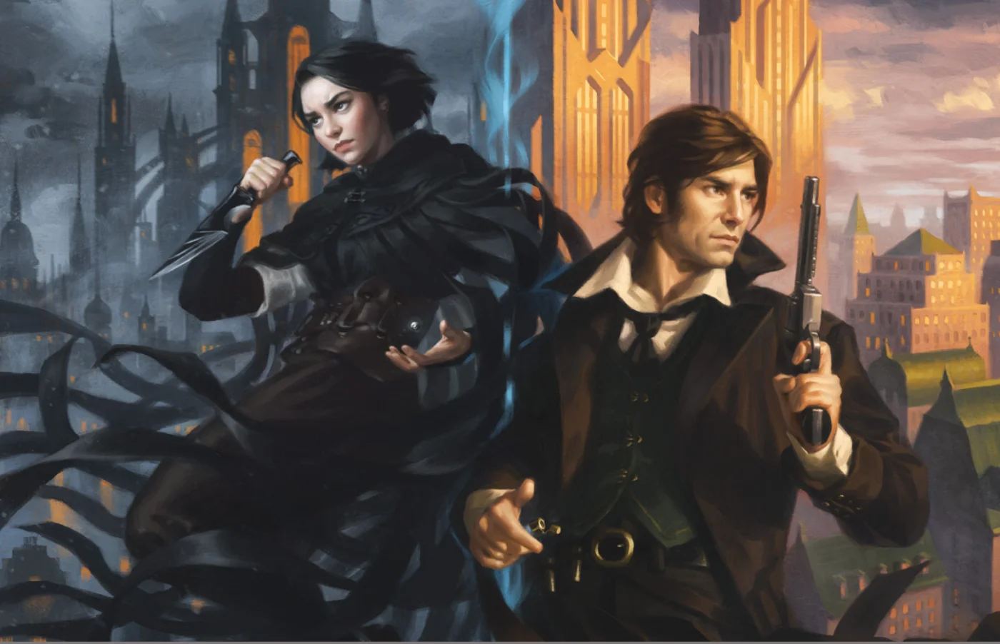
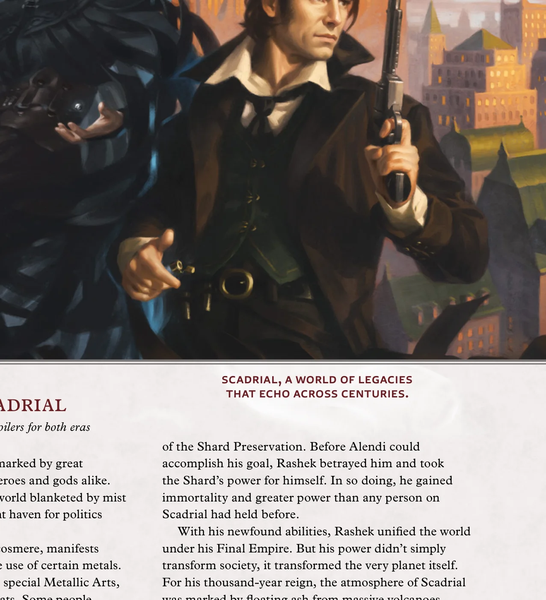
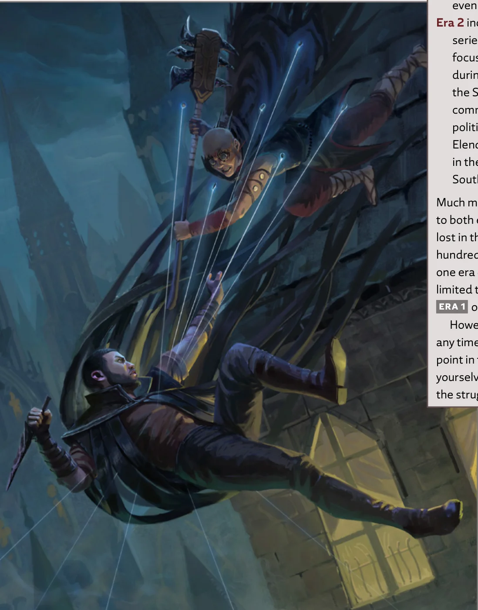
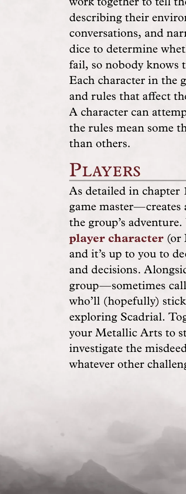
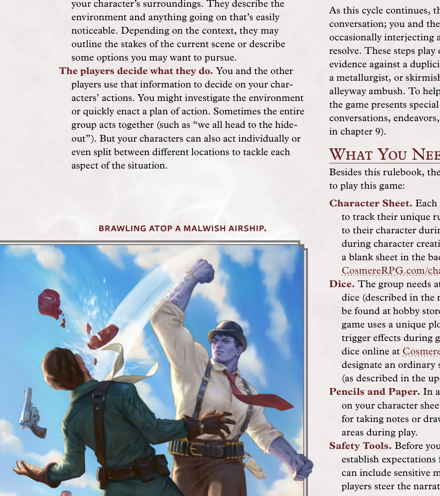
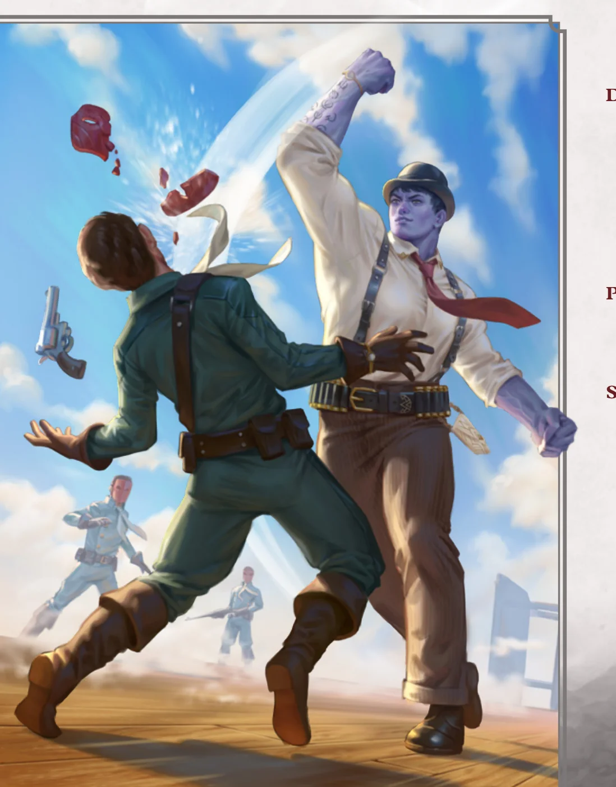
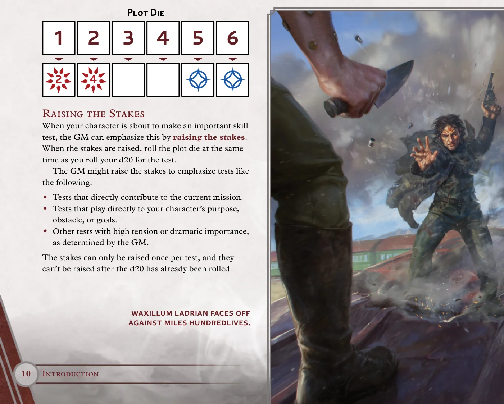
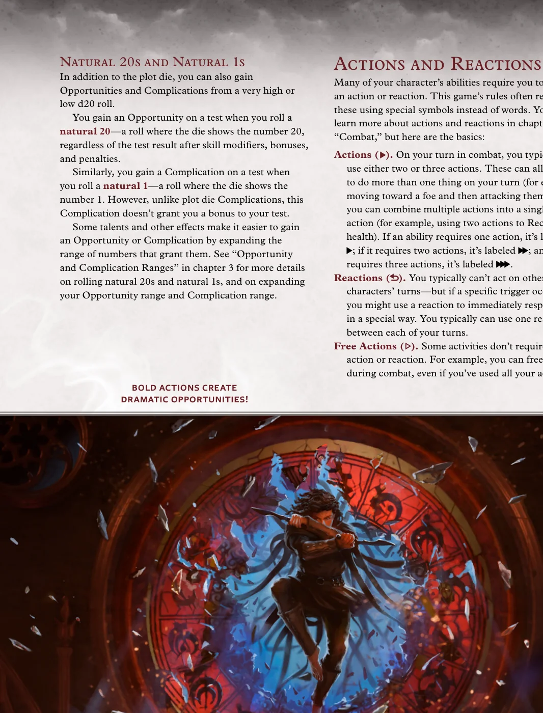
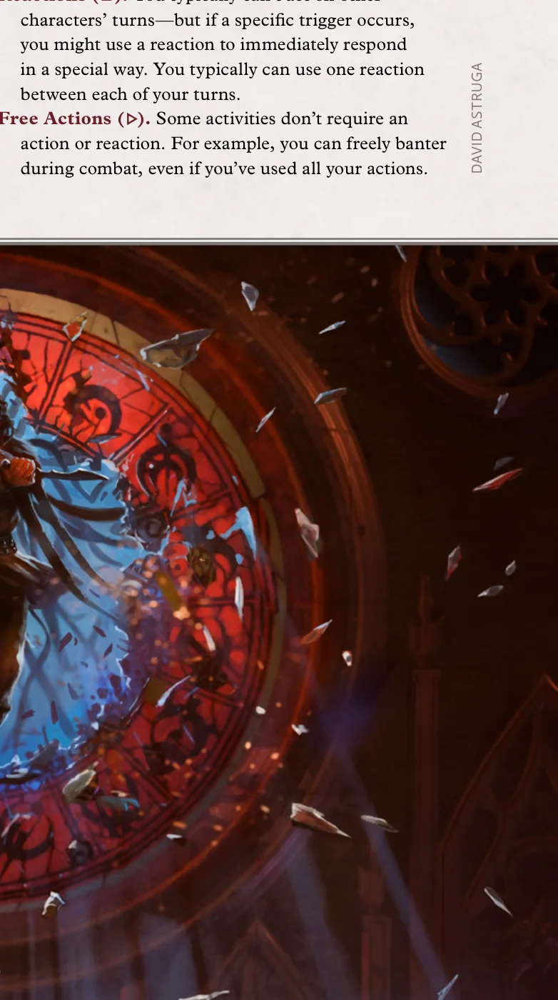
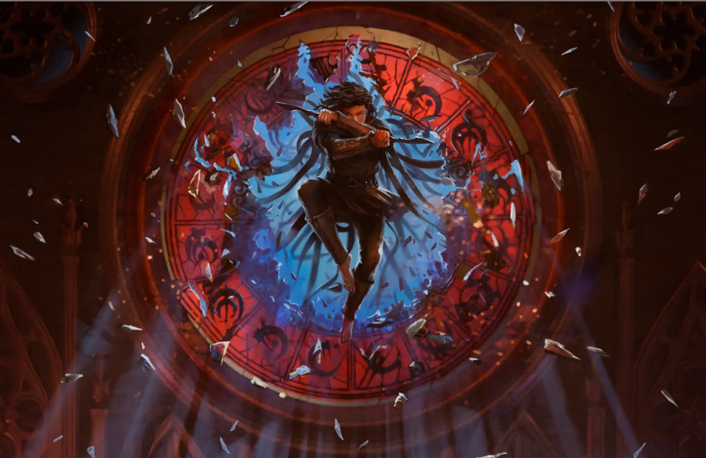

*本節包含《迷霧之子》（Mistborn）小說兩個時代的重大劇透。*

司卡德利亞（Scadrial）歷經許多時代，英雄與神祇的作為，一再為這個世界帶來巨變。強大的力量將它塑造成迷霧與灰燼籠罩的世界，後來又使它成為綠意盎然、政治與發展蓬勃興盛的樂土。

寰宇（cosmere）的力量稱為授予（Investiture）。在司卡德利亞，授予透過特定金屬，以獨特的方式展現。人們藉由特殊的金屬技藝（Metallic Arts）接觸授予，就能施展奇幻的本領。有些人吞下金屬，燃燒金屬以獲得力量；有些人配戴金屬物品，將自己的力量儲存起來，留待日後使用；還有些人將奇異的金屬尖刺刺入血肉，藉此強化並改變自己。

### 灰燼與迷霧的世界

一千多年來，整顆星球統一於最後帝國（Final Empire）之下。這個政權由一位宛如神明的人物統治，世人稱他為統御主（Lord Ruler）。這個名叫拉剎克（Rashek）的人，原本只是艾蘭迪（Alendi）的挑夫。艾蘭迪是預言中的英雄，意圖釋放碎力（Shard）存留（Preservation）的力量。在艾蘭迪達成目的之前，拉剎克背叛了他，將碎力的力量據為己有。因此，他獲得了永生，以及司卡德利亞有史以來無人擁有的強大力量。

拉剎克運用新獲得的能力，將世界統一於他的最後帝國之下。但這股力量改變的不只是社會，連整顆星球本身都變了。在他統治的一千年間，司卡德利亞的天空飄滿灰燼，來自人稱灰山（Ashmount）的巨大火山；夜晚籠罩著濃霧；倖存的植物盡是黃色與褐色，使司卡德利亞的人們忘記了這裡曾經繁盛的鮮花與綠意。

統御主的子民普遍視他為神，相信他的統治將永遠持續。但仍有少數人大膽地抱持不同想法。一支勇敢的團隊密謀推翻統御主，領頭的是名叫卡西爾（Kelsier）的迷霧之子。雖然卡西爾本人死了，他的繼承者，另一位名叫紋（Vin）的迷霧之子，卻殺死了統御主，拯救了最後帝國的人民……至少他們當時是這麼想的。

司卡德利亞，傳承跨越數百年、餘響不絕的世界。

導言 5

AMIRUL HHF

### 落灰之終（Catacendre）

雖然拉剎克在一千年前從艾蘭迪手中奪走了碎力存留的力量，這股力量卻沒有真正消失。每隔一千年，存留的力量就會重新匯聚於名為昇華之井（Well of Ascension）的地方。紋看似無私地釋放了這股力量，而不像拉剎克那樣據為己有。但她遭到另一股碎力滅絕（Ruin）欺騙，這個舉動幾乎招致世界末日。

存留很久以前就封印了滅絕的力量，但即使受困，滅絕仍暗中影響著整顆星球上的事件。紋釋放存留的力量時，無意間也釋放了滅絕，而他隨即企圖毀滅世界。他用灰燼掩埋司卡德利亞，煽動克羅司（koloss）與審判者（Inquisitor）的大軍肆虐這顆星球。

當一切看似毫無希望時，紋與她原本團隊其他成員的英勇作為，讓她得以重新取得存留的完整力量，直接迎戰滅絕，最終雙雙毀滅。

但碎力永遠不會真正消失。在那之後，一位英雄承接並融合了這兩股力量，形成新的碎力和諧（Harmony）。在名為落灰之終的事件中，這股新碎力阻止了世界末日，保護剩下的人民，並治癒這顆星球，讓他們有了能稱為家園的新世界。

### 遊戲時代

《迷霧之子》的背景設定橫跨數千年，你們可以將戰役（Campaign）設定在司卡德利亞歷史上的任何時期。《迷霧之子玩家手冊》（Mistborn Handbook）的規則，是為以下任一時代或兩個時代共同遊玩而設計的（《迷霧之子世界指南》（Mistborn World Guide）有更詳細的介紹）：

**第一時代**涵蓋最初《迷霧之子》三部曲小說的時期。本書的第一時代規則，聚焦於統御主死前一年的世界。這個時代的故事通常涉及陰謀、求生、革命，以及對抗階級歧視。你可以扮演司卡（skaa）盜賊團的一員、在最後帝國追逐聲望的貴族，甚至是鋼鐵教廷（Steel Ministry）的成員。

**第二時代**涵蓋《迷霧之子》瓦（Wax）與韋恩（Wayne）系列小說的時期。本書的第二時代規則，聚焦於落灰之終三個世紀之後的世界，時間介於「組織」（The Set）曝光之後，以及南方司卡德利亞人統一之前。這個時代的故事通常涉及動作場面、驚險冒險與政治陰謀。你可以扮演依藍戴（Elendel）警隊的警員、蠻橫區（The Roughs）中強大的雙生師（Twinborn）傭兵，或來自神祕南方大陸的發明家。

《迷霧之子玩家手冊》的許多內容同時適用於兩個時代，但某些元素只能用於其中一個時代，例如落灰之終中失落的資源，或其後數百年間發明的科技。特定能力或規則若僅限於某個時代，會以圖示標明：[第一時代] 或 [第二時代]。

不過，你們仍然可以決定在司卡德利亞歷史上的任何時期展開戰役。你們可以探索小說時間軸上的其他時點，甚至回到最後帝國建立之前，對抗深暗（Deepness）的年代。

一名迷霧之子用鋼推（Steelpush）將硬幣射向審判者。

CARSON DANIEL

### 落灰之終之後

世界經歷落灰之終的轉變之後，幾乎已看不出這裡曾是最後帝國的疆土。和諧恢復了遠古時代的繁茂植物與動物，並將大部分人類聚集到北方大陸一處稱為盆地的地區。在盆地中的依藍戴城，科技以空前的速度進步。火車等新發明，讓人們得以向盆地外的蠻橫區拓展，重新探索這顆已然改變的星球。

與此同時，在這顆星球的南方大陸，另一群人類開發出前所未見的金屬技藝創新用法。這兩群人類最終重新建立聯繫。在兩塊大陸關係緊張之際，外交能否取得成果仍有待觀察；但若能成功，雙方的合作或許能帶領司卡德利亞的人民攀向更高的成就。

## 什麼是角色扮演遊戲？

角色扮演遊戲是一種共同說故事、發揮想像力的體驗。你和朋友一起講述一群角色（Character）的故事，描述他們身處的環境、演出他們的對話（Conversation），並敘述他們的行為。你們透過擲骰（Roll）決定這些行為成功或失敗，因此沒有人能預先知道結果。遊戲中的每個角色都有獨特的屬性（attribute）與規則，以不同方式影響擲骰。角色在遊戲中可以嘗試任何事，但規則使某些事比其他事更容易成功。

### 玩家

如第 1 章詳述，除了遊戲主持人（game master）之外，每位玩家都會建立一個角色，在整段團體冒險中扮演。你的角色稱為玩家角色（Player Character，或 PC）。這個角色專屬於你，由你決定他的出身、抱負與選擇。你和其他 PC 組成團體，有時稱為冒險隊伍（Party），在探索司卡德利亞的冒險途中，（但願）能一路相伴。你們或許會協調彼此的金屬技藝，對抗可怕的敵人、調查權勢人物的惡行，並共同面對故事帶來的其他挑戰。

遊戲時，你描述角色採取的行為，在遊戲主持人要求時為這些行為擲骰，並決定何時及如何使用角色的能力。如何描述角色的行為，由你決定。有些玩家會演出角色的一言一行，有些則偏好像說故事一樣敘述角色的行為。選擇你最自在的方式就好。

### 遊戲主持人

大多數玩家建立並操控單一角色。不過，其中一位玩家會擔任遊戲主持人（或 GM）。GM 不只扮演一個角色，而是擔任引導故事的說書人，帶領你們體驗遊戲。

如第 13 章詳述，GM 是遊戲的主要說書人與裁判。GM 為你們準備冒險，敘述故事中的行為，並扮演 PC 遇到的每一位非玩家角色（Non-player Character，NPC），無論是敵是友。GM 也負責隨著故事發展裁定遊戲規則，因此務必熟悉所有規則，包括僅適用於玩家角色的規則。

玩家決定角色嘗試做什麼之後，由 GM 決定這些行為如何結算。玩家可以自由提出建議，但故事最終發生什麼事，由 GM 做最後決定。GM 必須隨時回應意料之外的玩家選擇與擲骰結果，即興發揮，這個角色也因此有著無限彈性。

在這款遊戲中，GM 並非其他玩家的敵手（adversary），而是引導大家一起創作故事的夥伴。雖然 GM 確實負責決定 PC 面臨的危險與敵人，但 GM 的最終目標，是協助大家創造整個團體都覺得精彩且滿意的故事。

### GM、玩家與「你」

GM 當然也是玩家，畢竟大家都在一起玩遊戲。不過，本遊戲的規則使用「玩家」一詞時，專指 GM 以外的參與者。針對玩家的規則，只適用於擁有自己個別玩家角色的人。

同樣地，本遊戲提到「你」時，通常是專門對玩家說話。但有些章節（包括第 13 章全章）會直接對 GM 說話。

導言 7

### 遊戲流程

遊戲由一連串遊戲場次（Session）組成，你們每次聚在一起遊玩，可以實體見面，也可以在線上進行。許多團體偏好每場兩到四小時，但時間長短完全可以依你們的意願安排。每場遊戲大致遵循以下流程：

**GM 設定場景。** GM 告訴你角色周遭的狀況，描述環境與正在發生、容易察覺的事情。視情境而定，GM 也可能說明當前場景（Scene）的利害關係，或描述一些你可能想採取的選擇。

**玩家決定怎麼做。** 你和其他玩家根據這些資訊，決定各自角色的行為。你可以調查環境，或迅速執行一項計畫。有時整個團體會一起行動，例如「我們一起前往藏身處」。不過，你們的角色也可以各自行動，甚至分散到不同地點，分頭處理眼前情況的各個面向。

**GM 敘述結果。** GM 描述你所選行為的結果。有時只需要描述一個新場景；但如果你嘗試的行為帶有風險，或可能失敗，GM 就可能要求你擲骰來決定結果。接著，GM 根據擲骰結果敘述後續發展，流程便再次循環。

這個循環持續下去，遊戲就像一場輕鬆的對話。你和 GM 一來一往，偶爾擲骰，看看事情如何發展。無論你是在蒐集證據指控兩面三刀的貴族、與冶金師討價還價，還是在巷弄伏擊中與殺霧者（Hazekiller）交戰，都會遵循這些步驟。為了讓不同情境各具特色，遊戲為三種場景提供專門規則：對話、試煉（Endeavor）與戰鬥（Combat）（見第 9 章〈場景〉）。

### 遊戲所需物品

除了這本規則書，玩家只需要幾樣東西，就能開始遊戲：

**角色紙。** 每位玩家都需要一張角色紙，用來追蹤自己角色專屬的規則，並記錄遊戲中發生在角色身上的事情。你會在第 1 章建立角色時填寫這張表。空白角色紙可在本書後方找到，也可至 CosmereRPG.com/character-sheets 取得。

**骰子。** 團體至少需要一組多面骰（下一節會介紹）。你可以在遊戲專賣店或網路上購買。此外，本遊戲使用一種獨特的劇情骰（Plot Die），上面的特殊符號會在遊戲中觸發效果。你可以在 CosmereRPG.com/shop 購買劇情骰，也可以指定一顆普通六面骰代替，方式見後面的〈劇情骰〉一節。

**鉛筆與紙。** 除了用來填寫角色紙的鉛筆，準備一些草稿紙也很有幫助，可以記筆記，或在遊戲中快速畫出簡圖，讓區域配置更容易想像。

**安全工具。** 遊戲開始前，務必先釐清團體的期望。桌上角色扮演遊戲可能包含敏感內容，安全工具能協助玩家引導故事，避開讓他們感到不舒服或不受歡迎的主題。第 13 章〈主持遊戲〉提供安全指南，幫助你們處理這些情況。

在 Malwish 飛船頂上打鬥。

ANDREW CHOU

此外，GM 也可以使用以下部分或全部資源，增進遊戲體驗：

**《迷霧之子世界指南》。** 《迷霧之子》小說描寫了不斷變化的司卡德利亞世界，但即使沒讀過小說，你仍然可以玩這款遊戲。《迷霧之子世界指南》（見本導言前面的〈寰宇 RPG〉）將司卡德利亞的必要資訊整理為一本參考書，並提供完整規則與數據，涵蓋你在世界各地可能遇到的敵人。

**冒險。** GM 可以運用《迷霧之子世界指南》，為你們設計專屬的冒險。如果 GM 願意，也可以使用官方出版的冒險，其中提供了講述故事所需的全部資源。

**地圖與模型。** 寰宇 RPG（Cosmere RPG）的規則支援以想像呈現場景的「腦內劇場」玩法，但許多玩家也喜歡視覺輔助。微縮模型與方格地圖有助於追蹤戰鬥中角色的位置，詳見第 10 章〈變體規則：使用方格地圖〉。

**音樂。** 使用筆記型電腦或喇叭，在適當時刻播放事先準備好的音樂，可以增添遊戲桌上的氣氛。

## 使用寰宇 RPG 骰子

這款 RPG 使用一組多面骰。每組中有不同面數的骰子：四面、六面、八面、十面、十二面與二十面。此外，遊戲還使用另一顆六面骰，稱為劇情骰（本節稍後會介紹）。你們至少需要上述每種骰子各一顆，才能進行遊戲，但大多數玩家偏好各自擁有一組。

規則文字以字母「d」後接骰子面數來表示骰子：d4、d6、d8、d10、d12 與 d20。因此，當規則要求你擲一顆 d20 時，就是要找到二十面骰並擲出。

### 進行技能檢定（Skill Test）

每當角色行為的結果不確定時，你就使用 d20 進行技能檢定，決定成功或失敗。檢定（Test）是本遊戲的核心機制，因此你會經常擲骰！第 3 章〈技能〉會更詳細地介紹技能檢定的運作方式，基本步驟如下：

1. 選擇技能並擲骰。判斷角色紙上的哪項技能（skill）最適用於目前情況，接著擲一顆 d20。（你也可能需要在擲 d20 的同時擲其他骰子，詳見〈加入額外骰子〉。）

2. 加上技能修正值（Skill Modifier）。角色紙上每項技能旁的數字，就是你的技能修正值，反映你對這項技能有多熟練。將它加到你的 d20 擲骰結果上。

3. 加上任何加值或減值。某些檢定會在特定情況下獲得加值或減值。將這些數值全部加到你的 d20 擲骰結果上。

4. 將總值與檢定難度比較。你要達到的目標數字，稱為難度等級（Difficulty Class，或 DC）。將 d20 擲骰結果、修正值、加值與減值合計；只要結果等於或超過 DC，你就成功完成這項任務。

5. 結算結果。處理成功或失敗的結果，以及你的能力或劇情骰觸發的任何附帶效果（劇情骰詳見〈劇情骰〉一節）。

### 加入額外骰子

有些技能檢定需要在 d20 之外加入額外骰子，例如：

**劇情骰。** 在特別重要的擲骰中，GM 可能要求你加入劇情骰，為故事帶來機遇（Opportunity）或變故（Complication）。（見〈劇情骰〉。）

**優勢（Advantage）或劣勢（Disadvantage）骰。** 當情況使你的檢定比平時容易或困難時，你可能會為一種或多種骰子各多擲一顆，再選擇最有利或最不利的結果。（見第 3 章〈優勢與劣勢〉。）

**傷害（Damage）骰。** 當你攻擊（Attack）敵手時，會在檢定中加入一顆或多顆傷害骰，決定這次攻擊的威力。（見第 10 章〈攻擊〉。）

除非另有指示，否則所有額外骰子都與你的 d20 同時擲出。

如果能力要求你擲多顆同種類的骰子，會在「d」前加上數字表示，例如「3d6」。擲出該數量的骰子，將結果相加。如果你沒有那麼多骰子，也可以將同一顆骰子連擲指定次數。例如，能力要求你「擲 3d6」時，你就擲三顆六面骰，或將同一顆六面骰連擲三次，再把結果相加。

GORDON MCALPIN

導言 9

## 劇情骰

除了普通多面骰，本遊戲還使用一種特製骰子，稱為劇情骰。你不會在每次技能檢定時自動加入劇情骰。只有在緊張時刻，或對劇情至關重要的檢定中，才會用它來提高賭注（Raise the Stakes）。NPC 的檢定通常不使用劇情骰。

擲劇情骰時，結果可能為你的檢定提供加值，也可能讓你的行為帶來意料之外的機遇或變故，詳見後面的章節。

劇情骰共有六面，其中兩面空白，另外兩面有機遇符號（ [機遇] ），最後兩面則有變故符號（ [變故] ）。如果你沒有本遊戲的特製劇情骰，也可以使用普通 d6，依劇情骰圖表換算結果。請注意，1 和 2 是「最差」的結果，但它們會給予該次檢定加值，藉此補償變故的影響（見〈變故加值〉）。加值等於變故符號中的數字，也就是普通 d6 擲出數字的兩倍。

### 劇情骰圖表

| 普通 d6 結果 | 劇情骰結果 | 檢定加值 |
| --- | --- | --- |
| 1 | [變故] | +2 |
| 2 | [變故] | +4 |
| 3 | 空白 | — |
| 4 | 空白 | — |
| 5 | [機遇] | — |
| 6 | [機遇] | — |

### 提高賭注

當你的角色即將進行重要的技能檢定時，GM 可以提高賭注，強調這次檢定的重要性。賭注提高後，你就要在擲 d20 進行檢定時，同時擲出劇情骰。

GM 可能會為以下檢定提高賭注，以凸顯其重要性：

- 對當前任務（Mission）有直接幫助的檢定。

- 直接觸及角色核心目的（purpose）、內在障礙（obstacle）或短期目標（goal）的檢定。

- GM 認定的其他高度緊張，或具有戲劇重要性的檢定。

每次檢定只能提高賭注一次，而且 d20 擲出之後，就不能再提高賭注。

### 結算劇情骰結果

當你在檢定中擲劇情骰時，效果取決於你擲出機遇、變故，還是空白。

如果劇情骰擲出空白，檢定不會產生任何正面或負面的附帶效果，其餘部分照常結算。如果擲出機遇或變故符號，請見〈機遇與變故〉。

### 自行提高賭注

有些能力讓你的角色可以自行提高賭注，但前提是 GM 尚未提高賭注。

即使你沒有這類能力，也可能覺得某次檢定值得提高賭注。你隨時可以請 GM 提高賭注，並說明你為何認為這次檢定值得如此處理，但最終仍由 GM 決定。（第 13 章〈使用劇情骰〉為 GM 提供何時及如何提高賭注的指引。）

瓦希黎恩．拉德利安（Waxillum Ladrian）與「百命」邁爾斯（Miles Hundredlives）對峙。

導言 10

RANDY VARGAS

## 機遇與變故

進行檢定時，機遇與變故代表檢定過程中發生的有利或不利附帶效果。這些敘事工具能在故事發展時，增添有趣的變化。

你的檢定可能因擲劇情骰、能力給予效果，或 d20 擲出 20 或 1，而獲得機遇或變故（見後面的〈自然20與自然1〉一節）。

### 花費機遇

當你獲得機遇時，無論當前檢定成功或失敗，都會為它的結果帶來有利效果。你可以花費這個機遇，選擇以下其中一種效果：

**援助盟友。** 由於你的行為，你所選的一位盟友（Ally）在下一次檢定中獲得優勢（見第 3 章〈使用技能〉）。

**穩住自己。** 你恢復 1 專注點（Focus）（見第 3 章〈專注點〉）。

**造成致命一擊。** 你將一次命中（Hit）改為致命一擊（Critical Hit）（見第 10 章〈攻擊〉）。這個效果只能用於攻擊檢定。

**影響敘事。** 你的行為帶來一項由你選擇的正面敘事效果，但必須獲得 GM 同意。例如，你可能正試圖毆打一名鬼血（Ghostblood）密探；如果你沒能達成最終目的，卻在該次檢定中擲出機遇，你和 GM 可以決定，你在動手時順勢扒走了那名密探口袋裡的東西。第 3 章〈技能〉提供了一些機遇範例。

有些能力提供花費機遇的額外方式。如果某項能力說你可以花費機遇觸發特殊效果，但你在該能力的檢定中沒有擲出機遇，就不能使用那個特殊效果。

### 面對變故

當你獲得變故時，無論當前檢定成功或失敗，都會為它的結果帶來負面的附帶效果。GM 應花費這個變故，選擇以下其中一種效果：

**妨礙盟友。** 你的行為帶來意料之外的後果。下一位進行檢定的 PC，會在該次檢定中獲得劣勢（見第 3 章〈使用技能〉）。

**分心。** 你失去 1 專注點（見第 3 章〈專注點〉）。

**影響敘事。** 你的行為帶來一項由 GM 選擇的敘事不利後果。例如，你可能試圖煽動人群爭吵，好轉移注意力；如果你成功達成最終目的，卻在該次檢定中擲出變故，GM 可以決定，你的挑釁實在太成功了，讓人群擠成一團，擋住你的去路。第 3 章〈技能〉提供了一些變故範例。

有些規則提供 GM 花費變故的額外方式。

### 變故加值

變故顧名思義，會讓情況變得複雜，但也能幫助你的檢定結果！當你因擲劇情骰而獲得變故時，也會為當前的 d20 擲骰提供加值。加值等於你擲出的變故符號內所顯示的數字，可能是 +2 或 +4。如果你從其他來源獲得變故，該來源會說明是否有加值，以及應加上多少。

### 選擇機遇與變故效果

當某人的檢定加入機遇或變故時，同桌其他人都可以建議有趣的花費方式，例如讓當前場景出現戲劇化的敘事發展。不過，最終選擇權屬於花費該機遇或變故的玩家或 GM。

如果你花費機遇並選擇影響敘事，你所提出的敘事效果是否可行，由 GM 做最後決定。如果 GM 不同意，你們可以一起選擇新的敘事效果，你也可以改選其他效果。

導言 11

### 自然20與自然1

除了劇情骰，d20 擲出特別高或低的數字，也能讓你獲得機遇與變故。

當你在檢定中擲出自然20（Natural 20）時，就會獲得一個機遇。自然20是指骰面直接顯示 20，與加上技能修正值、加值及減值之後的檢定結果無關。

同樣地，當你在檢定中擲出自然1（Natural 1）時，就會獲得一個變故。自然1是指骰面直接顯示 1。不過，和劇情骰的變故不同，這個變故不會為你的檢定提供加值。

有些天賦（talent）與其他效果，會擴大能產生機遇或變故的數字範圍，讓你更容易獲得它們。關於擲出自然20與自然1，以及擴大機遇範圍與變故範圍的詳細說明，請見第 3 章〈機遇與變故範圍〉。

## 行動與反應

你的角色有許多能力需要使用行動（Action）或反應（Reaction）。本遊戲的規則經常使用特殊符號來表示它們，而不直接寫出文字。第 10 章〈戰鬥〉會更詳細介紹行動與反應，以下先說明基本概念：

**行動（[1行動]）。** 在戰鬥中，輪到你的輪次（Turn）時，你通常可以使用兩個或三個行動。這讓你能在自己的輪次中做不只一件事，例如先移向敵人，再攻擊對方；你也可以將多個行動合併成一個較長的行動，例如使用兩個行動來恢復（Recover）失去的生命值（Health）。如果能力需要一個行動，會標示 [1行動]；需要兩個行動則標示 [2行動]；需要三個行動則標示 [3行動]。

**反應（[反應]）。** 你通常不能在其他角色的輪次中行動，但若發生特定觸發條件，你可能可以使用反應，立即以特殊方式回應。你通常可以在自己相鄰的兩個輪次之間，使用一次反應。

**自由行動（Free Action，[自由行動]）。** 有些活動不需要行動或反應。例如，即使你已用完所有行動，仍然可以在戰鬥中自由交談。

大膽行動，創造戲劇性的機遇！

DAVID ASTRUGA

