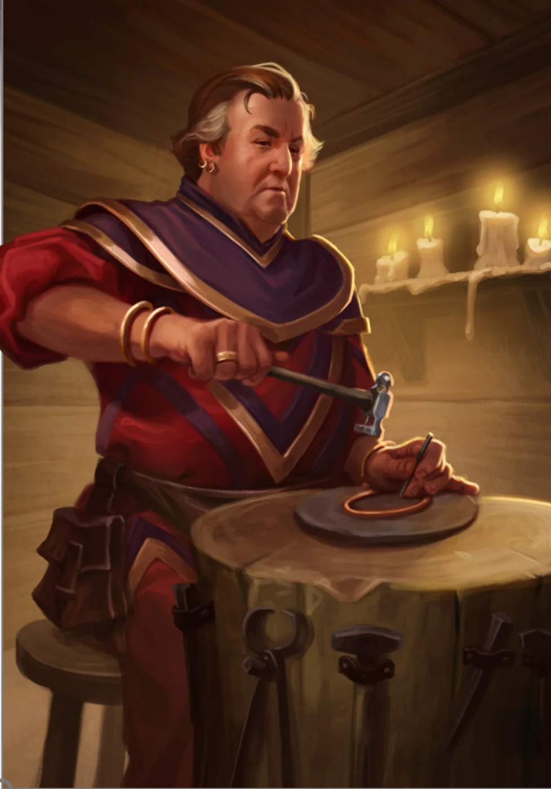
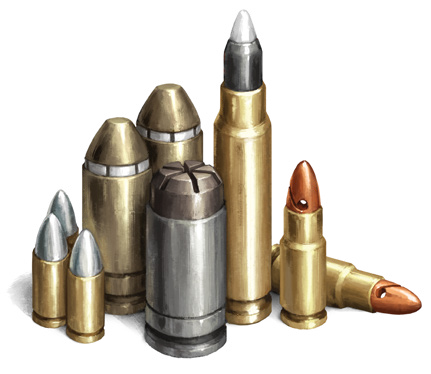
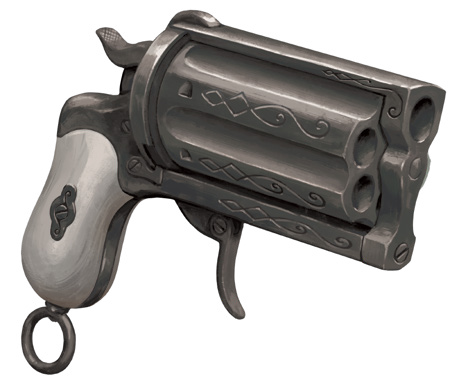
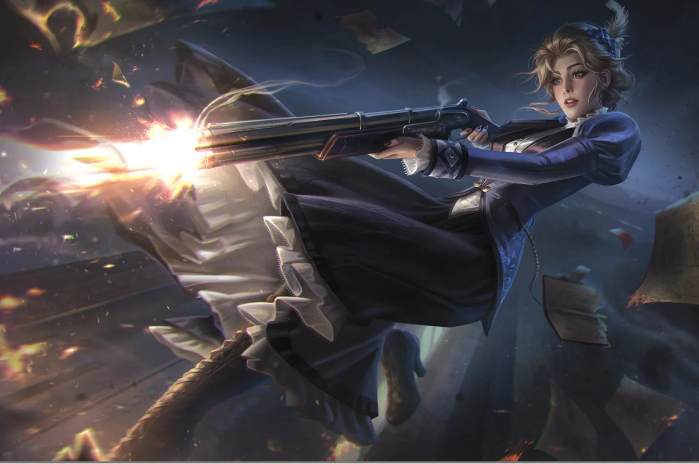
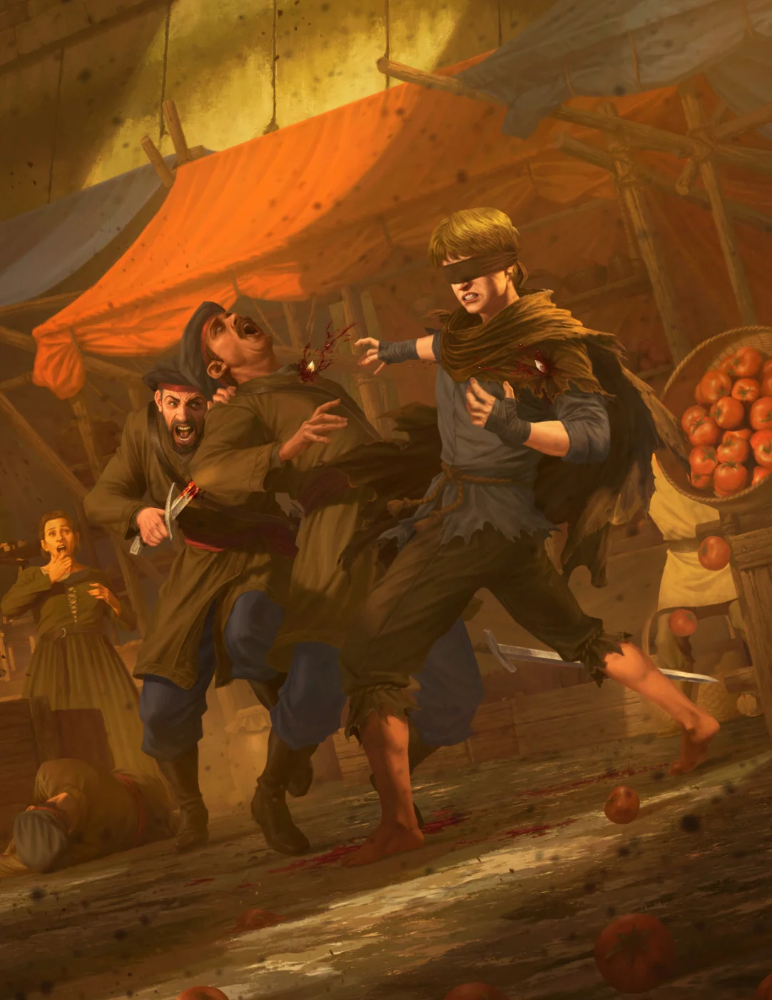

### 工藝

熟練的工匠可以為自己製作未受授予的（Non-Invested）物品，包括武器（Weapon）、護甲（Armor）、彈藥（Ammunition）、裝備（Equipment），甚至建築或藝術品等更宏大的作品。

### 製作前提條件

你必須具備與想製作的物品相關的專長（Expertise），才能製作該物品。例如，要製作左輪手槍（Revolver），你需要軍火工藝（Munitions Crafting）專長或左輪手槍專長。如果你只有較廣泛的專長（例如軍火工藝），仍能製作相關物品，但你本人無法在戰鬥（Combat）中享有該物品的專家特性（Expert Trait）。

### 製作普通物品

如果你具備必要的專長，就從武器表、護甲表或裝備表中，選擇一件列有價格的未受授予物品。由 GM 裁定，你也可以改為製作其他未受授予的物品。依以下步驟製作選定的物品：

1. 取得必要材料。
2. 進行工藝（Crafting）檢定（Test）。
3. 套用改良（Upgrade）或缺點（Drawback）。

### 第 1 步：取得材料

製作未受授予的物品時，只要你能接觸一般商業網絡或其他市場，就假定你能輕易找到製作所需的金屬、皮革、木材或其他原料。

**工具與設施。**你必須能使用製作該物品所需的適當工具與設施。具體需求由 GM 按照你製作的物品裁定。你或許徒手就能迅速做出一支開鎖器（Lockpick），但要製作鋒利的劍，就需要鍛爐與鐵砧。如果工具與設施品質不佳，你在第 2 步的工藝檢定可能會獲得一個劣勢（Disadvantage）。

**材料成本。**取得必要原料的成本，等於所製作物品正常價值的一半。

**稀有金屬。**視時代而定，有些金屬無法取得，有些則稀有且價格昂貴。製作物品時，如果需要「稀有金屬製作成本」表中的金屬，就要在標準材料成本之外，加上表列成本。視所製作物品的大小，GM 可以裁定提高或降低這筆價格。

### 稀有金屬製作成本

| 材料 | 第一時代製作價格 | 第二時代製作價格 |
| --- | --- | --- |
| 鋁（Aluminum）* | 無法取得 | 500 bx |
| 天金（Atium） | 2,500 bx | 無法取得 |
| 彎管合金（Bendalloy） | 無法取得 | 2,500 bx |
| 鎘（Cadmium） | 無法取得 | 1,250 bx |
| 鉻（Chromium） | 無法取得 | 500 bx |
| 硬鋁（Duralumin） | 無法取得 | 1,250 bx |
| 電金（Electrum） | 250 bx | 1,250 bx |
| 金（Gold） | 125 bx | 500 bx |
| 鎳鉻（Nicrosil） | 無法取得 | 250 bx |

*見稍後的「使用非標準材料製作物品」一節。

DARKO STOJANOVIC

第 7 章：物品 273

### 第 2 步：進行工藝檢定

備齊所有必要材料後，就可以在休整期（Downtime）製作物品（見第 9 章「休整期」）。

**所需時間。**製作時，你通常每個工作天能完成價值 50 盒金（Boxing）的工作。例如，一枚價值 75 盒金的破片手榴彈（Fragmentation Grenade），需要 1.5 個工作天才能完成；一支價值 2 盒金的開鎖器，則只需一個工作天中的一小部分時間。不過，製作過程中的機遇（Opportunity）與變故（Complication）會調整所需時間：工藝檢定每擲出一個機遇，製作時間就縮短百分之二十五；每擲出一個變故，則增加百分之二十五。

**工藝檢定。**準備開始製作時，擲一次工藝檢定，並提高賭注（Raise the Stakes）。由 GM 裁定，如果你能使用格外優良的工具或設施，這次檢定可能獲得一個優勢（Advantage）；如果工具或設施格外低劣，則可能獲得一個劣勢。參照「物品製作檢定」表，決定檢定結果如何影響製作。如果擲出機遇或變故，別忘了依照「所需時間」的說明調整製作時間。

### 物品製作檢定

| 檢定結果 | 物品品質 |
| --- | --- |
| 1–5 | 徹底失敗。儘管投入許多時間與心力，你仍未能做出任何可用的物品。稀有金屬與金屬意識庫（Metalmind）都可以回收重製，但其他材料全數損失，必須從頭開始。 |
| 6–10 | 粗劣成品。製作這件物品比預期困難。你完成了物品，但它沒有改良，並有一個缺點。 |
| 11–20 | 普通成品。製作過程完全符合預期。你完成了物品，具有一個改良與一個缺點。 |
| 21–25 | 優質成品。一切順利！你完成了物品，具有兩個改良與一個缺點。 |
| 26+ | 卓越成品！製作這件物品時，你有所突破。你完成了物品，具有三個改良，沒有缺點。 |

### 第 3 步：套用改良與缺點

工藝檢定每讓你獲得一個改良，就從「物品改良與缺點」表中選擇一個改良。只要 GM 同意，你也可以提出自己的創意。如果獲得兩個以上的改良，你可以視意願改從下一節「進階物品功能」中選擇。每獲得一個缺點，就在同一張表擲一次 d6，隨機決定缺點。某些情況下，GM 也可以為你指定一個別出心裁的缺點。

### 物品改良與缺點

| d6 | 改良 | 缺點 |
| --- | --- | --- |
| 1 | 你從邊角料中回收了足夠的材料，可以拿去製作別的東西。剛做好的這件物品不需材料成本。 | 製作所需的材料遠超預期。製作這件物品的成本加倍。 |
| 2 | 如果你公開製作或出售這件物品，其精湛工藝會讓你獲得識貨工匠與買家的讚譽。 | 你不慎損壞工具或設施。視設施屬於誰，你可能必須賠付盒金，或損及名聲。 |
| 3 | 物品比平常輕巧許多，重量減半。 | 物品比平常笨重許多，重量加倍。 |
| 4 | 物品十分堅固，會忽略可能導致它損壞或破裂的變故效果。 | 物品十分脆弱。使用它的任何檢定出現變故時，它都會損壞。 |
| 5 | 物品美得驚人，見過的人都印象深刻。 | 物品醜得讓人不忍直視。 |
| 6 | 這件物品讓你獲得貴族（Noble）或工匠的肯定，並吸引一位潛在贊助者（Patron）的注意（見第 8 章「獎勵〔Reward〕」）。 | 這件物品讓某些貴族或工匠因同行競爭而心生嫉妒；這會在日後影響你。 |

### 進階物品功能

在格外出色的情況下，工匠可以在製作過程中獲得最多三個改良。此時，你可以花費兩個改良，從「進階物品功能（Advanced Item Feature）」表選擇一個功能套用，而非從「物品改良與缺點」表中選擇。

第 7 章：物品 274

### 進階物品功能

| 功能名稱 | 效果 |
| --- | --- |
| 精美裝飾（Adorned） | 如果物品是護甲，你加上的藝術裝飾使它獲得得體（Presentable）專家特性。 |
| 暗格（Hidden Compartment） | 物品具有一個收納暗格，可以裝入體積不超過此物品四分之一的另一件物品。 |
| 致命設計（Lethal Design） | 如果物品是武器，當角色（Character）因這件武器進行傷勢擲骰（Injury Roll）時，結果減去 3。 |
| 完美平衡（Perfect Balance） | 如果物品具有笨重（Cumbersome）特性，該特性的數值減少 1。此外，如果物品是武器，它會獲得防禦型（Defensive）專家特性。 |
| 非典型武器（Unconventional Weapon） | 如果物品是武器，它會獲得隱蔽（Discreet）專家特性。如果物品既不是武器，也不是護甲，就可以當作不具易碎（Fragile）特性的臨時武器（Improvised Weapon）使用。 |
| 特製金屬意識庫（Special Metalmind） | 你將一件現有的金屬意識庫整合進一件實用的新物品中，例如武器。 |
### 使用非標準材料製作物品

你可以使用木材、玻璃、黑曜石、石材或獸皮等非標準材料（Nonstandard Materials）製作物品。以非標準材料代替金屬，會讓你的武器、護甲或其他物品具有鎔金惰性（Allomantically Inert），從而阻擋鐵鎔金術（Iron Allomancy）與鋼鎔金術（Steel Allomancy）的效果（見第 6 章「鎔金惰性材料〔Allomantically Inert Material〕」）。使用非標準材料製作物品，需要比標準物品更多的時間與材料，其餘步驟則相同。GM 可以加上易碎或危險（Dangerous）特性，以反映物品不穩定的性質；物品也可能失去部分相關的武器特性（Weapon Trait）、護甲特性（Armor Trait）或專家特性。由 GM 裁定，你可以使用非標準材料，製作任何列有價格的標準武器、護甲、彈藥或其他裝備（見本章前面的表格）。這遵循前面「製作普通物品」一節的標準製作規則，但通常需要花費十倍的盒金，因此製作時間也隨之增加。如同往常，你必須具備與所製作物品相關的專長（見前面的「製作前提條件」一節）；唯一例外是下一節介紹的標準殺霧彈，製作時不需要專長。

### 殺霧彈

[第二時代]

多數鎔金術師（Allomancer）習慣在戰鬥中占上風，但遇到裝備適當的槍手時，這反而可能成為弱點。殺霧彈（Hazekiller Rounds）是特別設計的子彈，專門欺騙、妨礙與傷害使用特定能力的敵方鎔金術師。這些創新彈藥的製法，是少數製造者與使用者嚴守的祕密。

**製作殺霧彈。**即使沒有相關專長，你也能製作「標準殺霧彈」表中的彈藥。除非使用稀有材料，否則你一次可以製作五十發同類型的殺霧彈，材料總成本為 20 盒金。如果你擁有軍火工藝實用專長（Utility Expertise），也可以嘗試發明新的殺霧彈或其他殺霧武器。與 GM 一起決定它們的作用，以及製作時是否需要比標準製作規則所涵蓋的材料更昂貴的材料。

**特殊校準。**一般火器（Firearm）並未針對殺霧彈正確校準，因此除非你有特殊火器，否則發射這些子彈會有風險。以不具特殊彈藥校準（Special Ammunition Calibration）組件的火器發射殺霧彈時（見本章末的「火器原型設計」表），這些攻擊（Attack）檢定會獲得一個劣勢，而且該火器在這些檢定期間暫時具有易碎特性。

*各種殺霧彈，每一種都特別針對某類鎔金術師設計*

ANNA VERHOOG

第 7 章：物品 275

**裝填殺霧彈。**重新裝填火器時，你可以從持有的殺霧彈中選擇一種類型（例如「標準殺霧彈」表中的一種），代替普通彈藥。如此做時，你裝入的殺霧彈數量，最多等於該火器的裝填（Loaded）數值。此後，火器會獲得該種殺霧彈的效果，直到你再次重新裝填。

### 標準殺霧彈

| 種類 | 材料 | 效果 |
| --- | --- | --- |
| 射幣彈（Coinshot rounds） | 金屬、陶瓷、火藥 | 如果子彈的外殼被鋼鎔金術移動，陶瓷核心仍會沿原本的路徑前進。此彈藥視為具有鎔金惰性。 |
| 扯手彈（Lurcher rounds） | 金屬、陶瓷、火藥 | 如果子彈的金屬核心被鐵鎔金術移動，子彈兩側的陶瓷就會炸開。該次攻擊獲得爆破（Blast）[10] 特性，而移動子彈的鎔金術師會成為攻擊目標（Target），並額外受到 1d4 衝擊傷害（Impact Damage）。 |
| 錫眼彈（Tineye rounds） | 金屬、額外火藥 | 發射時，這些彈藥會發出巨響，可能讓具有超自然聽覺的角色受到過度刺激。此外，感知範圍（Senses Range）涵蓋攻擊者佔位（Space）的任何角色，都會失去 1 點專注點（Focus）。 |
| 白鑞臂彈（Pewterarm rounds） | 金屬、額外火藥 | 命中（Hit）時，目標陷入減損（Diminished）[力量（Strength）−2]，持續一個回合（Round）。 |

### 製作鋁製物品

[第二時代]
鋁能提供對抗金屬技藝（Metallic Arts）的防護，因此備受追捧。在第二時代，你可以在製作物品時用鋁代替其他金屬（例如製作必須含有金屬的武器），也可以將鋁加在非金屬物品上。鋁的詳細效果，見第 6 章「鎔金惰性材料」。如前面的「稀有金屬製作成本」表所列，取得製作所需的鋁要花費 500 盒金。或者，由 GM 裁定，你也可能從其他物品回收到足夠的鋁。製作鋁製彈藥時，價值 500 盒金的鋁可以製成 50 發彈藥。

鋁也能用來強化建築，但這類用途昂貴至極，而且耗費大量人力。如果你想嘗試在團隊藏身處鋪設鋁板之類的工程，請與 GM 一起決定成本，以及你是否有辦法取得那麼多鋁。

### 製作金屬意識庫

金屬意識庫必須使用純度與合金（Alloy）比例都符合嚴格標準的金屬製作。如果你是藏金術師（Feruchemist）、單藏金術師（Ferring）或雙生師（Twinborn），通常會在完成金屬之子路徑（Metalborn Path）關鍵天賦（Key Talent）的短期目標（goal）後，獲得金屬意識庫作為獎勵（見第 5 章「金屬之子短期目標與獎勵」）。以此方式獲得金屬意識庫時，你不必支付金屬費用，也不遵循標準製作規則。不過，如果你遺失金屬意識庫，必須重新打造（或因任何理由想再打造一件），請參照以下各節。

### 補造遺失的金屬意識庫

如果你遺失現有的金屬意識庫，需要重新打造，可以使用標準製作規則製作新的金屬意識庫。若使用稀有金屬，材料成本就等於原料金屬的成本；若金屬意識庫使用普通金屬，補造成本為 5 盒金。（請記住，以此方式製作額外的金屬意識庫前，你必須已透過金屬之子短期目標〔Metalborn Goal〕與獎勵解鎖相應能力。）另一個方法是增加一項「打造你的金屬意識庫（Construct Your Metalmind）」短期目標，循著取得第一件金屬意識庫的相同流程，以獎勵方式取得。此時，GM 也可能要求你取得品質極佳的金屬，可能將其作為獎勵，也可能要你支付高價購買（見前面的「稀有金屬製作成本」表）。如果你還保有金屬意識庫，只是想做一件備用品，也可以視同已遺失，採用上述任一方式；不過，如第 5 章「金屬之子短期目標與獎勵」所述，你不能同時享有兩件相同金屬意識庫的好處。

### 改造現有的金屬意識庫

你從金屬之子路徑獲得金屬意識庫時，會選擇它的形態（例如項鍊或手鐲）。日後如果想將它改成另一種不提供規則好處的形態，例如懷錶或粉盒，你可以花費 1 天以上的休整期時間進行改造，所需時間由 GM 裁定。

第 7 章：物品 276

將現有的金屬意識庫改造成大小相近的裝飾品時，通常不需要取得額外金屬，也不必遵循標準製作規則。（若要將金屬意識庫整合進實用裝備，見「特製金屬意識庫」。）

### 特製金屬意識庫

只要工藝夠好，你的金屬意識庫也能兼作實用裝備。例如，將黃銅意識（Brassmind）做成指虎（knucklebones），就很適合激烈的近身戰。雖然以純鉻製作整件物品可能不切實際，但在火器上鍍一層鉻意識（Chromiummind），既時髦又能帶來好運。由於金屬意識庫是受授予的物品（Invested Item），它能抵抗許多形式的授予干擾，例如扯手（Lurcher）試圖用鐵拉（Ironpull）將它從你身邊拉走。由 GM 裁定，你幾乎可以將現有的金屬意識庫整合進任何正在製作的物品，通常作為外殼或裝飾。如此做時，依照一般製作規則打造該裝備，再在製作時花費兩個改良，選擇「特製金屬意識庫」進階物品功能。
### 發明槍械

[第二時代]

走在技術前端的發明家（Inventor）經常投入火器研究，試驗從未出現過，或只在閉門工坊中存在的原型。這些實驗技術可以針對任何人最佳化，無論是一般槍手、鎔金術師、藏金術師或殺霧者（Hazekiller）。如同製作其他物品，發明火器原型（Firearm Prototype）需要相關專長。如果你擁有正在製作的特定火器專長（例如左輪手槍專長），火器原型就會具有與基礎火器相同的專家特性。如果你只有軍火工藝專長，仍能發明新火器，但它不會具有基礎火器的專家特性。如果你具備相關專長，就使用以下步驟製作火器原型，取代一般製作規則：

1. 選擇一件普通火器，作為發明的基礎。
2. 選擇要製作的原型設計。
3. 取得必要材料。
4. 進行工藝檢定。
5. 套用改良或缺點。

### 第 1 步：選擇基礎火器

要發明一件特製火器，首先必須決定以哪種經過考驗的設計為基礎。從本章前面的「武器：火器」表中，選擇一件輕型武器（Light Weapon）或重型武器（Heavy Weapon）。

### 第 2 步：選擇原型設計

按照你想為基礎火器增添的用途，從稍後的「火器原型設計」表中選擇一個原型組件（Prototype Component）。每個原型組件都會說明它如何改變基礎武器，列出加裝時必須符合的要求，並提供可選的改良與缺點。

### 第 3 步：取得材料

如同製作其他物品，一律假定你能取得大多數所需原料。材料成本等於第 1 步所選火器購買價格（Purchase Price）的一半。這筆材料成本涵蓋稀有金屬以外的所有材料（使用稀有金屬的製作成本，見「製作普通物品」第 1 步）。如果想讓火器具有鎔金惰性，可以用鋁取代基礎武器通常使用的金屬（見前面的「製作鋁製物品」一節）。

### 第 4 步：進行工藝檢定

取得材料後，你就可以進行並結算工藝檢定。這需要一天的休整期時間。不過，製作過程中的機遇與變故會調整所需時間：工藝檢定每擲出一個機遇，製作時間就縮短百分之二十五；每擲出一個變故，則增加百分之二十五。

*一件特製火器*

ANNA VERHOOG

第 7 章：物品 277

進行工藝檢定，並提高賭注。參照「火器製作檢定」表，決定檢定結果如何影響製作。

### 火器製作檢定

| 檢定結果 | 物品品質 |
| --- | --- |
| 1–5 | 徹底失敗。儘管投入許多時間與心力，你仍未能做出一件能正常運作的火器。稀有金屬與金屬意識庫都可以回收重製，但其他材料全數損失，必須從頭開始。 |
| 6–10 | 粗劣成品。製作需要額外一天，而且過程比預期困難。你完成了火器，具有一個原型組件，沒有改良，並有一個缺點。 |
| 11–20 | 普通成品。製作過程完全符合預期。你完成了火器，具有一個原型組件、一個改良與一個缺點。 |
| 21–25 | 優質成品。一切順利！你完成了火器，具有一個原型組件、兩個改良與一個缺點。 |
| 26+ | 卓越成品！製作這件火器時，你有所突破。完成的火器具有一個原型組件、三個改良，沒有缺點。 |

*史特芮絲（Steris）見識到拉奈特（Ranette）一件實驗火器的猛烈後座力。*

### 第 5 步：套用改良與缺點

工藝檢定每讓你獲得一個改良，就選擇一個所選原型組件旁列出的改良（見「火器原型設計」表），或「物品改良與缺點」表中任何符合條件的改良。如果獲得兩個改良，你也可以視意願改從「製作普通物品」一節的「進階物品功能」表中選擇。每獲得一個缺點，你可以選擇所選原型組件旁列出的缺點，也可以在「製作普通物品」一節的「物品改良與缺點」表擲一次 d6，隨機決定缺點。GM 也可以為你指定一個別出心裁的缺點，或為你的某個變故想出其他創意。

MARIE MAGNY

第 7 章：物品 278

### 火器原型設計

| 原型組件 | 效果 | 基礎火器要求 | 改良 | 缺點 |
| --- | --- | --- | --- | --- |
| 刺刀（Bayonet） | 火器加裝一把可作為近戰武器（Melee Weapon）使用的刺刀。刺刀使用與火器遠程（Ranged）攻擊相同的技能（skill），具有隱蔽與副手（Offhand）特性，並造成 1d4 銳利傷害（Keen Damage）。持用此火器時，也算持用其刺刀。 | — | 刺刀的傷害骰提高為 1d8。 | 使用刺刀造成擦傷（Graze）時，須額外花費 1 點專注點。 |
| 擴充彈艙（Expanded Cartridge） | 火器的裝填數值加倍。 | 使用重型武器（Heavy Weaponry） | 你可以花費此火器攻擊的 [機遇]，重新裝填，不需行動（Action）。 | 重新裝填此火器須額外花費 [1行動]。 |
| 額外槍管（Extra Barrel） | 火器增加一顆原本骰型的傷害骰，並獲得笨重特性，其數值由武器的傷害骰決定。若為 d4，獲得笨重 [4]；若為 d6，獲得笨重 [5]；若為 d8，獲得笨重 [6]；若為 d10，獲得笨重 [7]。 | 使用重型武器 | 笨重數值降低 1。 | GM 可以花費此武器攻擊的 [變故]，使你倒地（Prone）。 |
| 攀爬鉤（Grappling Hook） | 持用此火器時，攀爬不會使你減速（Slowed），而且你為避免墜落（Falling）而進行的閃避危險（Avoid Danger）檢定會自動成功。 | — | — | — |
| 榴彈發射器（Grenade Launcher） | 除了火器的其他特性外，它另獲得裝填 [1] 特性，但不能發射普通彈藥，只能發射震盪手榴彈（Concussion Grenade）與破片手榴彈（見前面的「武器：火器」表）。火器也獲得爆破特性，數值等於裝入的手榴彈。 | 使用重型武器 | 火器具有裝填 [2] 特性，取代裝填 [1]。 | 火器獲得笨重 [3] 特性。 |
| 提升精準（Improved Precision） | 攻擊火器長距離（Long Range）內的目標時，不會增加劣勢。 | 長距離至少 600 呎 | 使用此火器時，你的機遇範圍（Opportunity Range）擴大 1。 | 你只能在完全平坦的表面上使用此火器架防（Brace）。 |
| 安全鎖（Security Lock） | 只有知道其安全機關的角色才能使用此火器。你在製作時選擇機關，例如隱藏按鈕、祕密扳桿，或只有鎔金術師才能用鐵拉或鋼推（Steelpush）啟動的保險裝置。你可以與武器互動（Interact），上鎖或解鎖。 | — | 你可以用 [自由行動] 為此火器的安全鎖上鎖或解鎖。 | 安全鎖會卡住，必須成功通過 DC 12 鎔金術（Allomancy）檢定（若為鎔金機關），或運動（Athletics）檢定（若為普通機關），才能上鎖或解鎖。 |
| 特殊彈藥校準 | 你用此火器發射殺霧彈時，該次攻擊不會獲得劣勢或易碎特性。此外，火器有兩個各容納 1 發彈藥的隱藏彈室，使裝填數值增加 2。重新裝填火器時，選擇每個隱藏彈室裝入的彈藥類型；這些彈藥必須與火器主彈室中的彈藥類型不同。攻擊時，選擇使用哪個彈室發射，並消耗該彈室中的彈藥。 | — | 火器有三個隱藏彈室，裝填數值增加 3，而非 2。 | 發射殺霧彈時，火器可能發生擊發故障，因此暫時獲得危險特性。 |
| 抑制器（Suppressor） | 只有感知範圍涵蓋攻擊者佔位的角色，才能察覺此火器開火。 | 使用輕型武器（Light Weaponry） | 你向措手不及（Surprised）的角色發射此火器時，該次攻擊獲得一個優勢。 | 火器的短距離（Short Range）與長距離減半。 |

第 7 章：物品 279

