### 貨幣

在司卡德利亞（Scadrial）的兩個時代，大多數地區都以硬幣作為主要貨幣（Currency）。為了方便，本書只用盒金（Boxing，有時縮寫為「bx」）這一種硬幣計算金錢。如果你獲得其他面額的貨幣，GM 會直接告訴你它值多少盒金。不過，司卡德利亞人通常使用以下三種面額：

**夾幣（Clip）。**夾幣是用鐵（Iron）、錫（Tin）、青銅（Bronze）等常見金屬製成的小硬幣。1 枚夾幣價值 0.01 bx。另有面額為 5、10、20 和 50 夾幣的硬幣。

**盒金。**帝國硬幣俗稱盒金，大小約為夾幣的兩倍，通常以金（Gold）等較貴重的金屬鑄造。1 枚盒金當然就值 1 bx。落灰之終（Catacendre）以前，有面額為 2 和 5 盒金的硬幣；第二時代又增加了更多面額。

**紙鈔（Note）。**兩個時代都有紙鈔，不過第一時代的紙鈔通常只在貴族（Noble）手中流通。1 單位紙鈔價值 10 bx，另有面額為 5、10、20 和 50 單位的紙鈔。

這些貨幣上的圖樣隨時代而異。第一時代的貨幣描繪統御主（Lord Ruler）與他的宮殿克雷迪克．霄（Kredik Shaw）。第二時代則描繪最後帝國（Final Empire）的傳奇英雄，例如昇華戰士（Ascendant Warrior）、永世英雄（Hero of Ages）、迷霧之子大人（Lord Mistborn），以及倖存者（Survivor）團隊的其他成員，另有依藍戴（Elendel）等著名地標。除非另有說明，本書的價格在兩個時代都適用。

### 起始套組

在角色建立（Character Creation）的第 6 步，你要從以下裝備組合中選擇一組。每個起始套組（starting kit）都會提供盒金（擲出指定的骰子，決定起始盒金數量）、武器（Weapon）或護甲（Armor）（見本章稍後的武器表與護甲表）、其他裝備（Equipment）（見本章稍後的裝備表），以及其他內容。

### 工匠套組（Artisan Kit）

**武器：**一把手鎚或一件輕型武器（Light Weapon），由你選擇。

**護甲：**皮甲（Leather Armor）。

**裝備：**一只箱子，內有平民服裝（Clothing (common)）、外科醫療用品（Surgical Supplies）、5 劑弱效消毒劑（Antiseptic (weak)）、一枝墨水筆、一瓶墨水、5 張羊皮紙、5 根蠟燭（Candle）、一組燧石與鋼片（Flint and Steel）、3 個空玻璃瓶、一支音叉、一件自選樂器（Musical Instrument），以及一具天平（Scale）。

**貨幣：**一只錢袋，內有 4d8 盒金（第一時代），或 10 × 4d8 盒金（第二時代）。

### 守護者套組（Keeper Kit）

**武器、護甲與貨幣：**無。

**裝備：**高級服裝（Clothing (fine)；長袍）。

**金屬意識庫（Metalmind）：**無論你本身就是守護者（Keeper），還是數百年後繼承他們傳統的人，你都很早就認識了自己的藏金能力（Feruchemical Power），也已取得第一件金屬意識庫。當你取得賦予藏金術（Feruchemy）的金屬之子路徑（Metalborn Path）關鍵天賦（Key Talent），例如單藏金術師（Ferring）、藏金術師（Feruchemist）或雙生師（Twinborn）時，無論是在角色建立期間，還是在日後提升等級（Level）時，都立即完成該天賦最初的「打造你的金屬意識庫（Construct Your Metalmind(s)）」短期目標（goal）。

*第一時代貨幣*

*第二時代貨幣*

ANNA VERHOOG

第 7 章：物品 254

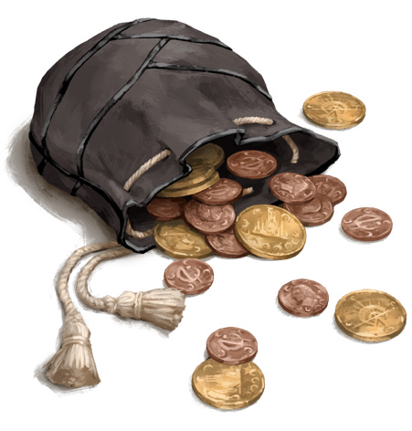

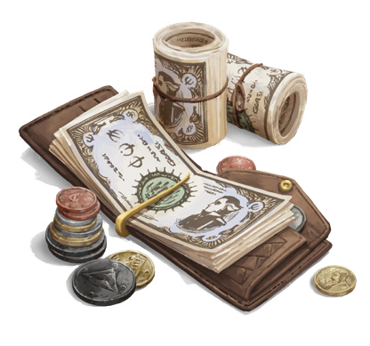

### 傭兵套組（Mercenary Kit）

**武器：**一件非特殊武器。

**護甲：**制服（Uniform）與胸甲（Breastplate）。

**裝備：**一個背包，內有平民服裝、水袋、放大鏡（Magnifying Lens）、撬棍（Crowbar）、鐐銬（Manacles），以及 10 天份乾糧（Food (ration)）。

**貨幣：**一只錢袋，內有 2d6 盒金（第一時代），或 10 × 2d6 盒金（第二時代）。

### 貴族套組（Noble Kit）

**武器：**一支決鬥杖（dueling cane）與一件輕型武器。

**護甲：**無。

**裝備：**酒類（Alcohol，一瓶上等葡萄酒或威士忌）、高級服裝。

**貨幣：**一只錢袋，內有 4d20 盒金（第一時代），或 10 × 4d20 盒金（第二時代）。

**人脈（Connections）：**你受到所屬貴族家族的一位贊助者（Patron）支持（見第 8 章「贊助者」）。這讓你享有住宿與一定的生活水準。

### 研究者套組（Researcher Kit）

**武器：**一把小刀（Knife，第一時代），或一把靴筒手槍（Boot Pistol，第二時代）。

**護甲：**制服。

**裝備：**一個背包，內有平民服裝、一枝墨水筆、一瓶墨水、20 張紙、一盞油燈（Lantern (oil)）、一壺油脂（Oil）、一本自選主題的參考書（Book (reference)；須經 GM 同意），以及一組鎖與鑰匙（Lock and Key）。

**貨幣：**一只錢袋，內有 3d12 盒金（第一時代），或 10 × 3d12 盒金（第二時代）。

**額外專長（Expertise）：**你獲得文學（Literature）實用專長（Utility Expertise）。如果你已擁有這項專長，則改為獲得一項自選的文化專長或實用專長。這項專長不計入你在角色建立時選擇的專長數量。

### 出走者套組（Runaway Kit）

**武器、護甲與貨幣：**無。

**裝備：**破舊服裝（Clothing (ragged)）。

**綻裂（Snap）：**你比一般人更早綻裂，發現了潛藏的鎔金能力（Allomantic Power），也已開始嘗試運用這些力量。當你取得賦予鎔金術（Allomancy）的金屬之子路徑關鍵天賦，例如迷霧之子（Mistborn）、迷霧人（Misting）或雙生師時，無論是在角色建立期間，還是在日後提升等級時，都立即完成該天賦最初的「訓練你的能力（Train Your Power(s)）」短期目標。

### 地下社會套組（Underworld Kit）

**武器：**兩件輕型武器。

**護甲：**皮甲。

**裝備：**一個背包，內有平民服裝、酒類（一瓶威士忌）、指虎（Knucklebones）、撬棍、開鎖器（Lockpick）、50 呎繩索（Rope）、一組燧石與鋼片、一盞油燈、一壺油脂，以及 5 天份街頭餐食（Food (street)）。

**貨幣：**一只錢袋，內有 1d20 盒金（第一時代），或 10 × 1d20 盒金（第二時代）。

### 武器

本節介紹司卡德利亞最常見的武器。此處武器表包含以下欄位：

**種類。**武器的一般類型；只要採用相同數據，你可以自由發揮，描述自己的武器外觀。

**技能（skill）。**使用這件武器攻擊（Attack）時所檢定（Test）的技能。（輕型武器〔Light Weaponry〕與重型武器〔Heavy Weaponry〕表中的所有武器，都使用各表對應的技能。）

**傷害（Damage）。**武器命中（Hit）或造成擦傷（Graze）時造成的傷害量。

**距離。**武器能攻擊多遠的目標（Target）（見稍後的「武器距離」一節）。

**特性。**適用於該武器的特殊規則（見稍後的「武器特性」一節）。

**專家特性（Expert Trait）。**只有你擁有該武器的專長時才適用的特殊規則。某些武器在你具備專長時，會移除不利的特性，而非增加有利的特性。例如，如果你擁有長劍專長，你的長劍就會失去雙手（Two-Handed）特性，讓你能單手持用。

**重量（Weight）。**武器的重量。

**價格。**武器的標準價格。

使用這些武器攻擊的完整規則，見第 10 章「攻擊」。

### 持用武器

除非武器特性另有說明，每件武器都需要一隻手持用。持用武器時，你可以用它攻擊或使用其他能力。提到「你的武器」的規則，只有在你持用該武器時才適用。如果你的某隻手沒有持用武器（或拿著物品），那隻手就空著，可以用於需要空手的其他能力。如果你雙手都拿著東西，但某項能力未註明需要空著一隻手，就由 GM 按故事情境判斷你是否能合理使用該能力。

第 7 章：物品 255

### 拔出武器

你可以使用互動（Interact）行動（Action）（[1行動]），拔出身上的一件武器並握在手中。之後你便持用該武器，可以用它攻擊或產生其他效果。你可以使用放下（Drop）自由行動（Free Action）（[自由行動]），鬆開手中握著的武器（例如，先放下武器，再互動拔出另一件武器）。場景（Scene）開始時，如果你並未措手不及（Surprised），就假定你能在第一個回合（Round）前本能地拔出武器，不必使用互動行動。如果場景開始時你措手不及，就不能本能地拔出武器。

### 副手武器

當你持用不只一件武器時，必須選擇其中一件作為主手（Main Hand）武器。你照常使用那件武器攻擊。你持用的武器如果不在主手，就是副手（Offhand）武器（Offhand Weapon）。使用副手武器進行打擊（Strike）行動前，你必須花費 2 點專注點（Focus）。（打擊行動以外的攻擊不必花費這些專注點。）有些角色（Character）可能用手以外的方式持用武器。只要你持用的武器組合，是另一名角色能以雙手持用的組合，就可以這樣做。此時，無論你如何持用，都要選定哪件武器視為「主手」、哪件視為「副手」，並遵守其餘武器規則。除非 GM 另有裁定，無論是否用手持用，你都不能同時持用超過兩件武器（或一件雙手武器）。

### 彈藥

如果你的武器具有裝填（Loaded）或遠程（Ranged）特性，你不必購買它的彈藥（Ammunition），也不必在角色紙上記錄彈藥數量（使用特殊彈藥的武器除外）。不過，裝填特性仍會限制武器重新裝填前可以發射幾次。除非 GM 判定你處於無法取得彈藥的特殊情況，否則一律假定你能取得或臨時製作武器的標準彈藥。

### 武器距離

武器只能攻擊一定距離內的目標。每件武器都分為近戰武器（Melee Weapon）或遠程武器（Ranged Weapon）。距離與觸及範圍（Reach）的進一步說明，見第 10 章「選定目標與距離（Targeting and Range）」。

### 近戰武器

你可以用持用中的近戰武器，攻擊觸及範圍內的目標。有些近戰武器在持用時，會增加你用該武器攻擊的觸及範圍。如果武器表中近戰（Melee）武器的距離欄有方括號數字，你的觸及範圍便增加該數字的呎數。例如，你平常的觸及範圍為 5 呎，「近戰 [+5]」的武器便能將觸及範圍延長為 10 呎。

### 遠程武器

你可以用持用中的遠程武器發射彈藥，攻擊觸及範圍內或範圍外的目標。武器的距離會以方括號列出兩個數字，例如「遠程 [80/320]」；第一個數字是以呎為單位的短距離（Short Range），第二個則是以呎為單位的長距離（Long Range）。如第 10 章「選定目標與距離」所述，超出短距離的遠程攻擊會獲得一個劣勢（Disadvantage）。此外，如第 10 章「攻擊」所述，你在敵人的觸及範圍內進行遠程攻擊時，也會獲得一個劣勢。如果你攻擊的目標位於盟友（Ally）5 呎內，就要提高賭注（Raise the Stakes）；變故（Complication）可能讓你的盟友受到擦傷。

取得鎔金惰性物品（Allomantically Inert Item） 有些司卡德利亞物品完全不含金屬，因此鐵與鋼（Steel）鎔金術師（Allomancer）無法影響這些物品（見第 6 章「鎔金惰性材料〔Allomantically Inert Material〕」）。哪些武器、護甲、彈藥與其他物品不含金屬，由 GM 決定。以下是通常不含金屬的例子：

- 名稱提到非金屬材料的物品，例如玻璃匕首（Glass Dagger）。

- 說明中明確指出材料的物品，例如決鬥杖或迷霧披風（mistcloak）。

- 你特地購買或製作的不含金屬物品，由 GM 裁定。如此製成的武器與護甲可能獲得易碎（Fragile）或危險（Dangerous）特性，也可能失去部分相關的武器特性、護甲特性或專家特性。

鋁（Aluminum）製物品也具有鎔金惰性（Allomantically Inert）。使用鋁或其他鎔金惰性材料製作物品的指引，見本章稍後的「使用非標準材料（Nonstandard Materials）製作物品」。如果你取得具有鎔金惰性的武器或護甲，而你又擁有其他方面相近的武器或護甲專長，GM 可能允許該專長適用於你的鎔金惰性物品。例如，小刀專長也可能適用於玻璃匕首。

第 7 章：物品 256
### 武器特性

武器表的項目只要列有某項特性（Weapon Trait），便適用該特性的以下規則：

**爆破（Blast）[X]。**方括號中的數字表示武器以呎為單位的爆破半徑。你用此武器命中或擦傷一個目標後，也會擦傷該半徑內的其他所有角色。命中時，你可以花費攻擊檢定的 [機遇]，改為命中所有原本受到擦傷的角色。

**笨重（Cumbersome）[X]。**你的力量（Strength）數值必須等於或高於方括號中的數字，才能輕鬆持用此武器。如果你的力量低於該數字，使用此武器的所有攻擊都會獲得一個劣勢，而且你在持用時處於減速（Slowed）狀態。

**危險。**GM 可以花費此武器攻擊的 [變故]，讓你不慎同時擦傷武器觸及範圍或距離內的一名盟友。這會造成通常的擦傷傷害。

**致命（Deadly）。**你用此武器命中目標時，可以花費 [機遇]，讓目標立即受到一項傷勢（Injury）。

**防禦型（Defensive）。**持用此武器時，即使附近沒有掩護（Cover），你也能使用架防（Brace）行動。

**隱蔽（Discreet）。**此武器比其他武器不起眼，因此在戒備森嚴的場所較不容易被沒收。在非戰鬥（Combat）場景中，當你檢定以偽裝此武器、將它藏在身上，或說服他人別將它拿走時，都會獲得一個優勢（Advantage）。

**易碎。**你用此武器攻擊時，GM 可以花費 [變故]，讓它在攻擊結算後損壞。

**曲射（Indirect）。**此遠程武器可以讓射出的物體以弧線越過掩護及遮蔽視線的地形（Terrain）。即使目標不在你的效果線（Line of Effect）內，只要你能感知到目標，而且射出的物體有合理、開闊的路徑能以弧線間接抵達，就仍可用此武器攻擊目標。目標無法對此武器的攻擊享有架防行動的好處。

**裝填 [X]。**此武器可容納的彈藥數，等於方括號中的數字。使用此武器進行遠程攻擊時，必須花費 1 發已裝填的彈藥。你可以花費 [1行動]，將此武器重新裝填至滿。GM 可以花費此武器攻擊的 [變故]，減少已裝填的彈藥；如此做之後，武器只剩一發彈藥。

**慣性（Momentum）。**你用此武器攻擊時，如果這個輪次（Turn）已朝目標直線移動至少 10 呎，該次攻擊就獲得一個優勢。

**副手。**你以副手持用此武器時，用它進行打擊只須花費 1 點專注點，而非 2 點。

**穿刺（Pierce）。**目標的偏轉值（Deflect）無法降低此武器造成的傷害。

**快拔（Quickdraw）。**你可以將互動行動作為 [自由行動]，拔出此武器。

**一次性（Single-Use）。**使用此武器後，它就永久耗盡。

**投擲（Thrown）[X/Y]。**你可以將此武器投向目標，進行一次遠程攻擊（見第 10 章「遠程攻擊」）。方括號內的兩個數字代表武器的短距離與長距離；與遠程武器相同，攻擊短距離外的目標時，你會獲得一個劣勢。武器投出後就不在你手上，必須從目標處取回才能再次使用。

**雙手。**你必須以雙手持用此武器，不能只用一隻手。使用它攻擊時，會占用雙手。

**獨特（Unique）。**此武器具有獨特規則，詳列於武器說明，或武器表中「獨特」一詞之後（例如「獨特：失去雙手特性」）。

### 文明場合中的武器

司卡德利亞多數「文明」社交場合都不歡迎武器。第一時代是因為最後帝國嚴格執法，第二時代則主要因為落灰之終後享有相對和平的生活。在市場或宴會等場所公開攜帶武器，往往會引來注目、敵意，或當局的注意。如果你想在這類場合攜帶武器，通常必須把它藏起來（例如進行隱匿〔Stealth〕檢定）。走在城市街道或造訪鄉間聚落時，小刀和木杖等具有隱蔽特性的武器，比其他武器更容易被接受（或更容易藏匿）。雖然某些場合仍可能不歡迎這些武器，但它們不會同樣讓陌生人之間的友善交談冷下來，而且各行各業的人都會持用。

第 7 章：物品 257

### 武器：輕型武器

| 種類 | 傷害 | 距離 | 特性 | 專家特性 | 重量 | 價格 |
| --- | --- | --- | --- | --- | --- | --- |
| 玻璃匕首 | 1d4 銳利（Keen） | 近戰 | 隱蔽、易碎 | 副手、投擲 [20/60] | 0.5 lb. | 50 bx |
| 小刀 | 1d4 銳利 | 近戰 | 隱蔽 | 副手、投擲 [20/60] | 1 lb. | 2 bx |
| 硬頭鎚（Mace） | 1d6 衝擊（Impact） | 近戰 | — | 慣性 | 3 lb. | 10 bx |
| 短矛（Shortspear） | 1d8 銳利 | 近戰 | 雙手 | 獨特：失去雙手特性 | 3 lb. | 5 bx |
| 佩劍（Sidesword） | 1d6 銳利 | 近戰 | 快拔 | 副手 | 2 lb. | 15 bx |
| 木杖（Wooden Staff） | 1d6 衝擊 | 近戰 | 隱蔽、雙手 | 防禦型 | 4 lb. | 5 bx |
| 短弓（Shortbow） | 1d6 銳利 | 遠程 [80/320] | 雙手 | 快拔 | 2 lb. | 40 bx |
| 投石索（Sling） | 1d4 衝擊 | 遠程 [30/120] | 隱蔽 | 曲射 | 1 lb. | 1 bx |

*玻璃匕首*

*短弓*

*硬頭鎚*

*短矛*

*佩劍*

*投石索*

ANNA VERHOOG

第 7 章：物品 258

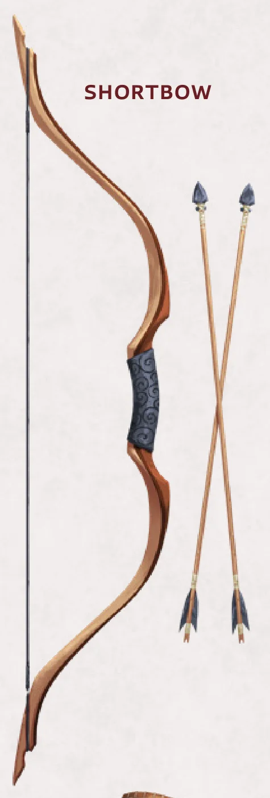

### 武器：重型武器

| 種類 | 傷害 | 距離 | 特性 | 專家特性 | 重量 | 價格 |
| --- | --- | --- | --- | --- | --- | --- |
| 斧頭（Axe） | 1d6 銳利 | 近戰 | 投擲 [20/60] | 副手 | 2 lb. | 10 bx |
| 戰鎚（Hammer） | 1d10 衝擊 | 近戰 | 雙手 | 慣性 | 8 lb. | 30 bx |
| 長矛（Longspear） | 1d8 銳利 | 近戰 [+5] | 雙手 | 防禦型 | 9 lb. | 20 bx |
| 長劍（Longsword） | 1d8 銳利 | 近戰 | 快拔、雙手 | 獨特：失去雙手特性 | 3 lb. | 30 bx |
| 黑曜石斧（Obsidian Axe） | 1d6 銳利 | 近戰 | 易碎 | 副手 | 1 lb. | 100 bx |
| 長柄斧（Poleaxe） | 1d10 銳利 | 近戰 | 雙手 | 獨特：近戰 [+5] | 5 lb. | 20 bx |
| 盾牌（Shield） | 1d4 衝擊 | 近戰 | 防禦型 | 副手 | 2 lb. | 5 bx |
| 木盾（Wooden Shield） | 1d4 衝擊 | 近戰 | 防禦型、雙手 | 獨特：失去雙手特性 | 4 lb. | 50 bx |
| 弩（Crossbow） | 1d8 銳利 | 遠程 [100/400] | 裝填 [1]、雙手 | 致命 | 7 lb. | 100 bx |
| 長弓（Longbow） | 1d6 銳利 | 遠程 [150/600] | 雙手 | 曲射 | 3 lb. | 75 bx |

*長劍*

*木盾*

*戰鎚*

*長弓*

*長柄斧*

*黑曜石斧*

ANNA VERHOOG

第 7 章：物品 259

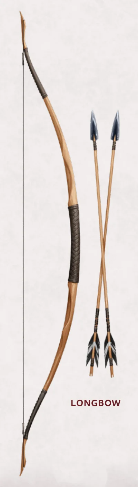

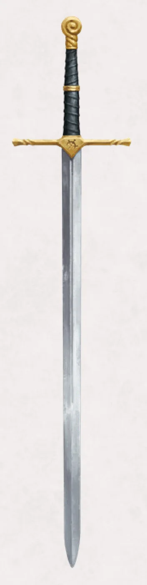

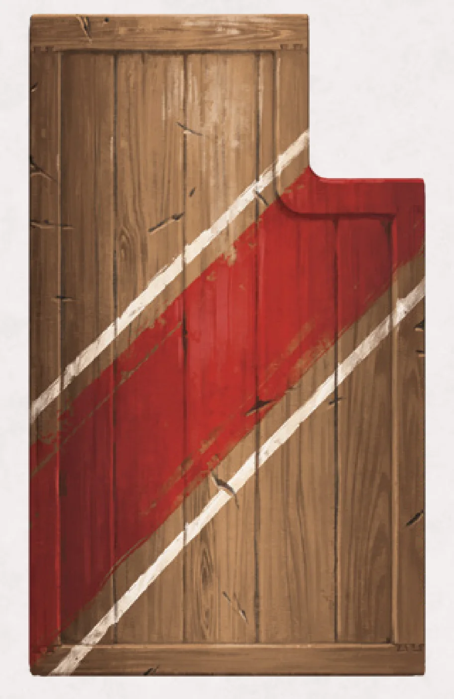

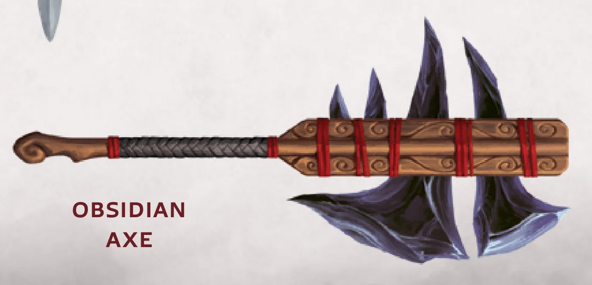

### 武器：特殊武器

| 種類 | 技能 | 傷害 | 距離 | 特性 | 專家特性 | 重量 | 價格 |
| --- | --- | --- | --- | --- | --- | --- | --- |
| 臨時武器（Improvised Weapon） | 同相近武器 | 同相近武器 | 近戰 | 易碎、獨特 | 獨特 | — | — |
| 徒手攻擊（Unarmed Attack） | 運動（Athletics） | 獨特 | 近戰 | 獨特 | 慣性、副手 | 無重量 | — |
| 決鬥杖 | 重型武器或輕型武器 | 1d8 衝擊 | 近戰 | 隱蔽、獨特 | 副手 | 3 lb. | 40 bx |
| 克羅司巨劍（Koloss Blade） | 重型武器 | 1d12 衝擊 | 近戰 [+5] | 笨重 [6]、危險、致命、雙手、獨特 | 獨特：失去危險特性，傷害改為 1d20 衝擊 | 200 lb. | 僅能作為獎勵（Reward）取得 |
| 聲響棒（soundstick） | 輕型武器 | 1d4 衝擊 | 近戰 | 易碎、獨特 | 副手 | 0.5 lb. | 100 bx |

### 臨時武器

情況緊急時，你可能想用非傳統武器的物品攻擊（例如用鍋子打人），或用不尋常的方式使用武器（例如將步槍當作木杖揮擊）。只要你能以單手或雙手拿起某件物品，就可以把它當作臨時武器！

**專長。**與特殊武器表中的其他項目不同，你可以選擇臨時武器作為武器專長（Weapon Expertise）。如此一來，即使你沒有最相近武器的專長，你的臨時武器攻擊仍能享有該武器的專家特性。

**使用臨時武器。**你用臨時武器攻擊時，由 GM 決定它最像哪件非特殊的輕型或重型武器。你視同使用該武器進行攻擊，但加上易碎特性（見「武器特性」）。

### 任人處置

刀抵咽喉、槍指腦袋，或雙方實力差距懸殊——有些情況會帶來無法克服的優勢。當角色無論言語或行動都無法有效對抗敵人，就只能任該敵人處置（At One’s Mercy）。在戰鬥中，這只會發生於極特殊的情況；在對話（Conversation）與試煉（Endeavor）中則較常見。如果你決定殺死完全任你處置的敵人，可以不必進行攻擊擲骰（Roll）。此時，與其他失敗機率微乎其微的行動一樣，以敘事方式處理行動結果。任你處置的角色抵抗影響（Resisting Influence）時，一律將你的影響視為強烈影響（Strong Influence）。

*決鬥杖*

*克羅司巨劍*

*聲響棒*

ANNA VERHOOG

第 7 章：物品 260

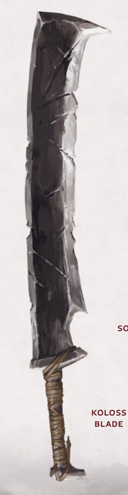

### 徒手攻擊

拳打、腳踢、肘擊、頭槌與咬人，都是徒手攻擊的例子。你可以使用運動進行徒手攻擊。

**專長。**與特殊武器表中的其他項目不同，你可以選擇徒手攻擊作為武器專長。

**獨特特性。**徒手攻擊加上以下獨特特性：

**隨時可用（Always Available）。**徒手攻擊不算武器攻擊（Weapon Attack），而是每名角色天生具備的近戰攻擊。你不必握有武器就能徒手攻擊，也不可能被繳械（Disarm）而失去徒手攻擊能力。即使雙手都拿著武器或其他物品，你仍可徒手攻擊，但該次攻擊依然算使用你指定的一隻手。如果你以打擊行動徒手攻擊，可以將它描述為拳打、腳踢或頭槌，但仍必須選擇這次攻擊使用哪一隻「手」，而且不能再以該手握著的武器進行另一次打擊。

**力量訓練（Strength Training）。**你的徒手攻擊傷害骰由力量數值決定，見徒手傷害表。許多司卡德利亞人會使用指虎（見「裝備」）來提高徒手攻擊的傷害。

### 徒手傷害

| 力量 | 徒手傷害 |
| --- | --- |
| 0–2 | 1 衝擊（不擲骰） |
| 3–4 | 1d4 衝擊 |
| 5–6 | 1d8 衝擊 |
| 7–8 | 2d6 衝擊 |
| 9+ | 2d10 衝擊 |

### 決鬥杖

決鬥杖深受殺霧者（Hazekiller）喜愛。這種木杖外表看似普通手杖，製作時卻特別考量了戰鬥的需要。它的重量與大小經過精確設計，能配合各種不同的戰鬥風格。

**獨特特性。**決鬥杖具有以下獨特特性：

**靈活戰法（Flexible Fighting）。**你可以使用重型武器或輕型武器技能操作決鬥杖。

### 特殊專長

每件武器與護甲的專家特性，都需要相應的專長（見第 3 章「專長」）。大多數武器與護甲的專長，可以在建立角色或角色升級時選擇。不過，本章某些物品必須具備特殊專長（Specialist Expertise），才能享有其專家特性。以下特殊專長只能透過天賦（talent）、獎勵或訓練（Training）取得（見第 9 章「休整期〔Downtime〕」）：決鬥杖、炸藥（Dynamite）、克羅司巨劍、迷霧外套（Mistcoat）、迷霧披風、轉管機槍（Rotary Gun），以及聲響棒。

### 克羅司巨劍

克羅司巨劍是一大塊粗略熔鑄成劍形的金屬，通常是鐵，體積巨大，重量更是驚人。劍長幾乎與持劍的克羅司（koloss）身高相當，通常為 7 至 8 呎；劍身寬度則約等於多數人類（Human）的肩寬。世代以來，克羅司都靠蠻力揮舞巨劍，直接將對手砸爛，因此劍身通常布滿鈍痕、缺口與凹痕，邊緣也往往參差不齊。

**獨特特性。**克羅司巨劍具有以下獨特特性：

**不易操控（Unwieldy）。**由於構造笨拙，克羅司巨劍的攻擊無法造成擦傷。

### 聲響棒

聲響棒是特製木棒，敲擊時會發出響亮刺耳的聲音；與另一根聲響棒互敲時，效果尤其強。殺霧者經常使用這種武器，它尤其擅長讓錫眼（Tineye）與風語（Windwhisperer）經錫增強的感官負荷過重。

**獨特特性。**聲響棒具有以下獨特特性：

**震耳欲聾（Ear-Splitting）。**持用此武器時，你可以花費 [1行動] 進行輕型武器檢定，將結果與感知範圍（Senses Range）涵蓋你佔位（Space）的每名其他角色之靈魂防禦（Spiritual Defense）比較。除了可能讓具有超自然聽覺的角色受到過度刺激，你對其檢定成功的每名角色都受到 1d6 命力傷害（Vital Damage），並陷入迷惑（Disoriented），直到其下一輪次結束。如果你在持用兩根聲響棒時進行此檢定，對具有超自然聽覺的角色會獲得一個優勢；對這類角色成功時，他們也會陷入震懾（Stunned），直到其下一輪次結束。

第 7 章：物品 261
### 武器：火器 [第二時代]

| 種類 | 技能 | 傷害 | 距離 | 特性 | 專家特性 | 重量 | 購買價格 |
| --- | --- | --- | --- | --- | --- | --- | --- |
| **輕型武器** |  |  |  |  |  |  |  |
| 破片手榴彈（Fragmentation Grenade） | 輕型武器 | 2d4 銳利 | 遠程 [20/60] | 爆破 [5]、危險、穿刺、一次性、投擲 [20/60] | 獨特：失去危險特性 | 0.5 lb. | 75 bx |
| 靴筒手槍 | 輕型武器 | 1d4 銳利 | 遠程 [20/40] | 隱蔽、裝填 [1]、穿刺 | 快拔 | 0.5 lb. | 125 bx |
| 獵用步槍（Hunting Rifle） | 輕型武器 | 1d8 銳利 | 遠程 [150/600] | 裝填 [1]、穿刺、雙手 | 獨特：裝填 [1] 改為裝填 [3] | 5 lb. | 400 bx |
| 左輪手槍（Revolver） | 輕型武器 | 1d6 銳利 | 遠程 [20/80] | 裝填 [6]、穿刺、雙手 | 獨特：失去雙手特性 | 1 lb. | 250 bx |
| 短管手槍（Snub Nose Pistol） | 輕型武器 | 1d4 銳利 | 遠程 [20/60] | 裝填 [6]、穿刺 | 隱蔽、副手 | 1 lb. | 175 bx |
| **重型武器** |  |  |  |  |  |  |  |
| 震盪手榴彈（Concussion Grenade） | 重型武器 | 2d6 衝擊 | 遠程 [20/60] | 爆破 [10]、危險、一次性、投擲 [20/60] | 獨特：失去危險特性 | 0.5 lb. | 50 bx |
| 栓動步槍（Bolt Rifle） | 重型武器 | 1d10 銳利 | 遠程 [150/600] | 裝填 [1]、穿刺、雙手 | 獨特：距離改為 [250/1,000] | 9 lb. | 600 bx |
| 卡賓槍（Carbine） | 重型武器 | 1d8 銳利 | 遠程 [80/320] | 裝填 [4]、穿刺、雙手 | 獨特：裝填 [4] 改為裝填 [8] | 7 lb. | 750 bx |
| 手砲（Hand Cannon） | 重型武器 | 1d8 銳利 | 遠程 [20/80] | 裝填 [6]、穿刺、雙手 | 獨特：失去雙手特性 | 2 lb. | 300 bx |
| 霰彈槍（Shotgun） | 重型武器 | 1d10 銳利 | 遠程 [20/60] | 危險、裝填 [2]、穿刺、雙手 | 爆破 [5] | 7 lb. | 600 bx |
| **特殊武器** |  |  |  |  |  |  |  |
| 炸藥（1 條） | 重型武器 | 4d6 衝擊 | 近戰 | 爆破 [30]、危險、一次性、投擲 [20/60]、獨特 | 獨特 | 0.5 lb. | 100 bx |
| 轉管機槍 | 重型武器 | 3d4 銳利 | 遠程 [20/60] | 笨重 [6]、危險、裝填 [20]、穿刺、雙手、獨特 | 獨特：失去危險特性 | 170 lb. | 2,500 bx |

*破片手榴彈*

*短管手槍*

*左輪手槍*

*靴筒手槍*

*獵用步槍*

ANNA VERHOOG

第 7 章：物品 262

### 火器：第二時代

落灰之終後，司卡德利亞的科技突飛猛進。戰爭技術也隨之發展，出現了各式以燃燒觸發的彈藥。火器（Firearm）的發展，從根本上改變了司卡德利亞的戰鬥樣貌。「武器：火器」表中的火器，遵循與其他武器相同的規則。不過，火器本身就不穩定，構造也比司卡德利亞的其他武器更精密。使用這些武器檢定時，可以從「火器的機遇（Opportunity）與變故」表尋找靈感。

### 炸藥

炸藥是威力強大、性質不穩定的爆裂物，通常用於拆除作業與露天採礦。它可以當作武器使用，但務必極度小心——光是隨身攜帶就已十分危險。炸藥通常以導火線引爆，但緊急時也可以投擲。多條炸藥可以接在同一條導火線上，提高定時爆炸的威力。

### 火器的機遇與變故

| 機遇 | 變故 |
| --- | --- |
| 武器開火嚇到了目標，使其失去 1d4 點專注點。如果其專注點因此降為 0，就會陷入震懾，直到場景結束。 | 你的槍發生故障，發出一聲巨響。你 5 呎內的每名角色（包括你）都陷入迷惑，直到你的下一輪次結束。 |
| 你的一槍擊碎目標的掩護。目標失去架防行動的好處，原本的掩護也不再提供任何好處。 | 子彈或彈殼卡在擊發機構中，使槍無法正常運作。重新裝填之前，你都無法開火。 |
| 你的子彈彈射後，以有利的方式擊中環境中的某個物件，例如打斷懸吊吊燈的繩索，或將敵人手中的武器打落。 | 槍的一個關鍵零件出現裂痕。你的槍獲得危險特性，直到你在長休息（Long Rest）期間成功通過 DC 12 工藝（Crafting）檢定將其修好。如果槍原本就有危險特性，在成功通過此檢定前就完全無法使用。 |

*栓動步槍*

*手砲*

*卡賓槍*

*霰彈槍*

*震盪手榴彈*

*炸藥*

*轉管機槍*

ANNA VERHOOG

第 7 章：物品 263

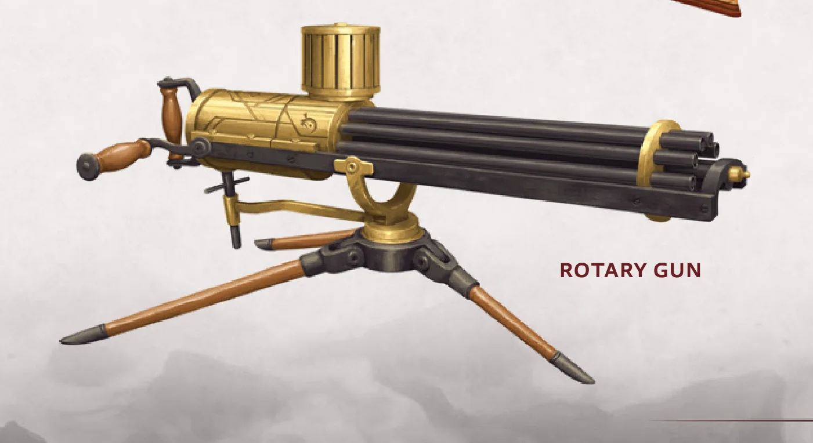

尤其在人口集中的都市，警察等執法人員會嚴密留意這類危險物品。除非你有贊助者（見第 8 章「獎勵類別」）授權你取得、運送或使用炸藥，否則它極難購得；被查獲持有時，你也很可能遭到逮捕與起訴。

**獨特特性。**炸藥具有以下獨特特性：

**延遲引爆（Delayed Detonation）。**接觸一條或多條炸藥時，你可以花費 [2行動] 接上並點燃導火線，選擇在 10 至 60 秒後引爆（戰鬥中的 1 至 6 回合）。時間一到，這些炸藥便會爆炸。爆炸時，對爆炸炸藥 5 呎內每名角色的實體防禦（Physical Defense）進行工藝攻擊；如何影響 5 呎外的目標，見爆破特性的規則。由 GM 裁定，你也可能損壞或摧毀爆破半徑內的物品。

**易爆（Volatile）。**雖然炸藥比純黑火藥更適合安全運送，受到強烈震動或摩擦時，仍可能自行起火。炸藥被投向角色、物品或表面時，碰撞的瞬間便會自動爆炸，如同以導火線引爆（見「延遲引爆」）。此外，你攜帶炸藥時，GM 可以花費你任何檢定的 [變故]，讓你其中一條炸藥爆炸，消耗該條炸藥，並擦傷其爆破距離內的每名角色（包括你）。不過，如果你擁有炸藥武器專長，就能安全攜帶炸藥，不必承受這種爆炸風險。

### 轉管機槍

轉管機槍有一組安裝在旋轉圓形基座上的槍管，通常連接著彈匣或彈鏈。手動轉動搖柄，就會將子彈送入槍管，以驚人的速度發射。尤其在人口集中的都市，警察等執法人員會嚴密留意這類危險物品。除非你有贊助者（見第 8 章「獎勵類別」）授權你取得、運送或使用轉管機槍，否則它極難購得；被查獲持有時，你也很可能遭到逮捕與起訴。

**獨特特性。**轉管機槍具有以下獨特特性：

**射速（Fire Velocity）。**你在自己的輪次中，以轉管機槍進行打擊行動的次數沒有上限。不過，每次用轉管機槍攻擊時，檢定都會獲得等同於你該輪次先前已用它攻擊次數的劣勢。例如，你在同一輪次進行第三次轉管機槍攻擊時，攻擊檢定會獲得兩個劣勢。

**沉重難持（Unwieldy Weight）。**轉管機槍的重量與後座力極大，若未固定在穩固表面上，便很難使用。未固定的轉管機槍具有笨重 [6] 特性。你或另一名能觸及它的角色，可以使用互動行動，將轉管機槍固定在水平穩固的表面上。每這麼做一次，笨重特性的數值就降低 2。例如，你以此方式互動兩次後，轉管機槍就變成笨重 [2]。如果已固定的轉管機槍因任何原因離開該表面，就會解除固定，再度變成笨重 [6]。

### 護甲

在司卡德利亞的兩個時代，一般民眾都很少穿戴護甲，文明社會尤其不認同這種打扮。穿戴護甲時，你通常會格外顯眼。視情況而定，如果你沒有適當的證件（或偽造證件），可能會十分突兀、遭某些場所拒絕進入，或在宴會、市場、教堂等場合對平民進行影響（Influence）檢定時獲得一個劣勢。本節介紹司卡德利亞最常見的護甲種類。你一次只能享有一種護甲的好處，而且在戰鬥中或難以活動的情況下，不能穿上或脫下護甲。護甲表包含以下欄位：

**種類。**護甲的一般類型；只要採用相同數據，你可以自由發揮，描述自己的護甲外觀。

**偏轉值。**你受到的所有衝擊、銳利與能量傷害（Energy Damage），都減去所穿護甲的偏轉值（見第 3 章「偏轉值」）。

**特性。**適用於該護甲的特殊規則（見稍後的「護甲特性」一節）。

**專家特性。**只有你擁有該護甲專長時才適用的特殊規則。有些護甲在你具備專長時，會移除不利的特性，而非增加有利的特性。例如，如果你擁有木製半身板甲專長，你穿戴該護甲時便不具有易碎特性。

**重量。**護甲的重量。

**價格。**護甲的標準價格。

第 7 章：物品 264

### 護甲

| 種類 | 偏轉值 | 特性 | 專家特性 | 重量 | 購買價格 |
| --- | --- | --- | --- | --- | --- |
| 制服 | 0 | 得體（Presentable） | — | 5 lb. | 20 bx |
| 迷霧披風 | 0 | 獨特 | 獨特 | 5 lb. | 僅能作為獎勵取得 |
| 皮甲 | 1 | — | 得體 | 10 lb. | 30 bx |
| 迷霧外套 [第二時代] | 1 | 得體 | 獨特 | 10 lb. | 僅能作為獎勵取得 |
| 胸甲 | 2 | 笨重 [3] | 得體 | 30 lb. | 50 bx |
| 陶瓷胸甲（Ceramic Breastplate） | 2 | 笨重 [3]、易碎 | 獨特：笨重 [3] 改為笨重 [2] | 20 lb. | 250 bx |
| 半身板甲（Half-Plate） | 3 | 笨重 [4] | 獨特：笨重 [4] 改為笨重 [3] | 40 lb. | 200 bx |
| 木製半身板甲（Wooden Half-Plate） | 3 | 笨重 [5]、易碎 | 獨特：失去易碎特性 | 30 lb. | 1,000 bx |

*制服*

*迷霧披風*

*皮甲*

*迷霧外套*

*胸甲*

*陶瓷胸甲*

*木製半身板甲*

ANNA VERHOOG

第 7 章：物品 265

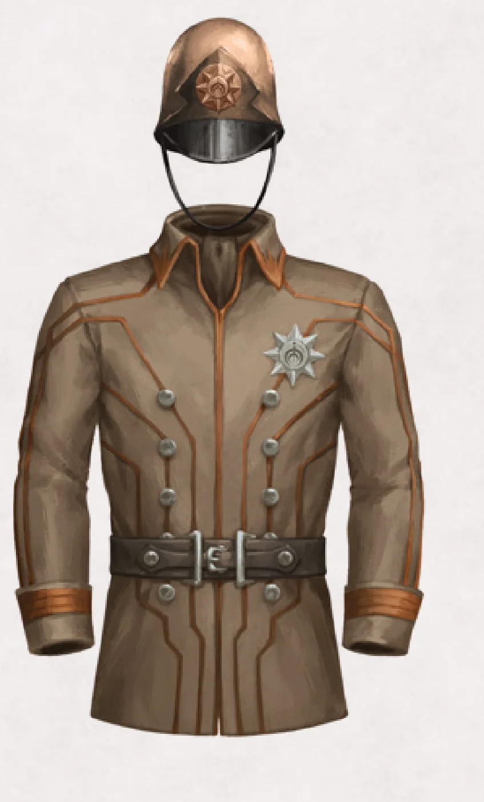

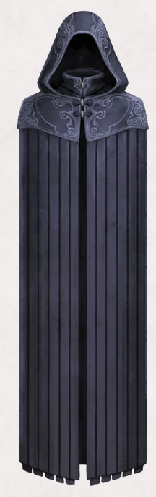

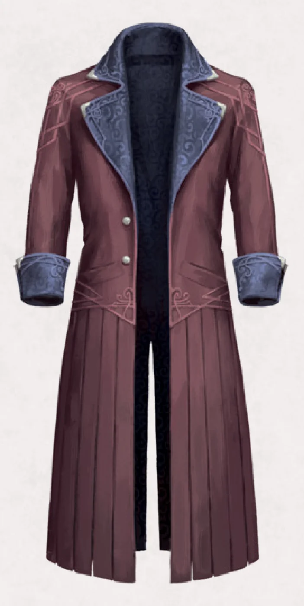

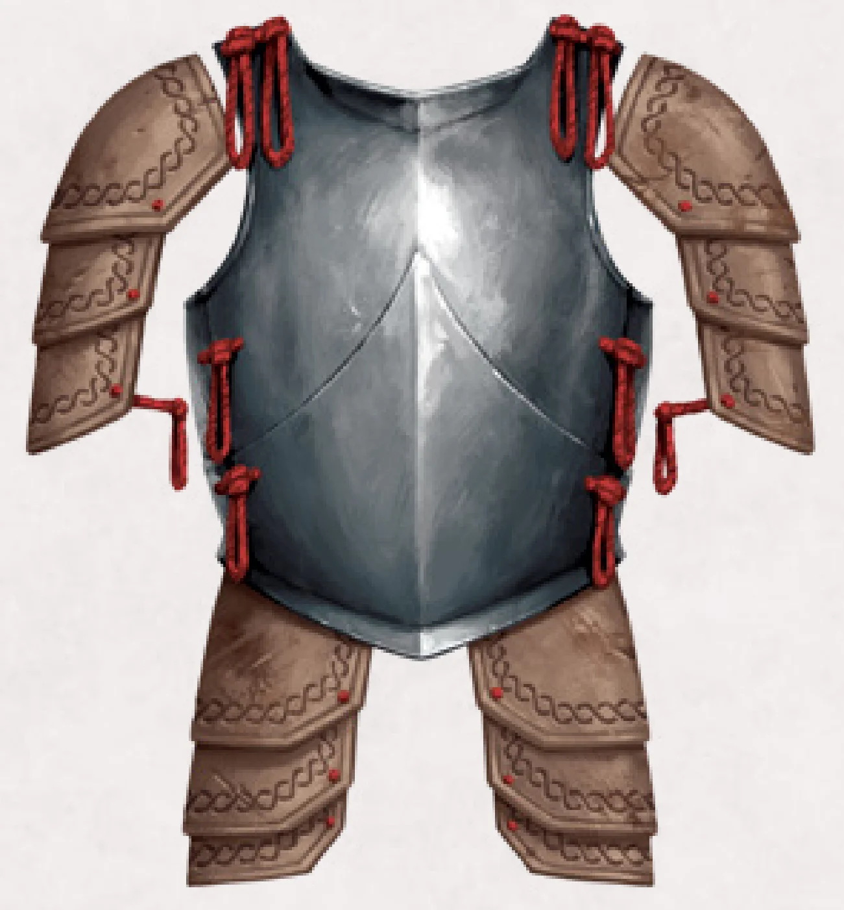

### 護甲特性

護甲表的項目只要列有某項護甲特性（Armor Trait），便適用該特性的以下規則。

**笨重 [X]。**你的力量數值必須等於或高於方括號中的數字，才能輕鬆穿戴此護甲。如果你的力量低於該數字，穿戴此護甲時便處於減速狀態，而且所有使用速度（Speed）屬性（attribute）的檢定都會獲得一個劣勢。

**易碎。**當你被攻擊命中時，GM 可以花費 [機遇]，讓你的護甲在攻擊結算後損壞。

**得體。**這種護甲不顯眼，適合在公開的非軍事場合穿戴。你不會因穿戴此護甲而受到不必要的注意，也不會因此在對話中的檢定獲得一個劣勢。

**獨特。**此護甲具有獨特規則，詳列於護甲表中「獨特」一詞之後（例如「獨特：失去易碎特性」）。

### 迷霧披風

迷霧披風是稀有而強大的迷霧之子所穿的披風；他們是能燃燒（Burn）所有鎔金金屬（Allomantic Metal）的鎔金術師。這種深色披風在第一時代比第二時代常見，通常附有兜帽，由許多輕薄布條製成，布條在穿戴者肩部與兜帽相接。長布條飄動時，模仿迷霧繚繞的動態，讓穿戴者在視線受阻的環境中更難被察覺。每件迷霧披風都是為穿戴者特別訂製，因此外觀可以相差甚遠。

**獨特特性。**迷霧披風加上以下獨特特性：

**飄動布條（Flowing Tassels）。**在黑暗或迷霧等遮蔽視線的區域穿戴此護甲時，如果某角色的主要感官（Primary Sense）也受到該區域遮蔽，你對該角色進行的隱匿檢定便會獲得一個優勢。此外，該角色對你進行的感知（Perception）檢定會獲得一個劣勢。

如果你擁有迷霧披風特殊專長，另加上以下特殊的專家特性：

**迷霧之子威勢（Mistborn Gravitas）。**穿戴此護甲時，對能感知到你，而且沒有理由認為你不是迷霧之子的非迷霧之子角色進行威嚇（Intimidation）檢定，你會獲得一個優勢。

### GM 提示：以物品作為獎勵

司卡德利亞有些物品極為珍貴強大，無法用金錢購得，包括克羅司巨劍、迷霧披風與迷霧外套。玩家只能透過獎勵（見第 8 章）取得這些物品，可能是完成短期目標的獎勵，也可能是故事中的收穫。

### 迷霧外套 [第二時代]

第二時代的迷霧外套向最後帝國的迷霧披風致意。這種長及腳踝的外套，從腰部略上方開始分成布條。如同迷霧披風，每件迷霧外套也是為穿戴者特別訂製。它的設計兼顧防護與時尚，一件經常穿用的迷霧外套，甚至能模仿傳奇迷霧披風的某些效果。

**獨特特性。**如果你擁有迷霧外套特殊專長，加上以下特殊的專家特性：

**飄動布條。**在黑暗或迷霧等遮蔽視線的區域穿戴此護甲時，如果某角色的主要感官也受到該區域遮蔽，你對該角色進行的隱匿檢定便會獲得一個優勢。此外，該角色對你進行的感知檢定會獲得一個劣勢。

> 那件長及腳踝的迷霧外套，從腰部略上方開始分成布條，布條在他身後飄動，發出輕微的窸窣聲。

第 7 章：物品 266

