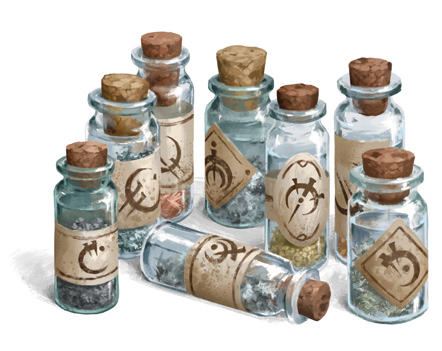
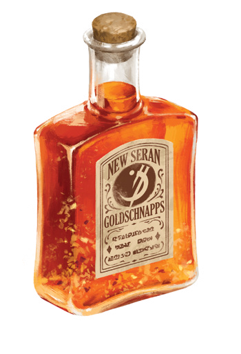
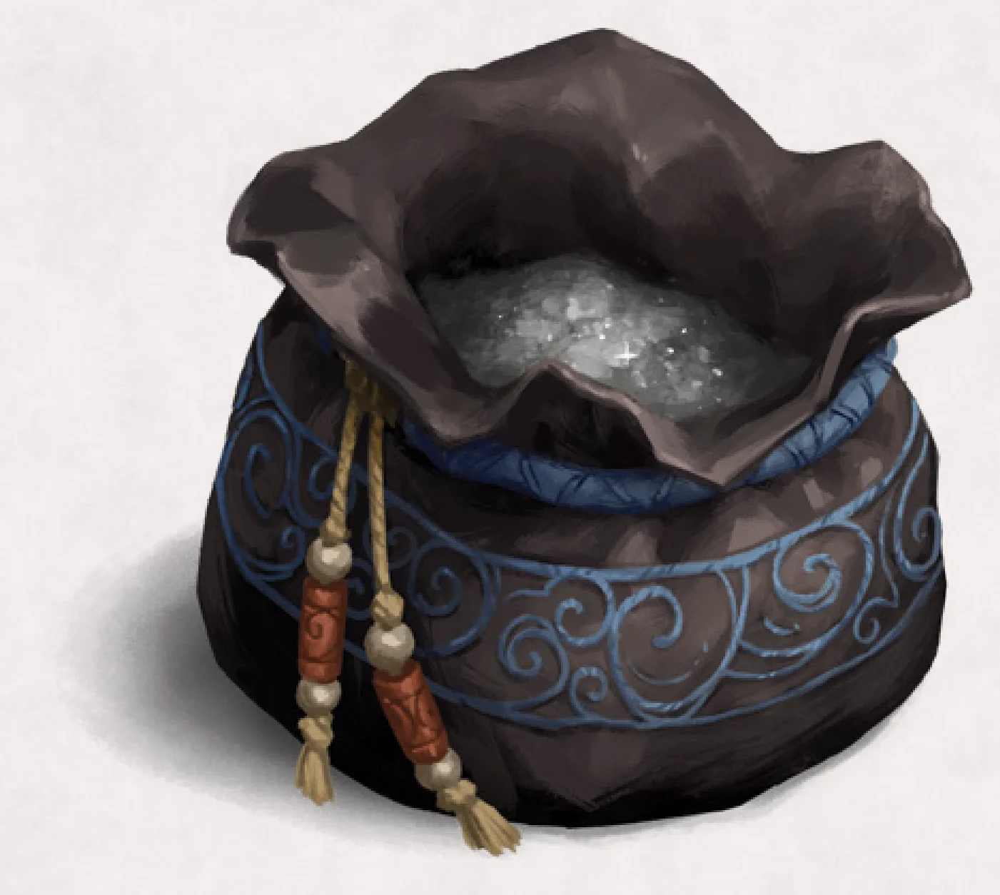
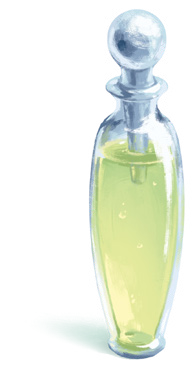

### 金屬瓶（Metal Vials）

鎔金術（Allomancy）用途廣泛，因此在司卡德利亞（Scadrial）的兩個時代，金屬交易都相當興盛。用於鎔金術的金屬，必須經過專門的提純，才能供人吞服；鎔金術師（Allomancer）攝入未提純的金屬，有承受傷勢（Injury）的風險。八種常見金屬的價格低廉，詳見第6章「司卡德利亞的金屬」。在大多數情況下，鎔金術師都能輕易免費取得金屬瓶，瓶中可裝有這八種常見金屬的任意組合，詳見第5章「鎔金術：使用授予」中的「管理金屬」。其他金屬則稀有且昂貴得多，價格列於「稀有金屬瓶（Rare Metal Vial）」表。這些金屬瓶必須逐瓶購買，因此需要稀有金屬的金屬之子（Metalborn），通常會設法找到可靠、持續的供應來源，詳見第8章「稀有金屬」。每瓶都裝有金屬碎屑與小珠，懸浮在酒精或油中，方便吞服。你可以在短休息（Short Rest）或長休息（Long Rest）期間，混合或分裝金屬瓶中的內容物，調配出任意稀有金屬組合。除非故事中金屬供應受到較多限制，否則任何稀有金屬瓶，都視為已含有鎔金術師想要的各種常見金屬，不需花費行動（Action）。

### 稀有金屬瓶

| 金屬 | 第一時代價格 | 第二時代價格 |
| --- | --- | --- |
| 鋁（Aluminum） | 25 bx／瓶 | 50 bx／瓶 |
| 天金（Atium） | 150 bx／顆 | 無供應 |
| 彎管合金（Bendalloy） | 無供應 | 500 bx／瓶 |
| 鎘（Cadmium） | 無供應 | 50 bx／瓶 |
| 鉻（Chromium） | 無供應 | 10 bx／瓶 |
| 硬鋁（Duralumin） | 25 bx／瓶 | 50 bx／瓶 |
| 電金（Electrum） | 10 bx／瓶 | 50 bx／瓶 |
| 金（Gold） | 5 bx／瓶 | 25 bx／瓶 |
| 鎳鉻（Nicrosil） | 無供應 | 50 bx／瓶 |

### 裝備（Equipment）

本節介紹在冒險（Adventure）中經常派得上用場的司卡德利亞日常工具與物資。「裝備」表列出各項物品的名稱、重量（Weight）與價格，接著的文字則說明其用途。有些物品列有價格範圍，因為司卡德利亞各地有許多不同款式。例如，酒類的價值差異極大，有些參考書也比其他書籍稀有得多。個別物品在這個範圍內的實際價格，由GM決定；價格較高的款式，也可能帶來一些附帶好處。例如，花錢買一瓶頂級威士忌，而不是陋巷釀造的麥酒，或許能降低你為影響（Influence）某位鑑賞家而進行的檢定（Test）DC。

**酒類（Alcohol）。** 司卡德利亞各種文化都有不同的飲酒傳統，從摻了大量水的麥酒、啤酒，到上好的威士忌與葡萄酒，種類繁多。

**麻醉劑（Anesthetic）。** 麻醉藥膏通常以乙醚製成。你可以在短休息或長休息後，對一項傷勢塗上一劑，使其剩餘恢復時間減少1d4天。每項傷勢每天只能使用麻醉劑處理一次。

**強效消毒劑（Antiseptic (potent)）。** 碘等強效消毒劑，可以用酸從海藻灰中萃取。角色（Character）在短休息後接受一劑處理，可以恢復2d6生命值（Health）。

*裝有鎔金金屬（Allomantic Metal）的小瓶。*

*一瓶烈酒。*

ANNA VERHOOG

第7章：物品　267

**弱效消毒劑（Antiseptic (weak)）。** 以汞等原料製成的弱效消毒劑，可以在角色短休息後使用一劑，使其恢復1d6生命值。

**參考書（Book (reference)）。** 每本參考書都載有某個特定主題的資訊，例如某段歷史、工程學、生物學或建築學。當你使用智力（Intellect）屬性（Attribute）進行相關檢定，而且有時間查閱書籍時，就視為擁有該主題的專長（Expertise），詳見第3章「專長的益處」。

**蠟燭（Candle）。** 點燃的蠟燭會照亮半徑15呎的範圍。最多燃燒6小時後，就無法再使用。

**皮製筒盒（Case (leather)）。** 這種可以封口的圓筒盒，最多能存放10頁紙張或羊皮紙，避免它們受到風雨侵襲。

**粗鎖鏈（Chain）。** 這種堅固的鎖鏈，可以用來固定貨物、拘束囚犯，以及其他需要堅固耐用的場合。成功通過DC 30的運動（Athletics）檢定，或對鎖鏈造成15傷害（Damage），就能將其弄斷。

**細鎖鏈。** 這種細鏈常用於首飾，通常由貴金屬製成，鏈節細緻。成功通過DC 20的運動檢定，或對細鏈造成5傷害，就能將其弄斷。

**快脫服裝（Clothing (breakaway)）。** 快脫服裝仿照高級服裝的外觀製作，但設計成可以穿在護甲（Armor）與武器（Weapon）外面，將它們遮掩起來。戰鬥爆發時，你可以用[1行動]沿著預設的接縫撕開並脫下衣服，而不會毀損它。穿著一套快脫服裝時，你身上穿著的任何護甲都獲得得體（Presentable）特性，攜帶的每件武器也都獲得隱蔽（Discreet）特性。不過，你進行的任何攻擊（Attack）都獲得一個劣勢（Disadvantage），而每次以你為目標（Target）的攻擊都獲得一個優勢（Advantage）。

**平民服裝（Clothing (common)）。** 樸素的衣服使用勞動階層常見的布料製作，通常不染色，讓你更容易融入平民之中。穿著一套平民服裝時，為了讓他人相信你來自勞動階層而進行的靈魂（Spiritual）檢定，會獲得一個優勢。

**高級服裝（Clothing (fine)）。** 高級服裝以絲綢或其他優質布料製成，使用昂貴染料上色，而且通常帶有精緻刺繡。穿著高級服裝，能讓你融入貴族宴會等上流社會場合，而不引起懷疑。穿著一套高級服裝時，為了讓他人相信你來自上流階層而進行的靈魂檢定，會獲得一個優勢。

**破舊服裝（Clothing (ragged)）。** 這些衣服或許曾是高級服裝，也可能只是平民衣著，如今卻幾乎要散架。穿著這些衣服時，為了讓他人相信你窮困潦倒而進行的靈魂檢定，會獲得一個優勢。

**撬棍（Crowbar）。** 在能運用撬棍槓桿作用的情況下，你可以藉此讓運動檢定獲得一個優勢。

**集音筒（Ear Trumpet）。** 透過集音筒聽見遠處的聲音時，可以視為聲音的距離只有實際的一半。GM也可以決定，是否能以更高的價格買到效力更強的集音筒。

**燧石與鋼片（Flint and Steel）。** 你可以用[1行動]，以燧石與鋼片點燃觸及範圍（Reach）內充足的燃料。在較困難的情況下生火，可能需要1分鐘或更久。

**乾糧（Food (ration)）。** 乾糧是為長途旅行準備的食物，例如肉乾與烤得硬實的麵包。通常滋味平淡，但只要保持乾燥，就能一直保存食用。

**街頭餐食（Food (street)）。** 在第一時代的各個統御區（Dominance），以及第二時代的各座城市，你都能品嘗當地的街頭飲食，從普通麵包，到根莖蔬菜雜燴與farlet湯，不一而足。

**高級餐食（Food (fine)）。** 高級餐廳與貴族宴席上，都能找到這類精緻食物。

**懸浮椅（Freechair）。** [第二時代] 懸浮椅改良自浮空船（Airship）技術，是一種利用鐵（Iron）徽章（Medallion）與可施展鋼推（Steelpush）的鎔金術方塊（Primer Cube）來懸浮、移動的行動輔具。操作者的移動速率（Movement Rate）與其他角色相同，詳見第3章「速度（Speed）」，而且懸浮椅不需花費行動啟動。懸浮椅雖然可以購買，身心障礙角色也能免費取得一張。第一時代尚無懸浮椅技術，但角色可以使用移動速率相同的輪椅。

**攀爬鉤（Grappling Hook）。** 攀爬鉤通常綁在繩索（Rope）末端，協助使用者攀上牆壁、懸崖，或沿著它們下降。使用綁在穩固攀爬鉤上的繩索攀爬時，敏捷（Agility）與運動檢定會獲得一個優勢。你可以使用互動（Interact）行動，將攀爬鉤固定在觸及範圍內的支點上，不需檢定。你也可以將它拋向20呎內合適的支點；只要成功通過敏捷或運動檢定，就能固定住，DC由GM設定。

第7章：物品　268

### 裝備

| 名稱 | 重量 | 購買價格 |
| --- | --- | --- |
| 酒類（1份） | 0.2 磅 | 0.1–50 bx |
| 酒類（1瓶） | 2–4 磅 | 0.5–300 bx |
| 麻醉劑（5劑） | 1.5 磅 | 30 bx |
| 強效消毒劑（5劑） | 1 磅 | 25 bx |
| 弱效消毒劑（5劑） | 1 磅 | 10 bx |
| 背包* | 5 磅 | 4 bx |
| 大桶* | 70 磅 | 10 bx |
| 毯子* | 2 磅 | 0.5 bx |
| 參考書 | 1–5 磅 | 5–250 bx |
| 陶瓶* | 3 磅 | 4 bx |
| 玻璃瓶* | 2 磅 | 8 bx |
| 水桶* | 2 磅 | 0.5 bx |
| 蠟燭 | 0.2 磅 | 0.1 bx |
| 皮製筒盒 | 1 磅 | 2 bx |
| 粗鎖鏈（10呎） | 10 磅 | 10 bx |
| 細鎖鏈（1呎） | 0.5 磅 | 10 bx |
| 箱子* | 25 磅 | 30 bx |
| 快脫服裝 | 5 磅 | 120 bx |
| 平民服裝 | 3 磅 | 1 bx |
| 高級服裝 | 6 磅 | 25–100 bx |
| 破舊服裝 | 1.5 磅 | 0.2 bx |
| 撬棍 | 3 磅 | 5 bx |
| 集音筒 | 1 磅 | 25 bx |
| 隨身壺或大杯* | 1 磅 | 0.5 bx |
| 燧石與鋼片 | 1.5 磅 | 2 bx |
| 乾糧（1日份） | 0.5 磅 | 0.1 bx |
| 街頭餐食（1日份） | 1.5 磅 | 0.5 bx |
| 高級餐食（1日份） | 0.5 磅 | 10 bx |
| 懸浮椅 [第二時代] | 12 磅 | 免費或500 bx |
| 攀爬鉤 | 4 磅 | 5 bx |
| 手鎚（手持式）* | 3 磅 | 2 bx |
| 墨水（1盎司瓶）* | 0.2 磅 | 20 bx |
| 墨水筆* | 0.1 磅 | 0.05 bx |
| 水罐或水壺* | 4 磅 | 1 bx |
| 指虎（Knucklebones） | 0.5 磅 | 5–10 bx |
| 梯子（10呎）* | 20 磅 | 10 bx |
| 油燈（Lantern (oil)） | 2 磅 | 10 bx |
| 鎖與鑰匙（Lock and Key） | 1 磅 | 25 bx |
| 開鎖器（Lockpick） | 0.5 磅 | 2 bx |
| 放大鏡（Magnifying Lens） | 0.2 磅 | 200 bx |
| 鐐銬（Manacles） | 6 磅 | 5 bx |
| 金屬砂（Metal Sand；1袋） | 0.3 磅 | 5 bx |
| 手持鏡* | 2 磅 | 15 bx |
| 樂器（Musical Instrument） | 0.5–20 磅 | 5–100 bx |
| 獵網（Net (hunting)） | 5 磅 | 2 bx |
| 漁網（Net (fishing)） | 15 磅 | 5 bx |
| 油脂（Oil；1瓶） | 1 磅 | 0.5 bx |
| 紙張或羊皮紙（1張）* | 0.1 磅 | 0.2 bx |
| 香水（1小瓶）* | 0.5 磅 | 10 bx |
| 採礦鎬* | 10 磅 | 10 bx |
| 弱效毒藥（Weak Poison；1劑） | 0.2 磅 | 10 bx |
| 中效毒藥（Effectual Poison；1劑） | 0.2 磅 | 25 bx |
| 強效毒藥（Potent Poison；1劑） | 0.2 磅 | 60 bx |
| 鐵鍋* | 10 磅 | 4 bx |
| 小袋* | 1 磅 | 0.5 bx |
| 滑輪組（Pulley System） | 12 磅 | 50 bx |
| 繩索（50呎） | 5 磅 | 15 bx |
| 大袋* | 0.5 磅 | 0.1 bx |
| 天平（Scale） | 3 磅 | 10 bx |
| 鏟子* | 5 磅 | 8 bx |
| 肥皂* | 0.1 磅 | 0.5 bx |
| 望遠鏡（Spyglass） | 1 磅 | 250 bx |
| 外科醫療用品（Surgical Supplies） | 3 磅 | 20 bx |
| 帳篷（雙人）* | 20 磅 | 5 bx |
| 補藥（Tonic；1劑） | 0.2 磅 | 2 bx |
| 醫療藥劑（Treatment (medical)；1劑） | 0.2 磅 | 5 bx |
| 音叉* | 0.5 磅 | 25 bx |
| 玻璃小瓶* | 0.2 磅 | 2 bx |
| 水袋* | 1 磅（空袋） | 0.5 bx |
| 蠟（1塊）* | 0.5 磅 | 1 bx |
| 磨刀石* | 1 磅 | 0.1 bx |

\* *此物品列出僅供角色扮演使用，沒有專屬的數據或規則。*

第7章：物品　269

**指虎。** 司卡德利亞大城市裡的街頭混混與打手，都很喜歡使用指虎。黃銅（Brass）指虎相當常見，但與鎔金術師交手時，較昂貴的木製款式卻是每一分錢都花得值得。你可以將指虎戴在手上，取代以該手持用武器。使用那隻手進行徒手攻擊（Unarmed Attack）時，將每顆徒手傷害骰的骰型（Die Size）提高一級，詳見本章前面的「徒手傷害」表。例如，傷害1（不擲骰）會變成1d4，1d8會變成1d10，依此類推。

**油燈。** 點燃的油燈會照亮半徑30呎的範圍。每品脫油脂最多可供其燃燒6小時。

**鎖與鑰匙。** 這種堅固的鎖，可以用隨附的鑰匙開啟，或成功通過DC 20的竊術（Thievery）檢定來打開。GM也可以決定，是否能以更高價格買到需要更高DC才能開啟的鎖。

**開鎖器。** 使用開鎖器開鎖時，竊術檢定會獲得一個優勢。檢定結算後，GM可以花費[變故]（Complication），使開鎖器折斷。

**放大鏡。** 使用放大鏡評估或檢查小型或十分精細的物品時，你進行的任何技能檢定（Skill Test）都會獲得一個優勢。

**鐐銬。** 這些附有鑰匙的金屬鐐銬，可以銬住大型（Large）或更小角色的手腕或腳踝。成功通過DC 25的敏捷檢定，就能掙脫；成功通過DC 25的運動檢定，或對鐐銬造成15傷害，就能破壞它；成功通過DC 20的竊術檢定，則能打開它的鎖。GM也可以決定，是否能以更高價格買到掙脫、破壞或開鎖所需DC更高的鐐銬。

**金屬砂（袋裝）。** 你可以撒出這些細小的廢金屬碎屑，干擾能感知金屬存在的角色，例如鐵鎔金術師或鋼鎔金術師。你可以用[1行動]，將這個袋子扔到30呎內的一個位置，讓袋子破裂，撒出其中的金屬砂。金屬砂形成一團10呎見方的雲，持續到你的下一個輪次（Turn）結束。這團雲會遮蔽視線，也會遮蔽鎔金術師藉由燃燒鐵或鋼（Steel）來感知金屬的能力。此外，若這團雲位於效果線（Line of Effect）上，使用鐵鎔金術（Iron Allomancy）或鋼鎔金術（Steel Allomancy）進行的鎔金術檢定，會獲得一個劣勢。

**樂器。** 樂器常用來自娛、打發時間，或在街頭賣藝賺取夾幣（Clip）。演奏樂器時，你可以進行相關技能（Skill）的檢定，判定表演得如何。例如，弦樂器可以使用敏捷，鼓可以使用運動，而有許多按鍵的樂器則可以使用紀律（Discipline）。若你擁有該樂器的專長，檢定會獲得一個優勢。

**獵網。** 這種粗繩製成的網，可以用來困住動物或敵人。手持獵網時，你可以用[1行動]，對15呎內一名大型或更小的角色進行運動檢定，對抗其實體防禦（Physical Defense）。成功時，該角色會受到束縛（Restrained），並倒地（Prone）。受困角色，或另一名能觸及他的角色，可以使用互動行動，進行DC 15的運動檢定；成功就能解救受困角色。如果角色被多張網束縛，必須分別解開每一張網。

**漁網。** 這種網目細密的網，用來捕捉魚類。使用漁網時，與捕魚有關的實體（Physical）檢定會獲得一個優勢。

**油脂。** 油脂通常以容量1品脫的陶瓶盛裝。油脂易燃，可以為油燈提供燃料，在某個位置形成危險地形（Dangerous Terrain），或用作投石索（Sling）類型的臨時武器（Improvised Weapon）。使用這件臨時武器命中（Hit）或擦傷（Graze）目標時，除了造成通常的傷害，也會使目標沾滿油脂。攻擊後，不論結果如何，陶瓶都會破裂，任何未用掉的油脂也會損失。

*一袋金屬砂。*

ANNA VERHOOG

第7章：物品　270

**毒藥（Poison）。** 毒藥通常用gurwraith，或毒樺（Birchbane）等攀藤植物的樹皮製成，以單劑裝的玻璃小瓶販售。你可以用[1行動]，將毒藥倒進食物、液體或容器中，或塗在你手持的一把近戰武器（Melee Weapon）或一枚彈藥（Ammunition）上。這麼做時，GM可能會要求你成功通過隱匿（Stealth）檢定，以免被發現。角色攝入毒藥，或被使用塗毒武器或彈藥的攻擊命中時，就會消耗這劑毒藥，而該角色會受到以下效果：

**弱效毒藥。** 目標必須成功通過DC 12的運動檢定，否則受到1d6命力傷害（Vital Damage）。

**中效毒藥。** 目標必須成功通過DC 14的運動檢定，否則受到2d8命力傷害，並陷入震懾（Stunned），持續1小時。

**強效毒藥。** 目標必須成功通過DC 16的運動檢定，否則受到3d10命力傷害，並陷入震懾，持續1小時。只要仍處於這種震懾之中，目標也會定身（Immobilized）。

**滑輪組。** 滑輪組最常由工程師與建築工人使用，包含四個滑輪、30呎繩索與一個鉤子。嘗試抬起物品時，如果你有時間架設滑輪裝置，就將該物品視為只有通常重量的四分之一。

**繩索。** 繩索通常以麻纖維製成，一般以50呎長度販售，可以視需要裁切、綁接，調整長度。直接對繩索造成2傷害就能將其割斷，或成功通過DC 20的運動檢定將其扯斷。

**天平。** 學者、鑑價師與寶石切割師最常使用天平，量出物品的精確重量，最多能秤2磅。

**望遠鏡。** 透過望遠鏡看見遠處的物體時，可以視為物體的距離只有實際的一半。GM也可以決定，是否能以更高價格買到讓遠物看起來更近的望遠鏡。

**外科醫療用品。** 這個肩袋裡裝有繃帶、藥膏、夾板與其他醫療用品，足以使用10次。進行醫學（Medicine）檢定來治療受傷角色，或以類似方式使用這些醫療用品時，你可以消耗一次使用次數，讓檢定獲得一個優勢。

**補藥。** 這是一種以祕密配方調製、氣味刺鼻的酊劑。第一時代，許多貴族喜歡每天喝一匙白鑞心補藥（Pewterheart Tonic）；到了第二時代，無數滿意的顧客都堅稱閃亮補藥（Sparkle Tonic）確實有效。（同時，也有人堅稱那只是安慰劑效應。）無論如何，角色可以在短休息後服用一劑，恢復1d4生命值與1點專注點（Focus）。

**醫療藥劑。** 司卡德利亞的醫師會使用各種藥方治療病症，通常以大蒜、歐芹、柳樹、柏樹等植物製成。短休息期間，你可以使用一劑醫療藥劑，治療角色的下列其中一種狀態（Condition），但該狀態的來源不能是永久傷勢：迷惑（Disoriented）、精疲力竭（Exhausted；懲罰降低1），或震懾。

### 個人物品（Personal Items）

本章提供的是會與遊戲規則互動的常見物品數據，並沒有列出司卡德利亞存在的所有東西！你可以攜帶其他對角色有意義、能為行動增添特色，或以類似方式豐富故事的個人物品。只要記住，這類個人物品不能在遊戲中提供機制上的優勢：你不能突然宣稱，口袋裡有一顆先前根本不存在的天金。除此之外，盡量發揮創意。

例如，你可以設定角色嗜吃甜食，不停地吃糖。糖果雖然不在物品清單裡，仍然可以用來為故事增添有趣的細節。在正式會晤貴族的嚴肅場合，你可以描述自己從襪子裡掏出一顆糖，丟進嘴裡，大聲嚼碎，不必先交代糖是在哪裡買的、花了多少錢！只要記住，這些靠敘事添出的糖果，不能拿去賄賂守衛、在乾糧用盡時補充營養，或交換裝備清單上的物品；這些用途都會對遊戲機制造成影響。

*一小瓶毒藥。*

ANNA VERHOOG

第7章：物品　271

