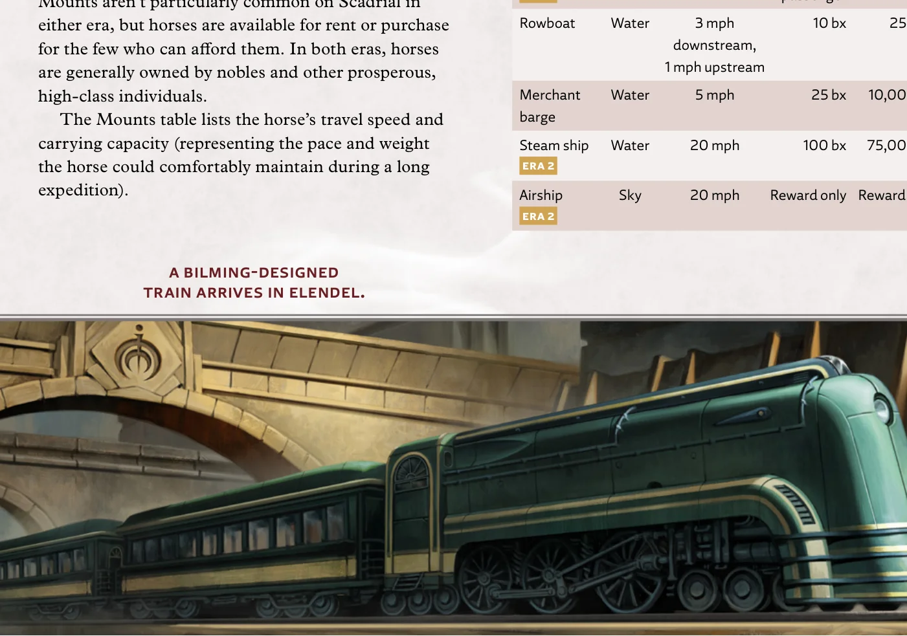

### 旅行（Travel）

你的冒險隊伍（Party）可能是受警察委任的特遣隊、在外圍統御區（Outer Dominances）[第一時代] 或蠻橫區（The Roughs）[第二時代] 出售服務的傭兵團，也可能是尋找失落知識的探險隊，或其他截然不同的團體。無論如何，你們很可能會跋涉司卡德利亞（Scadrial）各地。本節介紹遠離家鄉時可能派得上用場的住宿（Lodging）、坐騎（Mount）與交通工具（Vehicle）資訊。

### 住宿

旅行時，你可能會想找間房住，尤其是在落灰特別嚴重的時候。從破舊低俗的酒館到最上等的住處，「住宿」表列出各種住宿每晚通常所需的費用。你通常可以在住宿處或附近購買食物，價格依前一節的「裝備（Equipment）」表計算。

#### 住宿

| 住宿 | 每人每晚價格 |
| --- | --- |
| 簡陋 | 0.2 bx |
| 樸素 | 1 bx |
| 舒適 | 5 bx |
| 富裕 | 25 bx |
| 貴族級 | 40 bx |

### 坐騎

司卡德利亞的兩個時代都不太常見坐騎，不過，少數負擔得起的人仍可租借或購買馬匹。兩個時代的馬匹通常都由貴族或其他富裕的上流人士擁有。「坐騎」表列出馬匹的旅行速度（Travel Speed）與負重能力（Carrying Capacity），代表馬匹在長途遠征中能輕鬆維持的速度與承載重量。

坐騎繫上貨車、馬車或其他交通工具時，可以拖動相當於其負重能力五倍的重量，其中包含交通工具本身的重量。若有多匹坐騎拉同一輛車，就將牠們的負重能力相加。

#### 坐騎

| 坐騎 | 旅行 速度 | 負重 能力 | 每日 租金（Rental Price） | 購買 價格（Purchase Price） |
| --- | --- | --- | --- | --- |
| 馬（Horse） | 4 英哩／小時 | 500 磅 | 4 bx | 500 bx |

### 交通工具

交通工具讓你能在水上旅行，或更快速、更安全地在陸地上旅行；到了第二時代，甚至還能飛上天空。「交通工具」表列出常見的交通方式，包括種類、平均旅行速度，以及租借或購買的費用。租金讓你能暫時使用該交通工具，也包含操作所需的動物或人員。若你想購買交通工具，就必須自行安排操作人員。

#### 交通工具

| 交通工具 | 類型 | 旅行速度 | 每日 租金 | 購買 價格 |
| --- | --- | --- | --- | --- |
| 馬車（Horse cart） | 陸上 | 4 英哩／小時 | 5 bx | 500 bx |
| 汽車（Car） [第二時代] | 陸上 | 30 英哩／小時 | 200 bx | 4,000 bx |
| 火車（Train） [第二時代] | 陸上 | 60 英哩／小時 | 每位乘客 25 bx | 50,000 bx |
| 划艇（Rowboat） | 水上 | 3 英哩／小時 （順流）， 1 英哩／小時（逆流） | 10 bx | 250 bx |
| 貨運 駁船（Merchant Barge） | 水上 | 5 英哩／小時 | 25 bx | 10,000 bx |
| 蒸汽船（Steam ship） [第二時代] | 水上 | 20 英哩／小時 | 100 bx | 75,000 bx |
| 浮空船（Airship） [第二時代] | 空中 | 20 英哩／小時 | 僅能作為獎勵（Reward）取得 | 僅能作為獎勵取得 |

*一列由Bilming設計的火車抵達依藍戴（Elendel）。*

LUCAS TORQUATO

