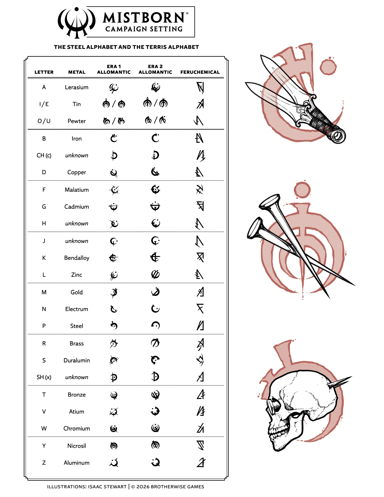

# 迷霧之子®戰役設定（Mistborn® Campaign Setting）

## 鋼鐵字母（Steel Alphabet）與泰瑞司字母（Terris Alphabet）

<!-- 第一時代鎔金術、第二時代鎔金術與藏金術各欄的符號字形保留於原圖。PDF 原生文字會將這些非拉丁字形對應為容易誤導的拉丁字母；不可轉錄這些對應字元。 -->

| 字母（Letter） | 金屬（Metal） |
| --- | --- |
| A | Lerasium |
| I / E | 錫（Tin） |
| O / U | 白鑞（Pewter） |
| B | 鐵（Iron） |
| CH (c) | 未知（unknown） |
| D | 紅銅（Copper） |
| F | 脈天金（Malatium） |
| G | 鎘（Cadmium） |
| H | 未知（unknown） |
| J | 未知（unknown） |
| K | 彎管合金（Bendalloy） |
| L | 鋅（Zinc） |
| M | 金（Gold） |
| N | 電金（Electrum） |
| P | 鋼（Steel） |
| R | 黃銅（Brass） |
| S | 硬鋁（Duralumin） |
| SH (x) | 未知（unknown） |
| T | 青銅（Bronze） |
| V | 天金（Atium） |
| W | 鉻（Chromium） |
| Y | 鎳鉻（Nicrosil） |
| Z | 鋁（Aluminum） |

符號欄位標題：第一時代鎔金術（Era 1 Allomantic）；第二時代鎔金術（Era 2 Allomantic）；藏金術（Feruchemical）。

插圖：Isaac Stewart | © 2026 Brotherwise Games

<!-- 本頁僅有星空與迷霧插圖，無可見的原文文字。 -->

