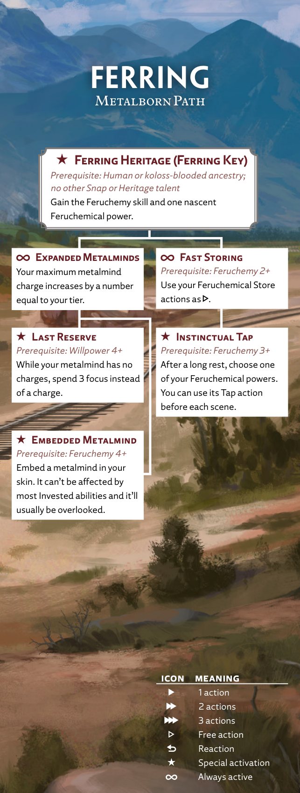

### 單藏金術師（Ferring）

金屬之子路徑（Metalborn Path）[第二時代]

> 統御主（Lord Ruler）掌握井中力量，同時又感到力量逐漸流失的那些時刻，他明白了許多事。他看見藏金術（Feruchemy）的力量，也理所當然地畏懼它。

落灰之終（Catacendre）之後，開始出現一種新的金屬之子（Metalborn）：單藏金術師，只能使用一種藏金能力（Feruchemical Power）。如同第一時代完整的藏金術師（Feruchemist），單藏金術師可以將力量、清醒程度等特定特質，儲存（Store）於對應藏金術金屬製成的金屬意識庫（Metalmind）。之後，他們就能汲取（Tap）金屬意識庫中的特質，以超自然的方式強化自身。

每種單藏金術師都有一個俗稱，反映其金屬意識庫所用的金屬，以及能儲存其中的特質。例如，庫藏（Archivist）就是紅銅（Copper）單藏金術師，能在金屬意識庫中儲存記憶。「藏金術能力發現表」列出了各種單藏金術師的名稱。

### 單藏金術師的歷史

在司卡德利亞（Scadrial）大多數已知的歷史中，藏金術都只由能運用所有藏金能力的完整藏金術師掌握。即使如此，這份遺傳傳承的延續依然岌岌可危。第一時代，統御主慘無人道的育種計畫（Breeding Program），就是為了將藏金術從泰瑞司（Terris）血脈中消除，進而讓整個司卡德利亞不再有藏金術。

泰瑞司人合力破壞這項計畫，讓藏金術撐過統御主的整段統治。落灰之終後，許多泰瑞司人選擇不再延續孤立的傳統，轉而與司卡德利亞北方的其他人口通婚。藏金術因此廣泛流傳，開始出現單藏金術師。雖然藏金術通常仍只在人口密集區中隱密的泰瑞司聚居地（Terris Enclave）傳授，運用這項金屬技藝（Metallic Arts）的能力卻已遍及整片大陸，甚至傳到蠻橫區（The Roughs）荒涼的邊陲。

### 建立單藏金術師

下方「經典單藏金術師」提供受小說啟發的角色建立範例。也可以參考以下建議，打造能發揮所長的單藏金術師：

**屬性（Attribute）。** 你的屬性主要取決於選擇的藏金能力。例如，如果能力經常用到藏金術修正值（Skill Modifier），如黃銅藏金術（Brass Feruchemy），可以優先提高智力（Intellect）。儲存特定屬性的能力，如電金藏金術（Electrum Feruchemy），通常會受益於對該屬性的投入。而如果能力適合戰鬥，如鋼藏金術（Steel Feruchemy），可以考慮力量（Strength）或速度（Speed），加強武器攻擊。

**英雄路徑（Heroic Path）。** 多數單藏金術師除了投入金屬之子路徑及其能力，也會以英雄天賦（Talent）加以補足。參考你感興趣的英雄路徑角色建立建議，會很有幫助。

**技能（Skill）。** 許多單藏金術師會優先提高藏金術技能等級（Skill Rank）。也可以考慮投入一般技能，例如你感興趣的金屬之子天賦或英雄天賦所要求的前提條件技能。

*一名金（Gold）單藏金術師汲取健康，從爆炸造成的傷害中恢復。*

JUST HIEU

第 5 章：金屬之子路徑 148

#### 隨機決定你的藏金能力

有些玩家喜歡隨機決定角色的藏金能力，如前文「隨機決定你的金屬之子路徑」側欄所述。你可以在藏金術能力發現表擲骰決定。

#### 藏金術能力發現表

| d20 | 能力 | 單藏金術師名稱 |
| --- | --- | --- |
| 1 | 鐵（Iron） | 掠影（Skimmer） |
| 2 | 鋼（Steel） | 鋼奔（Steelrunner） |
| 3 | 錫（Tin） | 風語（Windwhisperer） |
| 4 | 白鑞（Pewter） | 白鑞臂（Pewterarm）／蠻力（Brute） |
| 5–6 | 鋅（Zinc） | 星火（Sparker） |
| 7–8 | 黃銅（Brass） | 火靈（Firesoul） |
| 9–10 | 紅銅 | 庫藏 |
| 11–12 | 青銅（Bronze） | 哨兵（Sentry） |
| 13 | 鉻（Chromium） | 旋轉（Spinner） |
| 14 | 鎳鉻（Nicrosil） | 承魂（Soulbearer） |
| 15 | 鋁（Aluminum） | 真我（Trueself） |
| 16 | 硬鋁（Duralumin） | 聯絡（Connector） |
| 17 | 鎘（Cadmium） | 喘息（Gasper） |
| 18 | 彎管合金（Bendalloy） | 吞蝕（Subsumer） |
| 19 | 金 | 制血者（Bloodmaker） |
| 20 | 電金（Electrum） | 頂峰（Pinnacle） |

### 經典單藏金術師

如果你想從《迷霧之子》（Mistborn）小說汲取靈感，可以參考以下經典單藏金術師，再為建議的角色建立方式加入獨特的背景與個性，打造自己的角色。

### Adawathwyn

*鋅藏金術（Zinc Feruchemy）*

依藍戴（Elendel）副總督 Adawathwyn 是一名野心勃勃、精於算計的星火。她藉由在鋅意識（Zincmind）中儲存與汲取思考速度，巧妙勝過政治對手，也能迅速想出解決危機的方法。雖然 Adawathwyn 在 Varlance 總督麾下任職，但在許多方面，真正展現政治手腕的是她，而他只居於名義上的領導位置。

**建立星火政治家（Sparker Politician）。** 選擇人類（Human）血統（Ancestry），以及依藍戴與泰瑞司聚居地文化專長（Cultural Expertise）。起始時以智力和意志（Willpower）為高屬性。除了單藏金術師提供的 1 級藏金術，將威嚇（Intimidation）與學識（Lore）各提高 2 個技能等級。

使用單藏金術師傳承（Ferring Heritage，單藏金術師關鍵天賦），選擇鋅藏金術。運用人類血統，選擇博學（Erudition，學者關鍵天賦），將政治學（Politics）選為額外專長（Expertise），並將額外技能等級分配給推理（Deduction）與學識。最後，選擇研究者（Researcher）起始套組（Starting Kit）。

隨著等級提高，優先選擇鋅藏金術與學者（Scholar）策士（Strategist）專精（Specialty）的天賦。也可以考慮領袖（Leader）策劃者（Mastermind）與政客（Politico）專精的天賦。

### Handerwym

*硬鋁藏金術（Duralumin Feruchemy）*

Handerwym 是鎔金術師 Jak（Allomancer Jak）忠誠的侍從官，也是他不可或缺的編輯。他協助 Jak 將紳士冒險家的歷險，改寫成報紙故事，娛樂依藍戴的民眾。雖然 Handerwym 不允許太多自身能力的細節公開發表，他其實是一名聯絡。他的力量能暫時與他人建立牽繫（Connection），讓溝通與理解更加容易。

**建立聯絡專欄作家（Connector Columnist）。** 選擇人類血統，以及泰瑞司聚居地與旅行者（Wayfarer）文化專長。起始時以智力和風采（Presence）為高屬性。除了單藏金術師提供的 1 級藏金術，將推理與說服（Persuasion）各提高 2 個技能等級。

使用單藏金術師傳承（單藏金術師關鍵天賦），選擇硬鋁藏金術。運用人類血統，選擇振奮人心（Rousing Presence，使者關鍵天賦）。最後，選擇工匠（Artisan）起始套組。

隨著等級提高，優先選擇硬鋁藏金術與單藏金術師路徑的天賦。也可以考慮使者（Envoy）信仰者（Faithful）專精的天賦。

### Razal

*白鑞藏金術（Pewter Feruchemy）*

Razal 住在依藍戴的泰瑞司村（Terris Village），擔任堅定、偶爾也有些固執的守衛。他是一支三人蠻力小隊的領袖，負責將闖入者趕出村子。Razal 能在白鑞意識（Pewtermind）中儲存與汲取身體力量，增加肌肉量，壓倒對手。

**建立蠻力守衛（Brute Guard）。** 選擇人類血統，以及泰瑞司聚居地與依藍戴文化專長。起始時以力量和意志為高屬性。除了單藏金術師提供的 1 級藏金術，將運動（Athletics）提高 2 個技能等級，紀律（Discipline）與威嚇各提高 1 個技能等級。

使用單藏金術師傳承（單藏金術師關鍵天賦），選擇白鑞藏金術。運用人類血統，選擇戒備架式（Vigilant Stance，戰士關鍵天賦）。最後，選擇傭兵（Mercenary）起始套組。

隨著等級提高，優先選擇白鑞藏金術與戰士（Warrior）士兵（Soldier）專精的天賦。也可以考慮戰士鬥士（Brawler）專精的天賦。

第 5 章：金屬之子路徑 149

### 單藏金術師關鍵天賦（Key Talent）

泰瑞司人可能遺傳到賦予一種藏金能力的特徵。到了第二時代，這在泰瑞司文化中已是常識，因此多數擁有藏金能力的人，都在年幼時就發現了它。然而，有些人可能不知道自己有泰瑞司祖先，直到較晚的人生階段，才發現自己繼承了單藏金術師的力量。選擇此天賦代表你的角色發現自己的能力，並解鎖單藏金術師天賦樹（Talent Tree）。

**起始技能（Starting Skill）：藏金術。** 如果你選擇單藏金術師作為起始路徑（Starting Path），免費獲得 1 級藏金術，這是在單藏金術師傳承提供的技能等級之外額外獲得。

#### 單藏金術師傳承（單藏金術師關鍵天賦）

前提條件（Prerequisite）：人類或克羅司混血（koloss-blooded）血統；你沒有其他綻裂天賦（Snap Talent）或傳承天賦（Heritage Talent）

啟動（Activation）：[特殊啟動]

你發現自己的藏金術傳承，獲得一種藏金能力。起初，你只能用手邊現有的金屬，粗略地運用能力。打造適當的金屬意識庫後，就能解鎖完整能力。

取得此天賦時，你發現自己繼承了單藏金術師的力量，並獲得下列好處：

- 在角色紙上加入藏金術技能，起始時有 1 個技能等級。此技能使用智力屬性。

- 選擇一種在所處時代可用的藏金能力（見第 6 章「司卡德利亞的金屬」）。目前只能使用此能力的初萌能力（Nascent Power）。

此外，你獲得金屬之子短期目標（Metalborn Goal）「打造你的金屬意識庫（Construct Your Metalmind）」。完成此短期目標（Goal）後，你獲得其獎勵（Reward）：取得一個金屬意識庫、解鎖該能力的完整版本，並能選擇第 6 章該能力天賦樹的天賦。

### 單藏金術師天賦

以下天賦出現在單藏金術師天賦樹中，依英文名稱字母順序排列。

#### 嵌入金屬意識庫（Embedded Metalmind）

前提條件：藏金術 4+；擴充金屬意識庫（Expanded Metalminds）天賦

啟動：[特殊啟動]

嵌入身體的金屬更難受到鎔金術（Allomancy）影響，讓你既能保護金屬意識庫不受他人干涉，又能隨時使用它。

長休息（Long Rest）後，你可以將自己的一個金屬意識庫作為耳環或其他飾物，嵌入皮膚。嵌入期間，只有某項授予技能（Invested Skill）至少有 6 個技能等級的角色，才能用該授予能力影響這個金屬意識庫。此外，視嵌入的位置而定，一般搜查很可能會忽略它，具體由 GM 決定。

這個金屬意識庫會一直保持嵌入狀態，直到你再次使用此天賦，或它因其他方式被移出你的身體。

#### 擴充金屬意識庫

前提條件：單藏金術師傳承關鍵天賦

啟動：[常駐]

透過精心製作與熟練儲存，你能將

更多藏金術力量存入金屬意識庫，才會達到自身的極限。

取得此天賦時，每種能力金屬意識庫的充能（Charge）上限，都增加等同你階層（Tier）的數值。你的階層每提高 1，此上限也隨之提高 1。

#### 快速儲存（Fast Storing）

前提條件：藏金術 2+；單藏金術師傳承關鍵天賦

啟動：[常駐]

儲存藏金術力量幾乎已成為你的

本能，不太需要專心。

你可以用 [自由行動] 使用藏金術的儲存行動（Action）。

#### 本能汲取（Instinctual Tap）

前提條件：藏金術 3+；快速儲存天賦

啟動：[特殊啟動]

一察覺危險就汲取最常用的金屬意識庫，

已成為你最原始的本能。

長休息後，你可以選擇一種透過金屬之子路徑或血金術尖刺（Hemalurgic Spike）解鎖的藏金能力。場景（Scene）開始時，你可以在第一名角色的輪次（Turn）之前，使用該能力的汲取行動，不需花費行動，但仍照常花費充能。

當你使用此天賦選擇另一種能力時，原先的這項好處便結束。

#### 最後儲備（Last Reserve）

前提條件：意志 4+；擴充金屬意識庫天賦

啟動：[特殊啟動]

你細心集中精神，將幾乎耗盡的金屬意識庫中

殘留的力量聚攏，勉強湊出接近一次充能的份量。

每個場景一次，當單藏金術師傳承提供之能力的金屬意識庫沒有充能時，你可以花費 3 專注點（Focus）使用該能力，視同你改為花費了 1 充能。

DEANDRA SCICLUNA & LOGAN FELICIANO

第 5 章：金屬之子路徑 150

### 單藏金術師

金屬之子路徑

### 單藏金術師天賦樹

#### 單藏金術師傳承（單藏金術師關鍵天賦）

啟動：[特殊啟動]

前提條件：人類或克羅司混血血統；沒有其他綻裂天賦或傳承天賦

獲得藏金術技能與一種初萌藏金能力。

#### 擴充金屬意識庫

啟動：[常駐]

解鎖條件：單藏金術師傳承

你的金屬意識庫充能上限增加等同你階層的數值。

#### 快速儲存

啟動：[常駐]

前提條件：藏金術 2+

解鎖條件：單藏金術師傳承

以 [自由行動] 使用藏金術的儲存行動。

#### 最後儲備

啟動：[特殊啟動]

前提條件：意志 4+

解鎖條件：擴充金屬意識庫

金屬意識庫沒有充能時，花費 3 專注點，取代花費一次充能。

#### 本能汲取

啟動：[特殊啟動]

前提條件：藏金術 3+

解鎖條件：快速儲存

長休息後，選擇你的一種藏金能力。你可以在每個場景之前，使用該能力的汲取行動。

#### 嵌入金屬意識庫

啟動：[特殊啟動]

前提條件：藏金術 4+

解鎖條件：擴充金屬意識庫

將金屬意識庫嵌入皮膚。它不受大多數授予能力影響，通常也會被忽略。

### 圖示意義

| 圖示 | 意義 |
| --- | --- |
| [1行動] | 1 行動 |
| [2行動] | 2 行動 |
| [3行動] | 3 行動 |
| [自由行動] | 自由行動（Free Action） |
| [反應] | 反應（Reaction） |
| [特殊啟動] | 特殊啟動（Special activation） |
| [常駐] | 常駐（Always active） |

