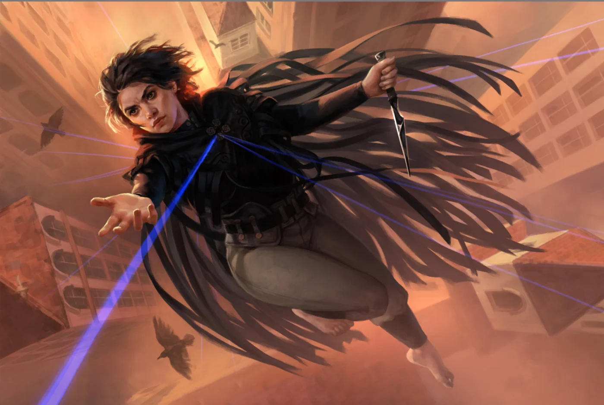
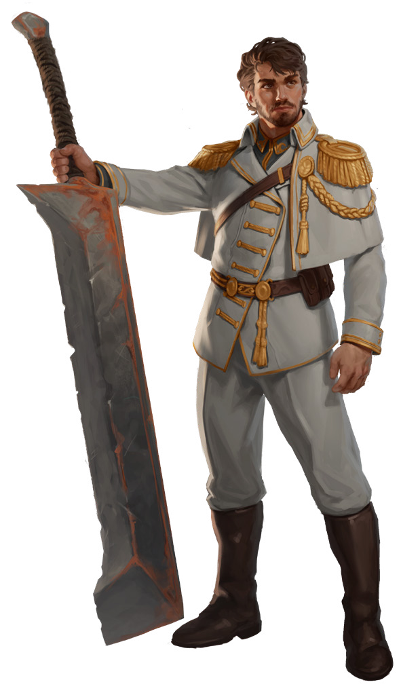
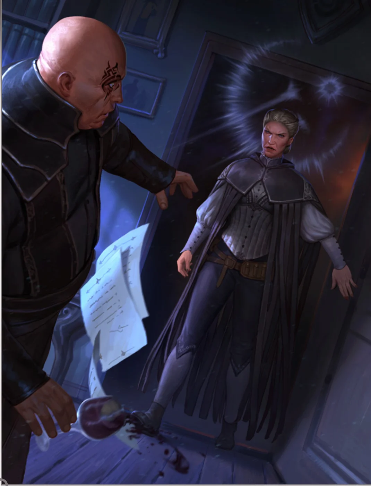
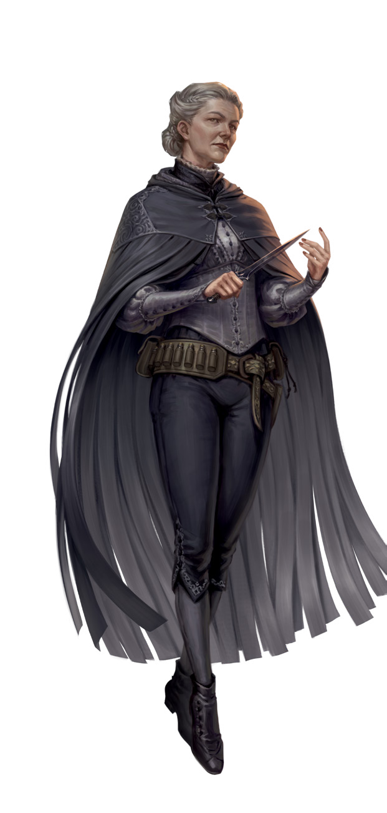

### 迷霧之子（Mistborn）

金屬之子路徑（Metalborn Path）[第一時代]

> 男人們尖叫著倒下，紋（Vin）只用一枚帶扣作武器，就撕開了他們的陣線。在她白鑞（Pewter）、錫（Tin）、鋼（Steel）與鐵（Iron）的力量面前，動用天金（Atium）簡直浪費得不可思議。即使沒有天金，她仍是一件可怕的武器——直到這一刻，連她自己才終於明白。迷霧之子。

迷霧之子是司卡德利亞（Scadrial）最具代表性、也最富傳奇色彩的金屬之子（Metalborn）。絕大多數鎔金術師（Allomancer）都是迷霧人（Misting），只能燃燒一種金屬，產生一種能力；迷霧之子卻能燃燒所有金屬，運用每一種鎔金術（Allomancy）能力。

結合多種能力，迷霧之子能創造非凡的效果，即使技藝極其精湛的迷霧人，也難以模仿。戰鬥中，迷霧之子可以用鐵鎔金術（Iron Allomancy）拉動一些金屬，同時用鋼鎔金術（Steel Allomancy）推動另一些金屬，掀起一場致命的金屬風暴。社交場合中，他們可以用鋅鎔金術（Zinc Allomancy）煽動某些情緒，同時用黃銅鎔金術（Brass Allomancy）安撫另一些情緒，精準引導他人的行為。

人們普遍認為，只有派出另一名迷霧之子，例如鋼鐵審判者（Steel Inquisitor），或靠驚人的人數壓倒他們，才能擊敗迷霧之子。而一旦迷霧之子取得天金，便會在短時間內幾乎無人能擋（見第 6 章「天金鎔金術」）。這些金屬之子令人如此畏懼又敬重，以至於人們看見穿著迷霧披風（Mistcloak）的人，往往都會讓開。這種流蘇衣物通常只有迷霧之子穿著，飄動時彷彿司卡德利亞的迷霧（見第 7 章「護甲」）。

### 迷霧之子的歷史

迷霧之子自最後帝國（Final Empire）建立之初便已存在。統御主（Lord Ruler）昇華（Ascension）時，獎賞古典時期的司卡德利亞（Classical Scadrial）中臣服於他的諸王，賦予他們迷霧之子的力量，讓他們成為最初的大家族。數百年間，鎔金術透過遺傳傳給後裔，但每過一代，力量便更分散，也稍微減弱。

最終，鎔金術力量稀釋到開始有迷霧人出生，而每一代只誕生少數迷霧之子。另一方面，貴族的婚外情讓最後帝國末年的司卡（skaa）人口中，也開始出現迷霧人，儘管相當罕見。最後，還出現了少數司卡迷霧之子，包括卡西爾（Kelsier）與紋。

統御主死後，依藍德．泛圖爾（Elend Venture）親身發現，不靠遺傳也能成為迷霧之子。只要吞下一小塊極其稀有的 Lerasium，也就是存留（Preservation）的神金屬（God Metal），就能成為迷霧之子，擁有與第一代大家族同樣集中的力量（見第 8 章「稀有金屬」）。

到了第二時代，鎔金術力量持續稀釋，已不再有迷霧之子自然出生。一些組織與祕密社團，例如「組織」（The Set）與鬼血（Ghostbloods），開始尋求創造數百年來首位迷霧之子的方法。有些嘗試著重於優生配種計畫，另一些則運用血金術（Hemalurgy）；後者一旦成功，就會創造出新的鋼鐵審判者，而這項技術原已隨統御主的死而失傳。

### 建立迷霧之子

迷霧之子能運用的鎔金能力數量龐大，扮演起來可能令人卻步。如果你願意接受挑戰，下方「經典迷霧之子」提供受小說啟發的角色建立範例。也可以參考以下建議，打造能發揮所長的迷霧之子：

**屬性（Attribute）。** 若想增加授予（Investiture）資源池，可以提高察覺（Awareness）或風采（Presence），兩者任選。其他屬性主要取決於你優先發展的鎔金能力。例如，如果能力經常需要鎔金術檢定（Test），如黃銅鎔金術，可以優先提高意志（Willpower）。

**英雄路徑（Heroic Path）。** 許多迷霧之子除了投入金屬之子路徑及其能力，也會以英雄天賦（Talent）加以補足。參考你感興趣的英雄路徑角色建立建議，會很有幫助。

**技能（Skill）。** 多數迷霧之子會優先提高鎔金術技能等級（Skill Rank）。

也可以考慮投入一般技能，例如你感興趣的金屬之子天賦或英雄天賦所要求的前提條件技能。

### 經典迷霧之子

如果你想從《迷霧之子》小說汲取靈感，可以參考以下經典迷霧之子，再為建議的角色建立方式加入獨特的背景與個性，打造自己的角色。

第 5 章：金屬之子路徑 138

### 卡西爾

海司辛倖存者（Survivor of Hathsin）卡西爾，是一名擁有一半貴族、一半司卡血統的迷霧之子。他憎惡貴族家族，一心只想殺死統御主，推翻最後帝國。卡西爾極具魅力，熱愛高風險、高報酬的計畫，常以笑容反抗最後帝國的壓迫。身為迷霧之子，卡西爾能運用所有鎔金能力，但他最精通鐵與鋼，對白鑞也格外熟練。

**建立迷霧之子革命家（Mistborn Revolutionary）。** 選擇人類（Human）血統（Ancestry），以及陸沙德（Luthadel）與地下社會（Underworld）文化專長（Cultural Expertise）。起始時以風采和意志為高屬性。將威嚇（Intimidation）與領導（Leadership）各提高 2 個技能等級。

使用迷霧之子綻裂（Mistborn Snap，迷霧之子關鍵天賦），為第一個「訓練你的能力（Train Your Powers）」短期目標選擇鐵鎔金術與鋼鎔金術。運用人類血統，選擇果斷指揮（Decisive Command，領袖關鍵天賦）。最後，選擇地下社會起始套組（Starting Kit）。

隨著等級提高，優先選擇鋼鎔金術與鐵鎔金術天賦。也可以考慮白鑞鎔金術（Pewter Allomancy），以及領袖（Leader）策劃者（Mastermind）專精（Specialty）的天賦。

### 紋

紋年幼時在陸沙德街頭營養不良，身形始終比同齡人嬌小，只能倚靠自己的「運氣」。那其實是情緒鎔金術：她在不知情下燃燒污水中的微量金屬，為能力提供力量。這些初萌能力（Nascent Power）讓卡西爾注意到她，發現紋和自己一樣是迷霧之子。卡西爾收留她，訓練她運用所有鎔金能力，而她尤其擅長白鑞、青銅（Bronze）、鐵與鋼。紋不輕易信任他人，卻極為忠誠，也精通戰鬥中的欺敵手法。她運用一切本領與力量，保護所愛的人，對抗暴政。

**建立迷霧之子天才（Mistborn Prodigy）。** 選擇人類血統，以及陸沙德與地下社會文化專長。起始時以速度（Speed）和意志為高屬性。將輕型武器（Light Weaponry）與隱匿（Stealth）各提高 2 個技能等級。

使用迷霧之子綻裂（迷霧之子關鍵天賦），為第一個「訓練你的能力」短期目標選擇錫鎔金術（Tin Allomancy）與白鑞鎔金術。運用人類血統，選擇伺機者（Opportunist，密探關鍵天賦）。最後，選擇逃亡者（Runaway）起始套組。

*紋，昇華戰士（Ascendant Warrior）。*

SVETLANA KOSTINA

隨著等級提高，優先選擇白鑞鎔金術與青銅鎔金術（Bronze Allomancy）天賦。也可以考慮鐵鎔金術、鋼鎔金術、密探（Agent）反抗者（Rebel）專精，以及領袖政客（Politico）專精的天賦。

### 依藍德．泛圖爾

依藍德是泛圖爾家族（House Venture）中理想主義而天真的貴族。他埋首學問，藉此逃離上流社會的繁文縟節，尤其對治理（Governance）與哲學的研究感興趣，夢想用這些知識改善司卡的生活。

依藍德並非天生的迷霧之子，而是在吞下一顆 Lerasium 後成為迷霧之子。大多數能力上，他既缺乏精巧的手法，也沒有充分訓練，但對情緒鎔金術已有一定程度的熟練。

**建立迷霧之子名義領袖（Mistborn Figurehead）。** 選擇人類血統，以及陸沙德與上流社會（High Society）文化專長。起始時以智力（Intellect）和意志為高屬性。將推理（Deduction）與學識（Lore）各提高 2 個技能等級。

使用迷霧之子綻裂（迷霧之子關鍵天賦），為第一個「訓練你的能力」短期目標選擇鋅鎔金術與黃銅鎔金術。運用人類血統，選擇博學（Erudition，學者關鍵天賦），將治理選為額外專長（Expertise），並將額外技能等級分配給學識與推理。最後，選擇研究者（Researcher）起始套組。

隨著等級提高，優先選擇學者（Scholar）策士（Strategist）專精與領袖軍官（Officer）專精的天賦，再考慮鋅鎔金術與黃銅鎔金術的天賦。

#### GM 提示：迷霧之子角色

喜愛戰術的玩家與小說讀者，往往能從扮演迷霧之子獲得極大的滿足，但也會面臨不小的挑戰。如果玩家對此路徑有興趣，請留意以下幾點。

扮演迷霧之子角色，需要承受相當大的思考負擔。同時追蹤十多種能力，以及為它們提供力量的金屬液與授予，可能讓人因選項過多而難以決定。因此，已熟悉《寰宇 RPG》（Cosmere RPG）的玩家，扮演迷霧之子會更得心應手。

為了讓遊戲更流暢，也簡化升級過程，你可以鼓勵迷霧之子玩家只專注於少數金屬。迷霧之子路徑極具彈性，但《寰宇 RPG》的行動（Action）系統，旨在讓每個角色，包括英雄角色，都有表現機會。因此，迷霧之子玩家很容易分散太多心力，每種金屬都投入一點，卻未深入鑽研少數幾棵天賦樹（Talent Tree），反而削弱自己的效能。

此外，建議每支隊伍最多只有一名完整的迷霧之子。多名迷霧之子玩家角色（PC）可能拖慢遊戲進行，也讓每個角色更難在規則上與故事發展中，找到自己獨特的定位。

GUILHERME CASTRO

第 5 章：金屬之子路徑 140

### 迷霧之子關鍵天賦（Key Talent）

迷霧之子在撼動人生根基的事件中綻裂（Snap），首次發現自己的能力，例如瀕死經驗或其他創傷情境。選擇此天賦代表你的角色經歷綻裂，並解鎖迷霧之子天賦樹。

**起始技能（Starting Skill）：無。** 如果你選擇迷霧之子作為起始路徑（Starting Path），不會免費獲得技能等級。

#### 迷霧之子綻裂（迷霧之子關鍵天賦）

前提條件（Prerequisite）：人類血統；你沒有其他綻裂天賦（Snap Talent）或傳承天賦（Heritage Talent）

啟動（Activation）：[特殊啟動]

你經歷綻裂，獲得所有鎔金能力。起初，你

只能使用能力的初步形式，甚至可能不知道自己正在使用它們。但經過練習或訓練，你就能精通每一種能力。

取得此天賦時，你經歷綻裂，成為迷霧之子，並獲得下列好處：

- 你獲得授予資源，起始授予上限為 2 + 你的察覺或風采，兩者取較高者。你現在可以使用飲用金屬液（Drink Vial）行動。

- 在角色紙上加入鎔金術技能，起始時有 1 個技能等級。此技能使用意志屬性。

- 你獲得所處時代可用的所有鎔金能力（見第 6 章「司卡德利亞的金屬」）。目前你只能使用這些能力的初萌版本，天金鎔金術除外；你可以使用其完整版本。

此外，從那些金屬中選擇一組推／拉配對（見第 6 章「司卡德利亞的金屬」）。你獲得針對這兩種鎔金能力的金屬之子短期目標（Metalborn Goal）「訓練你的能力」。完成此短期目標（Goal）後，你獲得其獎勵（Reward）：解鎖這兩種能力的完整版本，並能從各自的天賦樹選擇天賦。之後，GM 可以酌情允許你為另一組配對取得「訓練你的能力」短期目標，持續進行，直到解鎖所有能力。

#### 燃燒稀有金屬

迷霧人只需要穩定供應一種金屬，完整的迷霧之子卻需要取得多得多的種類。大多數情況下，你可以輕易取得含有全部八種常見金屬的金屬液。然而，其他金屬，包括增強金屬（Enhancement Metal）、時序金屬（Temporal Metal）與神金屬，可能更難取得，價格也更高。如果你想經常使用所有金屬，就必須為每一種金屬確保獨立的供應來源。如何記錄與使用金屬，請見本章前段的「管理金屬」。

*一名迷霧之子煽動（Riot）聖務官（obligator）的恐懼。*

SAEED RAMEZ

第 5 章：金屬之子路徑 141

### 迷霧之子天賦

以下天賦出現在迷霧之子天賦樹中，依英文名稱字母順序排列。

#### 本能燃燒（Instinctual Burn）

前提條件：鎔金術 3+；金屬連動（Metallic Splash）天賦

啟動：[特殊啟動]

一察覺危險就燃燒最常用的金屬，已成為你

最原始的本能。

長休息（Long Rest）後，你可以選擇一種透過金屬之子路徑或血金術尖刺（Hemalurgic Spike）解鎖的鎔金能力。場景（Scene）開始時，你可以在第一名角色的輪次（Turn）之前，使用該能力的燃燒（Burn）行動，不需花費行動，但仍照常花費授予。

當你使用此天賦選擇另一種能力時，原先的這項好處便結束。

#### 授予充沛（Invested）

前提條件：迷霧之子綻裂關鍵天賦

啟動：[常駐]

你學會同時容納並燃燒更多金屬。

取得此天賦時，你的授予上限增加等同你階層（Tier）的數值。你的階層每提高 1，授予上限也隨之提高 1。

#### 金屬連動

前提條件：迷霧之子綻裂關鍵天賦

啟動：[特殊啟動]

同時燃燒多種金屬已成為你的本能。你將各種金屬的用途交織，以其他金屬的些許力量，增強其中一種。

使用鎔金能力進行檢定時，你可以花費 [機遇]（Opportunity），啟動另外兩種能力的初萌版本，前提是你能取得那些能力所需的金屬。不必花費授予，也不需花費行動。

#### 選擇性燃燒（Selective Burn）

前提條件：鎔金術 3+；金屬連動天賦

啟動：[特殊啟動]

你能感覺到每種吞下的金屬，在體內各自形成力量的泉源，

因此能選出其中一種來燃燒，將其他金屬留待之後使用。

為鎔金能力花費授予之前，你可以選擇使該能力耗竭（Depleted），取代花費授予。如此使用時，該能力產生的效果，視同你花費等同金屬技藝上限（Metallic Art Limit）的授予。

#### 同步燃燒（Simultaneous Burn）

前提條件：鎔金術 4+；本能燃燒天賦

啟動：[自由行動]

你燃燒金屬的技巧如此純熟，甚至能在完成其他工作時

同時進行。

花費 2 專注點（Focus），獲得 [2行動]，只能用來啟動你的鎔金能力。

#### 微量金屬（Trace Metals）

前提條件：鎔金術 3+；授予充沛天賦

啟動：[常駐]

你可以燃燒金屬儲備（Metal Reserve）中來自

受污染的水或金屬餐具等來源的微量金屬，剛好足以讓能力產生細微的效果。

即使你的授予為 0，或能力因其他原因耗竭，你仍可使用鎔金能力的初萌版本。

> 「你是個非常特別的人。你擁有一種力量，連大多數高等貴族都羨慕不已。如果你出身貴族，這份力量會讓你成為整個最後帝國中最致命、最有影響力的人物之一。但你不是貴族出身，你不是貴族。你不必遵守他們的規矩——這讓你更加強大。」

DEANDRA SCICLUNA & LOGAN FELICIANO

第 5 章：金屬之子路徑 142

<!-- Source: MB001_Mistborn_Handbook_digital.pdf, physical page 146. Visually reconstructed from the original page and enlarged talent-tree crop. This patch replaces the false geometric table; the raw extraction remains unchanged. -->

## 迷霧之子

### 金屬之子路徑

### 天賦樹連線

對照《迷霧之子玩家手冊》PDF 第 146 頁。點選天賦名稱可跳至中文摘要。

| 天賦 | 解鎖來源 | 啟動 | 額外前提 |
| --- | --- | --- | --- |
| [迷霧之子綻裂](#迷霧之子綻裂) | 關鍵天賦 | 特殊啟動 | 人類血統，且沒有其他綻裂或傳承天賦 |
| [授予充沛](#授予充沛) | [迷霧之子綻裂](#迷霧之子綻裂) | 常駐 | — |
| [金屬連動](#金屬連動-1) | [迷霧之子綻裂](#迷霧之子綻裂) | 特殊啟動 | — |
| [微量金屬](#微量金屬) | [授予充沛](#授予充沛) | 常駐 | 鎔金術 3+ |
| [本能燃燒](#本能燃燒) | [金屬連動](#金屬連動-1) | 特殊啟動 | 鎔金術 3+ |
| [選擇性燃燒](#選擇性燃燒) | [金屬連動](#金屬連動-1) | 特殊啟動 | 鎔金術 3+ |
| [同步燃燒](#同步燃燒) | [本能燃燒](#本能燃燒) | 自由行動 | 鎔金術 4+ |

#### 迷霧之子綻裂

啟動：[特殊啟動]

前提條件：人類血統；沒有其他綻裂天賦或傳承天賦

獲得授予數值、飲用金屬液行動、鎔金術技能，以及所有鎔金術的初萌能力。

#### 授予充沛

啟動：[常駐]

你的授予上限增加等同你階層的數值。

#### 金屬連動

啟動：[特殊啟動]

使用鎔金能力進行檢定時，花費 [機遇]，同時使用另一種初萌能力。

#### 微量金屬

啟動：[常駐]

前提條件：鎔金術 3+

即使授予為 0，或能力因其他原因耗竭，仍可使用鎔金能力的初萌版本。

#### 本能燃燒

啟動：[特殊啟動]

前提條件：鎔金術 3+

長休息後，選擇你的一種鎔金能力。你可以在每個場景之前，使用該能力的燃燒行動。

#### 選擇性燃燒

啟動：[特殊啟動]

前提條件：鎔金術 3+

使鎔金能力耗竭，取代花費授予，藉此使用該能力。

#### 同步燃燒

啟動：[自由行動]

前提條件：鎔金術 4+

花費 2 專注點，獲得 [2行動]，用來啟動你的鎔金能力。

### 圖示意義

| 圖示 | 意義 |
| --- | --- |
| [1行動] | 1 行動 |
| [2行動] | 2 行動 |
| [3行動] | 3 行動 |
| [自由行動] | 自由行動（Free Action） |
| [反應] | 反應（Reaction） |
| [特殊啟動] | 特殊啟動（Special activation） |
| [常駐] | 常駐（Always active） |

<!-- Original illustration alternate text, preserved for the figure rather than inserted into the talent rules: A gray haired Mistborn woman with pale skin wields her glass dagger expertly and eyes the viewer with a dangerous expression. Her mistcloak is embroidered at the top, like a shawl, and a lace collar rises from underneath. Her sleeves gather in bracer-like buttons before puffing at the elbow. She wears a belt full of vials of metals and fitted pants that suit maneuverability. -->

