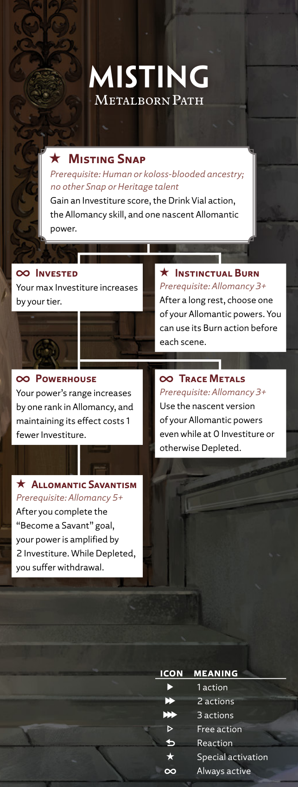

### 迷霧人（Misting）

金屬之子路徑（Metalborn Path）

「不是每個人都是迷霧之子（Mistborn），女孩——事實上，只有極少極少的

人才是。而且，不管你們這種人怎麼想，普通的迷霧人也能殺人。知道攻擊你的男人是打手（Thug），而不是射幣（Coinshot），很可能就能救你一命。」

在兩個時代中，迷霧人都是最常見的金屬之子（Metalborn），數量遠超其他類型。他們只有一種鎔金術（Allomancy）能力，使用方式與其他鎔金術師（Allomancer）相同：先吞入金屬，再燃燒金屬，藉此取得存留（Preservation）的力量。

每種迷霧人都有一個俗稱，反映他們燃燒的金屬及產生的效果。例如，射幣就是鋼迷霧人，能讓金屬物體高速飛射。「鎔金能力發現表」列出了各種迷霧人的名稱。

因為迷霧人只倚靠一種能力，通常能比雙生師（Twinborn）或迷霧之子更快精通它。因此，當完整的迷霧之子想深入學習自己各種能力的細節時，迷霧人幾乎總是最好的老師。

### 鎔金能者化（Allomantic Savantism）

大多數迷霧人經常燃燒自己的金屬。他們沒有其他授予之術（Invested Arts）分散這股力量，因此有些迷霧人會經歷一種稱為能者化（Savantism）的現象。當一個人長期頻繁且強烈地使用單一授予之術，靈網（Spiritweb）逐漸因此改變，就會成為能者（Savant）。這不僅讓他們能更有效地傳導這股力量，也會從根本改變其生理機能。能者在自己的技藝上變得強大許多，卻也經常承受危險的副作用。

鎔金能者化發生於多年，甚至數十年的金屬「驟燒（Flare）」之後，也就是頻繁或長時間地以極高強度燃燒金屬。鎔金能者（Allomantic Savant）停止燃燒自己的金屬時，會出現某種戒斷反應，症狀通常與能力效果相反。迷霧人路徑的鎔金能者化天賦（Talent）便呈現這些戒斷效果。

#### 隨機決定你的迷霧人能力

有些玩家喜歡隨機決定角色的鎔金能力，如前文「隨機決定你的金屬之子路徑」側欄所述。你可以在鎔金能力發現表擲骰決定；如果該金屬在你的時代尚不可用，就重新擲骰。

#### 鎔金能力發現表

| d20 | 能力 | 迷霧人名稱 |
| --- | --- | --- |
| 1–2 | 鐵（Iron） | 扯手（Lurcher） |
| 3–4 | 鋼（Steel） | 射幣 |
| 5–6 | 錫（Tin） | 錫眼（Tineye） |
| 7–8 | 白鑞（Pewter） | 白鑞臂（Pewterarm）／打手 |
| 9 | 鋅（Zinc） | 煽動者（Rioter） |
| 10 | 黃銅（Brass） | 安撫者（Soother） |
| 11 | 紅銅（Copper） | 煙陣（Smoker）／紅銅雲（Coppercloud） |
| 12 | 青銅（Bronze） | 搜尋者（Seeker） |
| 13 | 鉻（Chromium）* | 水蛭（Leecher） |
| 14 | 鎳鉻（Nicrosil）* | 鎳爆（Nicroburst） |
| 15 | 鋁（Aluminum）† | 鋁蟲（Aluminum Gnat）／虛無（Void） |
| 16 | 硬鋁（Duralumin）† | 硬鋁蟲（Duralumin Gnat） |
| 17 | 鎘（Cadmium）* | 脈動（Pulser） |
| 18 | 彎管合金（Bendalloy）* | 滑行（Slider） |
| 19 | 金（Gold）† | 命師（Augur） |
| 20 | 電金（Electrum）† | 預言師（Oracle） |

*僅限第二時代。*

†僅限第一時代末期或第二時代。

### 建立迷霧人

下方「經典迷霧人」提供受小說啟發的角色建立範例。也可以參考以下建議，打造能發揮所長的迷霧人：

**屬性（Attribute）。** 若想增加授予（Investiture）資源池，可以提高察覺（Awareness）或風采（Presence），兩者任選。其他屬性主要取決於你選擇的鎔金能力。例如，如果能力經常需要鎔金術檢定（Test），如黃銅鎔金術（Brass Allomancy），可以優先提高意志（Willpower）；如果能力適合戰鬥，如白鑞鎔金術，則可以考慮力量（Strength）或速度（Speed），加強武器攻擊。

**英雄路徑（Heroic Path）。** 多數迷霧人除了投入金屬之子路徑及其能力，也會以英雄天賦加以補足。參考你感興趣的英雄路徑角色建立建議，會很有幫助。

第 5 章：金屬之子路徑 134

**技能（Skill）。** 多數迷霧人會優先提高鎔金術技能等級（Skill Rank）。

也可以考慮投入一般技能，例如你感興趣的金屬之子天賦或英雄天賦所要求的前提條件技能。

### 經典迷霧人

如果你想從《迷霧之子》小說汲取靈感，可以參考以下經典迷霧人，再為建議的角色建立方式加入獨特的背景與個性，打造自己的角色。

### Edgard「微風」拉德利安（Edgard “Breeze” Ladrian）

*黃銅鎔金術*

微風是卡西爾（Kelsier）盜賊團隊的重要成員，可能也是世上技藝最精湛的安撫者。據說他的鎔金術手法極其細膩，即使最警覺的目標，也很少察覺他的情緒操控。微風極其擅長觀察他人，對他們的感受有深刻理解，因此能只安撫（Soothe）那些對方不會注意到的情緒。

**建立安撫者顧問（Soother Advisor）。** 選擇人類（Human）血統（Ancestry），以及上流社會（High Society）與地下社會（Underworld）文化專長（Cultural Expertise）。起始時以察覺和意志為高屬性。除了迷霧人給予的 1 個鎔金術技能等級，將洞察（Insight）與說服（Persuasion）各提高 2 個技能等級。

使用迷霧人綻裂（Misting Snap，迷霧人關鍵天賦）選擇黃銅鎔金術。運用人類血統，選擇使者（Envoy）路徑的振奮人心（Rousing Presence，使者關鍵天賦）。最後，選擇貴族（Noble）起始套組（Starting Kit）。

隨著等級提高，優先選擇黃銅鎔金術的天賦。也可以考慮迷霧人的強效鎔金（Powerhouse）天賦，以及使者的騙徒（Grifter）、導師（Mentor）與政客（Politico）專精（Specialty）天賦。

### 瑪拉席．科姆斯（Marasi Colms）

*鎘鎔金術（Cadmium Allomancy）[第二時代]*

瑪拉席是依藍戴（Elendel）警署中最盡忠職守的警員之一，尤其熱衷於推動有益平民的正面改變。她聰明伶俐，面臨危急情勢時也能保持冷靜，是瓦希黎恩．拉德利安（Waxillium Ladrian）對抗這個時代罪犯與陰謀勢力的重要盟友。瑪拉席是脈動，能在自身周圍的時泡中減慢時間。雖然起初看不起自己的能力，她已找到許多能善用它的方式。

**建立脈動警員（Pulser Constable）。** 選擇人類血統，以及依藍戴與上流社會文化專長。起始時以察覺和速度為高屬性。除了迷霧人給予的 1 個鎔金術技能等級，將推理（Deduction）提高 2 個技能等級，並將輕型武器（Light Weaponry）與感知（Perception）各提高 1 個技能等級。

使用迷霧人綻裂（迷霧人關鍵天賦）選擇鎘鎔金術。運用人類血統，選擇密探（Agent）路徑的伺機者（Opportunist，密探關鍵天賦）。最後，選擇傭兵（Mercenary）起始套組。隨著等級提高，優先選擇密探調查員（Investigator）專精的天賦。也可以考慮鎘鎔金術，以及獵手（Hunter）神射手（Sharpshooter）專精的天賦。

### 迷霧人關鍵天賦（Key Talent）

迷霧人在綻裂（Snap）時，首次發現自己的能力。第一時代通常發生於撼動人生根基的事件，例如瀕死經驗或其他創傷情境。第二時代則通常在青春期左右自然發生。選擇此天賦代表你的角色經歷綻裂，並解鎖迷霧人天賦樹（Talent Tree）。

**起始技能（Starting Skill）：鎔金術。** 如果你選擇迷霧人作為起始路徑（Starting Path），免費獲得 1 個鎔金術技能等級，這是在迷霧人綻裂提供的技能等級之外額外獲得。

### 迷霧人綻裂（迷霧人關鍵天賦）

前提條件（Prerequisite）：人類或克羅司混血（koloss-blooded）血統；你沒有其他綻裂天賦（Snap Talent）或傳承天賦（Heritage Talent）

啟動（Activation）：[特殊啟動]

你經歷綻裂，獲得一種鎔金能力。起初，你只能

使用能力的初步形式，甚至可能不知道自己正在使用它。但經過練習或訓練，你就能精通這份能力。

取得此天賦時，你經歷綻裂，成為迷霧人，並獲得下列好處：

- 你獲得授予資源，起始的授予上限為 2 + 你的察覺或風采，兩者取較高者。你現在可以使用飲用金屬液（Drink Vial）行動（Action）。

- 在角色紙上加入鎔金術技能，起始時有 1 個技能等級。此技能使用意志屬性。

- 選擇一種在你所處時代可用的鎔金能力（見第 6 章「司卡德利亞的金屬」）。目前你只能使用所選能力的初萌版本（Nascent Power），除非你選擇的是天金（Atium）鎔金術。

此外，你獲得金屬之子短期目標（Metalborn Goal）「訓練你的能力（Train Your Power）」，除非你的能力是天金鎔金術。完成此短期目標（Goal）後，你獲得其獎勵（Reward）：解鎖能力的完整版本，並能選擇第 6 章該能力天賦樹的天賦。

第 5 章：金屬之子路徑 135

### 迷霧人天賦

以下天賦出現在迷霧人天賦樹中，依英文名稱字母順序排列。

#### 鎔金能者化

前提條件：鎔金術 5+；強效鎔金天賦

啟動：[特殊啟動]

你長期持續驟燒自己的金屬，

從根本改變了生理機能，讓授予融入你的存在之中。你的鎔金能力極為強大，但也必須付出代價：一旦無法取得自己的金屬，就可能出現嚴重的戒斷反應。

你獲得短期目標「成為能者（Become a Savant）」，對應迷霧人綻裂關鍵天賦給予你的能力。近乎持續不斷地燃燒金屬至少 7 天後，你可以推進此短期目標一次；每個遊戲場次（Session）最多只能推進一次。另一種方式則由 GM 決定：如果你每次使用能力時都驟燒金屬，也就是每次花費大部分或全部授予，可能改為推進短期目標兩次。

完成此短期目標後，你獲得下列獎勵：

- 當你為此能力或其天賦花費授予時，可以將效果增強，視同額外花費 2 授予，不受金屬技藝上限（Metallic Art Limit）限制。這可能呈現出異常強大的效果，類似燃燒硬鋁或鎳鉻的人。

- 當你的授予為 0，或因其他原因使此能力耗竭（Depleted）時，你會出現戒斷症狀。與 GM 一同決定金屬的性質如何影響你的戒斷症狀（見「能者化的表現」側欄）。

#### 能者化的表現

能者能力的強大表現，會因金屬及個人而異。同樣地，耗竭時的戒斷症狀也可能因人而異。你和 GM 共同決定這些能力與症狀在你的角色身上會如何呈現。以下是一些例子：

- 錫能者的視聽能力可能強烈到低語在耳中轟鳴，星光如太陽般明亮。耗竭時，你的世界變得模糊不清，幾乎失去所有感官。

- 白鑞能者可能永不疲倦，強壯到能舉起其他白鑞臂動也動不了的重物。耗竭時，你連移動都很吃力，甚至可能陷入昏迷（Unconscious）。

#### 本能燃燒（Instinctual Burn）

前提條件：鎔金術 3+；迷霧人綻裂關鍵天賦

啟動：[特殊啟動]

一察覺危險就燃燒最常用的金屬，已成為你

最原始的本能。

長休息（Long Rest）後，你可以選擇一種透過金屬之子路徑或血金術尖刺（Hemalurgic Spike）解鎖的鎔金能力。場景（Scene）開始時，你可以在第一名角色的輪次（Turn）之前，使用該能力的燃燒（Burn）行動，不需花費行動，但仍照常花費授予。

當你使用此天賦選擇另一種能力時，原先的這項好處便結束。

#### 授予充沛（Invested）

前提條件：迷霧人綻裂關鍵天賦

啟動：[常駐]

你學會同時儲存並燃燒更多金屬。

取得此天賦時，你的授予上限增加等同你階層（Tier）的數值。你的階層每提高 1，授予上限也隨之提高 1。

#### 強效鎔金

前提條件：授予充沛天賦

啟動：[常駐]

無論是熟練的技巧或純粹的天分，當你燃燒

金屬時，發揮的力量與效率都超越大多數鎔金術師。

決定鎔金能力的金屬技藝距離（Metallic Art Range）時，你的鎔金術視為額外具有 1 個技能等級。

此外，維持鎔金能力的效果時，授予成本減少 1，最低仍需 1 授予。

#### 微量金屬（Trace Metals）

前提條件：鎔金術 3+；授予充沛天賦

啟動：[常駐]

你可以燃燒金屬儲備（Metal Reserve）中來自

受污染的水或金屬餐具等來源的微量金屬，剛好足以讓能力產生細微的效果。

即使你的授予為 0，或能力因其他原因耗竭，你仍可使用鎔金能力的初萌版本。

DEANDRA SCICLUNA & LOGAN FELICIANO

第 5 章：金屬之子路徑 136

### 迷霧人

金屬之子路徑

### 迷霧人天賦樹

#### 迷霧人綻裂

啟動：[特殊啟動]

前提條件：人類或克羅司混血血統；沒有其他綻裂天賦或傳承天賦

獲得授予數值、飲用金屬液行動、鎔金術技能，以及一種初萌鎔金能力。

#### 授予充沛

啟動：[常駐]

解鎖條件：迷霧人綻裂

你的授予上限增加等同你階層的數值。

#### 本能燃燒

啟動：[特殊啟動]

前提條件：鎔金術 3+

解鎖條件：迷霧人綻裂

長休息後，選擇你的一種鎔金能力。你可以在每個場景之前，使用該能力的燃燒行動。

#### 強效鎔金

啟動：[常駐]

解鎖條件：授予充沛

你的能力距離視同鎔金術提高 1 個技能等級，且維持效果的授予成本減少 1。

#### 微量金屬

啟動：[常駐]

前提條件：鎔金術 3+

解鎖條件：授予充沛

即使授予為 0，或能力因其他原因耗竭，仍可使用鎔金能力的初萌版本。

#### 鎔金能者化

啟動：[特殊啟動]

前提條件：鎔金術 5+

解鎖條件：強效鎔金

完成「成為能者」短期目標後，你的能力獲得 2 授予的增強。耗竭時，你會出現戒斷反應。

### 圖示意義

| 圖示 | 意義 |
| --- | --- |
| [1行動] | 1 行動 |
| [2行動] | 2 行動 |
| [3行動] | 3 行動 |
| [自由行動] | 自由行動（Free Action） |
| [反應] | 反應（Reaction） |
| [特殊啟動] | 特殊啟動（Special activation） |
| [常駐] | 常駐（Always active） |

