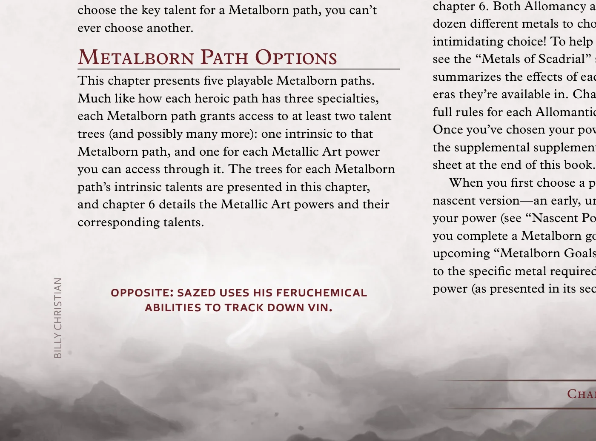
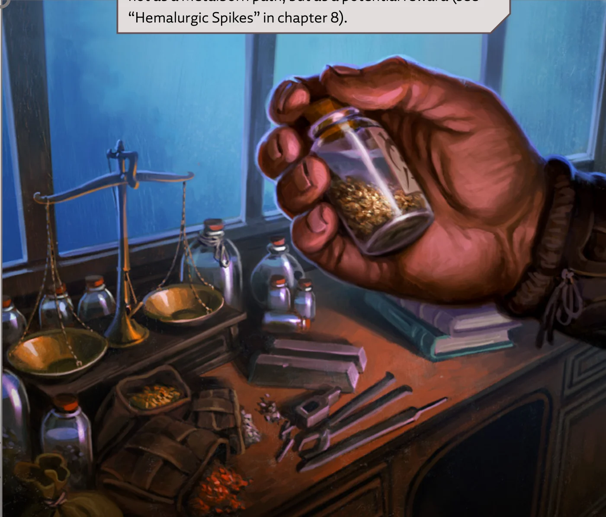
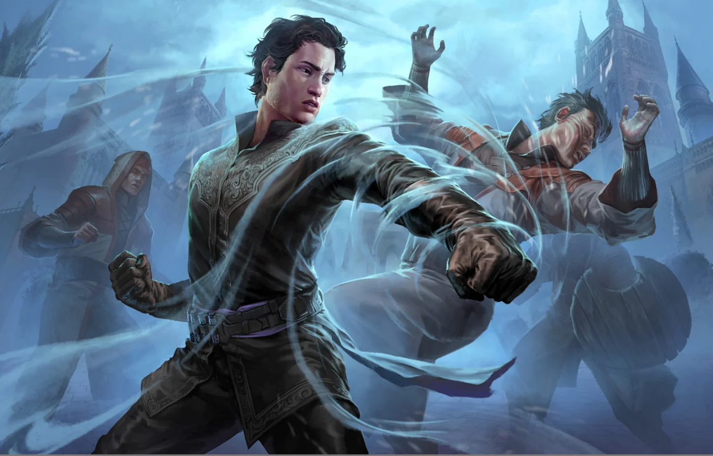
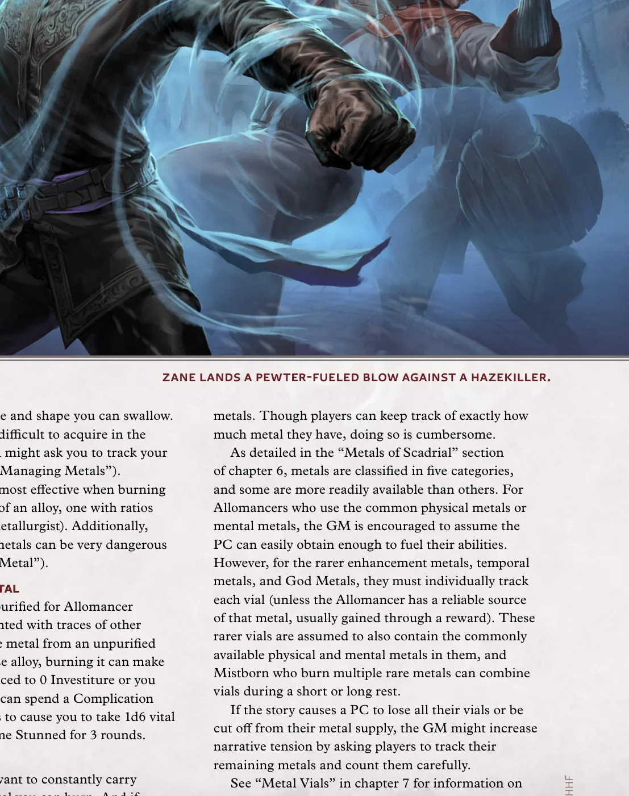
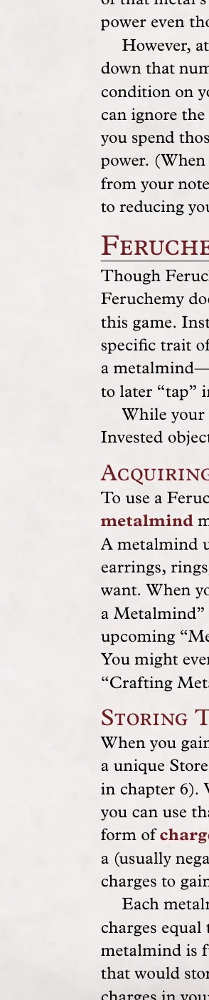
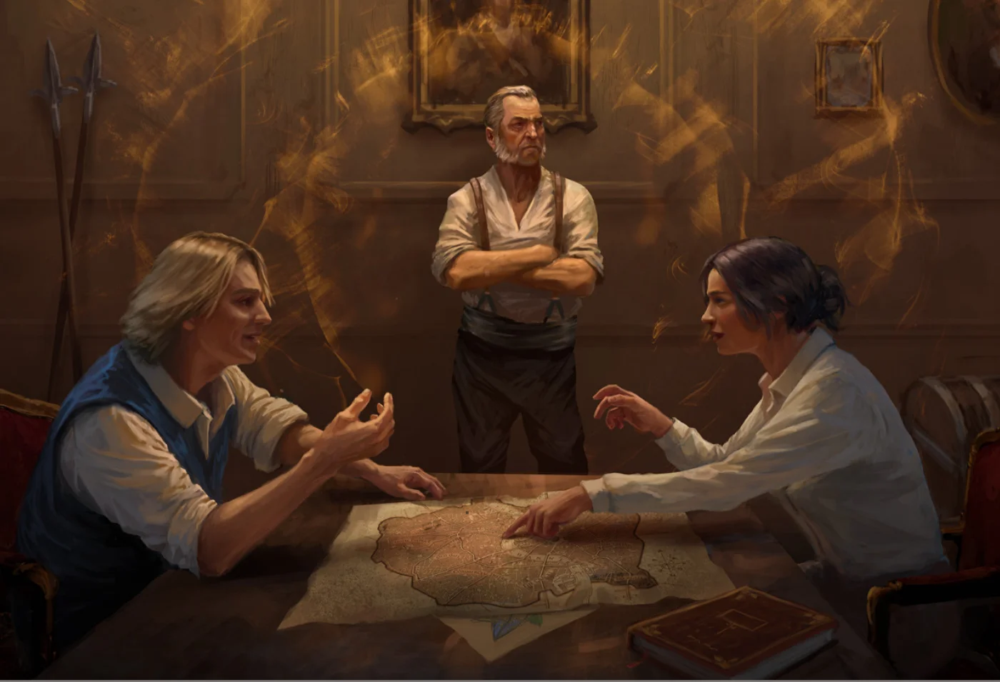
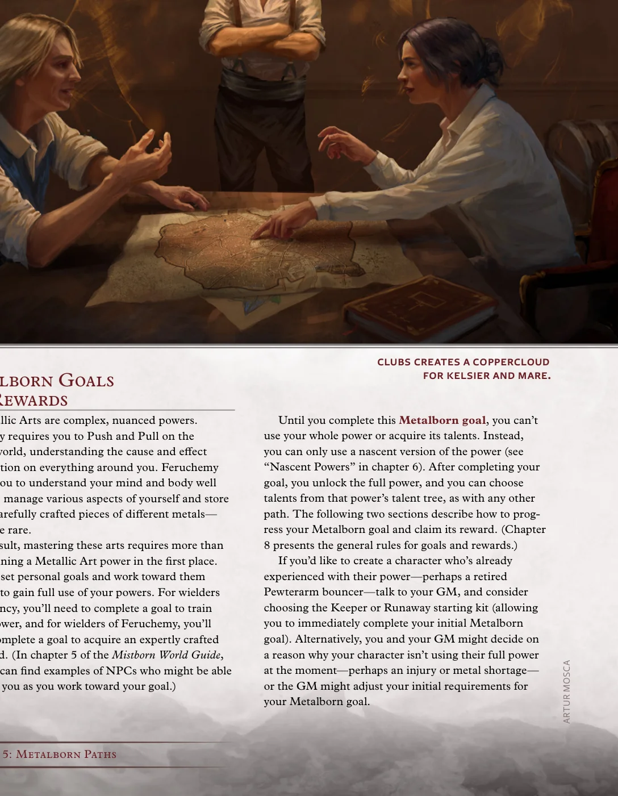
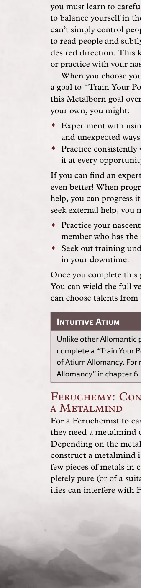

在最後帝國（Final Empire）時期，迷霧之子（Mistborn）大膽穿行於晦暗的夜色。他們運用這顆星球上的金屬，在空中飛行、聽見一個街區外的落針聲，甚至影響他人的情緒，為帝國的貴族家族掌握至高的力量。與此同時，強大的藏金術師（Feruchemist）避開統御主（Lord Ruler）的耳目，祕密運用相同的金屬調整自身特質，展現不可思議的力量、記憶力等本領。

帝國崩潰、改變世界的落灰之終（Catacendre）過去後，隨著世代更迭，金屬之子（Metalborn）的力量傳到更多人身上。有些人甚至開始同時展現兩種金屬技藝（Metallic Arts），能以新的方式結合運用。司卡德利亞（Scadrial）邁向未來，這個新時代也成了科技與授予之術（Invested Arts）不斷創新、實驗的年代。

### 使用金屬之子路徑（Metalborn Path）

本章的金屬之子路徑，運作方式與英雄路徑（Heroic Path）大致相同，遵循第 4 章「使用路徑與天賦」的規則。然而，司卡德利亞的授予之術來自遺傳，因此金屬之子路徑彼此互斥；一旦選擇某個金屬之子路徑的關鍵天賦（Key Talent），就永遠不能再選擇另一個金屬之子路徑。

### 金屬之子路徑選項

本章提供五種可供遊玩的金屬之子路徑。如同每個英雄路徑都有三項專精（Specialty），每個金屬之子路徑至少能解鎖兩棵天賦樹（Talent Tree），有時甚至更多：一棵屬於該路徑本身，另外每一種透過該路徑取得的金屬技藝能力，各有一棵天賦樹。本章介紹各金屬之子路徑本身的天賦樹，第 6 章則詳述金屬技藝能力及其對應天賦（Talent）。

每個金屬之子路徑提供不同的鎔金術（Allomancy）與／或藏金術（Feruchemy）能力組合，詳見本章稍後各路徑的說明：

- **迷霧人（Misting）。** 最常見的鎔金術師（Allomancer），每位

迷霧人擁有一種鎔金能力。（兩個時代皆可選擇此路徑。）

- **迷霧之子 [第一時代]。** 這些傳奇的鎔金術師

能運用所有鎔金能力，是不可小覷的力量。

- **藏金術師 [第一時代]。** 最後帝國時期，人們以為藏金術師

已遭消滅，但泰瑞司（Terris）守護者（Keeper）保存了這些金屬之子的血脈；他們能運用所有藏金能力。

- **單藏金術師（Ferring）[第二時代]。** 這些金屬之子是第一時代

藏金術師的後裔，能運用一種藏金能力。

- **雙生師（Twinborn）[第二時代]。** 泰瑞司人擺脫

統御主的限制後，新生的金屬之子可能同時具有一種鎔金能力與一種藏金能力的潛能。

### 選擇能力

取得金屬之子路徑的關鍵天賦時（見「選擇綻裂或傳承天賦」），你可以從第 6 章選擇一種或多種能力。鎔金術與藏金術各有十多種不同金屬可選，難免令人不知從何下手！你可以參閱第 6 章「司卡德利亞的金屬」，該節概述每種金屬的效果，並列出可使用它們的時代，協助你作決定。第 6 章也提供各種鎔金術與藏金能力的完整規則。選好能力後，你可以將其記錄在本書末尾附加的金屬技藝角色紙上。

初次選擇一種能力時，你只能使用它的初萌能力（Nascent Power），也就是尚未經過練習、才剛開始顯現的力量（見第 6 章「初萌能力」）。完成該能力的金屬之子短期目標（Metalborn Goal），並取得所需的特定金屬後，你才能運用完整能力，其內容詳見第 6 章該能力的段落（另見下方「金屬之子短期目標」）。

*對頁：沙賽德（Sazed）運用藏金能力追尋紋（Vin）。*

第 5 章：金屬之子路徑 127

BILLY CHRISTIAN

### 選擇綻裂或傳承天賦

各金屬之子路徑的關鍵天賦，分為鎔金術路徑的綻裂天賦（Snap Talent），以及藏金術路徑的傳承天賦（Heritage Talent）。你可以在任何等級選擇其中一項關鍵天賦。鎔金術與藏金能力透過血脈遺傳，而選擇這類天賦，代表你的角色首次發現自己擁有這些力量；這可能發生在人生的任何階段。

初次發現這些力量時，它們還只是初萌能力。你必須在遊戲過程中取得獎勵（Reward），才能解鎖它們的全部潛能（見本章稍後的「金屬之子短期目標與獎勵」）。

**角色紙上的記錄。** 選擇此關鍵天賦時，你會立即獲得一個金屬之子短期目標；朝此目標努力，就能解鎖金屬技藝的潛能。將這個短期目標記在角色紙背面。

你還會獲得授予技能（Invested Skill）與其他好處，取決於你的路徑使用鎔金術、藏金術，或像雙生師一樣兩者兼具：

- **如果你使用鎔金術，** 將鎔金術技能寫在角色紙其他意識（Cognitive）技能下方的空白行。旁邊記下技能修正值（Skill Modifier）；鎔金術使用意志（Willpower）屬性（Attribute）。你也會獲得授予（Investiture）數值，代表你能燃燒特定金屬，為能力提供力量（見下方「鎔金術：使用授予」）。

- **如果你使用藏金術，** 將藏金術技能寫在角色紙其他意識技能下方的空白行。旁邊記下技能修正值；藏金術使用智力（Intellect）屬性。這讓你能將力量注入特定金屬，最終注入特製的金屬意識庫（Metalmind）（見下方「藏金術：使用金屬意識庫」）。

- **如果你同時使用鎔金術與藏金術，** 兩者都依照上述方式記錄。由於角色紙的意識欄只有一條空白行，你必須將其中一項技能寫在其他空白處；可以畫一個箭頭指向意識欄，提醒自己那是意識技能。

### 使用授予技能

鎔金術與藏金術這兩項授予技能不同於一般技能（Skill）：在金屬之子路徑，或血金術尖刺（Hemalurgic Spike）等其他規則讓你取得它們之前，你不能使用它們。除此之外，授予技能的運作方式大致與其他技能相同：

- 鎔金術使用意志數值，藏金術使用智力數值。兩者皆為意識技能。

- 授予技能修正值，等於該技能的技能等級（Skill Rank）加上對應的屬性數值。

- 運用鎔金術或藏金能力進行檢定（Test）時，使用對應的授予技能，例如進行鎔金術檢定，就如同進行敏捷（Agility）檢定一樣。請注意，藏金術很少需要進行技能檢定，因此如果你是單藏金術師、藏金術師或雙生師，最好先讀完自己的藏金能力，再決定是否要投入智力屬性。

- 角色成長（Character Advancement）時，你可以用與其他技能相同的方式，提高授予技能的技能等級。

#### 《寰宇 RPG》（Cosmere RPG）中的血金術（Hemalurgy）

除了鎔金術與藏金術，還有第三種金屬技藝：血金術。如第 6 章末尾所述，這門禁術利用金屬尖刺，從一個人身上撕取力量與能力，再將那些特質賦予另一個人；過程幾乎總會殺死前者。《寰宇 RPG》將血金術尖刺列為可能獲得的獎勵，而非金屬之子路徑（見第 8 章「血金術尖刺」）。

第 5 章：金屬之子路徑 128

LUCAS TORQUATO

#### 隨機決定金屬之子路徑

《迷霧之子》小說中的鎔金術與藏金能力來自遺傳，因此它們在人群中的分布也帶有一定的隨機性。如果你想與角色一同發現出乎預料的力量，再決定如何面對這份認識，可以隨機決定金屬之子路徑及金屬技藝能力，也可能決定自己並無這些能力。你會運用力量改變處境、維持現有的生活，還是對它們不屑一顧，甚至不選擇該路徑的關鍵天賦？如果想以這種方式隨機決定路徑，在「金屬技藝的發現」表擲骰，再依遊戲所在的司卡德利亞時代，選擇對應欄位的路徑。如果擲出迷霧人、單藏金術師或雙生師路徑，請參閱該路徑的側欄，了解如何隨機決定能力。

### 金屬技藝的發現

| d20 | 第一時代路徑 | 第二時代路徑 |
| --- | --- | --- |
| 1–4 | 無 | 無 |
| 5–9 | 迷霧人路徑 | 單藏金術師路徑 |
| 10–14 | 迷霧人路徑 | 迷霧人路徑 |
| 15–17 | 迷霧之子路徑 | 單藏金術師或迷霧人路徑 |
| 18–20 | 藏金術師路徑 | 雙生師路徑 |

### 鎔金術：使用授予

授予是遍布寰宇（Cosmere）的能量，也是驅動授予之術的神聖本質。寰宇中的每個靈魂，誕生時都帶有一些天然的授予，但無法操控它。擁有授予數值的角色，則已能運用這股能量。

對鎔金術師而言，授予通常透過「燃燒」吞下的金屬顯現。金屬本身並無特殊力量，卻能讓你取得碎力（Shard）存留（Preservation）的力量，為所有鎔金能力提供能量。

### 花費授予

授予是靈魂資源（Resources），其規則運作方式與專注點（Focus）相近。對鎔金術師角色，包括迷霧之子、迷霧人與雙生師而言，授予的來源是與你鎔金能力對應的金屬。你的授予資源池反映你已吞下、且能有效運用的該種金屬數量。

在取得鎔金能力之前，角色紙的授予欄位維持空白。通常，你會透過迷霧之子、迷霧人或雙生師路徑的關鍵天賦取得能力。取得後，你便獲得授予上限（見第 3 章「授予」）。

你可以花費授予，啟動所選路徑的鎔金能力，包括天賦提供的任何能力（見第 6 章）。許多能力讓你自行選擇花費多少授予，上限由你的鎔金術技能等級決定（見第 6 章「金屬技藝上限（Metallic Art Limit）」）。你可以花少量授予，產生較弱的效果，也可以大量花費，發揮最強效果；後者會使能力「驟燒（Flare）」，迅速燒盡你的金屬儲備（Metal Reserve）。若要補充儲備，你可以使用鎔金術行動「飲用金屬液（Drink Vial）」（見下一節「補充金屬儲備」）。

授予也維持著由你鎔金術驅動、仍在持續的授予效果。因此，一旦目前授予降至 0，你就暫時成為未受授予的（Non-Invested），且無法將持續中的鎔金術效果維持超過它們剩餘的持續時間。

### 補充金屬儲備

司卡德利亞蘊藏豐富的金屬礦床。大多數鎔金術師隨身攜帶小瓶，內有懸浮在油、水或威士忌等液體中的金屬碎屑，只要喝下一瓶，就能補充胃中的金屬。

如果需要迅速補充金屬，你可以使用本節介紹的飲用金屬液行動。此行動遵循第 10 章「行動與反應」的一般規則。

場景（Scene）開始時，你通常具有全滿的授予。如同你可能在開戰前就已拔出武器，只要場景開始時沒有措手不及（Surprised），就視為你已本能地喝下一瓶金屬液，不需花費行動，或胃中原本就有金屬儲備。然而，如果你在場景開始時處於措手不及狀態（Condition），就只有 1 授予，剛好足以被動維持持續中的鎔金能力。

#### 飲用金屬液（[1行動]）

你喝下一瓶含懸浮金屬碎屑的液體，補充儲備；只要瓶中含有你能燃燒的金屬，你的授予就恢復至上限。

使用瓶內金屬的所有能力，都移除耗竭（Depleted）狀態；使用瓶內未含金屬的所有能力，則陷入耗竭。

#### 其他來源的金屬

有時你手邊沒有金屬液，可能會從門釘、錢幣或銀製餐具等其他來源尋找金屬。吞下這些非典型來源的金屬，仍可使用飲用金屬液行動。不過，如果金屬

第 5 章：金屬之子路徑 129

*詹（Zane） 藉由白鑞（Pewter）增強力量，擊中一名殺霧者（Hazekiller）。*

難以弄成適合吞嚥的大小與形狀，GM 可能要求進行檢定。此外，如果某種金屬在目前的故事情境中難以取得，GM 可能要求你記錄該金屬的存量（見「管理金屬」）。

燃燒純金屬時，鎔金能力最有效；若是合金，則須由冶金師精確調配比例。此外，燃燒不適用於鎔金術的金屬可能十分危險（見「攝入不純金屬」）。

### 攝入不純金屬

未經純化以供鎔金術師攝入的金屬，往往混有微量的其他金屬。吞下未純化的金屬，或配比不精確的合金後，燃燒它可能讓你生病。在你的授予降至 0，或完成長休息（Long Rest）之前，GM 可以花費你鎔金術檢定中的一個變故（Complication），使你每個階層（Tier）受到 1d6 命力傷害（Vital Damage），並震懾（Stunned）3 個回合（Round）。

### 管理金屬

身為鎔金術師，你最好隨時攜帶足夠的小瓶，裝好自己能燃燒的金屬。如果你是迷霧之子，就需要準備許多種不同的金屬。玩家雖然可以精確記錄持有的金屬數量，但這麼做相當繁瑣。

如第 6 章「司卡德利亞的金屬」所述，金屬分成五類，其中有些比其他種類更容易取得。對使用常見實體金屬（Physical Metal）或意志金屬（Mental Metal）的鎔金術師，建議 GM 視為玩家角色（PC）可以輕易取得足夠的金屬，供其運用能力。然而，較稀有的增強金屬（Enhancement Metal）、時序金屬（Temporal Metal）與神金屬（God Metal），則必須逐瓶記錄，除非該鎔金術師有可靠的金屬來源，通常是透過獎勵取得。這些稀有金屬液也視為含有容易取得的實體金屬與意志金屬。燃燒多種稀有金屬的迷霧之子，可以在短休息（Short Rest）或長休息期間混合瓶中內容物。

如果故事使玩家角色失去所有金屬液，或斷絕其金屬供應，GM 可以要求玩家記錄剩餘金屬、仔細計算用量，藉此提高劇情張力。

購買稀有金屬的資訊，見第 7 章「金屬液」；能提供持續稀有金屬供應的獎勵，見第 8 章「稀有金屬」。

第 5 章：金屬之子路徑 130

AMIRUL HHF

### 稀有金屬耗竭

有時，你可能仍有從金（Gold）等稀有金屬獲得的 1–2 授予，卻需要喝下普通金屬液來恢復授予。嚴格來說，當你喝下不含金或另一種稀有金屬的金屬液時，該金屬的能力便會耗竭；即使你原本打算很快使用它，也會因此無法使用。

然而，GM 可以酌情允許你將這幾點授予，記在角色紙的耗竭狀態旁。如此一來，你可以忽略該金屬的耗竭狀態，直到把這最後幾點授予花在該稀有金屬的能力上。（花費時，除了照常降低授予數值，也務必從耗竭狀態旁的筆記扣除這些點數。）

### 藏金術：使用金屬意識庫

藏金術與鎔金術同樣屬於授予之術，但在本遊戲中，藏金術不會提供授予資源池。你獲得的，是將自身某項特質，例如清醒程度或重量，「儲存（Store）」進金屬意識庫的能力。金屬意識庫是以特定金屬製成的物品，你日後可以從中「汲取（Tap）」儲存的力量。

只要金屬意識庫具有至少 1 充能（Charge），它就是受授予的（Invested）物品（見第 7 章「授予物品」）。

### 取得金屬意識庫

要使用藏金能力，你必須先擁有以該能力對應金屬製成的金屬意識庫。金屬意識庫通常是耳環、戒指或手鐲等飾品，但也可以是任何你想要的形狀。完成關鍵天賦提供的「打造金屬意識庫」短期目標後，你會獲得一個金屬意識庫（見下方「金屬之子短期目標與獎勵」）。你甚至可能打造特殊的金屬意識庫（見第 7 章「製作金屬意識庫」）。

### 將特質儲存於金屬意識庫

取得一種藏金能力時，你會獲得該能力獨有的儲存行動，詳見第 6 章該能力的段落。接觸該能力的金屬意識庫時，你可以使用其儲存行動，慢慢將一項特質以充能的形式存入。儲存充能時，你會承受某種通常不利的效果；之後，你可以花費這些充能，獲得某種通常有利的效果。

每個金屬意識庫的充能上限，等於 2 + 你的藏金術技能等級。金屬意識庫已滿時，你不能使用會額外儲存充能的天賦或其他效果。只有你能將充能儲存於自己的金屬意識庫。

儲存特質需要一些時間，具體依各種藏金能力而定。第 6 章「儲存行動的持續時間」提供進一步說明，介紹每點充能需要多久才能存入。

如第 9 章「休息」所述，你可以在短休息或長休息期間儲存充能，但這會使你放棄該次休息的其他好處。此外，在長休息期間儲存，會使你精疲力竭（Exhausted）。

### 汲取金屬意識庫

取得一種藏金能力時，你也會獲得該能力獨有的汲取行動，詳見第 6 章該能力的段落。接觸該能力的金屬意識庫時，你可以使用其汲取行動，花費指定數量的充能；一次可花費的上限由你的藏金術技能等級決定（見第 6 章「金屬技藝上限」）。只有你能花費自己金屬意識庫的充能。

金屬意識庫的充能耗盡時，你不能使用任何會花費充能的天賦或其他效果。

你不能同時對同一種金屬使用儲存與汲取行動；也不能在花費該金屬意識庫的充能使用天賦時進行儲存，因為這同樣算是汲取金屬意識庫。開始其中一種行動時，另一種行動會立即結束。

#### 多個金屬意識庫

使用藏金術的角色，理論上可以將特質儲存於任意數量的金屬意識庫，只要能取得就行。有些藏金術師使用多個以同種金屬製成的小型金屬意識庫，另一些人則使用單一大型金屬意識庫。為簡化遊戲，規則將這些方式一律視為每種藏金能力各有一個金屬意識庫。

你可以藉由短期目標取得同種金屬的備用金屬意識庫（見下方「藏金術：打造金屬意識庫」），甚至打造特殊的金屬意識庫（見第 7 章「製作金屬意識庫」）。然而，無論你擁有多少個金屬意識庫，同種金屬的所有金屬意識庫都必須共用單一充能資源池，上限仍是 2 + 你的藏金術技能等級。而且，如果你選擇藏金術師路徑，計算可配戴的金屬意識庫數量時，同一能力的所有金屬意識庫合計只算一個。

當由多個部件組成的金屬意識庫可能影響故事時，GM 可以允許你將充能上限，分配到數個以同種金屬製成的較小金屬意識庫。第 6 章部分藏金能力另有相關說明。

第 5 章：金屬之子路徑 131

*歪腳（Clubs）為卡西爾（Kelsier）與梅兒（Mare）製造紅銅雲（Coppercloud）。*

### 金屬之子短期目標與獎勵

金屬技藝的力量複雜而精細。鎔金術需要你對外在世界施以推拉，理解每個動作對周遭萬物造成的因果影響。藏金術則要求你充分了解自己的身心，才能調整自身各個面向，將它們儲存於精心打造的不同金屬製品中，其中有些金屬相當稀有。

因此，要精通這些技藝，光是最初取得金屬技藝能力還不夠。你必須設定個人的短期目標（Goal），並逐步努力，才能完整運用力量。鎔金術使用者需要完成訓練能力的短期目標；藏金術使用者則需要完成取得精心打造之金屬意識庫的短期目標。（《迷霧之子世界指南》第 5 章列出一些非玩家角色（NPC）範例，GM 可以在其中尋找能在你追求短期目標時指導你的人。）

完成這個金屬之子短期目標前，你不能使用完整能力，也不能取得該能力的天賦，只能使用它的初萌能力（見第 6 章「初萌能力」）。完成短期目標後，你會解鎖完整能力，並能如同其他路徑一樣，從該能力的天賦樹選擇天賦。以下兩節說明如何推進金屬之子短期目標，以及領取獎勵。（第 8 章提供短期目標與獎勵的一般規則。）

如果你想建立已熟練運用自身能力的角色，例如退休的白鑞臂（Pewterarm）保鑣，請與 GM 討論，並考慮選擇守護者或逃亡者（Runaway）起始套組（Starting Kit），讓你立即完成最初的金屬之子短期目標。或者，你與 GM 也可以決定角色目前無法使用完整能力的原因，例如受傷或缺少金屬；GM 也可能調整你最初金屬之子短期目標的要求。

第 5 章：金屬之子路徑 132

ARTUR MOSCA

### 鎔金術：訓練鎔金技藝

鎔金術師必須訓練自己的每一種鎔金能力，才能充分理解運用能力時，世界會產生怎樣的因果反應。每一次推都有相應的拉，每個動作也都有反作用。如果你是射幣（Coinshot），並不能輕易飛行；你必須學習小心推動金屬支點，才能在空中保持平衡。如果你是安撫者（Soother），也不能直接控制人心；你必須學會觀察他人，細微地將其情緒引導至想要的方向。這些精細的技巧，需要訓練或練習初萌能力才能掌握。

選擇綻裂（Snap）關鍵天賦時，你會獲得「訓練你的能力（Train Your Power(s)）」短期目標。

你需要逐步推進這個金屬之子短期目標。如果決定自行努力，可以採取下列方式：

- 嘗試以富有創意、出乎意料的方式運用初萌能力。

- 持續練習初萌能力，把握每個機會使用它。

如果能找到熟悉特定金屬的專家指導，就更好了！借助外力推進短期目標時，你可以推進兩次，而非一次。如果尋求外界協助，可以採取下列方式：

- 與擁有相同能力的隊伍成員，一起練習初萌能力。

- 在休整期（Downtime）尋找迷霧人或其他大師，接受訓練。

完成這個短期目標後，你會獲得獎勵：你可以運用完整版的能力，並從該能力的天賦樹選擇天賦。

#### 直覺天金（Intuitive Atium）

天金鎔金術（Atium Allomancy）與其他鎔金能力不同，不必完成「訓練你的能力」短期目標，就能使用完整能力。詳見第 6 章「天金鎔金術」。

### 藏金術：打造金屬意識庫

藏金術師需要大小與純度足夠的金屬意識庫，才能輕鬆儲存與汲取力量。依金屬種類而定，要取得足夠打造金屬意識庫的份量，可能並不容易。此外，一般流通的金屬製品，很少完全純淨或具有合適的合金配比。這些雜質可能干擾藏金術，因此要製作優良的金屬意識庫，就必須透過實驗或專業冶金師的協助，找到合適的金屬。

選擇傳承（Heritage）關鍵天賦時，你會獲得「打造你的金屬意識庫（Construct Your Metalmind(s)）」短期目標。每種能力首次完成此短期目標時，你都會免費取得所需金屬。

你需要逐步推進這個金屬之子短期目標。如果決定自行努力，可以採取下列方式：

- 在各種對應你藏金能力的金屬碎料上測試初萌能力，觀察何種金屬配比最適合你的能力。

- 逐漸收集足量的適當金屬。

其他藏金術師，例如泰瑞司守護者，世代傳承著製作金屬意識庫的技術；他們能協助你，比獨自實驗更快完成。借助外力推進短期目標時，你可以推進兩次，而非一次。如果尋求外界協助，可以採取下列方式：

- 與另一名藏金術師一同製作金屬意識庫。

- 從專業來源取得純化的金屬。

完成這個短期目標後，你會獲得獎勵：取得一個金屬意識庫，可以運用完整版的能力，並從該能力的天賦樹選擇天賦。

### 維護金屬意識庫

金屬意識庫受損時，通常可透過成功的 DC 15 工藝（Crafting）檢定修復，前提是你擁有原本用來製作它的全部金屬。

如果金屬意識庫遺失或遭到摧毀，或你想製作備用品，可以使用第 7 章「製作金屬意識庫」的規則，打造一個新的。

如果你在原本的金屬意識庫仍可正常使用時，製作備用金屬意識庫，它不會立即提供規則上的好處。只要你仍持有原本的金屬意識庫，就不能在備用金屬意識庫中儲存額外充能，而且充能上限維持不變。然而，原本的金屬意識庫一旦遺失或遭到摧毀，你就可以立即改用備用金屬意識庫，其起始充能為 0。

第 5 章：金屬之子路徑 133

