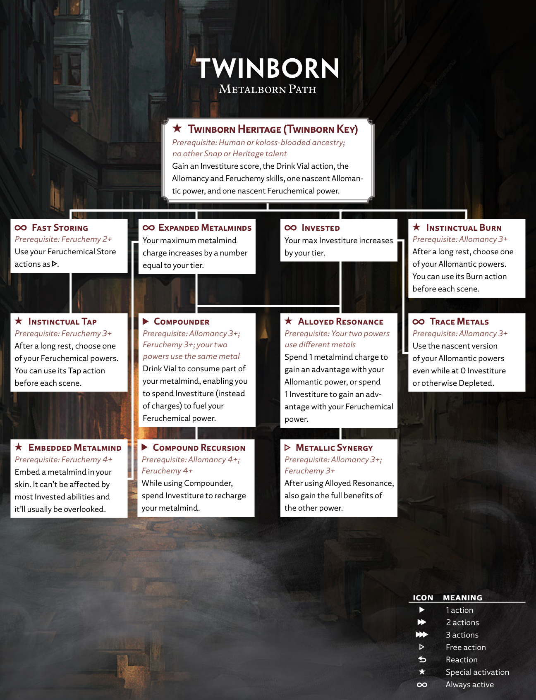
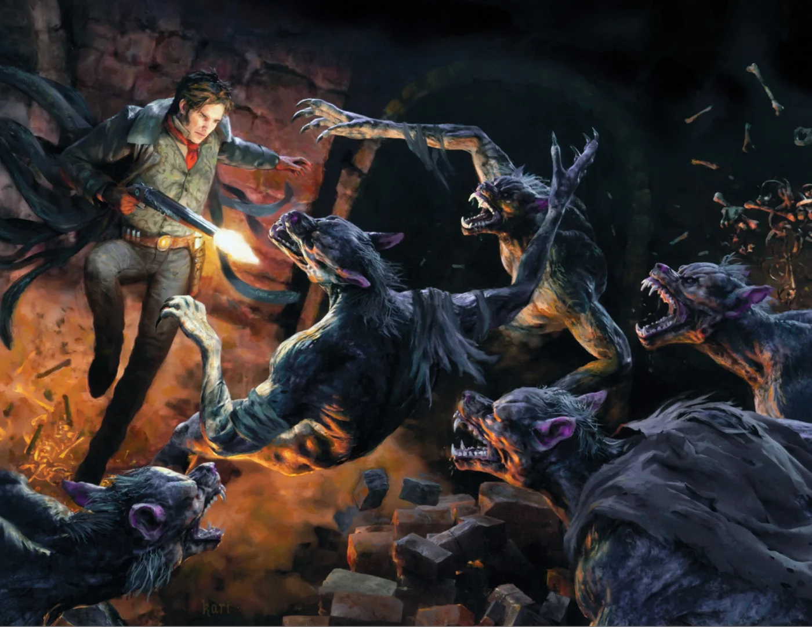

### 雙生師（Twinborn）

金屬之子路徑（Metalborn Path）[第二時代]

> 瓦希黎恩（Waxillium）驟燒（Flare）鋼（Steel），同時汲取（Tap）鐵（Iron）金屬意識庫的力量……他將自己的重量提高一百倍……接著向自身四周推去……他成了一圈向外擴張之力的中心。桌子翻倒，椅子刮過地板，人們［……］被這股力量捲入，從他身邊推開。

第二時代的雙生師同時繼承鎔金術（Allomancy）與藏金術（Feruchemy），能各運用一種鎔金能力（Allomantic Power）與藏金能力（Feruchemical Power）。這兩種能力不必使用相同的金屬，通常也確實不同。十六種金屬能產生大量組合，因此雙生師之間極其多樣。在落灰之終（Catacendre）後的三百年間，每種組合至多只出現過寥寥幾次。

雙生師運用兩種不同的能力，因此經常產生共鳴（Resonance）：能力彼此作用，創造超越兩者單獨相加的效果（見下方「探索共鳴」側欄）。有些共鳴只是讓個別能力運用起來更靈活。例如，瓦希黎恩．拉德利安（Waxillium Ladrian）能以鐵藏金術（Iron Feruchemy）調整重量，藉此精準控制鋼推（Steelpush）的相對強度。另一些共鳴，則可能表現得像全新的能力。例如，邁爾斯．達古特（Miles Dagouter）是一名複合師（Compounder），鎔金術與藏金術都使用同種金屬。他能燃燒金屬意識庫（Metalmind）的小碎片，大幅增強它的效果。

#### 隨機決定你的雙生師能力

有些玩家喜歡隨機決定角色的能力，如前文「隨機決定你的金屬之子路徑」側欄所述。如果你想為雙生師角色這麼做，請分別在前文「迷霧人」與「單藏金術師」的能力發現表擲骰，決定你的兩種能力。

### 複合師

> 瓦希黎恩迅速開了一槍……正中邁爾斯的左眼窩……邁爾斯踉蹌了一下，瓦希黎恩再次開槍，擊中他的額頭……邁爾斯的眼睛重新長出，頭上的傷口也在眨眼間消失……即使眼睛中槍，也沒讓他慢下多少……該如何對抗一個幾乎不死的人？

複合師是極其罕見的雙生師，鎔金術與藏金術使用相同金屬。他們能以獨特的方式，運用鎔金術燃燒自己的金屬意識庫，更常見的是燒掉從中削下的碎屑，大幅倍增其中儲存的藏金術特質效果。這讓複合師能展現遠超一般藏金術極限的本領。

此路徑的複合師天賦（Talent），讓你能燃燒金屬意識庫。這份能力能達成不可思議的壯舉，歡迎你發揮創意運用。

最後帝國（Final Empire）的統御主（Lord Ruler）是首位複合師，運用天金（Atium）維持青春將近千年。「經典雙生師」介紹另一名惡名昭彰的複合師：「百命」（Hundredlives）邁爾斯．達古特。透過對金藏金術（Gold Feruchemy）施展複合術（Compounding），邁爾斯幾乎能瞬間治癒看似致命的傷口。

大多數藏金術師（Feruchemist）的能力會自動調整，保護使用者免受有害的副作用。例如，鐵單藏金術師（Ferring）的身體會自行適應，不會被自己增加的重量壓垮；黃銅單藏金術師也不會因體溫變化傷害自己，除非變動極端劇烈。然而，複合術產生的力量爆發過於強烈，會移除藏金術通常具有的「安全護欄」。大多數複合師若不想傷及自己或他人，就必須小心控制力量。

### 雙生師的歷史

最後帝國時期，統御主施行駭人的育種計畫（Breeding Program），試圖阻止雙生師出現，而不幸的是，他成功了。他認為，雙生師，尤其是複合師，潛在的能力組合，對自己掌控司卡德利亞（Scadrial）的鐵腕統治構成最大的威脅。

然而，這些計畫並未徹底消除泰瑞司（Terris）人的藏金術傳承。統御主死後，落灰之終帶來新的開始，許多泰瑞司人開始與司卡德利亞北方其他人口融合。鎔金術與藏金術血脈交融，最終讓雙生師開始出現在司卡德利亞北方各處。

許多雙生師發現，自己受到兩個不同世界的拉扯。無論多麼熱愛自己的家園，他們往往也會被隱密的泰瑞司聚居地（Terris Enclave）吸引。這些聚居地通常不對沒有泰瑞司血統的人開放，卻讓許多單藏金術師與雙生師有機會精通自己的藏金能力。

第 5 章：金屬之子路徑 152

### 建立雙生師

下方「經典雙生師」提供受小說啟發的角色建立範例。也可以參考以下建議，打造能發揮所長的雙生師：

**屬性（Attribute）。** 你的屬性主要取決於選擇的鎔金能力與藏金能力。例如，若想增加鎔金術的授予（Investiture）資源池，可以提高察覺（Awareness）或風采（Presence）。如果能力經常需要鎔金術檢定（Test），如黃銅鎔金術（Brass Allomancy），可以優先提高意志（Willpower）。如果能力經常用到藏金術修正值（Skill Modifier），如黃銅藏金術（Brass Feruchemy），可以優先提高智力（Intellect）。儲存特定屬性的能力，如電金藏金術（Electrum Feruchemy），通常會受益於對該屬性的投入。而如果能力適合戰鬥，如白鑞鎔金術（Pewter Allomancy），可以考慮力量（Strength）或速度（Speed），加強武器攻擊。

**英雄路徑（Heroic Path）。** 多數雙生師除了投入金屬之子路徑及其能力，也會以英雄天賦加以補足。參考你感興趣的英雄路徑角色建立建議，會很有幫助。

**技能（Skill）。** 多數雙生師會優先提高鎔金術與藏金術技能等級（Skill Rank）。也可以考慮投入一般技能，例如你感興趣的金屬之子天賦或英雄天賦所要求的前提條件技能。

### 經典雙生師

雙生師可能有數百種組合，遠超出本書能完整呈現的範圍。不過，如果你想從《迷霧之子》（Mistborn）小說汲取靈感，可以參考以下經典雙生師，再為建議的角色建立方式加入獨特的背景與個性，打造自己的角色。

### 瓦希黎恩「曉擊」（Dawnshot）拉德利安

*鋼鎔金術（Steel Allomancy）與鐵藏金術*

瓦希黎恩出身貴族拉德利安家族（House Ladrian），青少年時期大多在依藍戴（Elendel）的泰瑞司聚居地度過。強烈的正義感，以及逃離依藍戴上流社會束縛的渴望，驅使瓦（Wax）前往蠻橫區（The Roughs），擔任執法者（Lawkeeper）二十年，最後才回到依藍戴。身為射幣（Coinshot）與掠影（Skimmer），瓦的雙生師組合稱為撞擊（Crasher），讓他能調整重量，並以鋼推作用於附近的金屬物體。

**建立撞擊義警（Crasher Vigilante）。** 選擇人類（Human）血統（Ancestry），以及蠻橫區與依藍戴文化專長（Cultural Expertise）。起始時以力量和意志為高屬性。除了雙生師提供的 1 級紀律（Discipline），將推理（Deduction）與重型武器（Heavy Weaponry）各提高 2 個技能等級。

使用雙生師傳承（Twinborn Heritage，雙生師關鍵天賦），選擇鋼鎔金術與鐵藏金術。運用人類血統，選擇追尋獵物（Seek Quarry，獵手關鍵天賦）。最後，選擇傭兵（Mercenary）起始套組（Starting Kit）。

隨著等級提高，優先選擇鋼鎔金術天賦，並提高兩項授予技能（Invested Skill）。也可以考慮獵手（Hunter）神射手（Sharpshooter）專精（Specialty）、戰士（Warrior）槍手（Gunslinger）專精的天賦，以及鐵藏金術的臨界質量（Critical Mass）天賦。

GUILHERME CASTRO

第 5 章：金屬之子路徑 153

### 韋恩（Wayne）

*彎管合金鎔金術（Bendalloy Allomancy）與金藏金術*

韋恩年輕時犯案，被瓦希黎恩．拉德利安逮個正著，最後卻成了瓦的副手，儘管他是個古怪的執法者。韋恩喜歡「交換」物品，未經許可就拿另一件自己認為等值的物品來替換。他也喜歡藉由帽子，讓自己進入他人的思考方式。身為滑行（Slider）與制血者（Bloodmaker），韋恩的組合通常稱為蜃景（Mirage），但他偏好「跳躍者」（Skipper）。這些力量讓他能製造使時間加速的速度圈（Time Bubble），並迅速治癒自己。

**建立蜃景騙徒（Mirage Swindler）。** 選擇人類血統，以及蠻橫區與地下社會（Underworld）文化專長。起始時以風采和速度為高屬性。除了雙生師提供的 1 級紀律，將欺騙（Deception）與竊術（Thievery）各提高 2 個技能等級。

使用雙生師傳承（雙生師關鍵天賦），選擇彎管合金鎔金術與金藏金術。運用人類血統，選擇伺機者（Opportunist，密探關鍵天賦）。最後，選擇貴族（Noble）起始套組。

隨著等級提高，優先選擇密探（Agent）竊賊（Thief）專精的天賦。也可以考慮使者（Envoy）騙徒（Grifter）專精，尤其是荒唐俏皮話（Outrageous Quip），以及你兩種能力的天賦。

### 「百命」邁爾斯．達古特

*金鎔金術（Gold Allomancy）與金藏金術*

邁爾斯曾是蠻橫區執法者，後來厭倦依藍戴政府對待蠻橫區人民的方式。他運用對幫派結構與手法的認識，建立消賊（Vanishers），這個組織嚴密的犯罪集團，透過精心策劃的劫案，企圖讓依藍戴屈服。邁爾斯的兩種能力都使用金，讓他成為金複合師（Gold Compounder），實際上具有近乎無限的自我治癒能力。

**建立複合師幫派首領（Compounder Ganglord）。** 選擇人類血統，以及蠻橫區與地下社會文化專長。起始時以力量和意志為高屬性。除了雙生師提供的 1 級紀律，將重型武器與領導（Leadership）各提高 2 個技能等級。

使用雙生師傳承（雙生師關鍵天賦），選擇金鎔金術與金藏金術。運用人類血統，選擇戒備架式（Vigilant Stance，戰士關鍵天賦）。最後，選擇傭兵起始套組。

隨著等級提高，優先選擇金藏金術天賦，並朝取得雙生師路徑的複合遞迴（Compound Recursion）天賦發展。也可以考慮戰士士兵（Soldier）專精與領袖（Leader）策劃者（Mastermind）專精的天賦。

#### 探索共鳴

共鳴是兩種授予之術（Invested Arts）結合後，湧現出的強大效果。在司卡德利亞，共鳴主要發生於雙生師身上。迷霧之子與藏金術師的能力數量太多，稀釋了每一項共鳴，讓它們幾乎無法察覺。（雖然血金術尖刺（Hemalurgic Spike）能賦予一個人不只一種授予之術，這些竊取來的力量，卻不會為新使用者產生共鳴。）

有些共鳴的運作大致符合預期，另一些則可能依魔法深層的本質，創造意想不到的新效果。雙生師可能的組合與效果多得驚人，大多尚未被充分探索或理解。與 GM 一同決定，你獨特的雙生師配對，可以在遊戲中如何有趣地呈現。如同機遇（Opportunity）與變故（Complication），這也是發揮創意、將自己的點子融入故事的好機會。

### 雙生師關鍵天賦（Key Talent）

落灰之終後，讓人能運用鎔金術與藏金術的基因逐漸交融，有些人開始發現，自己能掌握這兩種金屬技藝。人們可能在青春期或之後的任何階段，發現這些原先不知道的力量。選擇此天賦代表你的角色發現自己的傳承（Heritage），並解鎖雙生師天賦樹（Talent Tree）。

**起始技能（Starting Skill）：紀律。** 如果你選擇雙生師作為起始路徑（Starting Path），免費獲得 1 級紀律。

第 5 章：金屬之子路徑 154

#### 雙生師傳承（雙生師關鍵天賦）

前提條件（Prerequisite）：人類或克羅司混血（koloss-blooded）血統；你沒有其他綻裂天賦（Snap Talent）或傳承天賦（Heritage Talent）

啟動（Activation）：[特殊啟動]

你發現自己的雙生師傳承，獲得一種鎔金能力與一種藏金能力。起初，你只能粗略運用這些能力。但經過訓練，並打造適當的金屬意識庫後，就能解鎖完整能力。

取得此天賦時，你發現自己的雙生師傳承，並獲得下列好處：

- 你獲得授予資源，起始授予上限為 2 + 你的察覺或風采，兩者取較高者。你現在可以使用飲用金屬液（Drink Vial）行動（Action）。

- 在角色紙上加入鎔金術與藏金術技能，兩者起始時各有 1 個技能等級。鎔金術使用意志屬性，藏金術使用智力屬性。

- 選擇一種在所處時代可用的鎔金能力與一種藏金能力（見第 6 章「司卡德利亞的金屬」）。目前只能使用這些能力的初萌能力（Nascent Power）。

此外，你獲得金屬之子短期目標（Metalborn Goal）「訓練你的能力（Train Your Power）」。完成此短期目標（Goal）後，你獲得其獎勵（Reward）：解鎖鎔金能力的完整版本，並能選擇第 6 章該能力天賦樹的天賦。

最後，你獲得金屬之子短期目標「打造你的金屬意識庫（Construct Your Metalmind）」。完成此短期目標後，你獲得其獎勵：取得一個金屬意識庫、解鎖藏金能力的完整版本，並能選擇第 6 章該能力天賦樹的天賦。

### 雙生師天賦

以下天賦出現在雙生師天賦樹中，依英文名稱字母順序排列。

#### 合金共鳴（Alloyed Resonance）

前提條件：雙生師傳承天賦的兩種能力使用不同金屬；擴充金屬意識庫（Expanded Metalminds）天賦或授予充沛（Invested）天賦

啟動：[特殊啟動]

兩種授予之術彼此作用，你學會掌握

它們獨特的共鳴，以一種能力增強另一種，並嘗試新的效果。

使用鎔金能力進行檢定時，你可以花費 1 點金屬意識庫充能（Charge），使該次檢定具有優勢（Advantage）。此外，使用藏金能力進行檢定時，你可以花費 1 授予，使該次檢定具有優勢。

如此使用時，你的另一種金屬技藝，可能以富有創意、趣味的方式，增強你正在使用的能力。與 GM 一同決定，兩種能力如何互相配合。

#### 複合師

前提條件：鎔金術 3+；藏金術 3+；雙生師傳承天賦的兩種能力使用相同金屬；擴充金屬意識庫天賦或授予充沛天賦

啟動：[1行動]

燃燒已充能金屬意識庫的一小片，就能瞬間釋放大量藏金術力量，讓你以其他藏金術師通常不可能達到的速度運用它。

你可以使用飲用金屬液行動，吞下雙生師傳承所提供金屬意識庫的一小片。如此使用時，你會受到以下效果：

- 如同該行動通常的效果，你的授予恢復至上限。

- 該金屬意識庫的充能上限永久減少 1。

- 直到場景（Scene）結束，或該金屬意識庫的能力耗竭（Depleted）為止，你可以花費授予，如同花費金屬意識庫充能一樣，為該藏金能力提供力量。

要以這種方式使用飲用金屬液行動，你必須事先花費 [1行動]，從金屬意識庫取下一小片，放進小瓶中；或者，那一小片已在你的體內，例如已經吞下，或透過嵌入金屬意識庫（Embedded Metalmind）天賦，將金屬意識庫嵌入身體。

此外，你可以放棄長休息（Long Rest）的好處，修復因本天賦而降低充能上限的金屬意識庫。你必須能取得足夠的所需金屬，數量由 GM 決定。如果是常見金屬，或你能持續取得供應的稀有金屬，金屬意識庫便恢復通常的充能容量。如果是其他稀有金屬，修復時每消耗 1 磅金屬，就能恢復 2 點充能容量。

第 5 章：金屬之子路徑 155

#### 複合遞迴

前提條件：鎔金術 4+、藏金術 4+；複合師天賦

啟動：[1行動]

燃燒金屬意識庫的一小片，讓你體內充滿

平常儲存的那種力量。你能將其中一部分重新存回金屬意識庫，使它保持充盈，形成回饋循環。

在複合師天賦的效果持續期間，花費至少 1 授予，為金屬意識庫增加等量充能。

#### 嵌入金屬意識庫

前提條件：藏金術 4+；擴充金屬意識庫天賦

啟動：[特殊啟動]

嵌入身體的金屬更難受到鎔金術影響，讓你既能保護金屬意識庫不受他人干涉，又能隨時使用它。

長休息後，你可以將自己的一個金屬意識庫作為耳環或其他飾物，嵌入皮膚。嵌入期間，只有某項授予技能至少有 6 個技能等級的角色，才能用該授予能力影響這個金屬意識庫。此外，視嵌入的位置而定，一般搜查很可能會忽略它，具體由 GM 決定。

這個金屬意識庫會一直保持嵌入狀態，直到你再次使用此天賦，或它因其他方式被移出你的身體。

#### 擴充金屬意識庫

前提條件：雙生師傳承關鍵天賦

啟動：[常駐]

透過精心製作與熟練儲存，你能將

更多藏金術力量存入金屬意識庫，才會達到自身的極限。

取得此天賦時，每種能力金屬意識庫的充能上限，都增加等同你階層（Tier）的數值。你的階層每提高 1，此上限也隨之提高 1。

#### 快速儲存（Fast Storing）

前提條件：藏金術 2+；雙生師傳承關鍵天賦

啟動：[常駐]

儲存藏金術力量幾乎已成為你的

本能，不太需要專心。

你可以用 [自由行動] 使用藏金術的儲存（Store）行動。

第 5 章：金屬之子路徑 156

### 雙生師

金屬之子路徑

### 雙生師天賦樹

#### 雙生師傳承（雙生師關鍵天賦）

啟動：[特殊啟動]

前提條件：人類或克羅司混血血統；沒有其他綻裂天賦或傳承天賦

獲得授予數值、飲用金屬液行動、鎔金術與藏金術技能、一種初萌鎔金能力，以及一種初萌藏金能力。

#### 快速儲存

啟動：[常駐]

前提條件：藏金術 2+

解鎖條件：雙生師傳承

以 [自由行動] 使用藏金術的儲存行動。

#### 擴充金屬意識庫

啟動：[常駐]

解鎖條件：雙生師傳承

你的金屬意識庫充能上限增加等同你階層的數值。

#### 授予充沛

啟動：[常駐]

解鎖條件：雙生師傳承

你的授予上限增加等同你階層的數值。

#### 本能燃燒（Instinctual Burn）

啟動：[特殊啟動]

前提條件：鎔金術 3+

解鎖條件：雙生師傳承

長休息後，選擇你的一種鎔金能力。你可以在每個場景之前，使用該能力的燃燒（Burn）行動。

#### 本能汲取（Instinctual Tap）

啟動：[特殊啟動]

前提條件：藏金術 3+

解鎖條件：快速儲存

長休息後，選擇你的一種藏金能力。你可以在每個場景之前，使用該能力的汲取行動。

#### 複合師

啟動：[1行動]

前提條件：鎔金術 3+；藏金術 3+；你的兩種能力使用相同金屬

解鎖條件：擴充金屬意識庫或授予充沛

飲用金屬液，吞下金屬意識庫的一部分，讓你能花費授予，取代充能，為藏金能力提供力量。

#### 合金共鳴

啟動：[特殊啟動]

前提條件：你的兩種能力使用不同金屬

解鎖條件：擴充金屬意識庫或授予充沛

花費 1 點金屬意識庫充能，使鎔金能力檢定具有優勢，或花費 1 授予，使藏金能力檢定具有優勢。

#### 微量金屬（Trace Metals）

啟動：[常駐]

前提條件：鎔金術 3+

解鎖條件：授予充沛

即使授予為 0，或能力因其他原因耗竭，仍可使用鎔金能力的初萌版本。

#### 嵌入金屬意識庫

啟動：[特殊啟動]

前提條件：藏金術 4+

解鎖條件：擴充金屬意識庫

將金屬意識庫嵌入皮膚。它不受大多數授予能力影響，通常也會被忽略。

#### 複合遞迴

啟動：[1行動]

前提條件：鎔金術 4+；藏金術 4+

解鎖條件：複合師

使用複合師時，花費授予，為金屬意識庫補充充能。

#### 金屬協同（Metallic Synergy）

啟動：[自由行動]

前提條件：鎔金術 3+；藏金術 3+

解鎖條件：合金共鳴

使用合金共鳴後，也獲得另一種能力的完整好處。

### 圖示意義

| 圖示 | 意義 |
| --- | --- |
| [1行動] | 1 行動 |
| [2行動] | 2 行動 |
| [3行動] | 3 行動 |
| [自由行動] | 自由行動（Free Action） |
| [反應] | 反應（Reaction） |
| [特殊啟動] | 特殊啟動（Special activation） |
| [常駐] | 常駐（Always active） |

DEANDRA SCICLUNA & LOGAN FELICIANO

*瓦與一群血金嵌合獸（Hemalurgic Chimera）交戰。*

#### 本能燃燒

前提條件：鎔金術 3+；雙生師傳承關鍵天賦

啟動：[特殊啟動]

一察覺危險就燃燒最常用的金屬，已成為你

最原始的本能。

長休息後，你可以選擇一種透過金屬之子路徑或血金術尖刺解鎖的鎔金能力。場景開始時，你可以在第一名角色的輪次（Turn）之前，使用該能力的燃燒行動，不需花費行動，但仍照常花費授予。

當你使用此天賦選擇另一種能力時，原先的這項好處便結束。

#### 本能汲取

前提條件：藏金術 3+；快速儲存天賦

啟動：[特殊啟動]

一察覺危險就汲取最常用的金屬意識庫，

已成為你最原始的本能。

長休息後，你可以選擇一種透過金屬之子路徑或血金術尖刺解鎖的藏金能力。場景開始時，你可以在第一名角色的輪次之前，使用該能力的汲取行動，不需花費行動，但仍照常花費充能。

當你使用此天賦選擇另一種能力時，原先的這項好處便結束。

第 5 章：金屬之子路徑 158

KARI CHRISTENSEN

#### 授予充沛

前提條件：雙生師傳承關鍵天賦

啟動：[常駐]

你學會同時容納並燃燒更多金屬。

取得此天賦時，你的授予上限增加等同你階層的數值。你的階層每提高 1，授予上限也隨之提高 1。

#### 金屬協同

前提條件：鎔金術 3+；藏金術 3+；合金共鳴天賦

啟動：[自由行動]

你反覆練習兩種能力的共鳴，運用它們已成為本能。這讓你不必額外花費時間與心力，就能將兩種能力都發揮到極致。

使用合金共鳴後，你也會獲得雙生師傳承所提供另一種能力的好處：

- 如果你花費至少 1 授予增強藏金能力，也會獲得鎔金能力的效果，視同將那些授予用於燃燒金屬。

- 如果你花費至少 1 點金屬意識庫充能增強鎔金能力，也會獲得藏金能力的效果，視同將那些充能用於汲取金屬意識庫。

#### 微量金屬

前提條件：鎔金術 3+；授予充沛天賦

啟動：[常駐]

你可以燃燒金屬儲備（Metal Reserve）中來自

受污染的水或金屬餐具等來源的微量金屬，剛好足以讓能力產生細微的效果。

即使你的授予為 0，或能力因其他原因耗竭，你仍可使用鎔金能力的初萌版本。

*一名雙生師製造彎管合金（Bendalloy）速度圈，再汲取白鑞意識（Pewtermind），增強力量。*

> 韋恩自稱記得所有雙生師可能組合的名稱。當然，韋恩也自稱曾偷過一匹馬，打嗝時每個音都準得像樂音，所以他說什麼，都只能預設內容已經加油添醋過了。

第 5 章：金屬之子路徑 159

ANDREW CHOU

