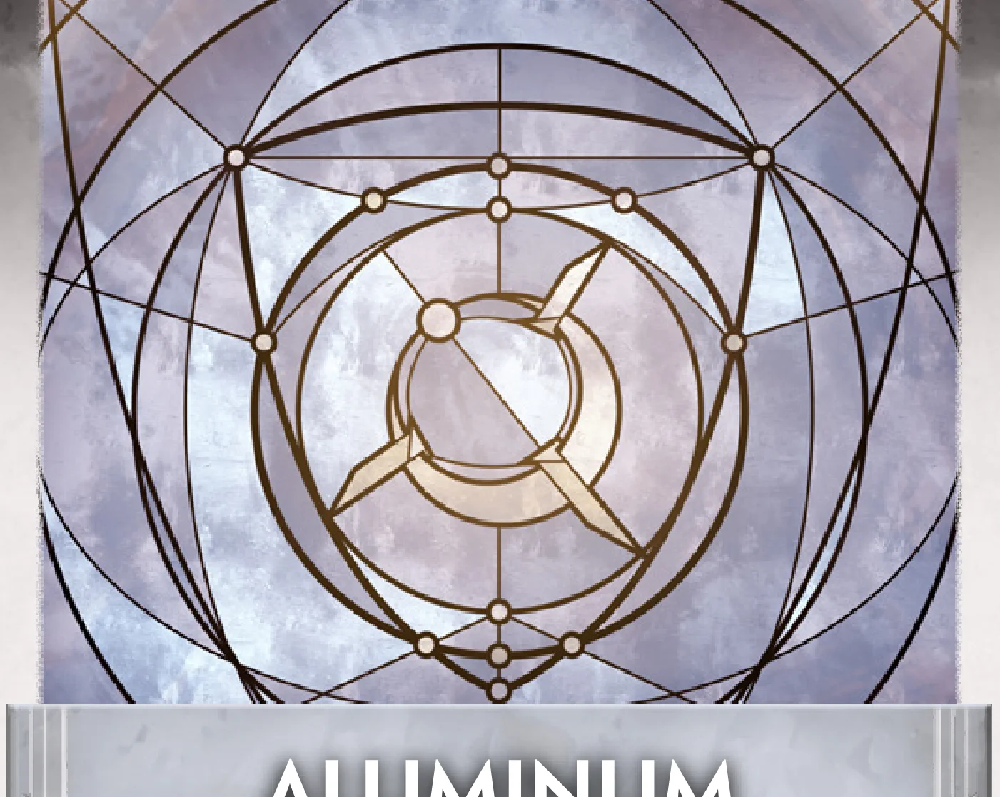
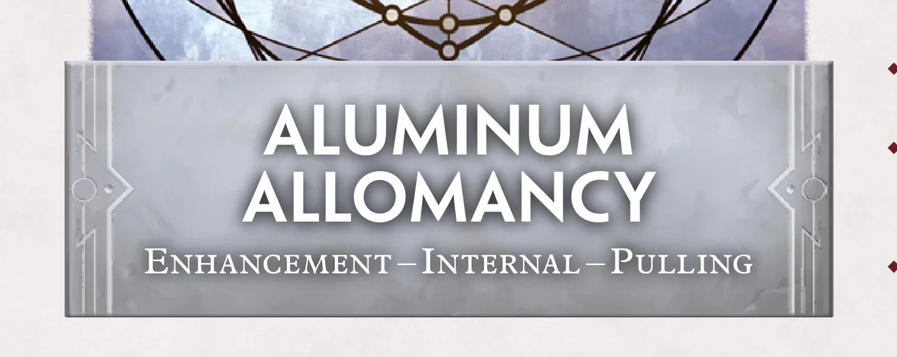
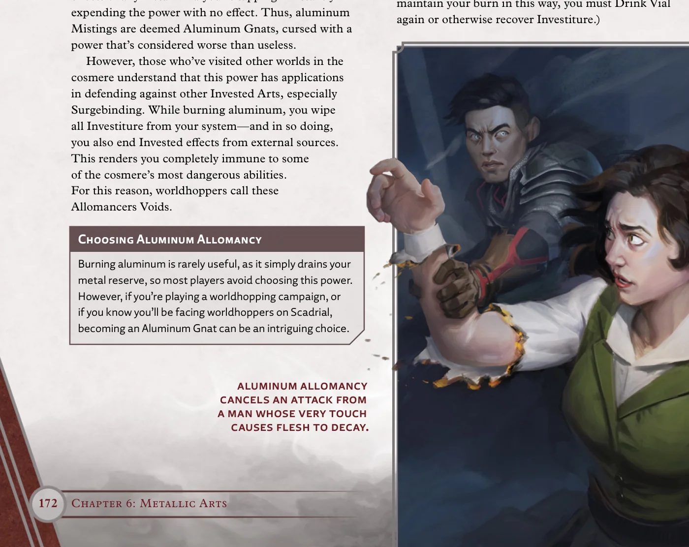
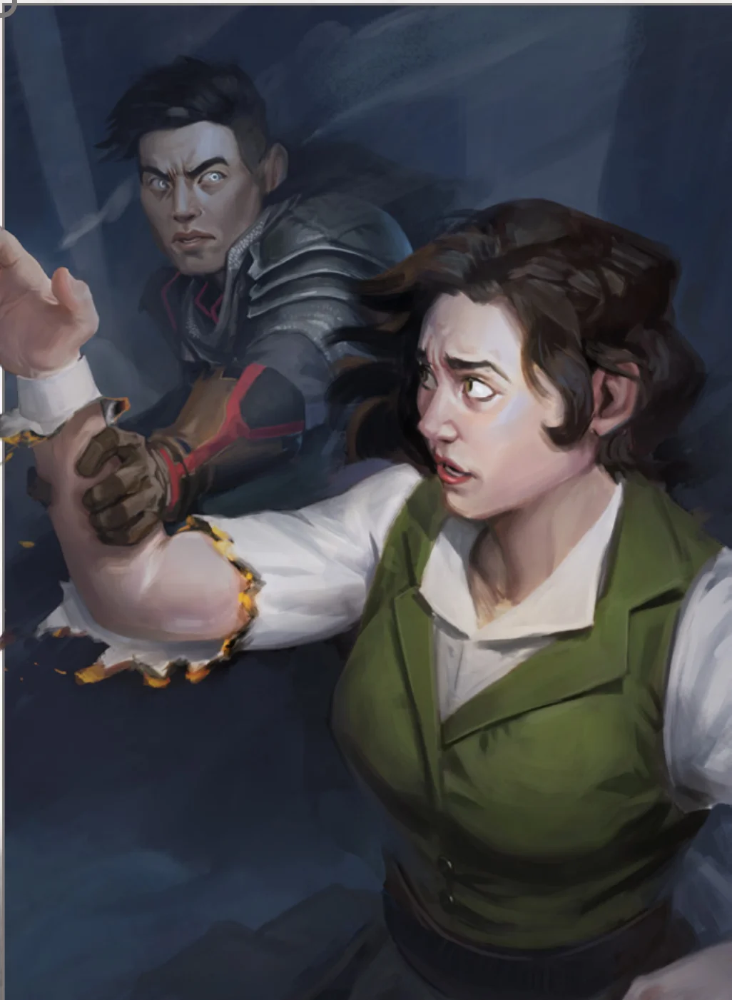

### 鋁鎔金術（Aluminum Allomancy）

增強（Enhancement）—內部（Internal）—拉引（Pulling）

在司卡德利亞（Scadrial）人看來，除非還能使用其他金屬技藝（Metallic Arts）能力，否則鋁鎔金術沒有任何效果……即使能使用其他能力，它的效果也被認為全是負面的。燃燒鋁（Aluminum）會清空你所有金屬的儲備，包括你正在汲取（Tap）的任何金屬意識庫（Metalmind）效果，瞬間耗盡力量，卻不產生效果。因此，鋁迷霧人（Misting）被稱為鋁蟲（Aluminum Gnat），彷彿遭到詛咒，得到一種被認為比毫無用處還糟的能力。

然而，造訪過寰宇（Cosmere）其他世界的人明白，這種力量能抵禦其他授予之術（Invested Arts），尤其是封波術（Surgebinding）。燃燒鋁時，你會清除體內所有授予（Investiture），同時終止外部來源施加的授予效果。這讓你能完全免疫寰宇中某些最危險的能力。因此，躍界者（Worldhopper）將這些鎔金術師（Allomancer）稱為虛無（Void）。

#### 選擇鋁鎔金術

燃燒鋁只是耗盡金屬儲備（Metal Reserve），很少派得上用場，因此多數玩家不會選擇這種能力。然而，如果你正在進行跨世界的戰役（Campaign），或已知將在司卡德利亞面對躍界者，成為鋁蟲也可能是有趣的選擇。

#### 燃燒鋁（Burn Aluminum）

啟動（Activation）：[1行動]

持續時間（Duration）：1 回合（Round）

花費 1 授予燃燒鋁，啟動下列效果，直到你的下一個輪次（Turn）結束：

- 你的授予降至 0。

- 在持續時間內，你的其他能力陷入耗竭（Depleted），即使使用飲用金屬液（Drink Vial）行動（Action），或以類似方式恢復授予，也仍然如此。

- 如果你正在汲取金屬意識庫，或花費其中的充能（Charge），該金屬意識庫的充能會降至 0，且不產生效果。

- 你終止自己身上的所有授予效果，例如其他迷霧之子（Mistborn）能力，或颶光（Stormlight）波力（Surge）的效果，如重力（Gravitation）波力的基本捆術（Basic Lashing）。

- 授予能力無法向你體內注入力量，你也免疫那些必須向你體內注入授予，才能發揮作用的授予效果，例如分裂（Division）波力。然而，這份保護不涵蓋你穿戴或持用的物品。

此次鋁燃燒結束前，你可以花費 [自由行動] 和 1 授予，將它維持相同的持續時間。（燃燒鋁會清除你的所有授予，因此若要如此維持燃燒，就必須再次飲用金屬液，或以其他方式恢復授予。）

*鋁鎔金術抵消了一名男子的攻擊，他只要碰觸就能使血肉腐朽。*

上方：AUSTIN HARTELL；下方：CARSON DANIEL

第 6 章：金屬技藝 172

