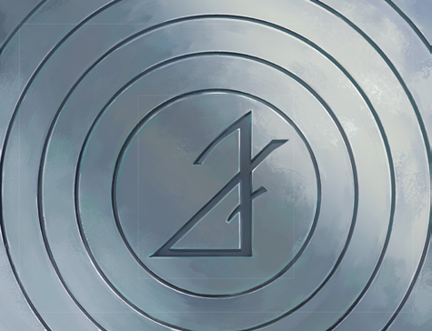

### 鋁藏金術（Aluminum Feruchemy）

身分（Identity）—靈魂金屬（Spiritual Metal）

鋁藏金術讓你將靈魂身分（Spiritual Identity）儲存在鋁意識（Aluminummind）中。在《迷霧之子》（Mistborn）的兩個時代裡，擁有這種能力的人俗稱真我（Trueself）。他們在鋁意識中儲存（Store）或汲取（Tap）身分時，其實並不清楚自己正在做什麼，只能透過實驗，辨識出一些基本效果。儲存身分時，你更容易受到外來影響，尤其是安撫（Soothe）、煽動（Riot）等授予能力。汲取身分時，無論以授予能力或普通手段，都極難影響你。據信，如果真我從金屬意識庫（Metalmind）汲取足夠的身分，即使面對神明的意志，也能堅定不移。

### 儲存身分（Store Identity）

啟動（Activation）：[1行動]　持續時間：每個場景（Scene）1點充能（Charge）

持續儲存身分，直到你以[自由行動]結束效果，或花費鋁意識的一點充能為止。儲存身分期間，你會受到下列效果：

- 你抵抗影響（Resisting Influence）時，需要額外花費1點專注點（Focus）。

- 你的靈魂防禦（Spiritual Defense）降低2。

每當一個場景結束，而你在整個場景中都持續儲存身分時，你的鋁意識便獲得1點充能。

### 汲取身分（Tap Identity）

啟動：[1行動]　持續時間：與你的藏金術（Feruchemy）技能等級（Rank）相同數量的回合（Round）

花費1點充能，汲取身分，持續與你的藏金術技能等級相同數量的回合，或直到你開始儲存身分為止。持續期間，你會受到下列效果：

- 你抵抗影響時，需要花費的專注點減少2點。

- 你的靈魂防禦提高4。

身分汲取結束前，你可以用[自由行動]花費鋁意識的1點充能，將其維持相同的時間。

### 運用鋁藏金術

除了上述能力規則，運用這項能力時，也可以參考以下指引。

### 創意運用

除了直接效果之外，人們對鋁藏金術仍所知甚少，就連研究藏金術本質超過1,500年的泰瑞司（Terris）社群也不例外。儲存及汲取身分會與其他能力產生奇異、難以預料的互動，甚至會影響其他世界的授予之術（Invested Arts）。我們鼓勵你自行發想這項能力的創意用途，並與GM討論如何判定。例如，儲存身分可以帶來下列效果：

- 讓盟友（Ally）更容易以鋅鎔金術（Zinc Allomancy）煽動你。

- 在意志薄弱的時刻，抵抗屈服於內在障礙（obstacle）的衝動。

- 讓魂印（Soulstamp）的偽造術（Forgery）更容易在你身上生效。

- 如果你是燦軍（Radiant），或許能讓你對另一名燦軍的灌注效果（infusion），使用自己的颶光回收（Stormlight Reclamation）天賦（talent）。

### 鋁藏金術天賦

以下依英文字母順序列出的天賦，都出現在鋁藏金術天賦樹（talent tree）中。你可以透過單藏金術師（Ferring）、雙生師（Twinborn）與藏金術師（Feruchemist）路徑（Path）的關鍵天賦（Key Talent），或透過血金術尖刺（Hemalurgic Spike），解鎖這棵天賦樹。

第6章：金屬技藝（Metallic Arts）　213

JANETTE RAMOS

### 精於內省（Adept Introspection）

前提條件（Prerequisite）：洞察（Insight）2+；鋁藏金術能力

啟動：[特殊啟動]

你並非不曾犯錯，但透過誠實的自我檢視，能克服難以處理的情緒，以更具建設性的心態繼續前進。

汲取身分期間，你的偏轉值（Deflect）也適用於靈魂傷害（Spirit Damage）。此外，即使你沒有汲取身分，也對自己有深刻的認識。完成一次長休息（Long Rest）後，你可以放棄通常的休息收益，改為獲得完成自省（Self-Reflection）休整期（Downtime）活動的收益，而且不必花錢。

### 核心動力（Core Drive）

前提條件：鋁藏金術能力

啟動：[常駐]

你以自身最根本的特質為依歸，更容易專注於真正重要的事。

汲取身分期間，在你的每個輪次（Turn）結束時，若你在該輪次中的行動符合自己的核心目的（purpose）、內在障礙，或某個短期目標（goal），便恢復1點專注點，由GM判定。

### 不動搖的本質（Unshakable Quintessence；原書天賦樹拼作 Unshakeable Quintessence）

前提條件：藏金術3+；精於內省天賦

啟動：[特殊啟動]

一次汲取大量身分，讓你能抵抗寰宇（cosmere）中幾乎任何影響。

當你汲取身分時，可以不按通常方式花費1點充能，而是改為花費任意數量的充能，最多不超過你的金屬技藝上限（Metallic Art Limit）。這麼做時，放棄該行動（Action）通常提供的效果，改為獲得下列好處，直到你的下一個輪次結束：

- 抵抗影響時，費用減少的點數等於1加上你為汲取身分花費的充能點數。

- 你的靈魂防禦提高的數值，等於2加上你為汲取身分花費的充能點數的兩倍。

- 對你靈魂防禦發動的攻擊（Attack），無法對你造成擦傷（Graze）。

這次身分汲取結束前，你可以用[自由行動]花費至少1點充能，將其維持相同的時間。

這名真我的鋁意識，也能用來防範情緒鎔金術（Emotional Allomancy）。

### 鋁藏金術天賦樹

**天賦連線**

| 天賦 | 解鎖來源 | 啟動 | 額外前提 |
| --- | --- | --- | --- |
| [精於內省](#精於內省) | 鋁藏金術能力 | 特殊啟動 | 洞察2+ |
| [核心動力](#核心動力) | 鋁藏金術能力 | 常駐 | — |
| [不動搖的本質](#不動搖的本質) | 精於內省 | 特殊啟動 | 藏金術3+ |

#### 精於內省

啟動：[特殊啟動]

前提條件：洞察2+

解鎖來源：鋁藏金術能力

放棄一次長休息，獲得自省的休整期收益。此外，汲取身分期間，你的偏轉值適用於靈魂傷害。

#### 核心動力

啟動：[常駐]

解鎖來源：鋁藏金術能力

汲取身分期間，若某個輪次中的行動符合你的核心目的、內在障礙或短期目標，便在該輪次恢復1點專注點。

#### 不動搖的本質

啟動：[特殊啟動]

前提條件：藏金術3+

解鎖來源：精於內省天賦

汲取身分時花費額外充能，縮短持續時間並增強效果，且對靈魂防禦發動的攻擊無法對你造成擦傷。

第6章：金屬技藝　214

VALERIA CASALE

